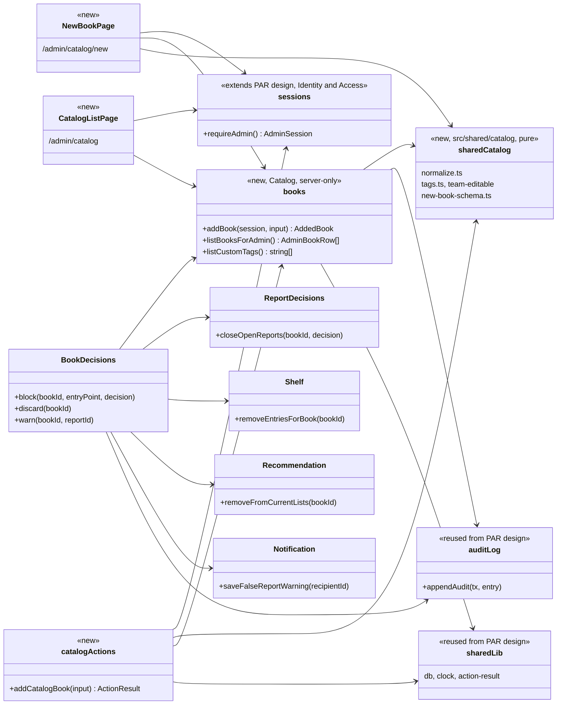
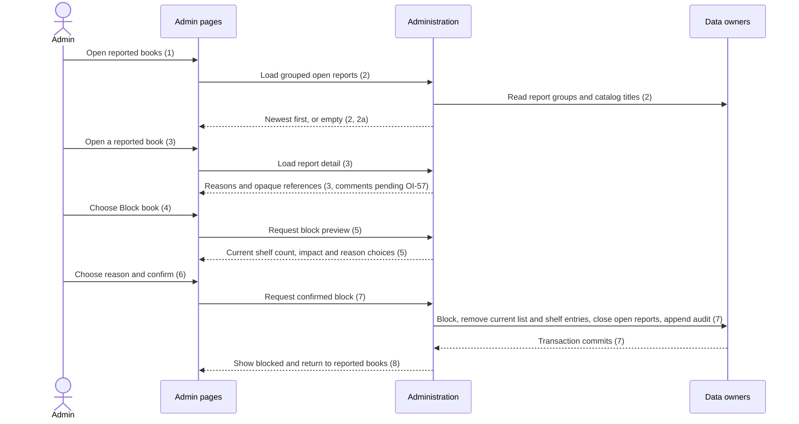
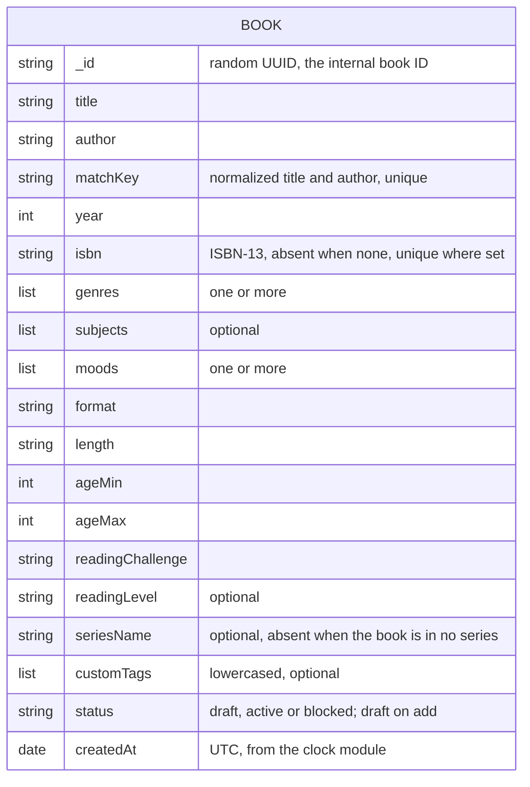

# Administration (ADM) Design

**Project:** BookBuddies
**Team:** Team 05
**Area:** `UC-ADM`

> **Realizes:** `UC-ADM-add-content`, `UC-ADM-block-content`, `FR-ADM-report-review`, `FR-ADM-catalog`, `FEAT-book-tagging`, `FEAT-admin-catalog`
> **Depends on:** `DI-book-id`, `DI-book-tags`, `DI-catalog-status`, `DI-field-tables`, `SAF-child-content`, `SEC-role-authorization`, `SEC-pii-boundary`, `AS-seed-catalog-size`, `KD-catalog-import-offline`, `KD-auth-sessions`, `BR-admin-limited-view`, `BR-reading-level-proxy`, `BR-kid-no-metrics`, `BR-parent-report-book`, `UC-PAR-report-book`, Notification (architecture §5.2)
> **See:** [use cases, ADM area](../docs/requirements/use-cases.md#uc-adm-add-content-add-a-book-to-the-seed-catalog), [specification](../docs/requirements/software-requirements-specification.md), [business rules](../docs/requirements/business-rules.md), [glossary](../docs/requirements/project-glossary.md), [architecture-of-record](architectural-design.md), [PAR design](par.md), [field values](adm-field-values.md)
> **Designed against:** `d8beec6` for add-content and `f9b6fa2` for block-content.

---

## Overview

The Administration area owns the admin's work on the catalog and the system ([containers](architectural-design.md#51-containers), [use case areas and components](architectural-design.md#52-use-case-areas-and-components)). `UC-ADM-add-content`, the first use case designed here, lets an admin add one book with its tags. The book lives in the Catalog, a cross-cutting component that owns books, tags, catalog status and custom tags (architecture §5.2), so this design also defines the Catalog's `books` collection, its indexes and its first write path. The admin supplies the book's details; the server validates them, saves the book as `draft`, and records the add in the audit log in the same transaction. A book is never active at save: it becomes active only when an admin publishes it through `UC-ADM-edit-content` (`OI-43`). The system makes no outside call and no child record is read or written, so the Child Identity Store is not involved and the admin's boundary (`BR-admin-limited-view`) is untouched. A book added here is bulk-import-compatible: the same fields, keys and checks are the ones the catalog import will use (`KD-catalog-import-offline`), and the validation and normalization code is a shared module the import can call.

`UC-ADM-block-content` adds the reported-books queue and the catalog block control. Administration coordinates the decision. Catalog owns the book status, Accounts & Family owns reports and per-child exclusions, Shelf owns shelf entries, Recommendation owns list entries, and Notification delivers the false-report warning. The design builds on the Catalog contract in this file, Catalog's existing `findActiveBookIds` read, the report contract in #110, and the separate shelf, rating and finish records in [shlf.md](shlf.md).

## Components & classes

Paths follow §8.2.3 and §8.2.4. The original add-content section marks files that were new when it was written. The shared files named below are created by whichever use case (PAR, REC or ADM) is built first.



- `src/app/(admin)/admin/catalog/page.tsx` (new): the catalog list of step 7. It calls `requireAdmin()` and shows every stored field of every book (the demo decision: the admin sees the whole record), blocked books included, newest first (`createdAt` descending, then ID, so the order is stable). No filter or pagination, because the seed is 134 books (`AS-seed-catalog-size`). The "Add Book" button of step 1 is here.
- `src/app/(admin)/admin/catalog/new/page.tsx` (new): the form of steps 1 to 3. It calls `requireAdmin()`, shows the standard tag fields from `tags.ts`, and offers the existing custom tags from `listCustomTags()`. The ISBN field has a "This book has no ISBN" checkbox beside it. It shows an inline error for each failed field and, for a suggested age outside 0 to 21, a warning that does not block the save. Cancel (3a) is a link back to the list and calls nothing. On a duplicate (5a) it shows the action's message, which names the existing book (see Key decisions). Its "open it" link points at `/admin/catalog/[bookId]`, a route that belongs to `UC-ADM-edit-content`; the link is left out until that route exists. The submit button is disabled while pending, and every entry stays in the form after a failed save.
- `src/app/(admin)/admin/access.ts` (new): `requireAdminPage()`, which redirects to sign-in with no session and calls `forbidden()` otherwise; `src/app/forbidden.tsx` is the fixed "Not authorized" page (`experimental.authInterrupts` in `next.config.ts`). `src/app/(admin)/admin/catalog/new/actions.ts` (new): `addCatalogBook`. In order (§8.2.3): `requireAdmin()`, zod validation with `buildNewBookSchema({ tags, now: now() })`, then `addBook`. The admin comes from the session, never from the request. Unknown request fields, including any `status`, are stripped by the schema. On success it revalidates the list and the form redirects to `/admin/catalog` (step 7).
- `src/shared/catalog/normalize.ts` (new, **pure**): `normalizeCustomTag`, `normalizeIsbn`, `buildMatchKey` and `normalizeText`, with the exact steps in Key decisions. The catalog import calls the same functions.
- `src/shared/catalog/tags.ts` (new, **team-editable**, pure): the approved value lists for genre, subjects, mood, format, length and reading challenge, the accepted reading-level formats and the limits, filled from [adm-field-values.md](adm-field-values.md). One value per line, so adding a value later is a one-line change.
- `src/shared/catalog/new-book-schema.ts` (new, **pure**): `buildNewBookSchema({ tags, now })` returns the one zod schema for form and action (§8.2.5), and `ageWarning(ageMin, ageMax)` returns the 0 to 21 warning. The module has no database, clock, session, `server-only` or Node-only import: the action passes the server's `now()`, and the browser passes its own date for an early check only. The server check is the one that counts. The schema trims text, normalizes each custom tag, removes duplicates among them, then checks length and count; it normalizes the ISBN; and it returns the first failing field in form order: title, author, year, ISBN, genres, subjects, moods, format, length, age min, age max, reading challenge, reading level, custom tags (the code identifies the field, since §8.2.1 has no field slot). Within one field, "required" is checked before "format". A title or author that is empty after normalization counts as empty.
- `src/server/catalog/books.ts` (new, server-only): the only code that touches `books`. `addBook` gets its collection from one function, `booksCollection(db)` (in `books-collection.ts`, so tests can replace it), which is the test seam (see Tests). It builds the `matchKey`, sets status `draft` and `createdAt` from `now()`, generates the book ID, and runs the insert and the audit entry through the driver's `withTransaction`, which retries transient write conflicts, with `timeoutMS: 5000` on the call (the driver's client-side operation timeout; if the installed driver version lacks it, use `maxCommitTimeMS: 5000` and accept the driver's default retry window). Any error that escapes `withTransaction` goes to `classifyInsertError` (see Key decisions). `listBooksForAdmin` returns every book including blocked ones with every stored field, and is the only Catalog read that does. `listCustomTags` returns the distinct custom tags across all books, sorted. Every other Catalog read, which other designs add, excludes blocked books and omits `customTags` and `readingLevel` by projection, except `listRuleCandidates`: that Recommendation-only read may load `readingLevel` internally but returns only normalized `comparableLevels`, omitting the raw annotation and `customTags` as fixed below.
- `src/server/identity-access/sessions.ts` (PAR's file, extended): adds `requireAdmin()`, which returns `{ userId, role: "admin" }` from the Auth.js database session and refuses any other role, including a Main Parent, a Sub Parent and a child (`KD-auth-sessions`). With no session, a page redirects to sign-in and the action returns `NOT_SIGNED_IN`. With the wrong role, a page ends with HTTP 403 and a fixed "Not authorized" page that names nothing else, and the action returns `NOT_AN_ADMIN`; the pages use Next.js `forbidden()` if the installed version supports it, otherwise ask before choosing another way.
- `src/server/audit/audit-log.ts`, `src/server/lib/db.ts`, `clock.ts`, `action-result.ts` and `src/server/setup/ensure-indexes.ts` (new if not yet built, otherwise reused): the append-only audit function, the one Mongo client, the settable clock, the result helper and the idempotent index setup, which gains the two `books` indexes. [par.md](par.md) fixes only `appendAudit(tx, entry)`; this design defines the entry: `{ event, actorId, actorRole, recordId }`, with the time (`occurredAt`) set inside `appendAudit` from `now()`. As built, `event` and `occurredAt` keep the names the note-flag audit already uses.

- `src/app/(admin)/admin/reports/page.tsx` and `reports/[bookId]/page.tsx` (new): queue and report detail. Admin checks run server-side. The queue groups open reports before joining Catalog, sorts by the most recent open report (book ID breaks ties), and shows title, count and reasons. Detail shows reasons and opaque references from the report projection. Missing references are shown as unavailable. Step 3's comment display is deferred pending `OI-57`; it should render approved comment text as text once that decision is made.
- `src/app/(admin)/admin/catalog/page.tsx` (catalog list from #83): add a **Block book** button on eligible rows. It opens the shared confirmation dialog with the book and current shelf count. After a Catalog block, return to the catalog list and show the updated status.
- `src/server/administration/book-decisions.ts` (new): coordinates block, discard and warning. Each write passes one MongoDB session to the owning components. Reuse `requireAdmin`, the shared result helper, `now()`, and the Catalog and Audit interfaces from the add-content design (#108 is the pending implementation). The coordinator does not query another component's collections.
- Owners provide narrow operations: Catalog reads block metadata and conditionally blocks the book, Accounts & Family groups and closes reports, Shelf counts and deletes entries by book ID, Recommendation removes the book from stored current lists, and Notification creates the in-app warning for the report's recorded recipient. Audit appends the decision with IDs only.

## Sequence

### UC-ADM-add-content: add a book to the catalog

```mermaid
sequenceDiagram
    actor A as Admin
    participant UI as Add Book page
    participant ACT as addCatalogBook
    participant IA as Identity & Access
    participant CAT as Catalog
    participant DB as Database
    A->>UI: Tap "Add Book" (step 1)
    UI->>IA: requireAdmin()
    alt not an admin (1a)
        UI-->>A: 403 Not authorized, nothing else shown
    end
    UI->>CAT: listCustomTags()
    UI-->>A: Form with standard tag fields and existing custom tags (step 2)
    alt Admin cancels (3a)
        Note over UI: No server call, nothing saved
    end
    A->>UI: Enter details, choose tags, add custom tags, submit (step 3)
    UI->>ACT: addCatalogBook(fields)
    ACT->>IA: requireAdmin()
    alt not an admin (1a)
        ACT-->>UI: NOT_AN_ADMIN
    end
    ACT->>ACT: Validate with buildNewBookSchema({ tags, now() }), normalize custom tags and ISBN (step 4)
    alt a field fails (4a, 4b, 4c, 4e, 4f, 4g, 4h)
        ACT-->>UI: The field's error code
    end
    ACT->>CAT: addBook(session, input)
    CAT->>DB: withTransaction (retries transient conflicts, 5 s limit)
    CAT->>DB: Insert book as draft; the unique indexes are the check (steps 5, 6)
    CAT->>DB: Append audit entry catalog.book_added, IDs only (step 6, POST-3)
    alt duplicate key, error 11000 (5a)
        DB-->>CAT: abort
        CAT->>DB: Read the matching book by the error's keyPattern, outside the transaction
        CAT-->>ACT: BOOK_ALREADY_EXISTS, message names the existing book
    else any other failure (6a)
        DB-->>CAT: abort
        CAT-->>ACT: SAVE_FAILED
    end
    CAT->>DB: Commit
    CAT-->>ACT: book ID
    ACT-->>UI: ok
    UI->>CAT: listBooksForAdmin()
    UI-->>A: Catalog list showing the new book as draft (step 7)
```

Step 4a's required fields and step 4d are in the schema: 4d is not an error, because a custom tag that matches an existing one after normalization is simply stored as that one tag, and the form's existing-tag list is what "offers the existing tag". Step 4i is a warning in the form only; the server never rejects an age for being outside 0 to 21.

### UC-ADM-block-content: block a catalog book



The catalog entry point joins at step 5 (1a). Cancellation calls no write. Warn and discard use their own confirmations and return to report detail and the queue respectively (3a, 4a).

## API contract

| Endpoint or job | Caller (who may) | Request | Success | Errors, by extension |
|---|---|---|---|---|
| Page `/admin/catalog` (UC-ADM-add-content step 7) | A signed-in admin | None | Every book with every stored field | Not an admin: HTTP 403, "Not authorized" (1a). No session: redirect to sign-in |
| Page `/admin/catalog/new` (UC-ADM-add-content steps 1 to 3) | A signed-in admin | None | The form, the approved tag lists, the existing custom tags | Same |
| Server action `addCatalogBook` (UC-ADM-add-content) | A signed-in admin; the admin comes from the session | Title, author, year, ISBN (or the "no ISBN" box ticked), genres, subjects (or none), moods, format, length, age min, age max, reading challenge, reading level (or none), custom tags (or none) | `ok` with the new book's ID. The status is not in the request and is always `draft` | 1a: `NOT_SIGNED_IN`, `NOT_AN_ADMIN`. 4a: `TITLE_REQUIRED`, `AUTHOR_REQUIRED`, `YEAR_REQUIRED`, `TAG_REQUIRED` (the message names the field). 4b: `INVALID_TAG` (the message names the list). 4c: `INVALID_YEAR`, `INVALID_AGE_RANGE` (min above max only), `INVALID_READING_LEVEL`. 4e: `INVALID_CUSTOM_TAG`. 4f: `INVALID_ISBN`. 4g: `TOO_MANY_CUSTOM_TAGS`. 4h: `ISBN_CHOICE_REQUIRED`. 5a: `BOOK_ALREADY_EXISTS`, whose message names the existing book's title, author, year and status. 6a: `SAVE_FAILED`, whose `errorId` field (the shared helper's, §8.2.1) carries an error ID, nothing stored. Also `TITLE_TOO_LONG`, `AUTHOR_TOO_LONG` and `INVALID_AGE` (a negative or non-whole age), added during the build. 3a, 4d and 4i are not errors |
| Reported books pages `/admin/reports` and `/admin/reports/[bookId]` (block-content 1–3) | Admin | Book ID for detail | Grouped queue or report detail. Detail includes the book's current status and existing block reason when blocked. | Signed out or non-admin refused (§8.1). Unknown book: not found. Empty queue: empty state (2a). Read failure: retry message. |
| Block preview (4–5, 1a) | Admin | Book ID and entry point | Title, status, current shelf entry count and reason choices. An already blocked book returns its recorded reason and, on the reports path, offers **Close as blocked**. Read only. | Unknown book or read failure: no confirmation. A blocked catalog book shows its recorded status and reason. |
| `blockCatalogBook` (7, 1a, 4b) | Admin | Book ID, entry point and confirmation. Decision is either **Block book** with a reason or **Close as blocked** without a reason (reports path only). | `BLOCKED` or `ALREADY_BLOCKED` with the stored status and reason. Only the reports path closes open reports. | `BOOK_NOT_FOUND`, `NO_OPEN_REPORTS` if the reports path lost its last report before a new block, `INVALID_REASON`, `CONFIRMATION_REQUIRED`, or `BLOCK_FAILED`. If the book is no longer blocked when **Close as blocked** is submitted, return `BOOK_STATUS_CHANGED` and refresh the preview. |
| `discardBookReports` (4a) | Admin | Book ID and confirmation | Closes still-open reports as discarded and returns to the queue. An empty repeat is a no-op. | `BOOK_NOT_FOUND`, `CONFIRMATION_REQUIRED`, `REPORT_DECISION_FAILED`. |
| `warnReportingParent` (3a) | Admin | Book ID, report ID and confirmation | Discards that open report and saves one in-app warning for its reporter. | `REPORT_NOT_OPEN` for stale or mismatched report, `REPORTER_UNAVAILABLE` if the recipient is gone, `CONFIRMATION_REQUIRED`, or `REPORT_DECISION_FAILED`. |

Adding a book reaches no parent or child screen. A block changes what they see on the next load. After warning a parent, the admin returns to the book's report detail. If that was the last report, the detail shows no open reports and a link back to the queue.

## Key decisions

**The duplicate check is the unique indexes, not a read before the insert.** Steps 5 and 6 are one insert against a unique `matchKey` and a unique ISBN-13. Rejected: "check, then insert", which lets two admins add one book at the same moment and leaves two copies (`DI-book-id`, `FR-ADM-catalog`).

**A duplicate-key error is told apart from every other failure by one classifier.** `addBook` runs inside `withTransaction`, so a transient write conflict is retried by the driver and never reaches the classifier. `classifyInsertError` then maps MongoDB error 11000 to `BOOK_ALREADY_EXISTS` and everything else to `SAVE_FAILED`, with no further retry. For 11000 it reads the matching book outside the transaction: by the field in the error's `keyPattern`, and if `keyPattern` names both fields or neither, ISBN first (when the new book has one), then `matchKey`. If no book is found the result is `SAVE_FAILED`. The loser of two concurrent adds gets `BOOK_ALREADY_EXISTS`, not `SAVE_FAILED`. Rejected: treating a write conflict as a failure, which would report a duplicate as a save error.

**The existing book and the error ID travel in `message`, not in an extra field.** §8.2.1 fixes the error as `{ code, message }`. The page only displays them, never branches on them, so a sentence such as "This book is already in the catalog: <title> by <author> (<year>), status <status>" is enough, and the response stays admin-only. The error ID in `SAVE_FAILED` is likewise in the message. If `UC-ADM-edit-content` needs the existing book's ID for the "open it" link, that design adds a field then. Rejected: widening the shared error type for one caller.

**A blocked or draft book counts as a duplicate.** The indexes cover every status. Rejected: ignoring blocked books, which would let an admin re-add a blocked book as a new one and bypass the block (`SAF-child-content`).

**`seriesName` is an optional field that the catalog import fills from the seed spreadsheet's "Series name (optional)" column.** It is absent, never an empty string, when the cell is empty. The child's shelf reads it (`design/shlf.md`, `getBooksForShelf`). The add form does not offer it, because `UC-ADM-add-content`'s data table does not list it; a later `UC-ADM-edit-content` design can add it. It takes no part in `matchKey` or the ISBN check, so it cannot cause a duplicate.


**The ISBN is optional, stored as ISBN-13 digits only, and omitted when there is none.** `normalizeIsbn` strips hyphens and spaces, validates the check digit (an `X` counts as 10 in an ISBN-10), and converts an ISBN-10 by adding the 978 prefix and recomputing the check digit. To save without an ISBN the admin must tick "This book has no ISBN"; leaving the field empty with the box unticked, or filling it and ticking the box, is `ISBN_CHOICE_REQUIRED`. The box is a request field only, not stored; a book with no ISBN has no `isbn` field at all, never `null` or an empty string, so the partial unique index ignores it. Rejected: storing what was typed, because one book entered once as ISBN-10 and once as ISBN-13 would pass the duplicate check.

**`buildMatchKey` folds case, spacing, accents and punctuation, with these exact steps.** `normalizeText` applies, to the title and to the author separately: Unicode NFKC; `toLowerCase()`; NFD, then remove combining marks (`\p{M}`); remove punctuation (`\p{P}`, which includes straight and curly apostrophes and quotes); collapse each run of whitespace to one space; trim. `buildMatchKey` joins the two results with the unit separator U+001F, which no entered text contains, so ("a b", "c") and ("a", "b c") cannot collide. The import calls this same function. Expected results are in the Tests table. Accepted: "Spider-Man" and "Spiderman" are one book, and "Spider Man" is not. Rejected: fuzzy or phonetic matching, which would reject real different books and which no requirement asks for.

**A new book is always saved as `draft`, and the form never sets the status.** `DI-catalog-status` and the use case say a new entry starts as draft, and only an active book can be recommended. The team decided on 2026-11-17 that a draft becomes active only when an admin explicitly publishes it through `UC-ADM-edit-content` (POST-2), so no added book is recommendable until then, and the use case's old 6b is gone. Add never produces `active` or `blocked`. The client's confirmation is `OI-43`. Rejected: an admin-chosen status, and deriving active at save.

**Custom tags are stored on the book, lowercased, with no plural merging, and the existing list is derived from the books.** `listCustomTags` takes the distinct values. The schema normalizes each tag, removes duplicates, checks each length (1 to 30), then counts (at most 10), so one tag typed twice is one tag and never a wrongful `TOO_MANY_CUSTOM_TAGS`; this is safe because the stored value is the normalized one. Rejected: a separate custom-tag collection, which is a second source of truth and would need a paired write to stay in step.

**No read for a child, a parent or a search returns custom tags or the reading level; Recommendation has one server-only exception.** Every non-admin Catalog read omits `customTags` and `readingLevel` by projection, except `listRuleCandidates` for `UC-REC-recommend-quiz-rules`. That Catalog-owned function may read the raw `readingLevel` annotation internally, but returns only normalized numeric `comparableLevels` (`lexile` and/or `arAtos`) to Recommendation, never the raw string and never `customTags`. It is not a page, child or parent API, and no returned difficulty value is displayed or stored in the batch. `BR-kid-no-metrics` says a book's reading level is never shown to children, and §8.2.11 makes leaking an admin's private label the costly guess; whether children see custom tags is open in the use case. The reading level remains an admin-set difficulty input (`BR-reading-level-proxy`) stored as typed. Rejected: returning the raw annotation, which would expose the admin label and make Recommendation parse Catalog's storage format; and returning every field.

**Validation lives in a pure shared module under `src/shared/catalog/`.** The browser, the server action and the import script all need the same checks. The module takes the date and the value lists as arguments and imports no server code, so it can ship to the browser and nothing can be bundled the wrong way; §8.2.4 now allows pure `src/shared/` modules. The browser's date gives an early year check only. Rejected: `server-only` validation code, which the browser cannot run, and a second copy for the browser, which would drift.

**Age is a warning, never a rejection.** A suggested age outside 0 to 21 is a warning in the form (`ageWarning`); the server accepts any whole number that is not negative. The one hard check is min above max, because that range cannot describe a book. Rejected: refusing old classics or adult books on age alone.

**The book and its audit entry are one transaction.** The use case's POST-3 and §8.2.9 ("admin catalog changes") require the audit entry, and §8.2.8 requires paired writes to be atomic. The entry is `catalog.book_added`, with the admin's user ID and role and the book ID, nothing else. Rejected: logging the add, which §8.2.9 says is not an audit.

**The book ID is a random UUID string.** Rejected: an ObjectId, which embeds its creation time and is sequential within a process, so it is not opaque (`DI-book-id`).

**Data access uses the native MongoDB driver, with no Mongoose.** The team decided this on 2026-11-18 (`docs/Team_Decisions.md`, §8.2.4), and it binds PAR and REC too. The design needs `withTransaction`, partial unique indexes and a `$jsonSchema` validator, all of which the driver gives directly, and the driver is needed either way, so the native choice adds no second dependency. Mongoose would add a layer whose own schema would duplicate the validator and the zod schema. A person still confirms the `mongodb` package before it is added (`CLAUDE.md`). Rejected: Mongoose.

**Tests reach failures through one seam, `booksCollection(db)`.** Integration tests wrap the real collection in a `Proxy` whose `insertOne` throws a chosen error: a plain `Error` for a non-duplicate failure, and a `MongoServerError` with code 11000 and a `keyPattern` for a duplicate. The audit failure is a `vi.mock` of `appendAudit` that throws. The tests run against the in-memory replica set (§8.2.10), so the transaction is real. Rejected: forcing failures with server fail points, which the in-memory server may not allow.

**The tag value lists are one team-editable file.** `tags.ts` is filled from `adm-field-values.md` (agreed 2026-11-17), following the `par-field-values.md` pattern, one value per line so a value is easy to add. An in-app screen for admins to edit the lists is not built; it would be its own use case. Rejected: inventing the lists in the design, which `DI-field-tables` forbids for TBD values.

**A non-admin gets HTTP 403, not 500.** A 500 reads as a server fault and would raise an error ID and a log line for an expected refusal; 403 says "not allowed" and the page shows nothing else.

**The catalog list shows every stored field.** The admin sees the whole record, including custom tags and reading level; parents see only title and author (`listPickerBooks`, `design/rec.md`). No filter, no detail page, no block, edit or publish controls. Those belong to `UC-ADM-edit-content`, `UC-ADM-block-content` and `UC-ADM-unblock-content`. Rejected: building a detail page here for 5a's "open it instead", which would be that use case's page without its design.

### Blocking and report decisions

**Block or close as blocked.** A new block can start from `draft` or `active`. The server accepts the reasons `age-inappropriate`, `content concern`, `data error` and `other` (step 6, `OI-56`). On the reports path, a confirmed decision closes open reports for that book at commit. If the book is already blocked (4b), keep its stored reason, actor and time and close only those reports. The UI shows the stored status and reason from the successful `ALREADY_BLOCKED` response. The catalog path leaves reports open. Opening a preview makes no changes.

**Save a block in one transaction.** Change the status and record the block on the book. Remove every Shelf entry by book ID and every occurrence in current Recommendation lists, including batches under parent review or already released. Preserve ratings, finish confirmations, finish notes, historical signals and per-child exclusions. Search, recommendation reads and shelf delivery filter by current Catalog status. An open page updates on the next load (7b). A global block sends no removal notices.

**Check races with the owning use cases.** Catalog's active-book read in #110 refuses a book already blocked at confirmation with `BOOK_NOT_FOUND`. If a block removes the last eligible shelf or batch row before the report can save, #110 returns `NOT_ON_SHELF_OR_BATCH`. Extension 4b handles reports already open on a blocked book, for example after a catalog block. A MongoDB snapshot read can see an earlier status. ADM, Shelf and Recommendation must settle the write contract in `OI-58` before implementation. The proposed contract is a conditional write on the Catalog book while its status is active, in the same transaction as each shelf or current-list insertion. It conflicts with the block's status write. The team needs to confirm the write cost for popular books and the affected write paths. See [MongoDB's transaction considerations](https://www.mongodb.com/docs/manual/core/transactions-production-consideration/#in-progress-transactions-and-stale-reads). The edit-content design should account for a block racing an edit or publish.

**Send one warning for an open report.** Use the recipient stored on the report. Update that report from open to discarded, save the warning and append its audit entry in one transaction. Proposed text: “False reports are not allowed and may lead to your account being suspended.” The parent sees it in the authenticated in-app Notification view (architecture §5.2). That view is a dependency for 3a. The warning goes to the recorded reporter only while `OI-56` is open. If the account is unavailable, return `REPORTER_UNAVAILABLE` and leave the report open. The admin can still discard the book's reports or close them by blocking. Suspension is its own use case.

**Audit confirmed decisions.** Use `catalog.book_blocked` and `report.discarded` with the book ID as `recordId`, and `report.parent_warned` with the report ID as `recordId`. Each record includes the admin's `actorId`, `actorRole` and UTC `occurredAt`, following #108's proposed audit shape. When 4b closes at least one open report, append `report.closed_as_blocked` with the book ID in the same transaction as the report update (§8.2.9). If there are no open reports, the repeat writes no audit entry. Keep comments out of audits, warnings and logs. Apply these event entries to the shared validator once #107 and #108 settle its shape. If commit cannot be confirmed, ask the admin to refresh before retrying and reload the current state.

## Data model

New collection `books` (Catalog). One document per book, written by one transaction together with its audit entry.



- Indexes, created by `ensure-indexes.ts`: unique on `matchKey`; unique on `isbn`, partial with the filter `{ isbn: { $type: "string" } }`. The `$jsonSchema` validator (§8.2.5) is the backstop and is set by `ensure-indexes.ts` (`createCollection` with the validator if the collection is missing, otherwise `collMod`, so the setup stays idempotent), with `validationLevel: "strict"` and `validationAction: "error"`. It requires `_id`, `title`, `author`, `matchKey`, `year`, `genres`, `moods`, `format`, `length`, `ageMin`, `ageMax`, `readingChallenge`, `status` and `createdAt`; checks their types; requires at least one entry in `genres` and `moods`; limits `status` to `draft`, `active` and `blocked`; and, when `isbn` is present, requires 13 digits; and when `seriesName` is present, requires a non-empty string. It does not list the approved tag values, which live only in `tags.ts`, so adding a value never needs a `collMod`, and it leaves other fields allowed so later designs can add some. No index on `status` yet, since the seed is small (`AS-seed-catalog-size`).
- No child data, no name and no age of any child: a book's `ageMin` and `ageMax` describe the book (the glossary's Age Band), not a child (`KD-pii-segregation`).
- `status` takes the three values of `DI-catalog-status`. Add writes only `draft`.
- Audit: one entry per add in the existing append-only collection, IDs only (§8.2.9).

**Block-content data.** Catalog writes `blockReason`, `blockedBy` (the opaque admin ID) and `blockedAt` (UTC) on the book with the change to `blocked`. Existing draft and active books need no backfill. Field cleanup and history on reversal belong to `UC-ADM-unblock-content`.

Accounts & Family owns `bookReports` and its indexes in #110. The queue reads open reports by `{ status, reportedAt }`; detail and decision writes use `{ bookId, status }`. An admin detail read projects report ID, book ID, reason, time and available opaque account references. Comment text joins that projection after `OI-57` is resolved. Shelf owns entries by child and book, with a book ID index for global counts and deletes. Recommendation owns removal from its current lists. Notification stores the warning for the recorded recipient.

## Reuse & cross-cutting

- **Authentication and authorization:** `requireAdmin()` on both pages and the action; the role is checked on the server, never by hiding the button (`KD-auth-sessions`, §8.1, `SEC-role-authorization`).
- **Error handling:** the shared result helper (§8.2.1); the existing book and the error ID go in `message`.
- **Time:** `createdAt` from the clock module, UTC. The year's "not in the future" check compares against the `now` the caller injects: the server's `now()` in the action (the check that counts) and the browser's date in the form (§8.2.2).
- **API conventions:** a verb-first server action; session, validation, then the owning component (§8.2.3).
- **Code conventions:** `server-only` on every module under `src/server/`; pure validation under `src/shared/catalog/` with no server import; only the Catalog touches `books` (§8.2.4).
- **Validation:** one zod schema for form and action (§8.2.5).
- **Logging:** never a book's title, tags or custom tags in a log line; only the error ID on failure (§8.2.7).
- **Transactions and concurrency:** the insert and the audit entry are one `withTransaction`, and the unique indexes settle two admins adding one book (§8.2.8).
- **Auditing:** `catalog.book_added`, admin user ID and role, the book ID (§8.2.9).

Add-content does not use Notification, the Child Identity Store, Accounts & Family, and the catalog import (the script is its own design and reuses `src/shared/catalog/`).

## Tests

| Use case, flow | Level | Asserts |
|---|---|---|
| UC-ADM-add-content main | integration | An admin adds a book with every required field: one `books` document with a UUID ID, the entered values, status `draft` and `createdAt` equal to the clock's `now()`, and one `catalog.book_added` audit entry; the result carries the book ID |
| UC-ADM-add-content main, draft only | integration | A book with every required tag is still saved `draft`, never `active` |
| Catalog field, series | integration | A book with no `seriesName` is saved with the field absent; an empty-string `seriesName` is rejected by the validator; the catalog import sets it only when its spreadsheet cell is not empty |
| UC-ADM-add-content main, optional fields | integration | With no ISBN (box ticked), subjects, reading level or custom tags the book is saved and those fields are absent, including `isbn` itself; two books with no ISBN can both be saved |
| UC-ADM-add-content main | end-to-end | The admin taps Add Book, fills the form, saves, and sees the book in the catalog list with status draft (steps 1 to 7) |
| UC-ADM-add-content status | integration | A request that carries a status value is stripped: the stored status is `draft` |
| UC-ADM-add-content 1a, action | integration | A Main Parent, a Sub Parent, a child and a request with no session are each refused (`NOT_AN_ADMIN`, `NOT_SIGNED_IN`), and nothing is stored |
| UC-ADM-add-content 1a, pages | end-to-end | A non-admin opening either page gets HTTP 403 and the "Not authorized" page with no form and no book data; no session redirects to sign-in |
| UC-ADM-add-content 3a | end-to-end | Leaving the form without submitting writes nothing |
| UC-ADM-add-content 4a | unit | An empty title, author or year, no genre, no mood, no format, no length, no age min, no age max and no reading challenge each return their `*_REQUIRED` or `TAG_REQUIRED` code, and several failures return the first in form order; a title that is only punctuation counts as empty |
| UC-ADM-add-content 4b | unit | A genre, subject, mood, format, length or reading challenge value not on its list is refused with `INVALID_TAG` naming the list; a custom tag is not checked against any list |
| UC-ADM-add-content 4b, new value | unit | A value added to a list in `tags.ts` is accepted with no other change |
| UC-ADM-add-content 4c | unit | A year that is not four digits or is in the future is `INVALID_YEAR`; an age min above the age max is `INVALID_AGE_RANGE`; a reading level not on an accepted scale is `INVALID_READING_LEVEL` |
| UC-ADM-add-content 4c, injected date | unit | The future-year check uses the `now` passed to `buildNewBookSchema`: the same year is accepted with one date and refused with another |
| UC-ADM-add-content 4d | integration | "Friend", " friend " and "FRIEND" on one or on two books leave one stored custom tag "friend", and `listCustomTags` returns it once |
| UC-ADM-add-content 4e | unit | An empty custom tag, and a custom tag of 31 characters, are refused with `INVALID_CUSTOM_TAG`; 30 characters is accepted |
| UC-ADM-add-content 4f | unit | An ISBN with a wrong check digit or length is `INVALID_ISBN`; a hyphenated ISBN-13, an ISBN-10 and an ISBN-10 ending in X are accepted and all stored as ISBN-13 |
| UC-ADM-add-content 4g | unit | Ten distinct custom tags are accepted; eleven are refused with `TOO_MANY_CUSTOM_TAGS`; twelve entries that normalize to ten distinct tags are accepted |
| UC-ADM-add-content 4h | unit | An empty ISBN with the box unticked, and a filled ISBN with the box ticked, are `ISBN_CHOICE_REQUIRED`; an empty ISBN with the box ticked is accepted |
| UC-ADM-add-content 4i | unit | An age of 25 returns an `ageWarning` and no error (a min of 0 is inside 0 to 21 and does not warn); the action still saves the book; an age min above the max is still `INVALID_AGE_RANGE` |
| UC-ADM-add-content 5a, ISBN | integration | A second book with the same ISBN, including the same book given as ISBN-10 then ISBN-13, returns `BOOK_ALREADY_EXISTS` whose message names the existing book, and creates no book and no audit entry |
| UC-ADM-add-content 5a, title and author | integration | The same title and author with different case, accents, punctuation or extra spaces returns `BOOK_ALREADY_EXISTS` |
| UC-ADM-add-content 5a, blocked | integration | A book matching a **blocked** book returns `BOOK_ALREADY_EXISTS` and the existing book keeps status `blocked` |
| UC-ADM-add-content 5a, both keys | integration | A book whose ISBN matches one book and whose title and author match another is reported against the one the error's `keyPattern` names; with both named, the ISBN's book |
| UC-ADM-add-content 5a, concurrent | integration | Two simultaneous adds of one book leave exactly one book and one audit entry, and the loser gets `BOOK_ALREADY_EXISTS`, not `SAVE_FAILED` |
| Schema validator | integration | A direct insert missing a required field, with a status outside the three values, with an empty `genres`, or with a 12-digit `isbn` is rejected by MongoDB; a book with no `isbn` field is accepted; a tag value not in `tags.ts` is not checked by the validator |
| UC-ADM-add-content 6a, classifier | unit | `classifyInsertError` maps code 11000 to a duplicate and every other error, including a non-duplicate write error, to `SAVE_FAILED`; a duplicate whose lookup finds nothing is `SAVE_FAILED` |
| UC-ADM-add-content 6a, book | integration | When `insertOne`, wrapped by the `booksCollection` test seam, throws a non-duplicate error the result is `SAVE_FAILED` with an error ID in the message and no book and no audit entry remain |
| UC-ADM-add-content 6a, audit | integration | When the audit append fails (the test mocks `appendAudit` to throw), no book remains and the result is `SAVE_FAILED` |
| UC-ADM-add-content POST-3 | integration | The audit entry holds the admin's user ID and role, the action, the book ID and the time, and no title, author or tag |
| Custom tags and reading level boundary | integration | No Catalog read other than the admin's returns `customTags` or `readingLevel`, except `listRuleCandidates`: assert its `RuleCandidate` contains normalized `comparableLevels` only, with no raw `readingLevel`, `customTags` or other admin-only field; child/parent/search responses remain unchanged |
| Admin boundary | integration | The add reads and writes no child record: no function it calls touches Child Identity Store, child accounts, notes or shelves |
| Catalog list | integration | `listBooksForAdmin` returns every status, newest first, with ties in a stable order |
| Shared module purity | unit | Every file under `src/shared/catalog/` imports nothing from `src/server/`, `server-only`, `mongodb`, `next/*` or the clock module (checked by walking the imports) |
| Pure functions, `buildMatchKey` | unit | Each row below gives the expected key (`␟` is U+001F) |
| Pure functions, other | unit | `normalizeCustomTag` and `normalizeIsbn` give the results above on a table of inputs |
| Logging | integration | After a successful and a failed add the logs contain no title, author, tag or custom tag |

`buildMatchKey` table:

| Title | Author | Key |
|---|---|---|
| Charlotte's Web | E. B. White | `charlottes web␟e b white` |
| Charlotte’s Web (curly apostrophe) | E.B. White | `charlottes web␟eb white` |
| `  The  Cat in the Hat ` | Dr. Seuss | `the cat in the hat␟dr seuss` |
| Pokémon (accent as one character, or as e plus a combining mark) | Satoshi Tajiri | `pokemon␟satoshi tajiri` |
| fish (ligature) | A. Author | `fish␟a author` |
| Spider-Man | S. Lee | `spiderman␟s lee` |
| Spider Man | S. Lee | `spider man␟s lee` |
| a b | c | `a b␟c` |
| a | b c | `a␟b c` (not equal to the row above) |
| É | é | `e␟e` |

### Block-content acceptance cases

| Flow | Level | Expected result |
|---|---|---|
| `UC-ADM-block-content` main (1–8) | Integration + UI | Given multiple children, multiple reports and several shelf categories, verify grouping and sort, preview count, and one committed block removes all active-list and shelf occurrences, closes only this book's open reports and saves block metadata and audit. Ratings, confirmations, notes, other books and exclusions remain. |
| 1a, direct Catalog | Integration | Block an active or draft book with open reports. Verify the catalog, recommendation and shelf effects and leave the queue's reports open. |
| 2a, empty queue | UI | Render an empty state with no decision controls. |
| 3a, false-report warning | Integration + UI | Cancel changes nothing. Confirm shows one in-app warning to the recorded reporter and discards only that report. Concurrent repeats cannot duplicate it. A missing reporter leaves the report open and the separate discard action is still available. |
| 4a, discard | Integration + UI | Cancel changes nothing. Confirm discards this book's open reports and preserves book status, shelves and exclusions. Repeating after the reports close makes no new audit. |
| 4b, already blocked | Integration | Return the stored status and reason, preserve the admin and timestamp, and close open reports only on the reports path. Append one `report.closed_as_blocked` audit only when at least one report closes. On audit failure, roll back the report updates. A stale **Close as blocked** request cannot block the book again. |
| 5a and 6a | UI + integration | Cancel makes no write. The action refuses a missing or unknown reason for a new block and missing confirmation for either decision. |
| 7a, failed write | Integration | Force a downstream owner or audit write to fail. Assert status, block fields, reports, lists, shelf entries and audit roll back together. A failed warning leaves both report and notification unchanged. |
| 7b, loaded screen | E2E | Open a child's shelf or recommendations. Block in a separate admin session. Reload the child view and check that the book disappears without ending the session or delivering a block notice. |
| Writer races and later unblock (pending OI-58) | Integration | Race block with a shelf insert and recommendation-list write. No shelf or list entry from before or during the block reappears after unblock and publish. Only future picks can add the book again. Existing exclusions, closed reports and deleted shelf entries stay as they were. |
| Authorization and privacy | Integration | Reject signed-out, child and parent callers for every read and action. Check that the admin projection contains opaque references and that comment text is withheld while OI-57 is open. Verify URLs, audit records and errors carry no report comments or names. |

## Changes to the architecture-of-record

The block design adds no architecture rule. Its Shelf, Recommendation and Notification contracts are linked from their owning designs below.

- Revision history: a v0.12 row records that `design/adm.md` has had its pass for `UC-ADM-add-content`: the Catalog's `books` collection, its indexes and add path, and `requireAdmin()`. It assumes the v0.11 row from the REC design is already merged; if this is merged first, renumber it v0.11. It cites `OI-42` and `OI-43`.
- §8.2.4: allows pure modules under `src/shared/<component>/` that the browser, the server and the import script share, with no `server-only`, database, clock or session import. Done in this change.
- §5.2 Catalog row: now says a book is draft until an admin publishes it. The REC design also edits this row to name its two picker reads, so expect a merge conflict to resolve by keeping both edits.

## Open questions & risks

What this design had to assume, and where each answer belongs.

- **Client confirmation of the draft-then-publish rule (client; `OI-43`).** The team decided that every added book is draft until an admin publishes it. The use cases (`UC-ADM-add-content`, `UC-ADM-edit-content`, `UC-ADM-unblock-content`), `DI-catalog-status` and architecture §5.2 are written that way. An unblocked book now returns to draft and needs a publish, which the team may want to soften.
- **Client confirmation of the value lists (client; `OI-42`).** The lists and limits in [`adm-field-values.md`](adm-field-values.md) are agreed by the team, from the seed spreadsheet. `/implement` builds `tags.ts` from them.
- **Custom tag normalization (client).** Case and spacing only, no plural merging, as `UC-ADM-add-content` Open Issues leave it. Filed together with the other custom-tag questions already open in the use case.
- **TEMPORARY, remove with `OI-61`: admin sign-in rig.** To demo this use case, an admin signs in on the Main Parent sign-in page, only when `ALLOW_ADMIN_PARENT_SIGNIN=1` (set by `npm run demo` and the e2e server, never in production), and `/parent` redirects them to `/admin/catalog` (`signInMainParent`, `findAdminByEmail`, `src/app/(parent)/parent/page.tsx`). This departs from `design/par.md` (see its sign-in row). When `OI-61` is answered, design the real admin sign-in, remove the rig and restore the test that refuses an admin on the parent sign-in page.
- **Admin accounts (team).** The design assumes an admin is a hand-created user with role `admin` (architecture §8.1, "Admin accounts are created by hand"); `UC-ADM-add-admin` is post-MVP. Tests use fixtures of that shape.
- **Build order of shared files (team).** `lib/`, the audit function, `sessions.ts` and `ensure-indexes.ts` are shared with PAR and REC. Whoever builds first creates them; the others extend them.
- **The `mongodb` dependency (person).** The design decides on the native driver (Key decisions); a person confirms the package and its version before `/implement` adds it, and that the version supports `timeoutMS` on `withTransaction` (otherwise the fallback in the Components section applies).
- **The `forbidden()` page (team).** Next.js `forbidden()` may need a version or setting the project lacks; if so, `/implement` asks before choosing another way to return 403.
- **The "open it" link (5a).** Omitted until `UC-ADM-edit-content` is designed and owns `/admin/catalog/[bookId]`. That design may then add the existing book's ID to the error.
- **Year, ISBN and the importer.** The catalog import must call the same `src/shared/catalog/` functions and use the same unique keys, or an import and an admin add could create two copies of one book. That is the import design's to keep.
- **Accepted risk: two unique keys can disagree.** One book's ISBN may match one existing book and its title and author another. Only the first is reported (the ISBN's, when both are named); the admin may need a second attempt to see the other. Accepted, because it needs a duplicate in the catalog already.
- **Accepted risk: punctuation folding merges some real titles.** "Spider-Man" and "Spiderman" match. Accepted, because a false duplicate is caught by the admin and a missed one puts two copies in front of a child.

### Block-content questions

- **Block reasons and warning (`OI-56`).** Confirm the reason labels, warning text, and whether a Main Parent also gets a warning about a Sub Parent's report. Discuss with the PAR owner alongside #110's proposed `OI-53` on reporter visibility.
- **Report comments (`OI-57`).** Step 3 is partly deferred. The queue and detail can show reasons and opaque references. The client and team need to decide what comment text can be shown under `BR-admin-limited-view`, since a parent may identify a child in free text. Discuss with the PAR owner alongside #110's proposed `OI-55` on comment length.
- **Integration order.** Check the shared audit validator and update the baseline again after #108 and its add-content design write-back land. #107's parent sign-in changes are already on the baseline. The Catalog list UI from #83 and the parent Notification view are needed for their corresponding entry points.
- **Transaction size.** Before enabling global block, the ADM implementer runs the full block transaction against a production-like fixture with the projected maximum number of shelves, current recommendation lists and open reports for one book. It must complete within the implementation's configured transaction deadline and leave zero current entries. A forced timeout must leave all the affected records unchanged. The ADM owner records the fixture counts and deadline with the test results.
- **Concurrent writes (team, `OI-58`).** ADM, Catalog, Shelf and Recommendation need to agree on the proposed same-book write and the callers it covers. The race test waits on that decision.
- **Visibility after unblock.** An unblocked book returns to draft and needs to be published. The shelf design covers whether a retained rating appears if the book is added again (`OI-41`).

---

## Working this document with your agent

_Delegate: drafting diagrams from the use case, listing the existing files a class should extend, proposing a test row per extension, checking that every cited identifier exists. Keep human: which details a wrong guess would break, every key decision, and the approval, which is a teammate's review of the pull request. Watch for scope nobody asked for: an admin override, a retry queue, a status field, a notification. Every interaction in the sequence names a use case step._

---

## The questions test (before you open the pull request)

Start a fresh agent session in plan mode with only the use case, the business rules it cites, architecture section 8 and this document, and ask: _List every point you would still have to guess to implement `UC-ADM-add-content`. For each, say what you would guess and whether a wrong guess could violate a requirement. Do not write code._ For each item, fix this document or keep the guess with one line saying why a wrong guess breaks no requirement. Paste the list under How it was verified in the pull request, inside a collapsed `<details><summary>Questions test</summary> … </details>` block.
