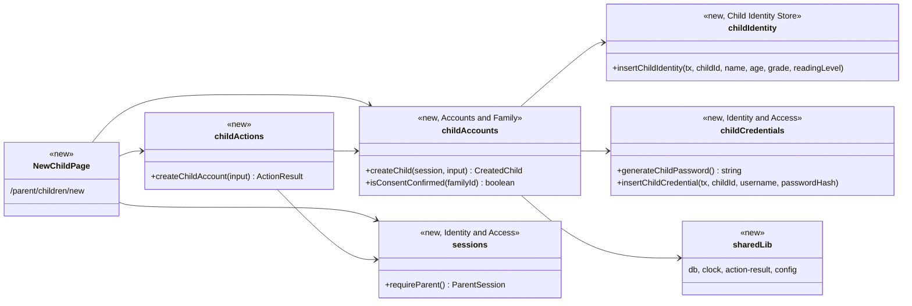
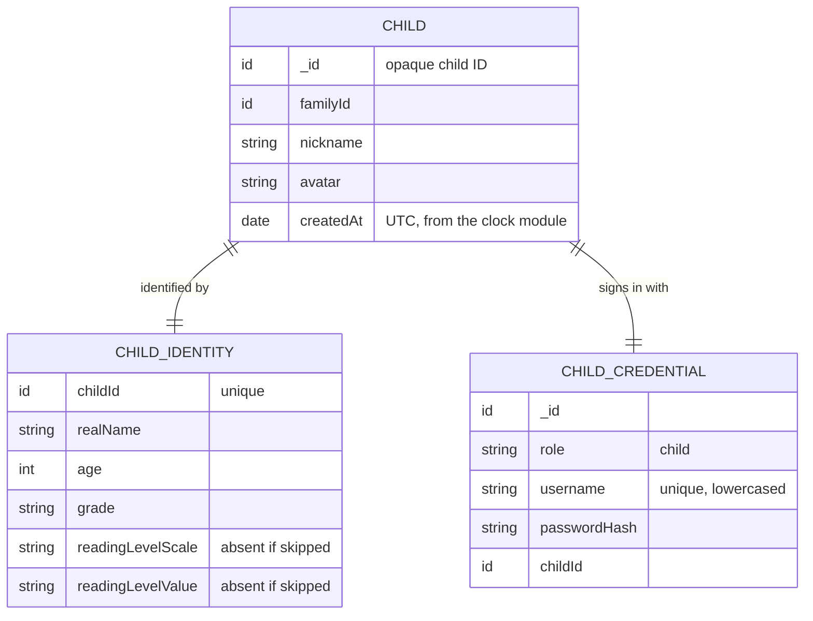

# Parent (PAR) Design

**Project:** BookBuddies
**Team:** Team 05
**Area:** `UC-PAR`

> **Realizes:** `UC-PAR-create-kid-account`, `FR-ACCT-parent-first`, `FR-ACCT-credentials`, `FR-ACCT-child-display` (collecting the nickname), `FR-ONB-profile` (the identity and account fields), `FR-ONB-level-optional`
> **Depends on:** `BR-parent-account-linked`, `BR-parent-creates-kid-account`, `BR-parent-account-structure`, `BR-kid-data-stored`, `BR-kid-anonymous-profile`, `BR-coppa-parental-consent`, `BR-coppa-minimization`, `BR-no-reading-level-assessment`, `BR-reading-level-parent-entered`, `BR-admin-limited-view`, `BR-coppa-notice`, `FR-ACCT-consent-confirm`, `FR-DATA-notice`, `DI-child-stored`, `DI-child-credentials`, `DI-acquire`, `DI-minimization`, `DI-field-tables`, `DI-integrity`, `SEC-auth`, `SEC-role-authorization`, `SEC-pii-boundary`, `KD-pii-segregation`, `KD-auth-sessions`
> **See:** [use cases, PAR area](../docs/requirements/use-cases.md#par-parent-feature-area), [specification](../docs/requirements/software-requirements-specification.md), [business rules](../docs/requirements/business-rules.md), [glossary](../docs/requirements/project-glossary.md), [COPPA design requirements](../docs/coppa/coppa-design-requirements.md), [team decisions](../docs/Team_Decisions.md), [architecture-of-record](architectural-design.md)
> **Designed against:** `79cb2ee` (no application code exists yet)

---

_**How to use this template.** Copy it to `docs/design/<area>.md`, named for the lowercase area code (`ord.md` for `UC-ORD-*`). Instructions appear in italic square brackets; leave them in place until the document is stable, because the agent reads them on every later pass. The full worked example is Project Pulse's [`not.md`](https://github.com/Washingtonwei/project-pulse/blob/main/docs/design/not.md); read it for the shape, not for the answers._

_BookBuddies keeps its design documents in the top-level `design/` folder beside the [architecture-of-record](architectural-design.md), so this file is `design/par.md`._

_**What this document is.** The **design-of-record** for one use case area: how the code will realize its use cases, written **before** the code and approved before anyone builds from it. It is the last document your agent reads before it writes code, so anything it leaves out, the agent invents. Your [architecture-of-record](architectural-design.md) is the map of the whole system and stops at each component's responsibility; this document goes one level down, inside one area, against real code._

_**What it is not.** A copy of your use cases. It **cites** `UC-*`, `FR-*`, and `BR-*` by identifier and never restates what the system shall do; it says only how. It is also not a transcript of the code. Once code exists, link to the files rather than describing every class, column, or getter._

_**One document per area, not per use case.** Your area gains use cases over the term. The overview, the class diagram, and the data model are **revised in place** when it does. The sequence diagrams, the API contract rows, and the test rows are **appended**, one set per use case. Never add a `## UC-…` section that repeats the whole skeleton._

_**How much to write.** Pin down what a wrong guess would break: a requirement, a business rule, a quality attribute, or the contract between two parts of your team. Leave the rest for the agent to derive while it builds: variable names, field types, exact JSON, column lengths. When you are unsure, ask which side of that line a detail falls on, not whether it is interesting._

_**Write it in this order.** Each step is one person's or one pair's work, and the order is the point:_

1. _**Sketch it yourselves first.** Before you open the agent, draw the main success scenario's sequence diagram and write the API contract rows by hand, from the use case and your architecture-of-record. Twenty minutes, on paper or in this file._
2. _**Have the agent draft it.** Give the agent this template, the use case, the business rules it cites, your architecture-of-record's section 8 (Crosscutting Concepts), and the relevant existing code, and ask for a draft of this document. Use plan mode, so it proposes before it writes._
3. _**Compare the two.** Where the agent's draft differs from your sketch, decide which is right and why. What it found that you missed goes in; what you knew that it could not have known is the context your specification is missing, so fix the specification too._
4. _**Run the questions test** (the last section) and fix what it finds._
5. _**Open a pull request.** A teammate who did not write it reviews and approves it. Nobody starts an implementation branch from this design until it is merged._

_**Status of this draft.** Redrafted by Claude on 2026-10-27 from use cases v0.15, business rules v0.7, SRS v0.8, the glossary, `docs/coppa/`, `docs/Team_Decisions.md`, `CLAUDE.md` and the architecture-of-record v0.8, following `.claude/commands/design.md`. It replaces the earlier `UC-PAR-onboarding` draft: the team chose to design `UC-PAR-create-kid-account` first, and onboarding has changed since (email-confirmed consent). The other PAR use cases are appended as each is designed._

---

## Overview

_[One paragraph: what this area does, which components of your [architecture-of-record](architectural-design.md) it lives in, and what it reads from or calls in other areas. Link the container diagram rather than redrawing it. If this design changes the architecture-of-record, say so here and list the change under "Changes to the architecture-of-record" below.]_

The Parent area owns families: Main and Sub Parents, consent, child accounts, the parent's book suggestions and reports, and the parent's data rights. It is the Accounts & Family component of the Application container ([containers](architectural-design.md#51-containers), [use case areas and components](architectural-design.md#52-use-case-areas-and-components)). `UC-PAR-create-kid-account`, the first use case designed here, lets the Main Parent create a child, once the family's consent is confirmed. One transaction writes three records, each through its owning component: the child account (nickname and avatar) in Accounts & Family, the child's real name, age, grade and optional reading level in the Child Identity Store, and the child's username and password hash in Identity & Access (`KD-pii-segregation`, architecture §5.2). The plaintext password exists only in the response that shows it to the parent. This design adds one entry to architecture §8.2.8, listed under "Changes to the architecture-of-record" below.

## Components & classes

_[One class diagram for the whole area, and one line per class or file saying what it does and whether it is **new** or **reused**. Show only what a reader needs to see how the parts relate: classes, their key methods, their dependencies. Fields and getters belong to the code._

_**If your repository has no code for this area yet**, which is the normal case for your proving slice, list the files you expect the agent to create, with the paths your architecture-of-record's conventions give them, and mark them all new. The agent then builds into the structure you chose rather than one it improvised._

_No application code exists, so every file below is new. Paths follow architecture §8.2.3 and §8.2.4: pages and server actions under `src/app/`, and each component's server-only data-access functions under `src/server/<component>/`, the only place its collections are touched.]_



- `src/app/(parent)/parent/children/new/page.tsx` (new): the form (step 2) and, after a successful save, the credentials screen (step 7). Before rendering it calls `requireParent()`; a Sub Parent sees an explanation instead of the form (1b), and a family without confirmed consent is redirected to the "check your email" screen of `UC-PAR-onboarding` (1c). It shows a link to the online privacy notice next to the form, because this is a place where a child's personal information is collected (`FR-DATA-notice`, `BR-coppa-notice`), and the reading-level referral links as plain outbound links (4e) and warns, without blocking, when the age is outside 6–11 (4b). This page sits outside the "no child yet" redirect that `UC-PAR-onboarding` 8a needs, so the first child can be created.
- `src/app/(parent)/parent/children/new/actions.ts` (new): `createChildAccount`. In order (§8.2.3): `requireParent()`, refuse a Sub Parent, refuse unconfirmed consent, validate with the zod schema, call `createChild`. The family comes from the session, never from the request.
- `src/app/(parent)/parent/children/new/schema.ts` (new): the one zod schema, shared by form and action (§8.2.5): name, nickname (not equal to the name, 4i), age, grade, username, optional reading level as a scale plus a value, avatar key.
- `src/server/accounts-family/child-accounts.ts` (new, server-only): `createChild` generates the opaque child ID, hashes the generated password, and in one transaction inserts the child account and calls the two other components' insert functions with the transaction handle. It returns the child ID, the username and the plaintext password, and nothing is stored if any insert fails (5a, 6a). `isConsentConfirmed` reads the family's consent record (`DI-consent-record`).
- `src/server/child-identity/child-identity.ts` (new, server-only): `insertChildIdentity`, the Child Identity Store's write path for a new child. No read function is added here.
- `src/server/identity-access/child-credentials.ts` (new, server-only): `generateChildPassword` (a cryptographically random password, see Open questions for its rules) and `insertChildCredential` (role `child`, the lowercased username, the hash, the child ID).
- `src/server/identity-access/passwords.ts` and `sessions.ts` (new, server-only): salted hashing (`KD-auth-sessions`) and `requireParent()`, which returns the parent's user ID, family ID and parent role (`main` or `sub`). Both are shared with every later use case.
- `src/server/lib/db.ts`, `clock.ts`, `action-result.ts`, `config.ts` (new): one Mongo client per instance, the settable clock, the `{ ok, data | error }` helper and the validated environment (§8.2.1, §8.2.2, §8.2.6, §8.2.8).
- `src/server/accounts-family/avatars.ts` and `src/server/accounts-family/grades.ts` (new, server-only): the fixed avatar set and grade list the schema checks against.

## Sequence

_[One sequence diagram per use case for its main success scenario, plus one for each extension that does not just return an error. **Label each interaction with the use case step it implements**, so a reviewer can check that every step is realized and nothing extra was invented. Use `alt` blocks for extensions that branch off the main flow. Give each use case its own `###` heading; that heading is the anchor your traceability matrix cites.]_

### UC-PAR-create-kid-account: create a linked child account

```mermaid
sequenceDiagram
    actor P as Main Parent
    participant UI as Web UI (new child page)
    participant ACT as createChildAccount
    participant IA as Identity & Access
    participant AF as Accounts & Family
    participant CIS as Child Identity Store
    participant DB as Database
    P->>UI: Arrive from UC-PAR-onboarding or tap "Add a Child" (step 1)
    UI->>IA: requireParent()
    UI->>AF: isConsentConfirmed(familyId)
    alt Sub Parent (1b)
        UI-->>P: Explanation, no form
    else consent not confirmed (1c)
        UI-->>P: Redirect to "check your email" (UC-PAR-onboarding step 6)
    end
    UI-->>P: Form: name, nickname, age, grade, username, reading level, avatar, privacy notice link (step 2)
    alt Parent cancels (1a)
        P->>UI: Leave the page
        Note over UI: No server call, nothing created
    end
    P->>UI: Fill in and submit (step 3)
    Note over UI: Age outside 6-11 shows a warning, not a block (4b); referral links for the unsure (4e)
    UI->>ACT: createChildAccount(fields)
    ACT->>IA: requireParent()
    ACT->>AF: isConsentConfirmed(familyId)
    alt Sub Parent (1b)
        ACT-->>UI: NOT_MAIN_PARENT
    else consent not confirmed (1c)
        ACT-->>UI: CONSENT_NOT_CONFIRMED
    end
    ACT->>ACT: Validate with the zod schema (step 4)
    alt a field fails (4a, 4c, 4d, 4f, 4h, 4i)
        ACT-->>UI: The field's error code
    end
    ACT->>AF: createChild(session, fields) (step 5)
    AF->>IA: generateChildPassword(), hashPassword() (step 6)
    AF->>DB: Begin transaction
    AF->>DB: Insert child account: family, nickname, avatar (step 5)
    AF->>CIS: insertChildIdentity(tx, name, age, grade, reading level) (step 5)
    AF->>IA: insertChildCredential(tx, username, hash) (step 6)
    alt username taken, unique index (4g)
        DB-->>AF: duplicate key, transaction aborted
        AF-->>ACT: USERNAME_TAKEN
    else any write fails (5a, 6a)
        DB-->>AF: error, transaction aborted
        AF-->>ACT: SAVE_FAILED
    end
    AF->>DB: Commit
    AF-->>ACT: child ID, username, plaintext password
    ACT-->>UI: ok, credentials (response only)
    UI-->>P: Username, password, "Tell your child to log in with these credentials." (step 7)
    P->>UI: Acknowledge (step 8)
    UI-->>P: Continue to UC-REC-kid-onboarding for this child
```

## API contract

_[One row per endpoint, scheduled job, or message this area adds or changes, appended per use case. **This section is never dropped**: before the code exists it is the only thing the person (or agent session) building the front end and the one building the back end both read. Name the caller and who may call it, the request fields, the success response, and the error each extension returns. Leave field types and exact JSON to the agent unless a wrong guess would break something, such as a format another system depends on. Use the error shape your architecture-of-record's section 8.2 fixes; do not invent one here._

_Pages change data through server actions (§8.2.3), and every result uses the `{ ok: true, data }` or `{ ok: false, error: { code, message } }` shape of §8.2.1.]_

| Endpoint or job | Caller (who may) | Request | Success | Errors, by extension |
|---|---|---|---|---|
| Page `/parent/children/new` (UC-PAR-create-kid-account) | A signed-in Main Parent whose family's consent is confirmed | None | The form, the avatar set, the grade list, the accepted reading-level scales, the referral links and the online privacy notice link (`FR-DATA-notice`) | 1b: a Sub Parent sees an explanation and no form. 1c: redirect to the "check your email" screen. No session: redirect to sign-in. |
| Server action `createChildAccount` (UC-PAR-create-kid-account) | A signed-in Main Parent whose family's consent is confirmed; the family comes from the session | Name, nickname, age, grade, username, reading level (scale and value, or none), avatar key | `ok` with the child ID, the username and the generated password. The password is in this response only, and the response is never cached | 1b: `NOT_MAIN_PARENT`. 1c: `CONSENT_NOT_CONFIRMED`. 4a: `NAME_REQUIRED`. 4i: `NICKNAME_REQUIRED` or `NICKNAME_MATCHES_NAME`. 4c: `INVALID_GRADE`. 4f: `USERNAME_REQUIRED`. 4h: `INVALID_USERNAME`. 4g: `USERNAME_TAKEN`. 4d: `INVALID_READING_LEVEL`, with the accepted scales. An age that is not a whole number in the accepted range: `INVALID_AGE`. A missing or unknown avatar: `INVALID_AVATAR`. 5a and 6a: `SAVE_FAILED` with an error ID, nothing stored. 4b (age outside 6–11) and 4e are not errors. Not a parent: refused (§8.1). |

The parent's screens may show the child's real name. Nothing in this use case sends the real name, age, grade or reading level to a child's screen (`FR-ACCT-child-display`, §8.2.11).

## Key decisions

_[Only the decisions a reader could not recover from the code: an invariant, who may do this and how it is enforced, a trade-off you chose, a reason you reused something rather than writing it. **Each one names what you chose, what you rejected, and why.** If you cannot name an alternative you considered, it probably was not a decision; leave it out._

_A decision that affects the whole system rather than this area is an architecture decision. It belongs in your architecture-of-record as a `KD-*` entry, not here.]_

**One child is three records in three components, written in one transaction.** Accounts & Family holds the child account (opaque ID, family, nickname, avatar); the Child Identity Store holds the real name, age, grade and reading level; Identity & Access holds the username and password hash. Accounts & Family opens the transaction and passes its handle to the other two components' insert functions, so each still owns its own collection (§8.2.4). Rejected: one child document with every field, which `KD-pii-segregation` rejects because one forgotten projection would leak the name; and three separate writes, which can leave a child with no credentials or an identity with no child, against 5a, 6a and `DI-integrity`.

**The password is generated before the transaction and shown from the action's response only.** It is never stored in plaintext, put in a URL, logged or cached, and it cannot be fetched again after the parent leaves the screen (7a). Rejected: storing it encrypted so the parent could view it later, which `FR-ACCT-credentials` and §8.1 rule out (salted hash only). Getting a new password is a reset, which is `OI-26` and not this use case.

**Main Parent and consent are checked in the action, not only by hiding the button.** The page hides "Add a Child" for a Sub Parent and redirects an unconfirmed family, but the action checks both again, because any action can be called directly (§8.1, `SEC-role-authorization`, `FR-ACCT-parent-first`). Rejected: relying on the page, which 1b explicitly says can be bypassed.

**The family comes from the session.** The request carries no family or parent ID. Rejected: taking it from the form, which would let a request attach a child to another family (`DI-integrity`).

**Usernames are unique across every account that signs in with one, case-insensitively.** They are trimmed and lowercased once, in the schema, and stored that way with a unique index; a duplicate key inside the transaction becomes `USERNAME_TAKEN` (4g). Sub Parents also sign in with a username (§8.1), so the index covers child and Sub Parent credentials alike. Rejected: "check, then insert", which lets two parents claim one username at the same moment; and uniqueness per family, which would make sign-in ambiguous.

**The age warning is the form's, the age bounds are the server's.** The form warns outside 6–11 (4b) and still submits. The server only rejects an age that is not a whole number in a wide range (see Open questions). Rejected: blocking outside 6–11, which 4b says not to do until the client decides.

**The avatar is a key from a fixed set, never an image.** Rejected: an uploaded picture, which would be a photo of the child and personal information in its own right (`BR-kid-anonymous-profile`; `docs/coppa/coppa-design-requirements.md` §3.5, no photos or uploads).

**The reading level is stored as the scale plus the value the parent typed, never converted.** Rejected: converting every scale to one number, which would be the system estimating a level (`BR-no-reading-level-assessment`).

## Data model

_[The **change** this area makes to the data: new tables or entities, new columns, the migration that adds them. Draw an ER diagram when there is more than one new table. Do not redraw the domain model; your [specification](../docs/requirements/software-requirements-specification.md) owns it, so link it and show only the change. If the area changes nothing, say "No change" and give the reason in one line; that is a design decision too.]_

Three new collections, one per owning component, all written in the one transaction. The family and consent records they depend on belong to `UC-PAR-onboarding`, which is not designed yet; this design assumes only that a family has an ID and its consent record carries a confirmation date (`DI-consent-record`).



- `children` (Accounts & Family): indexed on `familyId`. This is what other components hold: the opaque ID, nickname and avatar.
- `childIdentities` (Child Identity Store): unique on `childId`. Nothing else stores these fields (`KD-pii-segregation`).
- `CHILD_CREDENTIAL` is a document in Identity & Access's `users` collection (the Auth.js adapter's), with a unique index on `username` that applies only where a username is set, since Main Parents sign in by email.

Every child field has a stated purpose, as `DI-minimization` and `BR-coppa-minimization` require:

| Field | Purpose | Source of the purpose |
|---|---|---|
| Real name | Law-enforcement reporting only; never displayed to the child | `BR-kid-data-stored`; still under review (`OI-23`) |
| Nickname, avatar | What the child is shown as | `BR-kid-anonymous-profile`, `FR-ACCT-child-display` |
| Age, grade | The recommender's primary signals | `BR-reading-level-proxy`, `DI-child-stored` |
| Reading level | Matching book difficulty, when the parent gives one | `BR-reading-level-proxy`, `BR-reading-level-parent-entered` |
| Username, password hash | The child's sign-in | `FR-ACCT-credentials`, `DI-child-credentials` |

The indexes are created by an idempotent setup script, run before the first deploy and by the integration-test setup. MongoDB schema validation is the backstop for required fields (§8.2.5).

## Reuse & cross-cutting

_[Which existing services, components, and conventions this area uses rather than rebuilding: authentication, the error handler, email, the clock, another area's service. Cite your architecture-of-record's section 8.2 for each convention by name rather than restating it.]_

Nothing exists to reuse yet, so this use case builds the shared pieces the conventions name, once, for every later use case:

- **Authentication and sessions:** Auth.js database sessions and `requireParent()` (`KD-auth-sessions`, §8.1 Authentication).
- **Authorization:** the Main Parent and family checks in the action (§8.1 Authorization).
- **Error handling:** the shared result helper (§8.2.1).
- **Time:** the clock module for `createdAt` (§8.2.2).
- **API conventions:** a verb-first server action; session, then validation, then the owning component (§8.2.3).
- **Code conventions:** `server-only` on every module under `src/server/`; each component touches only its own collection (§8.2.4).
- **Validation:** one zod schema for form and action (§8.2.5).
- **Logging:** never the name, nickname, age, grade, reading level, username or password, not even on failure (§8.2.7).
- **Transactions:** the three inserts are one transaction (§8.2.8); development and tests run MongoDB as a replica set.

Not used: Notification and the Email Service (nothing is sent), Recommendation (`UC-REC-kid-onboarding` comes after step 8), and the audit log (child creation is not in the §8.2.9 list).

## Tests

_[One row per flow: the main success scenario and **every** extension of every use case this document realizes, appended per use case. Name the level (unit or integration) and what the test asserts. No code. This list is the definition of done that the reviewer approves; the agent writes these tests when it builds, and a reviewer can see at a glance whether an extension has no test.]_

| Use case, flow | Level | Asserts |
|---|---|---|
| UC-PAR-create-kid-account main | integration | A Main Parent with confirmed consent creates a child: one child account with the nickname and avatar, one identity record with name, age, grade and reading level, and one child credential with the lowercased username and a hash, all with the same child ID and the session's family; the response holds the plaintext password |
| UC-PAR-create-kid-account main, skipped reading level | integration | With no reading level, the identity record has none and the save succeeds (`FR-ONB-level-optional`) |
| UC-PAR-create-kid-account main | end-to-end | The parent fills in the form, sees the credentials, acknowledges, and lands on the child's reading-profile onboarding |
| UC-PAR-create-kid-account main, password | unit | Generated passwords meet the agreed rules and differ between calls; the stored hash verifies against the shown password |
| UC-PAR-create-kid-account 1a | end-to-end | Leaving the form without submitting writes nothing |
| UC-PAR-create-kid-account 1b | integration | A Sub Parent gets the explanation on the page and `NOT_MAIN_PARENT` from the action, and nothing is stored |
| UC-PAR-create-kid-account 1c | integration | A family without confirmed consent is redirected from the page and gets `CONSENT_NOT_CONFIRMED` from the action, and nothing is stored |
| UC-PAR-create-kid-account 4a | unit | An empty or blank name is refused with `NAME_REQUIRED` |
| UC-PAR-create-kid-account 4i | unit | An empty nickname is refused with `NICKNAME_REQUIRED`; a nickname equal to the name, ignoring case and surrounding spaces, with `NICKNAME_MATCHES_NAME` |
| UC-PAR-create-kid-account 4b | integration | An age outside 6–11 but inside the accepted range is saved; the form shows the warning |
| UC-PAR-create-kid-account 4b, bounds | unit | An age that is not a whole number, or is outside the accepted range, is refused with `INVALID_AGE` |
| UC-PAR-create-kid-account 4c | unit | A grade not in the grade list is refused with `INVALID_GRADE` |
| UC-PAR-create-kid-account 4d | unit | A reading level whose value does not match its scale's format, or whose scale is not accepted, is refused with `INVALID_READING_LEVEL` |
| UC-PAR-create-kid-account 4e | end-to-end | The referral links are shown and the system computes no level from anything entered |
| Privacy notice | end-to-end | The form shows the online privacy notice link (`FR-DATA-notice`) |
| UC-PAR-create-kid-account 4f | unit | An empty username is refused with `USERNAME_REQUIRED` |
| UC-PAR-create-kid-account 4g | integration | A username already used by any child or Sub Parent, in any letter case, returns `USERNAME_TAKEN`, and none of the three records is stored |
| UC-PAR-create-kid-account 4g, concurrent | integration | Two simultaneous creations with one username leave exactly one child |
| UC-PAR-create-kid-account 4h | unit | A username breaking the format rules is refused with `INVALID_USERNAME` |
| UC-PAR-create-kid-account 5a | integration | When the identity insert fails, no child account, identity or credential remains, and the result is `SAVE_FAILED` with an error ID |
| UC-PAR-create-kid-account 6a | integration | When the credential insert fails, no child account or identity remains, and the result is `SAVE_FAILED` |
| UC-PAR-create-kid-account 7a | integration | No function or page returns the plaintext password after the action's response; only the hash is stored |
| Authorization | integration | A request naming another family's ID still creates the child in the session's family; a child session and an admin session are refused |
| Logging | integration | After a successful and a failed creation, the logs contain no name, nickname, age, grade, reading level, username or password |
| No real name to the child | integration | The child account record that child-facing code reads holds only the ID, family, nickname and avatar |

## Changes to the architecture-of-record

_[Designing an area against real code is when the architecture's guesses meet reality. If this design needs a component the map does not have, moves a responsibility, or adds a dependency, **change [the architecture-of-record](architectural-design.md) in the same pull request** and list each change here in one line. If nothing changed, write "None". A design that silently disagrees with the architecture leaves two maps, and the agent will follow whichever it reads last.]_

- §8.2.8 Persistence and concurrency: add "a child account, its Child Identity Store record and its credentials (`UC-PAR-create-kid-account`)" to the list of changes that are one transaction. Edited in `architectural-design.md` in this pull request.

## Open questions & risks

_[What this design could not settle and who can, and what could go wrong that you are accepting. A question for the client also goes in [`OPEN-ISSUES.md`](../docs/requirements/OPEN-ISSUES.md).]_

What this design had to assume, and where each answer belongs. `DI-field-tables` says not to invent values for TBD fields, so these are **proposals**: `/implement` must not build the checks below until the team has written the agreed values into the use case's data table.

- **Username format (team; the use case, 4h).** Proposed: 3–20 characters, letters, digits and underscores, stored lowercase. Belongs in the use case's data table and §8.2.5, which says the checks are written once the rule exists.
- **Generated password rules (team; the use case and `FR-ACCT-credentials`).** Proposed: three short common words and two digits from a cryptographically random source, so a 6–11-year-old can type it. Belongs in the use case's data table.
- **Age range the server accepts (client; 4b).** Proposed: whole numbers 3–17, with the warning outside 6–11. Whether children outside the target band are allowed at all is open in the use case.
- **Grade list (team).** Proposed: K through 12, to match the age range above; K–6 if the client keeps to the target band.
- **Reading-level formats (team; 4d).** Each accepted scale needs a format the server checks. Proposed: Lexile as a number with an optional "BR" prefix and "L" suffix, AR/ATOS as a decimal 0.0–13.0, DRA as A–Z or 1–80, Guided Reading Level as a letter A–Z, and a grade-level range as two grades. Belongs in the use case's data table.
- **Nickname length (team).** Proposed: 1–20 characters. The use case says TBD.
- **Avatar set (team).** The use case says "a provided set"; nobody has chosen it. The page cannot be built until it exists.

Other open items:

- **`UC-PAR-onboarding` is not designed.** This use case needs a family ID, a Main Parent session and a confirmed consent record from it. Tests can create those as fixtures, but the feature cannot be used end to end until onboarding is designed and built.
- **The real name (client, `OI-23`).** `BR-kid-data-stored` keeps it, but whether it must be stored is open, and `BR-coppa-minimization` argues against collecting what is not needed. If the client drops it, only the identity record and the form change.
- **Seeing or resetting the password (client, `OI-26`).** This design makes the password unrecoverable after step 7 (7a). A reset needs its own use case.
- **Suspension in PRE-2 (client, `OI-16`).** A suspended parent's sessions are deleted (§8.1), so they cannot reach this page; no extra check is designed. If `BR-24hr-review-window` comes back, revisit.
- **Usernames that reveal the real name (team).** Nothing stops a parent choosing the child's real name as the username, which the child sees. `BR-kid-anonymous-profile` may call for the same check as the nickname (4i).
- **A COPPA data inventory in the README (team).** `docs/coppa/coppa-design-requirements.md` §3.9 proposes that every pull request adding a collected field update a COPPA section of `README.md`. No business rule or SRS requirement has adopted it, so this design does not require it. If the team adopts it, the build of this use case is the first to add an entry (the fields in the purpose table above).
- **Accepted risk: the transaction spans three components.** One function in Accounts & Family coordinates writes owned by two other components. It is the only way to keep the three records all-or-nothing in MongoDB, and the tests for 5a and 6a guard it.

---

## Working this document with your agent

_[Delegate: drafting the diagrams from your sketch and the use case; listing the existing files a class should extend; filling the contract rows' request and response fields; proposing the test row for each extension; drafting the rejected alternative for a decision you have already made; checking that every identifier this document cites exists in the document that owns it._

_Keep human: which side of the "would a wrong guess break something" line each detail falls on; every key decision; and the approval, which is a teammate's review of the pull request, not the drafter's own reading._

_**The specific failure to watch for: scope that nobody asked for.** An agent drafting a design adds what designs it has read usually have: an admin override, a retry queue, a status field, a notification "while we are here". Each looks reasonable and none is in your use case, and once it is in the design the agent will build it, test it, and you will maintain it. Read the sequence labels: every interaction should name the use case step it implements. An interaction with no step is either a missing requirement, which goes to your specification and your client, or scope creep, which comes out.]_

---

## The questions test (before you open the pull request)

_[Start a **fresh** agent session in plan mode, so it carries nothing from the session that drafted this document. Give it only the use case, the business rules it cites, your architecture-of-record's section 8, and this document, and ask:_

> _List every point you would still have to guess to implement `<UC-ID>`. For each, say what you would guess and whether a wrong guess could violate a requirement. Do not write code._

_For each item on its list, either fix this document or keep the guess and write one line saying why a wrong guess breaks no requirement. Paste the list, with your answer to each item, into the pull request description under How it was verified, inside a collapsed `<details><summary>Questions test</summary> … </details>` block so the description stays short. The design is ready when nothing on the list could break a requirement.]_
