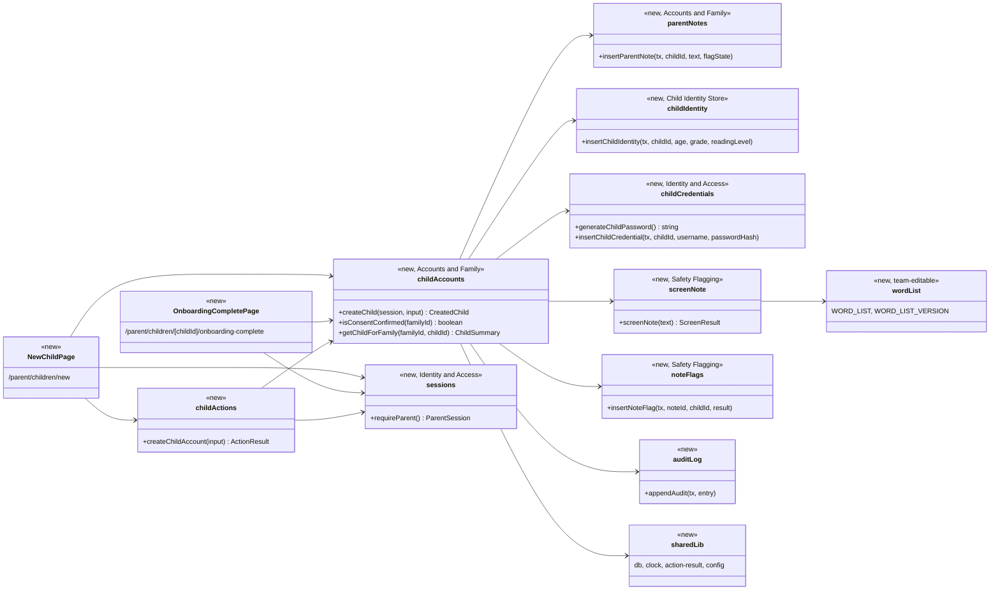
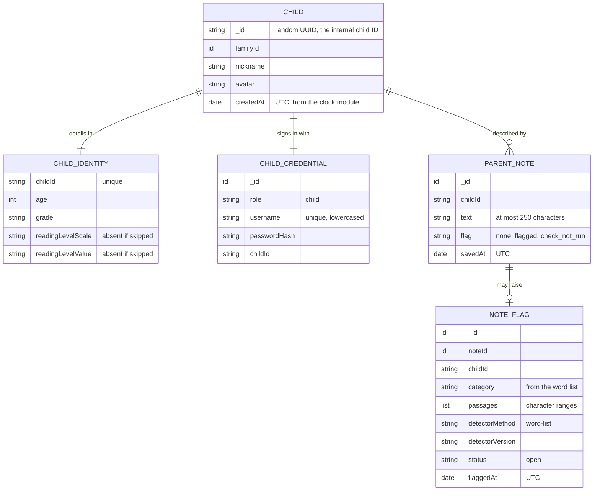

# Parent (PAR) Design

**Project:** BookBuddies
**Team:** Team 05
**Area:** `UC-PAR`

> **Realizes:** `UC-PAR-create-kid-account`, `FR-ACCT-parent-first`, `FR-ACCT-credentials`, `FR-ACCT-child-display` (collecting the nickname), `FR-ACCT-consent-confirm` (PRE-3), `FR-ONB-profile`, `FR-ONB-level-optional`, `FR-NOTE-parent-note`, `FR-NOTE-flagging`, `FR-DATA-notice`
> **Depends on:** `BR-parent-account-linked`, `BR-parent-creates-kid-account`, `BR-parent-account-structure`, `BR-kid-data-stored`, `BR-kid-anonymous-profile`, `BR-coppa-parental-consent`, `BR-coppa-notice`, `BR-coppa-minimization`, `BR-no-reading-level-assessment`, `BR-reading-level-parent-entered`, `BR-reading-level-proxy`, `BR-admin-limited-view`, `BR-parent-note`, `BR-note-safety-flagging`, `DI-child-id`, `DI-child-stored`, `DI-child-credentials`, `DI-parent-note`, `DI-minimization`, `DI-integrity`, `DI-pii-segregation`, `DI-field-tables`, `DI-acquire`, `SEC-auth`, `SEC-role-authorization`, `SEC-pii-boundary`, `SAF-flag-delivery`, `KD-pii-segregation`, `KD-auth-sessions`, `KD-admin-flag-review`
> **See:** [use cases, PAR area](../docs/requirements/use-cases.md#par-parent-feature-area), [specification](../docs/requirements/software-requirements-specification.md), [business rules](../docs/requirements/business-rules.md), [glossary](../docs/requirements/project-glossary.md), [COPPA design requirements](../docs/coppa/coppa-design-requirements.md), [team decisions](../docs/Team_Decisions.md), [architecture-of-record](architectural-design.md)
> **Designed against:** `3493672` (no application code exists yet)

---

_**How to use this template.** Copy it to `design/<area>.md`, named for the lowercase area code (`ord.md` for `UC-ORD-*`). Instructions appear in italic square brackets; leave them in place until the document is stable, because the agent reads them on every later pass. The full worked example is Project Pulse's [`not.md`](https://github.com/Washingtonwei/project-pulse/blob/main/design/not.md); read it for the shape, not for the answers._

_BookBuddies keeps its design documents in the top-level `design/` folder beside the [architecture-of-record](architectural-design.md), so this file is `design/par.md`._

_**What this document is.** The **design-of-record** for one use case area: how the code will realize its use cases, written **before** the code and approved before anyone builds from it. It is the last document your agent reads before it writes code, so anything it leaves out, the agent invents. Your [architecture-of-record](architectural-design.md) is the map of the whole system and stops at each component's responsibility; this document goes one level down, inside one area, against real code._

_**What it is not.** A copy of your use cases. It **cites** `UC-*`, `FR-*`, and `BR-*` by identifier and never restates what the system shall do; it says only how. It is also not a transcript of the code. Once code exists, link to the files rather than describing every class, column, or getter._

_**One document per area, not per use case.** Your area gains use cases over the term. The overview, the class diagram, and the data model are **revised in place** when it does. The sequence diagrams, the API contract rows, and the test rows are **appended**, one set per use case. Never add a `## UC-…` section that repeats the whole skeleton._

_**How much to write.** Pin down what a wrong guess would break: a requirement, a business rule, a quality attribute, or the contract between two parts of your team. Leave the rest for the agent to derive while it builds: variable names, field types, exact JSON, column lengths. When you are unsure, ask which side of that line a detail falls on, not whether it is interesting._

_**Write it in this order.** Each step is one person's or one pair's work, and the order is the point:_

1. _**Sketch it yourselves first.** Before you open the agent, draw the main success scenario's sequence diagram and write the API contract rows by hand, from the use case and your architecture-of-record. Twenty minutes, on paper or in this file._
2. _**Have the agent draft it.** Give the agent this template, the use case, the business rules it cites, your architecture-of-record's section 8 (Crosscutting Concepts), and the relevant existing code, and ask for a draft of this document. Use plan mode, so it proposes before it writes._
3. _**Compare the two.** Where the agent's draft differs from your sketch, decide which is right and why. What it found that you missed goes in; what you knew that it could not have known is the context your specification is missing, so fix the specification too._
4. _**Run the questions test** (the last section) and fix what it finds._
5. _**Open a pull request.** A teammate who did not write it reviews and approves it. Nobody starts an implementation branch from this design until it is merged._

_**Status of this draft.** Rewritten from scratch by Claude on 2026-11-05 from use cases (v0.14 on), business rules v0.8, SRS v0.9, the glossary, `docs/coppa/`, `docs/Team_Decisions.md`, `CLAUDE.md` and the architecture-of-record v0.9, following `.claude/commands/design.md`. It replaces the 2026-10-27 draft, which collected and stored a child's real name and had no parent note; the client's 2026-10-28 answers made both obsolete. The developer's decisions of 2026-11-05 are folded in. The other PAR use cases are appended as each is designed._

---

## Overview

_[One paragraph: what this area does, which components of your [architecture-of-record](architectural-design.md) it lives in, and what it reads from or calls in other areas. Link the container diagram rather than redrawing it. If this design changes the architecture-of-record, say so here and list the change under "Changes to the architecture-of-record" below.]_

The Parent area owns families: Main and Sub Parents, consent, child accounts, the parent's book suggestions and reports, and the parent's data rights. It is the Accounts & Family component of the Application container ([containers](architectural-design.md#51-containers), [use case areas and components](architectural-design.md#52-use-case-areas-and-components)). `UC-PAR-create-kid-account`, the first use case designed here, lets the Main Parent create a child once the family's consent is confirmed. The system holds **no real name** for the child; the child is a nickname, an avatar and an internal child ID (`DI-child-id`). One transaction writes the child account (nickname and avatar) in Accounts & Family, the child's age, grade and optional reading level in the Child Identity Store, and the child's username and password hash in Identity & Access (`KD-pii-segregation`, architecture §5.2). If the parent gave a note, the same transaction also writes the note (Accounts & Family) and, when the internal word list matches, its flag (Safety Flagging) and an audit entry. A flagged note needs no alert: it appears in the flag-review list of `UC-ADM-flag-review`. The plaintext password exists only in the response that shows it to the parent. After the parent acknowledges the credentials, the parent is sent into `UC-REC-kid-onboarding`, and returns to a completion message when that use case finishes.

## Components & classes

_[One class diagram for the whole area, and one line per class or file saying what it does and whether it is **new** or **reused**. Show only what a reader needs to see how the parts relate: classes, their key methods, their dependencies. Fields and getters belong to the code._

_**If your repository has no code for this area yet**, which is the normal case for your proving slice, list the files you expect the agent to create, with the paths your architecture-of-record's conventions give them, and mark them all new. The agent then builds into the structure you chose rather than one it improvised._

_No application code exists, so every file below is new. Paths follow architecture §8.2.3 and §8.2.4: pages and server actions under `src/app/`, and each component's server-only data-access functions under `src/server/<component>/`, the only place its collections are touched.]_



- `src/app/(parent)/parent/children/new/page.tsx` (new): the form (step 2) and, after a successful save, the credentials screen (step 7). Before rendering it calls `requireParent()`; a Sub Parent sees an explanation instead of the form (1b), and a family without confirmed consent is redirected to the "check your email" screen of `UC-PAR-onboarding` (1c). It shows a link to the online privacy notice next to the form (`FR-DATA-notice`, `BR-coppa-notice`), the note prompt of step 2, the reading-level referral links as plain outbound links (4e), a warning that does not block when the age is outside 6–11 (4b), and form text telling the parent the username must not be contact information or contain the nickname (4h). The privacy notice link comes from `config.ts` (`PRIVACY_NOTICE_URL`); the notice page itself is outside this use case. The submit button is disabled while the action is pending, and once the credentials screen is showing, no later response replaces it, so a double submit can never overwrite the only copy of the password (7a). On acknowledge (step 8) it navigates to `UC-REC-kid-onboarding` for this child (step 9), passing the child ID; `UC-REC-kid-onboarding` must check that ID against the session's family, and its route is that design's to name. This page sits outside the "no child yet" redirect that `UC-PAR-onboarding` 8a needs.
- `src/app/(parent)/parent/children/[childId]/onboarding-complete/page.tsx` (new): step 10. A parent of the child's family sees the "onboarding complete" message. `UC-REC-kid-onboarding` redirects here after its step 5. It shows no child detail beyond the nickname and holds no state of its own; a child ID outside the session's family is treated as not found.
- `src/app/(parent)/parent/children/new/actions.ts` (new): `createChildAccount`. In order (§8.2.3): `requireParent()`, refuse a Sub Parent, refuse unconfirmed consent, validate with the zod schema, call `createChild`. The family comes from the session, never from the request.
- `src/app/(parent)/parent/children/new/schema.ts` (new): the one zod schema, shared by form and action (§8.2.5): nickname, age, grade, username, optional reading level as a scale plus a value, optional note, avatar key. The cross-field rule "username does not contain the nickname" lives here. A reading level is both a scale and a value or neither; one without the other is `INVALID_READING_LEVEL`. The note is trimmed once here; the trimmed text is what is counted, screened and stored. When several fields fail, the action returns the first failing field in form order (the code identifies the field, since §8.2.1 has no field slot); the form runs the same schema in the browser to show every error inline.
- `src/server/accounts-family/child-accounts.ts` (new, server-only): `createChild` generates the child ID, hashes the generated password, calls `screenNote` **before** the transaction, and then in one transaction inserts the child account and calls the other components' insert functions with the transaction handle. It returns the child ID, the username and the plaintext password, and nothing is stored if any insert fails (5a, 6a). `isConsentConfirmed` reads the family's consent record (`DI-consent-record`) and is true only when that record has a confirmation date and has not been revoked; tests use fixtures of exactly that shape until `UC-PAR-onboarding` is designed. `getChildForFamily` returns the nickname and avatar only, and only for a child in that family.
- `src/server/accounts-family/parent-notes.ts` (new, server-only): `insertParentNote`. No read function is added here; the flag-review read comes with `UC-ADM-flag-review` and returns the text to that use case only (`KD-admin-flag-review`).
- `src/server/child-identity/child-identity.ts` (new, server-only): `insertChildIdentity`, the Child Identity Store's write path for a new child. No read function is added here.
- `src/server/identity-access/child-credentials.ts`, `passwords.ts`, `sessions.ts` (new, server-only): `generateChildPassword` (see Open questions for its rules), `insertChildCredential` (role `child`, the lowercased username, the hash, the child ID), salted hashing (`KD-auth-sessions`) and `requireParent()`, which returns `{ userId, familyId, role }` (`main` or `sub`), read from the user document through the Auth.js database session and never from the request.
- `src/server/safety-flagging/screen-note.ts` (new, server-only): `screenNote(text)`, a pure function. It returns `none`, `flagged` (with category and the character ranges that matched) or `check_not_run` (when the check throws), plus the detector's method (`word-list`) and version. It reads only `word-list.ts`. It screens the trimmed note, matches case-insensitively on whole-word boundaries with no stemming, and its character ranges are offsets into that same trimmed text, which is the text stored.
- `src/server/safety-flagging/word-list.ts` (new, **team-editable**): an exported array of `{ word, category }` and a `WORD_LIST_VERSION` constant. It ships with one placeholder entry and no real terms; the team adds words by editing this one file and raising the version. The categories are the ones `UC-ADM-flag-review` lists (violence, self-harm).
- `src/server/safety-flagging/note-flags.ts` (new, server-only): `insertNoteFlag`, writing the flag record the flag-review list reads.
- `src/server/audit/audit-log.ts` (new, server-only): `appendAudit`, append-only, IDs only (§8.2.9).
- `src/server/lib/db.ts`, `clock.ts`, `action-result.ts`, `config.ts` (new): one Mongo client per instance, the settable clock, the `{ ok, data | error }` helper and the validated environment (§8.2.1, §8.2.2, §8.2.6, §8.2.8).
- `src/server/accounts-family/avatars.ts` and `grades.ts` (new, server-only): the fixed avatar set and grade list the schema checks against.

## Sequence

_[One sequence diagram per use case for its main success scenario, plus one for each extension that does not just return an error. **Label each interaction with the use case step it implements**, so a reviewer can check that every step is realized and nothing extra was invented. Use `alt` blocks for extensions that branch off the main flow. Give each use case its own `###` heading; that heading is the anchor your traceability matrix cites.]_

### UC-PAR-create-kid-account: create a linked child account

```mermaid
sequenceDiagram
    actor P as Main Parent
    participant UI as Web UI (new child page)
    participant ACT as createChildAccount
    participant IA as Identity & Access
    participant AF as Accounts & Family
    participant SF as Safety Flagging
    participant CIS as Child Identity Store
    participant DB as Database
    P->>UI: Arrive from UC-PAR-onboarding or tap "Add a Child" (step 1)
    UI->>IA: requireParent()
    UI->>AF: isConsentConfirmed(familyId)
    alt Sub Parent (1b)
        UI-->>P: Explanation, no form
    else consent not confirmed (1c)
        UI-->>P: Redirect to "check your email" (UC-PAR-onboarding step 6)
    end
    UI-->>P: Form with note prompt and privacy notice link (step 2)
    alt Parent cancels (1a)
        P->>UI: Leave the page
        Note over UI: No server call, nothing created
    end
    P->>UI: Fill in and submit (step 3)
    Note over UI: Age outside 6-11 warns, never blocks (4b); referral links for the unsure (4e)
    UI->>ACT: createChildAccount(fields)
    ACT->>IA: requireParent()
    ACT->>AF: isConsentConfirmed(familyId)
    alt Sub Parent (1b)
        ACT-->>UI: NOT_MAIN_PARENT
    else consent not confirmed (1c)
        ACT-->>UI: CONSENT_NOT_CONFIRMED
    end
    ACT->>ACT: Validate with the zod schema (step 4)
    alt a field fails (4a, 4c, 4d, 4f, 4h, 4i)
        ACT-->>UI: The field's error code
    end
    ACT->>AF: createChild(session, fields) (step 5)
    opt a note was given (step 5.1)
        AF->>SF: screenNote(text)
        alt the check throws (5b)
            SF-->>AF: check_not_run
        else matches the word list
            SF-->>AF: flagged, category, passages
        else no match
            SF-->>AF: none
        end
    end
    AF->>IA: generateChildPassword(), hashPassword() (step 6)
    AF->>DB: Begin transaction
    AF->>DB: Insert child account: family, nickname, avatar (step 5)
    AF->>CIS: insertChildIdentity(tx, age, grade, reading level) (step 5)
    AF->>IA: insertChildCredential(tx, username, hash) (step 6)
    opt a note was given
        AF->>DB: Insert parent note with its flag state (step 5)
        opt flagged (step 5.1)
            AF->>SF: insertNoteFlag(tx, note, category, passages)
            AF->>DB: Append audit entry (IDs only)
        end
    end
    alt username taken, unique index (4g)
        DB-->>AF: duplicate key, transaction aborted
        AF-->>ACT: USERNAME_TAKEN
    else any write fails (5a, 6a)
        DB-->>AF: error, transaction aborted
        AF-->>ACT: SAVE_FAILED
    end
    AF->>DB: Commit
    AF-->>ACT: child ID, username, plaintext password
    ACT-->>UI: ok, credentials (response only)
    UI-->>P: Username, password, "Tell your child to log in with these credentials." (step 7)
    P->>UI: Acknowledge (step 8)
    UI-->>P: Go to UC-REC-kid-onboarding for this child (step 9)
    Note over UI,P: UC-REC-kid-onboarding runs; on its step 5 it redirects to the completion page
    UI-->>P: "Onboarding complete" message, use case ends (step 10)
```

## API contract

_[One row per endpoint, scheduled job, or message this area adds or changes, appended per use case. **This section is never dropped**: before the code exists it is the only thing the person (or agent session) building the front end and the one building the back end both read. Name the caller and who may call it, the request fields, the success response, and the error each extension returns. Leave field types and exact JSON to the agent unless a wrong guess would break something, such as a format another system depends on. Use the error shape your architecture-of-record's section 8.2 fixes; do not invent one here._

_Pages change data through server actions (§8.2.3), and every result uses the `{ ok: true, data }` or `{ ok: false, error: { code, message } }` shape of §8.2.1.]_

| Endpoint or job | Caller (who may) | Request | Success | Errors, by extension |
|---|---|---|---|---|
| Page `/parent/children/new` (UC-PAR-create-kid-account) | A signed-in Main Parent whose family's consent is confirmed | None | The form, the avatar set, the grade list, the accepted reading-level scales, the referral links, the note prompt and the online privacy notice link (`FR-DATA-notice`) | 1b: a Sub Parent sees an explanation and no form. 1c: redirect to the "check your email" screen. No session: redirect to sign-in. |
| Server action `createChildAccount` (UC-PAR-create-kid-account) | A signed-in Main Parent whose family's consent is confirmed; the family comes from the session | Nickname, age, grade, username, avatar key, reading level (scale and value, or none), note (or none) | `ok` with the child ID, the username and the generated password. The password is in this response only, and the response is never cached. The result does not say whether the note was flagged | 1b: `NOT_MAIN_PARENT`. 1c: `CONSENT_NOT_CONFIRMED`. 4a: `NICKNAME_REQUIRED`, or `INVALID_NICKNAME` for anything but letters and numbers. 4i: `NOTE_TOO_LONG`. 4c: `INVALID_GRADE`. 4f: `USERNAME_REQUIRED`. 4h: `INVALID_USERNAME` (format, or contact information) or `USERNAME_CONTAINS_NICKNAME`. 4g: `USERNAME_TAKEN`. 4d: `INVALID_READING_LEVEL`, with the accepted scales. An age that is not a whole number in the accepted range: `INVALID_AGE`. A missing or unknown avatar: `INVALID_AVATAR`. 5a and 6a: `SAVE_FAILED` with an error ID, nothing stored. 4b (age outside 6–11), 4e and 5b are not errors. Not a parent: refused (§8.1). |
| Page `/parent/children/[childId]/onboarding-complete` (UC-PAR-create-kid-account step 10) | A signed-in parent of the child's family | The child ID in the path | The "onboarding complete" message and the child's nickname | A child ID outside the session's family, or unknown: not found, with no hint which. No session: redirect to sign-in. |

The parent's screens may show the child's nickname and avatar. The system holds no real name. Nothing in this use case sends the age, grade, reading level or note to a child's screen (`FR-ACCT-child-display`, `BR-parent-note`, §8.2.11).

## Key decisions

_[Only the decisions a reader could not recover from the code: an invariant, who may do this and how it is enforced, a trade-off you chose, a reason you reused something rather than writing it. **Each one names what you chose, what you rejected, and why.** If you cannot name an alternative you considered, it probably was not a decision; leave it out._

_A decision that affects the whole system rather than this area is an architecture decision. It belongs in your architecture-of-record as a `KD-*` entry, not here.]_

**One child is records in three components, written in one transaction.** Accounts & Family holds the child account (opaque ID, family, nickname, avatar) and the parent note; the Child Identity Store holds age, grade and reading level; Identity & Access holds the username and password hash; Safety Flagging holds a flag when one is raised. Accounts & Family opens the transaction and passes its handle to the other components' insert functions, so each still owns its own collection (§8.2.4). Rejected: one child document with every field, which `KD-pii-segregation` rejects because one forgotten projection would leak the child's details; and separate writes, which can leave a child with no credentials, or a note with no flag, against 5a, 6a, `DI-integrity` and `SAF-flag-delivery`.

**The child ID is a random UUID, not a MongoDB ObjectId.** An ObjectId embeds its creation time and is sequential within a process, so it is not opaque (`DI-child-id`). Rejected: ObjectId, for that reason.

**The word-list check runs before the transaction, as a pure function, and a failure of the check never blocks the profile.** If `screenNote` throws, the note is saved with the flag state `check_not_run` and the child is created (5b). Rejected: running the check inside the transaction, where a detector failure would abort child creation against 5b; and swallowing the failure without recording it, which would let an unscreened note look clean. No re-run is designed: no use case owns one, and 5b is edited to say so.

**The word list is one team-editable file with a version constant.** The word list and categories are not written yet (`SAF-detection-pending`, `OI-19`). Every flag stores the detector's method and version, so a better detector can replace the file's contents or the whole function without reshaping data (`FR-NOTE-flagging`). Rejected: storing the list in the database or an admin screen, which no use case asks for.

**A flag is a record the flag-review list reads; there is no separate admin alert.** The developer decided on 2026-11-05 that an alert is not needed as long as the flag appears in the list of `UC-ADM-flag-review`. The flag is still saved in the same transaction as the note, so a note can never be stored flagged without a flag record (`SAF-flag-delivery`), and an audit entry is written for the flag (§8.2.9). Rejected: an in-app alert through Notification, which the developer dropped as extra work with no gain over the list.

**The flag record references the note by ID; the note text is stored once.** Rejected: copying the text into the flag entry, which would be a second copy of text about a child to export and delete (`FR-DATA-removal`, `BR-coppa-minimization`). `UC-ADM-flag-review` reads the text through a narrow Accounts & Family function when it is designed.

**The password is generated before the transaction and shown from the action's response only.** It is never stored in plaintext, put in a URL, logged or cached, and cannot be fetched again after the parent leaves the screen (7a). Rejected: storing it encrypted so the parent could view it later, which `FR-ACCT-credentials` and §8.1 rule out. A new password is a reset, which is `OI-26`.

**Main Parent and consent are checked in the action, not only by hiding the button.** Any action can be called directly (§8.1, `SEC-role-authorization`, `FR-ACCT-parent-first`). Rejected: relying on the page, which 1b says can be bypassed.

**The family comes from the session.** The request carries no family or parent ID. Rejected: taking it from the form, which would let a request attach a child to another family (`DI-integrity`).

**Usernames are unique across every account that signs in with one, case-insensitively.** They are trimmed and lowercased once, in the schema, and stored that way with a unique index; a duplicate key inside the transaction becomes `USERNAME_TAKEN` (4g). Sub Parents also sign in with a username (§8.1), so the index covers child and Sub Parent credentials alike. Rejected: "check, then insert", which lets two parents claim one username at the same moment; and uniqueness per family, which would make sign-in ambiguous.

**A username must not be contact information and must not contain the nickname; it cannot be checked against a real name, because none is held.** The checks are mechanical: only letters, digits and underscore (so no `@`, dot or space), no run of seven or more digits (a phone number), and the lowercased nickname is not a substring of the lowercased username. Rejected: a check against the child's real name, which the system does not have (`OI-23`); and a free-form username, which could carry an email or phone number (`BR-kid-data-stored`, "never stored").

**The age warning is the form's, the age bounds are the server's.** The form warns outside 6–11 (4b) and still submits. The server only rejects an age that is not a whole number in a wide range (see Open questions). Rejected: blocking outside 6–11, which 4b says not to do until the client decides.

**Age and grade are both required, in the Child Identity Store.** Collecting them with the parent's verified consent, for the stated purpose of `BR-reading-level-proxy`, is within COPPA's minimization rule (`BR-coppa-minimization`, 16 CFR 312.7), which is why `OI-29` is resolved. Rejected: making either optional, which the developer ruled out for the recommender's main signal.

**The avatar is a key from a fixed set, never an image.** Rejected: an uploaded picture, which would be a photo of the child (`BR-kid-anonymous-profile`; `docs/coppa/coppa-design-requirements.md` §3.5, no photos or uploads).

**The reading level is stored as the scale plus the value the parent typed, never converted.** Rejected: converting every scale to one number, which would be the system estimating a level (`BR-no-reading-level-assessment`).

**Waiting for the child's onboarding is a redirect and a return, not a state.** After step 8 the page sends the parent to `UC-REC-kid-onboarding`; that use case ends on its step 5 by redirecting to the completion page (step 10). No polling and no status field belong to this use case; whether onboarding is complete is already REC's own flag (`UC-REC-kid-onboarding` POST-3). Rejected: the create page staying open and polling for completion, which keeps the password on screen for the whole of onboarding and adds a status nobody asked for.

## Data model

_[The **change** this area makes to the data: new tables or entities, new columns, the migration that adds them. Draw an ER diagram when there is more than one new table. Do not redraw the domain model; your [specification](../docs/requirements/software-requirements-specification.md) owns it, so link it and show only the change. If the area changes nothing, say "No change" and give the reason in one line; that is a design decision too.]_

New collections, one per owning component, all written in the one transaction. The family and consent records they depend on belong to `UC-PAR-onboarding`, which is not designed yet; this design assumes only that a family has an ID and its consent record carries a confirmation date (`DI-consent-record`).



- `children` (Accounts & Family): indexed on `familyId`. This is what other components hold: the opaque ID, nickname and avatar. There is **no name field of any kind**.
- `childIdentities` (Child Identity Store): unique on `childId`. Nothing else stores age, grade or reading level (`KD-pii-segregation`).
- `CHILD_CREDENTIAL` is a document in Identity & Access's `users` collection (the Auth.js adapter's), with a unique index on `username` that applies only where a username is set, since Main Parents sign in by email. Child and Sub Parent credentials both store the field as `username`, lowercased, so the one index covers both.
- `parentNotes` (Accounts & Family): written only when a note was given. An empty or all-blank note is no note. Each save is one row (`DI-parent-note`); editing is not part of this use case.
- `noteFlags` (Safety Flagging): written only when the note is `flagged`; a `check_not_run` note has no flag record, only the state on the note. It holds no note text. `UC-ADM-flag-review` reads these as its list and owns the later `status` values.
- Audit: one entry for a raised flag, IDs only, in the existing append-only collection (§8.2.9).

Every child field has a stated purpose, as `DI-minimization` and `BR-coppa-minimization` require:

| Field | Purpose | Source of the purpose |
|---|---|---|
| Nickname, avatar | What the child is shown as | `BR-kid-anonymous-profile`, `FR-ACCT-child-display` |
| Internal child ID | Links the child's data over time without a name | `DI-child-id`, `BR-kid-data-stored` |
| Age, grade | The recommender's primary signals | `BR-reading-level-proxy`, `DI-child-stored` |
| Reading level | Matching book difficulty, when the parent gives one | `BR-reading-level-proxy`, `BR-reading-level-parent-entered` |
| Username, password hash | The child's sign-in | `FR-ACCT-credentials`, `DI-child-credentials` |
| Parent note, its flag state | Context for the recommender; human review of a flagged note | `BR-parent-note`, `BR-note-safety-flagging` |

The indexes are created by an idempotent setup script, run before the first deploy and by the integration-test setup. MongoDB schema validation is the backstop for required fields (§8.2.5).

## Reuse & cross-cutting

_[Which existing services, components, and conventions this area uses rather than rebuilding: authentication, the error handler, email, the clock, another area's service. Cite your architecture-of-record's section 8.2 for each convention by name rather than restating it.]_

Nothing exists to reuse yet, so this use case builds the shared pieces the conventions name, once, for every later use case:

- **Authentication and sessions:** Auth.js database sessions and `requireParent()` (`KD-auth-sessions`, §8.1 Authentication).
- **Authorization:** the Main Parent and family checks in the action, and the family check on the completion page (§8.1 Authorization).
- **Error handling:** the shared result helper (§8.2.1).
- **Time:** the clock module for `createdAt`, `savedAt` and `flaggedAt` (§8.2.2).
- **API conventions:** a verb-first server action; session, then validation, then the owning component (§8.2.3).
- **Code conventions:** `server-only` on every module under `src/server/`; each component touches only its own collection (§8.2.4).
- **Validation:** one zod schema for form and action (§8.2.5).
- **Logging:** never the nickname, age, grade, reading level, username, password or note text, not even on failure (§8.2.7).
- **Transactions:** the inserts, and a raised flag with its audit entry, are one transaction (§8.2.8); development and tests run MongoDB as a replica set.
- **Auditing:** one entry for a raised flag (§8.2.9): action `note.flagged`, actor the parent's user ID and role, record the flag ID, IDs only.

Not used: Notification and the Email Service (nothing is sent and no alert is raised), Recommendation (`UC-REC-kid-onboarding` runs after step 8 but is its own use case), and the audit log for child creation itself (not in the §8.2.9 list).

## Tests

_[One row per flow: the main success scenario and **every** extension of every use case this document realizes, appended per use case. Name the level (unit or integration) and what the test asserts. No code. This list is the definition of done that the reviewer approves; the agent writes these tests when it builds, and a reviewer can see at a glance whether an extension has no test.]_

| Use case, flow | Level | Asserts |
|---|---|---|
| UC-PAR-create-kid-account main | integration | A Main Parent with confirmed consent creates a child: one child account with the nickname and avatar, one identity record with age, grade and reading level, and one child credential with the lowercased username and a hash, all with the same child ID and the session's family; the response holds the plaintext password |
| UC-PAR-create-kid-account main, skipped reading level and note | integration | With no reading level and no note, the identity record has no reading level, no note row and no flag exist, and the save succeeds (`FR-ONB-level-optional`) |
| UC-PAR-create-kid-account main | end-to-end | The parent fills in the form, sees the credentials, acknowledges, is taken to the child's reading-profile onboarding, and after it sees "onboarding complete" (steps 8–10) |
| UC-PAR-create-kid-account main, password | unit | Generated passwords meet the agreed rules and differ between calls; the stored hash verifies against the shown password |
| UC-PAR-create-kid-account 5.1, note not flagged | integration | A note with no match is saved with flag state `none`; no flag record and no audit entry exist |
| UC-PAR-create-kid-account 5.1, note flagged | integration | A note matching the placeholder entry is saved with state `flagged`; one flag record holds the category, character ranges, detector method and version and no note text; one audit entry holds IDs only; all of it commits together with the child |
| UC-PAR-create-kid-account 5.1, screening | unit | `screenNote` returns the category and character ranges for a match, ignoring case and matching whole words; returns `none` otherwise; editing `word-list.ts` changes the result with no other change |
| UC-PAR-create-kid-account 5b | integration | When `screenNote` throws, the note is saved with state `check_not_run`, no flag record exists, and the child is created |
| UC-PAR-create-kid-account 1a | end-to-end | Leaving the form without submitting writes nothing |
| UC-PAR-create-kid-account 1b | integration | A Sub Parent gets the explanation on the page and `NOT_MAIN_PARENT` from the action, and nothing is stored |
| UC-PAR-create-kid-account 1c | integration | A family without confirmed consent is redirected from the page and gets `CONSENT_NOT_CONFIRMED` from the action, and nothing is stored |
| UC-PAR-create-kid-account 4a | unit | An empty nickname is refused with `NICKNAME_REQUIRED`; a nickname with a space or any character that is not a letter or digit with `INVALID_NICKNAME` |
| UC-PAR-create-kid-account 4i | unit | A 250-character note is accepted; a 251-character note is refused with `NOTE_TOO_LONG` and nothing is stored |
| UC-PAR-create-kid-account 4b | integration | An age outside 6–11 but inside the accepted range is saved; the form shows the warning |
| UC-PAR-create-kid-account 4b, bounds | unit | An age that is not a whole number, or is outside the accepted range, is refused with `INVALID_AGE` |
| UC-PAR-create-kid-account 4c | unit | A grade not in the grade list is refused with `INVALID_GRADE` |
| UC-PAR-create-kid-account 4d | unit | A reading level whose value does not match its scale's format, whose scale is not accepted, or that gives a scale without a value or a value without a scale, is refused with `INVALID_READING_LEVEL` |
| UC-PAR-create-kid-account 5.1, offsets | unit | A note with leading and trailing spaces is stored trimmed, and the flag's character ranges point at the matched words in the stored text |
| UC-PAR-create-kid-account 7a, double submit | end-to-end | Submitting twice quickly with one username leaves one child, and the credentials screen keeps the first response's password |
| UC-PAR-create-kid-account validation | unit | With several invalid fields, the action returns the error of the first one in form order |
| UC-PAR-create-kid-account 4e | end-to-end | The referral links are shown and the system computes no level from anything entered |
| Privacy notice | end-to-end | The form shows the online privacy notice link (`FR-DATA-notice`) |
| UC-PAR-create-kid-account 4f | unit | An empty username is refused with `USERNAME_REQUIRED` |
| UC-PAR-create-kid-account 4g | integration | A username already used by any child or Sub Parent, in any letter case, returns `USERNAME_TAKEN`, and nothing is stored (no child, identity, credential, note or flag) |
| UC-PAR-create-kid-account 4g, concurrent | integration | Two simultaneous creations with one username leave exactly one child |
| UC-PAR-create-kid-account 4h, format | unit | A username outside 3–20 letters, digits and underscores is refused with `INVALID_USERNAME` |
| UC-PAR-create-kid-account 4h, contact information | unit | A username with `@`, a dot, or a run of seven or more digits is refused with `INVALID_USERNAME` |
| UC-PAR-create-kid-account 4h, nickname | unit | A username containing the nickname, ignoring case, is refused with `USERNAME_CONTAINS_NICKNAME` |
| UC-PAR-create-kid-account 5a | integration | When the identity insert fails, no child account, identity, credential, note or flag remains, and the result is `SAVE_FAILED` with an error ID |
| UC-PAR-create-kid-account 6a | integration | When the credential insert fails, no child account, identity, note or flag remains, and the result is `SAVE_FAILED` |
| UC-PAR-create-kid-account 7a | integration | No function or page returns the plaintext password after the action's response; only the hash is stored |
| UC-PAR-create-kid-account 10 | integration | The completion page shows the message and nickname to a parent of the family; a child ID from another family, or an unknown one, gets the same not-found result |
| Authorization | integration | A request naming another family's ID still creates the child in the session's family; a child session and an admin session are refused |
| Logging | integration | After a successful and a failed creation, including a flagged note, the logs contain no nickname, age, grade, reading level, username, password or note text |
| Child-facing read | integration | The child account record that child-facing code reads holds only the ID, family, nickname and avatar; no function a child session can call returns the note, the flag, the age, the grade or the reading level |
| Admin boundary | integration | An admin session cannot read the note, the age, the grade or the reading level; the only path is the flag-review function, which is not built here |

## Changes to the architecture-of-record

_[Designing an area against real code is when the architecture's guesses meet reality. If this design needs a component the map does not have, moves a responsibility, or adds a dependency, **change [the architecture-of-record](architectural-design.md) in the same pull request** and list each change here in one line. If nothing changed, write "None". A design that silently disagrees with the architecture leaves two maps, and the agent will follow whichever it reads last.]_

- §5.2 Accounts & Family: the parent note and its flag no longer say "proposed owner; confirm in the design-of-record". Accounts & Family owns the note's text and state, Safety Flagging owns the flag record. Edited in `architectural-design.md` in this pull request.
- Revision history: a v0.10 row records that `design/par.md` has had its pass and drops the real name; the "Changes needed in other documents" line that said it still needed one is removed.
- §8.2.8 already lists this transaction and needs no edit. It still says the note's transaction includes "alert"; that wording is left for the team (see Open questions, "No admin alert").

## Open questions & risks

_[What this design could not settle and who can, and what could go wrong that you are accepting. A question for the client also goes in [`OPEN-ISSUES.md`](../docs/requirements/OPEN-ISSUES.md).]_

What this design had to assume, and where each answer belongs. `DI-field-tables` says not to invent values for TBD fields, so these are **proposals**: `/implement` must not build the checks below until the team has written the agreed values into the use case's data table.

- **Username format (team; the use case, 4h).** Proposed: 3–20 characters, letters, digits and underscores, stored lowercase, no run of seven or more digits, not containing the nickname. Belongs in the use case's data table and §8.2.5.
- **Generated password rules (team; the use case and `FR-ACCT-credentials`).** Proposed: three short common words and two digits from a cryptographically random source, so a 6–11-year-old can type it.
- **Age range the server accepts (client; 4b).** Proposed: whole numbers 3–17, with the warning outside 6–11. Whether children outside the target band are allowed at all is open in the use case.
- **Grade list (developer, 2026-11-05).** Decided: kindergarten and under, then grades 1 through 12, kept as three groups of values: "Pre-school and under", "Kindergarten", and 1 through 12. Recorded in `par-field-values.md` and `grades.ts`. The use case's data table still says "e.g., K–6" and should be updated to match.
- **Reading-level formats (team; 4d).** Proposed: Lexile as a number with an optional "BR" prefix and "L" suffix, AR/ATOS as a decimal 0.0–13.0, DRA as A–Z or 1–80, Guided Reading Level as a letter A–Z, and a grade-level range as two grades.
- **Nickname rules (team).** Per the developer: letters and numbers only, no special characters. Proposed on top: no spaces, 1–20 characters, ASCII letters.
- **Which fields are required (developer).** The nickname is the only required name-like field; age, grade, username and avatar are required by the use case's data table. The note and reading level are optional.
- **Note length counting (team).** Proposed: characters after trimming; a blank note is no note.
- **Avatar set (team).** The use case says "a provided set"; nobody has chosen it. The page cannot be built until it exists.
- **The word list (team).** `word-list.ts` ships with one placeholder entry. Real terms and the exact categories (`OI-19`) are the team's to write; until then nothing real is flagged.
- **Where the agreed values go (developer, 2026-11-05).** The tables for the TBD values live in [`par-field-values.md`](par-field-values.md), one empty table per item above. Files that read them are created empty: `word-list.ts`, `avatars.ts`, `grades.ts` under `src/server/`. `/implement` fills the code from the tables once the team has written them.
- **Child credential in the Auth.js `users` collection (team).** Proposed: role `child`, a unique-where-set index on `username`.
- **Libraries (team; a person confirms each before it is added).** Dependency policy (developer, 2026-11-05): open-source dependencies are allowed; paid third-party dependencies are not; nothing that collects data in a way that would violate COPPA is allowed. A person still confirms each package exists and is the one intended (CLAUDE.md). §8.2.4 leaves Mongoose against the native MongoDB driver open; this design assumes the native driver (setup script, `withTransaction`). The password-hashing algorithm and package are also unchosen; pick an open-source one that runs locally with no network calls.
- **REC hand-off route (team, with the REC design).** Step 9 passes the child ID to `UC-REC-kid-onboarding`, which must check it against the session's family (`DI-integrity`). Its route is not named here.
- **Completion page does not check REC's flag.** A parent who opens the page before onboarding finishes sees a harmless message with the nickname only. `UC-REC-kid-onboarding` POST-3 stays the authority on whether onboarding is complete. Accepted.
- **Not designed here, accepted:** the "Add a Child" dashboard button (the page and action already refuse a Sub Parent), age against grade consistency, nickname uniqueness, and a minimum nickname length (a one-character nickname makes the 4h nickname rule reject most usernames; the team may set a two-character minimum with the nickname rules).

Other open items:

- **No admin alert (team decision needed).** The developer dropped the alert for this use case. The same alert is still written into `FR-NOTE-flagging`, `SAF-flag-delivery`, `ROB-atomic-finish`, `UI-notifications`, the glossary entry for the flag, `UC-SHLF-par-finish-book` POST-5 and step 8, the trigger of `UC-ADM-flag-review`, and architecture §1.2, §4, §5.2 and §8.2.8 (the paths that say "note, flag and admin alert"). This pull request edits only `UC-PAR-create-kid-account`. If the alert goes everywhere, those edits are a separate change; if it stays for `UC-SHLF-par-finish-book`, the two flows differ and `SAF-flag-delivery` needs to say so.
- **Parent note edit or delete (client).** Out of this design; the developer will add it to a menu later. Filed as `OI-33` so it is not lost. `FR-NOTE-parent-note` says the parent "may edit it later", the use case says it is unspecified.
- **How the REC onboarding hands back (team).** Step 10 needs `UC-REC-kid-onboarding` to redirect to the completion page after its step 5. This pull request adds that to the use case text; the REC design must realize it. If the parent skips onboarding (REC 3b), the completion message is not shown, and nothing here reminds them.
- **Age and grade (`OI-29`).** Resolved here on the reading that collecting them with verified parental consent, for the purpose in `BR-reading-level-proxy`, is within the minimization rule. That is the team's reading of the rule text, not legal advice (`OI-20`).
- **`UC-PAR-onboarding` is not designed.** This use case needs a family ID, a Main Parent session and a confirmed consent record from it. Tests can create those as fixtures, but the feature cannot be used end to end until onboarding is designed and built. A family whose consent is later revoked (`UC-PAR-revoke-consent`) must make `isConsentConfirmed` false.
- **Seeing or resetting the password (client, `OI-26`).** This design makes the password unrecoverable after step 7 (7a). A reset needs its own use case.
- **Suspension in PRE-2 (`UC-ADM-suspend-parent-account`).** A suspended parent's sessions are deleted (§8.1), so they cannot reach this page; no extra check is designed.
- **A COPPA data inventory in the README (team).** `docs/coppa/coppa-design-requirements.md` §3.9 proposes it; no business rule has adopted it, so this design does not require it.
- **No limit on children per family.** Per the use case's Assumptions. A double submit with a different username would create a second child; accepted.
- **Accepted risk: the transaction spans four components.** One function in Accounts & Family coordinates writes owned by Child Identity Store, Identity & Access and Safety Flagging. It is the only way to keep the records all-or-nothing in MongoDB, and the tests for 5a and 6a guard it.

---

## Working this document with your agent

_[Delegate: drafting the diagrams from your sketch and the use case; listing the existing files a class should extend; filling the contract rows' request and response fields; proposing the test row for each extension; drafting the rejected alternative for a decision you have already made; checking that every identifier this document cites exists in the document that owns it._

_Keep human: which side of the "would a wrong guess break something" line each detail falls on; every key decision; and the approval, which is a teammate's review of the pull request, not the drafter's own reading._

_**The specific failure to watch for: scope that nobody asked for.** An agent drafting a design adds what designs it has read usually have: an admin override, a retry queue, a status field, a notification "while we are here". Each looks reasonable and none is in your use case, and once it is in the design the agent will build it, test it, and you will maintain it. Read the sequence labels: every interaction should name the use case step it implements. An interaction with no step is either a missing requirement, which goes to your specification and your client, or scope creep, which comes out.]_

---

## The questions test (before you open the pull request)

_[Start a **fresh** agent session in plan mode, so it carries nothing from the session that drafted this document. Give it only the use case, the business rules it cites, your architecture-of-record's section 8, and this document, and ask:_

> _List every point you would still have to guess to implement `<UC-ID>`. For each, say what you would guess and whether a wrong guess could violate a requirement. Do not write code._

_For each item on its list, either fix this document or keep the guess and write one line saying why a wrong guess breaks no requirement. Paste the list, with your answer to each item, into the pull request description under How it was verified, inside a collapsed `<details><summary>Questions test</summary> … </details>` block so the description stays short. The design is ready when nothing on the list could break a requirement.]_
