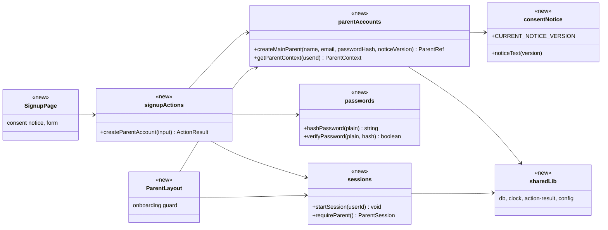
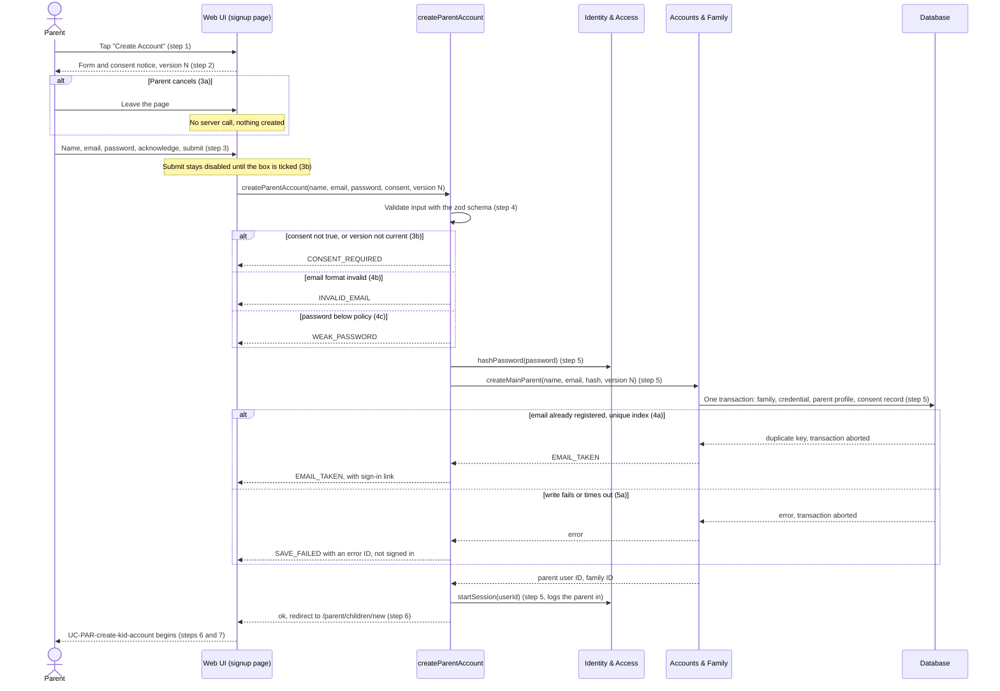
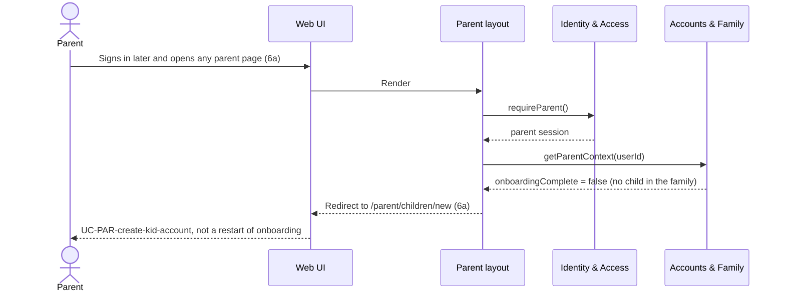
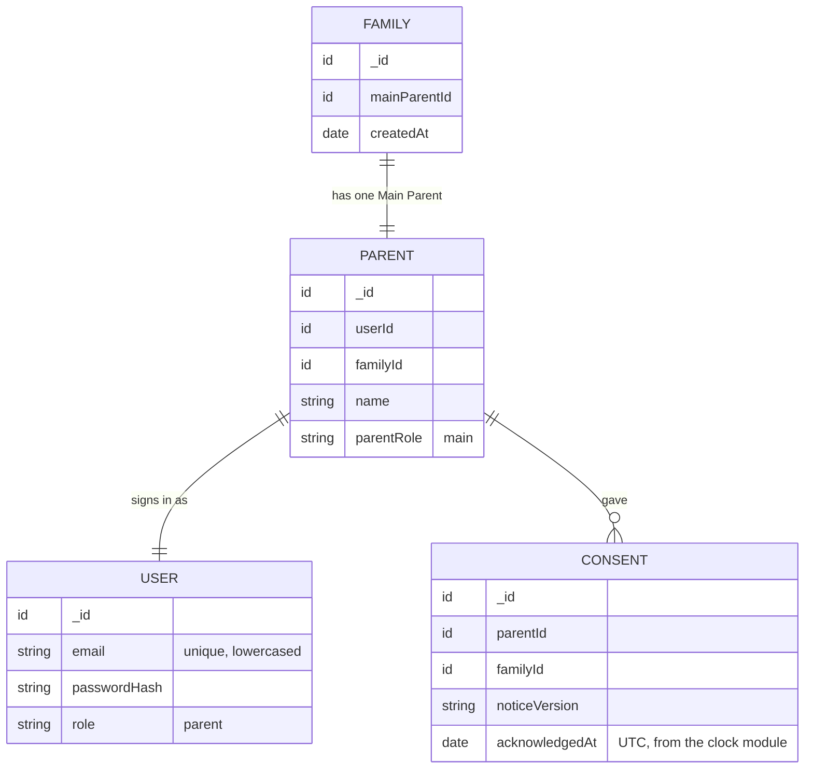

# Parent (PAR) Design

**Project:** BookBuddies
**Team:** Team 05
**Area:** `UC-PAR`

> **Realizes:** `UC-PAR-onboarding`, `FR-ACCT-consent`
> **Depends on:** `BR-parent-account-linked`, `BR-parent-creates-kid-account`, `BR-parent-account-structure`, `BR-coppa-parental-consent`, `FR-ACCT-parent-first`, `SEC-auth`, `SEC-role-authorization`, `CO-coppa-adjacent`, `AS-email-linking`
> **See:** [use cases, PAR area](../docs/requirements/use-cases.md#par-parent-feature-area), [specification](../docs/requirements/software-requirements-specification.md), [business rules](../docs/requirements/business-rules.md), [architecture-of-record](architectural-design.md)
> **Designed against:** `6aca106` (no application code exists yet)

---

_**How to use this template.** Copy it to `docs/design/<area>.md`, named for the lowercase area code (`ord.md` for `UC-ORD-*`). Instructions appear in italic square brackets; leave them in place until the document is stable, because the agent reads them on every later pass. The full worked example is Project Pulse's [`not.md`](https://github.com/Washingtonwei/project-pulse/blob/main/docs/design/not.md); read it for the shape, not for the answers._

_BookBuddies keeps its design documents in the top-level `design/` folder beside the [architecture-of-record](architectural-design.md), so this file is `design/par.md`._

_**What this document is.** The **design-of-record** for one use case area: how the code will realize its use cases, written **before** the code and approved before anyone builds from it. It is the last document your agent reads before it writes code, so anything it leaves out, the agent invents. Your [architecture-of-record](architectural-design.md) is the map of the whole system and stops at each component's responsibility; this document goes one level down, inside one area, against real code._

_**What it is not.** A copy of your use cases. It **cites** `UC-*`, `FR-*`, and `BR-*` by identifier and never restates what the system shall do; it says only how. It is also not a transcript of the code. Once code exists, link to the files rather than describing every class, column, or getter._

_**One document per area, not per use case.** Your area gains use cases over the term. The overview, the class diagram, and the data model are **revised in place** when it does. The sequence diagrams, the API contract rows, and the test rows are **appended**, one set per use case. Never add a `## UC-…` section that repeats the whole skeleton._

_**How much to write.** Pin down what a wrong guess would break: a requirement, a business rule, a quality attribute, or the contract between two parts of your team. Leave the rest for the agent to derive while it builds: variable names, field types, exact JSON, column lengths. When you are unsure, ask which side of that line a detail falls on, not whether it is interesting._

_**Write it in this order.** Each step is one person's or one pair's work, and the order is the point:_

1. _**Sketch it yourselves first.** Before you open the agent, draw the main success scenario's sequence diagram and write the API contract rows by hand, from the use case and your architecture-of-record. Twenty minutes, on paper or in this file._
2. _**Have the agent draft it.** Give the agent this template, the use case, the business rules it cites, your architecture-of-record's section 8 (Crosscutting Concepts), and the relevant existing code, and ask for a draft of this document. Use plan mode, so it proposes before it writes._
3. _**Compare the two.** Where the agent's draft differs from your sketch, decide which is right and why. What it found that you missed goes in; what you knew that it could not have known is the context your specification is missing, so fix the specification too._
4. _**Run the questions test** (the last section) and fix what it finds._
5. _**Open a pull request.** A teammate who did not write it reviews and approves it. Nobody starts an implementation branch from this design until it is merged._

_**Status of this draft.** Drafted by Claude on 2026-10-20 from use cases v0.10, business rules v0.3, the specification and architecture-of-record v0.4. Steps 1, 3, 4 and 5 above are still the team's to do. It covers `UC-PAR-onboarding` only; the other PAR use cases are appended as each is designed._

---

## Overview

_[One paragraph: what this area does, which components of your [architecture-of-record](architectural-design.md) it lives in, and what it reads from or calls in other areas. Link the container diagram rather than redrawing it. If this design changes the architecture-of-record, say so here and list the change under "Changes to the architecture-of-record" below.]_

The Parent area owns families: the Main Parent account and its consent record, Sub Parents, child accounts, and the parent's book suggestions, recap and reports. It is the Accounts & Family component of the Application container ([containers](architectural-design.md#51-containers), [use case areas and components](architectural-design.md#52-use-case-areas-and-components)). `UC-PAR-onboarding`, the first use case designed here, creates a family, its Main Parent and the consent record in one transaction, then signs the parent in through Identity & Access and hands off to `UC-PAR-create-kid-account`. Until the family has a child, every parent page sends the parent back to that hand-off (extension 6a). Onboarding calls no other area and no external system: it sends no email and touches neither the Child Identity Store nor Notification. This design does not change the architecture-of-record.

## Components & classes

_[One class diagram for the whole area, and one line per class or file saying what it does and whether it is **new** or **reused**. Show only what a reader needs to see how the parts relate: classes, their key methods, their dependencies. Fields and getters belong to the code._

_**If your repository has no code for this area yet**, which is the normal case for your proving slice, list the files you expect the agent to create, with the paths your architecture-of-record's conventions give them, and mark them all new. The agent then builds into the structure you chose rather than one it improvised._

_BookBuddies has no application code yet, so every file below is new. The paths follow section 8.2 of the architecture-of-record: pages and server actions under `src/app/`, and each component's server-only data-access functions in its own folder under `src/server/`, the only place its collections are touched (8.2.4).]_

- `src/app/(public)/signup/page.tsx` (new): the sign-up form (name, email, password) and the consent notice for `CURRENT_NOTICE_VERSION`, with an acknowledgment checkbox that starts unchecked. Redirects a signed-in user to the parent home.
- `src/app/(public)/signup/actions.ts` (new): the `createParentAccount` server action. In order (8.2.3): refuse if already signed in, validate with the zod schema, hash the password, call `createMainParent`, start the session, return the redirect.
- `src/app/(public)/signup/schema.ts` (new): the one zod schema for the sign-up input, imported by both the form (for friendliness) and the action (the check that counts, 8.2.5). Email is trimmed and lowercased here and nowhere else.
- `src/app/(parent)/layout.tsx` (new): the layout around every parent page. Calls `requireParent()` and, if the family has no child yet, redirects to `/parent/children/new` (extension 6a). The child-creation page itself sits outside this guard.
- `src/server/accounts-family/parent-accounts.ts` (new, server-only): `createMainParent` writes the family, the credential record, the parent profile and the consent record in one transaction. `getParentContext` returns the parent's family ID, parent role and whether onboarding is complete (the family has at least one child).
- `src/server/accounts-family/consent-notice.ts` (new, server-only): the consent wording, kept by version, and `CURRENT_NOTICE_VERSION`. The wording is a placeholder until the COPPA source arrives (`BR-coppa-parental-consent`).
- `src/server/identity-access/passwords.ts` (new, server-only): salted password hashing for every role (`KD-auth-sessions`). The algorithm is the team's choice; it lives only here.
- `src/server/identity-access/sessions.ts` (new, server-only): `startSession` is the sign-in glue `KD-auth-sessions` describes (create a database session through the Auth.js adapter and set the cookie), shared with the sign-in page. `requireParent` reads the session and refuses anything that is not a parent.
- `src/server/lib/db.ts`, `clock.ts`, `action-result.ts`, `config.ts` (new): the shared pieces section 8.2 names (one Mongo client per instance, the settable clock, the `{ ok, data | error }` helper, the validated environment). Onboarding is likely the first use case built, so it creates them; later areas reuse them.

## Sequence

_[One sequence diagram per use case for its main success scenario, plus one for each extension that does not just return an error. **Label each interaction with the use case step it implements**, so a reviewer can check that every step is realized and nothing extra was invented. Use `alt` blocks for extensions that branch off the main flow. Give each use case its own `###` heading; that heading is the anchor your traceability matrix cites.]_

### UC-PAR-onboarding: create a parent account

Extension 6a, the parent returns before any child exists:

## API contract

_[One row per endpoint, scheduled job, or message this area adds or changes, appended per use case. **This section is never dropped**: before the code exists it is the only thing the person (or agent session) building the front end and the one building the back end both read. Name the caller and who may call it, the request fields, the success response, and the error each extension returns. Leave field types and exact JSON to the agent unless a wrong guess would break something, such as a format another system depends on. Use the error shape your architecture-of-record's section 8.2 fixes; do not invent one here._

_BookBuddies' pages change data through server actions (8.2.3), so the rows are server actions and pages. Every result uses the `{ ok: true, data }` or `{ ok: false, error: { code, message } }` shape of 8.2.1.]_

| Endpoint or job | Caller (who may) | Request | Success | Errors, by extension |
|---|---|---|---|---|
| Server action `createParentAccount` (UC-PAR-onboarding) | Anyone **not** signed in; a signed-in session is refused with `ALREADY_SIGNED_IN` | Name, email, password, consent acknowledgment (must be literally `true`), the consent notice version the form showed | `ok`, with the redirect `/parent/children/new`; the session cookie is set | 3b: `CONSENT_REQUIRED` (also when the version is not the current one, so the parent re-reads the notice). 4a: `EMAIL_TAKEN`, and the page shows a sign-in link. 4b: `INVALID_EMAIL`. 4c: `WEAK_PASSWORD`. Name missing: `NAME_REQUIRED`. 5a: `SAVE_FAILED` with an error ID, nothing stored, no session. Any field error returns before anything is written. |
| Page `/signup` | Anyone not signed in | None | The form and the current consent notice | A signed-in user is redirected to the parent home. |
| Parent layout guard, every page under `/parent/` except `/parent/children/new` (UC-PAR-onboarding 6a) | A signed-in parent (Main or Sub) | None | The page renders | No session: redirect to sign-in. Not a parent: refused per 8.1. Family has no child: redirect to `/parent/children/new`. |

The path `/parent/children/new` is shared with `UC-PAR-create-kid-account`, which owns that page; both designs must use it.

## Key decisions

_[Only the decisions a reader could not recover from the code: an invariant, who may do this and how it is enforced, a trade-off you chose, a reason you reused something rather than writing it. **Each one names what you chose, what you rejected, and why.** If you cannot name an alternative you considered, it probably was not a decision; leave it out._

_A decision that affects the whole system rather than this area is an architecture decision. It belongs in your architecture-of-record as a `KD-*` entry, not here.]_

**What "onboarding complete" means.** It is derived: the family has at least one child account. Rejected: an `onboardingComplete` flag on the parent, set by `UC-PAR-create-kid-account`. A flag is a second source of truth that can disagree with the children that exist, for example if a child is later deleted (`FR-DATA-removal`), and `UC-PAR-onboarding` POST-4 is stated in terms of the child existing.

**Where extension 6a is enforced.** In the parent layout on the server, which every parent page goes through. Rejected: Next.js middleware alone, which section 8.1 says is never the check; and repeating the check in every parent server action, which adds nothing, because every other parent action works on a child of the family and with no child there is nothing for it to reach.

**A family record is created at onboarding.** `createMainParent` writes a family document, and the parent, and later Sub Parents and children, reference its ID. Rejected: children and Sub Parents pointing at the Main Parent's ID directly. Section 8.1 scopes a parent to "children linked to their family" and `BR-parent-account-structure` treats the family as the unit, so a Sub Parent's access would otherwise depend on a lookup through another parent's account.

**Email uniqueness is enforced by a unique index, not by checking first.** Email is trimmed and lowercased in one place (the sign-up schema) and stored that way, with a unique index. A duplicate-key error inside the transaction becomes `EMAIL_TAKEN` (4a). Rejected: "find by email, then insert", because two sign-ups with the same email at once would both pass the check, and `Parent@x.com` would register beside `parent@x.com`.

**Consent is a record with the notice version, not a boolean on the account.** The consent record holds the parent, the family, the notice version shown and the time from the clock module (8.2.2), written in the same transaction as the account (8.2.8). The action refuses a version that is not current. Rejected: a `consented: true` field. The wording is a placeholder until the COPPA source arrives (`BR-coppa-parental-consent`), so the team will need to know which wording each parent agreed to and which parents must be asked again.

**The session starts after the transaction commits.** The Auth.js adapter does not join our transaction, so the session is created once the account exists. If starting the session fails, the account stands, the parent is sent to sign in, and 6a then takes them to child creation. Rejected: deleting the new account when the session fails, which turns a sign-in hiccup into a lost account and a confusing `EMAIL_TAKEN` race. Extension 5a (no partial account) still holds, because the account's own records are all-or-nothing.

## Data model

_[The **change** this area makes to the data: new tables or entities, new columns, the migration that adds them. Draw an ER diagram when there is more than one new table. Do not redraw the domain model; your [specification](../docs/requirements/software-requirements-specification.md) owns it, so link it and show only the change. If the area changes nothing, say "No change" and give the reason in one line; that is a design decision too.]_

Onboarding adds four collections, all written in one transaction. `users` is the Auth.js adapter's collection, owned by Identity & Access; the other three belong to Accounts & Family. The child collections arrive with `UC-PAR-create-kid-account`.

Indexes: unique on `users.email`; on `parents.userId` and `parents.familyId`. MongoDB has no migrations; the indexes and the schema-validation backstop (8.2.5) are created by one idempotent setup script, run before the first deploy and by the integration-test setup. The `sessions` collection is Auth.js's own and is not designed here.

## Reuse & cross-cutting

_[Which existing services, components, and conventions this area uses rather than rebuilding: authentication, the error handler, email, the clock, another area's service. Cite your architecture-of-record's section 8.2 for each convention by name rather than restating it.]_

Nothing exists to reuse yet, so onboarding builds the shared pieces the conventions name, once, for every later area:

- **Authentication and sessions:** Identity & Access, Auth.js database sessions and the sign-in glue (`KD-auth-sessions`, 8.1 Authentication).
- **Authorization:** `requireParent` in Identity & Access (8.1 Authorization).
- **Error handling:** the shared result helper (8.2.1).
- **Time:** the clock module for the consent timestamp (8.2.2).
- **API conventions:** a verb-first server action; session, then validation, then the owning component (8.2.3).
- **Code conventions:** `server-only` on every module under `src/server/` (8.2.4).
- **Validation:** one zod schema shared by form and action (8.2.5).
- **Configuration:** the config module (8.2.6).
- **Logging:** the email, name and password are never logged, and neither is the reason a sign-up failed beyond its code (8.2.7).
- **Transactions:** a parent account and its consent record are one transaction (8.2.8).

Not used: Notification and the Email Service (onboarding sends nothing), the Child Identity Store, and the audit log (account creation is not in the 8.2.9 list).

## Tests

_[One row per flow: the main success scenario and **every** extension of every use case this document realizes, appended per use case. Name the level (unit or integration) and what the test asserts. No code. This list is the definition of done that the reviewer approves; the agent writes these tests when it builds, and a reviewer can see at a glance whether an extension has no test.]_

| Use case, flow | Level | Asserts |
|---|---|---|
| UC-PAR-onboarding main | integration | Valid input creates exactly one family, credential, parent profile (role `main`) and consent record with the current version and the clock's time; a session exists; the result redirects to `/parent/children/new` |
| UC-PAR-onboarding main | end-to-end | A new parent signs up, ticks consent and lands on the child-creation page (part of the core loop in 8.2.10) |
| UC-PAR-onboarding 3a | end-to-end | Leaving the form without submitting writes nothing |
| UC-PAR-onboarding 3b | unit | The schema refuses `consent` missing, `false` or a non-boolean, and a stale notice version, with `CONSENT_REQUIRED` |
| UC-PAR-onboarding 3b | integration | A request sent straight to the action without consent stores nothing |
| UC-PAR-onboarding 4a | integration | Signing up with an email already registered, in any letter case or with surrounding spaces, returns `EMAIL_TAKEN` and stores nothing new |
| UC-PAR-onboarding 4a, concurrent | integration | Two simultaneous sign-ups with one email leave exactly one account |
| UC-PAR-onboarding 4b | unit | Malformed emails are refused with `INVALID_EMAIL` |
| UC-PAR-onboarding 4c | unit | Passwords below the policy are refused with `WEAK_PASSWORD` (written once the policy is set, see Open questions) |
| UC-PAR-onboarding 5a | integration | A write that fails partway leaves no family, credential, parent or consent record, no session, and returns `SAVE_FAILED` with an error ID |
| UC-PAR-onboarding 6a | integration | A parent whose family has no child is redirected to `/parent/children/new` from every parent page; once a child exists, the pages render |
| Authorization | integration | A signed-in user calling `createParentAccount` gets `ALREADY_SIGNED_IN` and nothing is created |
| Credential storage | integration | The stored password is a hash, never the input; the action's logs contain no email, name or password |

## Changes to the architecture-of-record

_[Designing an area against real code is when the architecture's guesses meet reality. If this design needs a component the map does not have, moves a responsibility, or adds a dependency, **change [the architecture-of-record](architectural-design.md) in the same pull request** and list each change here in one line. If nothing changed, write "None". A design that silently disagrees with the architecture leaves two maps, and the agent will follow whichever it reads last.]_

None. The family record, the consent record and the parent-account transaction are already inside Accounts & Family's responsibility and section 8.2.8.

## Open questions & risks

_[What this design could not settle and who can, and what could go wrong that you are accepting. A question for the client also goes in [`OPEN-ISSUES.md`](../docs/requirements/OPEN-ISSUES.md).]_

- **Password policy (team).** Extension 4c and `UC-PAR-onboarding`'s data table leave the strength rule TBD. Proposed: at least 8 characters, no composition rules, with a sensible maximum length for the hashing algorithm. The 4c test cannot be written until the team settles it.
- **Consent wording (client).** `BR-coppa-parental-consent` is incomplete until Dr. Yang sends the COPPA rules link. The notice ships as version 1 placeholder text; recording the version makes it possible to re-ask every parent once the real wording exists.
- **No password reset exists (team).** Extension 4a offers a "sign-in or password-reset link", but no use case covers a parent resetting a password. The sign-in link can be built; the reset link has nowhere to go. Add a use case, or drop the reset link from 4a.
- **Is email verified? (client and team).** `CI-email-parent` and `AS-email-linking` say parent accounts are created by email, and the architecture lists "parent account emails" for the Email Service, but `UC-PAR-onboarding` sends nothing and does not verify the address. This design follows the use case and sends no email. If verification is wanted, it is a new step in the use case first.
- **Accepted risk: account enumeration.** Extension 4a tells anyone whether an email is registered. The use case asks for it, so this design keeps it. Failed sign-ups are slowed the same way as failed sign-ins (8.1).
- **Sub Parent and the 6a guard (team).** The guard applies to every parent, so a Sub Parent added to a family that still has no child would also be sent to child creation, which a Sub Parent may not do (`OI-21`). This cannot happen today, because a Main Parent cannot reach the Sub Parent page before a child exists, but `UC-PAR-create-sub-parent-account`'s design must keep it that way.

---

## Working this document with your agent

_[Delegate: drafting the diagrams from your sketch and the use case; listing the existing files a class should extend; filling the contract rows' request and response fields; proposing the test row for each extension; drafting the rejected alternative for a decision you have already made; checking that every identifier this document cites exists in the document that owns it._

_Keep human: which side of the "would a wrong guess break something" line each detail falls on; every key decision; and the approval, which is a teammate's review of the pull request, not the drafter's own reading._

_**The specific failure to watch for: scope that nobody asked for.** An agent drafting a design adds what designs it has read usually have: an admin override, a retry queue, a status field, a notification "while we are here". Each looks reasonable and none is in your use case, and once it is in the design the agent will build it, test it, and you will maintain it. Read the sequence labels: every interaction should name the use case step it implements. An interaction with no step is either a missing requirement, which goes to your specification and your client, or scope creep, which comes out.]_

---

## The questions test (before you open the pull request)

_[Start a **fresh** agent session in plan mode, so it carries nothing from the session that drafted this document. Give it only the use case, the business rules it cites, your architecture-of-record's section 8, and this document, and ask:_

> _List every point you would still have to guess to implement `<UC-ID>`. For each, say what you would guess and whether a wrong guess could violate a requirement. Do not write code._

_For each item on its list, either fix this document or keep the guess and write one line saying why a wrong guess breaks no requirement. Paste the list, with your answer to each item, into the pull request description under How it was verified, inside a collapsed `

Questions test
 … 
` block so the description stays short. The design is ready when nothing on the list could break a requirement.]_
