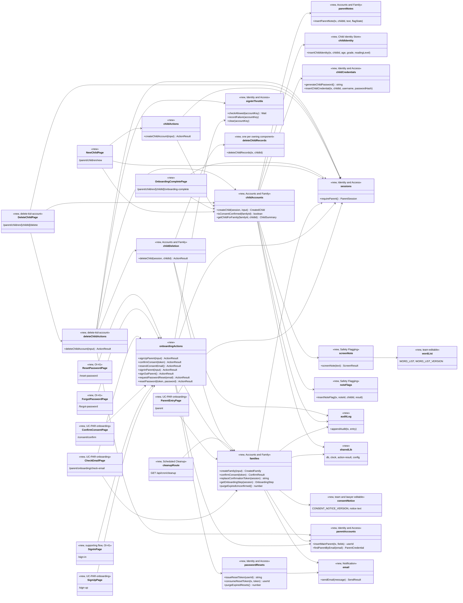
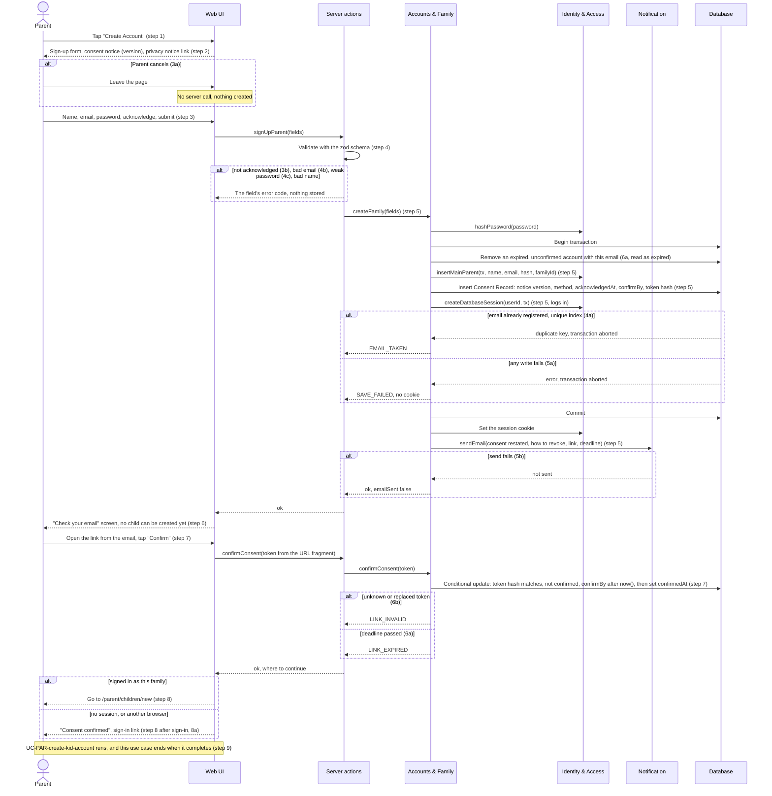
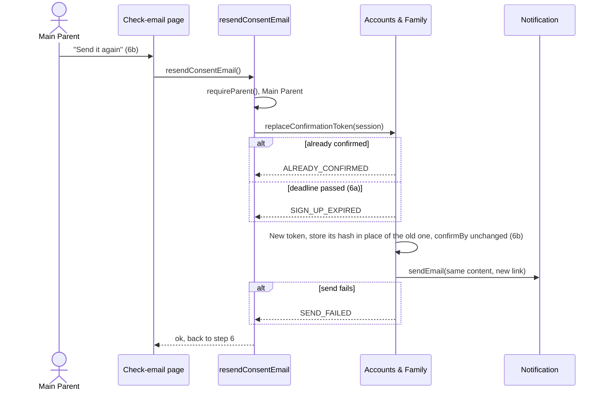
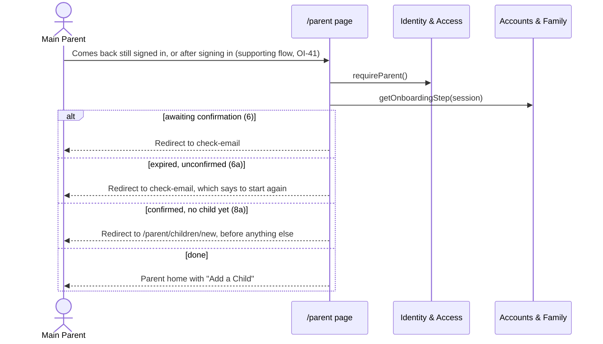
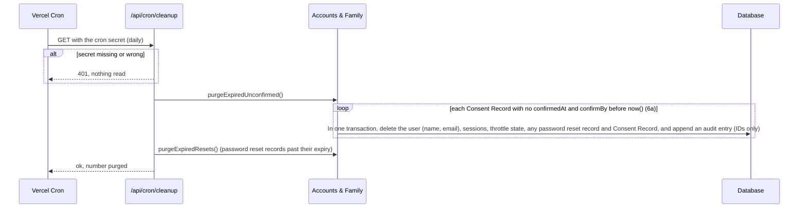
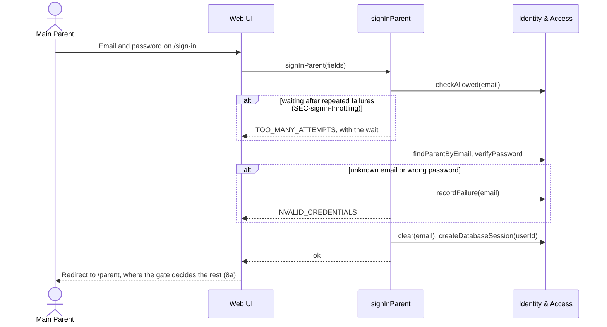
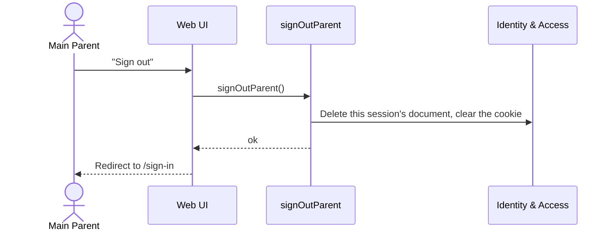
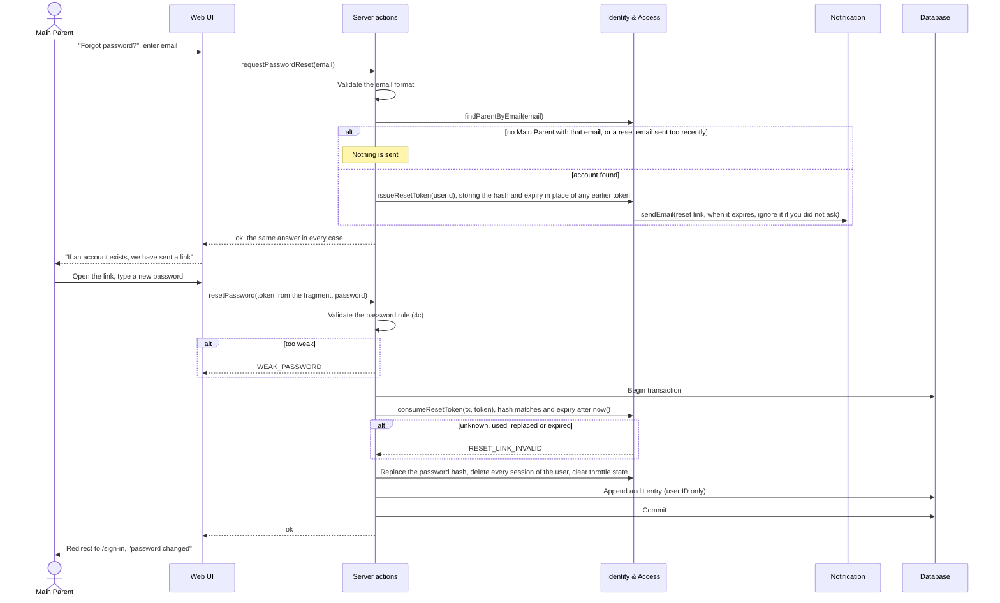
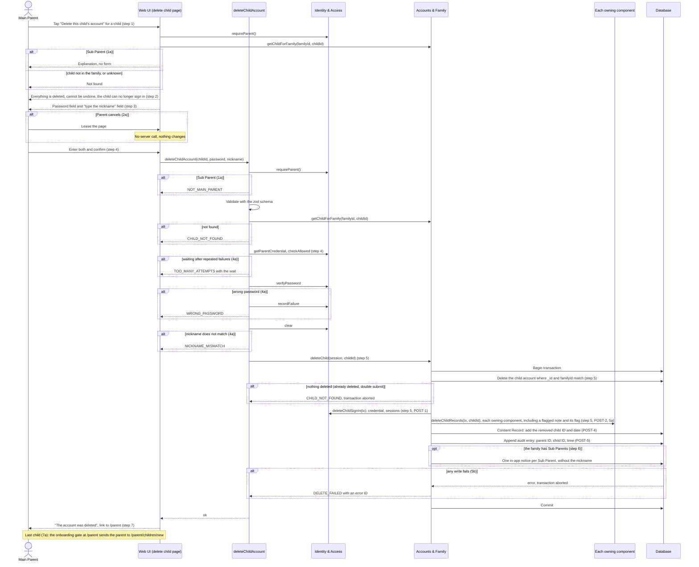
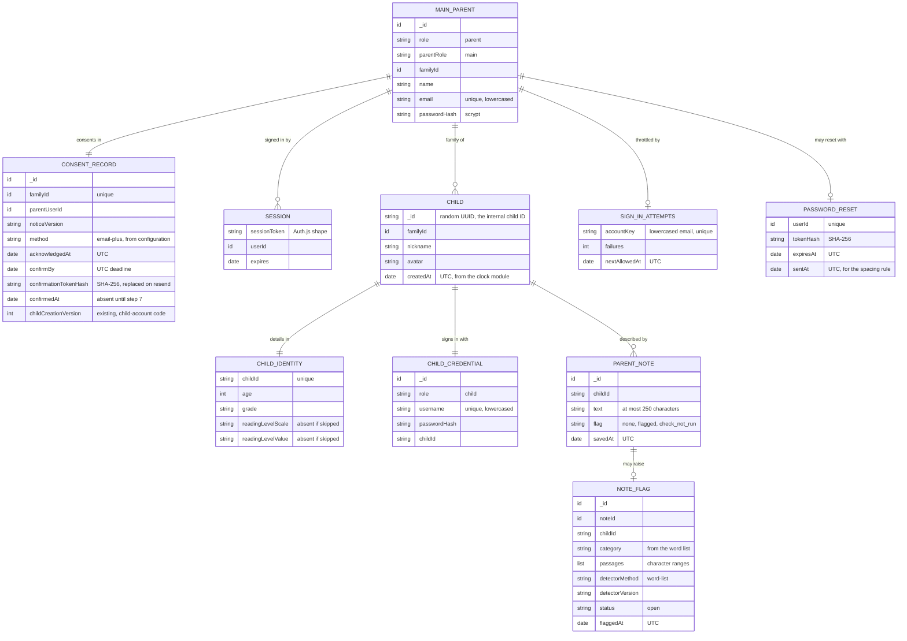

# Parent (PAR) Design

**Project:** BookBuddies
**Team:** Team 05
**Area:** `UC-PAR`

> **Realizes:** `UC-PAR-create-kid-account`, `UC-PAR-onboarding`, `FR-ACCT-parent-first`, `FR-ACCT-credentials`, `FR-ACCT-child-display` (collecting the nickname), `FR-ACCT-consent`, `FR-ACCT-consent-confirm`, `FR-ONB-profile`, `FR-ONB-level-optional`, `FR-NOTE-parent-note`, `FR-NOTE-flagging`, `FR-DATA-notice`, `DI-consent-record`, `SEC-signin-throttling` (Main Parent sign-in only, `OI-41`; and the password re-check of `UC-PAR-delete-kid-account`), `UC-PAR-delete-kid-account`, `FR-DATA-removal` (the whole-account path), `DI-disposal`
> **Depends on:** `BR-parent-account-linked`, `BR-parent-creates-kid-account`, `BR-parent-account-structure`, `BR-kid-data-stored`, `BR-kid-anonymous-profile`, `BR-coppa-parental-consent`, `BR-coppa-notice`, `BR-coppa-minimization`, `BR-coppa-retention`, `BR-coppa-no-third-party-disclosure`, `BR-no-reading-level-assessment`, `BR-reading-level-parent-entered`, `BR-reading-level-proxy`, `BR-admin-limited-view`, `BR-parent-note`, `BR-note-safety-flagging`, `DI-child-id`, `DI-child-stored`, `DI-child-credentials`, `DI-parent-note`, `DI-minimization`, `DI-integrity`, `DI-pii-segregation`, `DI-field-tables`, `DI-acquire`, `DI-retention`, `SEC-auth`, `SEC-role-authorization`, `SEC-pii-boundary`, `SAF-flag-delivery`, `CI-email-parent`, `SI-email-provider`, `DE-email-provider`, `KD-pii-segregation`, `KD-auth-sessions`, `KD-admin-flag-review`, `KD-time-rules-on-read`, `OI-21`, `OI-22`, `BR-coppa-parent-rights`, `FR-DATA-review`, `OI-18`, `OI-27`, `OI-42`, `OI-43`
> **See:** [use cases, PAR area](../docs/requirements/use-cases.md#par-parent-feature-area), [specification](../docs/requirements/software-requirements-specification.md), [business rules](../docs/requirements/business-rules.md), [glossary](../docs/requirements/project-glossary.md), [COPPA design requirements](../docs/coppa/coppa-design-requirements.md), [team decisions](../docs/Team_Decisions.md), [architecture-of-record](architectural-design.md)
> **Designed against:** `3493672` for `UC-PAR-create-kid-account` (no application code existed then); `d8beec6` for `UC-PAR-onboarding` (the child-account slice is built); `ce04601` (the onboarding design branch, on `main` at `8f27e55`) for `UC-PAR-delete-kid-account`

---

_**How to use this template.** Copy it to `design/<area>.md`, named for the lowercase area code (`ord.md` for `UC-ORD-*`). Instructions appear in italic square brackets; leave them in place until the document is stable, because the agent reads them on every later pass. The full worked example is Project Pulse's [`not.md`](https://github.com/Washingtonwei/project-pulse/blob/main/design/not.md); read it for the shape, not for the answers._

_BookBuddies keeps its design documents in the top-level `design/` folder beside the [architecture-of-record](architectural-design.md), so this file is `design/par.md`._

_**What this document is.** The **design-of-record** for one use case area: how the code will realize its use cases, written **before** the code and approved before anyone builds from it. It is the last document your agent reads before it writes code, so anything it leaves out, the agent invents. Your [architecture-of-record](architectural-design.md) is the map of the whole system and stops at each component's responsibility; this document goes one level down, inside one area, against real code._

_**What it is not.** A copy of your use cases. It **cites** `UC-*`, `FR-*`, and `BR-*` by identifier and never restates what the system shall do; it says only how. It is also not a transcript of the code. Once code exists, link to the files rather than describing every class, column, or getter._

_**One document per area, not per use case.** Your area gains use cases over the term. The overview, the class diagram, and the data model are **revised in place** when it does. The sequence diagrams, the API contract rows, and the test rows are **appended**, one set per use case. Never add a `## UC-…` section that repeats the whole skeleton._

_**How much to write.** Pin down what a wrong guess would break: a requirement, a business rule, a quality attribute, or the contract between two parts of your team. Leave the rest for the agent to derive while it builds: variable names, field types, exact JSON, column lengths. When you are unsure, ask which side of that line a detail falls on, not whether it is interesting._

_**Write it in this order.** Each step is one person's or one pair's work, and the order is the point:_

1. _**Sketch it yourselves first.** Before you open the agent, draw the main success scenario's sequence diagram and write the API contract rows by hand, from the use case and your architecture-of-record. Twenty minutes, on paper or in this file._
2. _**Have the agent draft it.** Give the agent this template, the use case, the business rules it cites, your architecture-of-record's section 8 (Crosscutting Concepts), and the relevant existing code, and ask for a draft of this document. Use plan mode, so it proposes before it writes._
3. _**Compare the two.** Where the agent's draft differs from your sketch, decide which is right and why. What it found that you missed goes in; what you knew that it could not have known is the context your specification is missing, so fix the specification too._
4. _**Run the questions test** (the last section) and fix what it finds._
5. _**Open a pull request.** A teammate who did not write it reviews and approves it. Nobody starts an implementation branch from this design until it is merged._

_**Status of this draft.** Rewritten from scratch by Claude on 2026-11-05 from use cases (v0.14 on), business rules v0.8, SRS v0.9, the glossary, `docs/coppa/`, `docs/Team_Decisions.md`, `CLAUDE.md` and the architecture-of-record v0.9, following `.claude/commands/design.md`. It replaces the 2026-10-27 draft, which collected and stored a child's real name and had no parent note; the client's 2026-10-28 answers made both obsolete. The developer's decisions of 2026-11-05 are folded in. The other PAR use cases are appended as each is designed. `UC-PAR-onboarding` was added on 2026-11-17 against the built child-account code, with the developer's decisions of that day: a minimal Main Parent sign-in, sign-out and password reset are included (no use case covers them yet, `OI-41`), email goes through Mailpit in development and Resend in production, a failed confirmation email keeps the account and offers resend, and the parent password follows a NIST-style length rule._

---

## Overview

_[One paragraph: what this area does, which components of your [architecture-of-record](architectural-design.md) it lives in, and what it reads from or calls in other areas. Link the container diagram rather than redrawing it. If this design changes the architecture-of-record, say so here and list the change under "Changes to the architecture-of-record" below.]_

The Parent area owns families: Main and Sub Parents, consent, child accounts, the parent's book suggestions and reports, and the parent's data rights. It is the Accounts & Family component of the Application container ([containers](architectural-design.md#51-containers), [use case areas and components](architectural-design.md#52-use-case-areas-and-components)). `UC-PAR-create-kid-account`, the first use case designed here, lets the Main Parent create a child once the family's consent is confirmed. The system holds **no real name** for the child; the child is a nickname, an avatar and an internal child ID (`DI-child-id`). One transaction writes the child account (nickname and avatar) in Accounts & Family, the child's age, grade and optional reading level in the Child Identity Store, and the child's username and password hash in Identity & Access (`KD-pii-segregation`, architecture §5.2). If the parent gave a note, the same transaction also writes the note (Accounts & Family) and, when the internal word list matches, its flag (Safety Flagging) and an audit entry. A flagged note needs no alert: it appears in the flag-review list of `UC-ADM-flag-review`. The plaintext password exists only in the response that shows it to the parent. After the parent acknowledges the credentials, the parent is sent into `UC-REC-kid-onboarding`, and returns to a completion message when that use case finishes.

`UC-PAR-onboarding` creates the family that every child hangs off. One transaction writes the Main Parent's user document and database session (Identity & Access) and the family's **Consent Record** (Accounts & Family); the confirmation email goes out through Notification after the commit. A family is identified by its `familyId`; there is no separate family collection, as the child-account code already assumes. "Awaiting confirmation" is not a status field: it is a Consent Record with no confirmation date and a stored `confirmBy` deadline, which every read compares against `now()` (`KD-time-rules-on-read`), and the Scheduled Cleanup cron route only purges what has already expired (6a). The confirmation link carries a single-use token that confirms consent without needing a session. An onboarding gate in Accounts & Family tells every parent entry point where a signed-in Main Parent belongs: awaiting confirmation (6), expired (6a), first child still needed (8a), or done. Sign-in, sign-out and password reset are **not part of this use case**. They are supporting flows with no use case of their own (`OI-41`), designed here for Main Parents at the developer's request (2026-11-17), with sign-in throttled (`SEC-signin-throttling`). Onboarding depends on only two of them: sign-in, so a parent who stops before finishing can come back and resume at 8a, and the password-reset link that 4a offers. They never decide onboarding state; the gate does. Email is sent over SMTP: Mailpit outside production, Resend in production (developer decision 2026-11-17, `DE-email-provider`, `SI-email-provider`). This design refines `KD-auth-sessions` and two lines of the architecture-of-record; see "Changes to the architecture-of-record".

`UC-PAR-delete-kid-account` lets the Main Parent delete one child and everything held about them (`FR-DATA-removal`). Every component that stores records keyed by the internal child ID exports one function, `deleteChildRecords(tx, childId)`, that deletes only its own records. Accounts & Family runs all of them in **one transaction**, together with the conditional delete of the child account, the child's sign-in records, the Consent Record entry for the removed child, the audit entry and any Sub Parent notices (§8.2.8), so either everything goes or nothing does (5b). The action re-checks the Main Parent's password through the same throttle as sign-in (`SEC-signin-throttling`) and checks the typed nickname (step 3). A flagged parent note and its flag are deleted like everything else (5a, team proposal 2026-11-19, `OI-43`). When the family's last child is gone, the onboarding gate already sends the Main Parent to `/parent/children/new` (7a); nothing new is needed for that.

## Components & classes

_[One class diagram for the whole area, and one line per class or file saying what it does and whether it is **new** or **reused**. Show only what a reader needs to see how the parts relate: classes, their key methods, their dependencies. Fields and getters belong to the code._

_**If your repository has no code for this area yet**, which is the normal case for your proving slice, list the files you expect the agent to create, with the paths your architecture-of-record's conventions give them, and mark them all new. The agent then builds into the structure you chose rather than one it improvised._

_No application code exists, so every file below is new. Paths follow architecture §8.2.3 and §8.2.4: pages and server actions under `src/app/`, and each component's server-only data-access functions under `src/server/<component>/`, the only place its collections are touched.]_



- `src/app/(parent)/parent/children/new/page.tsx` (new): the form (step 2) and, after a successful save, the credentials screen (step 7). Before rendering it calls `requireParent()`; a Sub Parent sees an explanation instead of the form (1b), and a family without confirmed consent is redirected to the "check your email" screen of `UC-PAR-onboarding` (1c). It shows a link to the online privacy notice next to the form (`FR-DATA-notice`, `BR-coppa-notice`), the note prompt of step 2, the reading-level referral links as plain outbound links (4e), a warning that does not block when the age is outside 6–11 (4b), and form text telling the parent the username must not be contact information or contain the nickname (4h). The privacy notice link comes from `config.ts` (`PRIVACY_NOTICE_URL`); the notice page itself is outside this use case. The submit button is disabled while the action is pending, and once the credentials screen is showing, no later response replaces it, so a double submit can never overwrite the only copy of the password (7a). On acknowledge (step 8) it navigates to `UC-REC-kid-onboarding` for this child (step 9), passing the child ID; `UC-REC-kid-onboarding` must check that ID against the session's family, and its route is that design's to name. This page sits outside the "no child yet" redirect that `UC-PAR-onboarding` 8a needs.
- `src/app/(parent)/parent/children/[childId]/onboarding-complete/page.tsx` (new): step 10. A parent of the child's family sees the "onboarding complete" message. `UC-REC-kid-onboarding` redirects here after its step 5. It shows no child detail beyond the nickname and holds no state of its own; a child ID outside the session's family is treated as not found.
- `src/app/(parent)/parent/children/new/actions.ts` (new): `createChildAccount`. In order (§8.2.3): `requireParent()`, refuse a Sub Parent, refuse unconfirmed consent, validate with the zod schema, call `createChild`. The family comes from the session, never from the request.
- `src/app/(parent)/parent/children/new/schema.ts` (new): the one zod schema, shared by form and action (§8.2.5): nickname, age, grade, username, optional reading level as a scale plus a value, optional note, avatar key. The cross-field rule "username does not contain the nickname" lives here. A reading level is both a scale and a value or neither; one without the other is `INVALID_READING_LEVEL`. The note is trimmed once here; the trimmed text is what is counted, screened and stored. When several fields fail, the action returns the first failing field in form order (the code identifies the field, since §8.2.1 has no field slot); the form runs the same schema in the browser to show every error inline.
- `src/server/accounts-family/child-accounts.ts` (new, server-only): `createChild` generates the child ID, hashes the generated password, calls `screenNote` **before** the transaction, and then in one transaction inserts the child account and calls the other components' insert functions with the transaction handle. It returns the child ID, the username and the plaintext password, and nothing is stored if any insert fails (5a, 6a). `isConsentConfirmed` reads the family's consent record (`DI-consent-record`) and is true only when that record has a confirmation date and has not been revoked; tests use fixtures of exactly that shape until `UC-PAR-onboarding` is designed. `getChildForFamily` returns the nickname and avatar only, and only for a child in that family.
- `src/server/accounts-family/parent-notes.ts` (new, server-only): `insertParentNote`. No read function is added here; the flag-review read comes with `UC-ADM-flag-review` and returns the text to that use case only (`KD-admin-flag-review`).
- `src/server/child-identity/child-identity.ts` (new, server-only): `insertChildIdentity`, the Child Identity Store's write path for a new child. No read function is added here.
- `src/server/identity-access/child-credentials.ts`, `passwords.ts`, `sessions.ts` (new, server-only): `generateChildPassword` (see Open questions for its rules), `insertChildCredential` (role `child`, the lowercased username, the hash, the child ID), salted hashing (`KD-auth-sessions`) and `requireParent()`, which returns `{ userId, familyId, role }` (`main` or `sub`), read from the user document through the Auth.js database session and never from the request.
- `src/server/safety-flagging/screen-note.ts` (new, server-only): `screenNote(text)`, a pure function. It returns `none`, `flagged` (with category and the character ranges that matched) or `check_not_run` (when the check throws), plus the detector's method (`word-list`) and version. It reads only `word-list.ts`. It screens the trimmed note, matches case-insensitively on whole-word boundaries with no stemming, and its character ranges are offsets into that same trimmed text, which is the text stored.
- `src/server/safety-flagging/word-list.ts` (new, **team-editable**): an exported array of `{ word, category }` and a `WORD_LIST_VERSION` constant. It ships with one placeholder entry and no real terms; the team adds words by editing this one file and raising the version. The categories are the ones `UC-ADM-flag-review` lists (violence, self-harm).
- `src/server/safety-flagging/note-flags.ts` (new, server-only): `insertNoteFlag`, writing the flag record the flag-review list reads.
- `src/server/audit/audit-log.ts` (new, server-only): `appendAudit`, append-only, IDs only (§8.2.9).
- `src/server/lib/db.ts`, `clock.ts`, `action-result.ts`, `config.ts` (new): one Mongo client per instance, the settable clock, the `{ ok, data | error }` helper and the validated environment (§8.2.1, §8.2.2, §8.2.6, §8.2.8).
- `src/server/accounts-family/avatars.ts` and `grades.ts` (new, server-only): the fixed avatar set and grade list the schema checks against.

Added for `UC-PAR-onboarding` (all new unless marked reused):

- `src/app/sign-up/page.tsx`, `actions.ts`, `schema.ts`: the form of step 2 (name, email, password, the consent notice with its version, an acknowledgment box that is never pre-checked, and the online privacy notice link from `getPrivacyNoticeUrl()` in [`config.ts`](../src/server/lib/config.ts)), and `signUpParent`. A visitor who is already signed in is redirected to `/parent`. One zod schema serves form and action (§8.2.5): the name is trimmed, the email is trimmed and lowercased once, the password rule is the table in [`par-field-values.md`](par-field-values.md), and the acknowledgment must be the literal `true` (3b).
- `src/app/consent/confirm/page.tsx`: the page the email links to. A client component reads the token from the URL **fragment** and shows a "Confirm" button that posts it to `confirmConsent` (step 7). Opening the page alone confirms nothing.
- `src/app/(parent)/parent/onboarding/check-email/page.tsx` and its `resendConsentEmail` action: step 6 and 6b. The path is the one [`access.ts`](../src/app/(parent)/parent/children/new/access.ts) already redirects to (`CHECK_EMAIL_PATH`). It shows the notice that the email could not be sent when sign-up reported it (5b), and "start again" once the deadline has passed (6a).
- `src/app/sign-in/page.tsx`, `actions.ts`: `signInParent`, a Main Parent's email and password (`OI-41`). Replaces the `SIGN_IN_PATH` placeholder in `access.ts`. On success it redirects to `/parent`. The page links to `/forgot-password`.
- `signOutParent` (server action, in `src/app/sign-in/actions.ts`): deletes the caller's own session document and clears the cookie, then redirects to `/sign-in` (`OI-41`). A "Sign out" button sits on `/parent` and on check-email.
- `src/app/forgot-password/page.tsx` and `requestPasswordReset`: the Main Parent enters their email; the page always shows the same "if an account exists, we've sent a link" answer (`OI-41`). Sign-up's 4a error and the sign-in page link here.
- `src/app/reset-password/page.tsx` and `resetPassword`: like `/consent/confirm`, a client component reads the token from the URL **fragment**; the parent types a new password, and the page posts token and password together. On success it redirects to `/sign-in` with a "password changed" message.
- `src/server/identity-access/password-resets.ts` (server-only): `issueResetToken` (a new token replaces any earlier one for that user, respecting the minimum spacing between reset emails), `consumeResetToken` (single use, inside the reset transaction) and `purgeExpiredResets`. It owns `passwordResets`.
- `src/app/(parent)/parent/page.tsx`: the parent entry point. It calls `requireParent()` and `getOnboardingStep()` and redirects: awaiting confirmation to check-email, first child still needed to `/parent/children/new` (8a). A family that is done sees a placeholder home with an "Add a Child" link (`UC-PAR-create-kid-account` trigger b); the dashboard itself belongs to `UC-PAR-view-growth-report`.
- `src/server/accounts-family/families.ts` (server-only): `createFamily` (the sign-up transaction, then the email), `confirmConsent`, `replaceConfirmationToken` (6b), `getOnboardingStep` (`awaiting`, `expired`, `needs-first-child` or `complete`, read from the Consent Record and whether the family has a child) and `purgeExpiredUnconfirmed` (6a). It owns `consentRecords`. [`child-accounts.ts`](../src/server/accounts-family/child-accounts.ts) (reused) already reads that collection; its contract (one record per family, `confirmedAt`, no `revokedAt`, the `childCreationVersion` counter) is kept as is.
- `src/server/accounts-family/consent-notice.ts` (team- and lawyer-editable): `CONSENT_NOTICE_VERSION` and the direct notice text, with the elements `BR-coppa-notice` lists, including that the parent's name and email are deleted if consent is not confirmed in time. Ships as placeholder wording until the legal review (`OI-20`, `OI-21`). Changing the text means raising the version.
- `src/server/identity-access/parent-accounts.ts` (server-only): `insertMainParent(tx, …)` and `findParentByEmail`, which returns the user ID, family ID, role and password hash and nothing else.
- `src/server/identity-access/sessions.ts` (reused): gains `createDatabaseSession(userId, tx?)`, which writes a session document in the Auth.js adapter's shape into `sessions` and sets the `next-auth.session-token` cookie the existing fixtures use (httpOnly, Secure, SameSite=Lax, §8.1). Sign-up calls it inside its transaction and sets the cookie only after commit.
- `src/server/identity-access/sign-in-throttle.ts` (server-only): counts failed sign-ins per account key (the lowercased email) and returns how long the caller must wait. Values are the throttling table in `par-field-values.md`.
- `src/server/identity-access/passwords.ts` (reused unchanged): scrypt hashing and verification for the parent password.
- `src/server/identity-access/indexes.ts` (reused): gains a unique index on `users.email`, partial on `email` being a string; `consentRecords` gets a unique index on `familyId`.
- `src/server/notification/email.ts` (server-only): `sendEmail({ to, subject, text })` over SMTP with **nodemailer**, returning `{ ok }` without the exception. Mailpit (`smtp://localhost:1025`, web UI on 8025) in development, the demo and CI; Resend's SMTP interface in production (host `smtp.resend.com`, user `resend`, the Resend API key as the password, all inside the `SMTP_URL` secret in Vercel's production environment, §8.1 Secrets). `MAIL_FROM` is an address on a domain verified in Resend. In production, with no `SMTP_URL` configured, it refuses to send (fail closed, the same pattern as `getPrivacyNoticeUrl`). A person must confirm the nodemailer package before it is added (CLAUDE.md).
- `src/app/api/cron/cleanup/route.ts` and `vercel.json` (daily schedule): the Scheduled Cleanup route. It accepts only `Authorization: Bearer <CRON_SECRET>` and calls `purgeExpiredUnconfirmed` (§8.1 trust boundary, §8.2.3).
- `src/server/lib/config.ts` (reused): gains `APP_URL` (to build the link), `SMTP_URL`, `MAIL_FROM`, `CRON_SECRET`, `CONSENT_CONFIRMATION_DAYS` (default 14, `OI-22`) and `CONSENT_METHOD` (an enum whose only value is `email-plus`, `OI-21`) (§8.2.6).
- Reused as they are: `action-result.ts`, `clock.ts`, `db.ts` (`withTransaction`), `log.ts`, `audit-log.ts`, and the `/privacy-notice` placeholder page.

Added for `UC-PAR-delete-kid-account` (new unless marked reused or extended):

- `src/app/(parent)/parent/children/[childId]/delete/page.tsx`: steps 2–3 and 7. It calls `requireParent()` and `getChildForFamily` (reused); a Sub Parent sees an explanation and no form (1a), and a child outside the family is not found. It shows the child's nickname and avatar, the statement of step 2, a password field and a "type the nickname" field. The submit button is disabled while the action is pending. On `ok` the page replaces the form with the confirmation of step 7 and a link to `/parent`, where the onboarding gate handles 7a. Leaving the page is the cancel (2a). No page links here yet; see Open questions, "Where the delete link lives".
- `.../[childId]/delete/actions.ts` and `schema.ts`: `deleteChildAccount`. In order (§8.2.3): `requireParent()`; refuse a Sub Parent (1a); validate with the zod schema (password and nickname present, the child ID a UUID from the route); `getChildForFamily`, so another family's child is not found before anything else is revealed; then the password check and the nickname check (4a, below); then `deleteChild`. The family comes from the session and the child ID from the route, never from the form. It does **not** check that consent is confirmed, because `UC-PAR-revoke-consent` 2a sends a parent here after revoking.
- `src/server/identity-access/parent-accounts.ts` (extended): `getParentCredential(userId)`, returning the lowercased email (the throttle's account key) and the password hash, and nothing else.
- `src/server/identity-access/sign-in-throttle.ts` and `passwords.ts` (reused): the password re-check calls `checkAllowed`, `verifyPassword`, then `recordFailure` on a wrong password or `clear` on a right one, with the same account key as sign-in, so failures here and at sign-in share one count (`SEC-signin-throttling`).
- `src/server/accounts-family/child-deletion.ts` (server-only): `deleteChild(session, childId)` runs the transaction in the sequence diagram and maps failures to the codes in the API contract. It is the only function that calls every component's `deleteChildRecords`, and the list of those calls lives in this one file.
- `deleteChildRecords(tx, childId)`, one per owning component, each deleting only its own collections (§8.2.4):
  - Accounts & Family, `parent-notes.ts` (extended): the child's parent notes. Per-child exclusions and book reports are added here when `UC-PAR-report-book` builds them: exclusions are deleted, and each report keeps its book and reason but loses its child reference (the use case's Associated Information).
  - Child Identity Store, `child-identity.ts` (extended): the identity record.
  - Identity & Access, `child-credentials.ts` (extended, named `deleteChildSignIn`): the child's `users` document, every `sessions` document with that user ID (POST-1), and, once they exist, the child's sign-in time records (`DI-usage-records`).
  - Safety Flagging, `note-flags.ts` (extended): the child's note flags, whatever their status (5a). Dangerous content list entries for the child are added here when `UC-ADM-flag-review` builds the list.
  - Recommendation, `reading-profiles.ts` (extended when it is built, `design/rec.md`): the reading profile, and later the interest profile, batches, reactions and decline reasons.
  - Shelf and Notification: their own records (shelf, shelf history, ratings, shelf requests, notices) when those collections are built.
- `src/server/accounts-family/families.ts` (extended): `markChildRemoved(tx, familyId, childId)` adds the child ID and date to the Consent Record (POST-4).
- `src/server/audit/audit-log.ts` (extended): `appendChildDeletedAudit(tx, parentUserId, childId)`, the event `child-account-deleted` (POST-5).
- Notification (new when Sub Parents exist): `insertNotice(tx, recipientUserId, kind)` for step 6. Sub Parent accounts and in-app notices are not built yet (`UC-PAR-create-sub-parent-account`), so until they are, `deleteChild` finds no Sub Parents and writes no notice.

## Sequence

_[One sequence diagram per use case for its main success scenario, plus one for each extension that does not just return an error. **Label each interaction with the use case step it implements**, so a reviewer can check that every step is realized and nothing extra was invented. Use `alt` blocks for extensions that branch off the main flow. Give each use case its own `###` heading; that heading is the anchor your traceability matrix cites.]_

### UC-PAR-create-kid-account: create a linked child account

```mermaid
sequenceDiagram
    actor P as Main Parent
    participant UI as Web UI (new child page)
    participant ACT as createChildAccount
    participant IA as Identity & Access
    participant AF as Accounts & Family
    participant SF as Safety Flagging
    participant CIS as Child Identity Store
    participant DB as Database
    P->>UI: Arrive from UC-PAR-onboarding or tap "Add a Child" (step 1)
    UI->>IA: requireParent()
    UI->>AF: isConsentConfirmed(familyId)
    alt Sub Parent (1b)
        UI-->>P: Explanation, no form
    else consent not confirmed (1c)
        UI-->>P: Redirect to "check your email" (UC-PAR-onboarding step 6)
    end
    UI-->>P: Form with note prompt and privacy notice link (step 2)
    alt Parent cancels (1a)
        P->>UI: Leave the page
        Note over UI: No server call, nothing created
    end
    P->>UI: Fill in and submit (step 3)
    Note over UI: Age outside 6-11 warns, never blocks (4b); referral links for the unsure (4e)
    UI->>ACT: createChildAccount(fields)
    ACT->>IA: requireParent()
    ACT->>AF: isConsentConfirmed(familyId)
    alt Sub Parent (1b)
        ACT-->>UI: NOT_MAIN_PARENT
    else consent not confirmed (1c)
        ACT-->>UI: CONSENT_NOT_CONFIRMED
    end
    ACT->>ACT: Validate with the zod schema (step 4)
    alt a field fails (4a, 4c, 4d, 4f, 4h, 4i)
        ACT-->>UI: The field's error code
    end
    ACT->>AF: createChild(session, fields) (step 5)
    opt a note was given (step 5.1)
        AF->>SF: screenNote(text)
        alt the check throws (5b)
            SF-->>AF: check_not_run
        else matches the word list
            SF-->>AF: flagged, category, passages
        else no match
            SF-->>AF: none
        end
    end
    AF->>IA: generateChildPassword(), hashPassword() (step 6)
    AF->>DB: Begin transaction
    AF->>DB: Insert child account: family, nickname, avatar (step 5)
    AF->>CIS: insertChildIdentity(tx, age, grade, reading level) (step 5)
    AF->>IA: insertChildCredential(tx, username, hash) (step 6)
    opt a note was given
        AF->>DB: Insert parent note with its flag state (step 5)
        opt flagged (step 5.1)
            AF->>SF: insertNoteFlag(tx, note, category, passages)
            AF->>DB: Append audit entry (IDs only)
        end
    end
    alt username taken, unique index (4g)
        DB-->>AF: duplicate key, transaction aborted
        AF-->>ACT: USERNAME_TAKEN
    else any write fails (5a, 6a)
        DB-->>AF: error, transaction aborted
        AF-->>ACT: SAVE_FAILED
    end
    AF->>DB: Commit
    AF-->>ACT: child ID, username, plaintext password
    ACT-->>UI: ok, credentials (response only)
    UI-->>P: Username, password, "Tell your child to log in with these credentials." (step 7)
    P->>UI: Acknowledge (step 8)
    UI-->>P: Go to UC-REC-kid-onboarding for this child (step 9)
    Note over UI,P: UC-REC-kid-onboarding runs; on its step 5 it redirects to the completion page
    UI-->>P: "Onboarding complete" message, use case ends (step 10)
```

### UC-PAR-onboarding: create a parent account



#### Resend the confirmation email (6b)



#### Resuming onboarding: the gate (8a)



#### Purge an unconfirmed account (6a)



### Supporting flows (`OI-41`): sign-in, sign-out, password reset

These are **not steps of `UC-PAR-onboarding`**, and no use case covers them yet (`OI-41`). The developer chose to design them here, for Main Parents only. Onboarding relies on two of them: sign-in, so a parent who stops before finishing can return to the gate (8a), and the password-reset link 4a offers. None of them reads or decides onboarding state; after sign-in, the gate on `/parent` does.

#### Sign in



#### Sign out



#### Reset a forgotten password



### UC-PAR-delete-kid-account: delete a child account



## API contract

_[One row per endpoint, scheduled job, or message this area adds or changes, appended per use case. **This section is never dropped**: before the code exists it is the only thing the person (or agent session) building the front end and the one building the back end both read. Name the caller and who may call it, the request fields, the success response, and the error each extension returns. Leave field types and exact JSON to the agent unless a wrong guess would break something, such as a format another system depends on. Use the error shape your architecture-of-record's section 8.2 fixes; do not invent one here._

_Pages change data through server actions (§8.2.3), and every result uses the `{ ok: true, data }` or `{ ok: false, error: { code, message } }` shape of §8.2.1.]_

| Endpoint or job | Caller (who may) | Request | Success | Errors, by extension |
|---|---|---|---|---|
| Page `/parent/children/new` (UC-PAR-create-kid-account) | A signed-in Main Parent whose family's consent is confirmed | None | The form, the avatar set, the grade list, the accepted reading-level scales, the referral links, the note prompt and the online privacy notice link (`FR-DATA-notice`) | 1b: a Sub Parent sees an explanation and no form. 1c: redirect to the "check your email" screen. No session: redirect to sign-in. |
| Server action `createChildAccount` (UC-PAR-create-kid-account) | A signed-in Main Parent whose family's consent is confirmed; the family comes from the session | Nickname, age, grade, username, avatar key, reading level (scale and value, or none), note (or none) | `ok` with the child ID, the username and the generated password. The password is in this response only, and the response is never cached. The result does not say whether the note was flagged | 1b: `NOT_MAIN_PARENT`. 1c: `CONSENT_NOT_CONFIRMED`. 4a: `NICKNAME_REQUIRED`, or `INVALID_NICKNAME` for anything but letters and numbers. 4i: `NOTE_TOO_LONG`. 4c: `INVALID_GRADE`. 4f: `USERNAME_REQUIRED`. 4h: `INVALID_USERNAME` (format, or contact information) or `USERNAME_CONTAINS_NICKNAME`. 4g: `USERNAME_TAKEN`. 4d: `INVALID_READING_LEVEL`, with the accepted scales. An age that is not a whole number in the accepted range: `INVALID_AGE`. A missing or unknown avatar: `INVALID_AVATAR`. 5a and 6a: `SAVE_FAILED` with an error ID, nothing stored. 4b (age outside 6–11), 4e and 5b are not errors. Not a parent: refused (§8.1). |
| Page `/parent/children/[childId]/onboarding-complete` (UC-PAR-create-kid-account step 10) | A signed-in parent of the child's family | The child ID in the path | The "onboarding complete" message and the child's nickname | A child ID outside the session's family, or unknown: not found, with no hint which. No session: redirect to sign-in. |
| Page `/sign-up` (UC-PAR-onboarding steps 1–2) | Anyone not signed in | None | The form, the consent notice and its version, the online privacy notice link (`FR-DATA-notice`) | Already signed in: redirect to `/parent`. |
| Server action `signUpParent` (UC-PAR-onboarding steps 3–5) | Anyone | Name, email, password, acknowledgment | `ok` with `emailSent` (true or false); the session cookie is set. Nothing about the family or the token is returned | 3b: `CONSENT_NOT_ACKNOWLEDGED`. Name: `NAME_REQUIRED` or `INVALID_NAME`. 4b: `INVALID_EMAIL`. 4c: `WEAK_PASSWORD`. 4a: `EMAIL_TAKEN`, and the page offers a sign-in link. 5a: `SAVE_FAILED` with an error ID, nothing stored, no cookie. 5b (send fails) is not an error: `emailSent` is false. |
| Page `/parent/onboarding/check-email` (UC-PAR-onboarding step 6) | A signed-in Main Parent whose consent is awaiting confirmation | None | "Check your email", the resend button, and the could-not-send notice after 5b | Confirmed: redirect to `/parent`. Expired (6a): "your sign-up expired, please start again", with a link to `/sign-up`. No session: redirect to `/sign-in`. |
| Server action `resendConsentEmail` (UC-PAR-onboarding 6b) | A signed-in Main Parent whose consent is awaiting confirmation; the family comes from the session | None | `ok`; the earlier link no longer works; the deadline is unchanged | `NOT_MAIN_PARENT`. `ALREADY_CONFIRMED`. 6a: `SIGN_UP_EXPIRED`. `SEND_FAILED` (the new token is kept, so the parent can try again). Not signed in: refused (§8.1). |
| Page `/consent/confirm` (UC-PAR-onboarding step 7) | Anyone holding the link | The token, in the URL fragment, never sent to the server by the page load | The "Confirm" button | None at load: the page confirms nothing on its own. |
| Server action `confirmConsent` (UC-PAR-onboarding step 7) | Anyone holding the token; no session needed | The token | `ok` with where to continue: `/parent/children/new` when the caller's session belongs to that family (step 8), otherwise `/sign-in` | `LINK_INVALID` for an unknown or replaced token (6b), with no hint which. 6a: `LINK_EXPIRED`. The same link used again after it confirmed: `ok`, nothing changes. |
| Page `/parent` (UC-PAR-onboarding 8a) | A signed-in parent | None | Redirect by onboarding step: awaiting to check-email (6), first child needed to `/parent/children/new` (8a), done to the parent home | No session: redirect to `/sign-in`. Expired: as check-email. |
| Route `GET /api/cron/cleanup` (UC-PAR-onboarding 6a) | Vercel Cron only, with `Authorization: Bearer <CRON_SECRET>` | None | `{ ok: true, data: { purged } }` | Missing or wrong secret: 401 with `{ ok: false, error: { code: "UNAUTHORIZED" } }`, nothing read. Unexpected failure: `{ ok: false, error: { code: "CLEANUP_FAILED", errorId } }`; the next run tries again. |
| Server action `signInParent` (supporting flow, `OI-41`; lets a parent come back to resume at 8a) | Anyone | Email, password | `ok`; a database session and its cookie; the page redirects to `/parent`, where the gate decides the rest | `INVALID_CREDENTIALS`, the same for an unknown email and a wrong password. `TOO_MANY_ATTEMPTS` with the wait in seconds (`SEC-signin-throttling`). A child or admin account signing in here: `INVALID_CREDENTIALS`. No onboarding check: an expired, unconfirmed parent signs in and the gate tells them to start again. |
| Server action `signOutParent` (supporting flow, `OI-41`) | A signed-in Main Parent | None | `ok`; this session's document is deleted and the cookie cleared; the page redirects to `/sign-in` | Not signed in: `NOT_SIGNED_IN` (nothing to end). |
| Page `/forgot-password` (supporting flow, `OI-41`; linked from 4a and the sign-in page) | Anyone | None | The email form | None. |
| Server action `requestPasswordReset` (supporting flow, `OI-41`) | Anyone | Email | `ok`, the same answer whether or not an account exists and whether or not an email was sent | `INVALID_EMAIL` for a malformed address only. A send failure is logged and still answers `ok`, so the answer reveals nothing. |
| Page `/reset-password` (supporting flow, `OI-41`) | Anyone holding the link | The token, in the URL fragment | The new-password form | None at load: nothing changes until the form is submitted. |
| Server action `resetPassword` (supporting flow, `OI-41`) | Anyone holding the token; no session needed | Token, new password | `ok`; the password is replaced, every session of that parent is ended, and the page redirects to `/sign-in` | `RESET_LINK_INVALID` for an unknown, used, replaced or expired token, with no hint which. `WEAK_PASSWORD` (the 4c rule), with the token still usable. `SAVE_FAILED` with an error ID, nothing changed. |
| Page `/parent/children/[childId]/delete` (UC-PAR-delete-kid-account) | A signed-in Main Parent of the child's family | The child ID in the path | The statement of step 2, the child's nickname and avatar, and the password and nickname fields of step 3 | 1a: a Sub Parent sees an explanation and no form. A child outside the family, or unknown: not found, with no hint which. No session: redirect to sign-in. |
| Server action `deleteChildAccount` (UC-PAR-delete-kid-account) | A signed-in Main Parent of the child's family; consent need not be active (`UC-PAR-revoke-consent` 2a); the family comes from the session | Child ID (from the route), password, typed nickname | `ok` with no data | Not signed in or not a parent: `NOT_SIGNED_IN`, `NOT_A_PARENT`. 1a: `NOT_MAIN_PARENT`. Child outside the family, unknown or already deleted: `CHILD_NOT_FOUND`. 4a: `WRONG_PASSWORD`, `NICKNAME_MISMATCH`, or `TOO_MANY_ATTEMPTS` with the wait in seconds. 5b: `DELETE_FAILED` with an error ID, nothing deleted. 2a and 5a are not errors. |

The Sub Parent notice of step 6 says that a child account in the family was deleted by the Main Parent. It does not hold the nickname, because the nickname is the deleted child's data (`FR-DATA-removal`).

The password reset email goes only to the Main Parent's own address. It holds the link and when it expires, says to ignore it if the parent did not ask, and holds no child data.

The confirmation email (`CI-email-parent`) goes to the parent's own address only. It restates what was consented to, names the notice version, says how to revoke (in words: account settings; the revoke link waits for `UC-PAR-revoke-consent`), gives the link and the date it stops working, and holds no child data (no child exists yet).

The parent's screens may show the child's nickname and avatar. The system holds no real name. Nothing in this use case sends the age, grade, reading level or note to a child's screen (`FR-ACCT-child-display`, `BR-parent-note`, §8.2.11).

## Key decisions

_[Only the decisions a reader could not recover from the code: an invariant, who may do this and how it is enforced, a trade-off you chose, a reason you reused something rather than writing it. **Each one names what you chose, what you rejected, and why.** If you cannot name an alternative you considered, it probably was not a decision; leave it out._

_A decision that affects the whole system rather than this area is an architecture decision. It belongs in your architecture-of-record as a `KD-*` entry, not here.]_

**One child is records in three components, written in one transaction.** Accounts & Family holds the child account (opaque ID, family, nickname, avatar) and the parent note; the Child Identity Store holds age, grade and reading level; Identity & Access holds the username and password hash; Safety Flagging holds a flag when one is raised. Accounts & Family opens the transaction and passes its handle to the other components' insert functions, so each still owns its own collection (§8.2.4). Rejected: one child document with every field, which `KD-pii-segregation` rejects because one forgotten projection would leak the child's details; and separate writes, which can leave a child with no credentials, or a note with no flag, against 5a, 6a, `DI-integrity` and `SAF-flag-delivery`.

**The child ID is a random UUID, not a MongoDB ObjectId.** An ObjectId embeds its creation time and is sequential within a process, so it is not opaque (`DI-child-id`). Rejected: ObjectId, for that reason.

**The word-list check runs before the transaction, as a pure function, and a failure of the check never blocks the profile.** If `screenNote` throws, the note is saved with the flag state `check_not_run` and the child is created (5b). Rejected: running the check inside the transaction, where a detector failure would abort child creation against 5b; and swallowing the failure without recording it, which would let an unscreened note look clean. No re-run is designed: no use case owns one, and 5b is edited to say so.

**The word list is one team-editable file with a version constant.** The word list and categories are not written yet (`SAF-detection-pending`, `OI-19`). Every flag stores the detector's method and version, so a better detector can replace the file's contents or the whole function without reshaping data (`FR-NOTE-flagging`). Rejected: storing the list in the database or an admin screen, which no use case asks for.

**A flag is a record the flag-review list reads; there is no separate admin alert.** The developer decided on 2026-11-05 that an alert is not needed as long as the flag appears in the list of `UC-ADM-flag-review`. The flag is still saved in the same transaction as the note, so a note can never be stored flagged without a flag record (`SAF-flag-delivery`), and an audit entry is written for the flag (§8.2.9). Rejected: an in-app alert through Notification, which the developer dropped as extra work with no gain over the list.

**The flag record references the note by ID; the note text is stored once.** Rejected: copying the text into the flag entry, which would be a second copy of text about a child to export and delete (`FR-DATA-removal`, `BR-coppa-minimization`). `UC-ADM-flag-review` reads the text through a narrow Accounts & Family function when it is designed.

**The password is generated before the transaction and shown from the action's response only.** It is never stored in plaintext, put in a URL, logged or cached, and cannot be fetched again after the parent leaves the screen (7a). Rejected: storing it encrypted so the parent could view it later, which `FR-ACCT-credentials` and §8.1 rule out. A new password is a reset, which is `OI-26`.

**Main Parent and consent are checked in the action, not only by hiding the button.** Any action can be called directly (§8.1, `SEC-role-authorization`, `FR-ACCT-parent-first`). Rejected: relying on the page, which 1b says can be bypassed.

**The family comes from the session.** The request carries no family or parent ID. Rejected: taking it from the form, which would let a request attach a child to another family (`DI-integrity`).

**Usernames are unique across every account that signs in with one, case-insensitively.** They are trimmed and lowercased once, in the schema, and stored that way with a unique index; a duplicate key inside the transaction becomes `USERNAME_TAKEN` (4g). Sub Parents also sign in with a username (§8.1), so the index covers child and Sub Parent credentials alike. Rejected: "check, then insert", which lets two parents claim one username at the same moment; and uniqueness per family, which would make sign-in ambiguous.

**A username must not be contact information and must not contain the nickname; it cannot be checked against a real name, because none is held.** The checks are mechanical: only letters, digits and underscore (so no `@`, dot or space), no run of seven or more digits (a phone number), and the lowercased nickname is not a substring of the lowercased username. Rejected: a check against the child's real name, which the system does not have (`OI-23`); and a free-form username, which could carry an email or phone number (`BR-kid-data-stored`, "never stored").

**The age warning is the form's, the age bounds are the server's.** The form warns outside 6–11 (4b) and still submits. The server only rejects an age that is not a whole number in a wide range (see Open questions). Rejected: blocking outside 6–11, which 4b says not to do until the client decides.

**Age and grade are both required, in the Child Identity Store.** Collecting them with the parent's verified consent, for the stated purpose of `BR-reading-level-proxy`, is within COPPA's minimization rule (`BR-coppa-minimization`, 16 CFR 312.7), which is why `OI-29` is resolved. Rejected: making either optional, which the developer ruled out for the recommender's main signal.

**The avatar is a key from a fixed set, never an image.** Rejected: an uploaded picture, which would be a photo of the child (`BR-kid-anonymous-profile`; `docs/coppa/coppa-design-requirements.md` §3.5, no photos or uploads).

**The reading level is stored as the scale plus the value the parent typed, never converted.** Rejected: converting every scale to one number, which would be the system estimating a level (`BR-no-reading-level-assessment`).

**Waiting for the child's onboarding is a redirect and a return, not a state.** After step 8 the page sends the parent to `UC-REC-kid-onboarding`; that use case ends on its step 5 by redirecting to the completion page (step 10). No polling and no status field belong to this use case; whether onboarding is complete is already REC's own flag (`UC-REC-kid-onboarding` POST-3). Rejected: the create page staying open and polling for completion, which keeps the password on screen for the whole of onboarding and adds a status nobody asked for.

### UC-PAR-onboarding

**The account, its Consent Record and its session are one transaction; the email goes after the commit.** 5a requires that no partial account is left and the parent is not logged in, so all three writes commit together and the cookie is set only after. An email cannot be rolled back, so it is sent last. If it fails, the account stays and the check-email screen offers resend (new extension 5b, developer decision 2026-11-17). Rejected: sending inside the transaction, where a commit failure after a send would leave a link to nothing; and deleting the account when the send fails, which the developer turned down and which would need a compensating delete after commit.

**"Awaiting confirmation" is the Consent Record with no `confirmedAt`, and the deadline is a stored `confirmBy`.** Rejected: a status field on the user document, which would be a second source of truth beside the record [`child-accounts.ts`](../src/server/accounts-family/child-accounts.ts) already checks, and a status a timer has to flip, which `KD-time-rules-on-read` rules out.

**The deadline is fixed at sign-up; a resend does not move it.** 6a counts from sign-up (`CONSENT_CONFIRMATION_DAYS` after `acknowledgedAt`, from configuration, `OI-22`). Rejected: restarting the window on each resend, which would let an unconfirmed parent's name and email be kept indefinitely, against the "reasonable time" of `BR-coppa-notice` and `FR-ACCT-consent-confirm`.

**The link carries a random token in its fragment, only the token's hash is stored, and the parent confirms with a button.** The token is 32 random bytes; the record keeps its SHA-256 hash, and a resend replaces the hash, which invalidates the earlier link (6b). The page reads the fragment in the browser and posts it to `confirmConsent`. Rejected: a token in the query string confirmed by the GET itself. Mail security scanners open links before a person does, which would confirm consent with no parent acting, so the email step would verify nothing (`BR-coppa-parental-consent`); and query strings are written to Vercel's request logs (§8.2.7).

**The link confirms without a session.** A parent who signs up on a laptop often opens the email on a phone. The token proves control of the email address, which is the point of the email step, and it grants no session and nothing beyond setting `confirmedAt` on its own family's record. Rejected: requiring sign-in on the device that opens the link, which strands the parent on the phone.

**An expired, unconfirmed account is treated as gone the moment its deadline passes; the cron only deletes it.** Sign-up replaces it inside its own transaction; confirmation and resend refuse it; and the gate sends a parent who is still signed in, or signs in again, to check-email, which says to start again. The daily purge deletes the user (the name and email held only to obtain consent), its sessions, its throttle state and the Consent Record in one transaction, and appends an audit entry with IDs only (§8.2.9, data deletions). Rejected: relying on the cron, which runs at most daily on the free plan and would be the only thing enforcing the window (`KD-time-rules-on-read`).

**Email uniqueness is a unique index on the lowercased email, across every user.** A duplicate key inside the sign-up transaction becomes `EMAIL_TAKEN` (4a). The index covers every user with an email, so an address already used by a Sub Parent or an admin is also taken. Rejected: check-then-insert, which lets two sign-ups with one email both succeed.

**Sessions are written by Identity & Access in the Auth.js adapter's own document shape, not through the Credentials provider.** Sign-up must create the session inside its transaction, and the adapter's `createSession` takes no transaction handle; sign-in uses the same helper so there is one way to make a session. Auth.js still reads, expires and deletes sessions (`requireParent()` and suspension are unchanged). A test proves `auth()` reads a session this helper wrote. Rejected: the Credentials provider with its adapter glue as `KD-auth-sessions` describes, which cannot join the transaction and would split session creation across two mechanisms. This refines `KD-auth-sessions`; see "Changes to the architecture-of-record".

**Email is sent over SMTP with nodemailer: Mailpit outside production, Resend's SMTP interface in production.** The developer chose Resend for production on 2026-11-17. Because Resend accepts SMTP, switching between the two is a change of `SMTP_URL`, not of code, and development never touches Resend. Production without a configured `SMTP_URL` fails closed, so no consent email can silently go nowhere. Resend receives only what the emails hold: a parent's or Sub Parent's name and email address and a link, never child data (§8.1 Sensitive data). Rejected: Resend's own SDK or HTTP API, which would be a second dependency and a second transport beside Mailpit's; and Mailpit's HTTP send API through `fetch`, which works only in development.

**The onboarding gate is a function every parent entry point calls, not middleware or a layout.** `getOnboardingStep` decides where a signed-in Main Parent goes; `/parent` and every later parent page that is not part of onboarding call it first, so 8a's "before allowing access to anything else" holds wherever a parent lands. Rejected: middleware, which §8.1 says is never the check; and a redirect in the `(parent)` layout, which cannot see the path and would redirect the onboarding pages to themselves. The gate is routing; the data rule is still the consent check inside `createChild`.

**The sign-up form says when an email is already registered (4a).** The use case asks for it, which lets anyone test whether an address has an account. Accepted for V1: sign-in does not reveal it, and the throttle limits guessing. Rejected: always showing "check your email", which would contradict 4a; a change for the client to decide.

### Supporting flows (`OI-41`)

**Sign-in knows nothing about onboarding.** It checks the throttle and the password, creates the session and sends the parent to `/parent`; the gate there decides awaiting, expired, first child or done. Password reset likewise treats every Main Parent alike. Rejected: checking the onboarding step inside sign-in and reset (the first draft), which duplicated the gate and tied flows that are not part of `UC-PAR-onboarding` to its states.

**Sign-in is throttled per account and never locks out.** Failures are counted per lowercased email, unknown ones included, and after repeated failures each attempt must wait a growing delay. Unknown email and wrong password give the same answer. Rejected: a lockout, which `SEC-signin-throttling` warns would let anyone lock a parent out on purpose; and counting per IP address, which keeps an identifier `BR-kid-data-stored` asks to minimize and is useless behind shared networks.

**Sign-out deletes the session document, not just the cookie.** With database sessions, deleting the document ends the session on the server at once. Rejected: clearing only the cookie, which leaves a session anyone holding the token could still use.

**A reset request gives the same answer whether or not the account exists.** Rejected: saying "no account with that email", which would let anyone test addresses. Sign-up's 4a still reveals it; this flow does not add a second way.

**Reset tokens follow the confirmation-link pattern, with a short life.** 32 random bytes in the URL fragment, only the SHA-256 hash stored, single use, replaced by a newer request, expiring after the lifetime in `par-field-values.md`, and checked on read (`KD-time-rules-on-read`). The new password and the token are posted together from the page. Rejected: a token in the query string, which reaches the request logs (§8.2.7).

**A reset ends every session of that parent and clears the throttle, in one transaction with the new hash and an audit entry.** A parent may be resetting because someone else knows the password. §8.2.9 lists password resets. Rejected: keeping existing sessions, which would leave an intruder signed in.

**Reset emails are spaced per account.** Anyone can type any email into `/forgot-password`, so the system sends at most one reset email per account within the minimum spacing in `par-field-values.md`, and still gives the same answer. Rejected: no limit, which would let anyone flood a parent's inbox; and the sign-in throttle, which counts wrong passwords, not emails sent.

### UC-PAR-delete-kid-account

**Each component deletes its own records, and one function calls them all in one transaction.** `child-deletion.ts` holds the one list of `deleteChildRecords` calls; each call deletes only its own collections (§8.2.4), and all of them share the transaction handle (§8.2.8), so a failure anywhere deletes nothing (5b). Rejected: Accounts & Family deleting from every collection itself, which breaks §8.2.4; and a later cleanup by cron, which leaves the data behind if the run fails and makes the cron the only thing enforcing `FR-DATA-removal`.

**A completeness test, not a checklist, guards `FR-DATA-removal`.** The integration test gives a child records in every collection that exists, deletes the child, then searches every collection in the database for the child ID; only the audit log and the Consent Record's removed-child entry may still hold it. A collection added later without a `deleteChildRecords` makes the test fail. Rejected: a hand-kept list of collections, which goes stale the first time someone adds one.

**The flagged note and its flag are deleted too (5a).** The use case said to refuse the deletion until `OI-27` was settled. The developer and Claude proposed on 2026-11-19 to delete them instead: V1 reports nothing outside the system (`OI-18`), so nothing is being kept as evidence; `FR-DATA-removal` says no preservation exception may be assumed; and a refusal would block a parent's COPPA deletion right (`BR-coppa-parent-rights`) for as long as `UC-ADM-flag-review` is unbuilt, because no flag can leave the `open` status until then. The use case is edited to match, and the client is asked to confirm (`OI-43`). Rejected: refusing the deletion, for those reasons. A flag the admin is reviewing at that moment disappears from the list; accepted.

**The password re-check uses the sign-in throttle, with the same account key.** `SEC-signin-throttling` counts a re-entered password as an attempt. Sharing the key means someone holding a stolen session cannot use this page to guess the password faster than at sign-in. Rejected: a separate counter for this page, which would give a second guessing route.

**The nickname must match exactly, after trimming, letter case included.** Its only job is to stop the wrong child being deleted (step 3); the nickname was validated as letters and numbers when the child was created. Rejected: ignoring letter case, which weakens the check for no gain.

**The child account is deleted first, with a condition on its ID and the session's family.** A double submit or a second tab gets `CHILD_NOT_FOUND`, because the second transaction finds nothing to delete. Rejected: reading the child and then deleting it, which races.

**Consent need not be active.** `UC-PAR-revoke-consent` 2a revokes first and then sends the parent here, and deleting is how a parent removes data after revoking. Rejected: reusing `isConsentConfirmed`, which would make a revoked child impossible to delete.

**Aggregate statistics need no step of their own (POST-3).** No stored aggregate exists; statistics are computed on read from the records, so a deleted child stops counting when their records go. A later design that stores an aggregate derived from a child must add it to `deleteChildRecords` or keep it free of child IDs. Rejected: stored counters, which would need adjusting here.

**Past audit entries for the child stay.** The audit log is append-only (§8.2.9) and holds IDs only, so after deletion the child ID resolves to nothing. This is the team's reading of "applicable logs" in `FR-DATA-removal`. Rejected: deleting audit entries, which §8.2.9 forbids.

## Data model

_[The **change** this area makes to the data: new tables or entities, new columns, the migration that adds them. Draw an ER diagram when there is more than one new table. Do not redraw the domain model; your [specification](../docs/requirements/software-requirements-specification.md) owns it, so link it and show only the change. If the area changes nothing, say "No change" and give the reason in one line; that is a design decision too.]_

New collections, one per owning component. `UC-PAR-create-kid-account` writes the child records in one transaction; `UC-PAR-onboarding` writes the Main Parent, the Consent Record and the session in another. A family is its `familyId`, carried by the parent's user document and the Consent Record; there is no family collection.



- `children` (Accounts & Family): indexed on `familyId`. This is what other components hold: the opaque ID, nickname and avatar. There is **no name field of any kind**.
- `childIdentities` (Child Identity Store): unique on `childId`. Nothing else stores age, grade or reading level (`KD-pii-segregation`).
- `CHILD_CREDENTIAL` is a document in Identity & Access's `users` collection (the Auth.js adapter's), with a unique index on `username` that applies only where a username is set, since Main Parents sign in by email. Child and Sub Parent credentials both store the field as `username`, lowercased, so the one index covers both.
- `parentNotes` (Accounts & Family): written only when a note was given. An empty or all-blank note is no note. Each save is one row (`DI-parent-note`); editing is not part of this use case.
- `noteFlags` (Safety Flagging): written only when the note is `flagged`; a `check_not_run` note has no flag record, only the state on the note. It holds no note text. `UC-ADM-flag-review` reads these as its list and owns the later `status` values.
- Audit: one entry for a raised flag, IDs only, in the existing append-only collection (§8.2.9).
- Main Parent (`users`, Identity & Access, `UC-PAR-onboarding`): the fields `requireParent()` already reads (`role`, `parentRole`, `familyId`) plus the name, the lowercased email and the password hash. A unique index on `email`, partial on its being a string, makes 4a race-free.
- `consentRecords` (Accounts & Family): one per family, unique on `familyId`. The shape [`child-accounts.ts`](../src/server/accounts-family/child-accounts.ts) reads is kept: confirmed means `confirmedAt` is a date and `revokedAt` is absent, and `childCreationVersion` stays the counter that serializes child creation with revocation (`OI-36`). Revocation belongs to `UC-PAR-revoke-consent`; whether it is per child or per family is `OI-42`. There is no third-party disclosure field, because nothing is disclosed (`CO-no-third-party-sharing`); the record gains one if that ever changes (`DI-consent-record`). The token hash stays after confirmation so the same link used twice is recognised; it confirms nothing more.
- `sessions` (Auth.js's collection and shape): no change.
- `signInAttempts` (Identity & Access): unique on the account key. Cleared on a successful sign-in and by the purge. It holds the lowercased email because that is the account key; it is never logged.
- `passwordResets` (Identity & Access): at most one per user, unique on `userId`. Deleted when used, replaced by a newer request, and purged by the cron once past `expiresAt`; a passed expiry is refused on read.

`UC-PAR-delete-kid-account` adds no collection:

- `consentRecords`: gains `removedChildren`, a list of `{ childId, removedAt }` (UTC, from the clock), written by `markChildRemoved` (POST-4). If `OI-42` makes consent per child, the per-child entry gains the removal date instead.
- `auditLog`: the `event` enum gains `child-account-deleted`, with the parent as actor and the deleted child ID; it needs no `recordId`, so the validator makes `recordId` required only for `parent-note-flagged`.
- `sessions`: deleted by `userId`. Add an index on `userId` if the Auth.js adapter does not create one.
- Every other collection keyed by the child ID already has, or must get, an index on `childId`, so each `deleteChildRecords` is one indexed delete.

What the purge deletes (6a), and why that is all: the parent's name and email were held only to obtain consent (`BR-coppa-notice`, `FR-ACCT-consent-confirm`), and no child data can exist before confirmation (step 6). A confirmed family's Consent Record is kept while a child account exists (`DI-consent-record`).

Every child field has a stated purpose, as `DI-minimization` and `BR-coppa-minimization` require:

| Field | Purpose | Source of the purpose |
|---|---|---|
| Nickname, avatar | What the child is shown as | `BR-kid-anonymous-profile`, `FR-ACCT-child-display` |
| Internal child ID | Links the child's data over time without a name | `DI-child-id`, `BR-kid-data-stored` |
| Age, grade | The recommender's primary signals | `BR-reading-level-proxy`, `DI-child-stored` |
| Reading level | Matching book difficulty, when the parent gives one | `BR-reading-level-proxy`, `BR-reading-level-parent-entered` |
| Username, password hash | The child's sign-in | `FR-ACCT-credentials`, `DI-child-credentials` |
| Parent note, its flag state | Context for the recommender; human review of a flagged note | `BR-parent-note`, `BR-note-safety-flagging` |

The indexes are created by an idempotent setup script, run before the first deploy and by the integration-test setup. MongoDB schema validation is the backstop for required fields (§8.2.5).

## Reuse & cross-cutting

_[Which existing services, components, and conventions this area uses rather than rebuilding: authentication, the error handler, email, the clock, another area's service. Cite your architecture-of-record's section 8.2 for each convention by name rather than restating it.]_

Nothing exists to reuse yet, so this use case builds the shared pieces the conventions name, once, for every later use case:

- **Authentication and sessions:** Auth.js database sessions and `requireParent()` (`KD-auth-sessions`, §8.1 Authentication).
- **Authorization:** the Main Parent and family checks in the action, and the family check on the completion page (§8.1 Authorization).
- **Error handling:** the shared result helper (§8.2.1).
- **Time:** the clock module for `createdAt`, `savedAt` and `flaggedAt` (§8.2.2).
- **API conventions:** a verb-first server action; session, then validation, then the owning component (§8.2.3).
- **Code conventions:** `server-only` on every module under `src/server/`; each component touches only its own collection (§8.2.4).
- **Validation:** one zod schema for form and action (§8.2.5).
- **Logging:** never the nickname, age, grade, reading level, username, password or note text, not even on failure (§8.2.7).
- **Transactions:** the inserts, and a raised flag with its audit entry, are one transaction (§8.2.8); development and tests run MongoDB as a replica set.
- **Auditing:** one entry for a raised flag (§8.2.9): action `note.flagged`, actor the parent's user ID and role, record the flag ID, IDs only.

Not used by `UC-PAR-create-kid-account`: Notification and the Email Service (nothing is sent and no alert is raised), Recommendation (`UC-REC-kid-onboarding` runs after step 8 but is its own use case), and the audit log for child creation itself (not in the §8.2.9 list).

`UC-PAR-onboarding` reuses all of the above that now exist (the result helper, the clock, `withTransaction`, `requireParent()`, scrypt hashing, the index setup script, the audit log, the privacy notice link) and adds:

- **Notification:** the first email the system sends (`CI-email-parent`), through the Email Service as §5.1 already draws it.
- **Scheduled Cleanup:** the first cron route, protected by the cron secret (§8.1, §8.2.3), for the unconfirmed-account purge §5.2 already lists.
- **Configuration:** the consent window and method come from the config module (§8.2.6), so legal review can change them without a code change (`OI-21`, `OI-22`).
- **Logging:** never the parent's name, email, password, the confirmation token or the session token (§8.2.7). Refused sign-ins and cleanup runs are logged as security events with an ID and no account detail.
- **Auditing (onboarding):** one entry per purged unconfirmed account (`account.unconfirmed-purged`, the user ID and family ID only). Sign-up and confirmation are not in the §8.2.9 list; the Consent Record itself is the proof of consent. A password reset is: `account.password-reset`, the user ID only.

`UC-PAR-delete-kid-account` reuses `requireParent()`, `getChildForFamily`, the result helper, `withTransaction`, scrypt verification, the sign-in throttle, the clock and the audit log, and adds:

- **Transactions:** the largest one yet, across every component that holds child records (§8.2.8).
- **Logging:** never the password, the typed nickname, the username or the account key; a failed deletion is logged with its error ID only (§8.2.7).
- **Auditing:** `child-account-deleted` with the parent's user ID and the deleted child ID (§8.2.9, data deletions).
- **Not used:** Recommendation, Shelf and the rest are called only through their `deleteChildRecords`; Notification only through step 6, once Sub Parents exist.

## Tests

_[One row per flow: the main success scenario and **every** extension of every use case this document realizes, appended per use case. Name the level (unit or integration) and what the test asserts. No code. This list is the definition of done that the reviewer approves; the agent writes these tests when it builds, and a reviewer can see at a glance whether an extension has no test.]_

| Use case, flow | Level | Asserts |
|---|---|---|
| UC-PAR-create-kid-account main | integration | A Main Parent with confirmed consent creates a child: one child account with the nickname and avatar, one identity record with age, grade and reading level, and one child credential with the lowercased username and a hash, all with the same child ID and the session's family; the response holds the plaintext password |
| UC-PAR-create-kid-account main, skipped reading level and note | integration | With no reading level and no note, the identity record has no reading level, no note row and no flag exist, and the save succeeds (`FR-ONB-level-optional`) |
| UC-PAR-create-kid-account main | end-to-end | The parent fills in the form, sees the credentials, acknowledges, is taken to the child's reading-profile onboarding, and after it sees "onboarding complete" (steps 8–10) |
| UC-PAR-create-kid-account main, password | unit | Generated passwords meet the agreed rules and differ between calls; the stored hash verifies against the shown password |
| UC-PAR-create-kid-account 5.1, note not flagged | integration | A note with no match is saved with flag state `none`; no flag record and no audit entry exist |
| UC-PAR-create-kid-account 5.1, note flagged | integration | A note matching the placeholder entry is saved with state `flagged`; one flag record holds the category, character ranges, detector method and version and no note text; one audit entry holds IDs only; all of it commits together with the child |
| UC-PAR-create-kid-account 5.1, screening | unit | `screenNote` returns the category and character ranges for a match, ignoring case and matching whole words; returns `none` otherwise; editing `word-list.ts` changes the result with no other change |
| UC-PAR-create-kid-account 5b | integration | When `screenNote` throws, the note is saved with state `check_not_run`, no flag record exists, and the child is created |
| UC-PAR-create-kid-account 1a | end-to-end | Leaving the form without submitting writes nothing |
| UC-PAR-create-kid-account 1b | integration | A Sub Parent gets the explanation on the page and `NOT_MAIN_PARENT` from the action, and nothing is stored |
| UC-PAR-create-kid-account 1c | integration | A family without confirmed consent is redirected from the page and gets `CONSENT_NOT_CONFIRMED` from the action, and nothing is stored |
| UC-PAR-create-kid-account 4a | unit | An empty nickname is refused with `NICKNAME_REQUIRED`; a nickname with a space or any character that is not a letter or digit with `INVALID_NICKNAME` |
| UC-PAR-create-kid-account 4i | unit | A 250-character note is accepted; a 251-character note is refused with `NOTE_TOO_LONG` and nothing is stored |
| UC-PAR-create-kid-account 4b | integration | An age outside 6–11 but inside the accepted range is saved; the form shows the warning |
| UC-PAR-create-kid-account 4b, bounds | unit | An age that is not a whole number, or is outside the accepted range, is refused with `INVALID_AGE` |
| UC-PAR-create-kid-account 4c | unit | A grade not in the grade list is refused with `INVALID_GRADE` |
| UC-PAR-create-kid-account 4d | unit | A reading level whose value does not match its scale's format, whose scale is not accepted, or that gives a scale without a value or a value without a scale, is refused with `INVALID_READING_LEVEL` |
| UC-PAR-create-kid-account 5.1, offsets | unit | A note with leading and trailing spaces is stored trimmed, and the flag's character ranges point at the matched words in the stored text |
| UC-PAR-create-kid-account 7a, double submit | end-to-end | Submitting twice quickly with one username leaves one child, and the credentials screen keeps the first response's password |
| UC-PAR-create-kid-account validation | unit | With several invalid fields, the action returns the error of the first one in form order |
| UC-PAR-create-kid-account 4e | end-to-end | The referral links are shown and the system computes no level from anything entered |
| Privacy notice | end-to-end | The form shows the online privacy notice link (`FR-DATA-notice`) |
| UC-PAR-create-kid-account 4f | unit | An empty username is refused with `USERNAME_REQUIRED` |
| UC-PAR-create-kid-account 4g | integration | A username already used by any child or Sub Parent, in any letter case, returns `USERNAME_TAKEN`, and nothing is stored (no child, identity, credential, note or flag) |
| UC-PAR-create-kid-account 4g, concurrent | integration | Two simultaneous creations with one username leave exactly one child |
| UC-PAR-create-kid-account 4h, format | unit | A username outside 3–20 letters, digits and underscores is refused with `INVALID_USERNAME` |
| UC-PAR-create-kid-account 4h, contact information | unit | A username with `@`, a dot, or a run of seven or more digits is refused with `INVALID_USERNAME` |
| UC-PAR-create-kid-account 4h, nickname | unit | A username containing the nickname, ignoring case, is refused with `USERNAME_CONTAINS_NICKNAME` |
| UC-PAR-create-kid-account 5a | integration | When the identity insert fails, no child account, identity, credential, note or flag remains, and the result is `SAVE_FAILED` with an error ID |
| UC-PAR-create-kid-account 6a | integration | When the credential insert fails, no child account, identity, note or flag remains, and the result is `SAVE_FAILED` |
| UC-PAR-create-kid-account 7a | integration | No function or page returns the plaintext password after the action's response; only the hash is stored |
| UC-PAR-create-kid-account 10 | integration | The completion page shows the message and nickname to a parent of the family; a child ID from another family, or an unknown one, gets the same not-found result |
| Authorization | integration | A request naming another family's ID still creates the child in the session's family; a child session and an admin session are refused |
| Logging | integration | After a successful and a failed creation, including a flagged note, the logs contain no nickname, age, grade, reading level, username, password or note text |
| Child-facing read | integration | The child account record that child-facing code reads holds only the ID, family, nickname and avatar; no function a child session can call returns the note, the flag, the age, the grade or the reading level |
| Admin boundary | integration | An admin session cannot read the note, the age, the grade or the reading level; the only path is the flag-review function, which is not built here |
| UC-PAR-onboarding main | integration | Sign-up writes one Main Parent (lowercased email, scrypt hash, `parentRole` main), one Consent Record (notice version, method from configuration, `acknowledgedAt`, `confirmBy` equal to `acknowledgedAt` plus the configured window under a fixed clock, a token hash and no plaintext token) and one session, all with the same user and family IDs; the session cookie is set; one email is sent to that address with the link, what was consented to, how to revoke and the deadline |
| UC-PAR-onboarding main | end-to-end | Against Mailpit: the parent signs up, lands on check-email, opens the link read from Mailpit's API, taps Confirm and lands on `/parent/children/new` (steps 1–8) |
| UC-PAR-onboarding 2 | end-to-end | The form shows the consent notice with its version and the online privacy notice link, and the acknowledgment box starts unchecked (`FR-ACCT-consent`, `FR-DATA-notice`) |
| UC-PAR-onboarding 3a | end-to-end | Leaving the form without submitting writes nothing |
| UC-PAR-onboarding 3b | unit and integration | An acknowledgment that is missing, false or anything but `true` is refused with `CONSENT_NOT_ACKNOWLEDGED`, and nothing is stored |
| UC-PAR-onboarding 4a | integration | An email already used by any user, in any letter case, returns `EMAIL_TAKEN` and stores nothing |
| UC-PAR-onboarding 4a, concurrent | integration | Two simultaneous sign-ups with one email leave exactly one account and one Consent Record |
| UC-PAR-onboarding 4a, expired | integration | An unconfirmed account past its `confirmBy` does not block a new sign-up with its email; the old user, record and sessions are gone and the new ones exist |
| UC-PAR-onboarding 4b | unit | A malformed or over-long email is refused with `INVALID_EMAIL`; surrounding spaces and capitals are normalized |
| UC-PAR-onboarding 4c | unit | Passwords of 7 and 129 characters are refused with `WEAK_PASSWORD`; 8 and 128 are accepted with no character-class rules; a password equal to the email, ignoring case, is refused |
| UC-PAR-onboarding, name | unit | An empty or all-blank name is refused with `NAME_REQUIRED`; one longer than the agreed maximum with `INVALID_NAME` |
| UC-PAR-onboarding 5a | integration | When the Consent Record insert or the session insert fails, no user, record or session remains, no cookie is set, and the result is `SAVE_FAILED` with an error ID |
| UC-PAR-onboarding 5b | integration | When the transport fails, the account, record and session stay, the result is `ok` with `emailSent` false, and the check-email page shows the could-not-send notice |
| UC-PAR-onboarding 6 | integration | Before confirmation, `/parent` and `/parent/children/new` redirect to check-email, and `createChildAccount` returns `CONSENT_NOT_CONFIRMED` |
| UC-PAR-onboarding 6a, on read | integration | With the clock past `confirmBy`: `confirmConsent` returns `LINK_EXPIRED`, `resendConsentEmail` returns `SIGN_UP_EXPIRED`, and check-email says to start again; a parent who signs in with the right password is let in and `/parent` sends them to that message; nothing is confirmed |
| UC-PAR-onboarding 6a, purge | integration | The cleanup route with the secret deletes every expired unconfirmed user, its sessions, throttle state and Consent Record, appends one audit entry per account with IDs only, and leaves confirmed families and unexpired unconfirmed ones untouched; without the secret, or with a wrong one, it returns 401 and deletes nothing |
| UC-PAR-onboarding 6b | integration | A resend replaces the token: the old link returns `LINK_INVALID`, the new one confirms, and `confirmBy` is unchanged; a confirmed family gets `ALREADY_CONFIRMED`; a Sub Parent gets `NOT_MAIN_PARENT` |
| UC-PAR-onboarding 7 | integration | A valid token sets `confirmedAt` once; the same link used again returns `ok` and changes nothing; an unknown token returns `LINK_INVALID`; with no session the result continues to `/sign-in`, with this family's session to `/parent/children/new` |
| UC-PAR-onboarding 7, no click | end-to-end | Loading the confirmation page, without tapping Confirm, leaves the family unconfirmed |
| UC-PAR-onboarding 8 | integration | After confirmation, `checkCreateChildAccess` lets the Main Parent create a child, and `createChild` accepts the Consent Record sign-up wrote (the `childCreationVersion` contract); setting `revokedAt` on it makes both refuse |
| UC-PAR-onboarding 8a | integration and end-to-end | A confirmed Main Parent with no child who signs in again is sent to `/parent/children/new` from `/parent`; with a child, to the parent home |
| Supporting flow: sign-in (`OI-41`) | integration | A correct email and password create a database session that `auth()` and `requireParent()` read back; an unknown email and a wrong password both return `INVALID_CREDENTIALS`; a child or admin user is refused the same way |
| Supporting flow: sign-in throttling (`OI-41`) | integration | Under a fixed clock, after the agreed number of failures the next attempt returns `TOO_MANY_ATTEMPTS` with the wait, the wait grows to the agreed cap and never becomes a lockout, unknown emails are throttled the same way, and a success clears the count |
| Confirmation email | unit | The message holds the link with the token in the fragment, the notice version, the deadline and how to revoke, and no child data |
| Email transport | unit | In production with no `SMTP_URL`, `sendEmail` refuses without trying to send; elsewhere it uses the configured URL |
| UC-PAR-onboarding logging | integration | After a sign-up, a 5b failure, a 5a failure, a confirmation, a refused sign-in and a purge, the logs contain no name, email, password, confirmation token or session token |
| Supporting flow: sign-out (`OI-41`) | integration | `signOutParent` deletes the caller's session document and clears the cookie; the old session token no longer passes `auth()`; other sessions of the same parent are untouched |
| Supporting flow: password reset request (`OI-41`) | integration | For a Main Parent, one reset record with a hash and expiry is stored and one email with the link is sent, whatever the family's onboarding state; for an unknown email, a child or an admin, nothing is stored or sent; all return the same `ok`; a second request within the spacing sends nothing more, and one after it replaces the earlier token |
| Supporting flow: password reset (`OI-41`) | integration | A valid token and an acceptable password replace the hash, delete every session of that parent, clear the throttle and append one audit entry with the user ID only, in one transaction; the old password no longer signs in and the new one does; the token cannot be used twice |
| Supporting flow: password reset refusals (`OI-41`) | integration | An unknown, replaced, used or expired token (fixed clock) returns `RESET_LINK_INVALID` and changes nothing; a password breaking the 4c rule returns `WEAK_PASSWORD` and leaves the token usable |
| Supporting flow: password reset, no click (`OI-41`) | end-to-end | Loading `/reset-password` from the link, without submitting, changes nothing; the token never appears in a request URL |
| Supporting flow: reset purge (`OI-41`) | integration | The cleanup route removes reset records past their expiry and leaves unexpired ones |
| UC-PAR-onboarding admin boundary | integration | No function an admin session can call returns a Consent Record's fields beyond whether one exists (`DI-consent-record`) |
| UC-PAR-delete-kid-account main | integration | A Main Parent deletes a child: no child account, identity record, credential, session or parent note for that child remains; the Consent Record lists the child ID as removed with the date (fixed clock); one `child-account-deleted` audit entry holds IDs only; another child of the same family and its records are untouched; the Main Parent account and its session remain |
| UC-PAR-delete-kid-account main, completeness | integration | With records for the child in every collection that exists, after deletion no document in any collection holds the child ID, except audit entries and the Consent Record's removed-child entry |
| UC-PAR-delete-kid-account main, sign-in | integration | The deleted child's old session token no longer passes `auth()`, and the child's username no longer exists |
| UC-PAR-delete-kid-account main | end-to-end | The parent opens the delete page, sees the statement, enters the password and nickname, confirms and sees the confirmation (steps 1–7) |
| UC-PAR-delete-kid-account 1a | integration | A Sub Parent sees the explanation on the page, gets `NOT_MAIN_PARENT` from the action, and nothing is deleted |
| UC-PAR-delete-kid-account 2a | end-to-end | Leaving the page without confirming deletes nothing |
| UC-PAR-delete-kid-account 4a, password | integration | A wrong password returns `WRONG_PASSWORD`, adds one failure to the parent's throttle count and deletes nothing |
| UC-PAR-delete-kid-account 4a, nickname | unit and integration | A nickname that differs in any letter or in letter case returns `NICKNAME_MISMATCH` and deletes nothing; surrounding spaces are ignored |
| UC-PAR-delete-kid-account 4a, throttle | integration | Under a fixed clock, after the agreed number of failures here or at sign-in, the action returns `TOO_MANY_ATTEMPTS` even with the right password until the wait passes, and deletes nothing |
| UC-PAR-delete-kid-account 5a | integration | A child with a flagged note and an `open` flag is deleted; no note and no flag remain; the earlier `parent-note-flagged` audit entry remains |
| UC-PAR-delete-kid-account 5b | integration | When any one component's `deleteChildRecords` throws, every record of the child is still there, the Consent Record and audit log are unchanged, and the result is `DELETE_FAILED` with an error ID |
| UC-PAR-delete-kid-account 6 | integration | With Sub Parents in the family, each gets one in-app notice in the same transaction, holding no nickname. Written when Sub Parents and Notification exist; until then, a family with no Sub Parent gets no notice |
| UC-PAR-delete-kid-account 7a | integration | After the family's last child is deleted, the Main Parent account and Consent Record remain and `getOnboardingStep` returns `needs-first-child` |
| UC-PAR-delete-kid-account, revoked consent | integration | A child whose family's consent is revoked can still be deleted |
| UC-PAR-delete-kid-account, double submit | integration | Two simultaneous deletions of one child: one returns `ok`, the other `CHILD_NOT_FOUND`, and one audit entry exists |
| UC-PAR-delete-kid-account authorization | integration | A child ID from another family returns `CHILD_NOT_FOUND` and deletes nothing; a child session and an admin session are refused |
| UC-PAR-delete-kid-account logging | integration | After a successful deletion, a wrong password and a 5b failure, the logs contain no password, nickname, username or email |

## Changes to the architecture-of-record

_[Designing an area against real code is when the architecture's guesses meet reality. If this design needs a component the map does not have, moves a responsibility, or adds a dependency, **change [the architecture-of-record](architectural-design.md) in the same pull request** and list each change here in one line. If nothing changed, write "None". A design that silently disagrees with the architecture leaves two maps, and the agent will follow whichever it reads last.]_

- §5.2 Accounts & Family: the parent note and its flag no longer say "proposed owner; confirm in the design-of-record". Accounts & Family owns the note's text and state, Safety Flagging owns the flag record. Edited in `architectural-design.md` in this pull request.
- Revision history: a v0.10 row records that `design/par.md` has had its pass and drops the real name; the "Changes needed in other documents" line that said it still needed one is removed.
- §8.2.8 already lists this transaction and needs no edit. It still says the note's transaction includes "alert"; that wording is left for the team (see Open questions, "No admin alert").

For `UC-PAR-onboarding`, edited in `architectural-design.md` in this pull request:

- §8.1 Authentication and `KD-auth-sessions`: sessions are written by Identity & Access in the Auth.js adapter's document shape, from the sign-up transaction and from sign-in, instead of through the Credentials provider and its glue. Added as a dated refinement of the decision; the decision itself (database sessions, not JWT) is unchanged.
- §5.1: the Email Service is Resend in production, reached over SMTP; Mailpit stands in for it outside production.
- §8.2.7: consent confirmation and password reset tokens join the list of what is never logged.

For `UC-PAR-delete-kid-account`, edited in `architectural-design.md` in this pull request:

- §8.2.8: the deletion of a child account with all of its records, sessions, the Consent Record entry, the audit entry and any Sub Parent notices joins the list of single transactions, and the rule that every component holding child records exports `deleteChildRecords` is stated there.

## Open questions & risks

_[What this design could not settle and who can, and what could go wrong that you are accepting. A question for the client also goes in [`OPEN-ISSUES.md`](../docs/requirements/OPEN-ISSUES.md).]_

What this design had to assume, and where each answer belongs. `DI-field-tables` says not to invent values for TBD fields. The developer approved the values on 2026-11-17, and they are recorded in [`par-field-values.md`](par-field-values.md) and the use case's data table; `/implement` builds the checks from those tables. The note word list is the exception: it waits for the client (`OI-34`).

- **Username format (team; the use case, 4h).** Proposed: 3–20 characters, letters, digits and underscores, stored lowercase, no run of seven or more digits, not containing the nickname. Belongs in the use case's data table and §8.2.5.
- **Generated password rules (team; the use case and `FR-ACCT-credentials`).** Proposed: three short common words and two digits from a cryptographically random source, so a 6–11-year-old can type it.
- **Age range the server accepts (client; 4b).** Proposed: whole numbers 3–17, with the warning outside 6–11. Whether children outside the target band are allowed at all is open in the use case.
- **Grade list (developer, 2026-11-05).** Decided: kindergarten and under, then grades 1 through 12, kept as three groups of values: "Pre-school and under", "Kindergarten", and 1 through 12. Recorded in `par-field-values.md` and `grades.ts`. The use case's data table still says "e.g., K–6" and should be updated to match.
- **Reading-level formats (team; 4d).** Proposed: Lexile as a number with an optional "BR" prefix and "L" suffix, AR/ATOS as a decimal 0.0–13.0, DRA as A–Z or 1–80, Guided Reading Level as a letter A–Z, and a grade-level range as two grades.
- **Nickname rules (team).** Per the developer: letters and numbers only, no special characters. Proposed on top: no spaces, 1–20 characters, ASCII letters.
- **Which fields are required (developer).** The nickname is the only required name-like field; age, grade, username and avatar are required by the use case's data table. The note and reading level are optional.
- **Note length counting (team).** Proposed: characters after trimming; a blank note is no note.
- **Avatar set (team).** The use case says "a provided set"; nobody has chosen it. The page cannot be built until it exists.
- **The word list (team).** `word-list.ts` ships with one placeholder entry. Real terms and the exact categories (`OI-19`) are the team's to write; until then nothing real is flagged.
- **Where the agreed values go (developer, 2026-11-05).** The tables for the TBD values live in [`par-field-values.md`](par-field-values.md), one empty table per item above. Files that read them are created empty: `word-list.ts`, `avatars.ts`, `grades.ts` under `src/server/`. `/implement` fills the code from the tables once the team has written them.
- **Child credential in the Auth.js `users` collection (team).** Proposed: role `child`, a unique-where-set index on `username`.
- **Libraries (team; a person confirms each before it is added).** Dependency policy (developer, 2026-11-05): open-source dependencies are allowed; paid third-party dependencies are not; nothing that collects data in a way that would violate COPPA is allowed. A person still confirms each package exists and is the one intended (CLAUDE.md). §8.2.4 leaves Mongoose against the native MongoDB driver open; this design assumes the native driver (setup script, `withTransaction`). The password-hashing algorithm and package are also unchosen; pick an open-source one that runs locally with no network calls.
- **REC hand-off route (team, with the REC design).** Step 9 passes the child ID to `UC-REC-kid-onboarding`, which must check it against the session's family (`DI-integrity`). Its route is `/parent/children/[childId]/reading-profile` (`design/rec.md`).
- **Completion page does not check REC's flag.** A parent who opens the page before onboarding finishes sees a harmless message with the nickname only. `UC-REC-kid-onboarding` POST-3 stays the authority on whether onboarding is complete. Accepted.
- **Not designed here, accepted:** the "Add a Child" dashboard button (the page and action already refuse a Sub Parent), age against grade consistency, nickname uniqueness, and a minimum nickname length (a one-character nickname makes the 4h nickname rule reject most usernames; the team may set a two-character minimum with the nickname rules).

Other open items:

- **No admin alert (team decision needed).** The developer dropped the alert for this use case. The same alert is still written into `FR-NOTE-flagging`, `SAF-flag-delivery`, `ROB-atomic-finish`, `UI-notifications`, the glossary entry for the flag, `UC-SHLF-par-finish-book` POST-5 and step 8, the trigger of `UC-ADM-flag-review`, and architecture §1.2, §4, §5.2 and §8.2.8 (the paths that say "note, flag and admin alert"). This pull request edits only `UC-PAR-create-kid-account`. If the alert goes everywhere, those edits are a separate change; if it stays for `UC-SHLF-par-finish-book`, the two flows differ and `SAF-flag-delivery` needs to say so.
- **Parent note edit or delete (client).** Out of this design; the developer will add it to a menu later. Filed as `OI-33` so it is not lost. `FR-NOTE-parent-note` says the parent "may edit it later", the use case says it is unspecified.
- **How the REC onboarding hands back (team).** Step 10 needs `UC-REC-kid-onboarding` to redirect to the completion page after its step 5. This pull request adds that to the use case text; `design/rec.md` realizes it. REC no longer has a skip extension; a parent who leaves the form unsaved sees no completion message and nothing reminds them (`OI-39`).
- **Age and grade (`OI-29`).** Resolved here on the reading that collecting them with verified parental consent, for the purpose in `BR-reading-level-proxy`, is within the minimization rule. That is the team's reading of the rule text, not legal advice (`OI-20`).
- **`UC-PAR-onboarding` supplies the family.** It is designed below (2026-11-17); the family ID, Main Parent session and Consent Record this use case needs come from it, in the shape the child-account code already reads. Until onboarding is built, tests keep their fixtures. A family whose consent is later revoked (`UC-PAR-revoke-consent`) must make `isConsentConfirmed` false (`OI-36`, `OI-42`).

`UC-PAR-onboarding`, what this design had to assume. The developer approved the values below on 2026-11-17; they are recorded in [`par-field-values.md`](par-field-values.md), and `/implement` builds the checks only from those tables.

- **Sign-in, sign-out and password reset have no use case (team, `OI-41`).** They are supporting flows, not steps of `UC-PAR-onboarding`. The developer chose on 2026-11-17 to design them here, because 8a assumes a parent can sign in again and 4a offers a reset link; step 6 needs no sign-in, since the parent is signed in at step 5. They cover Main Parents only. Sub Parent sign-in and reset come with `UC-PAR-create-sub-parent-account`; a child's sign-in, and the parent-run child password reset, are `OI-26`. A use case for them would let `/implement` trace these flows to the specification.
- **Reset link lifetime and email spacing (team).** Proposed: the link works for 1 hour, and at most one reset email per account every 5 minutes. Tables in `par-field-values.md`.
- **No "your password was changed" email (team).** Not asked for; the parent who reset it is the one who sees the confirmation. Add one only if the team wants it.
- **Parent password (team, 4c).** Developer decision 2026-11-17, NIST-style: 8 to 128 characters, no character-class rules, not equal to the email. A check against a list of common or breached passwords is left out; it would need a list or an outside service nobody has chosen.
- **Parent name and email limits (team).** Proposed: the name 1–100 characters after trimming; the email at most 254 characters, lowercased.
- **Throttling values (team, `SEC-signin-throttling`).** Proposed: after 5 failures, a delay starting at 30 seconds and doubling to a 15-minute cap, with no lockout.
- **nodemailer (a person confirms it, CLAUDE.md).** If the team rejects the dependency, the fallback is Resend's SDK in production and Mailpit's HTTP API in development, which means two transports.
- **Resend set-up (team, before the first production sign-up).** A sending domain verified in Resend (DNS records), the API key stored only as Vercel's production `SMTP_URL`, and the provider's written data-protection terms on file, which `BR-coppa-no-third-party-disclosure` and `SI-email-provider` ask for. Resend's free tier limits daily volume; sign-up, invitation and reset volumes for the pilot are far below it.
- **CI runs Mailpit (team).** The end-to-end job needs Mailpit as a service container; integration tests replace the transport in memory instead.
- **The parent home (team).** `/parent` shows a placeholder with "Add a Child" until `UC-PAR-view-growth-report` designs the dashboard.
- **How to revoke, in the email (team).** The email explains it in words (account settings) and has no revoke link until `UC-PAR-revoke-consent` is designed; that design adds the link.
- **The consent notice text (client and legal).** Ships as versioned placeholder wording with the elements `BR-coppa-notice` lists; the wording needs review before launch (`OI-20`, `OI-21`).

Other open items and accepted risks for `UC-PAR-onboarding`:

- **Per-child or per-family revocation (team, `OI-42`).** `UC-PAR-revoke-consent` revokes one child at a time, but the Consent Record is per family and the code checks a family-level `revokedAt`. Onboarding writes one record per family; the revoke design settles the rest.
- **Production email fails closed** until Resend is configured as above. Sign-up cannot finish in production until then.
- **Email enumeration at 4a, accepted.** See Key decisions.
- **Resend without a cooldown, accepted.** A resend needs the account's own session and goes only to its own address, so it cannot be aimed at someone else.
- **The purge can lag by a day, accepted.** Vercel Cron runs daily on the free plan; reads already treat the account as expired.
- **A session for an unconfirmed parent.** Step 5 logs the parent in before consent is confirmed. That session reaches only check-email and resend; every child action already refuses unconfirmed consent.
- **Seeing or resetting the password (client, `OI-26`).** This design makes the password unrecoverable after step 7 (7a). A reset needs its own use case.
- **Suspension in PRE-2 (`UC-ADM-suspend-parent-account`).** A suspended parent's sessions are deleted (§8.1), so they cannot reach this page; no extra check is designed.
- **A COPPA data inventory in the README (team).** `docs/coppa/coppa-design-requirements.md` §3.9 proposes it; no business rule has adopted it, so this design does not require it.
- **No limit on children per family.** Per the use case's Assumptions. A double submit with a different username would create a second child; accepted.
- **Accepted risk: the transaction spans four components.** One function in Accounts & Family coordinates writes owned by Child Identity Store, Identity & Access and Safety Flagging. It is the only way to keep the records all-or-nothing in MongoDB, and the tests for 5a and 6a guard it.

`UC-PAR-delete-kid-account`, what this design had to assume and the developer accepted on 2026-11-19:

- **Flagged content is deleted (client, `OI-43`).** See Key decisions. The use case's 5a is edited in this pull request. `UC-PAR-delete-child-data` 5a still says to refuse; its design should follow this one or the team should decide otherwise for both.
- **Reports keep the book and reason, lose the child (team).** POST-2 is edited to say so, matching the use case's Associated Information. Built with `UC-PAR-report-book`.
- **The Sub Parent notice has no nickname (team).** A notice holding it would keep the deleted child's data in another parent's notices.
- **Past audit entries stay (team).** See Key decisions.
- **Where the delete link lives (team).** No account settings page exists, and `UC-PAR-review-child-data` and `UC-PAR-revoke-consent` are not built. The page and action are the contract; whichever design builds a page that lists the family's children adds the link to `/parent/children/[childId]/delete`. Until then, the end-to-end test opens the page by its address.
- **The use case's other entry points.** `UC-PAR-revoke-consent` 2a and `UC-PAR-review-child-data` link to the same page when they are designed.
- **Depends on the onboarding design.** The throttle, `parent-accounts.ts`, `families.ts` and the onboarding gate come from the `UC-PAR-onboarding` design, so this pull request is built on its branch and merges after it.
- **Collections not built yet.** Recommendation, Shelf, Notification, reports, exclusions, usage records and the dangerous content list each add their `deleteChildRecords` when they are built; the completeness test catches any that do not.
- **Backups (`OI-22`).** Deletion covers backups only through their own expiry, which the retention policy states. Nothing is designed here.
- **Accepted risk: a long transaction.** One transaction touches every component holding child records. Each delete is one indexed query and families are small, so it stays well inside MongoDB's transaction limits.

---

## Working this document with your agent

_[Delegate: drafting the diagrams from your sketch and the use case; listing the existing files a class should extend; filling the contract rows' request and response fields; proposing the test row for each extension; drafting the rejected alternative for a decision you have already made; checking that every identifier this document cites exists in the document that owns it._

_Keep human: which side of the "would a wrong guess break something" line each detail falls on; every key decision; and the approval, which is a teammate's review of the pull request, not the drafter's own reading._

_**The specific failure to watch for: scope that nobody asked for.** An agent drafting a design adds what designs it has read usually have: an admin override, a retry queue, a status field, a notification "while we are here". Each looks reasonable and none is in your use case, and once it is in the design the agent will build it, test it, and you will maintain it. Read the sequence labels: every interaction should name the use case step it implements. An interaction with no step is either a missing requirement, which goes to your specification and your client, or scope creep, which comes out.]_

---

## The questions test (before you open the pull request)

_[Start a **fresh** agent session in plan mode, so it carries nothing from the session that drafted this document. Give it only the use case, the business rules it cites, your architecture-of-record's section 8, and this document, and ask:_

> _List every point you would still have to guess to implement `<UC-ID>`. For each, say what you would guess and whether a wrong guess could violate a requirement. Do not write code._

_For each item on its list, either fix this document or keep the guess and write one line saying why a wrong guess breaks no requirement. Paste the list, with your answer to each item, into the pull request description under How it was verified, inside a collapsed `<details><summary>Questions test</summary> … </details>` block so the description stays short. The design is ready when nothing on the list could break a requirement.]_
