# Parent (PAR) Design

**Project:** BookBuddies
**Team:** Team 05
**Area:** `UC-PAR`

> **Realizes:** `UC-PAR-review-child-data`, `FR-DATA-review`, `UC-PAR-create-kid-account`, `UC-PAR-onboarding`, `FR-ACCT-parent-first`, `FR-ACCT-credentials`, `FR-ACCT-child-display` (collecting the nickname), `FR-ACCT-consent`, `FR-ACCT-consent-confirm`, `FR-ONB-profile`, `FR-ONB-level-optional`, `FR-NOTE-parent-note`, `FR-NOTE-flagging`, `FR-DATA-notice`, `DI-consent-record`, `SEC-signin-throttling` (Main Parent sign-in, `OI-44`; review/export password re-entry, `OI-63`; and the password re-check of `UC-PAR-delete-kid-account`), `UC-PAR-report-book`, `FR-PAR-report-book`, `DI-report-exclusion`, `UC-PAR-delete-kid-account`, `FR-DATA-removal` (the whole-account path), `DI-disposal`, `UC-PAR-suggest-book`, `FR-REC-parent-suggest`, `FEAT-parent-suggest-book`
> **Depends on:** `BR-parent-account-linked`, `BR-parent-creates-kid-account`, `BR-parent-account-structure`, `BR-kid-data-stored`, `BR-kid-anonymous-profile`, `BR-coppa-parental-consent`, `BR-coppa-notice`, `BR-coppa-minimization`, `BR-coppa-retention`, `BR-coppa-no-third-party-disclosure`, `BR-no-reading-level-assessment`, `BR-reading-level-parent-entered`, `BR-reading-level-proxy`, `BR-admin-limited-view`, `BR-parent-note`, `BR-note-safety-flagging`, `DI-child-id`, `DI-child-stored`, `DI-child-credentials`, `DI-parent-note`, `DI-minimization`, `DI-integrity`, `DI-pii-segregation`, `DI-field-tables`, `DI-acquire`, `DI-retention`, `SEC-auth`, `SEC-role-authorization`, `SEC-pii-boundary`, `SAF-flag-delivery`, `CI-email-parent`, `SI-email-provider`, `DE-email-provider`, `KD-pii-segregation`, `KD-auth-sessions`, `KD-admin-flag-review`, `KD-time-rules-on-read`, `OI-21`, `OI-22`; for `UC-PAR-report-book`: `BR-parent-report-book`, `BR-parent-ultimate-say`, `BR-parent-shelf-removal`, `KD-book-exclusion`, `SAF-child-content`, `CI-in-app-alerts`, `ROB-no-data-loss`, `USE-parent-light`, `FR-DATA-removal`, `OI-25`, and the shelf data model and "Report" link of [`design/shlf.md`](shlf.md); for `UC-PAR-delete-kid-account`: `BR-coppa-parent-rights`, `FR-DATA-review`, `OI-18`, `OI-27`, `OI-42`, `OI-59`; for `UC-PAR-review-child-data`: `BR-coppa-parent-rights`, `BR-coppa-retention`, `OI-25`, `OI-27`, `OI-50`, `OI-63` and `OI-64`; for `UC-PAR-suggest-book`: `BR-parent-rec-not-forced`, `BR-parent-report-book`, `BR-kid-data-stored`, `BR-coppa-parental-consent`, `KD-book-exclusion`, `SAF-child-content`, `DI-catalog-status`, `DI-report-exclusion`, `OI-25`, `OI-45`, and `requireChild()` of [`design/shlf.md`](shlf.md)
> **See:** [use cases, PAR area](../docs/requirements/use-cases.md#par-parent-feature-area), [specification](../docs/requirements/software-requirements-specification.md), [business rules](../docs/requirements/business-rules.md), [glossary](../docs/requirements/project-glossary.md), [COPPA design requirements](../docs/coppa/coppa-design-requirements.md), [team decisions](../docs/Team_Decisions.md), [architecture-of-record](architectural-design.md)
> **Designed against:** `3493672` for `UC-PAR-create-kid-account` (no application code existed then); `d8beec6` for `UC-PAR-onboarding` (the child-account slice is built); `9783e44` for `UC-PAR-report-book` (Shelf is designed in `design/shlf.md` but has no code; Recommendation batches and Notification have neither); `8aadd95` for `UC-PAR-delete-kid-account` (rebased onto `main` after #98, #106, #108 and #110; the child-account, onboarding, sign-in and `UC-REC-kid-onboarding` slices are built); `43049ba` for `UC-PAR-review-child-data` (including parent onboarding and the child-deletion design); `10eebbc` for `UC-PAR-suggest-book` (the Catalog's `listPickerBooks` and `findActiveBookIds` are built; Shelf, `book-reports.ts`, `lockConsentForWrite`, `getBooksForShelf` and the child session are designed but not built)

---

_**How to use this template.** Copy it to `design/<area>.md`, named for the lowercase area code (`ord.md` for `UC-ORD-*`). Instructions appear in italic square brackets; leave them in place until the document is stable, because the agent reads them on every later pass. The full worked example is Project Pulse's [`not.md`](https://github.com/Washingtonwei/project-pulse/blob/main/design/not.md); read it for the shape, not for the answers._

_BookBuddies keeps its design documents in the top-level `design/` folder beside the [architecture-of-record](architectural-design.md), so this file is `design/par.md`._

_**What this document is.** The **design-of-record** for one use case area: how the code will realize its use cases, written **before** the code and approved before anyone builds from it. It is the last document your agent reads before it writes code, so anything it leaves out, the agent invents. Your [architecture-of-record](architectural-design.md) is the map of the whole system and stops at each component's responsibility; this document goes one level down, inside one area, against real code._

_**What it is not.** A copy of your use cases. It **cites** `UC-*`, `FR-*`, and `BR-*` by identifier and never restates what the system shall do; it says only how. It is also not a transcript of the code. Once code exists, link to the files rather than describing every class, column, or getter._

_**One document per area, not per use case.** Your area gains use cases over the term. The overview, the class diagram, and the data model are **revised in place** when it does. The sequence diagrams, the API contract rows, and the test rows are **appended**, one set per use case. Never add a `## UC-…` section that repeats the whole skeleton._

_**How much to write.** Pin down what a wrong guess would break: a requirement, a business rule, a quality attribute, or the contract between two parts of your team. Leave the rest for the agent to derive while it builds: variable names, field types, exact JSON, column lengths. When you are unsure, ask which side of that line a detail falls on, not whether it is interesting._

_**Write it in this order.** Each step is one person's or one pair's work, and the order is the point:_

1. _**Sketch it yourselves first.** Before you open the agent, draw the main success scenario's sequence diagram and write the API contract rows by hand, from the use case and your architecture-of-record. Twenty minutes, on paper or in this file._
2. _**Have the agent draft it.** Give the agent this template, the use case, the business rules it cites, your architecture-of-record's section 8 (Crosscutting Concepts), and the relevant existing code, and ask for a draft of this document. Use plan mode, so it proposes before it writes._
3. _**Compare the two.** Where the agent's draft differs from your sketch, decide which is right and why. What it found that you missed goes in; what you knew that it could not have known is the context your specification is missing, so fix the specification too._
4. _**Run the questions test** (the last section) and fix what it finds._
5. _**Open a pull request.** A teammate who did not write it reviews and approves it. Nobody starts an implementation branch from this design until it is merged._

_**Status of this draft.** Rewritten from scratch by Claude on 2026-11-05 from use cases (v0.14 on), business rules v0.8, SRS v0.9, the glossary, `docs/coppa/`, `docs/Team_Decisions.md`, `CLAUDE.md` and the architecture-of-record v0.9, following `.claude/commands/design.md`. It replaces the 2026-10-27 draft, which collected and stored a child's real name and had no parent note; the client's 2026-10-28 answers made both obsolete. The developer's decisions of 2026-11-05 are folded in. The other PAR use cases are appended as each is designed. `UC-PAR-onboarding` was added on 2026-11-17 against the built child-account code, with the developer's decisions of that day: a minimal Main Parent sign-in, sign-out and password reset are included (no use case covers them yet, `OI-44`), email goes through Mailpit in development and Resend in production, a failed confirmation email keeps the account and offers resend, and the parent password follows a NIST-style length rule. `UC-PAR-report-book` was added on 2026-11-21 with the developer's decisions of that day: the batch entry point is designed as a contract and built with `UC-REC-parent-review`, the comment limit of 250 characters is provisional (`OI-55`), and the reason list stays as proposed while the client is asked (`OI-52`). After review on 2026-11-21: the server enforces PRE-3, so 7b is refused until the client says how it fits with the "Reported book" rule (`OI-54`), and the report no longer stores the reporter's role. After the second review (2026-11-21): the open issues are renumbered from `OI-52` (open PRs #105, #106 and #109 hold `OI-46` to `OI-51`); child deletion follows #105 (the report stays without its child or comment, the exclusion goes); the child's notice uses #106's `childNotices`; the audit entries' shapes are fixed for whichever of #107 or #108 changes the validator first; `bookReports` gains a `{ bookId, status }` index for #109; and consent is checked inside the transaction._

---

## Overview

_[One paragraph: what this area does, which components of your [architecture-of-record](architectural-design.md) it lives in, and what it reads from or calls in other areas. Link the container diagram rather than redrawing it. If this design changes the architecture-of-record, say so here and list the change under "Changes to the architecture-of-record" below.]_

The Parent area owns families: Main and Sub Parents, consent, child accounts, the parent's book suggestions and reports, and the parent's data rights. It is the Accounts & Family component of the Application container ([containers](architectural-design.md#51-containers), [use case areas and components](architectural-design.md#52-use-case-areas-and-components)). `UC-PAR-create-kid-account`, the first use case designed here, lets the Main Parent create a child once the family's consent is confirmed. The system holds **no real name** for the child; the child is a nickname, an avatar and an internal child ID (`DI-child-id`). One transaction writes the child account (nickname and avatar) in Accounts & Family, the child's age, grade and optional reading level in the Child Identity Store, and the child's username and password hash in Identity & Access (`KD-pii-segregation`, architecture §5.2). If the parent gave a note, the same transaction also writes the note (Accounts & Family) and, when the internal word list matches, its flag (Safety Flagging) and an audit entry. A flagged note needs no alert: it appears in the flag-review list of `UC-ADM-flag-review`. The plaintext password exists only in the response that shows it to the parent. After the parent acknowledges the credentials, the parent is sent into `UC-REC-kid-onboarding`, and returns to a completion message when that use case finishes.

`UC-PAR-onboarding` creates the family that every child hangs off. One transaction writes the Main Parent's user document and database session (Identity & Access) and the family's **Consent Record** (Accounts & Family); the confirmation email goes out through Notification after the commit. A family is identified by its `familyId`; there is no separate family collection, as the child-account code already assumes. "Awaiting confirmation" is not a status field: it is a Consent Record with no confirmation date and a stored `confirmBy` deadline, which every read compares against `now()` (`KD-time-rules-on-read`), and the Scheduled Cleanup cron route only purges what has already expired (6a). The confirmation link carries a single-use token that confirms consent without needing a session. An onboarding gate in Accounts & Family tells every parent entry point where a signed-in Main Parent belongs: awaiting confirmation (6), expired (6a), first child still needed (8a), or done. Sign-in, sign-out and password reset are **not part of this use case**. They are supporting flows with no use case of their own (`OI-44`), designed here for Main Parents at the developer's request (2026-11-17), with sign-in throttled (`SEC-signin-throttling`). Onboarding depends on only two of them: sign-in, so a parent who stops before finishing can come back and resume at 8a, and the password-reset link that 4a offers. They never decide onboarding state; the gate does. Email is sent over SMTP: Mailpit outside production, Resend in production (developer decision 2026-11-17, `DE-email-provider`, `SI-email-provider`). This design refines `KD-auth-sessions` and two lines of the architecture-of-record; see "Changes to the architecture-of-record".

`UC-PAR-report-book` is one transaction coordinated by Accounts & Family, which owns the **Book Report** and the **Per-Child Exclusion** (`KD-book-exclusion`, architecture §5.2). The transaction inserts the exclusion and the report, asks Shelf to delete the child's shelf entry for the book, asks Recommendation to take the book out of the child's pending **Recommendation Batch**, asks Notification for the child's removal notice (in `childNotices`, the store `design/shlf.md` fixes in #106) only when a shelf entry was actually deleted, and appends the audit entries (§8.2.8, §8.2.9). Before writing, it checks inside the transaction that the child is in the session's family and that the family's consent is confirmed. If neither the shelf nor the batch held the book, the transaction aborts: the server enforces PRE-3 itself. Each component writes only its own collection, through a function that takes the transaction handle (§8.2.4). Ratings and finish confirmations are not touched, because Shelf keeps them in their own collections apart from the entry ([`shlf.md`](shlf.md), key decision "Ratings and finish confirmations are stored apart from the shelf entry" and Data model), which is what POST-6 needs. A parent reaches the report screen from the shelf, at the path [`shlf.md`](shlf.md) already links to, or from a batch under review; the batch entry point and Recommendation's batch function are designed here as a contract and built with `UC-REC-parent-review`, which has no design yet (developer decision 2026-11-21). Recommendation and manual search will read the exclusions through one Accounts & Family function. "The admin queue" of `FR-PAR-report-book` is the set of reports whose status is `open`: this use case writes every report as `open`, and `UC-ADM-block-content` reads that set as its list of reported books and is the only use case that changes a report's status.

`UC-PAR-delete-kid-account` lets the Main Parent delete one child and everything held about them (`FR-DATA-removal`). Every component that stores records keyed by the internal child ID exports one function, `deleteChildRecords(tx, childId)`, that deletes only its own records. Accounts & Family runs all of them in **one transaction**, together with the conditional delete of the child account, the child's sign-in records, the Consent Record entry for the removed child, the audit entry and any Sub Parent notices (§8.2.8), so either everything goes or nothing does (5b). The action re-checks the Main Parent's password through the same throttle as sign-in (`SEC-signin-throttling`) and checks the typed nickname (step 3). A flagged parent note and its flag are deleted like everything else (5a, team proposal 2026-11-19, `OI-59`). A write for the child that races the deletion fails instead of leaving a record behind, because every child write first makes a conditional write to the child account inside its own transaction (§8.2.8, as amended by this design). When the family's last child is gone, the onboarding gate already sends the Main Parent to `/parent/children/new` (7a); nothing new is needed for that.

`UC-PAR-suggest-book` lets a parent, Main or Sub, suggest one active catalog book to one child of the family, with an optional note the child sees. Accounts & Family owns the suggestion (§5.2), one document per child and book. A suggestion never creates a shelf entry (`BR-parent-rec-not-forced`) and is not a **Recommendation Batch**, so it does not go through `UC-REC-parent-review` (that use case's Assumptions). The parent finds the book in a plain list of active catalog books, built from the Catalog's `listPickerBooks`. The write is one small transaction in Accounts & Family that, like `reportBook`, first checks the child against the session's family, then takes `lockChildForWrite` (§8.2.8) and `lockConsentForWrite`, then checks the exclusion (`isExcluded`, `KD-book-exclusion`) and, for extension 4a, the child's shelf (`isOnShelf`), the books already released to the child (Recommendation's `listReleasedBatchesForChild`) and pending suggestions. This design also fixes the one child-facing read, `listSuggestionsForChild`, that `UC-REC-kid-review` will call to show the suggestion in step 5. A suggestion is deleted once it has no purpose left: when the child reacts (`UC-REC-kid-review` step 7), when the book is reported for the child or blocked, and with the child's data (see the retention key decision). This use case changes §8.2.5, §8.2.7 and §8.2.11 of the architecture-of-record (see "Changes to the architecture-of-record").

## Components & classes

Review/export extends Accounts & Family with a read coordinator for linked parents. Each component owns its reader. The review page stays available to a still-linked parent after consent is revoked while the data is retained. Main Parent sign-in and the account attempt counter are implemented. This use case adds password confirmation without creating a new session. The `/parent/settings` area (see Key decisions) is the revoked-family route that keeps review reachable.

### Child-data review components

| File / component | Reuse or change |
|---|---|
| `src/app/(parent)/parent/settings/page.tsx` | New minimal account-settings entry, linked from the parent area, with the UC step 1 link. This entry and its child-data page use the parent session check outside the onboarding redirect so a still-linked parent can reach retained data after revocation. The `/parent` gate routes a `revoked` family here (see Key decisions); [`families.ts`](../src/server/accounts-family/families.ts) `getOnboardingStep` gains that step. |
| `src/app/(parent)/parent/settings/child-data/page.tsx`, `review-child-data.tsx`, `actions.ts`, `schema.ts` | New selector, password prompt, category view, download control and action boundaries. |
| `src/server/accounts-family/child-data.ts` | New coordinator; family-scoped reads of child summaries, consent and notes. |
| `src/server/identity-access/sessions.ts`, `passwords.ts` | Reuse session and hash verification. Add `verifyParentPassword` in Identity & Access. Use the caller’s stored credential and the shared attempt policy below; never accept an email, username, hash or account key from the request. |
| `src/server/lib/log.ts` | Reuse `logUnexpectedError` and `logSecurityEvent`. Add `reauth-refused` to the `SecurityEvent` union so every refused password re-entry is a security event (`SEC-signin-throttling`); the event carries an event name and result code only (§8.2.7). |
| `src/server/identity-access/child-credentials.ts`, `src/server/child-identity/child-identity.ts`, `src/server/safety-flagging/note-flags.ts` | Extend with parent-authorized inclusion-projection readers. Each reader verifies family membership through Accounts & Family within the read transaction. |
| `src/server/lib/db.ts` | Extend `withTransaction` to accept optional transaction options so the review snapshot runs with `{ readConcern: { level: "snapshot" } }` (§8.2.8); defaults for all existing callers are unchanged. |
| `src/server/audit/audit-log.ts` | Extend append-only audit and validator. Add the two parent audit variants to the event-specific validator on main. |
| `src/server/recommendation/reading-profiles.ts` | Extend the merged REC module with a family-scoped reader for stored interests and favorite books. The REC design reserves `savedAt` for onboarding counts. |
| Shelf, Notification and usage readers | Add `readForParentData` to Shelf (`shelfEntries`, `ratings`, `finishConfirmations`), Notification (`childNotices`) and Identity & Access (`childSignIns` via `child-sign-ins.ts`; `childSessionEnds` via `child-sessions.ts`). These collections and ownership are merged in `design/shlf.md`; their reader functions land with the owner stores. Export also reads retained records the shelf display intentionally hides. |

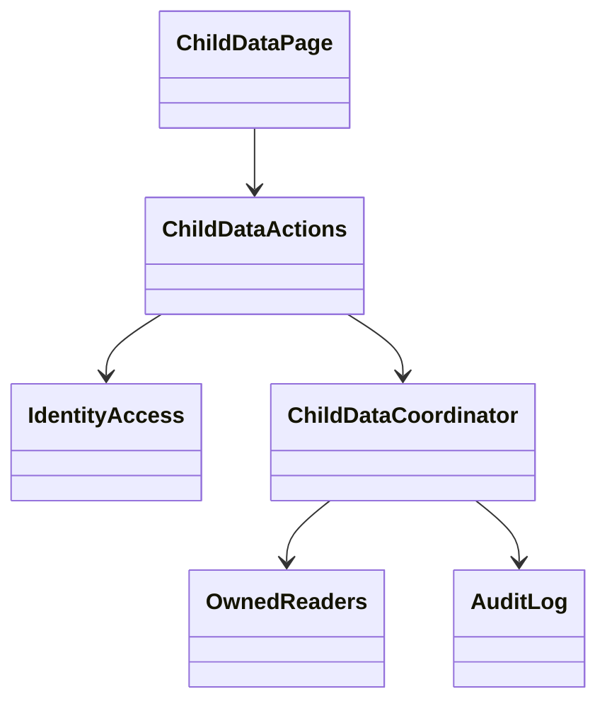

The original creation diagram and file descriptions below describe their pre-implementation baseline; the table above is the review/export delta against current code.

_[One class diagram for the whole area, and one line per class or file saying what it does and whether it is **new** or **reused**. Show only what a reader needs to see how the parts relate: classes, their key methods, their dependencies. Fields and getters belong to the code._

_**If your repository has no code for this area yet**, which is the normal case for your proving slice, list the files you expect the agent to create, with the paths your architecture-of-record's conventions give them, and mark them all new. The agent then builds into the structure you chose rather than one it improvised._

_No application code exists, so every file below is new. Paths follow architecture §8.2.3 and §8.2.4: pages and server actions under `src/app/`, and each component's server-only data-access functions under `src/server/<component>/`, the only place its collections are touched.]_

```mermaid
classDiagram
    direction LR
    class NewChildPage {
        <<new>>
        /parent/children/new
    }
    class OnboardingCompletePage {
        <<new>>
        /parent/children/[childId]/onboarding-complete
    }
    class childActions {
        <<new>>
        +createChildAccount(input) ActionResult
    }
    class childAccounts {
        <<new, Accounts and Family>>
        +createChild(session, input) CreatedChild
        +isConsentConfirmed(familyId) boolean
        +getChildForFamily(familyId, childId) ChildSummary
    }
    class parentNotes {
        <<new, Accounts and Family>>
        +insertParentNote(tx, childId, text, flagState)
    }
    class childIdentity {
        <<new, Child Identity Store>>
        +insertChildIdentity(tx, childId, age, grade, readingLevel)
    }
    class childCredentials {
        <<new, Identity and Access>>
        +generateChildPassword() string
        +insertChildCredential(tx, childId, username, passwordHash)
    }
    class sessions {
        <<new, Identity and Access>>
        +requireParent() ParentSession
    }
    class screenNote {
        <<new, Safety Flagging>>
        +screenNote(text) ScreenResult
    }
    class noteFlags {
        <<new, Safety Flagging>>
        +insertNoteFlag(tx, noteId, childId, result)
    }
    class wordList {
        <<new, team-editable>>
        WORD_LIST, WORD_LIST_VERSION
    }
    class auditLog {
        <<new>>
        +appendAudit(tx, entry)
    }
    class sharedLib {
        <<new>>
        db, clock, action-result, config
    }
    class SignUpPage {
        <<new, UC-PAR-onboarding>>
        /sign-up
    }
    class SignInPage {
        <<new, supporting flow, OI-44>>
        /sign-in
    }
    class ConfirmConsentPage {
        <<new, UC-PAR-onboarding>>
        /consent/confirm
    }
    class CheckEmailPage {
        <<new, UC-PAR-onboarding>>
        /parent/onboarding/check-email
    }
    class ParentEntryPage {
        <<new, UC-PAR-onboarding>>
        /parent
    }
    class onboardingActions {
        <<new>>
        +signUpParent(input) ActionResult
        +confirmConsent(token) ActionResult
        +resendConsentEmail() ActionResult
        +signInParent(input) ActionResult
        +signOutParent() ActionResult
        +requestPasswordReset(email) ActionResult
        +resetPassword(token, password) ActionResult
    }
    class ForgotPasswordPage {
        <<new, OI-44>>
        /forgot-password
    }
    class ResetPasswordPage {
        <<new, OI-44>>
        /reset-password
    }
    class passwordResets {
        <<new, Identity and Access>>
        +issueResetToken(userId) string
        +consumeResetToken(tx, token) userId
        +purgeExpiredResets() number
    }
    class families {
        <<new, Accounts and Family>>
        +createFamily(input) CreatedFamily
        +confirmConsent(token) ConfirmResult
        +replaceConfirmationToken(session) string
        +getOnboardingStep(session) OnboardingStep
        +purgeExpiredUnconfirmed() number
        +lockConsentForWrite(tx, familyId) boolean
    }
    class consentNotice {
        <<new, team and lawyer editable>>
        CONSENT_NOTICE_VERSION, notice text
    }
    class parentAccounts {
        <<new, Identity and Access>>
        +insertMainParent(tx, fields) userId
        +findParentByEmail(email) ParentCredential
    }
    class signInThrottle {
        <<new, Identity and Access>>
        +checkAllowed(accountKey) Wait
        +recordFailure(accountKey)
        +clear(accountKey)
    }
    class email {
        <<new, Notification>>
        +sendEmail(message) SendResult
    }
    class cleanupRoute {
        <<new, Scheduled Cleanup>>
        GET /api/cron/cleanup
    }
    class ReportBookPage {
        <<new, UC-PAR-report-book>>
        /parent/children/[childId]/shelf/[bookId]/report
    }
    class ReportForm {
        <<new, client component>>
        form, confirm, done
    }
    class reportActions {
        <<new, UC-PAR-report-book>>
        +reportBook(input) ActionResult
    }
    class bookReports {
        <<new, Accounts and Family>>
        +reportBook(session, input) ReportResult
        +isExcluded(childId, bookId) boolean
        +listExcludedBookIds(childId) string[]
    }
    class shelfEntries {
        <<Shelf, created by design/shlf.md or here>>
        +isOnShelf(childId, bookId) boolean
        +removeShelfEntryInTx(tx, childId, bookId) boolean
    }
    class batches {
        <<Recommendation, built with UC-REC-parent-review>>
        +removeFromPendingBatchInTx(tx, childId, bookId)
        +listReleasedBatchesForChild(childId, tx?)
    }
    class childNotices {
        <<Notification, child-notices.ts from design/shlf.md>>
        +createRemovalNoticeInTx(tx, childId, bookId)
    }
    class catalogBooks {
        <<reused, Catalog>>
        +findActiveBookIds(ids) string[]
        +getBooksForShelf(ids) ShelfBook[]
    }
    class BooksPage {
        <<new, UC-PAR-suggest-book>>
        /parent/books
    }
    class SuggestChildPickerPage {
        <<new, UC-PAR-suggest-book>>
        /parent/books/[bookId]/suggest
    }
    class SuggestPage {
        <<new, UC-PAR-suggest-book>>
        /parent/children/[childId]/suggest/[bookId]
    }
    class suggestActions {
        <<new>>
        +suggestBook(input) ActionResult
    }
    class suggestions {
        <<new, Accounts and Family>>
        +createSuggestion(session, input) SuggestResult
        +getSuggestionConflict(familyId, childId, bookId, tx?) Conflict
        +listSuggestionsForChild(childSession) ChildSuggestion[]
        +removeSuggestionInTx(tx, childId, bookId) contract
        +deleteSuggestionsForBookInTx(tx, bookId) contract
        +deleteChildRecords(tx, childId) contract
        +listSuggestionsForExport(familyId, childId, tx) contract
    }
    BooksPage --> sessions
    BooksPage --> catalogBooks
    SuggestChildPickerPage --> sessions
    SuggestChildPickerPage --> childAccounts
    SuggestChildPickerPage --> catalogBooks
    SuggestPage --> sessions
    SuggestPage --> childAccounts
    SuggestPage --> bookReports
    SuggestPage --> suggestions
    SuggestPage --> suggestActions
    suggestActions --> sessions
    suggestActions --> suggestions
    suggestions --> childAccounts
    suggestions --> families
    suggestions --> bookReports
    suggestions --> shelfEntries
    suggestions --> batches
    suggestions --> catalogBooks
    bookReports --> suggestions
    ReportBookPage --> sessions
    ReportBookPage --> bookReports
    ReportBookPage --> shelfEntries
    ReportBookPage --> catalogBooks
    ReportBookPage --> ReportForm
    ReportForm --> reportActions
    reportActions --> sessions
    reportActions --> bookReports
    bookReports --> childAccounts
    bookReports --> catalogBooks
    bookReports --> shelfEntries
    bookReports --> batches
    bookReports --> childNotices
    bookReports --> auditLog
    SignUpPage --> onboardingActions
    SignInPage --> onboardingActions
    ConfirmConsentPage --> onboardingActions
    CheckEmailPage --> onboardingActions
    CheckEmailPage --> families
    ParentEntryPage --> sessions
    ParentEntryPage --> families
    onboardingActions --> sessions
    onboardingActions --> families
    onboardingActions --> parentAccounts
    onboardingActions --> signInThrottle
    onboardingActions --> passwordResets
    ForgotPasswordPage --> onboardingActions
    ResetPasswordPage --> onboardingActions
    passwordResets --> email
    families --> parentAccounts
    families --> sessions
    families --> consentNotice
    families --> email
    families --> auditLog
    families --> sharedLib
    cleanupRoute --> families
    NewChildPage --> childActions
    NewChildPage --> sessions
    NewChildPage --> childAccounts
    OnboardingCompletePage --> sessions
    OnboardingCompletePage --> childAccounts
    childActions --> sessions
    childActions --> childAccounts
    childAccounts --> screenNote
    childAccounts --> parentNotes
    childAccounts --> childIdentity
    childAccounts --> childCredentials
    childAccounts --> noteFlags
    childAccounts --> auditLog
    childAccounts --> sharedLib
    screenNote --> wordList
    class DeleteChildPage {
        <<new, delete-kid-account>>
        /parent/children/[childId]/delete
    }
    class deleteChildActions {
        <<new, delete-kid-account>>
        +deleteChildAccount(input) ActionResult
    }
    class childDeletion {
        <<new, Accounts and Family>>
        +deleteChild(session, childId) ActionResult
    }
    class deleteChildRecords {
        <<new, one per owning component>>
        +deleteChildRecords(tx, childId)
    }
    DeleteChildPage --> deleteChildActions
    DeleteChildPage --> sessions
    DeleteChildPage --> childAccounts
    deleteChildActions --> sessions
    deleteChildActions --> childAccounts
    deleteChildActions --> parentAccounts
    deleteChildActions --> signInThrottle
    deleteChildActions --> childDeletion
    childDeletion --> deleteChildRecords
    childDeletion --> families
    childDeletion --> auditLog
```

- `src/app/(parent)/parent/children/new/page.tsx` (new): the form (step 2) and, after a successful save, the credentials screen (step 7). Before rendering it calls `requireParent()`; a Sub Parent sees an explanation instead of the form (1b), and a family without confirmed consent is redirected to the "check your email" screen of `UC-PAR-onboarding` (1c). It shows a link to the online privacy notice next to the form (`FR-DATA-notice`, `BR-coppa-notice`), the note prompt of step 2, the reading-level referral links as plain outbound links (4e), a warning that does not block when the age is outside 6–11 (4b), and form text telling the parent the username must not be contact information or contain the nickname (4h). The privacy notice link comes from `config.ts` (`PRIVACY_NOTICE_URL`); the notice page itself is outside this use case. The submit button is disabled while the action is pending, and once the credentials screen is showing, no later response replaces it, so a double submit can never overwrite the only copy of the password (7a). On acknowledge (step 8) it navigates to `UC-REC-kid-onboarding` for this child (step 9), passing the child ID; `UC-REC-kid-onboarding` must check that ID against the session's family, and its route is that design's to name. This page sits outside the "no child yet" redirect that `UC-PAR-onboarding` 8a needs.
- `src/app/(parent)/parent/children/[childId]/onboarding-complete/page.tsx` (new): step 10. A parent of the child's family sees the "onboarding complete" message. `UC-REC-kid-onboarding` redirects here after its step 5. It shows no child detail beyond the nickname and holds no state of its own; a child ID outside the session's family is treated as not found.
- `src/app/(parent)/parent/children/new/actions.ts` (new): `createChildAccount`. In order (§8.2.3): `requireParent()`, refuse a Sub Parent, refuse unconfirmed consent, validate with the zod schema, call `createChild`. The family comes from the session, never from the request.
- `src/app/(parent)/parent/children/new/schema.ts` (new): the one zod schema, shared by form and action (§8.2.5): nickname, age, grade, username, optional reading level as a scale plus a value, optional note, avatar key. The cross-field rule "username does not contain the nickname" lives here. A reading level is both a scale and a value or neither; one without the other is `INVALID_READING_LEVEL`. The note is trimmed once here; the trimmed text is what is counted, screened and stored. When several fields fail, the action returns the first failing field in form order (the code identifies the field, since §8.2.1 has no field slot); the form runs the same schema in the browser to show every error inline.
- `src/server/accounts-family/child-accounts.ts` (new, server-only): `createChild` generates the child ID, hashes the generated password, calls `screenNote` **before** the transaction, and then in one transaction inserts the child account and calls the other components' insert functions with the transaction handle. It returns the child ID, the username and the plaintext password, and nothing is stored if any insert fails (5a, 6a). `isConsentConfirmed` reads the family's consent record (`DI-consent-record`) and is true only when that record has a confirmation date and has not been revoked; tests use fixtures of exactly that shape until `UC-PAR-onboarding` is designed. `getChildForFamily` returns the nickname and avatar only, and only for a child in that family.
- `src/server/accounts-family/parent-notes.ts` (new, server-only): `insertParentNote`. No read function is added here; the flag-review read comes with `UC-ADM-flag-review` and returns the text to that use case only (`KD-admin-flag-review`).
- `src/server/child-identity/child-identity.ts` (new, server-only): `insertChildIdentity`, the Child Identity Store's write path for a new child. No read function is added here.
- `src/server/identity-access/child-credentials.ts`, `passwords.ts`, `sessions.ts` (new, server-only): `generateChildPassword` (see Open questions for its rules), `insertChildCredential` (role `child`, the lowercased username, the hash, the child ID), salted hashing (`KD-auth-sessions`) and `requireParent()`, which returns `{ userId, familyId, role }` (`main` or `sub`), read from the user document through the Auth.js database session and never from the request.
- `src/server/safety-flagging/screen-note.ts` (new, server-only): `screenNote(text)`, a pure function. It returns `none`, `flagged` (with category and the character ranges that matched) or `check_not_run` (when the check throws), plus the detector's method (`word-list`) and version. It reads only `word-list.ts`. It screens the trimmed note, matches case-insensitively on whole-word boundaries with no stemming, and its character ranges are offsets into that same trimmed text, which is the text stored.
- `src/server/safety-flagging/word-list.ts` (new, **team-editable**): an exported array of `{ word, category }` and a `WORD_LIST_VERSION` constant. It ships with one placeholder entry and no real terms; the team adds words by editing this one file and raising the version. The categories are the ones `UC-ADM-flag-review` lists (violence, self-harm).
- `src/server/safety-flagging/note-flags.ts` (new, server-only): `insertNoteFlag`, writing the flag record the flag-review list reads.
- `src/server/audit/audit-log.ts` (new, server-only): `appendAudit`, append-only, IDs only (§8.2.9).
- `src/server/lib/db.ts`, `clock.ts`, `action-result.ts`, `config.ts` (new): one Mongo client per instance, the settable clock, the `{ ok, data | error }` helper and the validated environment (§8.2.1, §8.2.2, §8.2.6, §8.2.8).
- `src/server/accounts-family/avatars.ts` and `grades.ts` (new, server-only): the fixed avatar set and grade list the schema checks against.

Added for `UC-PAR-onboarding` (all new unless marked reused):

- `src/app/sign-up/page.tsx`, `actions.ts`, `schema.ts`: the form of step 2 (name, email, password, the consent notice with its version, an acknowledgment box that is never pre-checked, and the online privacy notice link from `getPrivacyNoticeUrl()` in [`config.ts`](../src/server/lib/config.ts)), and `signUpParent`. A visitor who is already signed in is redirected to `/parent`, unless `getOnboardingStep` returns `expired`: that Main Parent sees the form, so "start again" (6a) does not loop back to check-email. _Changed before the final onboarding PR (2026-11-23)._ One zod schema serves form and action (§8.2.5): the name is trimmed, the email is trimmed and lowercased once, the password rule is the table in [`par-field-values.md`](par-field-values.md), and the acknowledgment must be the literal `true` (3b). _Changed at `/implement` (2026-11-23): `access.ts` holds the who-sees-the-form check; the sign-in page will link here, since `/` opens on sign-in and step 1 needs a "Create Account" entry; and a failure after the commit (setting the cookie, building or sending the email) never returns `SAVE_FAILED`, because the account exists. A failed email is 5b._ _Changed in review of #114 (2026-11-23): `signUpParent` runs the who-sees-the-form check itself (§8.1) and returns `ALREADY_SIGNED_IN` to anyone else signed in, and a taken email is refused before the password is hashed (`OI-51`). The developer chose to finish onboarding in #114 itself, as #113 planned, although that takes it past the 2000-line limit of `/implement`._
- `src/app/consent/confirm/page.tsx`: the page the email links to. A client component reads the token from the URL **fragment** and shows a "Confirm" button that posts it to `confirmConsent` (step 7). Opening the page alone confirms nothing.
- `src/app/(parent)/parent/onboarding/check-email/page.tsx` and its `resendConsentEmail` action: step 6 and 6b. The path is the one [`access.ts`](../src/app/(parent)/parent/children/new/access.ts) already redirects to (`CHECK_EMAIL_PATH`). It shows the notice that the email could not be sent when sign-up reported it (5b), and "start again" once the deadline has passed (6a). _Changed at `/implement` (2026-11-23): `view.ts` decides what the page shows (or where it redirects) on the server, so the states are tested without rendering. The Accounts & Family function behind the action is `resendConsentEmailFor(session)`, which is `replaceConfirmationToken` plus the send; the action adds `RESEND_FAILED` with an error ID for an unexpected failure._
- `src/app/sign-in/page.tsx`, `actions.ts`: `signInParent`, a Main Parent's email and password (`OI-44`). Replaces the `SIGN_IN_PATH` placeholder in `access.ts`. On success it redirects to `/parent`. The page links to `/forgot-password`. _Changed at `/implement` (2026-11-20, PR #107 review): sign-in and the `/parent` gate are built before sign-up so the app can be run, `/` redirects to `/sign-in`, and the `/forgot-password` link is added when that page exists. An unknown email is checked against a decoy hash, so response time does not reveal which emails have accounts._
- `signOutParent` (server action, in `src/app/sign-in/actions.ts`): deletes the caller's own session document and clears the cookie, then redirects to `/sign-in` (`OI-44`). A "Sign out" button sits on `/parent` and on check-email. _Changed at `/implement` (2026-11-24, developer decision): the button is in the `(parent)` layout instead, at the top of every parent page whenever a parent is signed in, because a confirmed parent with no child is always sent to `/parent/children/new` and had no way to sign out. Showing it checks nothing; each page and action still checks the session (§8.1)._ _Changed at `/implement` (2026-11-23): `endCurrentSession()` in `sessions.ts` deletes the document the request's cookie names. Any signed-in parent may sign out (no Sub Parent can sign in yet), and an unexpected failure is `SIGN_OUT_FAILED`._
- `src/app/forgot-password/page.tsx` and `requestPasswordReset`: the Main Parent enters their email; the page always shows the same "if an account exists, we've sent a link" answer (`OI-44`). Sign-up's 4a error and the sign-in page link here. _Changed at `/implement` (2026-11-23, developer decision): the lookup, the token and the email run in Next's built-in `after()`, once the response has gone, so neither the answer nor its timing shows whether an account exists. No dependency was added. An unexpected failure before that is `REQUEST_FAILED`._
- `src/app/reset-password/page.tsx` and `resetPassword`: like `/consent/confirm`, a client component reads the token from the URL **fragment**; the parent types a new password, and the page posts token and password together. On success it redirects to `/sign-in` with a "password changed" message.
- `src/server/identity-access/password-resets.ts` (server-only): `issueResetToken` (a new token replaces any earlier one for that user, respecting the minimum spacing between reset emails), `consumeResetToken` (single use, inside the reset transaction) and `purgeExpiredResets`. It owns `passwordResets`. _Changed at `/implement` (2026-11-23): the schema is in `password-reset-schema.ts`, because the index setup script runs outside Next.js; the request and reset flows are in `password-reset-flow.ts`, because `parent-accounts.ts` imports this module to delete a reset record with its account. The spacing is in `issueResetToken`'s filter, and the unique `userId` index refuses a second row, so two requests at once send one email. `resetPassword` checks the token before the costly hash, and makes the 4c "not the email" comparison once the token names the account._
- `src/app/(parent)/parent/page.tsx`: the parent entry point. It calls `requireParent()` and `getOnboardingStep()` and redirects: awaiting confirmation to check-email, first child still needed to `/parent/children/new` (8a). A family that is done sees a placeholder home with an "Add a Child" link (`UC-PAR-create-kid-account` trigger b); the dashboard itself belongs to `UC-PAR-view-growth-report`.
- `src/server/accounts-family/families.ts` (server-only): `createFamily` (the sign-up transaction, then the email), `confirmConsent`, `replaceConfirmationToken` (6b), `getOnboardingStep` (`awaiting`, `expired`, `needs-first-child` or `complete`, read from the Consent Record and whether the family has a child) and `purgeExpiredUnconfirmed` (6a). It owns `consentRecords`. The child-data review adds the `revoked` onboarding state below. _Changed at `/implement` (2026-11-23): the collection's schema and index setup moved to `consent-record-schema.ts`, because the setup script runs outside Next.js and cannot load the session code this module now uses._ [`child-accounts.ts`](../src/server/accounts-family/child-accounts.ts) (reused) already reads that collection; its contract (one record per family, `confirmedAt`, no `revokedAt`, the `childCreationVersion` counter) is kept as is.
- `src/server/accounts-family/consent-notice.ts` (team- and lawyer-editable): `CONSENT_NOTICE_VERSION`, `consentNoticeVersion(days)` (the version each Consent Record stores, which includes the configured window) and the direct notice text, with the elements `BR-coppa-notice` lists, including that the parent's name and email are deleted if consent is not confirmed in time. Ships as placeholder wording until the legal review (`OI-20`, `OI-21`). Changing the text means raising the version.
- `src/server/identity-access/parent-accounts.ts` (server-only): `insertMainParent(tx, …)` and `findParentByEmail`, which returns the user ID, family ID, role and password hash and nothing else.
- `src/server/identity-access/sessions.ts` (reused): gains `createDatabaseSession(userId, tx?)`, which writes a session document in the Auth.js adapter's shape into `sessions`, and `setSessionCookie`, which sets the cookie (httpOnly, SameSite=Lax, §8.1). Sign-up calls the first inside its transaction and the second only after commit. The cookie is the one Auth.js reads: `next-auth.session-token` on an http origin, `__Secure-next-auth.session-token` with `Secure` on https, decided from `APP_URL` in [`session-cookie.ts`](../src/server/identity-access/session-cookie.ts), which [`auth.ts`](../src/server/identity-access/auth.ts) also uses for `useSecureCookies` and the session lifetime (Auth.js's 30-day default). _Changed at `/implement` (2026-11-20): this design first named only `next-auth.session-token`, which Auth.js does not read on https, so production sign-up would have logged nobody in. `APP_URL` is therefore required in production._
- `src/server/identity-access/sign-in-throttle.ts` (server-only): counts failed sign-ins per account key (the lowercased email) and returns how long the caller must wait. Values are the throttling table in `par-field-values.md`. _Changed at `/implement` (2026-11-20): `checkAllowed` and `recordFailure` in the sign-in sequence are one conditional update, `claimSignInAttempt`, which counts the attempt before the password check and is cleared on success. Separate steps would let parallel guesses all pass the check (§8.2.8)._ _Changed in review of #107 (2026-11-22): each row has an `expiresAt` 24 hours after its last wait ends. A later attempt restarts the count, and `purgeExpiredSignInAttempts` deletes expired rows._
- `src/server/identity-access/passwords.ts` (reused unchanged): scrypt hashing and verification for the parent password.
- `src/server/identity-access/indexes.ts` (reused): gains a unique index on `users.email`, partial on `email` being a string; `consentRecords` gets a unique index on `familyId`.
- `src/server/notification/email.ts` (server-only): `sendEmail({ to, subject, text })` over SMTP with **nodemailer**, returning `{ ok }` without the exception. Mailpit (`smtp://localhost:1025`, web UI on 8025) in development, the demo and CI; Resend's SMTP interface in production (host `smtp.resend.com`, user `resend`, the Resend API key as the password, all inside the `SMTP_URL` secret in Vercel's production environment, §8.1 Secrets). `MAIL_FROM` is an address on a domain verified in Resend. In production, with no `SMTP_URL` configured, it refuses to send (fail closed, the same pattern as `getPrivacyNoticeUrl`). The developer confirmed nodemailer on 2026-11-20. It is pinned at 10.3.1 with an npm `overrides` entry, because next-auth 4.24.15 declares an optional peer of `^7` and every 7.x release has high-severity advisories fixed only in 10.1.4 and later; next-auth uses nodemailer only for its Email provider, which this app does not configure.
- `src/app/api/cron/cleanup/route.ts` and `vercel.json` (daily schedule): the Scheduled Cleanup route. It accepts only `Authorization: Bearer <CRON_SECRET>` and calls `purgeExpiredUnconfirmed` (§8.1 trust boundary, §8.2.3). _Changed in review of #107 (2026-11-22): the route ships first with the sign-in attempt purge; the unconfirmed-account and password-reset purges join it with their flows._ _Changed at `/implement` (2026-11-23): the route runs all three purges, each in turn even if an earlier one fails, and reports any failure after all have run; `purged` is their total. `purgeExpiredUnconfirmed` removes each family in its own transaction._
- `src/server/lib/config.ts` (reused): gains `APP_URL` (to build the link), `SMTP_URL`, `MAIL_FROM`, `CRON_SECRET`, `CONSENT_CONFIRMATION_DAYS` (default 14, `OI-22`) and `CONSENT_METHOD` (an enum whose only value is `email-plus`, `OI-21`) (§8.2.6).
- `src/server/audit/audit-log.ts` (reused): its validator accepts one shape per event, IDs only: the existing note flag, `account.unconfirmed-purged` (actor role `system`, since the cron has no account; the user ID and family ID) and `account.password-reset` (the parent as actor; the user ID). _Changed at `/implement` (2026-11-20): this file was listed as reused unchanged, but its validator refused both new events._
- Reused as they are: `action-result.ts`, `clock.ts`, `db.ts` (`withTransaction`), `log.ts`, and the `/privacy-notice` placeholder page.

Added for `UC-PAR-report-book` (all new unless marked reused or contract):

- `src/app/(parent)/parent/children/[childId]/shelf/[bookId]/report/page.tsx`: the shelf entry point, at the path [`shlf.md`](shlf.md) links "Report" to. A server component, dynamic. It calls `requireParent()` (no session: redirect to `/sign-in`; not a parent: `notFound()`), then, in this order, `getChildForFamily`, `isExcluded` (PRE-4), `isOnShelf` (PRE-3) and `getBooksForShelf([bookId])` for the title. Another family's child or an unknown or malformed child ID gives the same `404` as the shelf page. If `isExcluded` is true it shows "already reported" and no form, **before** the shelf check: a report deletes the shelf entry in the same transaction, so a parent who opens Report from a stale shelf page after the other parent reported the book has an exclusion and no entry, and must see 7c, not a `404`. A book not on this child's shelf and a book the Catalog does not return then give the `404`. Otherwise it renders `ReportForm` with the title, the child's nickname and the path back to the shelf (step 2). _Built at `/implement` (2026-11-25, second pull request): the reads and their order are in `view.ts` beside the page, `reportPageView(childId, bookId)`, which returns a redirect, a not-found or the screen's data, so they are tested by integration tests without rendering (the pattern of `check-email/view.ts`); the page only renders the result._
- `.../report-book/report-form.tsx` (client component): three states in component state, with no request until the last: the form (reason, optional comment, "Continue"; step 3–4, 3a), the confirmation (the wording of step 5, "Confirm" and "Go back"; 5a returns to the form with the reason and comment kept, `ROB-no-data-loss`), and the result (step 8, with a link back to where the parent started). "Cancel" on the form is a link back (3b). The submit button is disabled while the action is pending. On `SAVE_FAILED` it stays on the confirmation with the error and keeps the input (7a); on `ALREADY_REPORTED` it shows that the book is already reported (7c). The comment box carries a hint not to include the child's name or other details, because the admin reads it (`BR-admin-limited-view`). _Built (2026-11-25): the screens and their moves are a pure module, `report-form-state.ts`, a reducer the component drives, so 3a, 5a and the answer handling are unit-tested without a component-test library. `OUTCOME_UNKNOWN` (see the key decision on errors) and the other refusals end on a message with a link back to the shelf; `REASON_REQUIRED`, `INVALID_REASON` and `COMMENT_TOO_LONG` from the server return to the form with the input kept._
- `src/app/(parent)/parent/children/[childId]/report-book/actions.ts` and `schema.ts`: `reportBook`, shared by both entry points, and its zod schema, shared by form and action (§8.2.5): `childId`, `bookId`, `reason` (one of the values in [`par-field-values.md`](par-field-values.md)), `comment` (trimmed once; blank is no comment; the limit in that file), and `confirmed`, which must be the literal `true`. Order (§8.2.3): `requireParent()`, validate, call `reportBook` in Accounts & Family. The family comes from the session, never the request. _Built (2026-11-25): a missing or non-string `childId` or `bookId` is refused as `CHILD_NOT_FOUND` or `BOOK_NOT_FOUND`, the answers for an unknown ID, as `suggestBook` does; a request that is not an object, or a comment that is not a string, is `INVALID_INPUT`, which no form sends. The comment limit counts code points, as the `bookReports` validator does._
- `src/server/accounts-family/book-reports.ts` (server-only): owns `bookReports` and `childBookExclusions`. `reportBook(session, input)` checks the book with `findActiveBookIds`, then opens the transaction and, as its first reads, checks the child against the session's family with `getChildForFamily(familyId, childId, tx)` and locks the family's consent with `lockConsentForWrite(tx, familyId)` (`CONSENT_NOT_CONFIRMED` when nothing matches, that is, consent is not confirmed or is revoked); the rest follows the sequence below, and it returns `{ removedFromShelf }`. It enforces PRE-3 with the removal results themselves: if `removeShelfEntryInTx` deleted nothing and the batch step found nothing, it aborts the transaction and returns `NOT_ON_SHELF_OR_BATCH`. The batch step (7d) is wired in by `UC-REC-parent-review` (#135), so a book in a pending batch alone satisfies PRE-3. Errors map as follows (see the key decision on errors): a duplicate key (MongoDB code 11000) on the exclusions' unique index is `ALREADY_REPORTED`; every other thrown error is `SAVE_FAILED` with an error ID from `logUnexpectedError`. `isExcluded(childId, bookId)` serves the page. `listExcludedBookIds(childId)` is the one read Recommendation and manual search use to apply `KD-book-exclusion`; nothing calls it yet. No function deletes an exclusion or changes a report's status here. `UC-ADM-block-content` (#109) adds the status change. For `UC-PAR-delete-kid-account` (#105), this file adds its `deleteChildRecords(tx, childId)` when it is built: it deletes the child's exclusions and keeps each report, removing its `childId` and `comment`. Amended by the `UC-PAR-delete-kid-account` design (architecture §8.2.8): `reportBook` inserts records keyed by the child, so it calls `lockChildForWrite(tx, childId)` right after the `getChildForFamily` read and before `lockConsentForWrite`, and stops with `CHILD_NOT_FOUND` when it matches nothing; a report that races the child's deletion then fails instead of leaving an exclusion behind. Amended by the `UC-PAR-suggest-book` design: after the exclusion insert, `reportBook` calls `removeSuggestionInTx(tx, childId, bookId)`, so the child's pending suggestion of the book goes with the report; the call is added when `suggestions.ts` is built. _Built at `/implement` (2026-11-24, first pull request): the two collections' validators and indexes are in `book-report-schema.ts`, apart from this file, because the index setup script runs outside Next.js and this file loads session code through `families.ts` (as `consent-record-schema.ts` is apart from `families.ts`). The reason list and the comment limit are in `src/shared/accounts-family/book-report.ts`, which the form, the zod schema and the validator all read (§8.2.4). `lockChildForWrite` and the `children.writeVersion` field are added with this build, because `reportBook` needs them; `saveOnboardingProfile` still moves onto it with `UC-PAR-delete-kid-account`. Until the batch step joined (7d), only a shelf removal satisfied PRE-3, so a successful report always returned `removedFromShelf: true`._ _Changed on merging `main` (2026-11-26), for what #135 put there: `reportBook` calls `removeFromPendingBatchInTx` after `removeShelfEntryInTx`, and PRE-3 holds when either removed the book, so a report of a book only in a pending batch returns `removedFromShelf: false`._
- `src/server/shelf/shelf-entries.ts` (server-only, on the `SHELF_ENTRY` model in [`shlf.md`](shlf.md)): created by whichever of #106 (`UC-SHLF-kid-view-shelf`, which adds the shared shelf read) or this design merges first; the other extends it. This design adds `isOnShelf(childId, bookId)` and `removeShelfEntryInTx(tx, childId, bookId)`, which deletes the entry and returns the deleted entry's ID, or nothing if there was none. It touches no rating or finish confirmation, which `shlf.md` stores in their own collections, keyed by child and book (its key decision "Ratings and finish confirmations are stored apart from the shelf entry", and its Data model). `UC-SHLF-parent-remove-book` reuses it. _Built (2026-11-24): created by this use case; #106 had not added it. The existing reads stay in `parent-shelf.ts` and the collection names in `shelf-collections.ts`._
- `src/server/accounts-family/child-accounts.ts` (reused): `getChildForFamily` gains an optional transaction handle, so `reportBook` reads the child inside its transaction. Existing callers are unchanged.
- `src/server/accounts-family/families.ts` (extended): adds `lockConsentForWrite(tx, familyId)`, a conditional `$inc` of a new `consentWriteVersion` field on the family's Consent Record that matches only when `confirmedAt` is a date and `revokedAt` is absent, and returns whether it matched (see the key decision on the consent lock). The Consent Record validator refuses unknown fields, so this use case also adds `consentWriteVersion` to it in `consent-record-schema.ts`. `childCreationVersion` and child creation are unchanged.
- `src/server/recommendation/batches.ts`, **contract** (built by `UC-REC-parent-review` PR 1, #135; see the note at the end of this entry): `removeFromPendingBatchInTx(tx, childId, bookId)` takes the book out of the child's pending batch with the same effect as a parent's removal in `UC-REC-parent-review` step 4, leaves the batch pending, and returns whether the book was in a pending batch; `reportBook` needs that answer for PRE-3. It is written with `UC-REC-parent-review`, whose design chooses the batch's shape. Until then `reportBook` has no batch step; `/implement` for that use case adds the one call inside this transaction, and builds the batch entry page, which renders the same `ReportForm` and calls the same `reportBook`, with "in this child's pending batch" as its PRE-3 check. _Changed on merging `main` (2026-11-26): #135 built `removeFromPendingBatchInTx` and added the call to `reportBook`'s transaction; the batch entry page is still to come with `UC-REC-parent-review`._
- `src/server/notification/child-notices.ts` (server-only, Notification): the file, the `childNotices` collection and its `seenAt` shape are `design/shlf.md`'s (#106), which reads them and marks notices seen. This design adds `createRemovalNoticeInTx(tx, childId, bookId)`, which writes a `book-removed` notice holding the book ID only: no reason, no parent (§8.2.11). `UC-SHLF-parent-remove-book` writes the same kind. Whichever of #106 or this design merges first creates the file. _Built (2026-11-24): created by this use case, with the collection's validator and `{ childId, seenAt }` index. Its `kind` enum holds only `book-removed` until `UC-SHLF-par-finish-book` adds `finish-declined`; the reads and `markNoticeSeen` stay `design/shlf.md`'s._
- `src/server/catalog/books.ts` (reused): `findActiveBookIds` for the action's book check; `getBooksForShelf`, the read [`shlf.md`](shlf.md) adds, for the page's title. No new Catalog read.
- `src/server/audit/audit-log.ts` (reused): writes `book.reported` and `shelf.parent-removed` in the shapes under Data model, which `UC-SHLF-parent-remove-book` reuses for its own removals. If #108 has merged, both go through its `appendAudit(tx, entry)`, with the two shapes added to its `AuditEntry` type; otherwise this design adds `appendBookReportAudit` and `appendShelfRemovalAudit`. Either way the validator gains one branch per event (see Data model). §8.2.9 lists parent book reports and parent shelf removals separately, so a report that removes a shelf entry writes both.
- `src/server/setup/ensure-indexes.ts` (reused): calls the new collections' setup (see Data model).

Added for `UC-PAR-delete-kid-account` (new unless marked reused or extended):

- `src/app/(parent)/parent/children/[childId]/delete/page.tsx`: steps 2–3 and 7. It calls `requireParent()` and `getChildForFamily` (reused); a Sub Parent sees an explanation and no form (1a), and a child outside the family is not found. It shows the child's nickname and avatar, the statement of step 2, a password field and a "type the nickname" field. The submit button is disabled while the action is pending. On `ok` the page replaces the form with the confirmation of step 7 and a link to `/parent`, where the onboarding gate handles 7a. Leaving the page is the cancel (2a). No page links here yet; see Open questions, "Where the delete link lives".
- `.../[childId]/delete/actions.ts` and `schema.ts`: `deleteChildAccount`. In order (§8.2.3): `requireParent()`; refuse a Sub Parent (1a); validate with the zod schema (password and nickname present, the child ID a UUID from the route); `getChildForFamily`, so another family's child is not found before anything else is revealed; then the password check and the nickname check (4a, below); then `deleteChild`. The family comes from the session and the child ID from the route, never from the form. It does **not** check that consent is confirmed, because `UC-PAR-revoke-consent` 2a sends a parent here after revoking.
- `src/server/identity-access/parent-accounts.ts` (extended): `getParentCredential(userId)`, returning the lowercased email (the throttle's account key) and the password hash, and nothing else.
- `src/server/identity-access/sign-in-throttle.ts` and `passwords.ts` (reused): the password re-check calls `claimSignInAttempt(email)`, then `verifyPassword`, then `clearSignInAttempts(email)` on a right password, the same calls and the same account key as `signInParent` on `main`. The attempt is counted by one conditional update before the password is checked, so parallel requests cannot all pass a check made before any of them is counted, and failures here and at sign-in share one count (`SEC-signin-throttling`).
- `src/server/accounts-family/child-deletion.ts` (server-only): `deleteChild(session, childId)` runs the transaction in the sequence diagram and maps failures to the codes in the API contract. It is the only function that calls every component's `deleteChildRecords`, and the list of those calls lives in this one file.
- `deleteChildRecords(tx, childId)`, one per owning component, each deleting only its own collections (§8.2.4):
  - Accounts & Family, `parent-notes.ts` (extended): the child's parent notes. `book-reports.ts` (designed for `UC-PAR-report-book`, built with it) adds its own `deleteChildRecords` for `childBookExclusions` and `bookReports`: exclusions are deleted, and each report keeps only its book, its reason and the reporting parent's account reference; its child reference and the parent's comment are deleted, because the comment is free text about the child (the use case's Associated Information, `FR-DATA-removal`).
  - Child Identity Store, `child-identity.ts` (extended): the identity record.
  - Identity & Access, `child-credentials.ts` (extended, named `deleteChildSignIn`): the records keyed by the child ID, the child's user ID, the child's username or one of the child's session IDs. It first reads, with the transaction handle, the child's `users` document (for the user ID and the lowercased username) and the IDs of that user's `sessions`, then deletes: the `users` document; every `sessions` document with that user ID (POST-1); the `childSessionEnds` record of each of those session IDs; every `childSignIns` record with the child ID (`DI-usage-records`); and every `signInAttempts` record whose account key is the child's shared key or one of its trusted-device keys, that is, every key that starts with `child:<username>:` (the keys of the child sign-in design in [`design/shlf.md`](shlf.md)). The last three exist once child sign-in is built; until then those deletes match nothing. A `child_device` cookie still in a browser keeps an entry for the deleted child, but the server stores nothing for it, so it names a child ID that resolves to nothing and a username that no longer exists, and it is dropped when it expires.
  - Safety Flagging, `note-flags.ts` (extended): the child's note flags, whatever their status (5a). Dangerous content list entries for the child are added here when `UC-ADM-flag-review` builds the list.
  - Recommendation, [`reading-profiles.ts`](../src/server/recommendation/reading-profiles.ts) (extended): the reading profile, and later the interest profile, batches, reactions and decline reasons.
  - Shelf and Notification: their own records (shelf, shelf history, ratings, shelf requests, and the `childNotices` of [`design/shlf.md`](shlf.md)) when those collections are built. Notification deletes every notice about the child, whoever received it, the parents' included. Any notice about a child stores that child's ID, so it can be found; a notice never identifies a child by nickname text alone.
- `src/server/accounts-family/families.ts` (extended): `markChildRemoved(tx, familyId, childId)` adds the child ID and date to the Consent Record (POST-4).
- [`src/server/accounts-family/child-accounts.ts`](../src/server/accounts-family/child-accounts.ts) (extended): `lockChildForWrite(tx, childId)`, the conditional write to the child account that every child write makes first (§8.2.8; see Key decisions). It returns whether a child matched. The one child write already on `main`, `saveOnboardingProfile` in [`reading-profiles.ts`](../src/server/recommendation/reading-profiles.ts), checks the child and then inserts outside any transaction; it becomes one transaction that calls `lockChildForWrite` and then inserts. `/implement` makes that change in its own commit.
- `src/server/audit/audit-log.ts` (extended): `appendChildDeletedAudit(tx, parentUserId, childId)`, the event `child-account-deleted` (POST-5).
- Notification (new when Sub Parents exist): `insertNotice(tx, recipientUserId, kind)` for step 6. Sub Parent accounts and in-app notices are not built yet (`UC-PAR-create-sub-parent-account`), so until they are, `deleteChild` finds no Sub Parents and writes no notice.

_Changed at `/implement` (2026-11-24, #66):_
- _Shelf's `deleteChildRecords` is built now, in [`shelf-collections.ts`](../src/server/shelf/shelf-collections.ts), because its entries, ratings and finish confirmations are on `main` (developer decision). The completeness test seeds them from fixtures, since no Shelf write path exists yet._
- _After #134 and #144, `deleteChildSignIn` also removes the child’s session end records and sign-in records in the same transaction._
- _`deleteChild` also refuses a Sub Parent (`NOT_MAIN_PARENT`), as a second check next to the data; the action checks first._
- _The schema adds `PASSWORD_REQUIRED`, `NICKNAME_REQUIRED` and `INVALID_INPUT` (a malformed child ID or an over-long field). `TOO_MANY_ATTEMPTS` carries the wait in its message, worded by sign-in's `waitMessage`, because §8.2.1 has no data slot on an error. A refused re-check is logged as the `reauth-refused` security event (§8.2.7), the event the child-data review also names._
- _Two indexes are added for the deletion's lookups: `users.childId` (unique where set) and `noteFlags.childId`._
- _5b when MongoDB cannot say whether the commit happened (`UnknownTransactionCommitResult`, after the driver's own retries): `deleteChild` reads the child account to tell. Gone, at majority read concern, is success. Present is `DELETE_UNCONFIRMED`, like a failed read: the commit can still become visible after the read, so a child still there does not prove a rollback (Pradeep's re-review of #125, 2026-11-26, as in #135). `DELETE_UNCONFIRMED` asks the parent to reload and check rather than claim nothing was deleted. `DELETE_FAILED` ("Nothing was deleted") is kept for errors whose rollback is known. The form says the same when the call itself fails (review of #125, 2026-11-25)._
- _Changed in review of #125 (2026-11-25): that confirming read uses majority read concern (`childAccountExists`), so it cannot report a deletion a majority has not acknowledged. `getParentCredential(userId, familyId)` also requires the Main Parent role and the session's family, so a role or family change after the session check refuses the re-check. Done after #130 merged (2026-11-26): the re-check is `checkPasswordAttempt`, which claims, checks and settles the attempt as one operation, with mixed-outcome tests in both orders._
- _Changed on merging `main` (2026-11-26), for what #124 and #134 put there: `book-reports.ts` gains `deleteChildRecords`, which deletes the child's exclusions and keeps each report with only its book, reason and reporting parent (its `childId` and comment removed), as Components says; `child-notices.ts` gains `deleteChildRecords` for every notice to the child; and `deleteChildSignIn` also deletes the `childSessionEnds` record of each session it deletes (`deleteChildSessionEndsInTx`). All three join `DELETE_CHILD_RECORDS`, and the completeness test seeds them. `lockChildForWrite` is #124's, which this branch's copy matched; the copy is gone._
- _Changed on merging `main` again (2026-11-26), for what #135 put there: `deleteChildRecords` in [`batches.ts`](../src/server/recommendation/batches.ts), every recommendation batch of the child, joins `DELETE_CHILD_RECORDS`, and the completeness test seeds one from fixtures, since the quiz that stores batches is not built yet._

Added for `UC-PAR-suggest-book` (all new unless marked reused):

- `src/app/(parent)/parent/books/page.tsx`: step 1. It calls `requireParent()` (no session: `/sign-in`; not a parent: `notFound()`, as the other parent pages do), then `getOnboardingStep(familyId)`: any step but `complete` redirects to `/parent`, which routes by step (the onboarding gate key decision; questions test item 5). The step is computed per family ([`families.ts`](../src/server/accounts-family/families.ts)), so a Sub Parent of a family whose onboarding is complete gets `complete` and passes, then `listPickerBooks()`, and lists every active book with its title and author, each with a "Suggest" link to `/parent/books/[bookId]/suggest`. The Catalog holds no cover. It has no search and no detail page: the use case's trigger named pages that no use case specifies, and the trigger is edited in this pull request to name this list. It is the entry point until a parent dashboard links to it.
- `src/app/(parent)/parent/books/[bookId]/suggest/page.tsx`: extension 1a. It calls `requireParent()` and `getOnboardingStep` as the book list does. A book that `findActiveBookIds` does not return gives `notFound()`. With one child the page redirects to that child's confirmation page. With several it lists them by nickname and avatar through `listChildrenForFamily` (the function [`shlf.md`](shlf.md) adds to `child-accounts.ts`; whichever use case is built first adds it). With none it does what `/parent/shelf` does in `shlf.md`: a Main Parent goes to `/parent/children/new`, and a Sub Parent sees a message to ask the Main Parent.
- `src/app/(parent)/parent/children/[childId]/suggest/[bookId]/page.tsx` and `suggest-form.tsx`: step 2. The page checks the session and `getOnboardingStep` as the book list does, then `getChildForFamily` (another family's or an unknown child: `notFound()`), `isConsentConfirmed` (an explanation and no form), the book through `findActiveBookIds([bookId])` (not active, which includes draft and blocked: `notFound()`) and `getBooksForShelf([bookId])` for its title and author, and `isExcluded` (1b: "This book can't be suggested to [nickname]" and no form). It then calls `getSuggestionConflict` and shows the 4a warning, "already on [nickname]'s shelf", "already in [nickname]'s recommendations" or "already suggested", *before* the parent confirms. The form holds the optional note (at most 250 characters, with a live counter), "Suggest" (labelled "Suggest anyway" when there is a warning) and "Cancel" (3a, a link back to `/parent/books` that writes nothing). On `ok` it shows "Suggested to [nickname]" with a link back to the list. On `ALREADY_ON_SHELF`, `ALREADY_RECOMMENDED` or `ALREADY_SUGGESTED` (the state changed after the page loaded) it shows the matching warning, keeps the note, and lets the parent resubmit with `suggestAnyway`. The submit button is disabled while the action is pending. The page's checks are for display only; the action repeats every one.
- `.../suggest/[bookId]/actions.ts`: `suggestBook`. In order, as `reportBook` does (§8.2.3, §8.2.5): `requireParent()`, the zod schema, then `createSuggestion`, which checks the child against the session's family as the first read of its transaction (`CHILD_NOT_FOUND`). Nothing reaches a query before the schema has passed (questions test item 1). The family comes from the session, and the child and book IDs from the route, never from form fields.
- `.../suggest/[bookId]/schema.ts`: child ID (the internal child ID's UUID format), book ID (a non-empty string), note (trimmed once, at most 250 characters, blank means no note) and `suggestAnyway` (boolean, default false). A child ID or book ID that fails its format check gets `CHILD_NOT_FOUND` or `INVALID_BOOK`, the same answer as an unknown one, so the format check reveals nothing.
- `src/server/accounts-family/suggestions.ts` (server-only; the only code that touches `parentSuggestions`). `createSuggestion(session, input)` checks the book with `findActiveBookIds` (PRE-3), then opens one transaction that first checks the child with `getChildForFamily(familyId, childId, tx)`, then takes `lockChildForWrite(tx, childId)` (`CHILD_NOT_FOUND` when it matches nothing, §8.2.8) and `lockConsentForWrite(tx, familyId)` (`CONSENT_NOT_CONFIRMED` when it matches nothing), in the order the rules quiz uses ([`rec.md`](rec.md)). The family check comes before the child lock so the lock never writes to another family's child. After the consent lock it makes the Catalog's same-book conditional write, the write on the book while its status is active that the team agreed for `OI-58` (2026-11-26; [`adm.md`](adm.md), "Check races with the owning use cases"); when nothing matches, the book was blocked or set back to draft after the first check, and the result is `INVALID_BOOK`. That write conflicts with the block's status write, so a suggestion and a block of one book cannot both commit unseen by the other (see the block race key decision). Inside it, it checks `isExcluded(childId, bookId, tx)` (1b) and the conflict, `getSuggestionConflict(familyId, childId, bookId, tx)` (4a), so both reads belong to the transaction (questions test item 9). Every read, and `suggestedAt` from `now()`, happens inside the `withTransaction` callback (see Key decisions). It then inserts the suggestion, or, when `suggestAnyway` is set and a pending suggestion exists, updates that one document's note and `suggestedAt` (see Key decisions). A conflict without `suggestAnyway` is `ALREADY_ON_SHELF`, `ALREADY_RECOMMENDED` or `ALREADY_SUGGESTED`: one code per conflict, because §8.2.1's error has no field for a reason (questions test item 2). When more than one applies, `ALREADY_SUGGESTED` comes first, then `ALREADY_RECOMMENDED`, then `ALREADY_ON_SHELF`, so the parent hears about the item `suggestAnyway` would change, and then the one the child is still deciding on. A duplicate key (code 11000) on the unique index means another request inserted the same suggestion first. It carries no `TransientTransactionError` label, so the driver does not rerun the callback: it aborts the transaction and leaves `withTransaction` (see the `reportBook` key decision on errors). `createSuggestion` catches it there. Without `suggestAnyway` it is `ALREADY_SUGGESTED`. With `suggestAnyway`, `createSuggestion` calls `withTransaction` exactly once more; that callback reads the winner's suggestion, takes the update path and returns `ok`, and any error from this second call is `SAVE_FAILED` (questions test, second run, item 1; review of #120). *As built:* a refusal from that second call (the child deleted, consent revoked or the book blocked in between) is returned as its own code, not `SAVE_FAILED`, because it is not a failure and refusals are not logged. Any other error is `SAVE_FAILED`, with the error ID from `logUnexpectedError` in the result's `errorId` (the shared helper's field), except an error labelled `UnknownTransactionCommitResult` from either call, which is `OUTCOME_UNKNOWN` with its error ID: the commit may have applied, so "nothing was saved" could be false, and a retry is then `ALREADY_SUGGESTED` (reviews of #139, as `reportBook` does). `getSuggestionConflict(familyId, childId, bookId, tx?)` first checks the child against the family with `getChildForFamily` (none, for a child outside it), then returns `suggested`, `recommended`, `onShelf` or none, in that order of precedence, from its own collection, Recommendation's `listReleasedBatchesForChild(childId, tx)` (`recommended` when the book is in the `bookIds` of any batch it returns) and `isOnShelf`. `listReleasedBatchesForChild` is the merged hand-off of [`rec.md`](rec.md) (`UC-REC-parent-review` POST-2), so Recommendation owns what "released to the child" means; it gains an optional transaction handle, as `isExcluded` does, built by whichever of the two use cases is built first. `listSuggestionsForChild(childSession)` is the child-facing read for step 5. It takes the result of `requireChild()` ([`shlf.md`](shlf.md)), not a bare ID, and reads only that session's child, so no caller can ask for another child's suggestions (§8.1; questions test, second run, item 2). It returns the child's pending suggestions, newest first, minus the books in `listExcludedBookIds(childId)` and minus any book `findActiveBookIds` no longer returns (blocked, or back to draft), joined to `getBooksForShelf` for the title and author. Each item is the book ID, title, author, the note if any and `fromGrownUp: true`, and nothing else. Its only caller is `UC-REC-kid-review`'s page. `isExcluded(childId, bookId, tx?)` keeps the bare-ID shape `UC-PAR-report-book` merged; this use case calls it only after the family check, inside `createSuggestion` and on the confirmation page.
  The file also exports four **contracts**, named here so that only it touches `parentSuggestions` (§8.2.4), and built with this use case (questions test item 6). `removeSuggestionInTx(tx, childId, bookId)` deletes the child's suggestion of that book and returns whether one existed. `UC-REC-kid-review` calls it on every reaction at its step 7, "Yes", "Maybe later" and "No" alike; on "Yes" or "Maybe later" it runs in the same transaction as that use case's shelf add (§8.2.8). `reportBook` calls it too (see `book-reports.ts` below). `deleteSuggestionsForBookInTx(tx, bookId)` deletes every child's suggestion of one book, for `UC-ADM-block-content`'s block transaction, which already removes the book from every current recommendation list ([`adm.md`](adm.md), "Save a block in one transaction"). `deleteChildRecords(tx, childId)` is this file's part of the §8.2.8 deletion contract: it deletes all of one child's suggestions inside the caller's transaction. `child-deletion.ts` (`UC-PAR-delete-kid-account`) calls it from its one list of calls, and `UC-PAR-delete-child-data` and the inactivity purge call it too, since a suggestion is not among what `UC-PAR-delete-child-data` POST-2 keeps. `listSuggestionsForExport(familyId, childId, tx)` is this file's reader for `UC-PAR-review-child-data` (the "equivalently named narrow reader" of that design): inside the caller's snapshot transaction it checks the child against the family and returns the book ID, note and `suggestedAt` of each suggestion, including ones the child can no longer see.
- `src/server/accounts-family/book-reports.ts` (reused, from `UC-PAR-report-book`): `isExcluded` and `listExcludedBookIds`. `isExcluded` gains an optional transaction handle, as `getChildForFamily` did; existing callers are unchanged. No new exclusion read. Changed: `reportBook` calls `removeSuggestionInTx(tx, childId, bookId)` in its transaction, after the exclusion insert, so a reported book's pending suggestion goes with the report. It is the same component, and the child lock is already held. It does not count toward PRE-3: a book that is only suggested still gives `NOT_ON_SHELF_OR_BATCH`, as `UC-PAR-report-book` specifies.
- `src/server/accounts-family/consent-notice.ts` (changed): a new placeholder notice version is registered in `noticeTemplates` and `CONSENT_NOTICE_VERSION` points at it; the published template stays, as the file requires. The new text adds one item under "What we collect about your child, and why": "Books you suggest to your child, with a short note if you write one. Your child sees the book and your note, labelled "From your grown-up". The note is not checked or read by BookBuddies staff." It changes in the same pull request that creates `parentSuggestions` (`COPPA-direct-notice`, `COPPA-reconsent-on-change`; see the notice key decision). A sign-up form opened on the old version gets the existing `NOTICE_CHANGED` (`UC-PAR-onboarding` 3b). *As built:* the version is `2026-11-26-suggestions-placeholder`, and its text is child sign-in's version (`2026-11-26-placeholder`, #144) with this item added, so both earlier templates stay for resends.
- `README.md` (changed in the same pull request, `COPPA-readme-in-sync`): a "Child data inventory" row, `parentSuggestions` | child UUID, catalog book ID, optional trimmed note (at most 250 characters), suggestion time; no parent ID | Accounts & Family only; the child sees the book, the note and the generic label; the parent through review and export; never the admin. The row's text, or the paragraph under the table, says it is kept until the child reacts, the book is reported for the child or blocked, or the child's data is deleted or purged for inactivity.
- `src/server/accounts-family/families.ts` (reused, from `UC-PAR-report-book`): `lockConsentForWrite`.
- `src/server/accounts-family/child-accounts.ts` (reused): `getChildForFamily` (with the optional transaction handle `UC-PAR-report-book` adds), `isConsentConfirmed` for the page, and `listChildrenForFamily` (from `shlf.md`).
- `src/server/shelf/shelf-entries.ts` (reused, from `UC-PAR-report-book` and `shlf.md`): `isOnShelf(childId, bookId, tx?)`, which gains the same optional transaction handle. "On the shelf" means any shelf entry, in any category; a pending shelf request is not one.
- `src/server/catalog/books.ts` (reused): `listPickerBooks` and `findActiveBookIds` (built), and `getBooksForShelf` (designed in `shlf.md`). No new Catalog read. This design relies on `getBooksForShelf(ids)` returning, for the IDs it is given, each book it finds that is not blocked, with at least `id`, `title` and `author`, and dropping any ID it does not return rather than failing (architecture §5.2 Catalog, `shlf.md`). Because the child's read and the action also check `findActiveBookIds`, a draft book is never shown or saved either (`DI-catalog-status`; questions test item 8).
- Reused as they are: `requireParent()`, `action-result.ts`, `clock.ts`, `db.ts` (`withTransaction`), `log.ts`, `collections.ts`; `ensure-indexes.ts` gains the `parentSuggestions` setup.

## Sequence

_[One sequence diagram per use case for its main success scenario, plus one for each extension that does not just return an error. **Label each interaction with the use case step it implements**, so a reviewer can check that every step is realized and nothing extra was invented. Use `alt` blocks for extensions that branch off the main flow. Give each use case its own `###` heading; that heading is the anchor your traceability matrix cites.]_

### UC-PAR-create-kid-account: create a linked child account

```mermaid
sequenceDiagram
    actor P as Main Parent
    participant UI as Web UI (new child page)
    participant ACT as createChildAccount
    participant IA as Identity & Access
    participant AF as Accounts & Family
    participant SF as Safety Flagging
    participant CIS as Child Identity Store
    participant DB as Database
    P->>UI: Arrive from UC-PAR-onboarding or tap "Add a Child" (step 1)
    UI->>IA: requireParent()
    UI->>AF: isConsentConfirmed(familyId)
    alt Sub Parent (1b)
        UI-->>P: Explanation, no form
    else consent not confirmed (1c)
        UI-->>P: Redirect to "check your email" (UC-PAR-onboarding step 6)
    end
    UI-->>P: Form with note prompt and privacy notice link (step 2)
    alt Parent cancels (1a)
        P->>UI: Leave the page
        Note over UI: No server call, nothing created
    end
    P->>UI: Fill in and submit (step 3)
    Note over UI: Age outside 6-11 warns, never blocks (4b); referral links for the unsure (4e)
    UI->>ACT: createChildAccount(fields)
    ACT->>IA: requireParent()
    ACT->>AF: isConsentConfirmed(familyId)
    alt Sub Parent (1b)
        ACT-->>UI: NOT_MAIN_PARENT
    else consent not confirmed (1c)
        ACT-->>UI: CONSENT_NOT_CONFIRMED
    end
    ACT->>ACT: Validate with the zod schema (step 4)
    alt a field fails (4a, 4c, 4d, 4f, 4h, 4i)
        ACT-->>UI: The field's error code
    end
    ACT->>AF: createChild(session, fields) (step 5)
    opt a note was given (step 5.1)
        AF->>SF: screenNote(text)
        alt the check throws (5b)
            SF-->>AF: check_not_run
        else matches the word list
            SF-->>AF: flagged, category, passages
        else no match
            SF-->>AF: none
        end
    end
    AF->>IA: generateChildPassword(), hashPassword() (step 6)
    AF->>DB: Begin transaction
    AF->>DB: Insert child account: family, nickname, avatar (step 5)
    AF->>CIS: insertChildIdentity(tx, age, grade, reading level) (step 5)
    AF->>IA: insertChildCredential(tx, username, hash) (step 6)
    opt a note was given
        AF->>DB: Insert parent note with its flag state (step 5)
        opt flagged (step 5.1)
            AF->>SF: insertNoteFlag(tx, note, category, passages)
            AF->>DB: Append audit entry (IDs only)
        end
    end
    alt username taken, unique index (4g)
        DB-->>AF: duplicate key, transaction aborted
        AF-->>ACT: USERNAME_TAKEN
    else any write fails (5a, 6a)
        DB-->>AF: error, transaction aborted
        AF-->>ACT: SAVE_FAILED
    end
    AF->>DB: Commit
    AF-->>ACT: child ID, username, plaintext password
    ACT-->>UI: ok, credentials (response only)
    UI-->>P: Username, password, "Tell your child to log in with these credentials." (step 7)
    P->>UI: Acknowledge (step 8)
    UI-->>P: Go to UC-REC-kid-onboarding for this child (step 9)
    Note over UI,P: UC-REC-kid-onboarding runs; on its step 5 it redirects to the completion page
    UI-->>P: "Onboarding complete" message, use case ends (step 10)
```

### UC-PAR-onboarding: create a parent account

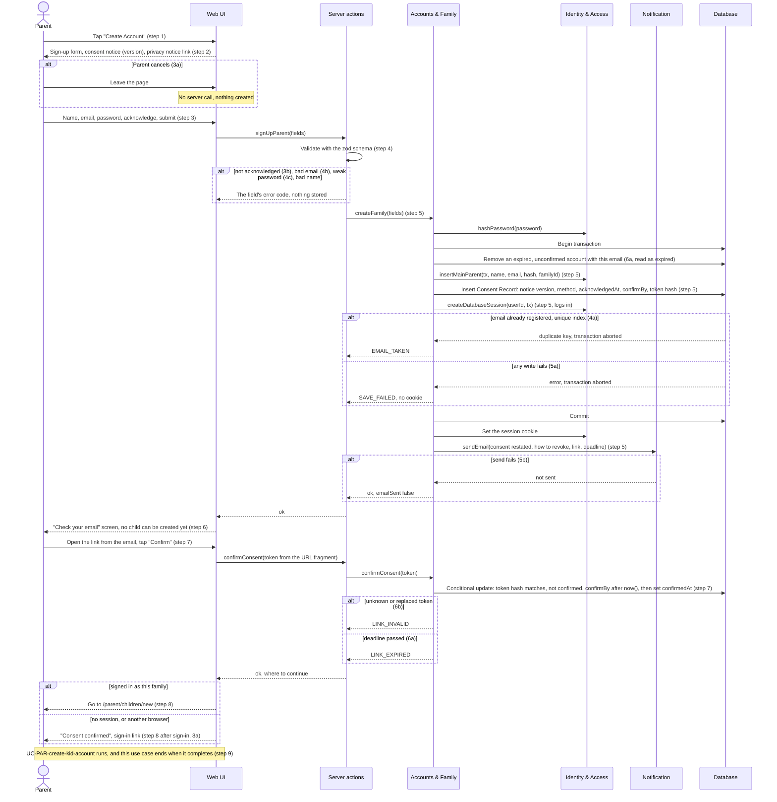

#### Resend the confirmation email (6b)

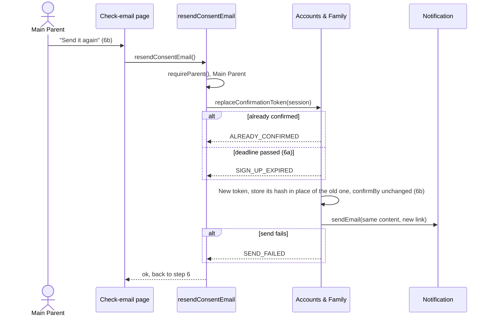

#### Resuming onboarding: the gate (8a)


#### Purge an unconfirmed account (6a)

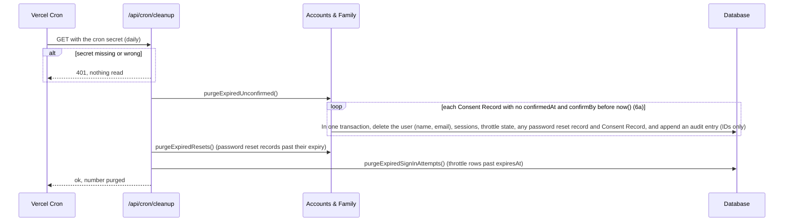

### Supporting flows (`OI-44`): sign-in, sign-out, password reset

These are **not steps of `UC-PAR-onboarding`**, and no use case covers them yet (`OI-44`). The developer chose to design them here, for Main Parents only. Onboarding relies on two of them: sign-in, so a parent who stops before finishing can return to the gate (8a), and the password-reset link 4a offers. None of them reads or decides onboarding state; after sign-in, the gate on `/parent` does.

#### Sign in

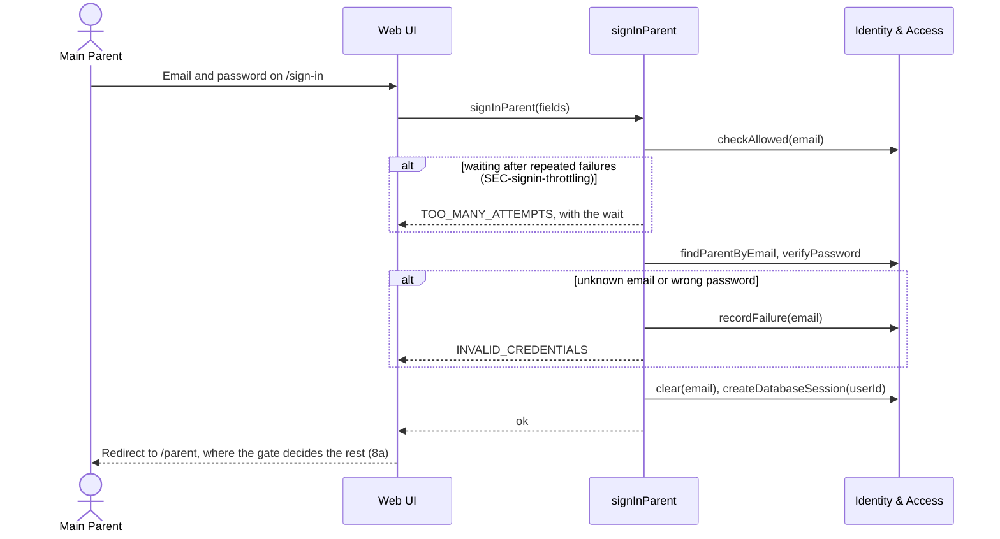

#### Sign out

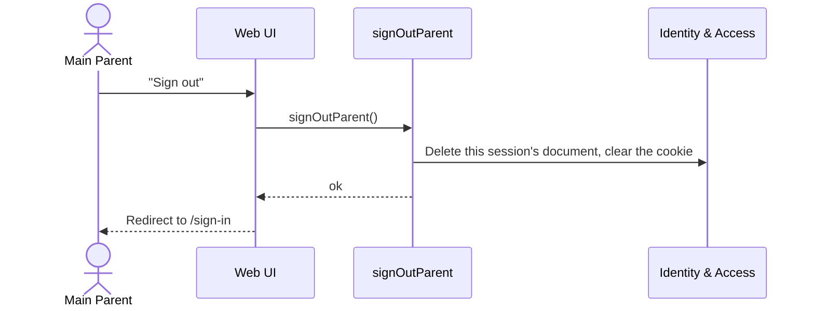

#### Reset a forgotten password

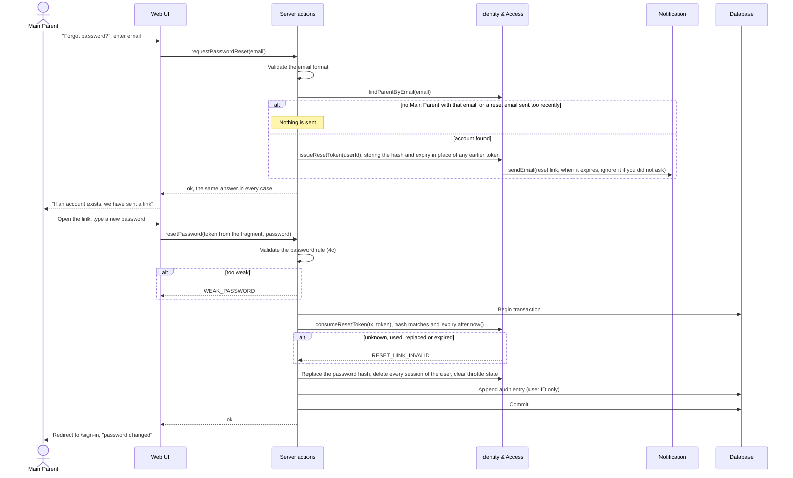

### UC-PAR-review-child-data: review and export

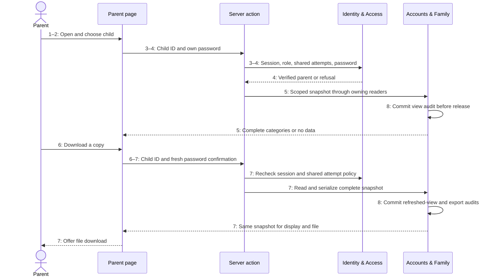

This proposal confirms the password separately for each action; no reusable authorization grant is created. Audit means data was released/offered, not proof the browser displayed or saved it. Step 8 occurs before each release so leaving without downloading still records the view.

### UC-PAR-report-book: report a book for a child

Shown from the shelf. From a batch under review the page differs only in its PRE-3 check, and 7d is the batch step inside the same transaction.

```mermaid
sequenceDiagram
    actor P as Parent (Main or Sub)
    participant UI as Report page
    participant ACT as reportBook action
    participant IA as Identity & Access
    participant AF as Accounts & Family
    participant SH as Shelf
    participant REC as Recommendation
    participant NOT as Notification
    participant CAT as Catalog
    participant DB as Database
    P->>UI: Tap "Report" on a book on the child's shelf (step 1)
    UI->>IA: requireParent()
    UI->>AF: getChildForFamily (PRE-2)
    alt another family or unknown child
        UI-->>P: 404
    end
    UI->>AF: isExcluded (PRE-4), before the shelf check
    alt already reported (PRE-4, 7c)
        UI-->>P: "Already reported", no form
    end
    UI->>SH: isOnShelf (PRE-3)
    UI->>CAT: getBooksForShelf([bookId])
    alt not on the shelf, or the Catalog does not return it
        UI-->>P: 404
    end
    UI-->>P: Report screen: title and the child's nickname (step 2)
    alt cancel (3b)
        P->>UI: Back to the shelf, no request
    end
    P->>UI: Choose a reason, maybe a comment (step 3), "Continue" (step 4)
    Note over UI: No reason: the form refuses to continue (3a)
    UI-->>P: Final, no longer appears for this child, false reports may be punished (step 5)
    alt decline (5a)
        UI-->>P: Back to the form, input kept
    end
    P->>UI: Confirm (step 6)
    UI->>ACT: reportBook(childId, bookId, reason, comment, confirmed)
    ACT->>IA: requireParent()
    ACT->>ACT: Validate with the zod schema (3a, confirmation)
    ACT->>AF: reportBook(session, input) (step 7)
    AF->>CAT: findActiveBookIds([bookId])
    AF->>DB: Begin transaction
    AF->>AF: getChildForFamily(session family, childId, tx), CHILD_NOT_FOUND if absent
    AF->>AF: lockConsentForWrite(tx, session family), CONSENT_NOT_CONFIRMED if nothing matches
    AF->>DB: Insert the exclusion, unique on child and book (step 7)
    alt duplicate key (7c)
        DB-->>AF: transaction aborted
        AF-->>ACT: ALREADY_REPORTED
    end
    AF->>DB: Insert the report: book, child, reporting parent, reason, comment, open, time (step 7)
    AF->>SH: removeShelfEntryInTx (step 7), returns the deleted entry's ID or nothing
    AF->>REC: removeFromPendingBatchInTx (step 7, 7d; wired with UC-REC-parent-review), returns whether it was there
    alt in neither the shelf nor a pending batch (PRE-3; 7b pending OI-54)
        AF->>DB: Abort, nothing kept
        AF-->>ACT: NOT_ON_SHELF_OR_BATCH
    end
    opt a shelf entry was deleted (POST-4; not in 7d)
        AF->>NOT: createRemovalNoticeInTx: book only, no reason, no parent (step 7, 7e)
        AF->>DB: Append audit entry shelf.parent-removed, IDs only (§8.2.9)
    end
    AF->>DB: Append audit entry book.reported, IDs only (§8.2.9)
    alt any write fails (7a)
        DB-->>AF: transaction aborted, nothing kept
        AF-->>ACT: SAVE_FAILED
    end
    AF->>DB: Commit
    AF-->>ACT: removedFromShelf
    ACT-->>UI: ok
    UI-->>P: Report sent, the book will no longer appear for the child (step 8)
```

The two audit appends are the only interactions with no use case step; §8.2.9 requires one for every parent book report and one for every parent shelf removal. A transient transaction error anywhere in the transaction reruns the whole of it (see the key decision on errors).

### UC-PAR-delete-kid-account: delete a child account

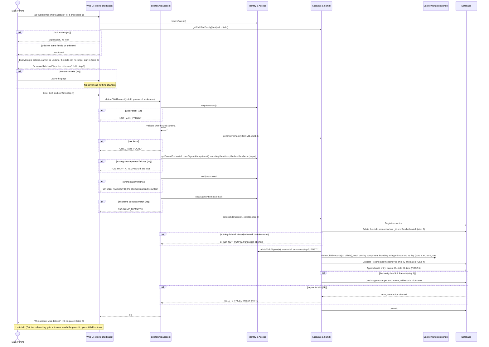

### UC-PAR-suggest-book: suggest a book to a child

```mermaid
sequenceDiagram
    actor P as Parent (Main or Sub)
    participant UI as Web UI (books, suggest pages)
    participant ACT as suggestBook
    participant IA as Identity & Access
    participant AF as Accounts & Family
    participant CAT as Catalog
    participant SH as Shelf
    participant REC as Recommendation
    participant DB as Database
    P->>UI: Open /parent/books (step 1)
    UI->>IA: requireParent()
    UI->>AF: getOnboardingStep(familyId), not complete: redirect to /parent
    UI->>CAT: listPickerBooks() (step 1)
    P->>UI: Tap "Suggest" on a book (step 1)
    UI->>CAT: findActiveBookIds([bookId]) (PRE-3)
    opt more than one child (1a)
        UI->>AF: listChildrenForFamily(familyId)
        UI-->>P: Child picker, nickname and avatar
        P->>UI: Choose a child (1a)
    end
    UI->>AF: getChildForFamily(familyId, childId), isConsentConfirmed(familyId)
    UI->>AF: isExcluded(childId, bookId) (PRE-3)
    alt excluded for this child (1b)
        UI-->>P: "This book can't be suggested to [nickname]", no form
    end
    UI->>AF: getSuggestionConflict(familyId, childId, bookId) (4a)
    AF->>DB: Pending suggestion for this child and book?
    AF->>REC: listReleasedBatchesForChild(childId)
    AF->>SH: isOnShelf(childId, bookId)
    UI-->>P: Confirmation with optional note field (step 2), with the 4a warning if any
    alt Parent cancels (3a)
        P->>UI: Cancel
        Note over UI: No server call, nothing written
    end
    P->>UI: Confirm, with or without a note (step 3)
    UI->>ACT: suggestBook(childId, bookId, note, suggestAnyway)
    ACT->>IA: requireParent()
    ACT->>ACT: Validate with the zod schema
    ACT->>AF: createSuggestion(session, input) (step 4)
    AF->>CAT: findActiveBookIds([bookId]) (PRE-3), before the transaction
    alt not active (PRE-3)
        AF-->>ACT: INVALID_BOOK
    end
    AF->>DB: Begin transaction
    Note over AF,DB: Every read below and suggestedAt are inside the withTransaction callback, so a rerun reads again
    AF->>AF: getChildForFamily(familyId, childId, tx), lockChildForWrite(tx, childId), lockConsentForWrite(tx, familyId)
    AF->>CAT: Same-book conditional write while the book is active (OI-58); no match: INVALID_BOOK
    AF->>AF: isExcluded(childId, bookId, tx) (1b)
    AF->>DB: Pending suggestion for this child and book? (4a)
    AF->>REC: listReleasedBatchesForChild(childId, tx) (4a)
    AF->>SH: isOnShelf(childId, bookId, tx) (4a)
    alt child not in the family or deleted, consent not confirmed, or excluded (1b)
        AF-->>ACT: CHILD_NOT_FOUND, CONSENT_NOT_CONFIRMED or BOOK_EXCLUDED
    else suggested, released to the child, or on shelf, without suggestAnyway (4a)
        AF-->>ACT: ALREADY_SUGGESTED, ALREADY_RECOMMENDED or ALREADY_ON_SHELF, first that applies
    end
    alt no pending suggestion
        AF->>DB: Insert suggestion: child, book, note, suggestedAt (step 4)
    else pending suggestion and suggestAnyway (4a)
        AF->>DB: Update that suggestion's note and suggestedAt (step 4)
    end
    alt duplicate key, simultaneous suggestion, without suggestAnyway (4a)
        DB-->>AF: duplicate key, transaction aborted
        AF-->>ACT: ALREADY_SUGGESTED
    else duplicate key, with suggestAnyway (4a)
        AF->>DB: Catch it and call withTransaction once more, which takes the update path
    else write fails
        AF-->>ACT: SAVE_FAILED
    end
    AF->>DB: Commit
    AF-->>ACT: ok
    ACT-->>UI: ok
    UI-->>P: "Suggested to [nickname]"
    Note over UI,DB: Step 5 runs later, on UC-REC-kid-review's page, in a child session
    UI->>IA: requireChild()
    UI->>AF: listSuggestionsForChild(the requireChild() result) (step 5)
    AF->>DB: Pending suggestions for the child
    AF->>AF: listExcludedBookIds(childId), drop those books (KD-book-exclusion)
    AF->>CAT: findActiveBookIds(bookIds), drop blocked and draft books (step 5)
    AF->>CAT: getBooksForShelf(bookIds), title and author (step 5)
    AF-->>UI: Title, author, "From your grown-up", the note if any (step 5)
```

Extension 5a needs no code of its own: a suggestion has no deadline (`OI-67`), so it stays in the list until the child reacts in `UC-REC-kid-review`. Otherwise it is removed only when the book is reported for the child (`reportBook`) or blocked (`UC-ADM-block-content`), or with the child's data (`deleteChildRecords`, the inactivity purge); see the retention key decision. The family check, the child lock and the consent lock implement no step; they come from §8.1, §8.2.8, `BR-kid-data-stored` and `BR-coppa-parental-consent`, as in `UC-PAR-report-book` and the rules quiz.

## API contract

_[One row per endpoint, scheduled job, or message this area adds or changes, appended per use case. **This section is never dropped**: before the code exists it is the only thing the person (or agent session) building the front end and the one building the back end both read. Name the caller and who may call it, the request fields, the success response, and the error each extension returns. Leave field types and exact JSON to the agent unless a wrong guess would break something, such as a format another system depends on. Use the error shape your architecture-of-record's section 8.2 fixes; do not invent one here._

_Pages change data through server actions (§8.2.3), and every result uses the `{ ok: true, data }` or `{ ok: false, error: { code, message } }` shape of §8.2.1.]_

| Endpoint or job | Caller (who may) | Request | Success | Errors, by extension |
|---|---|---|---|---|
| Page `/parent/children/new` (UC-PAR-create-kid-account) | A signed-in Main Parent whose family's consent is confirmed | None | The form, the avatar set, the grade list, the accepted reading-level scales, the referral links, the note prompt and the online privacy notice link (`FR-DATA-notice`) | 1b: a Sub Parent sees an explanation and no form. 1c: redirect to the "check your email" screen. No session: redirect to sign-in. |
| Server action `createChildAccount` (UC-PAR-create-kid-account) | A signed-in Main Parent whose family's consent is confirmed; the family comes from the session | Nickname, age, grade, username, avatar key, reading level (scale and value, or none), note (or none) | `ok` with the child ID, the username and the generated password. The password is in this response only, and the response is never cached. The result does not say whether the note was flagged | 1b: `NOT_MAIN_PARENT`. 1c: `CONSENT_NOT_CONFIRMED`. 4a: `NICKNAME_REQUIRED`, or `INVALID_NICKNAME` for anything but letters and numbers. 4i: `NOTE_TOO_LONG`. 4c: `INVALID_GRADE`. 4f: `USERNAME_REQUIRED`. 4h: `INVALID_USERNAME` (format, or contact information) or `USERNAME_CONTAINS_NICKNAME`. 4g: `USERNAME_TAKEN`. 4d: `INVALID_READING_LEVEL`, with the accepted scales. An age that is not a whole number in the accepted range: `INVALID_AGE`. A missing or unknown avatar: `INVALID_AVATAR`. 5a and 6a: `SAVE_FAILED` with an error ID, nothing stored. 4b (age outside 6–11), 4e and 5b are not errors. Not a parent: refused (§8.1). |
| Page `/parent/children/[childId]/onboarding-complete` (UC-PAR-create-kid-account step 10) | A signed-in parent of the child's family | The child ID in the path | The "onboarding complete" message and the child's nickname | A child ID outside the session's family, or unknown: not found, with no hint which. No session: redirect to sign-in. |
| Page `/sign-up` (UC-PAR-onboarding steps 1–2) | Anyone not signed in, or a signed-in Main Parent whose onboarding step is `expired` (6a) | None | The form, the consent notice and its version, the online privacy notice link (`FR-DATA-notice`) | Signed in with any other step: redirect to `/parent`. |
| Server action `signUpParent` (UC-PAR-onboarding steps 3–5) | A visitor with no session, or a Main Parent whose sign-up expired | Name, email, password, acknowledgment, the notice version the page showed | `ok` with `emailSent` (true or false); the session cookie is set. Nothing about the family or the token is returned | Anyone else signed in: `ALREADY_SIGNED_IN`. 3b: `CONSENT_NOT_ACKNOWLEDGED`. 3b, a notice version other than the current one (the form was open while the notice text or confirmation window changed): `NOTICE_CHANGED`, nothing stored, checked before the email and the hash; the page shows the current notice and asks for the box again. A missing notice version: `INVALID_INPUT`. Name: `NAME_REQUIRED` or `INVALID_NAME`. 4b: `INVALID_EMAIL`. 4c: `WEAK_PASSWORD`. 4a: `EMAIL_TAKEN`, and the page offers sign-in and password-reset links. 5a: `SAVE_FAILED` with an error ID, nothing stored, no cookie. 5b (send fails) is not an error: `emailSent` is false. |
| Page `/parent/onboarding/check-email` (UC-PAR-onboarding step 6) | A signed-in Main Parent whose consent is awaiting confirmation | None | "Check your email", the resend button, and the could-not-send notice after 5b or a resend that returned `SEND_FAILED` (6b) | Confirmed: redirect to `/parent`. Expired (6a): "your sign-up expired, please start again", with a link to `/sign-up`. No session: redirect to `/sign-in`. |
| Server action `resendConsentEmail` (UC-PAR-onboarding 6b) | A signed-in Main Parent whose consent is awaiting confirmation; the family comes from the session | None | `ok`; the earlier link no longer works; the deadline is unchanged | `NOT_MAIN_PARENT`. `ALREADY_CONFIRMED`. 6a: `SIGN_UP_EXPIRED`. `SEND_FAILED` (the new token is kept, so the parent can try again). Not signed in: refused (§8.1). An unexpected failure: `RESEND_FAILED` with an error ID. |
| Page `/consent/confirm` (UC-PAR-onboarding step 7) | Anyone holding the link | The token, in the URL fragment, never sent to the server by the page load | The "Confirm" button | None at load: the page confirms nothing on its own. |
| Server action `confirmConsent` (UC-PAR-onboarding step 7) | Anyone holding the token; no session needed | The token | `ok` with where to continue: `/parent/children/new` when the caller's session belongs to that family (step 8), otherwise `/sign-in` | `LINK_INVALID` for an unknown or replaced token (6b), with no hint which. 6a: `LINK_EXPIRED`. The same link used again after it confirmed: `ok`, nothing changes. An unexpected failure: `CONFIRM_FAILED` with an error ID (§8.2.1); trying again is safe. A revoked record: `LINK_INVALID`. |
| Page `/parent` (UC-PAR-onboarding 8a) | A signed-in parent | None | Redirect by onboarding step: awaiting to check-email (6), revoked to `/parent/settings` (`UC-PAR-review-child-data`), first child needed to `/parent/children/new` (8a), done to the parent home | No session: redirect to `/sign-in`. Expired: as check-email. |
| Route `GET /api/cron/cleanup` (UC-PAR-onboarding 6a) | Vercel Cron only, with `Authorization: Bearer <CRON_SECRET>` | None | `{ ok: true, data: { purged } }` | Missing or wrong secret: 401 with `{ ok: false, error: { code: "UNAUTHORIZED" } }`, nothing read. Unexpected failure: `{ ok: false, error: { code: "CLEANUP_FAILED", errorId } }`; the next run tries again. |
| Server action `signInParent` (supporting flow, `OI-44`; lets a parent come back to resume at 8a) | Anyone | Email, password | `ok`; a database session and its cookie; the page redirects to `/parent`, where the gate decides the rest | `INVALID_CREDENTIALS`, the same for an unknown email and a wrong password. `TOO_MANY_ATTEMPTS` with the wait in seconds (`SEC-signin-throttling`). A child account signing in here: `INVALID_CREDENTIALS`. **TEMPORARY (`OI-61`): an admin account with a password also signs in here, and `/parent` sends it to `/admin/catalog`, so the demo of `UC-ADM-add-content` works. Remove this when admin sign-in is designed; an admin then gets `INVALID_CREDENTIALS` again.** No onboarding check: an expired, unconfirmed parent signs in and the gate tells them to start again. |
| Server action `signOutParent` (supporting flow, `OI-44`) | A signed-in parent | None | `ok`; this session's document is deleted and the cookie cleared; the page redirects to `/sign-in` | Not signed in: `NOT_SIGNED_IN` (nothing to end). An unexpected failure: `SIGN_OUT_FAILED` with an error ID. |
| Page `/forgot-password` (supporting flow, `OI-44`; linked from 4a and the sign-in page) | Anyone | None | The email form | None. |
| Server action `requestPasswordReset` (supporting flow, `OI-44`) | Anyone | Email | `ok`, the same answer whether or not an account exists and whether or not an email was sent | `INVALID_EMAIL` for a malformed address only. A send failure is logged and still answers `ok`, so the answer reveals nothing. The lookup and the send run after the response. |
| Page `/reset-password` (supporting flow, `OI-44`) | Anyone holding the link | The token, in the URL fragment | The new-password form | None at load: nothing changes until the form is submitted. |
| Server action `resetPassword` (supporting flow, `OI-44`) | Anyone holding the token; no session needed | Token, new password | `ok`; the password is replaced, every session of that parent is ended, and the page redirects to `/sign-in` | `RESET_LINK_INVALID` for an unknown, used, replaced or expired token, with no hint which. `WEAK_PASSWORD` (the 4c rule), with the token still usable. `SAVE_FAILED` with an error ID, nothing changed. |
| Page `/parent/children/[childId]/shelf/[bookId]/report` (UC-PAR-report-book steps 1–2, from `UC-SHLF-parent-view-shelf`) | A signed-in Main or Sub Parent of the child's family (`OI-25`) | The child and book IDs in the path | The report screen: the book's title, the child's nickname, the reason list, the comment box, and the step 5 wording; a link back to the shelf | No session: redirect to `/sign-in`. Another family's child, an unknown or malformed ID, a book not on this child's shelf, a book the Catalog does not return, a child or admin session: the same `404` as the shelf page. PRE-4: "already reported", no form, checked before the shelf, so it shows even though the report removed the entry. |
| Batch entry page (UC-PAR-report-book from `UC-REC-parent-review` step 4) | As above | Its path is `UC-REC-parent-review`'s to choose | The same `ReportForm` and the same action | As above, with "in this child's pending batch" as the PRE-3 check. Built with `UC-REC-parent-review`. |
| Server action `reportBook` (UC-PAR-report-book steps 6–8) | A signed-in Main or Sub Parent; the family comes from the session | `childId`, `bookId`, `reason`, `comment` (optional), `confirmed` | `ok` with `removedFromShelf` (true or false) and nothing else | 3a: `REASON_REQUIRED`, or `INVALID_REASON` for a value not on the list. `COMMENT_TOO_LONG`. `NOT_CONFIRMED` when `confirmed` is not `true`. A child outside the session's family, or unknown: `CHILD_NOT_FOUND`, the same answer for both. The family's consent not confirmed, or revoked: `CONSENT_NOT_CONFIRMED`, nothing stored. A book that is not an active catalog book: `BOOK_NOT_FOUND` (a book blocked mid-report may get this or `NOT_ON_SHELF_OR_BATCH`; see Key decisions). PRE-3, a book on neither the child's shelf nor a pending batch, which includes 7b until `OI-54` is answered: `NOT_ON_SHELF_OR_BATCH`, nothing stored. 7c: `ALREADY_REPORTED` (checked first, so a book already reported gets this, not the PRE-3 error). 7a: `SAVE_FAILED` with an error ID, nothing stored. The commit's outcome unknown after the driver's retries: `OUTCOME_UNKNOWN` with an error ID; the report may have been saved, so the page tells the parent to check the shelf before trying again (see Key decisions). A malformed request no form sends: `INVALID_INPUT`. 7d and 7e are not errors. Not signed in: `NOT_SIGNED_IN`; not a parent: `NOT_A_PARENT` (§8.1). |
| Page `/parent/children/[childId]/delete` (UC-PAR-delete-kid-account) | A signed-in Main Parent of the child's family | The child ID in the path | The statement of step 2, the child's nickname and avatar, and the password and nickname fields of step 3 | 1a: a Sub Parent sees an explanation and no form. A child outside the family, or unknown: not found, with no hint which. No session: redirect to sign-in. |
| Server action `deleteChildAccount` (UC-PAR-delete-kid-account) | A signed-in Main Parent of the child's family; consent need not be active (`UC-PAR-revoke-consent` 2a); the family comes from the session | Child ID (from the route), password, typed nickname | `ok` with no data | Not signed in or not a parent: `NOT_SIGNED_IN`, `NOT_A_PARENT`. 1a: `NOT_MAIN_PARENT`. Child outside the family, unknown or already deleted: `CHILD_NOT_FOUND`. 4a: `WRONG_PASSWORD`, `NICKNAME_MISMATCH`, or `TOO_MANY_ATTEMPTS` with the wait in seconds. 5b: `DELETE_FAILED` with an error ID, nothing deleted; `DELETE_UNCONFIRMED` with an error ID when MongoDB cannot say whether the commit happened and a majority read does not show the child gone (review of #125). 2a and 5a are not errors. |
| Page `/parent/books` (UC-PAR-suggest-book step 1) | A signed-in parent, Main or Sub, whose family's onboarding is complete | None | Every active catalog book with title and author, each with a "Suggest" link | No session: redirect to `/sign-in`. Not a parent (a child or admin session): `404`. Onboarding not complete: redirect to `/parent`, as on all three suggest pages |
| Page `/parent/books/[bookId]/suggest` (UC-PAR-suggest-book 1a) | Same | Book ID in the path | One child: redirect to that child's confirmation page. Several: the child picker, nickname and avatar only | Unknown, draft or blocked book: `404`. No child: as `/parent/shelf` in `design/shlf.md` (Main Parent to `/parent/children/new`, Sub Parent a message). No session: `/sign-in` |
| Page `/parent/children/[childId]/suggest/[bookId]` (UC-PAR-suggest-book step 2) | A signed-in parent of the child's family | Child and book IDs in the path | The child's nickname, the book's title and author, the note field, and the 4a warning (`suggested`, `recommended` or `onShelf`) when there is one | Another family's child, an unknown child, or a book that is not active: `404`, with no hint which. 1b: an explanation and no form. Consent not confirmed or revoked: an explanation and no form. No session: `/sign-in` |
| Server action `suggestBook` (UC-PAR-suggest-book steps 3–4) | Same; the family comes from the session | Child ID, book ID, note (or none), `suggestAnyway` | `ok` with no data | `NOT_SIGNED_IN`, `NOT_A_PARENT`. Another family's or an unknown child, or one deleted while the write runs: `CHILD_NOT_FOUND`. Consent unconfirmed or revoked: `CONSENT_NOT_CONFIRMED`. PRE-3: `INVALID_BOOK` (unknown, draft or blocked, including a block that commits while the write runs). 1b: `BOOK_EXCLUDED`. 3b: `NOTE_TOO_LONG`. 4a without `suggestAnyway`: `ALREADY_SUGGESTED`, `ALREADY_RECOMMENDED` (the book is in a batch released to the child) or `ALREADY_ON_SHELF`, the first of these that applies. Write failure: `SAVE_FAILED` with the error ID in `errorId`, nothing stored. The commit's outcome unknown after the driver's retries: `OUTCOME_UNKNOWN` with the error ID; the suggestion may have been saved, and trying again is safe. Release gate off: `SUGGESTIONS_UNAVAILABLE`, nothing stored. A child ID or book ID in the wrong format: `CHILD_NOT_FOUND` or `INVALID_BOOK`. Input of the wrong type (not an object, a note that is not text, a `suggestAnyway` that is not a boolean), which the form never sends: `INVALID_INPUT` (developer, 2026-11-26, at `/implement`). 3a makes no call |
| `listSuggestionsForChild(childSession)` in Accounts & Family (UC-PAR-suggest-book step 5) | `UC-REC-kid-review`'s page only | The result of `requireChild()`, never a bare ID | The child's pending suggestions that are not excluded and whose book is still active, newest first, each with book ID, title, author, the note if any and `fromGrownUp: true` | Throws on a failed read, and the caller's error screen handles it. It never returns a parent ID or name, a date, a count or anything else |

No response of this use case says which parent reported a book, whether the admin has acted on a report, or any child detail beyond the nickname. The child's removal notice holds the book ID only: no reason, no comment and no parent (`BR-parent-report-book`, §8.2.11).

The Sub Parent notice of step 6 says that a child account in the family was deleted by the Main Parent. It does not hold the nickname, because the nickname is the deleted child's data (`FR-DATA-removal`).

The password reset email goes only to the Main Parent's own address. It holds the link and when it expires, says to ignore it if the parent did not ask, and holds no child data.

The confirmation email (`CI-email-parent`) goes to the parent's own address only. It restates what was consented to, names the notice version, links the online privacy notice (`BR-coppa-notice`, added at `/implement` 2026-11-23), says how to revoke (in words: account settings; the revoke link waits for `UC-PAR-revoke-consent`), gives the link and the date it stops working, and holds no child data (no child exists yet). A resend uses the template and window from the recorded notice version. If the version cannot be rendered, it leaves the existing link in place and returns `SEND_FAILED`.

The parent's screens may show the child's nickname and avatar. The system holds no real name. Nothing in this use case sends the age, grade, reading level or note to a child's screen (`FR-ACCT-child-display`, `BR-parent-note`, §8.2.11).

### Child-data review API contract

Every action independently checks current session and parent role before input validation (§8.2.3). Acting user and family come only from that session. Use the shared §8.2.1 result shape.

| Endpoint | Caller / input | Success | Refusals and failures |
|---|---|---|---|
| Page `/parent/settings/child-data` | Main or Sub Parent; no password in URL | Only linked-child IDs and display nicknames for the selector. Preselect one child or require selection for multiple children. Category records first appear in the successful review response. | No session: sign-in; wrong role: refusal; no linked children: explanation without review form. |
| Action `reviewChildData` | Parent; child UUID and own current password | Complete category DTO after password confirmation, scoped snapshot and committed view audit | 2a: `CHILD_NOT_FOUND`, identical for missing/unlinked IDs. 4a: `PASSWORD_INCORRECT`. 4b: `TOO_MANY_ATTEMPTS` with shared retry deadline. 5b or audit failure: `LOAD_FAILED`, no DTO. Malformed input: `INVALID_INPUT`. Missing or unsupported parent credential: `REAUTH_UNAVAILABLE`, never bypass confirmation. |
| Action `exportChildData` | Parent; child UUID and fresh own-password confirmation | Serialized complete document and same snapshot for the page; refreshed-view and export audits committed first | Same session, role, linkage, validation and password refusals. 7a, reader, serialization or audit failure: `EXPORT_FAILED`, no file bytes. If unresolved safety policy (an open flagged-note export decision, `OI-27`) prevents a complete export: `EXPORT_UNAVAILABLE` while `OI-27` is open, no file and no export audit. The action reads all records on the server. |

For both actions: session/role first, validate the child UUID and password bounds, check the child belongs to the session’s family, then confirm the password. Repeat the family check inside the data snapshot. A missing/unlinked child is `CHILD_NOT_FOUND` before checking its data. Password input is 1–128 characters and is never trimmed; accept an existing password shorter than the new sign-up minimum. Missing or unsupported parent credentials return `REAUTH_UNAVAILABLE`, not success.

The page is dynamic and uncached; no reader uses a shared data cache. Clear revealed data on child changes, navigation/pagehide and restored-history pageshow, requiring confirmation again after returning. A revoked/deleted session is checked again on every action; never reveal a restored payload merely because a button was previously unlocked.

Clear passwords after attempts. Changing child clears previous data and invalidates any pending review/download response for the previous selection. Render notes as text, never HTML. Errors receive keyboard focus and an announced status. Failed reads clear stale data; duplicate submissions are disabled while pending. No emailed export, public URL, download API route, object storage or scheduled job.

## Key decisions

_[Only the decisions a reader could not recover from the code: an invariant, who may do this and how it is enforced, a trade-off you chose, a reason you reused something rather than writing it. **Each one names what you chose, what you rejected, and why.** If you cannot name an alternative you considered, it probably was not a decision; leave it out._

_A decision that affects the whole system rather than this area is an architecture decision. It belongs in your architecture-of-record as a `KD-*` entry, not here.]_

**One child is records in three components, written in one transaction.** Accounts & Family holds the child account (opaque ID, family, nickname, avatar) and the parent note; the Child Identity Store holds age, grade and reading level; Identity & Access holds the username and password hash; Safety Flagging holds a flag when one is raised. Accounts & Family opens the transaction and passes its handle to the other components' insert functions, so each still owns its own collection (§8.2.4). Rejected: one child document with every field, which `KD-pii-segregation` rejects because one forgotten projection would leak the child's details; and separate writes, which can leave a child with no credentials, or a note with no flag, against 5a, 6a, `DI-integrity` and `SAF-flag-delivery`.

**The child ID is a random UUID, not a MongoDB ObjectId.** An ObjectId embeds its creation time and is sequential within a process, so it is not opaque (`DI-child-id`). Rejected: ObjectId, for that reason.

**The word-list check runs before the transaction, as a pure function, and a failure of the check never blocks the profile.** If `screenNote` throws, the note is saved with the flag state `check_not_run` and the child is created (5b). Rejected: running the check inside the transaction, where a detector failure would abort child creation against 5b; and swallowing the failure without recording it, which would let an unscreened note look clean. No re-run is designed: no use case owns one, and 5b is edited to say so.

**The word list is one team-editable file with a version constant.** The word list and categories are not written yet (`SAF-detection-pending`, `OI-19`). Every flag stores the detector's method and version, so a better detector can replace the file's contents or the whole function without reshaping data (`FR-NOTE-flagging`). Rejected: storing the list in the database or an admin screen, which no use case asks for.

**A flag is a record the flag-review list reads; there is no separate admin alert.** The developer decided on 2026-11-05 that an alert is not needed as long as the flag appears in the list of `UC-ADM-flag-review`. The flag is still saved in the same transaction as the note, so a note can never be stored flagged without a flag record (`SAF-flag-delivery`), and an audit entry is written for the flag (§8.2.9). Rejected: an in-app alert through Notification, which the developer dropped as extra work with no gain over the list.

**The flag record references the note by ID; the note text is stored once.** Rejected: copying the text into the flag entry, which would be a second copy of text about a child to export and delete (`FR-DATA-removal`, `BR-coppa-minimization`). `UC-ADM-flag-review` reads the text through a narrow Accounts & Family function when it is designed.

**The password is generated before the transaction and shown from the action's response only.** It is never stored in plaintext, put in a URL, logged or cached, and cannot be fetched again after the parent leaves the screen (7a). Rejected: storing it encrypted so the parent could view it later, which `FR-ACCT-credentials` and §8.1 rule out. A new password is a reset, which is `OI-26`.

**Main Parent and consent are checked in the action, not only by hiding the button.** Any action can be called directly (§8.1, `SEC-role-authorization`, `FR-ACCT-parent-first`). Rejected: relying on the page, which 1b says can be bypassed.

**The family comes from the session.** The request carries no family or parent ID. Rejected: taking it from the form, which would let a request attach a child to another family (`DI-integrity`).

**Usernames are unique across every account that signs in with one, case-insensitively.** They are trimmed and lowercased once, in the schema, and stored that way with a unique index; a duplicate key inside the transaction becomes `USERNAME_TAKEN` (4g). Sub Parents also sign in with a username (§8.1), so the index covers child and Sub Parent credentials alike. Rejected: "check, then insert", which lets two parents claim one username at the same moment; and uniqueness per family, which would make sign-in ambiguous.

**A username must not be contact information and must not contain the nickname; it cannot be checked against a real name, because none is held.** The checks are mechanical: only letters, digits and underscore (so no `@`, dot or space), no run of seven or more digits (a phone number), and the lowercased nickname is not a substring of the lowercased username. Rejected: a check against the child's real name, which the system does not have (`OI-23`); and a free-form username, which could carry an email or phone number (`BR-kid-data-stored`, "never stored").

**The age warning is the form's, the age bounds are the server's.** The form warns outside 6–11 (4b) and still submits. The server only rejects an age that is not a whole number in a wide range (see Open questions). Rejected: blocking outside 6–11, which 4b says not to do until the client decides.

**Age and grade are both required, in the Child Identity Store.** Collecting them with the parent's verified consent, for the stated purpose of `BR-reading-level-proxy`, is within COPPA's minimization rule (`BR-coppa-minimization`, 16 CFR 312.7), which is why `OI-29` is resolved. Rejected: making either optional, which the developer ruled out for the recommender's main signal.

**The avatar is a key from a fixed set, never an image.** Rejected: an uploaded picture, which would be a photo of the child (`BR-kid-anonymous-profile`; `docs/coppa/coppa-design-requirements.md` §3.5, no photos or uploads).

**The reading level is stored as the scale plus the value the parent typed, never converted.** Rejected: converting every scale to one number, which would be the system estimating a level (`BR-no-reading-level-assessment`).

**Waiting for the child's onboarding is a redirect and a return, not a state.** After step 8 the page sends the parent to `UC-REC-kid-onboarding`; that use case ends on its step 5 by redirecting to the completion page (step 10). No polling and no status field belong to this use case; whether onboarding is complete is already REC's own flag (`UC-REC-kid-onboarding` POST-3). Rejected: the create page staying open and polling for completion, which keeps the password on screen for the whole of onboarding and adds a status nobody asked for.

### UC-PAR-onboarding

**The account, its Consent Record and its session are one transaction; the email goes after the commit.** 5a requires that no partial account is left and the parent is not logged in, so all three writes commit together and the cookie is set only after. An email cannot be rolled back, so it is sent last. If it fails, the account stays and the check-email screen offers resend (new extension 5b, developer decision 2026-11-17). Rejected: sending inside the transaction, where a commit failure after a send would leave a link to nothing; and deleting the account when the send fails, which the developer turned down and which would need a compensating delete after commit.

**"Awaiting confirmation" is the Consent Record with no `confirmedAt`, and the deadline is a stored `confirmBy`.** Rejected: a status field on the user document, which would be a second source of truth beside the record [`child-accounts.ts`](../src/server/accounts-family/child-accounts.ts) already checks, and a status a timer has to flip, which `KD-time-rules-on-read` rules out.

**The deadline is fixed at sign-up; a resend does not move it.** 6a counts from sign-up (`CONSENT_CONFIRMATION_DAYS` after `acknowledgedAt`, from configuration, `OI-22`). Rejected: restarting the window on each resend, which would let an unconfirmed parent's name and email be kept indefinitely, against the "reasonable time" of `BR-coppa-notice` and `FR-ACCT-consent-confirm`.

**The link carries a random token in its fragment, only the token's hash is stored, and the parent confirms with a button.** The token is 32 random bytes; the record keeps its SHA-256 hash, and a resend replaces the hash, which invalidates the earlier link (6b). The page reads the fragment in the browser and posts it to `confirmConsent`. Rejected: a token in the query string confirmed by the GET itself. Mail security scanners open links before a person does, which would confirm consent with no parent acting, so the email step would verify nothing (`BR-coppa-parental-consent`); and query strings are written to Vercel's request logs (§8.2.7).

**The link confirms without a session.** A parent who signs up on a laptop often opens the email on a phone. The token proves control of the email address, which is the point of the email step, and it grants no session and nothing beyond setting `confirmedAt` on its own family's record. Rejected: requiring sign-in on the device that opens the link, which strands the parent on the phone.

**An expired, unconfirmed account is treated as gone the moment its deadline passes; the cron only deletes it.** Sign-up replaces it inside its own transaction; confirmation and resend refuse it; and the gate sends a parent who is still signed in, or signs in again, to check-email, which says to start again and links to `/sign-up`. That page shows its form to an expired parent instead of redirecting them. A successful sign-up with the same email replaces the old account and its sessions; with a different email, the new cookie replaces the old one and the purge removes the old account. Rejected: making the parent sign out first, an extra step that exists only to get past the redirect. The daily purge deletes the user (the name and email held only to obtain consent), its sessions, its throttle state and the Consent Record in one transaction, and appends an audit entry with IDs only (§8.2.9, data deletions). Rejected: relying on the cron, which runs at most daily on the free plan and would be the only thing enforcing the window (`KD-time-rules-on-read`).

**Email uniqueness is a unique index on the lowercased email, across every user.** A duplicate key inside the sign-up transaction becomes `EMAIL_TAKEN` (4a). The index covers every user with an email, so an address already used by a Sub Parent or an admin is also taken. Rejected: check-then-insert, which lets two sign-ups with one email both succeed.

**Sessions are written by Identity & Access in the Auth.js adapter's own document shape, not through the Credentials provider.** Sign-up must create the session inside its transaction, and the adapter's `createSession` takes no transaction handle; sign-in uses the same helper so there is one way to make a session. Auth.js still reads, expires and deletes sessions (`requireParent()` and suspension are unchanged). A test proves `auth()` reads a session this helper wrote. Rejected: the Credentials provider with its adapter glue as `KD-auth-sessions` describes, which cannot join the transaction and would split session creation across two mechanisms. This refines `KD-auth-sessions`; see "Changes to the architecture-of-record".

**Email is sent over SMTP with nodemailer: Mailpit outside production, Resend's SMTP interface in production.** The developer chose Resend for production on 2026-11-17. Because Resend accepts SMTP, switching between the two is a change of `SMTP_URL`, not of code, and development never touches Resend. _Changed at `/implement` (2026-11-23, developer decision): `npm run demo` may opt in to Resend for a real-delivery check, through `DEMO_SMTP_URL` and `DEMO_MAIL_FROM`, read from the developer's shell or their untracked `.env` or `.env.local` (only those two keys); Mailpit stays the default, and the key never enters the repository._ Production without a configured `SMTP_URL` fails closed, so no consent email can silently go nowhere. Resend receives only what the emails hold: a parent's or Sub Parent's name and email address and a link, never child data (§8.1 Sensitive data). Rejected: Resend's own SDK or HTTP API, which would be a second dependency and a second transport beside Mailpit's; and Mailpit's HTTP send API through `fetch`, which works only in development.

**The onboarding gate is a function every parent entry point calls, not middleware or a layout.** `getOnboardingStep` decides where a signed-in Main Parent goes; `/parent` and every later parent page that is not part of onboarding call it first, so 8a's "before allowing access to anything else" holds wherever a parent lands. Rejected: middleware, which §8.1 says is never the check; and a redirect in the `(parent)` layout, which cannot see the path and would redirect the onboarding pages to themselves. The gate is routing; the data rule is still the consent check inside `createChild`.

**The sign-up form says when an email is already registered (4a).** The use case asks for it, which lets anyone test whether an address has an account. Accepted for V1: sign-in does not reveal it, and the throttle limits guessing. Rejected: always showing "check your email", which would contradict 4a; a change for the client to decide.

### Supporting flows (`OI-44`)

**Sign-in knows nothing about onboarding.** It checks the throttle and the password, creates the session and sends the parent to `/parent`; the gate there decides awaiting, expired, first child or done. Password reset likewise treats every Main Parent alike. Rejected: checking the onboarding step inside sign-in and reset (the first draft), which duplicated the gate and tied flows that are not part of `UC-PAR-onboarding` to its states.

**A revoked family keeps `/parent` reachable, and the settings area sits outside the onboarding redirect.** `getOnboardingStep` reads a revoked Consent Record as `awaiting` (a revoked record is treated like an unconfirmed one, [`families.ts`](../src/server/accounts-family/families.ts)), so the `/parent` gate would strand a still-linked parent whose consent was revoked on the check-email screen, and `UC-PAR-review-child-data` must stay reachable in exactly that state (`BR-coppa-parent-rights`: review is not unduly burdensome). The gate therefore distinguishes the two: `getOnboardingStep` gains a `revoked` step, returned when the family's Consent Record has `revokedAt` ([`families.ts`](../src/server/accounts-family/families.ts) currently folds both into `awaiting`; a missing record stays `awaiting`), and the `/parent` gate routes `revoked` to `/parent/settings` instead of check-email. The settings page shows the onboarding status with its links (check-email, first child) and the child-data review link. The check-email, sign-up and children pages keep the gate they have; only the settings area bypasses the redirect. Rejected: a separate `/parent/revoked` route, a second state machine beside `getOnboardingStep`; and hiding the review link until revocation is designed, which would strand the parent with no route to their rights.

**Sign-in is throttled per account and never locks out.** Failures are counted per lowercased email, unknown ones included, and after repeated failures each attempt must wait a growing delay. Unknown email and wrong password give the same answer. Rejected: a lockout, which `SEC-signin-throttling` warns would let anyone lock a parent out on purpose; and counting per IP address, which would store a new identifier for every visitor and let families or schools on one shared network slow each other down (`OI-51`). A guesser can still hold a known email in the capped wait; a password reset clears the count, and whether that is enough is `OI-50`.

**Sign-out deletes the session document, not just the cookie.** With database sessions, deleting the document ends the session on the server at once. Rejected: clearing only the cookie, which leaves a session anyone holding the token could still use.

**A reset request gives the same answer whether or not the account exists.** Rejected: saying "no account with that email", which would let anyone test addresses. Sign-up's 4a still reveals it; this flow does not add a second way.

**Reset tokens follow the confirmation-link pattern, with a short life.** 32 random bytes in the URL fragment, only the SHA-256 hash stored, single use, replaced by a newer request, expiring after the lifetime in `par-field-values.md`, and checked on read (`KD-time-rules-on-read`). The new password and the token are posted together from the page. Rejected: a token in the query string, which reaches the request logs (§8.2.7).

**A reset ends every session of that parent and clears the throttle, in one transaction with the new hash and an audit entry.** A parent may be resetting because someone else knows the password. §8.2.9 lists password resets. Rejected: keeping existing sessions, which would leave an intruder signed in.

**Reset emails are spaced per account.** Anyone can type any email into `/forgot-password`, so the system sends at most one reset email per account within the minimum spacing in `par-field-values.md`, and still gives the same answer. Rejected: no limit, which would let anyone flood a parent's inbox; and the sign-in throttle, which counts wrong passwords, not emails sent.

### Child-data review decisions for approval

- **One screen/download schema.** Proposed format for teammate approval: one pretty-printed UTF-8 JSON file (`application/json`, fixed filename `bookbuddies-child-data.json`). A versioned document contains `schemaVersion`, UTC `generatedAt`, `childId` and all twelve categories, each with a stable key, plain purpose text and records. The same projected values populate the readable screen. Rejected: raw database dumps (secrets/unrelated fields) and a new PDF/ZIP dependency. This selects the UC’s format-TBD through the design review; it does not claim the client approved a separate PDF/ZIP or a new disclosure policy.
- **Password confirmation per action.** Enter it to review and again to export, without retaining plaintext. Approving this design accepts that interaction. Rejected: trusting a hidden button or client `verified` flag. A server-side grant could reduce friction but needs an agreed lifetime and binding to the parent, database session and child. No grant lifetime or new token store is needed. If reviewers prefer one prompt, its server-side binding and expiry require a revised design before implementation.
- **Snapshot, audit, release.** Owning readers share one snapshot transaction with snapshot read concern (the `db.ts` transaction option above). Missing optional data is empty; reader errors abort everything. Serialize before committing export audit. Rejected: swallowing failures into empty arrays. Export reads current data and replaces the page with that same snapshot, rather than silently downloading stale data; commit one refreshed-view audit and one export audit in that transaction. A failed commit releases neither data nor file.
- **No saved export.** Server retains no file or child-data cache. Browser builds a Blob from success only and revokes its URL; no local/session storage, service worker cache, URL payload or telemetry receives it. Leaving clears application state but cannot retract downloaded copies. Rejected: retaining or emailing exports, against the UC field table.
- **Revoked consent does not block review.** Use current linkage and password checks, never `checkCreateChildAccess` or `isConsentConfirmed`. Rejected: removing the review right when the parent stops collection.

### UC-PAR-report-book

**The report and the exclusion are two records, both in Accounts & Family.** The exclusion never changes once written (POST-7); the report's status is changed by `UC-ADM-block-content`. Rejected: one document holding both, where the admin's status change and the report's later handling would write to the record that must never change (`DI-report-exclusion` asks for a separate exclusion).

**"Already reported" is a unique index on the exclusion's child and book, and the exclusion is inserted first.** When two parents report the same book at once, one commits and the other's transaction aborts with a duplicate key, which becomes `ALREADY_REPORTED` (7c). Rejected: checking, then inserting, which lets both reports through.

**Which errors become `ALREADY_REPORTED`, which become `SAVE_FAILED`, and what retries.** `withTransaction` in [`db.ts`](../src/server/lib/db.ts) calls the driver's `ClientSession.withTransaction`, which reruns the whole callback when an error carries the `TransientTransactionError` label and retries the commit on `UnknownTransactionCommitResult`, until the driver's time limit; `db.ts` adds no retry of its own. So two simultaneous reports first meet as a write conflict on the exclusion's key, a transient error, and the loser is rerun; on the rerun the winner has committed and the insert fails with duplicate key 11000, which is not transient, so it leaves `withTransaction` and becomes `ALREADY_REPORTED` (7c). Only code 11000 on the `childBookExclusions` index maps to 7c; every other error, including a transient one still failing at the driver's time limit, is `SAVE_FAILED` with an error ID (7a). Because the callback can run more than once, it holds no state outside the transaction: the report ID and the timestamps are created inside it. This is the same pattern as `addBook` (`design/adm.md`, Key decisions). Rejected: treating a write conflict as a failure, which would tell the second parent `SAVE_FAILED` instead of 7c. **One exception to `SAVE_FAILED`: an error labelled `UnknownTransactionCommitResult`** (the commit retried to the driver's time limit without learning whether it applied) is `OUTCOME_UNKNOWN`, because the report may have been saved and `SAVE_FAILED` says nothing was. Trying again is safe: if the first attempt committed, the unique index makes the retry `ALREADY_REPORTED`. Added at `/implement` (2026-11-25, developer request). Rejected: `SAVE_FAILED` for it, which can tell a parent nothing was saved when the report was. **Input the action refuses before the transaction is not one of these errors:** the zod schema's codes (`REASON_REQUIRED`, `INVALID_REASON`, `COMMENT_TOO_LONG`, `NOT_CONFIRMED`) come first, a missing or non-string child or book ID is `CHILD_NOT_FOUND` or `BOOK_NOT_FOUND`, and anything else malformed (a request that is not an object, a comment that is not a string) is `INVALID_INPUT`, which no form sends. None of them reaches `reportBook` in Accounts & Family, so none writes anything. Rejected: `SAVE_FAILED` for malformed input, which would log an error ID for a request that never reached the database.

**The child is read inside the transaction.** `reportBook` reads the child with the transaction's handle as its first step, so the family check and the writes see one snapshot. Rejected: checking before the transaction (the first draft), which widens the window in which `UC-PAR-delete-kid-account` can delete the child between the check and the writes. A snapshot read does not conflict with a concurrent delete, so it narrows that race and does not close it; #105 closes it (see Open questions).

**Consent is locked, not only read, inside the transaction.** After the child read, `reportBook` calls `lockConsentForWrite`, which increments `consentWriteVersion` on the family's Consent Record only while consent is confirmed and not revoked; if nothing matches, the result is `CONSENT_NOT_CONFIRMED`, as `createChild` refuses. A revocation writes the same document, so a report and a revocation running at the same time conflict and MongoDB retries one of them: either the report commits first, or the revocation does and the retried report matches nothing. This is the same pattern as `childCreationVersion` for child creation (`OI-36`). The cost: reports in one family serialize on that document. Rejected: a read-only check (the previous draft), because a snapshot read does not conflict with a revocation committing at the same time, so a report could commit after consent was revoked; and relying on #105's `lockChildForWrite`, because revocation does not write the child document, so the two would not conflict.

**The server enforces PRE-3, inside the transaction, through the removals.** The book must be on the child's shelf or in a pending batch at the moment of the save, and the proof is that `removeShelfEntryInTx` or `removeFromPendingBatchInTx` actually removed it; if neither did, the transaction aborts with `NOT_ON_SHELF_OR_BATCH`. Using the removal results, rather than a read before them, means the check and the removal see the same state, so a child removing the book at the same moment cannot slip between them. Rejected: checking PRE-3 only on the page (the first draft), because any action can be called directly (§8.1) and the "Reported book" rule requires the book to be in one of the two places (review, 2026-11-21). The cost: 7b says a report still counts when the book left after the parent opened the screen, and this refuses it. The rule and 7b cannot both hold; `OI-54` asks the client which wins, and this design follows the rule until then. The exclusion is still inserted first, so a book already reported gets 7c rather than this error.

**Refusing 7b is a deliberate, temporary departure from `UC-PAR-report-book` extension 7b, pending `OI-54`.** A parent whose child removed the book after the report page opened gets `NOT_ON_SHELF_OR_BATCH`, where 7b says the report is saved. This stands until the client answers `OI-54`. If 7b wins, the PRE-3 rule stays and the server requires proof that the book was eligible when the page opened: the page issues a report eligibility token when its PRE-3 check passes, holding the family ID, child ID, book ID, whether the book was on the shelf or in the batch, and the time issued, signed with the server secret as #106's `child_device` cookie is. When both removals find nothing, `reportBook` accepts the report only if the token's signature is valid, it was issued within 30 minutes (team proposal, asked with `OI-54`), its family matches the session, and its child and book match the request; otherwise `NOT_ON_SHELF_OR_BATCH`. A book that was never eligible gets no token. The exclusion's unique index makes the token effectively single-use. Nothing is stored and the token is never logged (§8.2.7). Rejected: dropping the PRE-3 abort, because anyone could then report any active book by calling the action directly (§8.1); and a stored history of shelf removals, which is child data no requirement asks for (`BR-coppa-minimization`).

**A notice is written exactly when the shelf delete removed an entry.** That one rule covers POST-4, 7d (the child never saw a batch book), a book in the batch whose shelf entry the child already removed, and a book that is both in a batch and on the shelf. Rejected: deciding by the page the parent came from, which gets that last case wrong.

**The removal notice is the same kind a parent's plain removal writes.** The child cannot tell a report from a removal (`UC-SHLF-parent-remove-book`, "same notice, no reason"). Rejected: a report-specific notice, which tells the child a report happened.

**Exclusions reach Recommendation and search as a list of book IDs from Accounts & Family.** `listExcludedBookIds(childId)` returns them and the caller adds them to its Catalog query as `$nin`, beside the blocked-book filter. Rejected: those components reading `childBookExclusions` themselves, or a `$lookup` into it, which §8.2.4 forbids. This refines `KD-book-exclusion`; see "Changes to the architecture-of-record".

**`isExcluded`, `isOnShelf` and `listExcludedBookIds` take only the child ID; their callers check the child's family first.** Every caller first checks the child against the session's family with `getChildForFamily`, in the same request (or the same transaction), so the family scope (§8.1) is applied before these reads run. The report page does this before `isExcluded` and `isOnShelf` (its bullet under Components & classes), and Recommendation and search must do it before `listExcludedBookIds`. This is a deliberate exception to the pattern of reads that take `familyId` themselves, and to §8.1's rule that the scope is applied in the data-access function itself: a caller that skips the check could read another family's child. A new caller must make the same `getChildForFamily` check first, and each function's comment says so. Rejected: passing `familyId` into each of them. Neither `childBookExclusions` nor `shelfEntries` stores the family, so each would repeat the child lookup the caller has just made, and `isOnShelf` would have Shelf read Accounts & Family's `children` collection, which §8.2.4 forbids.

**The confirmation is checked by the server.** The form and the warning are two screens in the browser, but the action refuses any request whose `confirmed` is not the literal `true`. Rejected: trusting the page, since any action can be called directly (§8.1).

**The batch step is a Recommendation function joined to this transaction, written with `UC-REC-parent-review`.** It keeps the batch's shape that use case's to choose (developer decision 2026-11-21). Rejected: fixing the batch schema here, before the use case that owns batches is designed; and leaving the batch entry point out of this design, which would leave POST-3 half designed.

**A book blocked between opening the page and confirming is refused with `BOOK_NOT_FOUND` or `NOT_ON_SHELF_OR_BATCH`.** Which one depends on timing: if the block commits before `findActiveBookIds`, the Catalog's active-only read gives `BOOK_NOT_FOUND`; if it commits after that read, the block has already deleted the shelf entry (`UC-ADM-block-content`, #109), so the removal finds nothing and the PRE-3 abort gives `NOT_ON_SHELF_OR_BATCH`. Both save nothing, and both are correct. Rejected: forcing one code by reading the Catalog inside the transaction, which adds a cross-component read to the transaction for a rare race; and a Catalog read that returns blocked books, an exception to the Catalog's rule (architecture §5.2). The accepted cost is under Open questions.

### UC-PAR-delete-kid-account

**Each component deletes its own records, and one function calls them all in one transaction.** `child-deletion.ts` holds the one list of `deleteChildRecords` calls; each call deletes only its own collections (§8.2.4), and all of them share the transaction handle (§8.2.8), so a failure anywhere deletes nothing (5b). Rejected: Accounts & Family deleting from every collection itself, which breaks §8.2.4; and a later cleanup by cron, which leaves the data behind if the run fails and makes the cron the only thing enforcing `FR-DATA-removal`.

**A completeness test, not a checklist, guards `FR-DATA-removal`.** The integration test seeds the child's records by running the real write paths (child creation, onboarding, and each later use case's own action as it is built), not hand-written fixtures. It then fails if any collection in the database has no document holding the child's ID, the child's user ID, one of the child's session IDs or the child's username, so a new collection the seed does not reach makes the test fail rather than pass. After the deletion it searches every field of every document, nested fields and arrays included, for the internal child ID, the `_id` of the child's `users` document (which keys `sessions`), each of the child's session IDs (which key `childSessionEnds`) and the child's lowercased username, also as a substring of a string field (which finds the `signInAttempts` keys `child:<username>:...`); only audit entries and the Consent Record's removed-child entry may still hold the child ID, and nothing may hold the user ID, a session ID or the username. The seed signs the child in (with a wrong attempt first, so a throttle record exists) once child sign-in is built. A collection that legitimately never holds a child record (the catalog, for one) is listed by name in the test with the reason. Rejected: a hand-kept list of collections, which goes stale the first time someone adds one; and seeding from fixtures, which passes silently for any collection nobody seeded.

**The flagged note and its flag are deleted too (5a).** The use case said to refuse the deletion until `OI-27` was settled. The developer and Claude proposed on 2026-11-19 to delete them instead: V1 reports nothing outside the system (`OI-18`), so nothing is being kept as evidence; `FR-DATA-removal` says no preservation exception may be assumed; and a refusal would block a parent's COPPA deletion right (`BR-coppa-parent-rights`) for as long as `UC-ADM-flag-review` is unbuilt, because no flag can leave the `open` status until then. The use case is edited to match, and the client is asked to confirm (`OI-59`). Rejected: refusing the deletion, for those reasons. A flag the admin is reviewing at that moment disappears from the list; accepted.

**The password re-check uses the sign-in throttle, with the same account key.** `SEC-signin-throttling` counts failed password attempts per account and counts a re-entered password as an attempt, so there is one count; the requirement now says so outright. Sharing the key means someone holding a stolen session cannot use this page to guess the password faster than at sign-in. The page uses `claimSignInAttempt`, as sign-in does, so the attempt is counted before the password is checked and parallel requests cannot pass the count (review of #105, 2026-11-22). Rejected: a separate counter for this page, which would give a second guessing route and which `SEC-signin-throttling` does not describe; and a check followed by a separate failure record, which parallel requests get past.

**The nickname must match exactly, after trimming, letter case included.** The use case's Associated Information says so. Its only job is to stop the wrong child being deleted (step 3); the nickname was validated as letters and numbers when the child was created. Rejected: ignoring letter case, which weakens the check for no gain.

**The child account is deleted first, with a condition on its ID and the session's family.** A double submit or a second tab gets `CHILD_NOT_FOUND`, because the second transaction finds nothing to delete. Rejected: reading the child and then deleting it, which races.

**Consent need not be active.** `UC-PAR-revoke-consent` 2a revokes first and then sends the parent here, and deleting is how a parent removes data after revoking (the use case's Assumptions). Rejected: reusing `isConsentConfirmed`, which would make a revoked child impossible to delete.

**Aggregate statistics need no step of their own (POST-3).** No stored aggregate exists; statistics are computed on read from the records, so a deleted child stops counting when their records go. A later design that stores an aggregate derived from a child must keep enough to remove that child's contribution, and its component's `deleteChildRecords` must remove it in the same transaction, because POST-3 says the aggregate no longer counts the child. Rejected: stored counters, which would need adjusting here; and an aggregate made free of child IDs but still counting the child, which `FR-DATA-removal` would allow as de-identification but POST-3 does not.

**A write that races the deletion fails, because every child write first writes the child account.** A child request can pass `auth()` just before the deletion commits and then insert a record. A read of the child account inside that write's transaction is not enough: MongoDB transactions read a snapshot, so a read does not conflict with the deletion, and the insert could still commit after it and leave an orphan. So every write that inserts or upserts a record for a child starts its transaction with `lockChildForWrite(tx, childId)`, a conditional `$inc` of `writeVersion` on the child account, and stops with `CHILD_NOT_FOUND` when it matches nothing. The deletion deletes that same document, so the two transactions conflict and MongoDB aborts and retries one; a retried write then finds no child. This is the same pattern as `childCreationVersion` on the Consent Record (`OI-36`). Child creation itself is exempt, since it inserts the account. A write that only updates or deletes existing records by a filter is exempt too, such as marking a child notice seen or a session keep-alive: after the deletion it matches nothing, and before it the deletion removes what it changed, so it cannot leave an orphan (review of #105, 2026-11-22, narrowed from "creates or changes"). The rule is added to §8.2.8 for every component. On `main`'s designs this means `saveOnboardingProfile` ([`design/rec.md`](rec.md)), `reportBook` (above) and `signInChild`, whose transaction inserts the session, the `childSignIns` record and the `childSessionEnds` record ([`design/shlf.md`](shlf.md), amended in this pull request). **Same-child writes contend on the child account document.** Two inserting writes for the same child at once (a child signing in on two devices, a parent reporting a book while the child signs in) both write it, so MongoDB aborts one and `withTransaction` reruns it, as it does for the consent lock; the second then succeeds. Writes for different children never contend. Accepted: one child's write rate is low, and every write already runs in `withTransaction`. Rejected: a read-only existence check, for the snapshot reason above; and a cron sweep that deletes late records afterwards, which adds a job, a stored window and a response field, and still leaves an orphan for up to a day.

**Past audit entries for the child stay.** The audit log is append-only (§8.2.9) and holds IDs only, so after deletion the child ID resolves to nothing. This is the team's reading of "applicable logs", now noted on `FR-DATA-removal`. Rejected: deleting audit entries, which §8.2.9 forbids.

### UC-PAR-suggest-book

**A suggestion is its own document in Accounts & Family, not an item in a recommendation batch.** §5.2 gives parent book suggestions to Accounts & Family, and a suggestion skips parent review (`UC-REC-parent-review` Assumptions), so it has none of a batch's source, status or hand-off deadline ([`rec.md`](rec.md), rules quiz data). Rejected: writing it into `recommendationBatches`, whose one-pending-batch rule and parent review do not fit a parent's own pick. `UC-REC-kid-review` shows released batch books and suggestions in one list when it is designed.

**One pending suggestion per child and book; "suggest anyway" updates it in place.** A unique index on (`childId`, `bookId`) holds that. When a suggestion is already pending and the parent chooses "suggest anyway" (4a), the same document gets the new note (or loses the old one, if the new one is blank) and a new `suggestedAt`. Decided by the developer, 2026-11-19. Rejected: a second document, which would show the child the same book twice; and refusing outright, which would make "suggest anyway" mean nothing for a book that is already suggested. Accepted consequence: a second parent's suggestion replaces the first one's note. The index covers every document, not only pending ones, and needs no partial filter, because only pending suggestions are ever stored: every reaction, the report and the block delete the document (see the retention decision below). So once the child has reacted, the same book can be suggested again as a new insert. A full index on a collection of pending suggestions is therefore the "one pending suggestion" rule. Rejected: a status field with a partial unique index, which would keep reacted-to suggestions that no step reads (review of #120). Two simultaneous suggestions without `suggestAnyway` give the loser `ALREADY_SUGGESTED` by design: the parent gets the 4a choice, as on a page that loaded after the winner.

**Everything the write decides is read inside the `withTransaction` callback.** The driver reruns the callback on a transient error, as the `reportBook` key decision on errors describes, and two simultaneous inserts of one book usually meet first as a write conflict, not a duplicate key. So the child, consent, exclusion, shelf and pending-suggestion reads, and `suggestedAt` from `now()`, are all taken inside the callback, and nothing from a failed attempt is reused. On the rerun the losing request sees the winner's suggestion: without `suggestAnyway` it returns `ALREADY_SUGGESTED`; with it, it updates the winner's note, so the last "suggest anyway" wins, which is the developer's decision above. Rejected: computing the conflict or the time before the transaction, which a rerun would reuse stale (questions test item 11).

**The write takes the child lock and the consent lock.** A suggestion inserts a record for a child, so §8.2.8 requires `lockChildForWrite`: a suggestion that races the child's deletion then fails with `CHILD_NOT_FOUND` instead of leaving an orphan record. A suggestion is also data about the child (`BR-kid-data-stored`), so it must not be written after consent is revoked (`OI-36`). `createSuggestion` runs `getChildForFamily(…, tx)`, `lockChildForWrite(tx, childId)` and `lockConsentForWrite(tx, familyId)` first in its transaction, in the rules quiz's order. Rejected: `isConsentConfirmed` before a plain insert, which a revocation committed in between would slip past. Whether consent is per child or per family is `OI-45`; this follows whatever `lockConsentForWrite` checks.

**The 4a check runs before the parent confirms, and the action enforces it again.** The confirmation page shows the warning with "Suggest anyway", so a parent confirms once. The action refuses a conflict unless `suggestAnyway` is set, so a shelf add or another suggestion made after the page loaded is still caught. Rejected: asking only after submit, which takes two round trips for the common case, and trusting the page alone, which a race defeats.

**4a checks the shelf, the released batch books and pending suggestions, through each owner's read.** "Already in their recommendation list" is the books released to the child plus the pending suggestions. Recommendation's `listReleasedBatchesForChild` ([`rec.md`](rec.md), merged with `UC-REC-parent-review`) is the one contract for released books: it already applies exclusions, blocks, drafts and the age band, so a book it does not return is not in the child's list. `getSuggestionConflict` calls it inside the transaction, with the optional handle this design adds, so the 4a check needs nothing from an unbuilt use case. The other direction, a quiz batch released after the book was suggested, cannot be caught at the suggestion's write. The rule is fixed here and `UC-REC-kid-review` applies it when it merges the two lists: **a book that is both suggested and in a released batch appears once, as the suggestion**, with its label and note, because the parent's pick carries more for the child; how that use case records the reaction against the batch is its own design. That design cites this decision (review of #120). Rejected: reading `recommendationBatches` from here, which §8.2.4 forbids; leaving the released-books check to `UC-REC-kid-review`, which is unscheduled (review of #120); and treating a pending batch as "in the list", since the child cannot see it yet.

**The suggestion stores no parent ID, and the child sees a generic label.** No step reads which parent suggested the book, and the label "From your grown-up" names nobody (`BR-coppa-minimization`, `BR-kid-anonymous-profile`). Decided by the developer, 2026-11-19. Rejected: storing the parent ID to show "from Mom", which the use case does not ask for and which would put a parent's name on a child's screen.

**Exclusions and blocks are applied when the child's list is read, and the suggestion is then deleted.** A parent may report the book (`UC-PAR-report-book`) or the admin may block it (`UC-ADM-block-content`) after it was suggested. `listSuggestionsForChild` drops both, through `listExcludedBookIds` and the Catalog's active-only rule, so the book "never appears for that child again" even in the moment before the delete commits (`BR-parent-report-book`, `KD-book-exclusion`, `SAF-child-content`). The report and the block also delete the suggestion in their own transactions, as the retention decision below requires. A book set back to draft is only hidden, not deleted, because it may become active again and the suggestion still serves its purpose then.

**Each suggestion is kept only while it can still reach the child (`COPPA-retention-policy`, `BR-coppa-retention`).** Its purpose is to show the child one book (`BR-kid-data-stored`), so it is deleted when that purpose ends: when the child reacts (`removeSuggestionInTx`, `UC-REC-kid-review` step 7); when the book is reported for that child (`reportBook` calls `removeSuggestionInTx` in its transaction); when the book is blocked (the block transaction calls `deleteSuggestionsForBookInTx`); and with the child's data (`deleteChildRecords`: `UC-PAR-delete-kid-account`, `UC-PAR-delete-child-data`, and the inactivity purge of `BR-coppa-retention`, whose period is configurable, `OI-22`). Apart from these, a suggestion the child can still see has no deadline until the client answers `OI-67`; the inactivity purge bounds it, because a child who never signs in becomes inactive, and the release gate for real families (Open questions & risks) keeps the feature from real families until that purge deletes suggestions. If the client sets an expiry, it is a stored deadline checked on read (`KD-time-rules-on-read`), and the cron only purges what has already expired. Developer decision, 2026-11-25 (review of #120), replacing the accepted risk that kept never-shown suggestions. Rejected: keeping a reported or blocked book's suggestion until the child's data is deleted, which keeps data with no purpose (`BR-coppa-minimization`); a daily sweep for blocked books, since the block design already removes the book from every current list in one transaction; and blocking implementation on `OI-67`, since every case but the visible, unreacted suggestion now has a disposal rule.

**A suggestion and a block of the same book conflict through the Catalog book (`OI-58`).** A snapshot read of the book's status cannot see a block that commits while the suggestion's transaction is open, so the block's `deleteSuggestionsForBookInTx` could miss a suggestion saved at the same moment, and the retention rule above would fail. `createSuggestion` therefore joins the callers of `OI-58`'s same-book conditional write, as the shelf and recommendation-list writes do. If the block commits first, the suggestion's write matches nothing and returns `INVALID_BOOK`; if the suggestion commits first, the block's transaction runs after it and deletes it. Whichever starts second and meets the other is rerun or refused by MongoDB's write conflict. The team agreed this write and its callers on 2026-11-26 (`OI-58`, resolved; [`Team_Decisions.md`](../docs/Team_Decisions.md)), and the race test covers it (review of #120). Rejected: a second read of the status inside the transaction, which reads the same snapshot and creates no conflict; and accepting the race, which keeps a record the retention rule says the block removes.

**The direct notice names suggestions before any is collected.** A suggestion and its note are a new item stored about the child and shown to them, so the notice gains an item for them (`COPPA-direct-notice`), under a new notice version (`COPPA-notice-versioning`), in the same pull request that creates the collection. Every Consent Record so far was given under a placeholder notice with invented data (§8.2.10; the notice awaits legal review, `OI-20`, `OI-21`), so no existing family needs to consent again for this change, and a family that signs up afterwards sees the new version. A family with real data that consented under an older version (for example the pilot's testers, `OI-13`, if they sign up before this ships) would need fresh notice and consent before the feature reaches them (`COPPA-reconsent-on-change`). The app has no flow for that yet; that is `OI-70`. Developer decision, 2026-11-25 (review of #120). Rejected: refusing suggestions from families whose record shows an older version, which would strand every test family with no way to consent again; and waiting for the legal-review notice, which no other use case waits for.

**The note is at most 250 characters, is not screened, and is plain text.** The use case left the length open, and §8.2.5 limits every parent free-text field, so it uses the parent note's limit. It is not checked against the word list: the glossary says a suggestion note is not a Parent Note, and the use case says the admin never sees it, which a flag would contradict. Decided by the developer, 2026-11-19, with the screening question filed for the client (`OI-68`). The note is rendered as text (React escapes it), never as HTML or a link. Rejected: screening it into `UC-ADM-flag-review`, which adds an admin path to text the use case keeps from the admin.

**Refusals are returned, not logged.** A `CHILD_NOT_FOUND`, `CONSENT_NOT_CONFIRMED`, `BOOK_EXCLUDED`, `INVALID_BOOK`, conflict or schema failure goes back to the caller and writes no log line. Only `SAVE_FAILED` and `OUTCOME_UNKNOWN` log, through `logUnexpectedError`, which writes an error ID and a fixed location and nothing from the error or the input ([`log.ts`](../src/server/lib/log.ts)). The security events §8.2.7 names are sign-ins and cleanup runs, which `logSecurityEvent` already covers; a parent suggesting a book is not one. Rejected: logging each refusal with the child and book IDs, which would put a child ID tied to a book, or a report, in Vercel's logs (questions test, second run, item 6).

**No notification, no audit entry and no usage record.** Step 5 says the child sees the suggestion "the next time they view recommendations"; nothing is sent. Suggestions are not in the §8.2.9 list. A suggestion is the parent's action, not the child's, so it is not one of the child's usage records (`DI-usage-records`; questions test item 10). Rejected: a "new suggestion" notice, which no step asks for.

**Step 1 is a plain list of active books.** The trigger named a book detail page and search results that no use case gives a parent. Decided by the developer, 2026-11-19: a list built from `listPickerBooks`, the read the onboarding picker already uses. The seed catalog is small (`AS-seed-catalog-size`). Rejected: a parent keyword search, which is new scope; and suggesting only from the shelf, where every book is already on the child's shelf.

## Data model

_[The **change** this area makes to the data: new tables or entities, new columns, the migration that adds them. Draw an ER diagram when there is more than one new table. Do not redraw the domain model; your [specification](../docs/requirements/software-requirements-specification.md) owns it, so link it and show only the change. If the area changes nothing, say "No change" and give the reason in one line; that is a design decision too.]_

New collections, one per owning component. `UC-PAR-create-kid-account` writes the child records in one transaction; `UC-PAR-onboarding` writes the Main Parent, the Consent Record and the session in another. A family is its `familyId`, carried by the parent's user document and the Consent Record; there is no family collection.

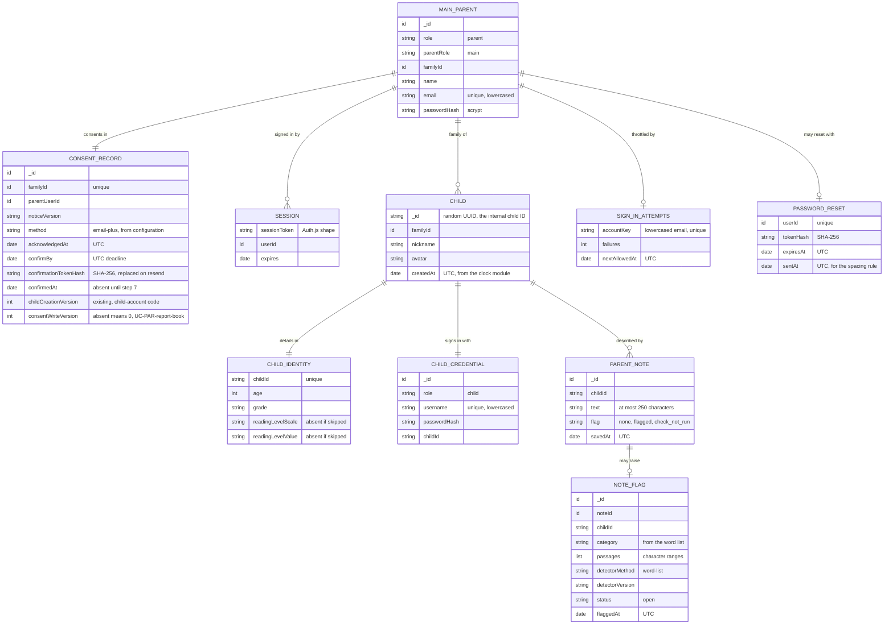

- `children` (Accounts & Family): indexed on `familyId`. This is what other components hold: the opaque ID, nickname and avatar. There is **no name field of any kind**.
- `childIdentities` (Child Identity Store): unique on `childId`. Nothing else stores age, grade or reading level (`KD-pii-segregation`).
- `CHILD_CREDENTIAL` is a document in Identity & Access's `users` collection (the Auth.js adapter's), with a unique index on `username` that applies only where a username is set, since Main Parents sign in by email. Child and Sub Parent credentials both store the field as `username`, lowercased, so the one index covers both.
- `parentNotes` (Accounts & Family): written only when a note was given. An empty or all-blank note is no note. Each save is one row (`DI-parent-note`); editing is not part of this use case.
- `noteFlags` (Safety Flagging): written only when the note is `flagged`; a `check_not_run` note has no flag record, only the state on the note. It holds no note text. `UC-ADM-flag-review` reads these as its list and owns the later `status` values.
- Audit: one entry for a raised flag, IDs only, in the existing append-only collection (§8.2.9).
- Main Parent (`users`, Identity & Access, `UC-PAR-onboarding`): the fields `requireParent()` already reads (`role`, `parentRole`, `familyId`) plus the name, the lowercased email and the password hash. A unique index on `email`, partial on its being a string, makes 4a race-free.
- `consentRecords` (Accounts & Family): one per family, unique on `familyId` and on `confirmationTokenHash` (the lookup for step 7; added in review of #114, 2026-11-23). The shape [`child-accounts.ts`](../src/server/accounts-family/child-accounts.ts) reads is kept: confirmed means `confirmedAt` is a date and `revokedAt` is absent, and `childCreationVersion` stays the counter that serializes child creation with revocation (`OI-36`). `UC-PAR-report-book` adds `consentWriteVersion` (integer, absent means 0), which `lockConsentForWrite` increments so a report conflicts with a revocation; it is never shown or read for anything else. Revocation belongs to `UC-PAR-revoke-consent`; whether it is per child or per family is `OI-45`. There is no third-party disclosure field, because nothing is disclosed (`CO-no-third-party-sharing`); the record gains one if that ever changes (`DI-consent-record`). The token hash stays after confirmation so the same link used twice is recognised; it confirms nothing more.
- `sessions` (Auth.js's collection and shape): no change.
- `signInAttempts` (Identity & Access): unique on the account key, indexed on `expiresAt`. Cleared on a successful sign-in. A count restarts once `expiresAt` (24 hours after its last wait ends) has passed, and the daily cleanup deletes rows past it, including rows for unknown emails. It holds the lowercased email because that is the account key; it is never logged.
- `passwordResets` (Identity & Access): at most one per user, unique on `userId`. Deleted when used, replaced by a newer request, and purged by the cron once past `expiresAt`; a passed expiry is refused on read. _Built (2026-11-23) as `userId`, `tokenHash` (unique), `issuedAt` and `expiresAt` (indexed for the cleanup), with a validator that refuses any other field; also deleted with an unconfirmed account (6a)._

`UC-PAR-delete-kid-account` adds no collection:

- `children`: gains `writeVersion`, an integer that `lockChildForWrite` increments; absent means 0. It is never shown or read for anything else.
- `consentRecords`: gains `removedChildren`, a list of `{ childId, removedAt }` (UTC, from the clock), written by `markChildRemoved` (POST-4). If `OI-45` makes consent per child, the per-child entry gains the removal date instead.
- `auditLog`: the `event` enum gains `child-account-deleted`, with the parent as actor and the deleted child ID; it needs no `recordId`, so the validator makes `recordId` required only for `parent-note-flagged`.
- `sessions`: deleted by `userId`. Add an index on `userId` if the Auth.js adapter does not create one.
- Every other collection keyed by the child ID already has, or must get, an index on `childId`, so each `deleteChildRecords` is one indexed delete.

What the purge deletes (6a), and why that is all: the parent's name and email were held only to obtain consent (`BR-coppa-notice`, `FR-ACCT-consent-confirm`), and no child data can exist before confirmation (step 6). A confirmed family's Consent Record is kept while a child account exists (`DI-consent-record`).

Every child field has a stated purpose, as `DI-minimization` and `BR-coppa-minimization` require:

| Field | Purpose | Source of the purpose |
|---|---|---|
| Nickname, avatar | What the child is shown as | `BR-kid-anonymous-profile`, `FR-ACCT-child-display` |
| Internal child ID | Links the child's data over time without a name | `DI-child-id`, `BR-kid-data-stored` |
| Age, grade | The recommender's primary signals | `BR-reading-level-proxy`, `DI-child-stored` |
| Reading level | Matching book difficulty, when the parent gives one | `BR-reading-level-proxy`, `BR-reading-level-parent-entered` |
| Username, password hash | The child's sign-in | `FR-ACCT-credentials`, `DI-child-credentials` |
| Parent note, its flag state | Context for the recommender; human review of a flagged note | `BR-parent-note`, `BR-note-safety-flagging` |

The indexes are created by an idempotent setup script, run before the first deploy and by the integration-test setup. MongoDB schema validation is the backstop for required fields (§8.2.5).

### Review/export schema delta and source inventory

No duplicate child-data store or grant collection. Add `child-data-viewed` and `child-data-exported` audit events with actor ID/role, child ID and time. For these event variants, `recordId` is the reviewed child's UUID and equals `childId`; the existing note-flag event keeps its ObjectId record reference. Extend the event-discriminated TypeScript type and MongoDB validator together. Never substitute the parent's credential record or coerce a UUID to an ObjectId. Keep the existing sign-in, reset and cleanup audit variants when adding these events.

Each owning reader checks the child/family relation inside the transaction and uses an inclusion projection. Nested cross-family references never authorize reading the referenced record. Never return hashes, salts, live session/verification/reset tokens, siblings' records, admin review notes or aggregate/system logs. Family consent includes recorded method, notice version and lifecycle times when available, not link secrets or other family members' account details.

| Step 5 category | Owner / source or dependency | Contents and purpose source |
|---|---|---|
| Identity | Accounts & Family `children`; Child Identity Store `childIdentities`; Identity & Access `users` | UC-listed fields and stored creation times; credentials reader returns username only. Purposes: `BR-kid-data-stored`. |
| Reading profile | Merged REC `readingProfiles` module and future interest-profile store | Entered interests, favorite books and any stored derived Interest Profile. REC onboarding analytics timestamps remain internal; purpose: `BR-kid-data-stored`. |
| Parent notes and flags | Accounts & Family `parentNotes`; Safety Flagging `noteFlags` | Review shows the stored note, save time and the note's parent-visible flag state. Detection evidence and admin review fields stay in Safety Flagging. Export of flagged notes waits on OI-27. `check_not_run` is shown as a check that did not run. Purposes: `BR-parent-note`, `BR-note-safety-flagging`. |
| Recommendations/reactions | REC `readingProfiles` on `main`; `recommendationBatches` defined by the merged rules quiz design (#115) | Reading-profile interests/favorites use the REC reader above. Once batch storage exists, read the stored `bookIds`, `source`, `status`, `createdAt` and `handoffDeadline`. Include any stored review metadata, such as `removedBookIds` and `releasedAt`, once parent review adds it. No raw quiz answers, scores, device identifiers or report state are stored with the batch. Until that store exists, mark batches not yet collected. Purpose: `BR-kid-data-stored`. |
| Shelf/history | Shelf `shelfEntries`, `finishConfirmations` (merged `design/shlf.md`) | `bookId`, `category`, `movedAt`; confirmation `confirmedAt`. Ratings and confirmations remain readable after an entry is removed; omit `confirmedByParentId` and never derive child-facing counts; purpose: `BR-kid-data-stored`. |
| Ratings | Shelf `ratings` (merged `design/shlf.md`) | `bookId`, `value`, `ratedAt`, including ratings retained after shelf removal; no counts or derived metrics; purpose: `BR-kid-data-stored`. |
| Shelf requests | Shelf / Accounts & Family contract pending | Child-scoped requests/decisions; purpose: `BR-kid-data-stored`. |
| Usage | Identity & Access `childSignIns` and `childSessionEnds` (merged `design/shlf.md`); later action records stay with their owners | `childSignIns.at`; session `endsAt`, `lastSeenAt`, `lastActiveAt` where a live session exists. Join sessions only through the family-scoped child account; omit session IDs/tokens, usernames, IPs, device IDs and child-facing metrics; purpose: `BR-kid-data-stored`. |
| Reports/exclusions | Accounts & Family `bookReports`, `childBookExclusions` in `src/server/accounts-family/book-reports.ts` (merged and implemented by #110) | `bookId`, `reason`, `comment`, `status`, `reportedAt`; exclusion `createdAt`. Omit `reportedByUserId`, following the merged report design; purpose: `BR-kid-data-stored`. |
| Notifications | Notification `childNotices` (merged `design/shlf.md`) | `kind`, `bookId` when present, `createdAt`, `seenAt`; no parent identity, comment or safety-alert content; purpose: `BR-kid-data-stored`. |
| Family consent | Accounts & Family `consentRecords`, provisional shape | Recorded consent fields including revoked state; purpose: `BR-coppa-parental-consent`. |
| Parent suggestions | Accounts & Family `parentSuggestions`, through `listSuggestionsForExport(familyId, childId, tx)` in `suggestions.ts` (`UC-PAR-suggest-book`) | `bookId`, `note` when present, `suggestedAt`, including suggestions the child can no longer see; no parent identity is stored; purpose: `BR-kid-data-stored`. |

Each owning component supplies `readForParentData(parent, childId, tx)` or an equivalently named narrow reader, receiving the same transaction session and returning only its listed category fields. The coordinator calls those readers, never their collections. Parent-note reads include every retained note, not only the latest; no earlier version is invented when none exists. Shared book references return only catalog data, never another child’s records.

All twelve categories remain visible with purpose and a plain empty state when genuinely empty (5a). Purposes must match the supplied privacy notice before release. An unimplemented reader is not evidence of no records: confirm nothing collects that category, document the dependency, and add the owning reader in the same change that starts collecting it. Never claim full UC coverage while omitting an existing source. Reads use one committed snapshot; deletion before a later request gives not found.

`UC-PAR-report-book` adds two collections and writes to Shelf's `SHELF_ENTRY` and Notification's `childNotices`, both from [`shlf.md`](shlf.md) (`childNotices` in #106):

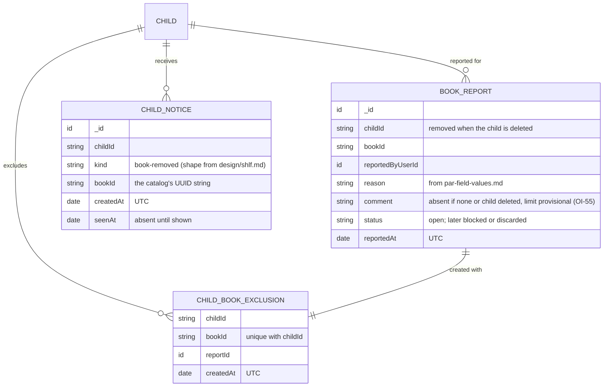

- `bookReports` (Accounts & Family): indexed on `{ status, reportedAt }` for the admin's list, on `{ bookId, status }` so `UC-ADM-block-content` (#109) can find and close a book's open reports, and on `childId` for the data-rights use cases. The validator makes `childId` and `comment` optional: this use case always writes `childId`, but when `UC-PAR-delete-kid-account` deletes the child, it keeps the report and removes its `childId` and `comment` (#105), because the comment is free text about the child. This use case writes only `open`; `UC-ADM-block-content` owns the other values. The reports with status `open` are "the admin queue" of `FR-PAR-report-book`. The reporting parent is stored as a user ID only, with no Main or Sub role: `DI-report-exclusion`, POST-1 and `BR-parent-report-book` ask only for "the reporting parent", and the role can be read from that user's document if a later use case needs it.
- `childBookExclusions` (Accounts & Family): unique on `{ childId, bookId }`, which is 7c. Nothing in this use case deletes one; `UC-PAR-delete-kid-account` deletes them with the rest of the child's data (#105, `FR-DATA-removal`).
- `childNotices` (Notification): the collection, its `{ childId, seenAt }` index and its `seenAt` shape are `design/shlf.md`'s (#106); this use case writes `book-removed` notices into it. No expiry and no deadline (7e).
- `SHELF_ENTRY`: the entry is deleted; ratings and finish confirmations are separate records and stay (POST-6).
- `auditLog`: two events, IDs only (§8.2.9), each a document with exactly these fields:
  - `book.reported`: `actorId` (the reporting parent's user ID, ObjectId), `actorRole` `parent`, `event`, `childId` (string), `recordId` (the report's `_id`, ObjectId), `occurredAt` (date).
  - `shelf.parent-removed`, written only when a shelf entry was removed: `actorId`, `actorRole` `parent`, `event`, `childId`, `recordId` (the deleted shelf entry's `_id`, ObjectId), `bookId` (string, so the entry it names can still be identified after the delete), `occurredAt`.

  Both fit whichever validator change merges first. With #107's `oneOf` of closed shapes, each event is one more branch with `additionalProperties: false`. With #108's shared properties plus a per-event `oneOf`, each event is one more branch, and `bookId` joins the shared properties.
- Each new collection gets a validator through `ensureCollection` (§8.2.5).

No new item is stored about a child: reports, per-child exclusions and in-app notices are already a row of `BR-kid-data-stored`.

Added for `UC-PAR-suggest-book`:

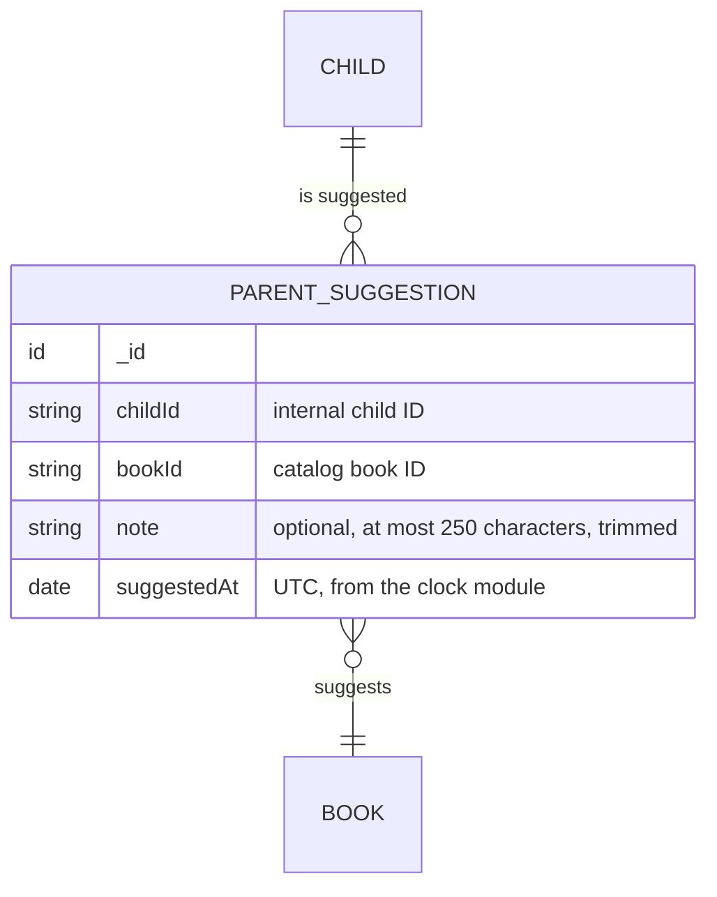

- `parentSuggestions` (Accounts & Family): a unique index on (`childId`, `bookId`) and a validator through `ensureCollection` (§8.2.5). There is no status, no deadline (`OI-67`), no parent ID and no copied book data. A document is pending while it exists. `UC-REC-kid-review` removes it when the child reacts (its step 7), through `removeSuggestionInTx`, so a later suggestion of the same book is a new insert; the report and the block remove it too (retention key decision). The validator requires `childId`, `bookId` and `suggestedAt` and allows an optional `note` of at most 250 characters; no other index is needed.
- Purpose, for `BR-kid-data-stored` and `DI-minimization`: a book a parent wants the child to see, and the parent's reason. Seen by the child and the parent, never by the admin. The row is added to `BR-kid-data-stored` in this pull request, so `UC-PAR-review-child-data` (through `listSuggestionsForExport`), `UC-PAR-delete-child-data` and `UC-PAR-delete-kid-account` (through this file's `deleteChildRecords`) must cover it, and the inactivity purge removes it the same way. Kept until the child reacts, the book is reported for the child or blocked, or the child's data is deleted or purged (retention key decision). The README's child data inventory gets its row, and the direct notice its item, in the pull request that creates the collection (Components & classes).
- `childBookExclusions` and `shelfEntries` are only read, through `isExcluded`, `listExcludedBookIds` and `isOnShelf`.

## Reuse & cross-cutting

For `UC-ADM-block-content` 3a, the parent Notification view displays the false-report warning saved by `saveFalseReportWarning(recipientId, tx)` to the authenticated recipient. See [the block design](adm.md#blocking-and-report-decisions).

_[Which existing services, components, and conventions this area uses rather than rebuilding: authentication, the error handler, email, the clock, another area's service. Cite your architecture-of-record's section 8.2 for each convention by name rather than restating it.]_

Nothing exists to reuse yet, so this use case builds the shared pieces the conventions name, once, for every later use case:

- **Authentication and sessions:** Auth.js database sessions and `requireParent()` (`KD-auth-sessions`, §8.1 Authentication).
- **Authorization:** the Main Parent and family checks in the action, and the family check on the completion page (§8.1 Authorization).
- **Error handling:** the shared result helper (§8.2.1).
- **Time:** the clock module for `createdAt`, `savedAt` and `flaggedAt` (§8.2.2).
- **API conventions:** a verb-first server action; session, then validation, then the owning component (§8.2.3).
- **Code conventions:** `server-only` on every module under `src/server/`; each component touches only its own collection (§8.2.4).
- **Validation:** one zod schema for form and action (§8.2.5).
- **Logging:** never the nickname, age, grade, reading level, username, password or note text, not even on failure (§8.2.7).
- **Transactions:** the inserts, and a raised flag with its audit entry, are one transaction (§8.2.8); development and tests run MongoDB as a replica set.
- **Auditing:** one entry for a raised flag (§8.2.9): action `note.flagged`, actor the parent's user ID and role, record the flag ID, IDs only.

Not used by `UC-PAR-create-kid-account`: Notification and the Email Service (nothing is sent and no alert is raised), Recommendation (`UC-REC-kid-onboarding` runs after step 8 but is its own use case), and the audit log for child creation itself (not in the §8.2.9 list).

`UC-PAR-onboarding` reuses all of the above that now exist (the result helper, the clock, `withTransaction`, `requireParent()`, scrypt hashing, the index setup script, the audit log, the privacy notice link) and adds:

- **Notification:** the first email the system sends (`CI-email-parent`), through the Email Service as §5.1 already draws it.
- **Scheduled Cleanup:** the first cron route, protected by the cron secret (§8.1, §8.2.3), for the unconfirmed-account purge §5.2 already lists.
- **Configuration:** the consent window and method come from the config module (§8.2.6), so legal review can change them without a code change (`OI-21`, `OI-22`).
- **Logging:** never the parent's name, email, password, the confirmation token or the session token (§8.2.7). Refused sign-ins and cleanup runs are logged as security events with an ID and no account detail.
- **Auditing (onboarding):** one entry per purged unconfirmed account (`account.unconfirmed-purged`, actor role `system`, the user ID and family ID only), whether the cron purges it or a new sign-up with its email replaces it (6a). Sign-up and confirmation are not in the §8.2.9 list; the Consent Record itself is the proof of consent. A password reset is: `account.password-reset`, the user ID only.

`UC-PAR-report-book` reuses `requireParent()`, `getChildForFamily` (the family scope inside data access, §8.1), the result helper (§8.2.1), `now()` (§8.2.2), `withTransaction` (§8.2.8, which already lists this transaction), the audit log (§8.2.9, which already lists parent book reports), `findActiveBookIds`, and Shelf's `getBooksForShelf` from [`shlf.md`](shlf.md). It writes Notification's `childNotices` from `design/shlf.md`. Logging never includes the comment, the reason or the nickname (§8.2.7). The notice follows §8.2.11. Not used: the Child Identity Store, Safety Flagging (no rule asks to screen a report comment), and email.

`UC-PAR-delete-kid-account` reuses `requireParent()`, `getChildForFamily`, the result helper, `withTransaction`, scrypt verification, the sign-in throttle, the clock and the audit log, and adds:

- **Transactions:** the largest one yet, across every component that holds child records (§8.2.8).
- **Logging:** never the password, the typed nickname, the username or the account key; a failed deletion is logged with its error ID only (§8.2.7).
- **Auditing:** `child-account-deleted` with the parent's user ID and the deleted child ID (§8.2.9, data deletions).
- **Not used:** Recommendation, Shelf and the rest are called only through their `deleteChildRecords`; Notification only through step 6, once Sub Parents exist.

`UC-PAR-suggest-book` reuses `requireParent()`, `getChildForFamily` and `lockConsentForWrite` (§8.1, the family and consent scope inside data access), `isExcluded` and `listExcludedBookIds` (`KD-book-exclusion`), `isOnShelf`, Recommendation's `listReleasedBatchesForChild`, the Catalog's reads, the result helper (§8.2.1), `now()` for `suggestedAt` (§8.2.2), the action order (§8.2.3), `server-only` and one owner per collection (§8.2.4), one zod schema with the 250-character note (§8.2.5) and `withTransaction` (§8.2.8). Application logs never include the suggestion note, the nickname, or the child ID tied to a book (§8.2.7); `logUnexpectedError` and `logSecurityEvent` in [`log.ts`](../src/server/lib/log.ts) already log no property of an error. The child and book IDs do appear together in the suggest page's path, so they reach Vercel's request logs, as on the report route (`/parent/children/[childId]/shelf/[bookId]/report`). Both IDs are opaque, and this is accepted (developer, 2026-11-24, questions test item 3). The child-facing read follows the §8.2.11 exception added here. It uses no Notification, audit, Child Identity Store or Safety Flagging.

## Tests

_[One row per flow: the main success scenario and **every** extension of every use case this document realizes, appended per use case. Name the level (unit or integration) and what the test asserts. No code. This list is the definition of done that the reviewer approves; the agent writes these tests when it builds, and a reviewer can see at a glance whether an extension has no test.]_

| Use case, flow | Level | Asserts |
|---|---|---|
| UC-PAR-create-kid-account main | integration | A Main Parent with confirmed consent creates a child: one child account with the nickname and avatar, one identity record with age, grade and reading level, and one child credential with the lowercased username and a hash, all with the same child ID and the session's family; the response holds the plaintext password |
| UC-PAR-create-kid-account main, skipped reading level and note | integration | With no reading level and no note, the identity record has no reading level, no note row and no flag exist, and the save succeeds (`FR-ONB-level-optional`) |
| UC-PAR-create-kid-account main | end-to-end | The parent fills in the form, sees the credentials, acknowledges, is taken to the child's reading-profile onboarding, and after it sees "onboarding complete" (steps 8–10) |
| UC-PAR-create-kid-account main, password | unit | Generated passwords meet the agreed rules and differ between calls; the stored hash verifies against the shown password |
| UC-PAR-create-kid-account 5.1, note not flagged | integration | A note with no match is saved with flag state `none`; no flag record and no audit entry exist |
| UC-PAR-create-kid-account 5.1, note flagged | integration | A note matching the placeholder entry is saved with state `flagged`; one flag record holds the category, character ranges, detector method and version and no note text; one audit entry holds IDs only; all of it commits together with the child |
| UC-PAR-create-kid-account 5.1, screening | unit | `screenNote` returns the category and character ranges for a match, ignoring case and matching whole words; returns `none` otherwise; editing `word-list.ts` changes the result with no other change |
| UC-PAR-create-kid-account 5b | integration | When `screenNote` throws, the note is saved with state `check_not_run`, no flag record exists, and the child is created |
| UC-PAR-create-kid-account 1a | end-to-end | Leaving the form without submitting writes nothing |
| UC-PAR-create-kid-account 1b | integration | A Sub Parent gets the explanation on the page and `NOT_MAIN_PARENT` from the action, and nothing is stored |
| UC-PAR-create-kid-account 1c | integration | A family without confirmed consent is redirected from the page and gets `CONSENT_NOT_CONFIRMED` from the action, and nothing is stored |
| UC-PAR-create-kid-account 4a | unit | An empty nickname is refused with `NICKNAME_REQUIRED`; a nickname with a space or any character that is not a letter or digit with `INVALID_NICKNAME` |
| UC-PAR-create-kid-account 4i | unit | A 250-character note is accepted; a 251-character note is refused with `NOTE_TOO_LONG` and nothing is stored |
| UC-PAR-create-kid-account 4b | integration | An age outside 6–11 but inside the accepted range is saved; the form shows the warning |
| UC-PAR-create-kid-account 4b, bounds | unit | An age that is not a whole number, or is outside the accepted range, is refused with `INVALID_AGE` |
| UC-PAR-create-kid-account 4c | unit | A grade not in the grade list is refused with `INVALID_GRADE` |
| UC-PAR-create-kid-account 4d | unit | A reading level whose value does not match its scale's format, whose scale is not accepted, or that gives a scale without a value or a value without a scale, is refused with `INVALID_READING_LEVEL` |
| UC-PAR-create-kid-account 5.1, offsets | unit | A note with leading and trailing spaces is stored trimmed, and the flag's character ranges point at the matched words in the stored text |
| UC-PAR-create-kid-account 7a, double submit | end-to-end | Submitting twice quickly with one username leaves one child, and the credentials screen keeps the first response's password |
| UC-PAR-create-kid-account validation | unit | With several invalid fields, the action returns the error of the first one in form order |
| UC-PAR-create-kid-account 4e | end-to-end | The referral links are shown and the system computes no level from anything entered |
| Privacy notice | end-to-end | The form shows the online privacy notice link (`FR-DATA-notice`) |
| UC-PAR-create-kid-account 4f | unit | An empty username is refused with `USERNAME_REQUIRED` |
| UC-PAR-create-kid-account 4g | integration | A username already used by any child or Sub Parent, in any letter case, returns `USERNAME_TAKEN`, and nothing is stored (no child, identity, credential, note or flag) |
| UC-PAR-create-kid-account 4g, concurrent | integration | Two simultaneous creations with one username leave exactly one child |
| UC-PAR-create-kid-account 4h, format | unit | A username outside 3–20 letters, digits and underscores is refused with `INVALID_USERNAME` |
| UC-PAR-create-kid-account 4h, contact information | unit | A username with `@`, a dot, or a run of seven or more digits is refused with `INVALID_USERNAME` |
| UC-PAR-create-kid-account 4h, nickname | unit | A username containing the nickname, ignoring case, is refused with `USERNAME_CONTAINS_NICKNAME` |
| UC-PAR-create-kid-account 5a | integration | When the identity insert fails, no child account, identity, credential, note or flag remains, and the result is `SAVE_FAILED` with an error ID |
| UC-PAR-create-kid-account 6a | integration | When the credential insert fails, no child account, identity, note or flag remains, and the result is `SAVE_FAILED` |
| UC-PAR-create-kid-account 7a | integration | No function or page returns the plaintext password after the action's response; only the hash is stored |
| UC-PAR-create-kid-account 10 | integration | The completion page shows the message and nickname to a parent of the family; a child ID from another family, or an unknown one, gets the same not-found result |
| Authorization | integration | A request naming another family's ID still creates the child in the session's family; a child session and an admin session are refused |
| Logging | integration | After a successful and a failed creation, including a flagged note, the logs contain no nickname, age, grade, reading level, username, password or note text |
| Child-facing read | integration | The child account record that child-facing code reads holds only the ID, family, nickname and avatar; no function a child session can call returns the note, the flag, the age, the grade or the reading level |
| Admin boundary | integration | An admin session cannot read the note, the age, the grade or the reading level; the only path is the flag-review function, which is not built here |
| UC-PAR-onboarding main | integration | Sign-up writes one Main Parent (lowercased email, scrypt hash, `parentRole` main), one Consent Record (notice version, method from configuration, `acknowledgedAt`, `confirmBy` equal to `acknowledgedAt` plus the configured window under a fixed clock, a token hash and no plaintext token) and one session, all with the same user and family IDs; the session cookie is set; one email is sent to that address with the link, what was consented to, how to revoke and the deadline |
| UC-PAR-onboarding main | end-to-end | Against Mailpit: the parent signs up, lands on check-email, opens the link read from Mailpit's API, taps Confirm and lands on `/parent/children/new` (steps 1–8) |
| UC-PAR-onboarding 2 | end-to-end | The form shows the consent notice with its version and the online privacy notice link, and the acknowledgment box starts unchecked (`FR-ACCT-consent`, `FR-DATA-notice`) |
| UC-PAR-onboarding 3a | end-to-end | Leaving the form without submitting writes nothing |
| UC-PAR-onboarding 3b | unit and integration | An acknowledgment that is missing, false or anything but `true` is refused with `CONSENT_NOT_ACKNOWLEDGED`, and nothing is stored |
| UC-PAR-onboarding 3b, stale form | integration | A notice version other than the current one, whether the text or only the window changed, is refused with `NOTICE_CHANGED` before any hash, and nothing is stored; a sign-up with the current version records exactly that version |
| UC-PAR-onboarding 4a | integration | An email already used by any user, in any letter case, returns `EMAIL_TAKEN` and stores nothing |
| UC-PAR-onboarding 4a, concurrent | integration | Two simultaneous sign-ups with one email leave exactly one account and one Consent Record |
| UC-PAR-onboarding 4a, expired | integration | An unconfirmed account past its `confirmBy` does not block a new sign-up with its email; the old user, record and sessions are gone and the new ones exist |
| UC-PAR-onboarding 4b | unit | A malformed or over-long email is refused with `INVALID_EMAIL`; surrounding spaces and capitals are normalized |
| UC-PAR-onboarding 4c | unit | Passwords of 7 and 129 characters are refused with `WEAK_PASSWORD`; 8 and 128 are accepted with no character-class rules; a password equal to the email, ignoring case, is refused |
| UC-PAR-onboarding, name | unit | An empty or all-blank name is refused with `NAME_REQUIRED`; one longer than the agreed maximum with `INVALID_NAME` |
| UC-PAR-onboarding 5a | integration | When the Consent Record insert or the session insert fails, no user, record or session remains, no cookie is set, and the result is `SAVE_FAILED` with an error ID |
| UC-PAR-onboarding 5b | integration | When the transport fails, the account, record and session stay, the result is `ok` with `emailSent` false, and the check-email page shows the could-not-send notice |
| UC-PAR-onboarding 6 | integration | Before confirmation, `/parent` and `/parent/children/new` redirect to check-email, and `createChildAccount` returns `CONSENT_NOT_CONFIRMED` |
| UC-PAR-onboarding 6a, on read | integration | With the clock past `confirmBy`: `confirmConsent` returns `LINK_EXPIRED`, `resendConsentEmail` returns `SIGN_UP_EXPIRED`, and check-email says to start again; a parent who signs in with the right password is let in and `/parent` sends them to that message; nothing is confirmed |
| UC-PAR-onboarding 6a, start again | integration and end-to-end | With the clock past `confirmBy`, a signed-in parent follows "start again" from check-email and sees the `/sign-up` form with no redirect; signing up with the same email replaces the old account and sessions and lands on check-email for the new deadline. A signed-in parent at any other step is still redirected from `/sign-up` to `/parent` |
| UC-PAR-onboarding 6a, purge | integration | The cleanup route with the secret deletes every expired unconfirmed user, its sessions, throttle state and Consent Record, appends one audit entry per account with IDs only, and leaves confirmed families and unexpired unconfirmed ones untouched; without the secret, or with a wrong one, it returns 401 and deletes nothing |
| UC-PAR-onboarding 6b | integration | A resend replaces the token: the old link returns `LINK_INVALID`, the new one confirms, and `confirmBy` is unchanged; a confirmed family gets `ALREADY_CONFIRMED`; a Sub Parent gets `NOT_MAIN_PARENT` |
| UC-PAR-onboarding 6b, send fails | integration | Under a fixed clock, with the transport failing, a resend returns `SEND_FAILED`, the old link already returns `LINK_INVALID`, and check-email shows the could-not-send notice with the resend button still offered; with the transport restored, a second resend sends one email whose link confirms, and `confirmBy` is still the sign-up deadline throughout |
| UC-PAR-onboarding 7 | integration | A valid token sets `confirmedAt` once; the same link used again returns `ok` and changes nothing; an unknown token returns `LINK_INVALID`; with no session the result continues to `/sign-in`, with this family's session to `/parent/children/new` |
| UC-PAR-onboarding 7, no click | end-to-end | Loading the confirmation page, without tapping Confirm, leaves the family unconfirmed |
| UC-PAR-onboarding 8 | integration | After confirmation, `checkCreateChildAccess` lets the Main Parent create a child, and `createChild` accepts the Consent Record sign-up wrote (the `childCreationVersion` contract); setting `revokedAt` on it makes both refuse |
| UC-PAR-onboarding 8a | integration and end-to-end | A confirmed Main Parent with no child who signs in again is sent to `/parent/children/new` from `/parent`; with a child, to the parent home |
| Supporting flow: sign-in (`OI-44`) | integration | A correct email and password create a database session that `auth()` and `requireParent()` read back; an unknown email and a wrong password both return `INVALID_CREDENTIALS`; a child user is refused the same way. **TEMPORARY (`OI-61`): the admin refusal is suspended; restore it, and its test, when the rig is removed** |
| Supporting flow: sign-in throttling (`OI-44`) | integration | Under a fixed clock, after the agreed number of failures the next attempt returns `TOO_MANY_ATTEMPTS` with the wait, the wait grows to the agreed cap and never becomes a lockout, unknown emails are throttled the same way, a success clears the count, the count restarts at `expiresAt`, and the cleanup deletes only expired rows |
| Confirmation email | unit | The message holds the link with the token in the fragment, the notice version, the deadline and how to revoke, and no child data |
| Email transport | unit | In production with no `SMTP_URL`, `sendEmail` refuses without trying to send; elsewhere it uses the configured URL |
| UC-PAR-onboarding logging | integration | After a sign-up, a 5b failure, a 5a failure, a confirmation, a refused sign-in and a purge, the logs contain no name, email, password, confirmation token or session token |
| Supporting flow: sign-out (`OI-44`) | integration | `signOutParent` deletes the caller's session document and clears the cookie; the old session token no longer passes `auth()`; other sessions of the same parent are untouched |
| Supporting flow: password reset request (`OI-44`) | integration | For a Main Parent, one reset record with a hash and expiry is stored and one email with the link is sent, whatever the family's onboarding state; for an unknown email, a child or an admin, nothing is stored or sent; all return the same `ok`; a second request within the spacing sends nothing more, and one after it replaces the earlier token |
| Supporting flow: password reset (`OI-44`) | integration | A valid token and an acceptable password replace the hash, delete every session of that parent, clear the throttle and append one audit entry with the user ID only, in one transaction; the old password no longer signs in and the new one does; the token cannot be used twice |
| Supporting flow: password reset refusals (`OI-44`) | integration | An unknown, replaced, used or expired token (fixed clock) returns `RESET_LINK_INVALID` and changes nothing; a password breaking the 4c rule returns `WEAK_PASSWORD` and leaves the token usable |
| Supporting flow: password reset, no click (`OI-44`) | end-to-end | Loading `/reset-password` from the link, without submitting, changes nothing; the token never appears in a request URL |
| Supporting flow: reset purge (`OI-44`) | integration | The cleanup route removes reset records past their expiry and leaves unexpired ones |
| UC-PAR-onboarding admin boundary | integration | No function an admin session can call returns a Consent Record's fields beyond whether one exists (`DI-consent-record`) |
| UC-PAR-report-book main | integration | Under a fixed clock, a Main Parent's report writes one report (`open`, the reporting parent's user ID, reason, comment, `reportedAt`, and no role field), one exclusion, deletes the shelf entry, writes one `book-removed` notice holding the book ID only, and two audit entries with IDs only (`book.reported` with the report ID, `shelf.parent-removed` with the deleted entry's ID); the result is `removedFromShelf` true |
| UC-PAR-report-book main, Sub Parent | integration | A Sub Parent's report is saved the same way, with the Sub Parent's user ID as the reporting parent |
| UC-PAR-report-book main | end-to-end | From the shelf: Report, choose a reason, Continue, see the warning, Confirm, see the step 8 message; the book is gone from the parent's shelf |
| UC-PAR-report-book POST-2 | integration | `listExcludedBookIds` returns the book for the reported child and not for a sibling |
| UC-PAR-report-book POST-6 | integration | The child's rating and finish confirmation for the book remain; another child's shelf entry for the same book is untouched |
| UC-PAR-report-book POST-7 | integration | No exported function deletes an exclusion or changes a report's status |
| UC-PAR-report-book 2 | integration (`view.ts`) | The page shows the title and the nickname and no age, grade or reading level; another family's child, an unknown or malformed ID, a book not on the shelf, and a child or admin session all get the same `404` |
| UC-PAR-report-book 3a | unit (schema and `report-form-state.ts`) | A missing reason is refused with `REASON_REQUIRED`, a value off the list with `INVALID_REASON`; the form does not continue without a reason |
| UC-PAR-report-book comment | unit | A comment at the limit in `par-field-values.md` (250, provisional, `OI-55`) is accepted, one character more is refused with `COMMENT_TOO_LONG`; a blank comment is stored as no comment. The test reads the limit from the schema's constant, so a changed limit changes one value |
| UC-PAR-report-book 3b | end-to-end | Cancelling returns to the shelf and writes nothing |
| UC-PAR-report-book refusals | end-to-end | A book already reported shows "already reported" and no form, also when the other parent's report commits while the confirmation is open; a book not on the shelf gets the `404`; a book taken off the shelf after the page opened, and a family whose consent is revoked, see the refusal and nothing is saved |
| UC-PAR-report-book outcome unknown | integration and unit | An error labelled `UnknownTransactionCommitResult` returns `OUTCOME_UNKNOWN` with an error ID, not `SAVE_FAILED`, and its message does not say nothing was saved; the form ends on that message with a link to the shelf |
| UC-PAR-report-book 5a | unit (`report-form-state.ts`) and end-to-end | Declining the confirmation returns to the form with the reason and comment kept; no transition but Confirm yields the action's input, and the browser sends no request |
| UC-PAR-report-book 6, unconfirmed | unit | A request with `confirmed` missing or false is refused with `NOT_CONFIRMED` |
| UC-PAR-report-book 7a | integration | When the notice insert fails, no report, exclusion, audit entry (of either event) or notice exists and the shelf entry is still there; the result is `SAVE_FAILED` with an error ID; a retry succeeds |
| UC-PAR-report-book PRE-3 | integration | A book that is an active catalog book but on neither the child's shelf nor a pending batch is refused with `NOT_ON_SHELF_OR_BATCH`, and no report, exclusion, notice or audit entry is written |
| UC-PAR-report-book 7b (pending `OI-54`) | integration | Today: with the shelf entry removed after the page loaded and no pending batch holding the book, the result is `NOT_ON_SHELF_OR_BATCH` and nothing is written. If 7b is chosen: the same request with a valid report eligibility token is saved, and no removal notice is written |
| UC-PAR-report-book 7b token (only if 7b is chosen) | integration | With the shelf entry removed and no pending batch holding the book, a request with no token, a tampered token, a token for another child, book or family, or one issued more than 30 minutes earlier (fixed clock) is refused with `NOT_ON_SHELF_OR_BATCH` and nothing is written |
| UC-PAR-report-book 7c before PRE-3 | integration | A book already reported, and so no longer on the shelf, gets `ALREADY_REPORTED`, not `NOT_ON_SHELF_OR_BATCH` |
| UC-PAR-report-book 7c, error mapping | integration | A duplicate key on the exclusions index returns `ALREADY_REPORTED`; any other error thrown inside the transaction returns `SAVE_FAILED` with an error ID |
| UC-PAR-report-book child check | integration | With the child deleted before the report (fixture), the result is `CHILD_NOT_FOUND` and nothing is written; the read uses the transaction's handle |
| UC-PAR-report-book consent check | integration | With the family's Consent Record unconfirmed, and again with `revokedAt` set, the result is `CONSENT_NOT_CONFIRMED` and no report, exclusion, removal, notice or audit entry is written; a successful report increments `consentWriteVersion` by one; the lock uses the transaction's handle |
| UC-PAR-report-book revocation race | integration | A report and a revocation of the same family at the same time (a fixture writing `revokedAt` in its own transaction, until `UC-PAR-revoke-consent` is built) leave no report, exclusion, removal, notice or audit entry unless the report committed first; a report after the revocation returns `CONSENT_NOT_CONFIRMED` and writes nothing |
| UC-PAR-report-book blocked mid-report | integration | With the book blocked before the action runs, and again with the block's shelf deletion applied after the book check (fixture), the result is `BOOK_NOT_FOUND` or `NOT_ON_SHELF_OR_BATCH`, either accepted, and nothing is written |
| UC-PAR-report-book validator | integration | The `bookReports` validator accepts a report with no `childId` and no `comment` (the shape #105 leaves after a child is deleted); the `{ bookId, status }` index exists |
| UC-PAR-report-book audit shapes | integration | The two audit entries hold exactly the fields under Data model and no comment, reason or nickname; the validator refuses an extra field |
| UC-PAR-report-book 7c | integration | A second report of the same book for the same child, by either parent, returns `ALREADY_REPORTED` and writes nothing; two simultaneous reports leave exactly one report and one exclusion |
| UC-PAR-report-book 7c, page | integration (`view.ts`) | With a report and exclusion for the book and **no shelf entry** (the state a committed report leaves), the page shows "already reported" and no form, not the `404` |
| UC-PAR-report-book 7d | integration (built with `UC-REC-parent-review`) | Reported from a pending batch, the book leaves the batch, the batch stays pending, no notice is written, and the report is saved although the book was never on the shelf (PRE-3 met by the batch) |
| UC-PAR-report-book 7e | integration | The notice has no expiry and stays unseen until the child-side code marks it seen |
| UC-PAR-report-book authorization | integration | Another family's child gets `CHILD_NOT_FOUND` and nothing is written; a family ID in the request is ignored; child and admin sessions are refused |
| UC-PAR-report-book book check | integration | A draft or unknown book ID, or a book blocked before the request, gets `BOOK_NOT_FOUND` and nothing is written |
| UC-PAR-report-book child-facing | integration | The notice record holds no reason, comment or parent ID |
| UC-PAR-report-book logging | integration | After a success and a 7a failure, the logs hold no comment, reason or nickname |
| UC-PAR-delete-kid-account main | integration | A Main Parent deletes a child: no child account, identity record, credential, session or parent note for that child remains; the Consent Record lists the child ID as removed with the date (fixed clock); one `child-account-deleted` audit entry holds IDs only; another child of the same family and its records are untouched; the Main Parent account and its session remain |
| UC-PAR-delete-kid-account main, completeness | integration | The child's records are created through the real write paths; before deletion, every collection not on the test's named exempt list holds the child ID or the child's user ID, or the test fails; after deletion, no field at any depth of any document holds the child's user ID, and only audit entries and the Consent Record's removed-child entry hold the child ID |
| UC-PAR-delete-kid-account main, reports and notices | integration | Once `UC-PAR-report-book` and Notification exist: a report made for the child keeps only book, reason and the reporting parent's reference, with no comment and no child reference; no notice about the child remains for any recipient |
| UC-PAR-delete-kid-account, racing child write | integration | A child write that has called `lockChildForWrite` and a deletion of that child run at the same time: whichever commits, no record of the child remains afterwards, and a write that runs after the deletion returns `CHILD_NOT_FOUND` and inserts nothing. `saveOnboardingProfile` is the write used, since it is the one on `main` |
| UC-PAR-delete-kid-account, racing report and sign-in | integration | Once `UC-PAR-report-book` and child sign-in are built: a `reportBook` and a `signInChild` for the child, each run against a deletion of that child (fixture ordering as in the row above), leave no exclusion, session, `childSignIns` or `childSessionEnds` record; the report returns `CHILD_NOT_FOUND` and the sign-in `INVALID_CREDENTIALS` |
| UC-PAR-delete-kid-account main, sign-in | integration | The deleted child's old session token no longer passes `auth()`, and the child's username no longer exists |
| UC-PAR-delete-kid-account main, child sign-in records | integration | Once child sign-in is built: after the child signed in on a trusted device and a wrong attempt was made under the shared key, deletion leaves no `childSessionEnds` record for the child's sessions, no `childSignIns` record for the child, and no `signInAttempts` record whose key starts with `child:<username>:`; another child's keys and a parent's email key are untouched |
| UC-PAR-delete-kid-account main | end-to-end | The parent opens the delete page, sees the statement, enters the password and nickname, confirms and sees the confirmation (steps 1–7) |
| UC-PAR-delete-kid-account 1a | integration | A Sub Parent sees the explanation on the page, gets `NOT_MAIN_PARENT` from the action, and nothing is deleted |
| UC-PAR-delete-kid-account 2a | end-to-end | Leaving the page without confirming deletes nothing |
| UC-PAR-delete-kid-account 4a, password | integration | A wrong password returns `WRONG_PASSWORD`, adds one failure to the parent's throttle count and deletes nothing |
| UC-PAR-delete-kid-account 4a, nickname | unit and integration | A nickname that differs in any letter or in letter case returns `NICKNAME_MISMATCH` and deletes nothing; surrounding spaces are ignored |
| UC-PAR-delete-kid-account 4a, throttle | integration | Under a fixed clock, after the agreed number of failures here or at sign-in, the action returns `TOO_MANY_ATTEMPTS` even with the right password until the wait passes, and deletes nothing |
| UC-PAR-delete-kid-account 4a, parallel re-checks | integration | Under a fixed clock, with the count one short of a wait, several wrong-password requests sent at once are each counted, and every request after the free attempts are used gets `TOO_MANY_ATTEMPTS`; none deletes anything |
| UC-PAR-delete-kid-account 5a | integration | A child with a flagged note and an `open` flag is deleted; no note and no flag remain; the earlier `parent-note-flagged` audit entry remains |
| UC-PAR-delete-kid-account 5b | integration | When any one component's `deleteChildRecords` throws, every record of the child is still there, the Consent Record and audit log are unchanged, and the result is `DELETE_FAILED` with an error ID |
| UC-PAR-delete-kid-account 6 | integration | With Sub Parents in the family, each gets one in-app notice in the same transaction, holding no nickname. Written when Sub Parents and Notification exist; until then, a family with no Sub Parent gets no notice |
| UC-PAR-delete-kid-account 7a | integration | After the family's last child is deleted, the Main Parent account and Consent Record remain and `getOnboardingStep` returns `needs-first-child` |
| UC-PAR-delete-kid-account, revoked consent | integration | A child whose family's consent is revoked can still be deleted |
| UC-PAR-delete-kid-account, double submit | integration | Two simultaneous deletions of one child: one returns `ok`, the other `CHILD_NOT_FOUND`, and one audit entry exists |
| UC-PAR-delete-kid-account authorization | integration | A child ID from another family returns `CHILD_NOT_FOUND` and deletes nothing; a child session and an admin session are refused |
| UC-PAR-delete-kid-account logging | integration | After a successful deletion, a wrong password and a 5b failure, the logs contain no password, nickname, username or email |
| UC-PAR-suggest-book main | integration | A parent of the family suggests an active book with a note: one suggestion with the child, the book, the trimmed note and `suggestedAt` equal to `now()`; no shelf entry is created (POST-1, `BR-parent-rec-not-forced`) |
| UC-PAR-suggest-book main, no note | integration | With a blank or missing note the suggestion is saved with no note field (step 3) |
| UC-PAR-suggest-book main | end-to-end | The parent opens the book list, taps "Suggest", confirms with a note, and sees "Suggested to [nickname]" (steps 1–4) |
| UC-PAR-suggest-book step 1 | integration | The book list shows active books only; draft and blocked books are not listed |
| UC-PAR-suggest-book step 5 | integration | `listSuggestionsForChild` returns the suggestion with book ID, title, author, the note and `fromGrownUp: true`, and no other field: no parent ID or name, no date, no count (POST-2, §8.2.11) |
| UC-PAR-suggest-book step 5, later report or block | integration | After an exclusion for the book is written, or the book is blocked, `listSuggestionsForChild` no longer returns it (`KD-book-exclusion`, `SAF-child-content`) |
| UC-PAR-suggest-book 1a | integration | With one child the child-picker page redirects to that child's confirmation page; with several it lists them by nickname and avatar only; with none, a Main Parent goes to `/parent/children/new` and a Sub Parent sees the message |
| UC-PAR-suggest-book 1b | integration | A book excluded for the child gives `BOOK_EXCLUDED` from the action and the explanation with no form on the page; nothing is stored. The same book can still be suggested to a sibling with no exclusion |
| UC-PAR-suggest-book PRE-3 | integration | An unknown, draft or blocked book gives `INVALID_BOOK` from the action and `404` on both suggest pages, and the confirmation page shows no title for it; nothing is stored |
| UC-PAR-suggest-book 3a | end-to-end | Cancelling from the confirmation page writes nothing |
| UC-PAR-suggest-book 3b | unit | A 250-character note (after trimming) is accepted, 251 is refused with `NOTE_TOO_LONG`, and a note of only spaces is no note |
| UC-PAR-suggest-book 4a, on shelf | integration | A book on the child's shelf gives `ALREADY_ON_SHELF` and no write; with `suggestAnyway` the suggestion is saved and the shelf entry is unchanged |
| UC-PAR-suggest-book 4a, already suggested | integration | A pending suggestion gives `ALREADY_SUGGESTED` (also when the book is on the shelf or in a released batch too); with `suggestAnyway` the one document has the new note (or no note) and a new `suggestedAt`, and no second document exists |
| UC-PAR-suggest-book 4a, released batch | integration | A book in a batch `listReleasedBatchesForChild` returns for the child gives `ALREADY_RECOMMENDED` and no write (also when it is on the shelf too); with `suggestAnyway` the suggestion is saved and the batch is unchanged. A book only in a pending batch, or left out of a released batch's books by that read (excluded, blocked, draft or out of the age band), gives no warning |
| UC-PAR-suggest-book, suggest again after a reaction | integration | After `removeSuggestionInTx` deletes a pending suggestion, a new suggestion of the same book to the same child is inserted with `ok` and no warning about a suggestion |
| UC-PAR-suggest-book, report deletes the suggestion | integration | `reportBook` for a book with a pending suggestion deletes that suggestion in the same transaction as the exclusion, and leaves a sibling's suggestion of the book; a forced failure later in `reportBook` leaves the suggestion in place; a book that is only suggested still gives `NOT_ON_SHELF_OR_BATCH` and nothing is deleted |
| UC-PAR-suggest-book, block deletes suggestions | integration | `deleteSuggestionsForBookInTx` inside a test transaction deletes every child's suggestion of that book and no other book's; an aborted transaction deletes none. Once `UC-ADM-block-content` is built, its block test asserts the same |
| UC-PAR-suggest-book, block race (`OI-58`, team decision 2026-11-26) | integration | Block then suggest: once the block has committed, a suggestion of the book returns `INVALID_BOOK` and stores nothing, even when the book check before the transaction saw it active. Suggest then block: when the suggestion commits first, the block's transaction deletes it, and no suggestion of the book remains. Run concurrently, every interleaving ends with no suggestion of the blocked book |
| UC-PAR-suggest-book, draft race (`OI-58`, team decision 2026-11-26) | integration | Draft then suggest: a fixture sets the book back to draft in its own transaction after the book check before the transaction saw it active and before the suggestion's transaction starts; the suggestion returns `INVALID_BOOK` and stores nothing. Suggest then draft: when the suggestion commits first, it stays stored and `listSuggestionsForChild` does not return it |
| UC-PAR-suggest-book, notice | unit | The current notice version's text names suggested books and their notes as shown to the child; the earlier placeholder version is still returned unchanged by `consentNoticeForVersion` |
| UC-PAR-suggest-book 4a, warning | end-to-end | The confirmation page shows the warning before the parent confirms, and the button reads "Suggest anyway" |
| UC-PAR-suggest-book 4a, duplicate key with suggest anyway | integration | A fixture that makes the insert fail with code 11000 while `suggestAnyway` is set gets `ok`, and the one document holds the new note |
| UC-PAR-suggest-book 4a, concurrent | integration | Two simultaneous suggestions of one book to one child without `suggestAnyway` leave exactly one document, and the other gets `ALREADY_SUGGESTED`; with `suggestAnyway` on both, one document remains, holding one of the two notes, and both get `ok` |
| UC-PAR-suggest-book 4a, rerun | integration | When the transaction callback is rerun after a transient error, the rerun reads the conflict and `now()` again: a fixture that inserts the same suggestion between the two attempts makes the rerun return `ALREADY_SUGGESTED` |
| UC-PAR-suggest-book 5a | integration | No deadline is stored, and with the clock moved forward and the child still active, `listSuggestionsForChild` still returns the suggestion (until `OI-67` is answered). The inactivity purge's own test covers its deletion when that purge is built |
| UC-PAR-suggest-book write failure | integration | When the write fails the result is `SAVE_FAILED` with its error ID in `errorId` and no suggestion exists |
| UC-PAR-suggest-book outcome unknown | integration | A transaction that commits and then reports `UnknownTransactionCommitResult` gives `OUTCOME_UNKNOWN` with an error ID, a message that does not say nothing was saved, and the suggestion stored; a retry is `ALREADY_SUGGESTED`. The same label on the `suggestAnyway` second call is `OUTCOME_UNKNOWN` too |
| UC-PAR-suggest-book authorization | integration | With otherwise valid input, another family's child or an unknown one gives `CHILD_NOT_FOUND` from the action and `404` on the page, and nothing in the response tells them apart; a malformed child ID gives the same `CHILD_NOT_FOUND`; a Sub Parent of the family may suggest; a child session and an admin session are refused |
| UC-PAR-suggest-book check order | unit | A request with an invalid note and a foreign child fails at the schema (`NOTE_TOO_LONG`) before any database read; the schema runs before `createSuggestion` is called |
| UC-PAR-suggest-book onboarding gate | integration | A parent whose family's onboarding step is not `complete` is redirected to `/parent` from all three suggest pages |
| UC-PAR-suggest-book step 5, draft | integration | A book set back to draft after it was suggested is not returned by `listSuggestionsForChild` |
| UC-PAR-suggest-book consent | integration | A family with unconfirmed or revoked consent gets `CONSENT_NOT_CONFIRMED` and nothing is stored |
| UC-PAR-suggest-book, racing child deletion | integration | A suggestion and `UC-PAR-delete-kid-account`'s deletion of the same child run at the same time: whichever commits, no suggestion for the child remains, and a suggestion that runs after the deletion returns `CHILD_NOT_FOUND` (§8.2.8) |
| UC-PAR-suggest-book, deletion completeness | integration | After `UC-PAR-delete-kid-account` deletes a child with a pending suggestion, `parentSuggestions` holds nothing for that child; `suggestions.ts`'s `deleteChildRecords` is in `child-deletion.ts`'s list, so the existing completeness test covers the collection |
| UC-PAR-suggest-book, review and export | integration | `listSuggestionsForExport` returns the child's suggestions, including one for a book set back to draft, inside the review snapshot transaction; another family's parent gets none |
| UC-PAR-suggest-book revocation race | integration | A suggestion and a revocation of the same family at the same time (a fixture writing `revokedAt` in its own transaction, as in `UC-PAR-report-book`'s test) leave either no suggestion or a suggestion committed before the revocation, never one written after it |
| UC-PAR-suggest-book admin boundary | integration | No admin-callable function returns a suggestion or its note |
| UC-PAR-suggest-book release gate | unit, integration | `areParentSuggestionsEnabled()` is false unless `PARENT_SUGGESTIONS_ENABLED` is exactly `1`, and another value is refused. With the gate off, `createSuggestion` returns `SUGGESTIONS_UNAVAILABLE` and stores nothing, `listSuggestionsForChild` returns an empty list for a child with a stored suggestion, and the suggest pages return `404` |
| UC-PAR-suggest-book logging | integration | After a success and a failure the application logs contain no suggestion note, nickname, or child ID tied to a book |

### Review/export acceptance tests (to implement after design approval)

Use invented siblings with different ages, grades, usernames, notes and book choices, plus another family. Assert against independent seeded values, not another rendering of the same output. Directly test every owning reader with another family's parent context (§8.2.10).

| UC flow | Level | Concrete acceptance check |
|---|---|---|
| Main 1–5, one/multiple children | Browser + integration | One child preselected; with two choose the second. Private values absent from initial HTML/RSC and all responses before correct own-password confirmation. Both parent roles work once their credential paths are available. |
| Main 5–8 | Browser + integration | Seed each implemented category; open and parse the actual downloaded file. Compare each ID/value to independent fixtures and view to returned export snapshot. Inspect every category by keyboard. |
| 2a | Integration + browser | Substitute sibling, foreign, unknown and malformed IDs in direct action calls. Sibling needs confirmation; foreign/unknown refusals do not reveal existence. Signed-out/child/admin with invalid input fail authentication/role first. |
| 4a | Integration + browser | Child's password and wrong parent password disclose nothing; correct own password succeeds. Clear field after error. Missing hash never bypasses. |
| 4b | Integration, fixed clock | Fail through sign-in then reauthentication and in reverse: combined attempts reach the agreed threshold. Pin just-before/at retry deadline and concurrent attempts. Use the policy below for Main and Sub Parents, including the fifth-failure threshold, 30-second first delay, capped doubling, successful reset and concurrent updates. |
| 4b, logging | Integration | Every refused password re-entry writes one `reauth-refused` security event through `logSecurityEvent` with a fixed event name and result code, and nothing else: no password, email, username or child ID (§8.2.7, `SEC-signin-throttling`). A refused attempt under the wait is still logged. |
| 5a | Browser + integration | New child without optional level/note still shows twelve categories/purposes. No ratings gives an empty state; reader failure never does. |
| 5b | Integration + browser | Fail a later reader after identity/note succeed: no partial DTO, old view cleared, retry works. |
| 6a | Browser + integration | Review then leave. One view event, no export event/file. |
| 7a | Integration + browser | Separately force serialization and audit failure. No file and no success event from the aborted transaction; retry produces complete parsed data. |
| Flagged notes and export (OI-27) | Integration + browser | A linked parent can see the note and flag state under step 5. Detection evidence, admin review fields and dangerous-content entries are absent. While OI-27 is open, a flagged note makes export unavailable and creates no export audit. |
| Selector changes | Browser | If a response for the first child returns after the second child is selected, the page still shows no records and offers no download until confirmation for the second child. |
| POST-3 | Integration | Export refresh commits a second view event and one export event; the initial read has one view event. View audit failure discloses nothing. Success records exact actor/child IDs/event; audit commit precedes response; no fixture values in audit. |
| POST-4 | Integration | Compare all source records before/after: only specified audits and authentication-attempt bookkeeping differ; consent/profile/shelf unchanged. |
| Session/link changes | Integration + browser | Delete session or remove family link after viewing; direct export refuses. After consent revocation, a still-linked parent can reach the review page from settings and review retained data. A link removed before the next snapshot refuses; readers in a single snapshot cannot mix families or different membership versions. |
| Revoked route | Integration + browser | With `revokedAt` set on the family's Consent Record, sign-in lands on `/parent`, which routes the parent to `/parent/settings` (not check-email), and the settings page reaches the review page and a successful review of retained data. An `awaiting` family with no `revokedAt` still lands on check-email. |
| Secrecy/escaping | Integration + browser | Unique hash/password/token sentinels and sibling note never appear in page/action/file/logs. HTML-like note renders literally. Force a real logged failure so silence cannot make the logging check vacuous. |

After implementation, manually choose the younger sibling, mistype the password, correct it, inspect categories, download/open the file, then switch to the older sibling. Check heading, contents and file after Back/refresh and a failed retry. Inspect desktop and narrow layouts for readable labels, visible focus and correct disclosure. Record screenshots and outcomes.


## Changes to the architecture-of-record

- §5.2 names the parent-only Child Identity Store reader. §8.2.9 includes the two review/export audit events. The `db.ts` `withTransaction` options and the `reauth-refused` security event extend §8.2.8 and §8.2.7 conventions in code, not architecture rules; the revoked-family `/parent/settings` route is this area's own page, no architecture change.

_[Designing an area against real code is when the architecture's guesses meet reality. If this design needs a component the map does not have, moves a responsibility, or adds a dependency, **change [the architecture-of-record](architectural-design.md) in the same pull request** and list each change here in one line. If nothing changed, write "None". A design that silently disagrees with the architecture leaves two maps, and the agent will follow whichever it reads last.]_

- §5.2 Accounts & Family: the parent note and its flag no longer say "proposed owner; confirm in the design-of-record". Accounts & Family owns the note's text and state, Safety Flagging owns the flag record. Edited in `architectural-design.md` in this pull request.
- Revision history: a v0.10 row records that `design/par.md` has had its pass and drops the real name; the "Changes needed in other documents" line that said it still needed one is removed.
- §8.2.8 already lists this transaction and needs no edit. It still says the note's transaction includes "alert"; that wording is left for the team (see Open questions, "No admin alert").

For `UC-PAR-onboarding`, edited in `architectural-design.md` in this pull request:

- §8.1 Authentication and `KD-auth-sessions`: sessions are written by Identity & Access in the Auth.js adapter's document shape, from the sign-up transaction and from sign-in, instead of through the Credentials provider and its glue. Added as a dated refinement of the decision; the decision itself (database sessions, not JWT) is unchanged.
- §5.1: the Email Service is Resend in production, reached over SMTP; Mailpit stands in for it outside production.
- §8.2.7: consent confirmation and password reset tokens join the list of what is never logged.

For `UC-PAR-report-book`, edited in `architectural-design.md` in this pull request:

- `KD-book-exclusion`: a dated refinement. Accounts & Family returns a child's excluded book IDs, and Recommendation and manual search pass them into their Catalog query; no other component reads the exclusions' collection.
- §5.2 Notification: not changed here; the child notice store is `design/shlf.md`'s `childNotices` (#106), which edits that row.
- Revision history: a v0.15 row.

For `UC-PAR-delete-kid-account`, edited in `architectural-design.md` in this pull request:

- §8.2.8: the deletion of a child account with all of its records, sessions, the Consent Record entry, the audit entry and any Sub Parent notices joins the list of single transactions, with the rule that every component holding child records exports `deleteChildRecords`. A new rule: every write that inserts or upserts a record for a child first calls `lockChildForWrite` in its own transaction; updates and deletes by filter are exempt. Revision history: a v0.19 row (v0.15 and v0.16 went to #110 and #106; v0.17 is claimed by open #118 and v0.18 by open #112, and whichever merges after this pull request with a clashing number renumbers on rebase). The use cases take v0.20 for the same reason (#118 and #111 claim v0.19).
- §11, `RISK-dangerous-content-unbounded`: an entry is now also deleted with its child's account (`UC-PAR-delete-kid-account` 5a, pending `OI-59`).

For `UC-PAR-suggest-book`, edited in `architectural-design.md` in this pull request:

- §8.2.11: an exception lets a child's screen show a parent suggestion's note and the generic label "From your grown-up", which names no parent.
- §8.2.5: the suggestion note (at most 250 characters) joins the parent free-text fields.
- §8.2.7: suggestion note text joins what is never logged.
- §8.2.8: the report transaction and the block transaction also delete the book's pending parent suggestions (retention key decision).
- Revision history: a v0.22 row. §5.2 needs no change: Accounts & Family already lists parent book suggestions, and every read reused here is already named.

## Open questions & risks

_[What this design could not settle and who can, and what could go wrong that you are accepting. A question for the client also goes in [`OPEN-ISSUES.md`](../docs/requirements/OPEN-ISSUES.md).]_

What this design had to assume, and where each answer belongs. `DI-field-tables` says not to invent values for TBD fields. The developer approved the values on 2026-11-17, and they are recorded in [`par-field-values.md`](par-field-values.md) and the use case's data table; `/implement` builds the checks from those tables. The note word list is the exception: it waits for the client (`OI-34`).

- **Username format (team; the use case, 4h).** Proposed: 3–20 characters, letters, digits and underscores, stored lowercase, no run of seven or more digits, not containing the nickname. Belongs in the use case's data table and §8.2.5.
- **Generated password rules (team; the use case and `FR-ACCT-credentials`).** Proposed: three short common words and two digits from a cryptographically random source, so a 6–11-year-old can type it.
- **Age range the server accepts (client; 4b).** Proposed: whole numbers 3–17, with the warning outside 6–11. Whether children outside the target band are allowed at all is open in the use case.
- **Grade list (developer, 2026-11-05).** Decided: kindergarten and under, then grades 1 through 12, kept as three groups of values: "Pre-school and under", "Kindergarten", and 1 through 12. Recorded in `par-field-values.md` and `grades.ts`. The use case's data table still says "e.g., K–6" and should be updated to match.
- **Reading-level formats (team; 4d).** Proposed: Lexile as a number with an optional "BR" prefix and "L" suffix, AR/ATOS as a decimal 0.0–13.0, DRA as A–Z or 1–80, Guided Reading Level as a letter A–Z, and a grade-level range as two grades.
- **Nickname rules (team).** Per the developer: letters and numbers only, no special characters. Proposed on top: no spaces, 1–20 characters, ASCII letters.
- **Which fields are required (developer).** The nickname is the only required name-like field; age, grade, username and avatar are required by the use case's data table. The note and reading level are optional.
- **Note length counting (team).** Proposed: characters after trimming; a blank note is no note.
- **Avatar set (team).** The use case says "a provided set"; nobody has chosen it. The page cannot be built until it exists.
- **The word list (team).** `word-list.ts` ships with one placeholder entry. Real terms and the exact categories (`OI-19`) are the team's to write; until then nothing real is flagged.
- **Where the agreed values go (developer, 2026-11-05).** The tables for the TBD values live in [`par-field-values.md`](par-field-values.md), one empty table per item above. Files that read them are created empty: `word-list.ts`, `avatars.ts`, `grades.ts` under `src/server/`. `/implement` fills the code from the tables once the team has written them.
- **Child credential in the Auth.js `users` collection (team).** Proposed: role `child`, a unique-where-set index on `username`.
- **Libraries (team; a person confirms each before it is added).** Dependency policy (developer, 2026-11-05): open-source dependencies are allowed; paid third-party dependencies are not; nothing that collects data in a way that would violate COPPA is allowed. A person still confirms each package exists and is the one intended (CLAUDE.md). The native MongoDB driver is a team decision (2026-11-18, §8.2.4; `withTransaction`, setup script). The password-hashing algorithm and package are also unchosen; pick an open-source one that runs locally with no network calls.
- **REC hand-off route (team, with the REC design).** Step 9 passes the child ID to `UC-REC-kid-onboarding`, which must check it against the session's family (`DI-integrity`). Its route is `/parent/children/[childId]/reading-profile` (`design/rec.md`).
- **Completion page does not check REC's flag.** A parent who opens the page before onboarding finishes sees a harmless message with the nickname only. `UC-REC-kid-onboarding` POST-3 stays the authority on whether onboarding is complete. Accepted.
- **Not designed here, accepted:** the "Add a Child" dashboard button (the page and action already refuse a Sub Parent), age against grade consistency, nickname uniqueness, and a minimum nickname length (a one-character nickname makes the 4h nickname rule reject most usernames; the team may set a two-character minimum with the nickname rules).

Other open items:

- **No admin alert (team decision needed).** The developer dropped the alert for this use case. The same alert is still written into `FR-NOTE-flagging`, `SAF-flag-delivery`, `ROB-atomic-finish`, `UI-notifications`, the glossary entry for the flag, `UC-SHLF-par-finish-book` POST-5 and step 8, the trigger of `UC-ADM-flag-review`, and architecture §1.2, §4, §5.2 and §8.2.8 (the paths that say "note, flag and admin alert"). This pull request edits only `UC-PAR-create-kid-account`. If the alert goes everywhere, those edits are a separate change; if it stays for `UC-SHLF-par-finish-book`, the two flows differ and `SAF-flag-delivery` needs to say so.
- **Parent note edit or delete (client).** Out of this design; the developer will add it to a menu later. Filed as `OI-33` so it is not lost. `FR-NOTE-parent-note` says the parent "may edit it later", the use case says it is unspecified.
- **How the REC onboarding hands back (team).** Step 10 needs `UC-REC-kid-onboarding` to redirect to the completion page after its step 5. This pull request adds that to the use case text; `design/rec.md` realizes it. REC no longer has a skip extension; a parent who leaves the form unsaved sees no completion message and nothing reminds them (`OI-39`).
- **Age and grade (`OI-29`).** Resolved here on the reading that collecting them with verified parental consent, for the purpose in `BR-reading-level-proxy`, is within the minimization rule. That is the team's reading of the rule text, not legal advice (`OI-20`).
- **`UC-PAR-onboarding` supplies the family.** It is designed below (2026-11-17); the family ID, Main Parent session and Consent Record this use case needs come from it, in the shape the child-account code already reads. Until onboarding is built, tests keep their fixtures. A family whose consent is later revoked (`UC-PAR-revoke-consent`) must make `isConsentConfirmed` false (`OI-36`, `OI-45`).

`UC-PAR-onboarding`, what this design had to assume. The developer approved the values below on 2026-11-17; they are recorded in [`par-field-values.md`](par-field-values.md), and `/implement` builds the checks only from those tables.

- **Sign-in, sign-out and password reset have no use case (team, `OI-44`).** They are supporting flows, not steps of `UC-PAR-onboarding`. The developer chose on 2026-11-17 to design them here, because 8a assumes a parent can sign in again and 4a offers a reset link; step 6 needs no sign-in, since the parent is signed in at step 5. They cover Main Parents only. Sub Parent sign-in and reset come with `UC-PAR-create-sub-parent-account`; a child's sign-in, and the parent-run child password reset, are `OI-26`. A use case for them would let `/implement` trace these flows to the specification.
- **Reset link lifetime and email spacing (team).** Proposed: the link works for 1 hour, and at most one reset email per account every 5 minutes. Tables in `par-field-values.md`.
- **No "your password was changed" email (team).** Not asked for; the parent who reset it is the one who sees the confirmation. Add one only if the team wants it.
- **Parent password (team, 4c).** Developer decision 2026-11-17, NIST-style: 8 to 128 characters, no character-class rules, not equal to the email. A check against a list of common or breached passwords is left out; it would need a list or an outside service nobody has chosen.
- **Parent name and email limits (team).** Proposed: the name 1–100 characters after trimming; the email at most 254 characters, lowercased.
- **Throttling values (developer, 2026-11-20, `SEC-signin-throttling`).** Decided: after 5 failures, a delay starting at 30 seconds and doubling to a 15-minute cap, with no lockout.
- **Sign-in attempts are kept for 24 hours after the last wait (review of #107, 2026-11-22).** Rows can hold a typed email with no account, so the daily cleanup deletes them after that time. Neither a forced delay on a real parent (`OI-50`) nor hashing load across many emails (`OI-51`) is settled by this.
- **nodemailer (a person confirms it, CLAUDE.md).** If the team rejects the dependency, the fallback is Resend's SDK in production and Mailpit's HTTP API in development, which means two transports.
- **Resend set-up (team, before the first production sign-up).** A sending domain verified in Resend (DNS records), the API key stored only as Vercel's production `SMTP_URL`, and the provider's written data-protection terms on file, which `BR-coppa-no-third-party-disclosure` and `SI-email-provider` ask for. Resend's free tier limits daily volume; sign-up, invitation and reset volumes for the pilot are far below it.
- **CI runs Mailpit (team).** The end-to-end job needs Mailpit as a service container; integration tests replace the transport in memory instead.
- **The parent home (team).** `/parent` shows a placeholder with "Add a Child" until `UC-PAR-view-growth-report` designs the dashboard.
- **How to revoke, in the email (team).** The email explains it in words (account settings) and has no revoke link until `UC-PAR-revoke-consent` is designed; that design adds the link.
- **The consent notice text (client and legal).** Ships as versioned placeholder wording with the elements `BR-coppa-notice` lists; the wording needs review before launch (`OI-20`, `OI-21`).

Other open items and accepted risks for `UC-PAR-onboarding`:

- **Per-child or per-family revocation (team, `OI-45`).** `UC-PAR-revoke-consent` revokes one child at a time, but the Consent Record is per family and the code checks a family-level `revokedAt`. Onboarding writes one record per family; the revoke design settles the rest, including where `/parent` sends a parent whose consent is revoked. Until then the gate treats a revoked or missing record as not confirmed and sends them to check-email, which has no revoked state. Nothing can set `revokedAt` yet, and child actions stay refused.
- **Production email fails closed** until Resend is configured as above. Sign-up cannot finish in production until then.
- **Email enumeration at 4a, accepted.** See Key decisions.
- **Resend without a cooldown, accepted.** A resend needs the account's own session and goes only to its own address, so it cannot be aimed at someone else.
- **The purge can lag by a day, accepted.** Vercel Cron runs daily on the free plan; reads already treat the account as expired.
- **A session for an unconfirmed parent.** Step 5 logs the parent in before consent is confirmed. That session reaches only check-email and resend; every child action already refuses unconfirmed consent.
- **Seeing or resetting the password (client, `OI-26`).** This design makes the password unrecoverable after step 7 (7a). A reset needs its own use case.
- **Suspension in PRE-2 (`UC-ADM-suspend-parent-account`).** A suspended parent's sessions are deleted (§8.1), so they cannot reach this page; no extra check is designed.
- **A COPPA data inventory in the README (team).** `docs/coppa/coppa-design-requirements.md` §3.9 proposes it; no business rule has adopted it, so this design does not require it.
- **No limit on children per family.** Per the use case's Assumptions. A double submit with a different username would create a second child; accepted.
- **Accepted risk: the transaction spans four components.** One function in Accounts & Family coordinates writes owned by Child Identity Store, Identity & Access and Safety Flagging. It is the only way to keep the records all-or-nothing in MongoDB, and the tests for 5a and 6a guard it.

`UC-PAR-report-book`, what this design had to assume. The developer and the reviewer settled these on 2026-11-21, with `OI-52`, `OI-54` and `OI-55` still for the client; the values are in [`par-field-values.md`](par-field-values.md).

- **The batch entry point (developer).** Designed as a contract; the page and `removeFromPendingBatchInTx` are built with `UC-REC-parent-review`, which has no design and, per its own Open Issues, no `FEAT-*`. Until then only the shelf path exists, and the 7d test waits. **Kept, with this reason:** pending batches are created only by `UC-REC-recommend-quiz-rules` and reviewed only in `UC-REC-parent-review`, neither built, so no pending batch can exist for the report to miss until the use case that wires the batch step exists. _Changed on merging `main` (2026-11-26): #135 built `removeFromPendingBatchInTx`, wired it into `reportBook`, and added the 7d test; only the batch entry page remains._
- **Ratings stored apart from the shelf entry (resolved).** Confirmed in [`shlf.md`](shlf.md): its key decision "Ratings and finish confirmations are stored apart from the shelf entry, keyed by child and book" and its Data model (`SHELF_ENTRY`, `RATING` and `FINISH_CONFIRMATION` are three collections, each unique on child and book). Deleting the entry leaves the rating and confirmation, which is POST-6.
- **7b against the "Reported book" field rule (client, `OI-54`).** The rule says the book must be in the batch or on the shelf; 7b says a report counts after the book left. They cannot both hold. After review (2026-11-21) the server enforces the rule and 7b is refused with `NOT_ON_SHELF_OR_BATCH`; the use case's wording is unchanged, and `OI-54` asks the client which should win. If 7b wins, the PRE-3 abort stays and `reportBook` also accepts a book that has left when the request carries a valid report eligibility token from the page (see the key decision on refusing 7b); the token's 30-minute lifetime is a team proposal, asked with `OI-54`.
- **Comment length (client, `OI-55`).** Built with 250 characters after trimming, the parent note's limit, marked provisional in `par-field-values.md`; blank is no comment. The use case keeps "TBD" until `OI-55` is answered.
- **No reporter role is stored (review, 2026-11-21).** No requirement needs it: `DI-report-exclusion`, POST-1 and `BR-parent-report-book` name only "the reporting parent", and `UC-ADM-block-content`'s question whether the Main Parent also gets a warning about a Sub Parent's report is open there, and would read the role from the user's document.
- **Reason list (developer; client, `OI-52`).** Kept as proposed: inappropriate content, too difficult, not interested, other. Whether "too difficult" and "not interested" belong in a final report that warns of punishment, rather than a plain shelf removal, is for the client.
- **"Other" needs no comment (team).** Proposed; no requirement asks for one.
- **Step 8 goes back where the parent started (team).** The result screen links back to the shelf, or to the batch from the batch page.
- **One notice kind for removals (team).** `UC-SHLF-parent-remove-book` must write the same `book-removed` notice.

Other open items and accepted risks for `UC-PAR-report-book`:

- **Shelf has no code yet.** `/implement` for this use case either lands after `UC-SHLF-parent-view-shelf` or creates Shelf's entries collection on the model in [`shlf.md`](shlf.md).
- **A book blocked between the page and Confirm, accepted.** The report is refused with `BOOK_NOT_FOUND` or `NOT_ON_SHELF_OR_BATCH`, depending on timing, and nothing is saved; if the admin later unblocks the book (`UC-ADM-unblock-content`), it can reach that child again. Rare, and it keeps the Catalog's active-only reads.
- **What the admin sees (with `UC-ADM-block-content`).** The report stores the internal child ID and the reporter's user ID. How the reported-books list shows them as "opaque account references" (`BR-admin-limited-view`) is that design's; this design adds no admin read, so the admin-boundary test lands there.
- **The comment can carry the child's identity to the admin.** Only the form's hint guards against it; no rule asks for screening, and the word list is for parent notes (`BR-note-safety-flagging`).
- **The notice holds a book ID, not a title.** If the book is later blocked, the Catalog's reads leave it out, so the child-side display may have no title to show. The child-side designs decide what the notice says then.
- **Excluded books elsewhere.** This transaction covers the shelf and the pending batch only. Every other place a reported book could still reach the child must apply `listExcludedBookIds` in its own design, or `BR-parent-report-book`'s "never appears for that child again" fails: `UC-REC-recommend-quiz-rules` (new batches), `UC-SHLF-manual-search` (results), `UC-PAR-suggest-book` (new suggestions, and suggestions already waiting for the child), `UC-PAR-approve-shelf-request` (a shelf request still pending for the book), `UC-REC-kid-review` (a released batch the child is still reacting to) and `UC-SHLF-kid-dashboard` (parent-approved recommended books, and any list of rated books, since the rating is kept).
- **Risk: if the build order changes.** If `UC-REC-recommend-quiz-rules` and `UC-REC-parent-review` are built before the batch step is wired into this transaction, a book reported from the shelf stays in a pending batch and the parent could approve it, against POST-2 and POST-3. Whichever is built first, batch approval and release (`UC-REC-parent-review` steps 5–6, extension 2a) must drop excluded books with `listExcludedBookIds`, which also covers a report that lands after the batch was generated. _Changed on merging `main` (2026-11-26): #135 wired the batch step in, so a book reported from the shelf also leaves the child's pending batch._
- **A child deleted during a report (#105).** A snapshot read of the child does not conflict with a delete. #105 (`UC-PAR-delete-kid-account`) closes this: its deletion removes the child's exclusions and strips `childId` and `comment` from each report in the same transaction, and its §8.2.8 rule makes every child write start with `lockChildForWrite(tx, childId)`, so a report racing the deletion conflicts with it and, when retried, gets `CHILD_NOT_FOUND`. `reportBook` calls `lockChildForWrite` after the family check, as #105 adds to its component entry above, so the race is closed once both are built.
- **Revoked consent and suspended parents.** `reportBook` refuses with `CONSENT_NOT_CONFIRMED` when the family's Consent Record is unconfirmed or revoked, as `createChild` does; a suspended parent has no session (§8.1). Whether revocation is per child or per family is `OI-45`; the check is the conditional write `lockConsentForWrite`, not a read, on the family-level record the code has today.
- **Contract for `UC-PAR-revoke-consent`.** Revocation must write the same document `lockConsentForWrite` writes, the family's Consent Record, in its own transaction, so a report and a revocation conflict (see the key decision on the consent lock). If `OI-45` makes consent per child, the per-child entry must be where both write, and `lockConsentForWrite` takes the child ID.
- **A loose citation in the use case (resolved).** `BR-parent-content-removal` (removing flagged words, reporting abuse signals) does not govern book reports and is no longer cited by `UC-PAR-report-book` (use cases v0.17, developer decision 2026-11-21).
- **Who reported is shown to no parent (client, `OI-53`).** The use case's "Reported by" row now matches this design: no screen or response of this use case names the reporting parent, and 7c says only "already reported". Whether `UC-PAR-review-child-data`'s export includes the reporter is that design's, pending `OI-53`.
- **Audit event names (team, follow-up).** Neither §8.2.9 nor the `auditLog` validator states a naming convention; the validator only enumerates `parent-note-flagged`. This design uses the dotted style the rest of this document uses (`book.reported`, `shelf.parent-removed`). The existing mismatch, `note.flagged` here against `parent-note-flagged` in [`audit-log.ts`](../src/server/audit/audit-log.ts), is left for a separate change, and #108 adds a third style (`catalog.book_added`); `/implement` for this use case should settle one style before adding the new events. _Settled at `/implement` (2026-11-24): the new events use the dotted style of most existing events (`account.unconfirmed-purged`, `account.password-reset`): `book.reported` and `shelf.parent-removed`. Both go through #108's `appendAudit`, whose `AuditEntry` is now a union with one member per event. Renaming `parent-note-flagged` and `catalog.book_added` is left as a follow-up._

`UC-PAR-delete-kid-account`, what this design had to assume and the developer accepted on 2026-11-19:

- **Flagged content is deleted (client, `OI-59`).** See Key decisions. The use case's 5a is edited in this pull request; `UC-PAR-delete-child-data` now carries a note pointing to `OI-59`, and its 5a should follow the same answer when it is designed.
- **Reports keep the book and reason, lose the child (team).** POST-2 is edited to say so, matching the use case's Associated Information. Built with `UC-PAR-report-book`.
- **The Sub Parent notice has no nickname (team).** A notice holding it would keep the deleted child's data in another parent's notices.
- **Past audit entries stay (team).** See Key decisions; noted on `FR-DATA-removal`.
- **Where the delete link lives (team).** No account settings page exists, and `UC-PAR-review-child-data` and `UC-PAR-revoke-consent` are not built. The page and action are the contract; whichever design builds a page that lists the family's children adds the link to `/parent/children/[childId]/delete`. Until then, the end-to-end test opens the page by its address.
- **The use case's other entry points.** `UC-PAR-revoke-consent` 2a and `UC-PAR-review-child-data` link to the same page when they are designed.
- **Every inserting child write must call `lockChildForWrite` (team).** The §8.2.8 rule binds every later design. In code on `main`, `saveOnboardingProfile` (Recommendation) is the only child write and gains the call with this use case's build; `design/rec.md` is edited to say so. Designed but not built on `main`: `reportBook` (this document) and `signInChild` (`design/shlf.md`, edited in this pull request) gain it too. `submitRecommendationQuiz` (`design/rec.md`, merged with #115) already takes the call. Open designs that add a child write (#109, #111) must add the call before they merge, or be amended after.
- **Collections not built yet.** Recommendation, Shelf, Notification, reports, exclusions, child sign-in records, usage records and the dangerous content list each add their `deleteChildRecords` (or, for Identity & Access, their part of `deleteChildSignIn`) when they are built; the completeness test catches any that do not.
- **Open issue number (team).** This design first filed its flagged-content question as `OI-46`, which #106 took for child sign-in. It is `OI-59` here (#119, which replaces #105). Claims as of 2026-11-24: `main` holds up to `OI-55` and `OI-61` to `OI-62` (#117); open #109 claims `OI-56` to `OI-58`; open #112 renumbered its `OI-59` and `OI-60` to `OI-63` and `OI-64`; open #111 claims `OI-65`; open #118 also adds rows numbered `OI-61` and `OI-62`, which `main` already holds. No other open pull request claims `OI-59`. If one does before this merges, whichever merges later renumbers on rebase (reviews of #105, 2026-11-22, and #119, 2026-11-24).
- **Backups (`OI-22`).** Deletion covers backups only through their own expiry, which the retention policy states. Nothing is designed here.
- **Accepted risk: a long transaction.** One transaction touches every component holding child records. Each delete is one indexed query and families are small, so it stays well inside MongoDB's transaction limits.

Open items and accepted risks for `UC-PAR-suggest-book`:

- **As built, server pull request (2026-11-26).** Built as designed, with these departures and gaps. After merging `main` (#134, #135, #137), `getSuggestionConflict` calls `listReleasedBatchesForChild` and `listSuggestionsForChild` takes #134's `ChildSession`. That read needs the child's age, so a child with no Child Identity Store record (which `createChildAccount` never leaves) makes the save fail instead of skipping 4a. `OUTCOME_UNKNOWN` was added in review (reviews of #139). `deleteChildRecords` is in `child-deletion.ts`'s list since #125 merged, and the completeness test seeds a suggestion through `createSuggestion`. `deleteSuggestionsForBookInTx` and `listSuggestionsForExport` have no production caller until `UC-ADM-block-content` and `UC-PAR-review-child-data` are built; their tests use fixture transactions. `lockActiveBookForWrite` is built as `OI-58` proposes; the team signed it off on 2026-11-26. The release gate is enforced by `areParentSuggestionsEnabled()` (see the release gate item). The action, the three pages and the end-to-end tests come in a second pull request, to keep each under 2000 changed lines.
- **As built, pages pull request (2026-11-26).** Built as designed, with these departures. `suggestBook` returns `INVALID_INPUT` for input of the wrong type, which the API contract did not name (developer, 2026-11-26). The three pages share `requireSuggestingParent()` in `src/app/(parent)/parent/books/access.ts`: the release gate, then the session, then the onboarding gate. Each page returns one view component (`BookList`, `ChildPicker`, `SuggestScreen`), so the page tests read its props, as the batch review page's do. On the confirmation page the 404 checks come in the order Components gives: the child, then consent, then the book. Two branches are reachable only in a race, because the onboarding gate runs first and sends a family with unconfirmed or revoked consent, or with no child, to `/parent`: the consent explanation, and the picker's "no child" answer (a child deleted after the gate). Both are kept as the design says; the picker's is tested with a fixture, the consent one is not tested. The note's limit is checked in the form (counter and inline error) and again by the schema; the form does not disable Suggest on its own count, because without JavaScript the count cannot update after the parent shortens a refused note (re-review of #147), so the schema's `NOTE_TOO_LONG` is the check that counts (§8.2.5). *Changed in review of #147:* the form posts to `submitSuggestion`, a server action the page binds to the route's child and book IDs, through `useActionState`, so it works before hydration and without JavaScript and the note never goes into a URL (§8.2.7); a refusal comes back as form state that keeps the note. Next.js passes page params still percent-encoded, so the links encode catalog IDs and both pages decode them (`decodeRouteParam`; a bad encoding is `404`). The team signed off `OI-58` on 2026-11-26 (the same-book conditional write, with suggestions, the rules quiz's batch write and `UC-REC-kid-review`'s shelf add as callers), recorded in [`Team_Decisions.md`](../docs/Team_Decisions.md) and the Resolved table of `OPEN-ISSUES.md`; the pending note on `lockActiveBookForWrite` is removed.

- **Decided by the developer, 2026-11-19:** step 1 is a plain book list; the note is at most 250 characters and is not screened; "suggest anyway" replaces a pending suggestion's note; the §8.2.11 exception uses a generic label. The use case, `BR-kid-data-stored` and the architecture are edited in this pull request to match.
- **Should a suggestion note be screened, and should the field show a privacy prompt (client, `OI-68`)?** The child reads this text. Until the client answers, there is no screening and no prompt, which is what the use case says.
- **Does a pending suggestion expire (client, `OI-67`)?** Moved from the use case's Open Issues into `OPEN-ISSUES.md`. No expiry is designed; every other end of a suggestion's purpose has a disposal rule (retention key decision).
- **Re-consent after a change to collection (team and client, `OI-70`).** This design adds a notice item under a new version without asking any family to consent again, which holds while every Consent Record is placeholder test data. If a family with real data has consented before this ships, it must not reach that family until `OI-70` has an answer.
- **README and notice in the build's pull request (team).** The `parentSuggestions` README row and the notice item are specified in Components & classes and land with the collection, as the README already does for every built collection (`COPPA-readme-in-sync`). The reviewer of that pull request checks both.
- **Built on designs that are not built yet (team).** `book-reports.ts` (`isExcluded`, `listExcludedBookIds`) and `lockConsentForWrite` come with `UC-PAR-report-book`; `isOnShelf`, `getBooksForShelf`, `listChildrenForFamily` and `requireChild()` with [`shlf.md`](shlf.md); `listReleasedBatchesForChild` with `UC-REC-parent-review` ([`rec.md`](rec.md)). `/implement` for this use case lands after them, or creates the missing piece exactly as its design says and the other use case extends it, as `reportBook` and #106 already agree for `shelf-entries.ts`.
- **A book set back to draft after the suggestion commits, accepted.** Two cases differ here. *A stale read before the transaction* saves nothing: `findActiveBookIds` runs before the transaction, as in `reportBook`, but a block or a return to draft that commits after that check and before the suggestion makes the `OI-58` same-book write match nothing, so the result is `INVALID_BOOK` (Components & classes, `createSuggestion`). *An edit that commits after the suggestion* leaves it stored. A block then deletes it, because the `OI-58` write makes the two transactions conflict (block race key decision; questions test, second run, item 4; review of #120). A return to draft does not delete it: the suggestion is only hidden, as the exclusions key decision says, because `listSuggestionsForChild` checks `findActiveBookIds` again on every read, and the test "step 5, draft" guards that.
- **Who calls the deletion, export and purge contracts (team).** `parentSuggestions` does not exist until this use case is built, so the call is added where the collection is created: `/implement` for this use case adds `suggestions.ts`'s `deleteChildRecords` to the one list in `child-deletion.ts` (`UC-PAR-delete-kid-account`, built by #125) and `listSuggestionsForExport` to `UC-PAR-review-child-data`'s readers if that use case is already built, as the review design requires of a component that starts collecting a category. A use case among `UC-PAR-review-child-data` and `UC-PAR-delete-child-data` that is built later adds its own call. The same holds for the two disposal calls: `/implement` adds `removeSuggestionInTx` to `reportBook` (built by #124), and `deleteSuggestionsForBookInTx` to the block transaction if `UC-ADM-block-content` is already built; otherwise that use case adds it when it is built ([`adm.md`](adm.md) names it). The **inactivity purge** of Scheduled Cleanup (§5.2, `BR-coppa-retention`, `OI-22`) has no design yet; whichever design builds it must delete parent suggestions with the child's other data, through `deleteChildRecords`. This design does not accept suggestions outliving that limit: it adds a **release gate for real families** (see the next item; questions test, second run, item 5; review of #120).
- **Release gate for real families (team, developer decision 2026-11-25, review of #120).** Suggestions must not be enabled for any family with real data, pilot testers included (`OI-13`), until both of these hold: `OI-70` is answered for families that consented under an earlier notice version, and the inactivity purge of Scheduled Cleanup calls `suggestions.ts`'s `deleteChildRecords` for every child past the configured inactivity limit, with a fixed-clock test that a suggestion of such a child is deleted and one of an active child is not (`COPPA-inactivity-purge`, `BR-coppa-retention`, `OI-22`). Test families with invented data may use the feature before then. `/implement` adds this gate to the README's "Review and release dependencies" in the pull request that creates the collection, so the release checklist carries it. **Enforced in code (developer instruction, 2026-11-25, during `/implement`):** `areParentSuggestionsEnabled()` in `src/server/lib/config.ts` reads `PARENT_SUGGESTIONS_ENABLED`, which is off unless set to `1`; only `npm run demo` and the end-to-end server set it, because they hold invented data only. While it is off, all three suggest pages return `404`, `createSuggestion` returns `SUGGESTIONS_UNAVAILABLE` before any database read and stores nothing, and `listSuggestionsForChild` returns an empty list. An environment switch was chosen over a per-family "test family" marker, which would add a stored field and could be set on a real family by mistake. Lifting the gate is a deployment change made only after both conditions hold. Rejected: accepting over-retention until a purge is designed, which `COPPA-inactivity-purge` does not allow; and designing the purge here, which is Scheduled Cleanup's own use case.
- **Released batch books and suggestions (team, with `UC-REC-kid-review`).** 4a checks released books through `listReleasedBatchesForChild`. A batch released after the suggestion can still hold the same book. The rule, shown once and as the suggestion, is fixed in Key decisions, and `UC-REC-kid-review` applies it in its merged list (review of #120).
- **The child's list page (team, with `UC-REC-kid-review`).** That design builds the page, which calls `requireChild()`, shows suggestions and released batch books together, and removes the suggestion at its step 7. It must call `listSuggestionsForChild` rather than read `parentSuggestions` itself (§8.2.4).
- **Sub Parent may suggest (team, `OI-25`).** The use case says "A Parent", and §8.1 gives a Sub Parent the same access to linked children.
- **Open issue numbers.** `OI-67` and `OI-68` are the first numbers that no open pull request uses or cites; the numbers between them and `OI-55` are taken by open pull requests (#109, #111, #112, #118, #119) and will appear when those merge. `OI-70` follows `OI-69` on `main`, and no open pull request cites it (checked 2026-11-25). Check again before merging.
- **Replaced (developer, 2026-11-25, review of #120):** the accepted risk that kept a reported or blocked book's suggestion until the child's data was deleted. The report and the block now delete it (retention key decision).

---

### Child-data review dependencies and open decisions

- **Authentication integration (`OI-63`, `OI-50`).** Main Parent sign-in uses lowercased email and the implemented `sign-in-throttle.ts` and `signInAttempts`. Reuse that policy: five failures, then 30 seconds, doubling after each further failure to 15 minutes; correct confirmation clears the failure count, as sign-in does. Main Parent sign-in already uses `claimSignInAttempt` and `clearSignInAttempts`. Extend that shared path so all password entry points use one Identity & Access operation that reserves/checks an attempt and records its outcome atomically per account; serialize the account’s counter updates with a transaction/conditional version and recheck after contention, including successful confirmations. Do not implement separate read-count-then-increment sequences in the actions. A rate-limited attempt does not run scrypt. All time checks use the shared clock. Every refused re-entry is logged through [`logSecurityEvent`](../src/server/lib/log.ts) as a `reauth-refused` security event (`SEC-signin-throttling`), extending that union in the same change; the event carries a fixed event name and result code and nothing else (§8.2.7). The counter is shared with sign-in, so anyone who knows a parent's email can also hold the signed-in parent in the 15-minute wait and keep them from a COPPA review (`BR-coppa-parent-rights`); `OI-50` owns that question, and a password reset, which clears the count, is the V1 recovery path until it is answered.
- `verifyParentPassword(parent, password)` reads the current parent `users` record by the authenticated user ID, checks its current role/family, and verifies its stored `passwordHash` through `passwords.ts`. Main Parents use their stored lowercased email as the shared attempt key. Sub Parents use `username:` plus their stored lowercased username (the prefix cannot collide with an email); their eventual sign-in flow must use that same key and counter. Missing credentials fail closed. Neither the child’s password nor another parent’s password authorizes this action. This extends the Main-Parent-only contract. The onboarding owner must review the shared interface before implementation.
- **Safety data (`OI-27`).** Step 5 permits the parent’s note and its flag state. The use case leaves export of flagged notes and parent access to the Dangerous Content List open; `OI-27` now asks it explicitly (whether a flagged parent note may be exported, and what blocks the whole export when it may not). No admin-only evidence or review comments enter the parent DTO. Do not enable the affected export path until the client/team records allowed fields and any restriction in the requirements: while `OI-27` is open, a flagged note makes the whole export `EXPORT_UNAVAILABLE`, with no file and no export audit, rather than a silently incomplete success. A missing decision must never be treated as permission, “no data”, or a silently incomplete successful export. This is a policy gate; this design does not decide it for the client.
- **Export interaction (`OI-64`).** This proposal chooses the JSON format and per-action password prompt described above. A teammate can approve or request changes to those choices in this design PR. Requester-confirmation acceptance by the client/team remains explicit, not assumed.
- **Integration review.** Shelf/Notification/usage-data (#106), book reporting (#110), parent onboarding (#114) and the child-deletion design (#119) are on `main`. The review reads in a transaction and checks family membership and child existence before returning data or auditing access. The merged rules quiz design (#115) defines the batch fields in the inventory above. It adds a data reader when storage is built.
- **Notice and Sub Parent scope.** Category/purpose copy must match the supplied privacy notice. The development placeholder is not approval. Both parent roles follow `OI-25`; Sub Parent credential verification stays in scope even though the onboarding sign-in design covers Main Parents only.

## Working this document with your agent

_[Delegate: drafting the diagrams from your sketch and the use case; listing the existing files a class should extend; filling the contract rows' request and response fields; proposing the test row for each extension; drafting the rejected alternative for a decision you have already made; checking that every identifier this document cites exists in the document that owns it._

_Keep human: which side of the "would a wrong guess break something" line each detail falls on; every key decision; and the approval, which is a teammate's review of the pull request, not the drafter's own reading._

_**The specific failure to watch for: scope that nobody asked for.** An agent drafting a design adds what designs it has read usually have: an admin override, a retry queue, a status field, a notification "while we are here". Each looks reasonable and none is in your use case, and once it is in the design the agent will build it, test it, and you will maintain it. Read the sequence labels: every interaction should name the use case step it implements. An interaction with no step is either a missing requirement, which goes to your specification and your client, or scope creep, which comes out.]_

---

## The questions test (before you open the pull request)

_[Start a **fresh** agent session in plan mode, so it carries nothing from the session that drafted this document. Give it only the use case, the business rules it cites, your architecture-of-record's section 8, and this document, and ask:_

> _List every point you would still have to guess to implement `<UC-ID>`. For each, say what you would guess and whether a wrong guess could violate a requirement. Do not write code._

_For each item on its list, either fix this document or keep the guess and write one line saying why a wrong guess breaks no requirement. Paste the list, with your answer to each item, into the pull request description under How it was verified, inside a collapsed `<details><summary>Questions test</summary> … </details>` block so the description stays short. The design is ready when nothing on the list could break a requirement.]_
