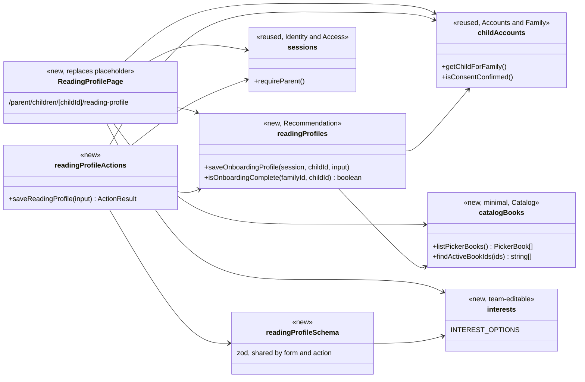
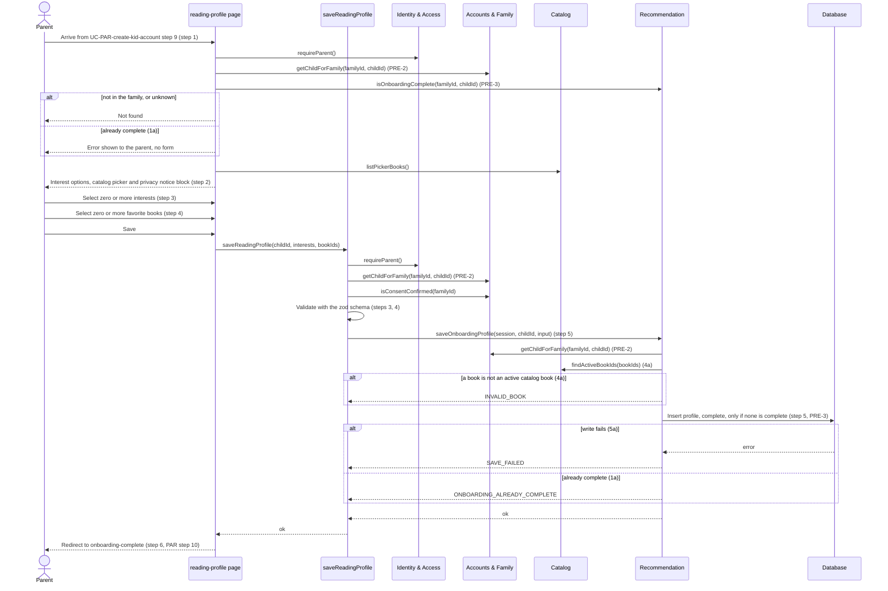
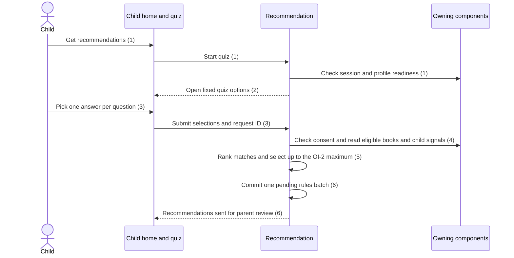
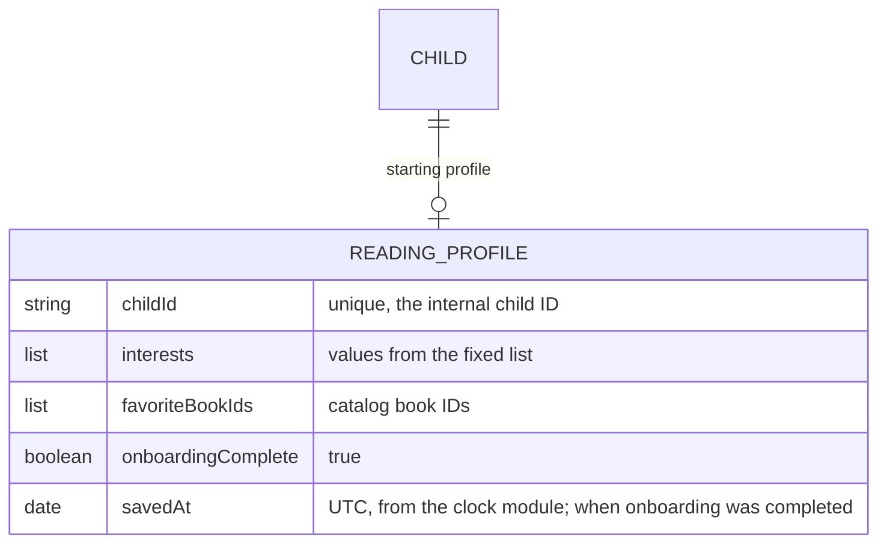

# Recommendation (REC) Design

**Project:** BookBuddies
**Team:** Team 05
**Area:** `UC-REC`

> **Realizes:** `UC-REC-kid-onboarding`, `FR-ONB-profile` (the interests and favorite books half), `FEAT-onboarding-profile`, `UC-REC-recommend-quiz-rules`, `FR-REC-rules`, `FR-REC-every-request`, `FEAT-recommendation-quiz`
> **Depends on:** `BR-parent-creates-kid-account`, `BR-kid-data-stored`, `BR-reading-level-proxy`, `BR-no-reading-level-assessment`, `BR-child-structured-responses`, `BR-coppa-minimization`, `BR-admin-limited-view`, `BR-coppa-notice`, `BR-coppa-parent-rights`, `BR-coppa-retention`, `FR-DATA-notice`, `FR-DATA-review`, `DI-integrity`, `DI-catalog-status`, `DI-field-tables`, `SEC-role-authorization`, `KD-pii-segregation`, `KD-auth-sessions`, `KD-book-exclusion`, `KD-catalog-import-offline`, `BR-parent-report-book`, `BR-parent-ultimate-say`, `BR-parent-note`, `DI-report-exclusion`, `SAF-child-content`, `PER-recommendation-latency`
> **See:** [use cases, REC area](../docs/requirements/use-cases.md#uc-rec-kid-onboarding-capture-a-childs-reading-interests-and-favorite-books), [specification](../docs/requirements/software-requirements-specification.md), [business rules](../docs/requirements/business-rules.md), [glossary](../docs/requirements/project-glossary.md), [architecture-of-record](architectural-design.md), [PAR design](par.md), [field values to agree](rec-field-values.md)
> **Designed against:** `d8beec6` for onboarding and `8aadd95` for the rules quiz.

---

## Overview

The Recommendation area owns each child's reading profile and, in later use cases, the recommender itself ([containers](architectural-design.md#51-containers), [use case areas and components](architectural-design.md#52-use-case-areas-and-components)). `UC-REC-kid-onboarding`, the first use case designed here, lets a parent record the child's reading interests and favorite books already read, and marks onboarding complete. It is entered from `UC-PAR-create-kid-account` step 9 at the route PAR already fixed, `/parent/children/[childId]/reading-profile`, and ends by redirecting to PAR's `/onboarding-complete` page (PAR step 10).

The profile is held by Recommendation under the opaque child ID. It is not identifying, so it stays out of the Child Identity Store, which keeps only age, grade and reading level (architecture §5.2, `KD-pii-segregation`). Onboarding never touches those three fields and never estimates a reading level (`BR-no-reading-level-assessment`). The book picker reads the Catalog, which this design depends on but does not build (see Open questions). Either parent role, Main or Sub, may onboard a child of their family (architecture §8.1).

`UC-REC-recommend-quiz-rules` adds the child’s recommendation request. Catalog filters the active and age-appropriate books against the quiz and the child's permanent exclusions. Recommendation ranks the results using that child's profile and history, then stores an ordered batch for [parent review](../docs/requirements/use-cases.md#uc-rec-parent-review-parent-reviews-a-childs-recommendation-batch). The child sees that the request was sent. The books become available through the downstream release flow.

## Components & classes

All files below are new unless marked reused. Paths follow §8.2.3 and §8.2.4.

- `src/app/(parent)/parent/children/[childId]/reading-profile/page.tsx` (**reused route, replaces the placeholder**): the form for steps 1 to 4. It calls `requireParent()`, then `getChildForFamily`; a child outside the session's family, or unknown, is not found with no hint which. If onboarding is already complete it shows the parent an error and no form (1a, PRE-3). The error has a link back to the parent's home page; that page is not built yet, so the target is one constant that points there once the route exists, and until then the error shows without a link. It shows the child's nickname and avatar only, the interest options, the catalog picker and a privacy notice block (`FR-DATA-notice`, `BR-coppa-notice`). **Placeholder, to be replaced by the client:** the block is a short plain paragraph saying what is collected (interests and favorite books), that it is used only to recommend books, and that the parent can review and delete it, shown in full above the Save button, with an unticked checkbox, "I have read this notice and agree to share this information about my child". Save stays disabled until the parent ticks it themselves; it is never pre-ticked or ticked by default. The tick is held in the form only and is not stored, because `BR-coppa-parental-consent` is already recorded in PAR, so whether to store it is for the client. The client, with a lawyer, supplies the real notice text; the block is one small component so swapping in the text changes nothing else. As built (the developer's decision, 2026-11-18), the block also carries a link to the privacy notice from `getPrivacyNoticeUrl()` in `src/server/lib/config.ts`, the same location `UC-PAR-create-kid-account` links to (`COPPA-online-notice`). It opens in a new tab, so the parent's selections stay on the form and closing the tab brings them back; the development placeholder page says so. Like the PAR form, the page fails closed in production when `PRIVACY_NOTICE_URL` is unset, and falls back to `/privacy-notice` in development and tests. There is no skip control: the use case has no skip extension, and saving with nothing selected is step 3 with zero choices. The save button is disabled while pending, and every selection stays in the form after a failed save (5a).
- `.../reading-profile/actions.ts` (new): `saveReadingProfile`. In order (§8.2.3): `requireParent()`, `getChildForFamily` (not found before anything else is revealed), `isConsentConfirmed`, zod validation, then Recommendation. The family comes from the session, never from the request. On success it returns `ok` with no data, and the form component calls `router.push` to `/parent/children/${childId}/onboarding-complete` (step 6), with `childId` taken from the route params, never from user input or a return parameter. The path template is fixed in code. `SAVE_FAILED` carries the error ID in the shared result helper's error ID field (§8.2.1), never in logs with profile data.
- `.../reading-profile/schema.ts` (new): the one zod schema (§8.2.5): child ID, interests (each from the fixed list, duplicates removed), favorite book IDs (duplicates removed, at most 10, proposed in `OI-38`; one constant in `schema.ts`). No free-text field exists.
- `src/server/recommendation/reading-profiles.ts` (new, server-only): the only code that touches `readingProfiles`. `saveOnboardingProfile` confirms the child belongs to the family through Accounts & Family, validates the book IDs through the Catalog, and writes with one conditional insert guarded by "no completed profile for this child". A duplicate-key error from the unique `childId` index is mapped to `ONBOARDING_ALREADY_COMPLETE`, not `SAVE_FAILED`. `isOnboardingComplete` is the read the page uses for PRE-3 and that `UC-REC-recommend-quiz-rules` will use later. Amended by the `UC-PAR-delete-kid-account` design (architecture §8.2.8): the child check and the insert become one transaction that first calls Accounts & Family's `lockChildForWrite`, so a save that races the child's deletion returns `CHILD_NOT_FOUND` instead of leaving a profile behind. `deleteChildRecords` here deletes the child's profile ([`design/par.md`](par.md)).
- `src/server/recommendation/interests.ts` (new, **team-editable**): the fixed interest options, filled from [rec-field-values.md](rec-field-values.md). As built it is not `server-only`, because the form and its schema read it too, like PAR's `grades.ts`. The route folder also holds `access.ts` (the session, family and consent checks the page and action share, kept out of the `"use server"` file) and `paths.ts` (the fixed completion path and the home-page constant, which the form imports).
- `src/server/catalog/books.ts` (new, minimal, owned by the Catalog): `listPickerBooks` (active, non-blocked books, returned as `PickerBook = { id: string; title: string; author: string }`, sorted by title) and `findActiveBookIds`. "Active" and "blocked" are the Catalog's own status values from `DI-catalog-status`; this design invents none, and fixture books use whatever names that requirement fixes. Draft and blocked books are never returned. Nothing else is designed here; the Catalog's collection, import and admin functions belong to `UC-ADM-add-content`. Until then integration tests insert invented fixture books.
- Reused, not changed: `src/server/identity-access/sessions.ts` (`requireParent`), `src/server/accounts-family/child-accounts.ts` (`getChildForFamily`, `isConsentConfirmed`), `src/server/lib/` (`action-result.ts`, `clock.ts`, `db.ts`, `log.ts`, `collections.ts`), and `src/server/setup/ensure-indexes.ts`, which gains one call for the new index.
- `/parent/children/[childId]/onboarding-complete/page.tsx` is PAR's and is not changed.

### Rules quiz components

| Component | Reuse or change |
|---|---|
| `src/app/(child)/child/page.tsx`, `recommendations/quiz/page.tsx`, `quiz-form.tsx`, `actions.ts` | Add **Get recommendations** to the child home and add the quiz page, shared validation and two child-session actions. Both the child home and quiz render the existing online-privacy-notice link from `getPrivacyNoticeUrl()` with the same production fail-closed behavior as onboarding and no additional consent checkbox. A page load may show readiness but only the start action records a failed request. |
| `src/shared/recommendation/quiz.ts` | The option keys, labels and one shared schema for the form and server action. See [field values](rec-field-values.md#rules-quiz-proposal-oi-2). |
| `src/server/lib/config.ts` | Add `RECOMMENDER_MODE` as an optional string in the validated environment, defaulting to `rules` for V1. Startup parsing preserves unknown strings; the server-only `getRecommenderMode()` whitelist accepts exactly `rules` and treats every other value as unavailable. |
| `src/server/identity-access/sessions.ts` and Child Identity Store | Reuse the designed `requireChild()` from [Shelf](shlf.md). The narrow recommendation reader in `child-identity.ts` returns age, grade and the optional parent-entered scale and value for the session's child. |
| `src/server/accounts-family/families.ts`, `book-reports.ts`, and `parent-notes.ts` | Reuse the child/family and consent guards and `listExcludedBookIds` from [parent reporting](par.md#uc-par-report-book-report-a-book-for-a-child). That read accepts the same transaction for batch generation. Accounts & Family reads notes for that child and projects only recognized preference keys to Recommendation. |
| `src/server/catalog/books.ts` | Add `listRuleCandidates(age, quiz, excludedBookIds, tx)` and a batched feature read for eligible history book IDs. It returns `RuleCandidate = { id, genres, subjects, length, ageMin, ageMax, comparableLevels: { lexile?: number; arAtos?: number } }`. Catalog owns the status/age/quiz filters, seed tag normalization and level parsing. The raw `readingLevel` annotation is read only inside this server-only Recommendation path and is never returned; `customTags` stays private. Recommendation compares the normalized numbers with the child’s optional level. |
| `src/server/recommendation/reading-profiles.ts`, Shelf and reaction readers | Read the existing onboarding profile, retained shelf activity, ratings and the child's recorded reactions in bounded, child-scoped queries. Use the owning component's API and the same transaction. |
| `src/server/recommendation/quiz-recommendations.ts`, `rules.ts` and `batches.ts` | Coordinate the reads and save, rank candidates in a pure function, and store the pending batch. Do not depend on the parent review UI to complete the save. |

## Sequence

### UC-REC-kid-onboarding: capture a child's reading interests and favorite books

The family check runs first, so a child outside the family gets `CHILD_NOT_FOUND` whatever else is wrong with the request. Consent and the family check come from `BR-kid-data-stored` and §8.1 and implement no extra step; the consent check is an assumption listed under Open questions.

### UC-REC-recommend-quiz-rules

## API contract

| Endpoint or job | Caller (who may) | Request | Success | Errors, by extension |
|---|---|---|---|---|
| Page `/parent/children/[childId]/reading-profile` (UC-REC-kid-onboarding) | A signed-in parent, Main or Sub, of the child's family | Child ID in the path | The form, the interest options, the catalog picker, the privacy notice block, and the child's nickname and avatar | A child outside the session's family, or unknown: not found, with no hint which. Already complete (1a): the page shows an error to the parent and no form; the child's own access is untouched. No session: redirect to sign-in |
| Server action `saveReadingProfile` (UC-REC-kid-onboarding) | Same; the family comes from the session | Child ID, interests (zero or more, from the fixed list), favorite book IDs (zero or more) | `ok`; the form then navigates to `/parent/children/[childId]/onboarding-complete` (step 6). The result carries no profile data | Not signed in or not a parent: `NOT_SIGNED_IN`, `NOT_A_PARENT`. Child not in the family or unknown: `CHILD_NOT_FOUND`. No confirmed consent: `CONSENT_NOT_CONFIRMED`. 3: `INVALID_INTEREST`. 4a: `INVALID_BOOK` (not in the catalog, draft or blocked), `TOO_MANY_BOOKS`. 1a: `ONBOARDING_ALREADY_COMPLETE`. 5a: `SAVE_FAILED` with an error ID, nothing saved. Selecting no interests or no books is not an error |

Nothing in this use case is sent to a child's screen (`BR-parent-creates-kid-account`, §8.2.11).

### Rules quiz API contract

| Entry | Request | Success | Refusal or failure |
|---|---|---|---|
| `startRecommendationQuiz` (1, 1a) | Signed-in child. No child ID in the request. | Opens `/child/recommendations/quiz` when no pending batch exists. If one exists, returns its acknowledgment without opening another quiz. | Signed out or wrong role, consent unavailable, `RULES_UNAVAILABLE` if `RECOMMENDER_MODE` is not `rules` or dependencies prevent the flow, or `PROFILE_INCOMPLETE` after recording the failed request. Show “Ask a parent to finish your profile.” |
| `/child/recommendations/quiz` (2, 2a) | Child session. No parameters. | Fixed options, the existing online-privacy-notice URL and a random submission ID for this form when no pending batch exists; otherwise the existing-batch acknowledgment with the notice link. Leaving discards the selections. | Same read guards and production notice failure behavior as onboarding. A direct visit or prefetch never writes a failed-request event. |
| `submitRecommendationQuiz` (3–6) | Child session, one approved option per question and the form's UUID. | `ok` with the acknowledgment “Your recommendations were sent for parent review.” The same UUID returns the acknowledgment for its existing batch. If another pending batch exists, return its acknowledgment without storing the new answers or creating a batch. | Start refusals, including configured mode, are checked again for a new submission. `INVALID_QUIZ` gets a field highlight (3a). `NO_MATCHES` offers restart (4a). `LOAD_FAILED` offers retry (4b). `SAVE_FAILED` offers a retry with the same UUID (6a). |

## Key decisions

**The reading profile lives in Recommendation, keyed by the child ID, not in the Child Identity Store.** Interests and favorite books are not identifying, and the architecture puts them under the opaque ID (§5.2). Rejected: the Child Identity Store, which would widen the one collection `KD-pii-segregation` keeps small. Also rejected: Accounts & Family, whose §5.2 row said it owned the "onboarding answers"; that wording contradicted Recommendation's row and is corrected here.

**The child sees no raw interests or favorites.** The use case's table and `BR-kid-data-stored` said "visible to parent and child"; both are edited in this pull request to "parent only; the child sees only the derived interest profile", which is the dashboard's radar chart with no numbers (`UC-SHLF-kid-dashboard`). §8.2.11 allows a child's screen to show only book data, nickname and avatar, and no child function returns the stored lists. Rejected: a child-callable read.

**Interests are stored as a plain list of fixed values with no strengths.** The Interest Profile's relative strengths are built by the recommender from later choices and ratings, which `UC-REC-recommend-quiz-rules` owns. Rejected: inventing a strength model here.

**A missing profile means onboarding is incomplete.** Nothing is written until step 5, and the use case has no skip extension. Rejected: an `incomplete` record, which is a status field no use case reads.

**"Already complete" (1a) is enforced by the write, not only by a read before it.** One conditional insert fails if a completed profile exists, so two simultaneous saves leave one and the second gets the error (§8.2.8). Rejected: read then write, which lets both through. The error concerns the parent's screen only; nothing here changes the child's login or access.

**Step 6 always redirects to the completion page, with no return parameter.** The use case's "if started from" has one other entry, the re-fill after `UC-PAR-delete-child-data`, whose design may add its own landing. Rejected: a caller-supplied return URL, an open redirect.

**The picker loads every active book on the server.** The seed catalog is small (`AS-seed-catalog-size`). Rejected: a search action now, which no step asks for; revisit when the catalog grows (`KD-catalog-import-offline`).

**Blocked books are left out by the Catalog; per-child report exclusions are not applied.** A child being onboarded has no reports, and the picker is not a recommendation or search query (`KD-book-exclusion`). The re-fill after data deletion removes the exclusions with the rest of the child's data.

**The admin sees one child's interests and favorite books only through the audited usage lookup.** `UC-ADM-view-usage-stats` lets the admin check which interests and favorite books are common overall, with small counts hidden, but its child lookup never returns one child's interests or favorites. The totals are built later in that use case as aggregate functions in Recommendation that return counts keyed by interest or book and never a child ID. Rejected: any per-child read of the profile for the admin (`BR-admin-limited-view`, `KD-pii-segregation`).

**The profile keeps a save time, so the admin can count onboardings in a period.** `UC-ADM-view-usage-stats` lists "Onboardings completed" as a total for the chosen date range, and a count over a period needs the time each onboarding finished. Account creation dates cannot serve, because a parent may leave a child's onboarding unsaved (`OI-39`), so sign-ups and completions differ. The admin sees a count only, never which child or when (`BR-admin-limited-view`). The count is built later with `UC-ADM-view-usage-stats` as aggregate functions in Recommendation that return numbers; they are not built here, and no admin-callable function returns a profile or its time. Rejected: no time field, which makes the figure impossible; a separate event log, a second collection for one number. No index on `savedAt` now, as the seed catalog and family numbers are small. The figure is a team proposal and still needs confirming (`UC-ADM-view-usage-stats` Open Issues).

### Rules quiz decisions

**Keep the quiz short.** Ask about mood and length. Each question has an explicit **Any** answer, so a blank answer remains distinguishable from no preference. Requests use exact approved catalog tags from [the field table](rec-field-values.md#rules-quiz-proposal-oi-2). The proposal leaves these choices, batch size and ranking under `OI-2`. Rejected: a longer interest questionnaire or free text, which repeats onboarding and weakens structured responses; and treating an unanswered question as **Any**, which hides 3a.

**Filter before ranking.** Catalog returns active, tagged books whose inclusive age band contains the child's recorded age. It excludes book IDs supplied by Accounts & Family and enforces the chosen mood and length. Catalog skips rows missing required tags or a valid age interval. When the query finishes with zero matches, show 4a. When a read fails, show 4b and keep the answers. Never broaden the query after seeing the results. Rejected: ranking before exclusion, which wastes reads and risks an excluded book entering the candidate set; and broadening after zero matches, which 4a forbids.

**Age and grade come first, without drowning out interests.** Put each eligible book in one of three age-fit groups: **2** when both the child's age and grade-reference age fall inside its age band; **1** when the child's age is inside and the grade-reference age is at most one year outside; **0** when the child's age is inside but the grade-reference age is farther away. The Catalog filter already guarantees that the child's age is inside. Rank a higher group first. Within a group, rank by interest score, then by distance from the child's age to the band midpoint, then by opaque book ID in ascending ordinal order. A comparable parent-entered level adds one interest point; an absent or incomparable level adds zero. The grade reference uses preschool = 4, kindergarten = 5, and grades 1–12 = grade + 5. This compares a grade to catalog age bands; it does not produce a reading level. A missing onboarding profile or absent history is neutral. Rejected: continuous midpoint distance before interests, which makes ratings, reactions, notes and shelf history almost tie-break-only; and treating a missing level as a poor score, which penalizes a child for not supplying optional data.

**Use each account's existing signals.** Calculate interest strengths on demand using the rules in [the field table](rec-field-values.md#rules-quiz-proposal-oi-2). The child sees no inputs, scores or note text. Accounts & Family supplies recognized preference keys from the latest retained `parentNotes` record by `savedAt`; that collection has no setup/finish type, so this design does not invent one. A separate finish-note source is not designed and contributes zero until its owning use case exposes a typed read. Ratings, reactions and shelf history use bounded reads from their owners; a source that does not exist yet is neutral. All processing stays on the server. No note text or raw quiz answers are copied into a batch or logs. Rejected: inferring note types from free text, reading another component's collections directly, or generating interests at quiz time, which would require a backend the use case does not ask for.

**Fail closed on reads.** Consent, exclusion and candidate-catalog reads are mandatory. An absent onboarding profile contributes no onboarding/favorite signals; only absent age or grade follows 1a. A read error after the guard produces `LOAD_FAILED`, not a neutral profile. An error from any already-available notes, reactions, shelf-history, ratings or history-feature read also produces `LOAD_FAILED` with no batch. Neutral means that the owner has no matching records or that its source/API is explicitly not yet designed, never that a read failed. Rejected: treating exclusions or failed existing signals as empty, which could return a reported book or silently discard required inputs.

**Save once and hand off by state.** Use one transaction for the final consent guard, exclusion read, catalog reads and batch write. Take `lockChildForWrite(tx, childId)` from #119 ahead of the consent lock, then use `lockConsentForWrite` before reading exclusions, as in the report design. Report and quiz writes then serialize on the Consent Record. The quiz only saves `pending`. The parent-review flow owns notification, release and the final age/status/exclusion checks. Its handoff contract supplies the configured duration used to store `handoffDeadline` at creation and must resolve or delete every pending batch by that deadline, within the bounded timeframe stated in the published privacy notice; REC starts no second retry queue or timer. For a global block racing a list write, use the Catalog write contract once it is agreed in #109 (`OI-58` on that branch). Keep the quiz entry unavailable for real use until that bounded parent handoff, child-deletion guard and concurrent block contract are available. Fixture data can exercise the flow before those dependencies land. Rejected: a read-only child check, whose snapshot would not conflict with deletion; and enabling the entry before the parent handoff, which would strand pending batches.

**Retry the same request, with one pending batch per child.** Authentication and consent checks precede every acknowledgment. An existing same-request UUID is acknowledged before new-request mode/profile gates; a genuinely new request passes every gate. Uniqueness on child ID and request UUID handles double-clicks, connection loss and concurrent retries. On insert collision, abort the failed transaction and classify the index by its key pattern: `{ childId, requestId }` means read and acknowledge that request's batch for the session's child; the partial pending index means read and acknowledge the child's current pending batch. Keep the answers and UUID together on retry. If the child edits an answer, issue a fresh UUID for the changed request. Restart creates a new UUID and resets the quiz. On an uncertain write result, the retry uses the same UUID. A partial unique index on `childId` for `status: pending` permits only one open batch, even across different request IDs. Start and Submit return an existing unexpired pending batch's acknowledgment without storing another set of answers; after parent review resolves it, a new request may create one. A batch is live only before its stored `handoffDeadline`. At or after that instant, the parent-review expiration path owns resolution/deletion; REC returns `RULES_UNAVAILABLE` rather than acknowledging it as live or creating a second batch while the unique pending record remains. At review time `removeFromPendingBatchInTx` removes a reported book from every matching pending batch for that child. Rejected: unlimited pending batches, which grows an unreviewed parent queue without bound; and an IP/time rate limit, which neither bounds stored batches nor fits shared households.

## Data model

New collection `readingProfiles` (Recommendation), one document per child with a completed onboarding:

- Unique index on `childId`, created by `ensure-indexes.ts`; schema validation as backstop (§8.2.5).
- No name, age, grade or reading level (`KD-pii-segregation`). The purpose of each field is already in `BR-kid-data-stored` ("reading interests, favorite books already read").
- Favorite book IDs reference the Catalog by its internal book ID; the profile copies no book data.
- `savedAt` is set once, at the insert, from `now()`, and never changed. Its only reader is the "onboardings completed" figure of `UC-ADM-view-usage-stats` (see Key decisions). The profile never returns it to a page or a child.
- Deleting a child's data or account removes this document (`UC-PAR-delete-child-data`, `UC-PAR-delete-kid-account`). After a data deletion and a new fill-in, `savedAt` is the later save.

### Rules quiz data

Recommendation adds `recommendationBatches` with the fields below. It uses a unique index on `{ childId, requestId }`, a partial unique index on `{ childId }` where `status` is `pending`, and a lookup index on `{ childId, status, createdAt }`.

| Field | Generation contract |
|---|---|
| `_id`, `requestId`, `childId` | Batch ID, form submission UUID, and opaque child ID from the session. |
| `source`, `status`, `createdAt`, `handoffDeadline` | `rules`, `pending`, and UTC times from the shared clock. Compute `handoffDeadline` once at creation as `createdAt` plus the downstream parent-review handoff duration, and store it on the batch; do not recompute it after configuration changes. Parent review owns the duration and future status changes. |
| `bookIds` | Ordered IDs of unique candidates. At generation the list is nonempty and contains at most six books under the `OI-2` proposal. Parent decisions or a block may later remove entries. |

A batch is included in the existing review, export and deletion inventory. It contains no age, grade, reading level, raw answers, note, history, or rank scores. The derived interest strengths are recomputed from retained source records. An unreviewed pending batch is retained only until parent review resolves it or its stored `handoffDeadline`, whose bounded duration is documented in the privacy notice, whichever comes first, and is also removed by child data/account deletion or the existing inactivity purge. Parent review owns that deadline and its resolution/deletion behavior; V1 adds no separate REC timer and never silently expires a parent's queue on its own. Rejected: indefinite retention for an active account, and an independent fixed REC expiry that would conflict with the parent-review contract.

The only new logging case is a fixed `recommendation-request-failed` event with `PROFILE_INCOMPLETE` and an event ID for 1a. It records the occurrence of the refusal, not a per-child history: it contains no child ID or inputs, no later step reads such a history, and the server does not retry that refusal. Rejected: a child-linked audit record, which adds retained correlation without a reader.

## Reuse & cross-cutting

For `UC-ADM-block-content`, Recommendation provides `removeFromCurrentLists(bookId, tx)` to remove a book from pending and released lists in the admin's transaction. See [the block design](adm.md#blocking-and-report-decisions).

- **Authentication and authorization:** `requireParent()` and the family check on page and action (`KD-auth-sessions`, §8.1).
- **Error handling:** the shared result helper (§8.2.1).
- **Time:** `savedAt` from the clock module, stored in UTC, set once at the insert (§8.2.2). The date range of the admin's figure is applied on read; nothing is purged by age.
- **API conventions:** a verb-first server action; session, validation, then the owning component (§8.2.3).
- **Code conventions:** `server-only` on every module under `src/server/`; only Recommendation touches `readingProfiles`; only the Catalog touches books (§8.2.4).
- **Validation:** one zod schema for form and action; choices come from fixed lists, never free text (§8.2.5, `BR-child-structured-responses`).
- **Privacy notice:** a placeholder paragraph and a "read and agree" checkbox on the form for now, to be replaced by the client's notice, with the link from `getPrivacyNoticeUrl()` already shown (`FR-DATA-notice`, `BR-coppa-notice`). The notice text, which covers this data's purpose and retention, is the client's and a lawyer's to supply.
- **Parent rights:** `UC-PAR-review-child-data` shows the profile (interests, favorite books) and includes it in the downloadable copy; `UC-PAR-delete-child-data`, `UC-PAR-delete-kid-account` and `UC-PAR-revoke-consent` remove it or stop its use (`BR-coppa-parent-rights`, `FR-DATA-review`, `FR-DATA-removal`). This design adds no parent-facing read; Recommendation will export one read by child ID, scoped to the family, when `UC-PAR-review-child-data` is designed.
- **Retention:** the inactivity purge of Scheduled Cleanup deletes the profile and any pending batch with the child's other data once the configurable limit passes (`BR-coppa-retention`, `OI-22`, §8.2.6). For an active account, the downstream parent-review handoff must resolve or delete an unreviewed batch by its bounded, published deadline; child-data/account deletion still applies immediately. REC invents neither timeframe nor a second timer.
- **Logging:** never the interests, favorite books, or the child ID tied to them (§8.2.7).
- **Persistence:** the conditional insert (§8.2.8). No transaction is needed: one document is written.

Not used: Notification (no alert is asked for), the audit log (not in the §8.2.9 list), and the Child Identity Store.

## Tests

| Use case, flow | Level | Asserts |
|---|---|---|
| UC-REC-kid-onboarding main | integration | A parent of the family saves interests and favorite books: one profile keyed to the child, complete, with the chosen values and a `savedAt` equal to the clock module's `now()` (POST-1 to POST-3) |
| UC-REC-kid-onboarding main | end-to-end | From the PAR credentials screen the parent reaches the form, picks, saves and lands on "onboarding complete" (steps 1 to 6) |
| UC-REC-kid-onboarding 3, none selected | integration | An empty interest list is accepted and onboarding is complete |
| UC-REC-kid-onboarding 4, no favorites | integration | An empty book list is accepted and saved (POST-2) |
| UC-REC-kid-onboarding abandoned | end-to-end | Leaving the form without saving writes nothing: no profile exists and the child account is unchanged |
| UC-REC-kid-onboarding 3, invalid | unit | A value not on the interest list is refused with `INVALID_INTEREST`; duplicate interests and books are collapsed |
| UC-REC-kid-onboarding 4a | integration | An unknown, draft or blocked book ID is refused with `INVALID_BOOK` and nothing is saved |
| UC-REC-kid-onboarding 4a, cap | unit | More than 10 books are refused with `TOO_MANY_BOOKS` |
| UC-REC-kid-onboarding 5a | integration | When the write fails the result is `SAVE_FAILED` with an error ID and no profile exists |
| UC-REC-kid-onboarding 5a | end-to-end | After a failed save every selection is still in the form |
| UC-REC-kid-onboarding 1a | integration | A second save returns `ONBOARDING_ALREADY_COMPLETE` and changes nothing, and two simultaneous saves leave exactly one profile |
| UC-REC-kid-onboarding 1a | end-to-end | Opening the form for a completed child shows the parent an error and no form; the child can still sign in |
| UC-REC-kid-onboarding PRE-2 | integration | A child ID from another family, or an unknown one, gets the same not-found result on page and action (`CHILD_NOT_FOUND`) and nothing is saved |
| UC-REC-kid-onboarding consent | integration | A family without confirmed or with revoked consent gets `CONSENT_NOT_CONFIRMED` and nothing is saved |
| Authorization | integration | A Sub Parent of the family may save; a Sub Parent of another family gets `CHILD_NOT_FOUND`; a child session and an admin session are refused |
| Check order | integration | A foreign child ID with an invalid interest returns `CHILD_NOT_FOUND`, not `INVALID_INTEREST`, and a duplicate-key error from a simultaneous save returns `ONBOARDING_ALREADY_COMPLETE` |
| Step 6, redirect | integration | The redirect target is always the child's completion page, whatever the request carries |
| Admin boundary | integration | No admin-callable function returns the profile outside the audited usage lookup, and that lookup returns no identifying field. |
| Privacy notice | end-to-end | The form shows the notice block, Save stays disabled until the parent ticks the unticked-by-default checkbox, and the notice link opens the same location as the Add a child form in a new tab and the selections are still there after closing it |
| Child-facing read | integration | No function a child session can call returns the interests or favorite books (§8.2.11) |
| Logging | integration | After a success and a failure the logs contain no interests, favorite books or child ID |

### Rules quiz acceptance cases

| Flow | Level | Expected result |
|---|---|---|
| Main 1–6, 5a | Integration + browser | A child completes both questions. A fixture with three eligible matches saves all three in deterministic order with `source: rules` and `status: pending`. The child gets an acknowledgment and sees none of the pending books. |
| 1a | Integration + browser | Missing age or grade refuses Start and re-submission with the parent-help message and one failed-request event per refused action. No batch. |
| Neutral optional signals | Integration | Age and grade with no onboarding profile proceed with zero onboarding/favorite signals. A profile read error is 4b, not neutral. |
| 2a | Browser | Leave before answering. No write, including a prefetched quiz page. The child home and quiz render the existing privacy-notice link, production notice configuration fails closed, and no extra consent checkbox appears. |
| 3a | Unit + browser | Missing and unknown choices are refused. Show the first unanswered question. A direct action call cannot skip the server checks. |
| 4a | Integration + browser | Use a valid mood/length pair with zero eligible books. No batch and no fallback query. Show “We couldn’t find books for those choices. Try the quiz again.” Restart offers a fresh quiz. |
| 4b | Integration + browser | Fail consent, exclusions, Catalog and each already-available signal owner in turn. Show retry, retain choices and save no batch. Only absent records or explicitly undesigned sources are neutral. |
| 6a | Integration | A failed write has no pending handoff. An uncertain commit followed by retry of the same ID yields at most one saved batch. Two simultaneous submissions with the same ID do the same. |
| Pending capacity | Integration | Concurrent requests with different UUIDs leave exactly one pending batch. Start, a direct quiz visit and Submit acknowledge that batch without storing new answers. After parent review resolves it, a new request can create one. |
| Handoff deadline | Integration with fixed clock | Store `createdAt + downstream duration` once. Immediately before `handoffDeadline`, acknowledge the existing pending batch; at the deadline, treat it as expired, do not create a second pending batch, and exercise the parent-review expiration handoff. |
| Ranking | Unit | Verify the three age-fit groups, interest ordering within each group, comparable and missing levels, low rating weight, every available signal type, absent finish notes as neutral, and stable ties. Verify optional signals never override age-fit groups or exclusions. |
| Authorization and mode | Integration | Refuse missing/expired and non-child sessions and revoked consent. Caller cannot select a child. With `RECOMMENDER_MODE` unset, V1 defaults to `rules`; `ai`, `off` and unknown values return `RULES_UNAVAILABLE` with no batch. Missing handoff dependencies keep the normal entry unavailable. |
| Safety and handoff | Integration + browser | Blocked, draft and reported books are absent. A report racing creation is either seen during generation or removes the committed pending item under the parent-review contract. Test the global-block race once the Catalog write contract is agreed. Parent sees only their linked child's batch. |
| Child data | Integration | Assert absence of raw quiz answers, age, grade, level, note and scores from the batch, response and logs. Check the batch in review/export and deletion integration once those use cases land. |
| Seed catalog | Integration | Benchmark all eligible combinations over the 134 source rows after import. Record elapsed time and result count internally. The target and traffic assumptions remain `OI-11` and `OI-12`. |

## Changes to the architecture-of-record

The rules quiz uses existing boundaries in §5.2 and the report-exclusion decision. `design/adm.md` receives one narrow Recommendation-only exception to the reading-level read rule; the raw annotation still never leaves Catalog. No architecture rule changes are proposed.

- §5.2 Accounts & Family: the words "and their onboarding answers" are removed; Recommendation owns the reading profile, as its own row and the paragraph after the table already say. Edited in `architectural-design.md` in this pull request.
- `BR-kid-data-stored`, `BR-admin-limited-view`, `FR-ADM-child-lookup`, `KD-admin-usage-lookup` and the use case's Associated Information are edited in this pull request (child sees no raw interests; admin lookup lists no interests).
- §5.2 Catalog: names the two narrow reads this use case needs (`listPickerBooks`, `findActiveBookIds`). Edited in this pull request.
- Catalog reading-level boundary: `design/adm.md` now permits only `listRuleCandidates` to read the raw annotation for Recommendation, returning normalized numeric difficulty and never the raw label or `customTags`; every other non-admin read still omits both.
- Revision history: a v0.11 row records `design/rec.md`.

## Open questions & risks

What this design had to assume. The developer accepted each on 2026-11-16 on the condition that none breaches a rule or COPPA.

- **The interest options (client and team).** The interest options (client): taken from the client’s Book domains slide (Genre and Subjects). Whether Mood and Themes are also options is to confirm (OI-37).
- **Favorite-book cap (team).** Proposed 10, since the glossary says "a few". Filed as `OI-38`.
- **Catalog does not exist in code (team).** No Catalog collection, import or read exists. `/implement` for this use case can build the form, action and Recommendation code against the two minimal reads and fixture books, but the picker cannot show real books until the seed catalog is imported (`KD-catalog-import-offline`, to be designed with `UC-ADM-add-content`). The import will need an `.xlsx` reader, a new dependency; `exceljs` is proposed and a person must confirm it before it is added (CLAUDE.md).
- **No skip, and no way back after leaving (specification).** The use case no longer has the skip extension (old 3b) or the next-login reminder. A parent who leaves the form unsaved leaves the child incomplete, with no reminder and no designed way to return to the form. Filed as `OI-39`.
- **Consent check (team).** Interests and favorite books are a child's personal information (`BR-kid-data-stored`) but the use case has no consent precondition. The action checks `isConsentConfirmed`. It does not join the `childCreationVersion` serialization of `OI-36`; a revocation racing a save can leave one profile, which revocation's own deletion removes.
- **Sub Parent may onboard (team).** PRE-1 says "Parent"; architecture §8.1 gives a Sub Parent the same access to linked children.
- **Use case edited by the developer (2026-11-16).** Step 3 is now "zero or more", extension 1a (already complete: raise an error to the parent; the child keeps normal access) is added, and 3a and 3b are removed. This design follows that text.
- **Save time for the admin's count (team).** `savedAt` exists only for the "onboardings completed" figure added to `UC-ADM-view-usage-stats` on 2026-11-16 as a team proposal. If the client does not want that figure, `savedAt` can be removed with no other change.
- **Privacy notice not written yet (client and a lawyer).** The client has to supply the real notice. Until then the form shows the placeholder paragraph and the "read and agree" checkbox described under Components, which is easy to replace. Whether the agreement should be stored is the client's to decide. `BR-coppa-notice` is met only once the client's text is in place, so the real notice must be in before launch.
- **Smaller assumptions, each breaking no rule, security measure or COPPA duty (developer, 2026-11-16).** Book and child IDs are strings. A complete child gives the error page with no link until the parent home page exists, and an unknown or foreign child gives `notFound()`. A revoked-consent family can still open the form, which collects nothing until Save, and the action refuses to save. `onboardingComplete` is stored as `true` and not read. The `savedAt` field stays as a team proposal. The Sub Parent from another family is the same not-found case as any foreign child.
- **Accepted risk:** parents could pick a long list of favorites that skews the first recommendations; the cap limits it. How favorites weigh in is `UC-REC-recommend-quiz-rules`'s to decide.

---

### Rules quiz open decisions

- **Client and team (`OI-2`).** Confirm the two questions and their choices, the six-book maximum, one-pending-batch limit, three age-fit groups and provisional signal weights. The SRS still lists these as TBD.
- **Parent review (#72).** This design hands off a pending batch. The owner must confirm the notification and non-blocking release policy, reporting across pending batches, and the behavior when eligibility checks leave no books. Its contract must resolve or delete every pending batch within a bounded timeframe stated in the published privacy notice; the exact duration remains there, and REC starts no separate timer.
- **Catalog and consent.** Import the seed through Catalog, with only approved active rows eligible. The families contract must support the consent lock, and the child-deletion design must provide its guard. Catalog/Shelf/REC must settle the concurrent block contract in #109 before enabling the normal flow.
- **Seed coverage (client and team, under `OI-2`).** The source workbook has 134 rows. Across ages 6–11 and the proposed mood/length choices, 17 of 144 combinations have no raw age/mood/length matches and 59 have one to five, before import, status or report exclusions. For 4a, explicitly choose whether the UI recommends **Any**, offers a deliberately narrowed option set for V1, or waits for an expanded seed. The quiz never widens an answered query automatically.

## Working this document with your agent

_Delegate: drafting diagrams from the use case, listing the existing files a class should extend, proposing a test row per extension, checking that every cited identifier exists. Keep human: which details a wrong guess would break, every key decision, and the approval, which is a teammate's review of the pull request. Watch for scope nobody asked for: an admin override, a retry queue, a status field, a notification. Every interaction in the sequence names a use case step._

---

## The questions test (before you open the pull request)

Start a fresh agent session in plan mode with only the use case, the business rules it cites, architecture section 8 and this document, and ask: _List every point you would still have to guess to implement `UC-REC-kid-onboarding`. For each, say what you would guess and whether a wrong guess could violate a requirement. Do not write code._ For each item, fix this document or keep the guess with one line saying why a wrong guess breaks no requirement. Paste the list under How it was verified in the pull request, inside a collapsed `

Questions test
 … 
` block.
