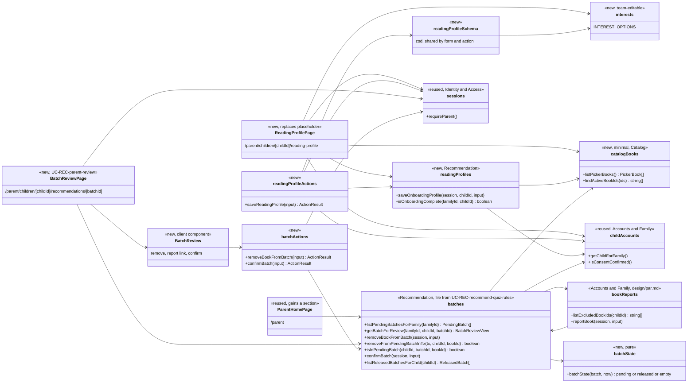
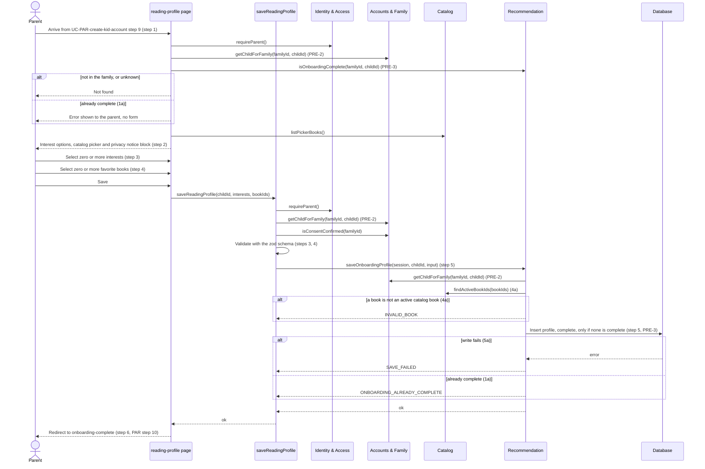
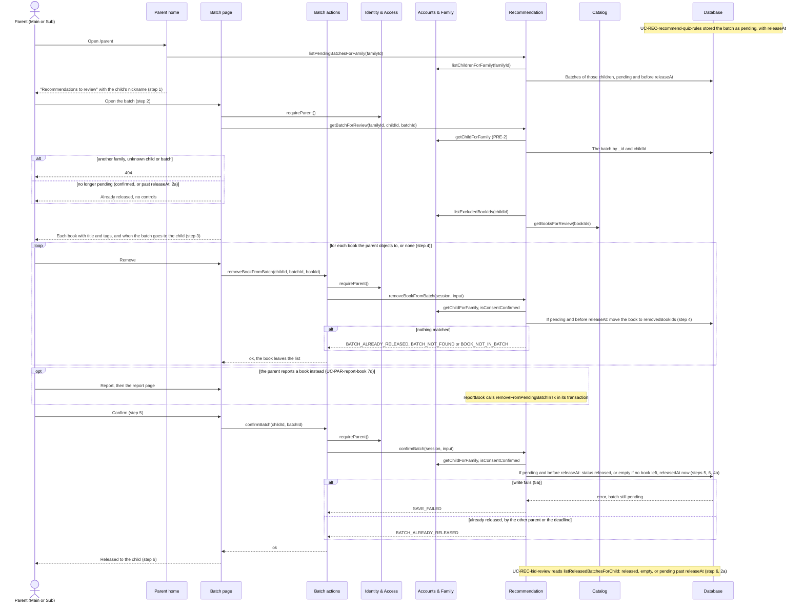
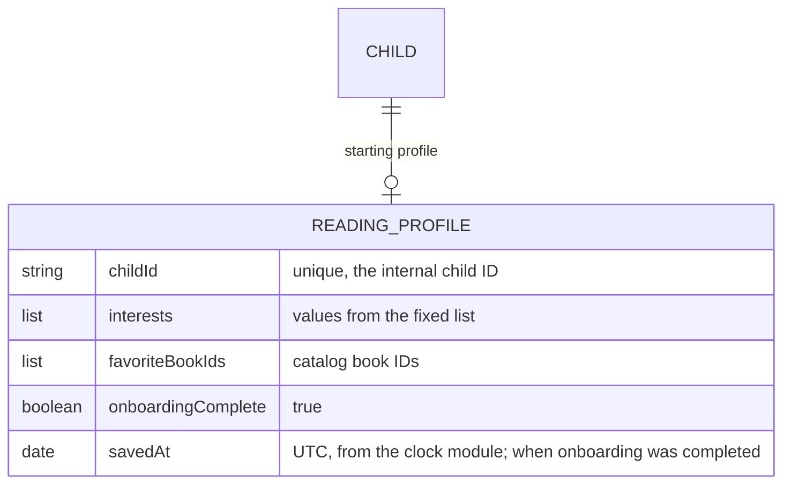
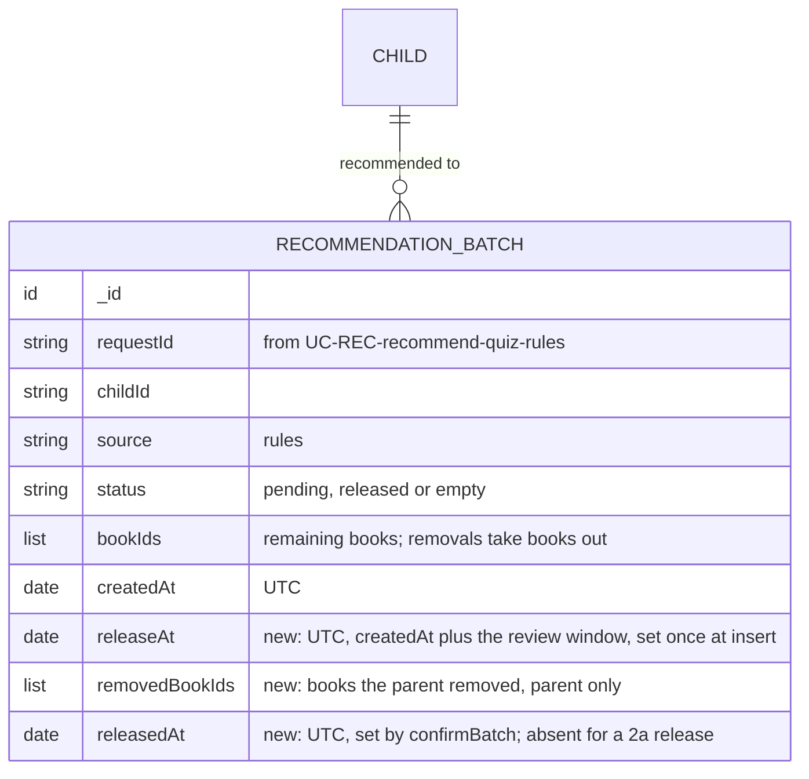

# Recommendation (REC) Design

**Project:** BookBuddies
**Team:** Team 05
**Area:** `UC-REC`

> **Realizes:** `UC-REC-kid-onboarding`, `FR-ONB-profile` (the interests and favorite books half), `FEAT-onboarding-profile`, `UC-REC-parent-review`
> **Depends on:** `BR-parent-creates-kid-account`, `BR-kid-data-stored`, `BR-reading-level-proxy`, `BR-no-reading-level-assessment`, `BR-child-structured-responses`, `BR-coppa-minimization`, `BR-admin-limited-view`, `BR-coppa-notice`, `BR-coppa-parent-rights`, `BR-coppa-retention`, `FR-DATA-notice`, `FR-DATA-review`, `DI-integrity`, `DI-catalog-status`, `DI-field-tables`, `SEC-role-authorization`, `KD-pii-segregation`, `KD-auth-sessions`, `KD-book-exclusion`, `KD-catalog-import-offline`; for `UC-REC-parent-review`: `BR-parent-ultimate-say`, `BR-parent-rec-not-forced`, `BR-parent-report-book`, `KD-time-rules-on-read`, `CI-in-app-alerts`, `ROB-no-data-loss`, `OI-25`, `OI-32`, the batch shape proposed for `UC-REC-recommend-quiz-rules` in #115, and the batch contract and batch entry point of `UC-PAR-report-book` in [`design/par.md`](par.md)
> **See:** [use cases, REC area](../docs/requirements/use-cases.md#uc-rec-kid-onboarding-capture-a-childs-reading-interests-and-favorite-books), [specification](../docs/requirements/software-requirements-specification.md), [business rules](../docs/requirements/business-rules.md), [glossary](../docs/requirements/project-glossary.md), [architecture-of-record](architectural-design.md), [PAR design](par.md), [field values to agree](rec-field-values.md)
> **Designed against:** `d8beec6` for `UC-REC-kid-onboarding`; `8aadd95` for `UC-REC-parent-review` (no batch code exists; the `recommendationBatches` collection is proposed in open PR #115, not merged)

---

## Overview

The Recommendation area owns each child's reading profile and, in later use cases, the recommender itself ([containers](architectural-design.md#51-containers), [use case areas and components](architectural-design.md#52-use-case-areas-and-components)). `UC-REC-kid-onboarding`, the first use case designed here, lets a parent record the child's reading interests and favorite books already read, and marks onboarding complete. It is entered from `UC-PAR-create-kid-account` step 9 at the route PAR already fixed, `/parent/children/[childId]/reading-profile`, and ends by redirecting to PAR's `/onboarding-complete` page (PAR step 10).

The profile is held by Recommendation under the opaque child ID. It is not identifying, so it stays out of the Child Identity Store, which keeps only age, grade and reading level (architecture §5.2, `KD-pii-segregation`). Onboarding never touches those three fields and never estimates a reading level (`BR-no-reading-level-assessment`). The book picker reads the Catalog, which this design depends on but does not build (see Open questions). Either parent role, Main or Sub, may onboard a child of their family (architecture §8.1).

`UC-REC-parent-review` sits between the batch that `UC-REC-recommend-quiz-rules` stores as `pending` and the child's reactions in `UC-REC-kid-review`. Everything it needs is the **Recommendation Batch** document itself, owned by Recommendation, so it adds no collection. The parent is told a batch is ready (step 1) by a list of pending batches on the parent home page, which Recommendation reads from the batches; no separate notice is stored. The parent opens one batch, sees each book's title and tags through the Catalog (steps 2–3), and may remove books one at a time, each removal saved at once (step 4). Confirming (step 5) is one conditional update that marks the batch `released`, or `empty` when no book is left (4a), and that update **is** the release (step 6): `UC-REC-kid-review` reads released batches, so there is no separate hand-off to fail or retry (6a). A batch the parent never confirms is released unchanged when its stored deadline, `releaseAt`, passes (2a); every read applies that rule (`KD-time-rules-on-read`), and no job changes the stored status. Either parent role may review (architecture §8.1, `OI-25`). A parent may report a book from the batch instead of only removing it; the report is `UC-PAR-report-book`'s, and this design supplies the batch function and the entry path that [`par.md`](par.md) left to it. Parent-suggested books do not pass through this review (`BR-parent-rec-not-forced`, the use case's Assumptions).

## Components & classes

All files below are new unless marked reused. Paths follow §8.2.3 and §8.2.4.

- `src/app/(parent)/parent/children/[childId]/reading-profile/page.tsx` (**reused route, replaces the placeholder**): the form for steps 1 to 4. It calls `requireParent()`, then `getChildForFamily`; a child outside the session's family, or unknown, is not found with no hint which. If onboarding is already complete it shows the parent an error and no form (1a, PRE-3). The error has a link back to the parent's home page; that page is not built yet, so the target is one constant that points there once the route exists, and until then the error shows without a link. It shows the child's nickname and avatar only, the interest options, the catalog picker and a privacy notice block (`FR-DATA-notice`, `BR-coppa-notice`). **Placeholder, to be replaced by the client:** the block is a short plain paragraph saying what is collected (interests and favorite books), that it is used only to recommend books, and that the parent can review and delete it, shown in full above the Save button, with an unticked checkbox, "I have read this notice and agree to share this information about my child". Save stays disabled until the parent ticks it themselves; it is never pre-ticked or ticked by default. The tick is held in the form only and is not stored, because `BR-coppa-parental-consent` is already recorded in PAR, so whether to store it is for the client. The client, with a lawyer, supplies the real notice text; the block is one small component so swapping in the text changes nothing else. As built (the developer's decision, 2026-11-18), the block also carries a link to the privacy notice from `getPrivacyNoticeUrl()` in `src/server/lib/config.ts`, the same location `UC-PAR-create-kid-account` links to (`COPPA-online-notice`). It opens in a new tab, so the parent's selections stay on the form and closing the tab brings them back; the development placeholder page says so. Like the PAR form, the page fails closed in production when `PRIVACY_NOTICE_URL` is unset, and falls back to `/privacy-notice` in development and tests. There is no skip control: the use case has no skip extension, and saving with nothing selected is step 3 with zero choices. The save button is disabled while pending, and every selection stays in the form after a failed save (5a).
- `.../reading-profile/actions.ts` (new): `saveReadingProfile`. In order (§8.2.3): `requireParent()`, `getChildForFamily` (not found before anything else is revealed), `isConsentConfirmed`, zod validation, then Recommendation. The family comes from the session, never from the request. On success it returns `ok` with no data, and the form component calls `router.push` to `/parent/children/${childId}/onboarding-complete` (step 6), with `childId` taken from the route params, never from user input or a return parameter. The path template is fixed in code. `SAVE_FAILED` carries the error ID in the shared result helper's error ID field (§8.2.1), never in logs with profile data.
- `.../reading-profile/schema.ts` (new): the one zod schema (§8.2.5): child ID, interests (each from the fixed list, duplicates removed), favorite book IDs (duplicates removed, at most 10, proposed in `OI-38`; one constant in `schema.ts`). No free-text field exists.
- `src/server/recommendation/reading-profiles.ts` (new, server-only): the only code that touches `readingProfiles`. `saveOnboardingProfile` confirms the child belongs to the family through Accounts & Family, validates the book IDs through the Catalog, and writes with one conditional insert guarded by "no completed profile for this child". A duplicate-key error from the unique `childId` index is mapped to `ONBOARDING_ALREADY_COMPLETE`, not `SAVE_FAILED`. `isOnboardingComplete` is the read the page uses for PRE-3 and that `UC-REC-recommend-quiz-rules` will use later.
- `src/server/recommendation/interests.ts` (new, **team-editable**): the fixed interest options, filled from [rec-field-values.md](rec-field-values.md). As built it is not `server-only`, because the form and its schema read it too, like PAR's `grades.ts`. The route folder also holds `access.ts` (the session, family and consent checks the page and action share, kept out of the `"use server"` file) and `paths.ts` (the fixed completion path and the home-page constant, which the form imports).
- `src/server/catalog/books.ts` (new, minimal, owned by the Catalog): `listPickerBooks` (active, non-blocked books, returned as `PickerBook = { id: string; title: string; author: string }`, sorted by title) and `findActiveBookIds`. "Active" and "blocked" are the Catalog's own status values from `DI-catalog-status`; this design invents none, and fixture books use whatever names that requirement fixes. Draft and blocked books are never returned. Nothing else is designed here; the Catalog's collection, import and admin functions belong to `UC-ADM-add-content`. Until then integration tests insert invented fixture books.
- Reused, not changed: `src/server/identity-access/sessions.ts` (`requireParent`), `src/server/accounts-family/child-accounts.ts` (`getChildForFamily`, `isConsentConfirmed`), `src/server/lib/` (`action-result.ts`, `clock.ts`, `db.ts`, `log.ts`, `collections.ts`), and `src/server/setup/ensure-indexes.ts`, which gains one call for the new index.
- `/parent/children/[childId]/onboarding-complete/page.tsx` is PAR's and is not changed.

Added for `UC-REC-parent-review` (all new unless marked reused or contract):

- `src/app/(parent)/parent/page.tsx` (reused): the parent home, a placeholder until `UC-PAR-view-growth-report` designs the dashboard, gains a "Recommendations to review" section after its onboarding gate (step 1). It lists `listPendingBatchesForFamily(familyId)`: one line per pending batch with the child's nickname, the number of books and when the batch goes to the child, each linking to the batch page. With nothing pending the section is absent. Read on every load (dynamic).
- `src/app/(parent)/parent/children/[childId]/recommendations/[batchId]/page.tsx`: steps 2–3. A server component, dynamic. `requireParent()` (no session: redirect to `/sign-in`; not a parent: `notFound()`), then `getBatchForReview(familyId, childId, batchId)`; `null` is `notFound()`, the same `404` for another family's child, an unknown or malformed child or batch ID, and a batch of another child. A batch that is no longer pending (confirmed, or past `releaseAt`) shows "Already released to {nickname}" and its remaining books, with no controls. Otherwise it renders `BatchReview`.
- `.../[batchId]/batch-review.tsx` (client component): the books, each with title, author and tags (genres, subjects, moods, length), and two controls: "Remove", which calls `removeBookFromBatch` and drops the book from the list on success, and "Report", a link to the batch entry point below, rendered only once that page is built (until then the control is absent, so no link leads to a `404`). A line under the heading says the batch goes to the child unchanged at `releaseAt` if not confirmed (2a). "Confirm" calls `confirmBatch` (step 5). Every button is disabled while an action is pending. On `SAVE_FAILED` the page stays as it was and shows the error (5a); on `BATCH_ALREADY_RELEASED` it refreshes into the released view. Removing the last book leaves "No books left. Confirm to let {nickname} know there are no new picks right now" (4a). It shows the source as "Picked by the rules recommender" (the source is parent-visible, `UC-REC-recommend-quiz-rules` Associated Information).
- `.../[batchId]/actions.ts` and `schema.ts`: `removeBookFromBatch` (`childId`, `batchId`, `bookId`) and `confirmBatch` (`childId`, `batchId`), with one zod schema each (§8.2.5). Order (§8.2.3): `requireParent()`, validate, then Recommendation. The family comes from the session, never the request. Both revalidate the batch page and `/parent` on success. The schemas check shape only: each ID is a non-empty string of at most 100 characters, so a malformed ID passes zod and is answered by the data layer like an unknown one (`CHILD_NOT_FOUND`, then `BATCH_NOT_FOUND`), never by a validation error that would tell a caller which IDs exist. Any other shape failure (a missing field, a non-string) is `INVALID_INPUT`, as in PAR's actions. In Recommendation a `batchId` that is not a 24-character hex string is `BATCH_NOT_FOUND` without a query (`ObjectId.isValid` is not used, since it accepts any 12-character string); child IDs are plain strings, so `getChildForFamily` returns `null` for a malformed one and needs no guard.
- `src/server/recommendation/batches.ts` (server-only; the file and the batch insert are `UC-REC-recommend-quiz-rules`'s, #115): this design adds the reads and conditional updates below, which are the only code that changes a batch after it is stored.
  - `listPendingBatchesForFamily(familyId)`: the family's children from `listChildrenForFamily` (Accounts & Family; added by #111, or by this build with the same signature if #111 has not merged), then their batches that are pending and before `releaseAt`, oldest first.
  - `getBatchForReview(familyId, childId, batchId)`: `getChildForFamily` first, then the batch by `_id` **and** `childId`, then its remaining books through `getBooksForReview`, minus `listExcludedBookIds(childId)`. Returns the nickname, the state from `batchState`, `releaseAt`, the source and the books; never `removedBookIds`. The books keep `bookIds` order (#115 stores them ranked). **Remaining books** are always the same set: `bookIds` minus `listExcludedBookIds(childId)`, minus any book `getBooksForReview` does not return (blocked or draft). The 4a wording on the page, the count on `/parent` and the child's `empty` (below) all use that set, never the raw `bookIds`.
  - `removeBookFromBatch(session, input)`: `getChildForFamily`, `isConsentConfirmed`, then one `updateOne` on `{ _id, childId, status: "pending", releaseAt: { $gt: now() }, bookIds: bookId }` that pulls the book from `bookIds` and adds it to `removedBookIds`. When nothing matched it reads the batch once to give the right code: no batch is `BATCH_NOT_FOUND`, not pending or past its deadline is `BATCH_ALREADY_RELEASED`, a book already in `removedBookIds` is `ok` (a double tap), any other book is `BOOK_NOT_IN_BATCH`.
  - `removeFromPendingBatchInTx(tx, childId, bookId)`: **the contract [`par.md`](par.md) names**, now designed. The same update as `removeBookFromBatch` with `updateMany` over every batch of the child that is pending and before `releaseAt` and holds the book, on the report's transaction; returns whether any batch changed. This is 7d of `UC-PAR-report-book`: the batch stays pending.
  - `isInPendingBatch(childId, batchId, bookId)`: the PRE-3 check of the batch entry page.
  - `confirmBatch(session, input)`: `getChildForFamily`, `isConsentConfirmed`, then one `updateOne` on `{ _id, childId, status: "pending", releaseAt: { $gt: now() } }` with an update pipeline that sets `status` to `empty` when `bookIds` is empty and to `released` otherwise, and `releasedAt` to `now()`. A stored `empty` therefore only means `bookIds` was empty; a batch whose `bookIds` still holds only blocked or excluded books is stored `released` and is empty to the child by the rule in `listReleasedBatchesForChild`. When nothing matched it reads once: `BATCH_NOT_FOUND` or `BATCH_ALREADY_RELEASED`. A write error is `SAVE_FAILED` with an error ID from `logUnexpectedError`.
  - `listReleasedBatchesForChild(childId)`: the hand-off to `UC-REC-kid-review` (POST-2), built here and unused until that use case is. Released batches by the one rule in `batchState` (stored `released` or `empty`, or `pending` past `releaseAt`), newest first, each as `{ batchId, releasedAt, bookIds, empty }`. `releasedAt` is the effective release time (`releasedAt`, or `releaseAt` for 2a), for ordering only, and is never sent to a child's screen (the release deadline is never shown to the child, Associated Information). `bookIds` is the remaining books as defined under `getBatchForReview`, read through the Catalog's active-only read. `empty` is true when that list is empty, whatever the stored status, so a batch the parent emptied and never confirmed (2a), or one left holding only blocked or excluded books, also gives the child 4a's message. Showing that message from `empty`, with no status shown, is `UC-REC-kid-review`'s. It never returns `removedBookIds`. Which books still await a reaction is that use case's.
- `src/server/recommendation/batch-state.ts` (pure, not `server-only`): `batchState(batch, now)` and the matching query filters for "pending" and "released", so the deadline rule is written once (§8.2.2). Unit-tested with a fixed clock (§8.2.10).
- `src/server/catalog/books.ts` (reused): gains `getBooksForReview(ids)`, the title, author and tags (genres, subjects, moods, length) of the active books among `ids`, one query. Draft and blocked books are absent.
- `src/server/accounts-family/book-reports.ts` (from [`par.md`](par.md), not built yet): `listExcludedBookIds(childId): Promise<string[]>` is read here, and the transaction handle `tx` is `Tx` from `src/server/lib/db.ts`. If this use case is built first, it builds `listExcludedBookIds` as `par.md` specifies (a read of `childBookExclusions` by `childId`), never a stub: no exclusion can exist before `reportBook` does, but a stub left in place would let a reported book reach the child (`KD-book-exclusion`). `reportBook` gains the one call to `removeFromPendingBatchInTx` inside its transaction, as `par.md` says. Whichever of this use case and `UC-PAR-report-book` is built second wires that call.
- Batch entry point for `UC-PAR-report-book`: `.../recommendations/[batchId]/[bookId]/report/page.tsx`, the path [`par.md`](par.md) left to this use case. It checks in the same order as `par.md`'s shelf entry point: `requireParent()` (no session: redirect to `/sign-in`; not a parent: `notFound()`), `getChildForFamily(familyId, childId)` (another family's or an unknown child: `404`), `isExcluded` (7c: "already reported", no form), `isInPendingBatch(childId, batchId, bookId)` (PRE-3: a book not in this pending batch, or a batch past `releaseAt`, is the `404`), then `getBooksForReview([bookId])` for the title. It renders `par.md`'s `ReportForm`, calls its `reportBook`, and links back to the batch page. Built with whichever of the two use cases is built second, since it needs both.
- `src/server/lib/config.ts` (reused): gains `BATCH_REVIEW_WINDOW_HOURS`, an integer from 1 to 168, default 24, provisional (`OI-61`, [`rec-field-values.md`](rec-field-values.md)) (§8.2.6). The batch insert of `UC-REC-recommend-quiz-rules` reads it to set `releaseAt`.
- Reused as they are: `requireParent`, `getChildForFamily`, `isConsentConfirmed`, `action-result.ts`, `clock.ts` (`now()`), `log.ts`, `db.ts`.

## Sequence

### UC-REC-kid-onboarding: capture a child's reading interests and favorite books

The family check runs first, so a child outside the family gets `CHILD_NOT_FOUND` whatever else is wrong with the request. Consent and the family check come from `BR-kid-data-stored` and §8.1 and implement no extra step; the consent check is an assumption listed under Open questions.

### UC-REC-parent-review: parent reviews a child's recommendation batch

Every interaction names a use case step or a precondition. The family and consent checks implement no step; they come from §8.1 and `BR-kid-data-stored` and match the other REC and PAR actions. The deadline rule (2a) has no interaction of its own: it is a condition on every read and every write, so nothing runs when the deadline passes.

## API contract

| Endpoint or job | Caller (who may) | Request | Success | Errors, by extension |
|---|---|---|---|---|
| Page `/parent/children/[childId]/reading-profile` (UC-REC-kid-onboarding) | A signed-in parent, Main or Sub, of the child's family | Child ID in the path | The form, the interest options, the catalog picker, the privacy notice block, and the child's nickname and avatar | A child outside the session's family, or unknown: not found, with no hint which. Already complete (1a): the page shows an error to the parent and no form; the child's own access is untouched. No session: redirect to sign-in |
| Server action `saveReadingProfile` (UC-REC-kid-onboarding) | Same; the family comes from the session | Child ID, interests (zero or more, from the fixed list), favorite book IDs (zero or more) | `ok`; the form then navigates to `/parent/children/[childId]/onboarding-complete` (step 6). The result carries no profile data | Not signed in or not a parent: `NOT_SIGNED_IN`, `NOT_A_PARENT`. Child not in the family or unknown: `CHILD_NOT_FOUND`. No confirmed consent: `CONSENT_NOT_CONFIRMED`. 3: `INVALID_INTEREST`. 4a: `INVALID_BOOK` (not in the catalog, draft or blocked), `TOO_MANY_BOOKS`. 1a: `ONBOARDING_ALREADY_COMPLETE`. 5a: `SAVE_FAILED` with an error ID, nothing saved. Selecting no interests or no books is not an error |
| Page `/parent` (UC-REC-parent-review step 1; the existing parent home) | A signed-in Main or Sub Parent | None | The existing home, plus one line per pending batch of the family: the child's nickname, the number of books, when it goes to the child, and a link to the batch page. No line once a batch is confirmed or past `releaseAt` | As today: no session, redirect to `/sign-in`; a Main Parent still onboarding is sent on by the gate |
| Page `/parent/children/[childId]/recommendations/[batchId]` (UC-REC-parent-review steps 2–3) | A signed-in Main or Sub Parent of the child's family (`OI-25`) | Child and batch IDs in the path | A pending batch: each remaining book's title, author and tags, the source, when it goes to the child, and the Remove, Report and Confirm controls. A batch no longer pending: "Already released", its remaining books, no controls. Never the removed books | No session: redirect to `/sign-in`. Another family's child, an unknown or malformed child or batch ID, a batch of another child, a child or admin session: the same `404` |
| Server action `removeBookFromBatch` (UC-REC-parent-review step 4) | As above; the family comes from the session | `childId`, `batchId`, `bookId` | `ok` with no data; the book is in `removedBookIds` and no longer in the batch. Removing a book already removed is `ok` | `NOT_SIGNED_IN`, `NOT_A_PARENT`. `INVALID_INPUT` for a request of the wrong shape (a malformed ID is not one; it gets the not-found code). `CHILD_NOT_FOUND` for another family's or an unknown child. `CONSENT_NOT_CONFIRMED`. `BATCH_NOT_FOUND` for an unknown or malformed batch ID or a batch of another child. `BATCH_ALREADY_RELEASED` when confirmed or past `releaseAt` (2a). `BOOK_NOT_IN_BATCH`. `SAVE_FAILED` with an error ID, nothing changed |
| Server action `confirmBatch` (UC-REC-parent-review steps 5–6, 4a) | As above | `childId`, `batchId` | `ok` with `state`, either `released` or `empty` (4a: every book was removed); the batch is released to the child by this write | As above for session, child, consent and batch. `BATCH_ALREADY_RELEASED` when the other parent confirmed first or `releaseAt` has passed. 5a: `SAVE_FAILED` with an error ID; the batch stays pending and nothing reaches the child. 6a cannot occur apart from 5a (see Key decisions) |
| Page `/parent/children/[childId]/recommendations/[batchId]/[bookId]/report` (UC-PAR-report-book from step 4) | As above | Child, batch and book IDs in the path | `par.md`'s report screen and action, returning to the batch page | As `par.md`'s shelf entry point, with `isInPendingBatch` as the PRE-3 check: a book not in this pending batch, or a batch past `releaseAt`, is the same `404` |
| Function `listReleasedBatchesForChild(childId)` (UC-REC-parent-review step 6, POST-2; for `UC-REC-kid-review`) | Recommendation only, called by the child's recommendation list once a child session has been checked | Child ID | Released batches newest first, each as `{ batchId, releasedAt, bookIds, empty }`: the remaining books (minus exclusions, blocked and draft books), and `empty` when none remain, whatever the stored status. `releasedAt` is for ordering and is never shown to the child | None of its own; a failed read throws to the caller's error handling |

Nothing in `UC-REC-kid-onboarding` is sent to a child's screen (`BR-parent-creates-kid-account`, §8.2.11).

Nothing in `UC-REC-parent-review` is sent to a child's screen. The removed books are never returned by any function a child session can reach (POST-2).

## Key decisions

**The reading profile lives in Recommendation, keyed by the child ID, not in the Child Identity Store.** Interests and favorite books are not identifying, and the architecture puts them under the opaque ID (§5.2). Rejected: the Child Identity Store, which would widen the one collection `KD-pii-segregation` keeps small. Also rejected: Accounts & Family, whose §5.2 row said it owned the "onboarding answers"; that wording contradicted Recommendation's row and is corrected here.

**The child sees no raw interests or favorites.** The use case's table and `BR-kid-data-stored` said "visible to parent and child"; both are edited in this pull request to "parent only; the child sees only the derived interest profile", which is the dashboard's radar chart with no numbers (`UC-SHLF-kid-dashboard`). §8.2.11 allows a child's screen to show only book data, nickname and avatar, and no child function returns the stored lists. Rejected: a child-callable read.

**Interests are stored as a plain list of fixed values with no strengths.** The Interest Profile's relative strengths are built by the recommender from later choices and ratings, which `UC-REC-recommend-quiz-rules` owns. Rejected: inventing a strength model here.

**A missing profile means onboarding is incomplete.** Nothing is written until step 5, and the use case has no skip extension. Rejected: an `incomplete` record, which is a status field no use case reads.

**"Already complete" (1a) is enforced by the write, not only by a read before it.** One conditional insert fails if a completed profile exists, so two simultaneous saves leave one and the second gets the error (§8.2.8). Rejected: read then write, which lets both through. The error concerns the parent's screen only; nothing here changes the child's login or access.

**Step 6 always redirects to the completion page, with no return parameter.** The use case's "if started from" has one other entry, the re-fill after `UC-PAR-delete-child-data`, whose design may add its own landing. Rejected: a caller-supplied return URL, an open redirect.

**The picker loads every active book on the server.** The seed catalog is small (`AS-seed-catalog-size`). Rejected: a search action now, which no step asks for; revisit when the catalog grows (`KD-catalog-import-offline`).

**Blocked books are left out by the Catalog; per-child report exclusions are not applied.** A child being onboarded has no reports, and the picker is not a recommendation or search query (`KD-book-exclusion`). The re-fill after data deletion removes the exclusions with the rest of the child's data.

**The admin sees one child's interests and favorite books only through the audited usage lookup.** `UC-ADM-view-usage-stats` lets the admin check which interests and favorite books are common overall, with small counts hidden, but its child lookup never returns one child's interests or favorites. The totals are built later in that use case as aggregate functions in Recommendation that return counts keyed by interest or book and never a child ID. Rejected: any per-child read of the profile for the admin (`BR-admin-limited-view`, `KD-pii-segregation`).

**The profile keeps a save time, so the admin can count onboardings in a period.** `UC-ADM-view-usage-stats` lists "Onboardings completed" as a total for the chosen date range, and a count over a period needs the time each onboarding finished. Account creation dates cannot serve, because a parent may leave a child's onboarding unsaved (`OI-39`), so sign-ups and completions differ. The admin sees a count only, never which child or when (`BR-admin-limited-view`). The count is built later with `UC-ADM-view-usage-stats` as aggregate functions in Recommendation that return numbers; they are not built here, and no admin-callable function returns a profile or its time. Rejected: no time field, which makes the figure impossible; a separate event log, a second collection for one number. No index on `savedAt` now, as the seed catalog and family numbers are small. The figure is a team proposal and still needs confirming (`UC-ADM-view-usage-stats` Open Issues).

### UC-REC-parent-review

**Release is the confirmation's write, not a step after it.** `confirmBatch` sets the batch `released` (or `empty`) in one conditional update, and `UC-REC-kid-review` reads released batches. A batch is one document, so the child sees all of its remaining books or none, and there is no hand-off that can fail on its own; 6a is folded into 5a in the use case (developer decision 2026-11-23). Rejected: copying the books into a separate child-facing list on release, which is a second write that can fail between the two and would need the retry 6a described, a retry queue no other requirement asks for.

**Each removal is saved when the parent taps Remove.** A parent who removes books and then leaves without confirming keeps those removals, and the batch is released at the deadline without them (2a), which is what `BR-parent-ultimate-say` needs. It is also how `UC-PAR-report-book` 7d reads: the book leaves the batch "as if the Parent had removed it" and the batch stays in review. Rejected: holding removals in the page until Confirm (developer decision 2026-11-23), where a parent who runs out the window or closes the tab loses them and the child sees the books.

**An unconfirmed batch is released by a stored deadline checked on read (2a).** The batch stores `releaseAt` when it is created (creation time plus `BATCH_REVIEW_WINDOW_HOURS`, 24 hours provisional, `OI-61`), and every read and write compares it with `now()` (`KD-time-rules-on-read`, §8.2.2). The stored status stays `pending`; `batchState` is the one place that turns "pending and past `releaseAt`" into released. Rejected: a cron job that flips the status, which `KD-time-rules-on-read` rejects for every deadline; and computing the deadline from `createdAt` and the current setting, which would move every waiting batch's deadline when the setting changes (§8.2.2 says each time-limited state stores its own deadline).

**The deadline applies whether or not the parent opened the batch.** The use case's 2a says "does not open"; a parent who opens the batch and stops before confirming is not covered. This design releases at the deadline in both cases, with the removals already made. Rejected: stopping the clock once the parent opens the batch, which could hold the child's books for ever with no rule to release them.

**Two parents, or a parent and the deadline, are settled by conditional updates.** Every removal and the confirmation match only a batch that is `pending` with `releaseAt` still ahead (§8.2.8: a release is a single-actor state change). The first change wins; the other gets `BATCH_ALREADY_RELEASED` and the page shows the released batch. `confirmBatch` decides `released` or `empty` inside the same update with a pipeline, so a removal by the other parent cannot slip between reading the books and writing the status. Rejected: a transaction around a read and a write, which adds nothing a single-document update does not already give.

**The "batch ready" notice is the pending batch itself (step 1).** The parent home lists the family's pending batches, read from Recommendation. The notice persists until the batch is confirmed or its deadline passes, which is exactly as long as it is true, and it is in-app as `CI-in-app-alerts` asks (developer decision 2026-11-23). Rejected: a stored parent notice in Notification, which every confirmation, report and deadline would have to clear, a second record of the batch's state. This is a refinement of architecture §5.2's Notification row; see "Changes to the architecture-of-record".

**Exclusions and blocks are applied when books are read, not only when the batch was made.** A book reported for the child while the batch is pending leaves the batch through `removeFromPendingBatchInTx`; a book reported or blocked after release is filtered by `listReleasedBatchesForChild` (exclusions) and by the Catalog's active-only reads (blocks), as `KD-book-exclusion` and `par.md`'s risk on build order ask. Rejected: re-checking only at confirm, which a 2a release never passes through.

**The batch entry point for reports is a page under the batch.** `par.md` left its path to this use case. Rejected: reporting inline on the batch page, which would duplicate `par.md`'s form and its warning step.

**Removed books are kept on the batch for the parent only.** `removedBookIds` is the use case's "Removed books" (Associated Information), and POST-1 needs every book to be either removed or released. No child-callable function returns it. Whether the recommender learns from a parent's removal is `OI-2`'s; nothing here reads it for that.

## Data model

New collection `readingProfiles` (Recommendation), one document per child with a completed onboarding:

- Unique index on `childId`, created by `ensure-indexes.ts`; schema validation as backstop (§8.2.5).
- No name, age, grade or reading level (`KD-pii-segregation`). The purpose of each field is already in `BR-kid-data-stored` ("reading interests, favorite books already read").
- Favorite book IDs reference the Catalog by its internal book ID; the profile copies no book data.
- `savedAt` is set once, at the insert, from `now()`, and never changed. Its only reader is the "onboardings completed" figure of `UC-ADM-view-usage-stats` (see Key decisions). The profile never returns it to a page or a child.
- Deleting a child's data or account removes this document (`UC-PAR-delete-child-data`, `UC-PAR-delete-kid-account`). After a data deletion and a new fill-in, `savedAt` is the later save.

`UC-REC-parent-review` adds three fields to `recommendationBatches`, the collection `UC-REC-recommend-quiz-rules` creates (#115), and no collection:

- `releaseAt` is written by the batch insert of `UC-REC-recommend-quiz-rules` and never changed. If #115 merges without it, the build of this use case adds it to that insert, which is Recommendation's own code. The validator requires it, so no batch can exist without a deadline.
- The other fields are #115's (branch `design/70-rec-quiz-rules`, Rules quiz data): `requestId` the form's UUID, `childId` the opaque string child ID, `bookIds` ordered string book IDs (one to six at insert), `createdAt` from `now()`. This design fixes `_id` as an `ObjectId` set by the insert, which the batch ID check above relies on. The insert sets `releaseAt` from the same `now()` value as `createdAt`, plus `BATCH_REVIEW_WINDOW_HOURS`. If #115 merges with other types, its types win and the ID checks follow them.
- `status` stays `pending` until `confirmBatch` sets `released` or `empty`. A `pending` batch past `releaseAt` is released (2a) by `batchState`, so the stored value alone never says whether the child can see a batch; only the filters in `batch-state.ts` do.
- `removedBookIds` holds book IDs only, each one that was in `bookIds`. It is the parent's; no child-callable function returns it (POST-2).
- #115's index `{ childId, status, createdAt }` serves the family list, the review read and the released read; no new index.
- The validator (`ensureCollection`, §8.2.5) gains the three fields; `status` is the enum above.
- Deleting a child's data or account removes the child's batches with the rest (`UC-PAR-delete-child-data`, `UC-PAR-delete-kid-account`), as #115 already lists them. The batch holds no new kind of child data: it is the recommendations `BR-kid-data-stored` already names.

## Reuse & cross-cutting

- **Authentication and authorization:** `requireParent()` and the family check on page and action (`KD-auth-sessions`, §8.1).
- **Error handling:** the shared result helper (§8.2.1).
- **Time:** `savedAt` from the clock module, stored in UTC, set once at the insert (§8.2.2). The date range of the admin's figure is applied on read; nothing is purged by age.
- **API conventions:** a verb-first server action; session, validation, then the owning component (§8.2.3).
- **Code conventions:** `server-only` on every module under `src/server/`; only Recommendation touches `readingProfiles`; only the Catalog touches books (§8.2.4).
- **Validation:** one zod schema for form and action; choices come from fixed lists, never free text (§8.2.5, `BR-child-structured-responses`).
- **Privacy notice:** a placeholder paragraph and a "read and agree" checkbox on the form for now, to be replaced by the client's notice, with the link from `getPrivacyNoticeUrl()` already shown (`FR-DATA-notice`, `BR-coppa-notice`). The notice text, which covers this data's purpose and retention, is the client's and a lawyer's to supply.
- **Parent rights:** `UC-PAR-review-child-data` shows the profile (interests, favorite books) and includes it in the downloadable copy; `UC-PAR-delete-child-data`, `UC-PAR-delete-kid-account` and `UC-PAR-revoke-consent` remove it or stop its use (`BR-coppa-parent-rights`, `FR-DATA-review`, `FR-DATA-removal`). This design adds no parent-facing read; Recommendation will export one read by child ID, scoped to the family, when `UC-PAR-review-child-data` is designed.
- **Retention:** the inactivity purge of Scheduled Cleanup deletes the profile with the child's other data once the configurable limit passes (`BR-coppa-retention`, `OI-22`, §8.2.6). The limit is never in this code.
- **Logging:** never the interests, favorite books, or the child ID tied to them (§8.2.7).
- **Persistence:** the conditional insert (§8.2.8). No transaction is needed: one document is written.

Not used: Notification (no alert is asked for), the audit log (not in the §8.2.9 list), and the Child Identity Store.

`UC-REC-parent-review` reuses `requireParent()` and the family check inside data access (`getChildForFamily`, §8.1), `isConsentConfirmed`, the result helper (§8.2.1), `now()` and the deadline-on-read rule (§8.2.2, `KD-time-rules-on-read`), the action shape (§8.2.3), the Catalog's active-only reads (§8.2.4), `listExcludedBookIds` from [`par.md`](par.md) (`KD-book-exclusion`), and conditional updates for a single-actor state change (§8.2.8). Configuration: `BATCH_REVIEW_WINDOW_HOURS` (§8.2.6). Logging: never the child ID with book IDs, the nickname or a removal (§8.2.7); a failed save logs an error ID only. Not used: Notification (the batch-ready notice is read from the batches; see Key decisions), the audit log (batch review is not in the §8.2.9 list), the Child Identity Store, Shelf, and email.

## Tests

| Use case, flow | Level | Asserts |
|---|---|---|
| UC-REC-kid-onboarding main | integration | A parent of the family saves interests and favorite books: one profile keyed to the child, complete, with the chosen values and a `savedAt` equal to the clock module's `now()` (POST-1 to POST-3) |
| UC-REC-kid-onboarding main | end-to-end | From the PAR credentials screen the parent reaches the form, picks, saves and lands on "onboarding complete" (steps 1 to 6) |
| UC-REC-kid-onboarding 3, none selected | integration | An empty interest list is accepted and onboarding is complete |
| UC-REC-kid-onboarding 4, no favorites | integration | An empty book list is accepted and saved (POST-2) |
| UC-REC-kid-onboarding abandoned | end-to-end | Leaving the form without saving writes nothing: no profile exists and the child account is unchanged |
| UC-REC-kid-onboarding 3, invalid | unit | A value not on the interest list is refused with `INVALID_INTEREST`; duplicate interests and books are collapsed |
| UC-REC-kid-onboarding 4a | integration | An unknown, draft or blocked book ID is refused with `INVALID_BOOK` and nothing is saved |
| UC-REC-kid-onboarding 4a, cap | unit | More than 10 books are refused with `TOO_MANY_BOOKS` |
| UC-REC-kid-onboarding 5a | integration | When the write fails the result is `SAVE_FAILED` with an error ID and no profile exists |
| UC-REC-kid-onboarding 5a | end-to-end | After a failed save every selection is still in the form |
| UC-REC-kid-onboarding 1a | integration | A second save returns `ONBOARDING_ALREADY_COMPLETE` and changes nothing, and two simultaneous saves leave exactly one profile |
| UC-REC-kid-onboarding 1a | end-to-end | Opening the form for a completed child shows the parent an error and no form; the child can still sign in |
| UC-REC-kid-onboarding PRE-2 | integration | A child ID from another family, or an unknown one, gets the same not-found result on page and action (`CHILD_NOT_FOUND`) and nothing is saved |
| UC-REC-kid-onboarding consent | integration | A family without confirmed or with revoked consent gets `CONSENT_NOT_CONFIRMED` and nothing is saved |
| Authorization | integration | A Sub Parent of the family may save; a Sub Parent of another family gets `CHILD_NOT_FOUND`; a child session and an admin session are refused |
| Check order | integration | A foreign child ID with an invalid interest returns `CHILD_NOT_FOUND`, not `INVALID_INTEREST`, and a duplicate-key error from a simultaneous save returns `ONBOARDING_ALREADY_COMPLETE` |
| Step 6, redirect | integration | The redirect target is always the child's completion page, whatever the request carries |
| Admin boundary | integration | No admin-callable function returns the profile outside the audited usage lookup, and that lookup returns no identifying field. |
| Privacy notice | end-to-end | The form shows the notice block, Save stays disabled until the parent ticks the unticked-by-default checkbox, and the notice link opens the same location as the Add a child form in a new tab and the selections are still there after closing it |
| Child-facing read | integration | No function a child session can call returns the interests or favorite books (§8.2.11) |
| Logging | integration | After a success and a failure the logs contain no interests, favorite books or child ID |
| UC-REC-parent-review main | integration | Under a fixed clock, with a pending batch of three books: the review read returns the three with title, author and tags; removing one moves it to `removedBookIds`; `confirmBatch` sets `released` and `releasedAt` to `now()`; `listReleasedBatchesForChild` returns the batch with the two remaining books (POST-1, POST-2) |
| UC-REC-parent-review main | end-to-end | A parent sees "Recommendations to review" on `/parent`, opens the batch, removes a book, confirms, and sees "Released"; the line is gone from `/parent` (steps 1–6) |
| UC-REC-parent-review 1, list | integration | `listPendingBatchesForFamily` returns pending batches before `releaseAt` for every child of the family, and none that are released, empty, past `releaseAt`, or of another family |
| UC-REC-parent-review 2, access | integration | Another family's child, an unknown or malformed child or batch ID, and a batch of a different child of the same family all give the same `404` on the page and `CHILD_NOT_FOUND` or `BATCH_NOT_FOUND` on both actions, and change nothing; a child or admin session is refused; a Sub Parent of the family may remove and confirm |
| UC-REC-parent-review 3, books | integration | A book blocked or turned back to draft while the batch is pending, and a book reported for this child, are not shown; the removed books are never in the page's data |
| UC-REC-parent-review 4, none removed | integration | Confirming with no removals releases every book |
| UC-REC-parent-review 4, repeat | integration | Removing the same book twice is `ok` and leaves it once in `removedBookIds`; a book not in the batch is `BOOK_NOT_IN_BATCH` |
| UC-REC-parent-review 4, saved at once | integration | After a removal and no confirmation, the batch released at `releaseAt` (2a) does not contain the removed book |
| UC-REC-parent-review 4a | integration and end-to-end | Removing every book and confirming sets `empty`; `listReleasedBatchesForChild` returns the batch with no books; the page shows the 4a wording before Confirm |
| UC-REC-parent-review 4a, empty to the child | integration | `listReleasedBatchesForChild` returns `empty: true` for a batch the parent emptied and never confirmed, once past `releaseAt`, and for a confirmed batch whose only remaining books were blocked or reported after confirmation; no child-facing page renders `releasedAt` |
| UC-REC-parent-review input | integration | A malformed child ID gives `CHILD_NOT_FOUND` and a malformed batch ID `BATCH_NOT_FOUND` on both actions, the same as unknown ones; a missing or non-string field gives `INVALID_INPUT` |
| UC-REC-parent-review report entry page | integration (built with `UC-PAR-report-book`) | Another family's child gives the `404` before `isInPendingBatch` is called; a book already reported for the child shows 7c with no form |
| UC-REC-parent-review 2a | unit | `batchState` and its query filters, with a fixed clock: pending one millisecond before `releaseAt`, released at `releaseAt` and after; stored `released` and `empty` are unaffected by the clock |
| UC-REC-parent-review 2a | integration | With the clock past `releaseAt` and no review, the batch is in `listReleasedBatchesForChild` with every book and its release time is `releaseAt`; it is gone from `/parent`; its stored status is still `pending` and no job ran |
| UC-REC-parent-review 2a, late parent | integration | Past `releaseAt`, `removeBookFromBatch` and `confirmBatch` both return `BATCH_ALREADY_RELEASED` and change nothing; the page shows "Already released" with no controls |
| UC-REC-parent-review 5a | integration | When the confirmation's write fails, the result is `SAVE_FAILED` with an error ID, the batch is still pending, and `listReleasedBatchesForChild` does not return it; a retry succeeds |
| UC-REC-parent-review 5a | end-to-end | After a failed confirmation the page still shows the batch and its controls, with the error |
| UC-REC-parent-review 6a | integration | The child-facing read returns either the whole remaining batch or nothing: there is no state in which part of a confirmed batch is returned |
| UC-REC-parent-review concurrency | integration | Two simultaneous confirmations leave one release, and the second gets `BATCH_ALREADY_RELEASED`; a removal racing a confirmation either lands before it (and the book is absent from the release) or is refused, and `empty` is set only when no book remains at the moment of the write |
| UC-REC-parent-review report, 7d | integration | `removeFromPendingBatchInTx` on a transaction removes the book from every pending batch of the child that holds it, leaves each batch pending, returns true, and returns false when no pending batch holds it; it does not touch a released batch or another child's |
| UC-REC-parent-review report, entry page | integration (built with `UC-PAR-report-book`) | The batch entry page shows the report screen for a book in this pending batch and the `404` for a book not in it or a batch past `releaseAt` |
| UC-REC-parent-review released read | integration | `listReleasedBatchesForChild` leaves out a book reported for the child after release and returns no `removedBookIds` |
| UC-REC-parent-review consent | integration | A family whose consent is unconfirmed or revoked gets `CONSENT_NOT_CONFIRMED` from both actions and nothing changes |
| UC-REC-parent-review child-facing | integration | No function a child session can reach returns a pending batch, a batch's `removedBookIds`, or a batch before its release (POST-2, §8.2.11) |
| UC-REC-parent-review validator | integration | The `recommendationBatches` validator refuses a batch without `releaseAt` and a `status` outside pending, released and empty |
| UC-REC-parent-review logging | integration | After a removal, a confirmation and a failed save, the logs hold no child ID with a book ID and no nickname |

## Changes to the architecture-of-record

- §5.2 Accounts & Family: the words "and their onboarding answers" are removed; Recommendation owns the reading profile, as its own row and the paragraph after the table already say. Edited in `architectural-design.md` in this pull request.
- `BR-kid-data-stored`, `BR-admin-limited-view`, `FR-ADM-child-lookup`, `KD-admin-usage-lookup` and the use case's Associated Information are edited in this pull request (child sees no raw interests; admin lookup lists no interests).
- §5.2 Catalog: names the two narrow reads this use case needs (`listPickerBooks`, `findActiveBookIds`). Edited in this pull request.
- Revision history: a v0.11 row records `design/rec.md`.

For `UC-REC-parent-review`, edited in `architectural-design.md` in this pull request:

- §5.2 Notification: the parent's "batch ready" notice is not a stored notice; Recommendation lists the family's pending batches on the parent home (developer decision 2026-11-23).
- §8.2.6: the batch review window joins the configuration list.
- Revision history: a v0.17 row.

## Open questions & risks

What this design had to assume. The developer accepted each on 2026-11-16 on the condition that none breaches a rule or COPPA.

- **The interest options (client and team).** The interest options (client): taken from the client’s Book domains slide (Genre and Subjects). Whether Mood and Themes are also options is to confirm (OI-37).
- **Favorite-book cap (team).** Proposed 10, since the glossary says "a few". Filed as `OI-38`.
- **Catalog does not exist in code (team).** No Catalog collection, import or read exists. `/implement` for this use case can build the form, action and Recommendation code against the two minimal reads and fixture books, but the picker cannot show real books until the seed catalog is imported (`KD-catalog-import-offline`, to be designed with `UC-ADM-add-content`). The import will need an `.xlsx` reader, a new dependency; `exceljs` is proposed and a person must confirm it before it is added (CLAUDE.md).
- **No skip, and no way back after leaving (specification).** The use case no longer has the skip extension (old 3b) or the next-login reminder. A parent who leaves the form unsaved leaves the child incomplete, with no reminder and no designed way to return to the form. Filed as `OI-39`.
- **Consent check (team).** Interests and favorite books are a child's personal information (`BR-kid-data-stored`) but the use case has no consent precondition. The action checks `isConsentConfirmed`. It does not join the `childCreationVersion` serialization of `OI-36`; a revocation racing a save can leave one profile, which revocation's own deletion removes.
- **Sub Parent may onboard (team).** PRE-1 says "Parent"; architecture §8.1 gives a Sub Parent the same access to linked children.
- **Use case edited by the developer (2026-11-16).** Step 3 is now "zero or more", extension 1a (already complete: raise an error to the parent; the child keeps normal access) is added, and 3a and 3b are removed. This design follows that text.
- **Save time for the admin's count (team).** `savedAt` exists only for the "onboardings completed" figure added to `UC-ADM-view-usage-stats` on 2026-11-16 as a team proposal. If the client does not want that figure, `savedAt` can be removed with no other change.
- **Privacy notice not written yet (client and a lawyer).** The client has to supply the real notice. Until then the form shows the placeholder paragraph and the "read and agree" checkbox described under Components, which is easy to replace. Whether the agreement should be stored is the client's to decide. `BR-coppa-notice` is met only once the client's text is in place, so the real notice must be in before launch.
- **Smaller assumptions, each breaking no rule, security measure or COPPA duty (developer, 2026-11-16).** Book and child IDs are strings. A complete child gives the error page with no link until the parent home page exists, and an unknown or foreign child gives `notFound()`. A revoked-consent family can still open the form, which collects nothing until Save, and the action refuses to save. `onboardingComplete` is stored as `true` and not read. The `savedAt` field stays as a team proposal. The Sub Parent from another family is the same not-found case as any foreign child.
- **Accepted risk:** parents could pick a long list of favorites that skews the first recommendations; the cap limits it. How favorites weigh in is `UC-REC-recommend-quiz-rules`'s to decide.

`UC-REC-parent-review`, what this design had to assume. The developer settled the first four on 2026-11-23.

- **Review window (developer; client, `OI-61`).** 24 hours from the batch's creation, provisional and configurable (`BATCH_REVIEW_WINDOW_HOURS`, [`rec-field-values.md`](rec-field-values.md)). The use case gives no length for 2a.
- **Removals saved at once (developer).** See Key decisions.
- **The notice is the pending batch (developer).** See Key decisions; an architecture §5.2 refinement.
- **6a folded into 5a (developer).** Use cases v0.19 rewords 6a, since release is the confirmation's own write.
- **No `FEAT-*` covers this use case (client).** Its own Open Issues ask to confirm with the client before it is built; `/implement` should not start until someone has. Nothing here depends on the answer.
- **The deadline runs even if the parent opened the batch (team).** See Key decisions. If the client wants an opened batch to wait for the parent, 2a changes and a batch can wait with no limit.
- **After release, a parent cannot remove or report a book the child has not reacted to (client, `OI-62`).** `UC-PAR-report-book` PRE-3 covers a pending batch or the shelf only, and this use case allows removals only while pending. A parent who opens a batch late can act only once the child puts the book on the shelf. Accepted until the client answers.
- **`releaseAt` comes from #115's insert (team).** #115 is open and stores no deadline. Either it adds `releaseAt` before merging, or the build of this use case adds it there.
- **Several pending batches per child (#115).** A child may request again before a parent reviews, so a child can have more than one pending batch; each is reviewed on its own page, and `removeFromPendingBatchInTx` removes a reported book from all of them.
- **Tags shown (team).** Genres, subjects, moods and length from the Catalog's book; not reading challenge or reading level. Step 3 says "tags" with no list.
- **Consent is checked on both actions (team).** As `UC-REC-kid-onboarding` does. A revocation racing a confirmation can release one batch; revocation's own handling stops the child's use of it.
- **No age re-check at release (team).** No step asks for one, and a child's age changes only through a use case not designed yet.
- **Parent-suggested books and the follow-up books after a rating are not batches here.** `BR-parent-rec-not-forced` sends suggestions straight to the child; whether the follow-up books skip review is `OI-32`.
- **Accepted risk: the batch waits for the parent.** For up to the review window the child sees only #115's acknowledgment. If that is too long for children, the window is one setting.

---

## Working this document with your agent

_Delegate: drafting diagrams from the use case, listing the existing files a class should extend, proposing a test row per extension, checking that every cited identifier exists. Keep human: which details a wrong guess would break, every key decision, and the approval, which is a teammate's review of the pull request. Watch for scope nobody asked for: an admin override, a retry queue, a status field, a notification. Every interaction in the sequence names a use case step._

---

## The questions test (before you open the pull request)

Start a fresh agent session in plan mode with only the use case, the business rules it cites, architecture section 8 and this document, and ask: _List every point you would still have to guess to implement `<UC-ID>` (`UC-REC-kid-onboarding` or `UC-REC-parent-review`). For each, say what you would guess and whether a wrong guess could violate a requirement. Do not write code._ For each item, fix this document or keep the guess with one line saying why a wrong guess breaks no requirement. Paste the list under How it was verified in the pull request, inside a collapsed `

Questions test
 … 
` block.
