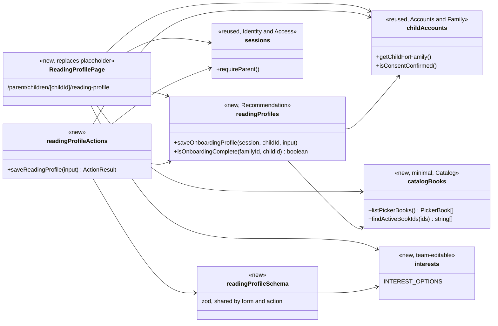
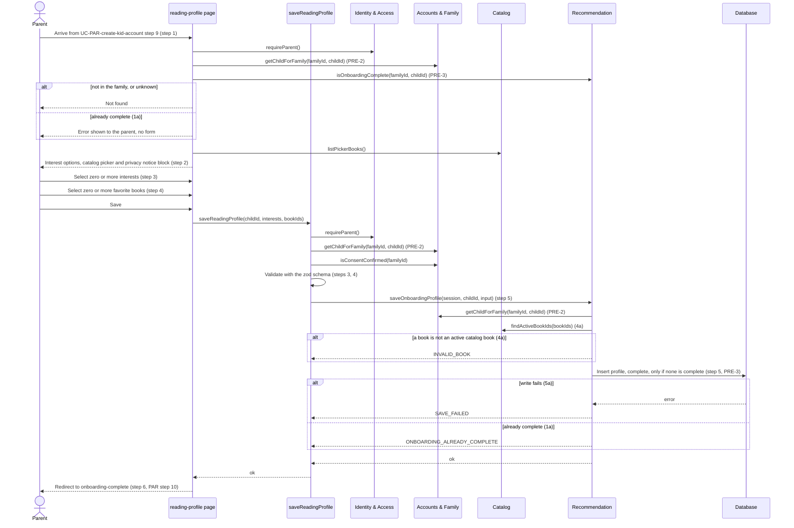
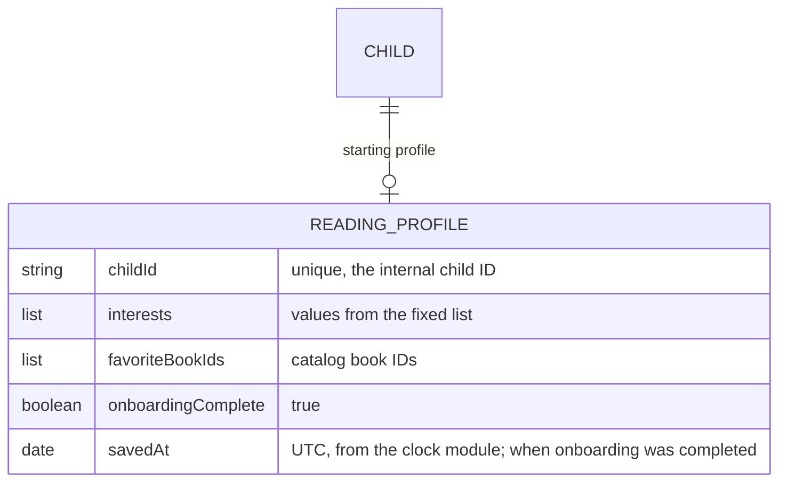

# Recommendation (REC) Design

**Project:** BookBuddies
**Team:** Team 05
**Area:** `UC-REC`

> **Realizes:** `UC-REC-kid-onboarding`, `FR-ONB-profile` (the interests and favorite books half), `FEAT-onboarding-profile`
> **Depends on:** `BR-parent-creates-kid-account`, `BR-kid-data-stored`, `BR-reading-level-proxy`, `BR-no-reading-level-assessment`, `BR-child-structured-responses`, `BR-coppa-minimization`, `BR-admin-limited-view`, `BR-coppa-notice`, `BR-coppa-parent-rights`, `BR-coppa-retention`, `FR-DATA-notice`, `FR-DATA-review`, `DI-integrity`, `DI-catalog-status`, `DI-field-tables`, `SEC-role-authorization`, `KD-pii-segregation`, `KD-auth-sessions`, `KD-book-exclusion`, `KD-catalog-import-offline`
> **See:** [use cases, REC area](../docs/requirements/use-cases.md#uc-rec-kid-onboarding-capture-a-childs-reading-interests-and-favorite-books), [specification](../docs/requirements/software-requirements-specification.md), [business rules](../docs/requirements/business-rules.md), [glossary](../docs/requirements/project-glossary.md), [architecture-of-record](architectural-design.md), [PAR design](par.md), [field values to agree](rec-field-values.md)
> **Designed against:** `d8beec6`

---

## Overview

The Recommendation area owns each child's reading profile and, in later use cases, the recommender itself ([containers](architectural-design.md#51-containers), [use case areas and components](architectural-design.md#52-use-case-areas-and-components)). `UC-REC-kid-onboarding`, the first use case designed here, lets a parent record the child's reading interests and favorite books already read, and marks onboarding complete. It is entered from `UC-PAR-create-kid-account` step 9 at the route PAR already fixed, `/parent/children/[childId]/reading-profile`, and ends by redirecting to PAR's `/onboarding-complete` page (PAR step 10).

The profile is held by Recommendation under the opaque child ID. It is not identifying, so it stays out of the Child Identity Store, which keeps only age, grade and reading level (architecture §5.2, `KD-pii-segregation`). Onboarding never touches those three fields and never estimates a reading level (`BR-no-reading-level-assessment`). The book picker reads the Catalog, which this design depends on but does not build (see Open questions). Either parent role, Main or Sub, may onboard a child of their family (architecture §8.1).

## Components & classes

All files below are new unless marked reused. Paths follow §8.2.3 and §8.2.4.

- `src/app/(parent)/parent/children/[childId]/reading-profile/page.tsx` (**reused route, replaces the placeholder**): the form for steps 1 to 4. It calls `requireParent()`, then `getChildForFamily`; a child outside the session's family, or unknown, is not found with no hint which. If onboarding is already complete it shows the parent an error and no form (1a, PRE-3). The error has a link back to the parent's home page; that page is not built yet, so the target is one constant that points there once the route exists, and until then the error shows without a link. It shows the child's nickname and avatar only, the interest options, the catalog picker and a privacy notice block (`FR-DATA-notice`, `BR-coppa-notice`). **Placeholder, to be replaced by the client:** the block is a short plain paragraph saying what is collected (interests and favorite books), that it is used only to recommend books, and that the parent can review and delete it, shown in full above the Save button, with an unticked checkbox, "I have read this notice and agree to share this information about my child". Save stays disabled until the parent ticks it themselves; it is never pre-ticked or ticked by default. The tick is held in the form only and is not stored, because `BR-coppa-parental-consent` is already recorded in PAR, so whether to store it is for the client. The client, with a lawyer, supplies the real notice text; the block is one small component so swapping in the text changes nothing else. As built (the developer's decision, 2026-11-18), the block also carries a link to the privacy notice from `getPrivacyNoticeUrl()` in `src/server/lib/config.ts`, the same location `UC-PAR-create-kid-account` links to (`COPPA-online-notice`). It opens in a new tab, so the parent's selections stay on the form and closing the tab brings them back; the development placeholder page says so. Like the PAR form, the page fails closed in production when `PRIVACY_NOTICE_URL` is unset, and falls back to `/privacy-notice` in development and tests. There is no skip control: the use case has no skip extension, and saving with nothing selected is step 3 with zero choices. The save button is disabled while pending, and every selection stays in the form after a failed save (5a).
- `.../reading-profile/actions.ts` (new): `saveReadingProfile`. In order (§8.2.3): `requireParent()`, `getChildForFamily` (not found before anything else is revealed), `isConsentConfirmed`, zod validation, then Recommendation. The family comes from the session, never from the request. On success it returns `ok` with no data, and the form component calls `router.push` to `/parent/children/${childId}/onboarding-complete` (step 6), with `childId` taken from the route params, never from user input or a return parameter. The path template is fixed in code. `SAVE_FAILED` carries the error ID in the shared result helper's error ID field (§8.2.1), never in logs with profile data.
- `.../reading-profile/schema.ts` (new): the one zod schema (§8.2.5): child ID, interests (each from the fixed list, duplicates removed), favorite book IDs (duplicates removed, at most 10, proposed in `OI-38`; one constant in `schema.ts`). No free-text field exists.
- `src/server/recommendation/reading-profiles.ts` (new, server-only): the only code that touches `readingProfiles`. `saveOnboardingProfile` confirms the child belongs to the family through Accounts & Family, validates the book IDs through the Catalog, and writes with one conditional insert guarded by "no completed profile for this child". A duplicate-key error from the unique `childId` index is mapped to `ONBOARDING_ALREADY_COMPLETE`, not `SAVE_FAILED`. `isOnboardingComplete` is the read the page uses for PRE-3 and that `UC-REC-recommend-quiz-rules` will use later. Amended by the `UC-PAR-delete-kid-account` design (architecture §8.2.8): the child check and the insert become one transaction that first calls Accounts & Family's `lockChildForWrite`, so a save that races the child's deletion returns `CHILD_NOT_FOUND` instead of leaving a profile behind. `deleteChildRecords` here deletes the child's profile ([`design/par.md`](par.md)).
- `src/server/recommendation/interests.ts` (new, **team-editable**): the fixed interest options, filled from [rec-field-values.md](rec-field-values.md). As built it is not `server-only`, because the form and its schema read it too, like PAR's `grades.ts`. The route folder also holds `access.ts` (the session, family and consent checks the page and action share, kept out of the `"use server"` file) and `paths.ts` (the fixed completion path and the home-page constant, which the form imports).
- `src/server/catalog/books.ts` (new, minimal, owned by the Catalog): `listPickerBooks` (active, non-blocked books, returned as `PickerBook = { id: string; title: string; author: string }`, sorted by title) and `findActiveBookIds`. "Active" and "blocked" are the Catalog's own status values from `DI-catalog-status`; this design invents none, and fixture books use whatever names that requirement fixes. Draft and blocked books are never returned. Nothing else is designed here; the Catalog's collection, import and admin functions belong to `UC-ADM-add-content`. Until then integration tests insert invented fixture books.
- Reused, not changed: `src/server/identity-access/sessions.ts` (`requireParent`), `src/server/accounts-family/child-accounts.ts` (`getChildForFamily`, `isConsentConfirmed`), `src/server/lib/` (`action-result.ts`, `clock.ts`, `db.ts`, `log.ts`, `collections.ts`), and `src/server/setup/ensure-indexes.ts`, which gains one call for the new index.
- `/parent/children/[childId]/onboarding-complete/page.tsx` is PAR's and is not changed.

## Sequence

### UC-REC-kid-onboarding: capture a child's reading interests and favorite books

The family check runs first, so a child outside the family gets `CHILD_NOT_FOUND` whatever else is wrong with the request. Consent and the family check come from `BR-kid-data-stored` and §8.1 and implement no extra step; the consent check is an assumption listed under Open questions.

## API contract

| Endpoint or job | Caller (who may) | Request | Success | Errors, by extension |
|---|---|---|---|---|
| Page `/parent/children/[childId]/reading-profile` (UC-REC-kid-onboarding) | A signed-in parent, Main or Sub, of the child's family | Child ID in the path | The form, the interest options, the catalog picker, the privacy notice block, and the child's nickname and avatar | A child outside the session's family, or unknown: not found, with no hint which. Already complete (1a): the page shows an error to the parent and no form; the child's own access is untouched. No session: redirect to sign-in |
| Server action `saveReadingProfile` (UC-REC-kid-onboarding) | Same; the family comes from the session | Child ID, interests (zero or more, from the fixed list), favorite book IDs (zero or more) | `ok`; the form then navigates to `/parent/children/[childId]/onboarding-complete` (step 6). The result carries no profile data | Not signed in or not a parent: `NOT_SIGNED_IN`, `NOT_A_PARENT`. Child not in the family or unknown: `CHILD_NOT_FOUND`. No confirmed consent: `CONSENT_NOT_CONFIRMED`. 3: `INVALID_INTEREST`. 4a: `INVALID_BOOK` (not in the catalog, draft or blocked), `TOO_MANY_BOOKS`. 1a: `ONBOARDING_ALREADY_COMPLETE`. 5a: `SAVE_FAILED` with an error ID, nothing saved. Selecting no interests or no books is not an error |

Nothing in this use case is sent to a child's screen (`BR-parent-creates-kid-account`, §8.2.11).

## Key decisions

**The reading profile lives in Recommendation, keyed by the child ID, not in the Child Identity Store.** Interests and favorite books are not identifying, and the architecture puts them under the opaque ID (§5.2). Rejected: the Child Identity Store, which would widen the one collection `KD-pii-segregation` keeps small. Also rejected: Accounts & Family, whose §5.2 row said it owned the "onboarding answers"; that wording contradicted Recommendation's row and is corrected here.

**The child sees no raw interests or favorites.** The use case's table and `BR-kid-data-stored` said "visible to parent and child"; both are edited in this pull request to "parent only; the child sees only the derived interest profile", which is the dashboard's radar chart with no numbers (`UC-SHLF-kid-dashboard`). §8.2.11 allows a child's screen to show only book data, nickname and avatar, and no child function returns the stored lists. Rejected: a child-callable read.

**Interests are stored as a plain list of fixed values with no strengths.** The Interest Profile's relative strengths are built by the recommender from later choices and ratings, which `UC-REC-recommend-quiz-rules` owns. Rejected: inventing a strength model here.

**A missing profile means onboarding is incomplete.** Nothing is written until step 5, and the use case has no skip extension. Rejected: an `incomplete` record, which is a status field no use case reads.

**"Already complete" (1a) is enforced by the write, not only by a read before it.** One conditional insert fails if a completed profile exists, so two simultaneous saves leave one and the second gets the error (§8.2.8). Rejected: read then write, which lets both through. The error concerns the parent's screen only; nothing here changes the child's login or access.

**Step 6 always redirects to the completion page, with no return parameter.** The use case's "if started from" has one other entry, the re-fill after `UC-PAR-delete-child-data`, whose design may add its own landing. Rejected: a caller-supplied return URL, an open redirect.

**The picker loads every active book on the server.** The seed catalog is small (`AS-seed-catalog-size`). Rejected: a search action now, which no step asks for; revisit when the catalog grows (`KD-catalog-import-offline`).

**Blocked books are left out by the Catalog; per-child report exclusions are not applied.** A child being onboarded has no reports, and the picker is not a recommendation or search query (`KD-book-exclusion`). The re-fill after data deletion removes the exclusions with the rest of the child's data.

**The admin sees one child's interests and favorite books only through the audited usage lookup.** `UC-ADM-view-usage-stats` lets the admin check which interests and favorite books are common overall, with small counts hidden, but its child lookup never returns one child's interests or favorites. The totals are built later in that use case as aggregate functions in Recommendation that return counts keyed by interest or book and never a child ID. Rejected: any per-child read of the profile for the admin (`BR-admin-limited-view`, `KD-pii-segregation`).

**The profile keeps a save time, so the admin can count onboardings in a period.** `UC-ADM-view-usage-stats` lists "Onboardings completed" as a total for the chosen date range, and a count over a period needs the time each onboarding finished. Account creation dates cannot serve, because a parent may leave a child's onboarding unsaved (`OI-39`), so sign-ups and completions differ. The admin sees a count only, never which child or when (`BR-admin-limited-view`). The count is built later with `UC-ADM-view-usage-stats` as aggregate functions in Recommendation that return numbers; they are not built here, and no admin-callable function returns a profile or its time. Rejected: no time field, which makes the figure impossible; a separate event log, a second collection for one number. No index on `savedAt` now, as the seed catalog and family numbers are small. The figure is a team proposal and still needs confirming (`UC-ADM-view-usage-stats` Open Issues).

## Data model

New collection `readingProfiles` (Recommendation), one document per child with a completed onboarding:

- Unique index on `childId`, created by `ensure-indexes.ts`; schema validation as backstop (§8.2.5).
- No name, age, grade or reading level (`KD-pii-segregation`). The purpose of each field is already in `BR-kid-data-stored` ("reading interests, favorite books already read").
- Favorite book IDs reference the Catalog by its internal book ID; the profile copies no book data.
- `savedAt` is set once, at the insert, from `now()`, and never changed. Its only reader is the "onboardings completed" figure of `UC-ADM-view-usage-stats` (see Key decisions). The profile never returns it to a page or a child.
- Deleting a child's data or account removes this document (`UC-PAR-delete-child-data`, `UC-PAR-delete-kid-account`). After a data deletion and a new fill-in, `savedAt` is the later save.

## Reuse & cross-cutting

- **Authentication and authorization:** `requireParent()` and the family check on page and action (`KD-auth-sessions`, §8.1).
- **Error handling:** the shared result helper (§8.2.1).
- **Time:** `savedAt` from the clock module, stored in UTC, set once at the insert (§8.2.2). The date range of the admin's figure is applied on read; nothing is purged by age.
- **API conventions:** a verb-first server action; session, validation, then the owning component (§8.2.3).
- **Code conventions:** `server-only` on every module under `src/server/`; only Recommendation touches `readingProfiles`; only the Catalog touches books (§8.2.4).
- **Validation:** one zod schema for form and action; choices come from fixed lists, never free text (§8.2.5, `BR-child-structured-responses`).
- **Privacy notice:** a placeholder paragraph and a "read and agree" checkbox on the form for now, to be replaced by the client's notice, with the link from `getPrivacyNoticeUrl()` already shown (`FR-DATA-notice`, `BR-coppa-notice`). The notice text, which covers this data's purpose and retention, is the client's and a lawyer's to supply.
- **Parent rights:** `UC-PAR-review-child-data` shows the profile (interests, favorite books) and includes it in the downloadable copy; `UC-PAR-delete-child-data`, `UC-PAR-delete-kid-account` and `UC-PAR-revoke-consent` remove it or stop its use (`BR-coppa-parent-rights`, `FR-DATA-review`, `FR-DATA-removal`). This design adds no parent-facing read; Recommendation will export one read by child ID, scoped to the family, when `UC-PAR-review-child-data` is designed.
- **Retention:** the inactivity purge of Scheduled Cleanup deletes the profile with the child's other data once the configurable limit passes (`BR-coppa-retention`, `OI-22`, §8.2.6). The limit is never in this code.
- **Logging:** never the interests, favorite books, or the child ID tied to them (§8.2.7).
- **Persistence:** the conditional insert (§8.2.8). No transaction is needed: one document is written.

Not used: Notification (no alert is asked for), the audit log (not in the §8.2.9 list), and the Child Identity Store.

## Tests

| Use case, flow | Level | Asserts |
|---|---|---|
| UC-REC-kid-onboarding main | integration | A parent of the family saves interests and favorite books: one profile keyed to the child, complete, with the chosen values and a `savedAt` equal to the clock module's `now()` (POST-1 to POST-3) |
| UC-REC-kid-onboarding main | end-to-end | From the PAR credentials screen the parent reaches the form, picks, saves and lands on "onboarding complete" (steps 1 to 6) |
| UC-REC-kid-onboarding 3, none selected | integration | An empty interest list is accepted and onboarding is complete |
| UC-REC-kid-onboarding 4, no favorites | integration | An empty book list is accepted and saved (POST-2) |
| UC-REC-kid-onboarding abandoned | end-to-end | Leaving the form without saving writes nothing: no profile exists and the child account is unchanged |
| UC-REC-kid-onboarding 3, invalid | unit | A value not on the interest list is refused with `INVALID_INTEREST`; duplicate interests and books are collapsed |
| UC-REC-kid-onboarding 4a | integration | An unknown, draft or blocked book ID is refused with `INVALID_BOOK` and nothing is saved |
| UC-REC-kid-onboarding 4a, cap | unit | More than 10 books are refused with `TOO_MANY_BOOKS` |
| UC-REC-kid-onboarding 5a | integration | When the write fails the result is `SAVE_FAILED` with an error ID and no profile exists |
| UC-REC-kid-onboarding 5a | end-to-end | After a failed save every selection is still in the form |
| UC-REC-kid-onboarding 1a | integration | A second save returns `ONBOARDING_ALREADY_COMPLETE` and changes nothing, and two simultaneous saves leave exactly one profile |
| UC-REC-kid-onboarding 1a | end-to-end | Opening the form for a completed child shows the parent an error and no form; the child can still sign in |
| UC-REC-kid-onboarding PRE-2 | integration | A child ID from another family, or an unknown one, gets the same not-found result on page and action (`CHILD_NOT_FOUND`) and nothing is saved |
| UC-REC-kid-onboarding consent | integration | A family without confirmed or with revoked consent gets `CONSENT_NOT_CONFIRMED` and nothing is saved |
| Authorization | integration | A Sub Parent of the family may save; a Sub Parent of another family gets `CHILD_NOT_FOUND`; a child session and an admin session are refused |
| Check order | integration | A foreign child ID with an invalid interest returns `CHILD_NOT_FOUND`, not `INVALID_INTEREST`, and a duplicate-key error from a simultaneous save returns `ONBOARDING_ALREADY_COMPLETE` |
| Step 6, redirect | integration | The redirect target is always the child's completion page, whatever the request carries |
| Admin boundary | integration | No admin-callable function returns the profile outside the audited usage lookup, and that lookup returns no identifying field. |
| Privacy notice | end-to-end | The form shows the notice block, Save stays disabled until the parent ticks the unticked-by-default checkbox, and the notice link opens the same location as the Add a child form in a new tab and the selections are still there after closing it |
| Child-facing read | integration | No function a child session can call returns the interests or favorite books (§8.2.11) |
| Logging | integration | After a success and a failure the logs contain no interests, favorite books or child ID |

## Changes to the architecture-of-record

- §5.2 Accounts & Family: the words "and their onboarding answers" are removed; Recommendation owns the reading profile, as its own row and the paragraph after the table already say. Edited in `architectural-design.md` in this pull request.
- `BR-kid-data-stored`, `BR-admin-limited-view`, `FR-ADM-child-lookup`, `KD-admin-usage-lookup` and the use case's Associated Information are edited in this pull request (child sees no raw interests; admin lookup lists no interests).
- §5.2 Catalog: names the two narrow reads this use case needs (`listPickerBooks`, `findActiveBookIds`). Edited in this pull request.
- Revision history: a v0.11 row records `design/rec.md`.

## Open questions & risks

What this design had to assume. The developer accepted each on 2026-11-16 on the condition that none breaches a rule or COPPA.

- **The interest options (client and team).** The interest options (client): taken from the client’s Book domains slide (Genre and Subjects). Whether Mood and Themes are also options is to confirm (OI-37).
- **Favorite-book cap (team).** Proposed 10, since the glossary says "a few". Filed as `OI-38`.
- **Catalog does not exist in code (team).** No Catalog collection, import or read exists. `/implement` for this use case can build the form, action and Recommendation code against the two minimal reads and fixture books, but the picker cannot show real books until the seed catalog is imported (`KD-catalog-import-offline`, to be designed with `UC-ADM-add-content`). The import will need an `.xlsx` reader, a new dependency; `exceljs` is proposed and a person must confirm it before it is added (CLAUDE.md).
- **No skip, and no way back after leaving (specification).** The use case no longer has the skip extension (old 3b) or the next-login reminder. A parent who leaves the form unsaved leaves the child incomplete, with no reminder and no designed way to return to the form. Filed as `OI-39`.
- **Consent check (team).** Interests and favorite books are a child's personal information (`BR-kid-data-stored`) but the use case has no consent precondition. The action checks `isConsentConfirmed`. It does not join the `childCreationVersion` serialization of `OI-36`; a revocation racing a save can leave one profile, which revocation's own deletion removes.
- **Sub Parent may onboard (team).** PRE-1 says "Parent"; architecture §8.1 gives a Sub Parent the same access to linked children.
- **Use case edited by the developer (2026-11-16).** Step 3 is now "zero or more", extension 1a (already complete: raise an error to the parent; the child keeps normal access) is added, and 3a and 3b are removed. This design follows that text.
- **Save time for the admin's count (team).** `savedAt` exists only for the "onboardings completed" figure added to `UC-ADM-view-usage-stats` on 2026-11-16 as a team proposal. If the client does not want that figure, `savedAt` can be removed with no other change.
- **Privacy notice not written yet (client and a lawyer).** The client has to supply the real notice. Until then the form shows the placeholder paragraph and the "read and agree" checkbox described under Components, which is easy to replace. Whether the agreement should be stored is the client's to decide. `BR-coppa-notice` is met only once the client's text is in place, so the real notice must be in before launch.
- **Smaller assumptions, each breaking no rule, security measure or COPPA duty (developer, 2026-11-16).** Book and child IDs are strings. A complete child gives the error page with no link until the parent home page exists, and an unknown or foreign child gives `notFound()`. A revoked-consent family can still open the form, which collects nothing until Save, and the action refuses to save. `onboardingComplete` is stored as `true` and not read. The `savedAt` field stays as a team proposal. The Sub Parent from another family is the same not-found case as any foreign child.
- **Accepted risk:** parents could pick a long list of favorites that skews the first recommendations; the cap limits it. How favorites weigh in is `UC-REC-recommend-quiz-rules`'s to decide.

---

## Working this document with your agent

_Delegate: drafting diagrams from the use case, listing the existing files a class should extend, proposing a test row per extension, checking that every cited identifier exists. Keep human: which details a wrong guess would break, every key decision, and the approval, which is a teammate's review of the pull request. Watch for scope nobody asked for: an admin override, a retry queue, a status field, a notification. Every interaction in the sequence names a use case step._

---

## The questions test (before you open the pull request)

Start a fresh agent session in plan mode with only the use case, the business rules it cites, architecture section 8 and this document, and ask: _List every point you would still have to guess to implement `UC-REC-kid-onboarding`. For each, say what you would guess and whether a wrong guess could violate a requirement. Do not write code._ For each item, fix this document or keep the guess with one line saying why a wrong guess breaks no requirement. Paste the list under How it was verified in the pull request, inside a collapsed `

Questions test
 … 
` block.
