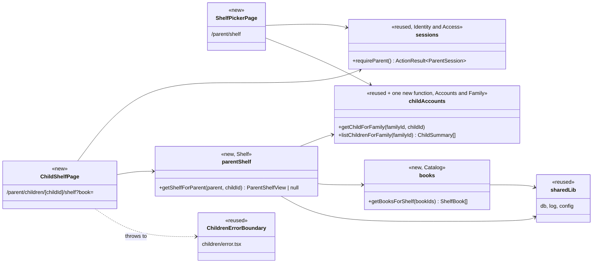
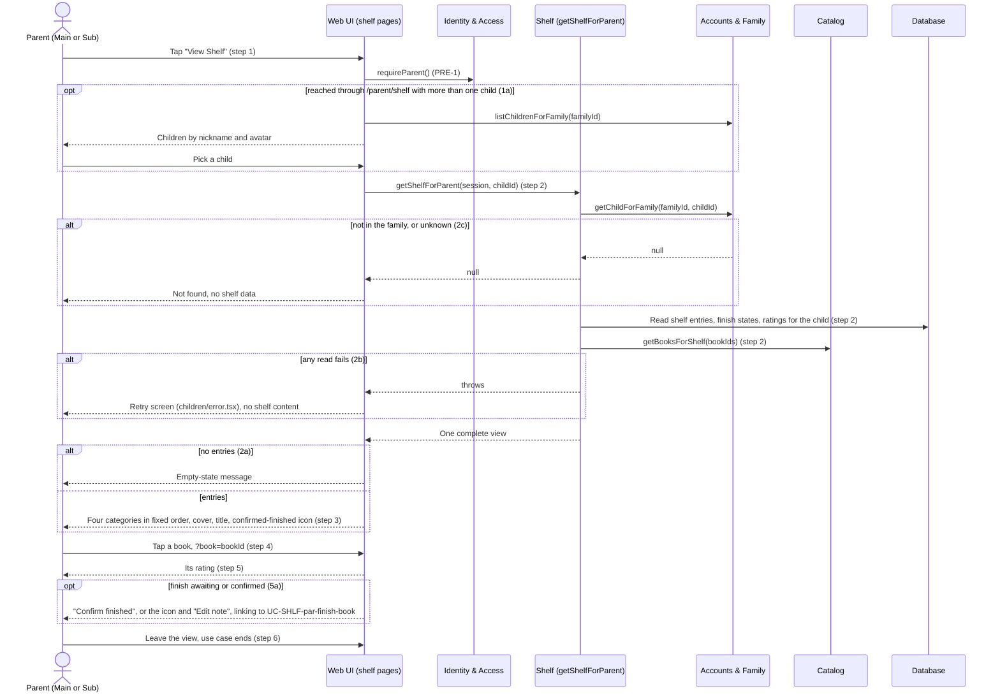
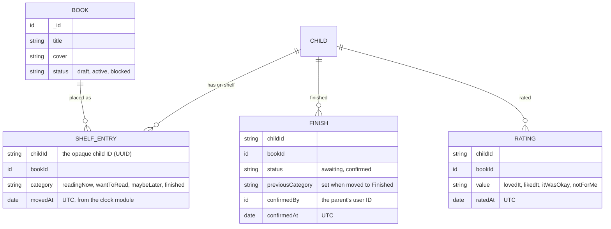

# Shelf (SHLF) Design

**Project:** BookBuddies
**Team:** Team 05
**Area:** `UC-SHLF`

> **Realizes:** `UC-SHLF-parent-view-shelf`, `FR-PAR-review`
> **Depends on:** `BR-parent-account-linked`, `BR-kid-no-metrics`, `FR-SHLF-categories`, `FR-SHLF-finish-confirm`, `FR-RATE-rating`, `SEC-role-authorization`, `SEC-pii-boundary`, `USE-parent-light`, `KD-pii-segregation`
> **See:** [use cases, SHLF area](../docs/requirements/use-cases.md#uc-shlf-parent-view-shelf-view-a-childs-shelf-and-ratings), [specification](../docs/requirements/software-requirements-specification.md), [business rules](../docs/requirements/business-rules.md), [glossary](../docs/requirements/project-glossary.md), [architecture-of-record](architectural-design.md), [PAR design](par.md)
> **Designed against:** `d8beec6` (the `UC-PAR-create-kid-account` slice is built; no Shelf or Catalog code exists yet)

---

_**How to use this template.** Copy it to `design/<area>.md`, named for the lowercase area code (`ord.md` for `UC-ORD-*`). Instructions appear in italic square brackets; leave them in place until the document is stable, because the agent reads them on every later pass. The full worked example is Project Pulse's [`not.md`](https://github.com/Washingtonwei/project-pulse/blob/main/design/not.md); read it for the shape, not for the answers._

_BookBuddies keeps its design documents in the top-level `design/` folder beside the [architecture-of-record](architectural-design.md), so this file is `design/shlf.md`._

_**What this document is.** The **design-of-record** for one use case area: how the code will realize its use cases, written **before** the code and approved before anyone builds from it. It is the last document your agent reads before it writes code, so anything it leaves out, the agent invents. Your [architecture-of-record](architectural-design.md) is the map of the whole system and stops at each component's responsibility; this document goes one level down, inside one area, against real code._

_**What it is not.** A copy of your use cases. It **cites** `UC-*`, `FR-*`, and `BR-*` by identifier and never restates what the system shall do; it says only how. It is also not a transcript of the code. Once code exists, link to the files rather than describing every class, column, or getter._

_**One document per area, not per use case.** Your area gains use cases over the term. The overview, the class diagram, and the data model are **revised in place** when it does. The sequence diagrams, the API contract rows, and the test rows are **appended**, one set per use case. Never add a `## UC-…` section that repeats the whole skeleton._

_**How much to write.** Pin down what a wrong guess would break: a requirement, a business rule, a quality attribute, or the contract between two parts of your team. Leave the rest for the agent to derive while it builds: variable names, field types, exact JSON, column lengths. When you are unsure, ask which side of that line a detail falls on, not whether it is interesting._

_**Write it in this order.** Each step is one person's or one pair's work, and the order is the point:_

1. _**Sketch it yourselves first.** Before you open the agent, draw the main success scenario's sequence diagram and write the API contract rows by hand, from the use case and your architecture-of-record. Twenty minutes, on paper or in this file._
2. _**Have the agent draft it.** Give the agent this template, the use case, the business rules it cites, your architecture-of-record's section 8 (Crosscutting Concepts), and the relevant existing code, and ask for a draft of this document. Use plan mode, so it proposes before it writes._
3. _**Compare the two.** Where the agent's draft differs from your sketch, decide which is right and why. What it found that you missed goes in; what you knew that it could not have known is the context your specification is missing, so fix the specification too._
4. _**Run the questions test** (the last section) and fix what it finds._
5. _**Open a pull request.** A teammate who did not write it reviews and approves it. Nobody starts an implementation branch from this design until it is merged._

_**Status of this draft.** Revised by Claude on 2026-11-17 against `main` at `d8beec6`: use cases, business rules v0.8, SRS v0.9, glossary v0.11, architecture-of-record v0.10, `design/par.md` and the built PAR code. It replaces the 2026-10-20 draft (against `6aca106`). Since then the client's 2026-10-28 answers withdrew the child's reflections (`BR-notes-visible-to-parent` and `SEC-no-private-notes` retired, `OI-16` resolved), the use case gained finish confirmation (5a) and a block now removes the shelf entry (5b, `UC-ADM-block-content` POST-3). This draft drops the reflection, flag and pending-deletion parts, adds finish status, withdraws the earlier Catalog exception, and reuses the PAR code that now exists instead of assuming it. Steps 1, 3, 4 and 5 above are still the team's to do. It covers `UC-SHLF-parent-view-shelf` only; the other SHLF use cases are appended as each is designed._

---

## Overview

_[One paragraph: what this area does, which components of your [architecture-of-record](architectural-design.md) it lives in, and what it reads from or calls in other areas. Link the container diagram rather than redrawing it. If this design changes the architecture-of-record, say so here and list the change under "Changes to the architecture-of-record" below.]_

The Shelf area owns each child's shelf: entries in the four categories of `FR-SHLF-categories`, finish confirmations, ratings, shelf history, the child dashboard, keyword search and its shelf requests, and parent removal. It is the Shelf component of the Application container ([containers](architectural-design.md#51-containers), [use case areas and components](architectural-design.md#52-use-case-areas-and-components)). `UC-SHLF-parent-view-shelf`, the first use case designed here, is read-only. It asks Accounts & Family whether the child belongs to the signed-in parent's family (the existing `getChildForFamily`), reads the child's shelf entries, finish states and ratings from Shelf, and asks the Catalog for each book's cover and title. It never reads the Child Identity Store, so the parent picks a child by nickname and avatar. A finish awaiting confirmation links to `UC-SHLF-par-finish-book` (5a). A blocked book needs no handling of its own here, because `UC-ADM-block-content` deletes its shelf entries in the same save (5b). This design does not change the architecture-of-record.

## Components & classes

_[One class diagram for the whole area, and one line per class or file saying what it does and whether it is **new** or **reused**. Show only what a reader needs to see how the parts relate: classes, their key methods, their dependencies. Fields and getters belong to the code._

_**If your repository has no code for this area yet**, which is the normal case for your proving slice, list the files you expect the agent to create, with the paths your architecture-of-record's conventions give them, and mark them all new. The agent then builds into the structure you chose rather than one it improvised._

_The paths follow the PAR design and its built code: pages under `src/app/(parent)/parent/`, and each component's server-only data-access functions under `src/server/<component>/` (§8.2.3, §8.2.4).]_

- `src/app/(parent)/parent/shelf/page.tsx` (new): the child picker (1a). It calls `requireParent()`, then `listChildrenForFamily`, and lists the children by nickname and avatar (`avatarSrc` from `avatars.ts`). With exactly one child it redirects to that child's shelf, so the parent stays one tap away (`USE-parent-light`).
- `src/app/(parent)/parent/children/[childId]/shelf/page.tsx` (new): a server component. It calls `requireParent()` and then `getShelfForParent`. It renders the four categories in the fixed order of step 3, each entry with its cover, title and, for a confirmed finish, the confirmed-finished icon. For the book selected through `?book=<bookId>` (step 4) it shows the rating (step 5) and the 5a control: "Confirm finished" for an awaiting finish, "Edit note" for a confirmed one. Both are links into `UC-SHLF-par-finish-book`, and that design names their route. There is no server action, because the view changes nothing (POST-2). Session handling copies the built PAR pages: `NOT_SIGNED_IN` redirects to sign-in, and `NOT_A_PARENT` and an unknown or foreign child both call `notFound()` (2c).
- `src/app/(parent)/parent/children/error.tsx` (**reused**, already built for PAR): the nearest error boundary for `children/[childId]/shelf`, so it is the 2b retry screen. It shows a generic message and a "Try again" button and no shelf content. No new `error.tsx` is added.
- `src/server/shelf/parent-shelf.ts` (new, server-only): `getShelfForParent(parent, childId)`. It calls `getChildForFamily(parent.familyId, childId)` **first** and returns `null` when the child is not in that family. Then it reads the child's shelf entries, the finish states and ratings for those books, and the books' catalog data, and it returns one complete view or throws. It never returns part of a shelf (2b).
- `src/server/accounts-family/child-accounts.ts` (**reused**): `getChildForFamily` already returns the nickname and avatar for a child of the given family only. It is the family scope (§8.1 Authorization), and it works for Main and Sub Parents. **New in this file:** `listChildrenForFamily(familyId)`, which returns the ID, nickname and avatar of each child, oldest first. The earlier draft's separate `family-access.ts` is dropped, because the function it proposed now exists.
- `src/server/catalog/books.ts` (new, server-only): `getBooksForShelf(bookIds)` returns the cover and title of the active books among the IDs given. Like every catalog read, it leaves out blocked books (architecture §5.2).
- `src/server/identity-access/sessions.ts` (**reused**): `requireParent()` returns `{ userId, familyId, parentRole }` from the Auth.js database session, or `NOT_SIGNED_IN` or `NOT_A_PARENT`.
- `src/server/lib/db.ts`, `log.ts`, `collections.ts` (**reused**); `src/server/setup/ensure-indexes.ts` (**reused**, gains the Shelf and Catalog index functions).

## Sequence

_[One sequence diagram per use case for its main success scenario, plus one for each extension that does not just return an error. **Label each interaction with the use case step it implements**, so a reviewer can check that every step is realized and nothing extra was invented. Use `alt` blocks for extensions that branch off the main flow. Give each use case its own `###` heading; that heading is the anchor your traceability matrix cites.]_

### UC-SHLF-parent-view-shelf: view a child's shelf and ratings

Step 4 needs no second request: the page already holds every entry's rating and finish state, and selecting a book only changes `?book=` in the URL. Extension 5b needs no branch: once `UC-ADM-block-content` commits, the entry is gone from the next load.

## API contract

_[One row per endpoint, scheduled job, or message this area adds or changes, appended per use case. **This section is never dropped**: before the code exists it is the only thing the person (or agent session) building the front end and the one building the back end both read. Name the caller and who may call it, the request fields, the success response, and the error each extension returns. Leave field types and exact JSON to the agent unless a wrong guess would break something, such as a format another system depends on. Use the error shape your architecture-of-record's section 8.2 fixes; do not invent one here._

_This use case only reads, so its rows are pages and the server functions behind them, not server actions (§8.2.3).]_

| Endpoint or job | Caller (who may) | Request | Success | Errors, by extension |
|---|---|---|---|---|
| Page `/parent/shelf` (UC-SHLF-parent-view-shelf 1a) | A signed-in parent, Main or Sub | None | The family's children, ID, nickname and avatar only; with one child, a redirect to that child's shelf | No session: redirect to sign-in. Not a parent (a child or admin session): not found, as on the PAR pages. No children: see Open questions. |
| Page `/parent/children/[childId]/shelf` (UC-SHLF-parent-view-shelf) | A signed-in parent, Main or Sub, of that child's family | `childId` in the path; optional `?book=` for the selected book | The four categories in fixed order, entries most recently moved first, each with cover, title and the confirmed-finished icon when confirmed; for the selected book, its rating and the 5a link | 2a: the empty state, not an error. 2b: the retry screen, no shelf content. 2c: not found, the same response as an unknown child, so it does not reveal that the child exists. No session: redirect to sign-in. Not a parent: not found. A `?book=` that is not on the shelf selects nothing. |
| `getShelfForParent(parent, childId)` in Shelf | Only the page above | The `ParentSession` and the child ID | One complete view: per entry the book ID, category, cover, title, finish state (`none`, `awaiting`, `confirmed`) and rating if any | Returns `null` when the child is outside the family or unknown (2c). Throws on any failed read (2b). |
| `listChildrenForFamily(familyId)` in Accounts & Family | The picker page, after `requireParent()` | The session's family ID | ID, nickname and avatar per child | None. |
| `getBooksForShelf(bookIds)` in Catalog | Only `getShelfForParent` | Book IDs | Cover and title of each active book among them | Throws on a failed read (2b). |

Fields never in any response here: the child's age, grade or reading level (the system holds no real name); any count or total (use case Assumptions, `BR-kid-no-metrics`); the finish note, its flag, or who confirmed the finish.

## Key decisions

_[Only the decisions a reader could not recover from the code: an invariant, who may do this and how it is enforced, a trade-off you chose, a reason you reused something rather than writing it. **Each one names what you chose, what you rejected, and why.** If you cannot name an alternative you considered, it probably was not a decision; leave it out._

_A decision that affects the whole system rather than this area is an architecture decision. It belongs in your architecture-of-record as a `KD-*` entry, not here.]_

**The family check is inside the Shelf data-access function, not the page.** `getShelfForParent` takes the session and calls `getChildForFamily` before any read, so no function returns a child's shelf without the check. Rejected: checking in the page and passing a bare child ID down. §8.1 puts the scope in data access so that a query cannot be written without it, and the next page to reuse the function would skip the check.

**Reuse `getChildForFamily` for the family scope rather than a new `family-access.ts`.** The PAR build already has a family-scoped lookup that returns only the nickname and avatar. Rejected: the separate `assertChildInFamily` the 2026-10-20 draft proposed, which would be a second function doing the same check that could drift from the first.

**Another family's child is "not found", the same as an unknown child.** This matches the built PAR pages and their tests. Rejected: 403 Forbidden, which confirms that a child ID exists and turns it into a probe for other families' children.

**The parent picks a child by nickname and avatar.** The nickname now exists (`UC-PAR-create-kid-account`), and the system holds no real name. Rejected: showing age or grade to tell children apart, which would add a read path into the Child Identity Store that `KD-pii-segregation` does not allow.

**Finish state and ratings are stored apart from the shelf entry, keyed by child and book.** `UC-SHLF-par-finish-book` POST-1 and `UC-ADM-block-content` POST-3 keep the confirmation and rating when the entry is removed, and the icon returns when the book is added back. A field on a deleted entry cannot do that. This view joins them to the current entries, so a rating or confirmation for a book no longer on the shelf is not shown. Rejected: fields on the shelf entry.

**A blocked book is handled by the block, not by this view.** `UC-ADM-block-content` removes the shelf entries in the same save that blocks the book (its step 7), so the Catalog's "leave out blocked books" rule holds here unchanged. If a block commits between the entry read and the catalog read, the entry whose book the Catalog does not return is left out of the view, which is what 5b describes; it is not a 2b failure. Rejected: the 2026-10-20 draft's Catalog exception that returned blocked books with a marker, since a blocked book can no longer have a shelf entry; and treating a missing book as a load failure, which would show the retry screen for a correct state.

**The whole shelf loads in one call.** Every entry's rating and finish state come with step 2. Rejected: fetching a book's details when the parent taps it (step 4). A shelf can hold at most the catalog, which starts with 134 books (`OI-12`), and one load means the parent never sees half a shelf (2b) or waits for a second request.

**The 5a controls are links, not actions.** "Confirm finished" and "Edit note" open `UC-SHLF-par-finish-book`, which owns the decision, the note and the flag. Rejected: confirming from this page, which would make the read-only view write (POST-2).

## Data model

_[The **change** this area makes to the data: new tables or entities, new columns, the migration that adds them. Draw an ER diagram when there is more than one new table. Do not redraw the domain model; your [specification](../docs/requirements/software-requirements-specification.md) owns it, so link it and show only the change. If the area changes nothing, say "No change" and give the reason in one line; that is a design decision too.]_

This use case writes nothing. It is the first SHLF design, though, so it fixes the three collections that every SHLF use case shares. Their write paths come with `UC-SHLF-kid-move-book`, `UC-SHLF-par-finish-book` and `UC-SHLF-kid-rate-book`, which must use these shapes or revise this section. The children it reads belong to Accounts & Family (`design/par.md`), and the books belong to the Catalog.

- `shelfEntries` (Shelf): unique on `(childId, bookId)`, because a book is on a child's shelf once; also indexed on `(childId, category, movedAt)` for the step 3 order.
- `finishes` (Shelf): unique on `(childId, bookId)`. It survives the entry's removal (`UC-SHLF-par-finish-book` POST-1). A missing record means finish state `none`. The finish note is not stored here. Where it lives is `UC-SHLF-par-finish-book`'s to settle; architecture §5.2 gives parent note text to Accounts & Family.
- `ratings` (Shelf): unique on `(childId, bookId)`, one rating per child and book (`FR-RATE-rating`, the four-option scale of the glossary, `OI-17` resolved). It survives the entry's removal.
- `BOOK` is shown only for what this view reads. The Catalog is not designed. Its shape is assumed here and used by test fixtures until the Catalog's own design fixes it (see Open questions).
- `childId` is the opaque UUID from `children._id`, never a name (`KD-pii-segregation`). Each collection gets a `$jsonSchema` validator through `ensureCollection` and its indexes through `src/server/setup/ensure-indexes.ts`, as PAR's collections do (§8.2.5).

## Reuse & cross-cutting

_[Which existing services, components, and conventions this area uses rather than rebuilding: authentication, the error handler, email, the clock, another area's service. Cite your architecture-of-record's section 8.2 for each convention by name rather than restating it.]_

- **Sessions:** `requireParent()` in `src/server/identity-access/sessions.ts` (§8.1 Authentication, `KD-auth-sessions`).
- **Family scope:** `getChildForFamily` and the new `listChildrenForFamily` in `src/server/accounts-family/child-accounts.ts` (§8.1 Authorization).
- **Error handling:** the existing `children/error.tsx` boundary, with a calm message and no detail (§8.2.1). An unexpected failure is logged through `logUnexpectedError`.
- **Time:** none. The view compares no deadlines; `movedAt` is only an order (§8.2.2).
- **Code conventions:** only Shelf's data-access functions read its collections, and the Catalog's read its own; the pages import no database client (§8.2.4).
- **Logging:** no child ID, nickname, book title or rating in logs; `logUnexpectedError` already logs only a location and an error ID (§8.2.7).
- **Database:** the shared client in `src/server/lib/db.ts` (§8.2.8). No transaction is needed for reads; a block that lands between two reads is covered under Key decisions.
- **Child-facing views:** not used; this is a parent view. The child's own shelf is `UC-SHLF-kid-view-shelf`, which follows §8.2.11.

Not used: Notification, Safety Flagging and the audit log (a parent viewing a shelf is not in the §8.2.9 list), and the Child Identity Store.

## Tests

_[One row per flow: the main success scenario and **every** extension of every use case this document realizes, appended per use case. Name the level (unit or integration) and what the test asserts. No code. This list is the definition of done that the reviewer approves; the agent writes these tests when it builds, and a reviewer can see at a glance whether an extension has no test.]_

| Use case, flow | Level | Asserts |
|---|---|---|
| UC-SHLF-parent-view-shelf main | integration | `getShelfForParent` returns the child's entries under the four categories in fixed order, most recently moved first, each with cover, title, finish state and rating |
| UC-SHLF-parent-view-shelf main | end-to-end | A parent opens the shelf, taps a book and sees its rating (steps 1–6) |
| UC-SHLF-parent-view-shelf main, Sub Parent | integration | A Sub Parent of the family gets the same view as the Main Parent |
| UC-SHLF-parent-view-shelf main, read-only | integration | Loading the shelf changes no shelf entry, finish or rating (POST-2) |
| UC-SHLF-parent-view-shelf 1a | end-to-end | A parent with two children gets the picker; a parent with one is redirected straight to that child's shelf |
| UC-SHLF-parent-view-shelf 1a, no identity data | integration | `listChildrenForFamily` returns only ID, nickname and avatar, only for the session's family, and reads nothing from `childIdentities` |
| UC-SHLF-parent-view-shelf 2a | end-to-end | A child with no entries gets the empty-state message, not an error |
| UC-SHLF-parent-view-shelf 2b | integration | When the catalog read fails, `getShelfForParent` throws and returns no partial view |
| UC-SHLF-parent-view-shelf 2b, screen | end-to-end | A failed load shows the retry screen with no shelf entries |
| UC-SHLF-parent-view-shelf 2c | integration | Another family's child and an unknown child ID both return `null`, and no shelf collection is read for them |
| UC-SHLF-parent-view-shelf 2c, page | end-to-end | Both get the same not-found page with no shelf data |
| UC-SHLF-parent-view-shelf 5a, awaiting | end-to-end | A Finished book awaiting confirmation shows "Confirm finished" and no icon |
| UC-SHLF-parent-view-shelf 5a, confirmed | end-to-end | A confirmed book shows the confirmed-finished icon and "Edit note", in Finished and in any other category it was moved to |
| UC-SHLF-parent-view-shelf 5b | integration | An entry whose book the Catalog does not return is left out, the other entries are returned, and no error is raised |
| Removed book | integration | A rating and a finish confirmation kept after the book left the shelf do not appear in the view |
| Selected book | integration | A `?book=` that is not on the child's shelf selects nothing and reveals nothing about that book |
| No counts | integration | The view holds no count or total of any kind |
| Authorization | end-to-end | A child session and an admin session get not found from both pages; no session redirects to sign-in |
| Logging | integration | After a failed load, the logs contain no child ID, nickname, book title or rating |

## Changes to the architecture-of-record

_[Designing an area against real code is when the architecture's guesses meet reality. If this design needs a component the map does not have, moves a responsibility, or adds a dependency, **change [the architecture-of-record](architectural-design.md) in the same pull request** and list each change here in one line. If nothing changed, write "None". A design that silently disagrees with the architecture leaves two maps, and the agent will follow whichever it reads last.]_

None. The 2026-10-20 draft's change to the §5.2 Catalog row ("except the shelf lookup") was never made and is withdrawn: `UC-ADM-block-content` POST-3 now removes a blocked book's shelf entries, so no catalog read has to return a blocked book.

## Open questions & risks

_[What this design could not settle and who can, and what could go wrong that you are accepting. A question for the client also goes in [`OPEN-ISSUES.md`](../docs/requirements/OPEN-ISSUES.md).]_

- **Trigger and 1a (team).** The trigger is "View Shelf" on a child's dashboard (`FR-PAR-dashboard`, not designed), which already knows the child, so 1a's picker is reached only through `/parent/shelf`. Proposed: the dashboard links straight to `/parent/children/[childId]/shelf`, and the picker is the shelf's own entry in the parent navigation. If the team does not want a picker outside the dashboard, 1a should be edited.
- **PRE-2 has no guard yet (team, with `UC-PAR-onboarding`).** The 2026-10-20 draft reused a parent layout with an onboarding guard. That layout does not exist; the "no child yet" redirect is `UC-PAR-onboarding` 8a, which is not designed. Until it is built, the picker with no children shows a short "no children yet" message and nothing else.
- **The Catalog is not designed (team).** No Catalog code or import exists. This design assumes a book has an ID, a title, a cover and a status. Tests use fixtures of that shape until the Catalog's design fixes it, which may revise `getBooksForShelf`.
- **Nothing writes the shelf yet.** No SHLF write path is built, so the view can be tested only with fixtures. The collection shapes above bind `UC-SHLF-kid-move-book`, `UC-SHLF-par-finish-book` and `UC-SHLF-kid-rate-book`; a change there revises this section.
- **The rating outside Finished (team).** A confirmed book can move to any category and keep its rating. Proposed: show the rating for the selected book wherever it sits. The Associated Information says the rating is "only for Finished entries", which reads as when it can be given, not when it is shown.
- **Remove and report controls.** The use case says this view invokes `UC-SHLF-parent-remove-book` and `UC-PAR-report-book`. Their controls on the selected book come with their own designs; nothing here builds them.
- **Route of `UC-SHLF-par-finish-book` (team, with that design).** The 5a links point at a route that design names. Until then they are placeholders, as the PAR build did with its REC hand-off.
- **Seeing move history (client).** Still open in the use case. This design shows only the current category and uses `movedAt` only for order. History would need its own records.
- **Sub Parent sign-in is not built** (`UC-PAR-create-sub-parent-account`). `requireParent()` already accepts `sub`, so the Sub Parent test uses a seeded session, as the PAR tests do.
- **Accepted risk: shelf size.** One load assumes a shelf no larger than the catalog (134 books to start, `OI-12`). If the catalog grows far beyond that, revisit the single load.

---

## Working this document with your agent

_[Delegate: drafting the diagrams from your sketch and the use case; listing the existing files a class should extend; filling the contract rows' request and response fields; proposing the test row for each extension; drafting the rejected alternative for a decision you have already made; checking that every identifier this document cites exists in the document that owns it._

_Keep human: which side of the "would a wrong guess break something" line each detail falls on; every key decision; and the approval, which is a teammate's review of the pull request, not the drafter's own reading._

_**The specific failure to watch for: scope that nobody asked for.** An agent drafting a design adds what designs it has read usually have: an admin override, a retry queue, a status field, a notification "while we are here". Each looks reasonable and none is in your use case, and once it is in the design the agent will build it, test it, and you will maintain it. Read the sequence labels: every interaction should name the use case step it implements. An interaction with no step is either a missing requirement, which goes to your specification and your client, or scope creep, which comes out.]_

---

## The questions test (before you open the pull request)

_[Start a **fresh** agent session in plan mode, so it carries nothing from the session that drafted this document. Give it only the use case, the business rules it cites, your architecture-of-record's section 8, and this document, and ask:_

> _List every point you would still have to guess to implement `<UC-ID>`. For each, say what you would guess and whether a wrong guess could violate a requirement. Do not write code._

_For each item on its list, either fix this document or keep the guess and write one line saying why a wrong guess breaks no requirement. Paste the list, with your answer to each item, into the pull request description under How it was verified, inside a collapsed `

Questions test
 … 
` block so the description stays short. The design is ready when nothing on the list could break a requirement.]_
