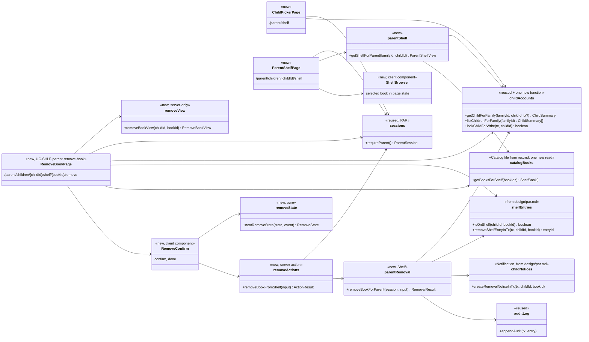
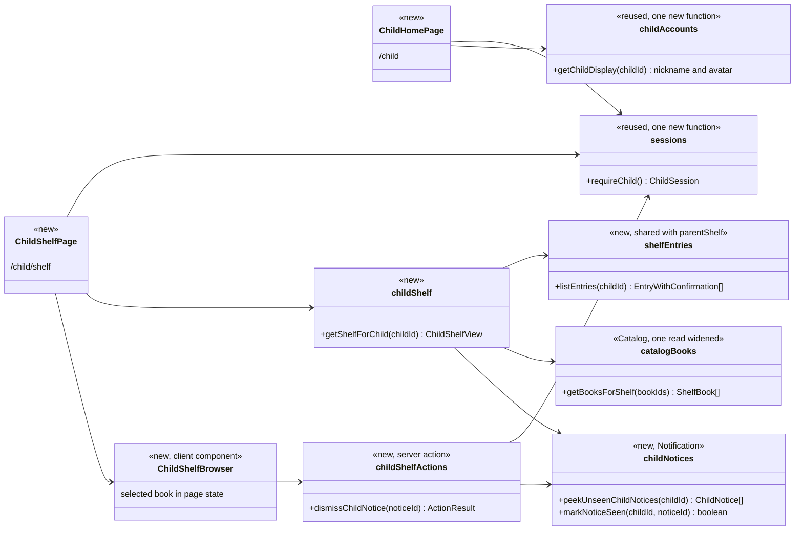
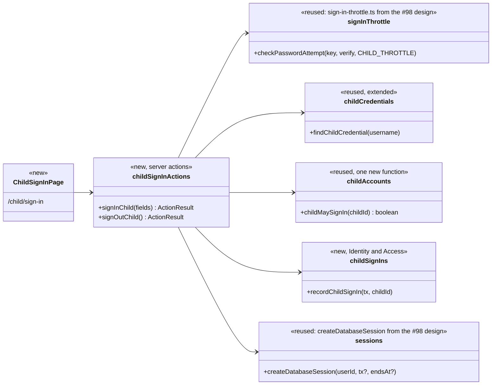
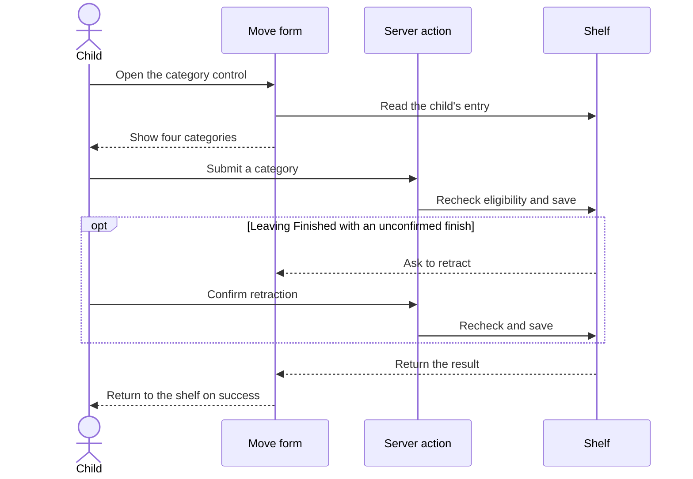
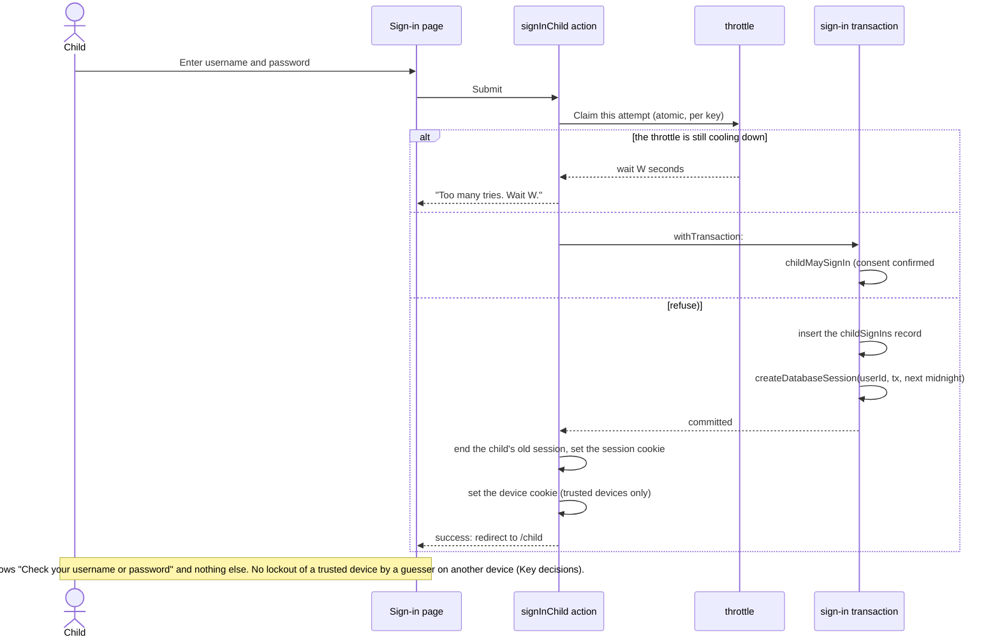

# Shelf (SHLF) Design

**Project:** BookBuddies
**Team:** Team 05
**Area:** `UC-SHLF`

> **Realizes:** `UC-SHLF-parent-view-shelf`, `UC-SHLF-kid-view-shelf`, `UC-SHLF-parent-remove-book`, `FR-SHLF-parent-remove`, `FR-PAR-review`, `FR-ACCT-credentials` (the child's sign-in half, a supporting flow with no use case, `OI-46`), `DI-usage-records` (the sign-in record)
> **Depends on:** `UC-ADM-block-content` (extension 5b: a block removes the shelf entries), `BR-parent-account-linked`, `BR-kid-no-metrics`, `BR-kid-anonymous-profile`, `BR-parent-shelf-removal`, `FR-SHLF-categories`, `FR-SHLF-finish-confirm`, `UI-kid-no-metrics`, `USE-child-first-run`, `DI-child-credentials`, `SEC-auth`, `SEC-signin-throttling`, `SEC-role-authorization`, `USE-parent-light`; for `UC-SHLF-parent-remove-book`: `BR-parent-ultimate-say`, `ROB-no-data-loss`, `OI-25`, `OI-41`, and from [`design/par.md`](par.md) (`UC-PAR-report-book`): `removeShelfEntryInTx`, `createRemovalNoticeInTx`, `lockConsentForWrite`, `getChildForFamily` with a transaction handle, and the `shelf.parent-removed` audit shape; from [`design/par.md`](par.md) (`UC-PAR-delete-kid-account`): `lockChildForWrite`, its §8.2.8 rule and `children.writeVersion`
> **Related, designed separately:** `UC-SHLF-par-finish-book`, `UC-PAR-report-book`
> **See:** [use cases, SHLF area](../docs/requirements/use-cases.md#shlf-shelf-feature-area), [specification](../docs/requirements/software-requirements-specification.md), [business rules](../docs/requirements/business-rules.md), [architecture-of-record](architectural-design.md), [PAR design](par.md)
> **Designed against:** use cases v0.24 (updated in this PR), business rules v0.8, SRS v0.12 (updated in this PR), the PAR design, and the code on `main` and the merged `design/rec.md` as of 2026-11-18 (`requireParent()` in `sessions.ts` and `getChildForFamily` in `child-accounts.ts`, both used by the add-a-child pages). The Shelf and Catalog components have no code yet, and there is no shared parent layout guard: each parent page calls `requireParent()` itself.

> **Revised for:** `UC-SHLF-kid-view-shelf` and child sign-in, 2026-11-19, against `main` at `9783e44`, which holds the merged designs of #98, #100 and #102 (designs only; no Shelf, Notification or child sign-in code exists).

> **Revised for:** `UC-SHLF-parent-remove-book`, 2026-11-24, against `main` at `8aadd95`. No Shelf, Notification or book-report code exists yet; `appendAudit` is in [`audit-log.ts`](../src/server/audit/audit-log.ts) from #108.

**Status of this draft.** The parent's shelf view was revised from PR #42 after it was reviewed against the 2026-10-28 client answers: children no longer enter free text, so reflections, flagging of reflections and the 24-hour deletion window are gone. The child's shelf and child sign-in were added and revised through two rounds of review on PR #106. The questions test (design process step 3) was run on the first version of the child's half and still needs a re-run on the current design. Parent removal (`UC-SHLF-parent-remove-book`) was added on 2026-11-24. It covers `UC-SHLF-parent-view-shelf`, `UC-SHLF-kid-view-shelf`, child sign-in and `UC-SHLF-parent-remove-book`; the other SHLF use cases are appended as each is designed.

---

## Overview

The Shelf area owns each child's shelf: the entries in four categories, the child's ratings, the parent's confirmation that a child finished a book, manual search and its shelf requests, and parent removal. It is the Shelf component of the Application container ([containers](architectural-design.md#51-containers), [use case areas and components](architectural-design.md#52-use-case-areas-and-components)). `UC-SHLF-parent-view-shelf`, the first use case designed here, is read-only: it reads one child's shelf entries, their ratings and their finish state, checks that the child belongs to the signed-in parent's family, and asks the Catalog for each book's cover and title. It never reads the Child Identity Store, so the parent picks a child by nickname and avatar. It is the entry point to `UC-SHLF-parent-remove-book`, `UC-PAR-report-book` and `UC-SHLF-par-finish-book`, which are designed separately and implement the pages that this view links to. A child's pending shelf request is not a shelf entry, so it is not shown here; the parent sees it through `UC-PAR-approve-shelf-request`. This design adds one read to the Catalog row of the architecture-of-record.

**Realizes for move-book:** `UC-SHLF-kid-move-book`. A move changes one existing shelf entry. Unconfirmed moves into Finished produce the existing parent shelf prompt. Consent follows `BR-coppa-parental-consent` and `UC-PAR-revoke-consent` POST-3.

`UC-SHLF-kid-view-shelf` is the child's side of the same shelf, and it needs a signed-in child, which **no use case covers** (`OI-46`). It is designed here as two parts that share one seam, `requireChild()`. The first is the child's shelf: a read-only view of the child's own entries, book details, own rating and pending notices, with no count of any kind (`BR-kid-no-metrics`, 8.2.11). The second is **child sign-in, sign-out and the child home screen**, written as *supporting flows with no use case*, the way `design/par.md` (open pull request #98) does for parent sign-in (`OI-44`). They live in this document and not in `par.md`: a child starts no `UC-PAR-*` use case, and it keeps this pull request away from the `par.md` edits of pull requests #98, #102, #104 and #100. The pieces this document reuses from those pull requests (`createDatabaseSession`, `sign-in-throttle.ts`, `deleteChildSignIn`, `signOutParent`) are **designs, not code**, and are named as such where used.

A parent removes one book from one child's shelf, and the child gets the same `book-removed` notice a report writes. The design adds no new storage. It builds the page the parent shelf view already links to ("Remove from shelf", in the table under API contract below) and one Shelf function that runs the removal, the notice and the audit entry in one transaction (§8.2.8 lists "a shelf removal and its notice"). Everything it writes comes from `UC-PAR-report-book`'s functions, so a plain removal and a report's removal cannot differ: the child sees the same notice, with no reason and no parent, and cannot tell which one happened. The rating and the finish confirmation are untouched (5c), because they live in their own collections (Key decisions below, "Ratings and finish confirmations are stored apart from the shelf entry").

## Components & classes



- `src/app/(parent)/parent/shelf/page.tsx` (new): the child picker (extension 1a), and the temporary entry point until a parent dashboard (`FR-PAR-dashboard`) links to the shelf. It calls `requireParent()`, then `listChildrenForFamily`. With exactly one child it redirects straight to that child's shelf, so a parent with one child takes no extra step (`USE-parent-light`, threshold still TBD). With several it lists them by nickname and avatar. With none (extension 1b, PRE-2 not met), a Main Parent is redirected to `/parent/children/new` and a Sub Parent sees a message to ask the Main Parent to add a child, as the add-a-child page does.
- `src/app/(parent)/parent/children/[childId]/shelf/page.tsx` (new): a server component, marked dynamic so it never serves a cached shelf. It calls `requireParent()` and handles the result the way `onboarding-complete/page.tsx` does: `NOT_SIGNED_IN` redirects to `/sign-in`, and any other failure (`NOT_A_PARENT`, which is what a child or admin session gets) is `notFound()`. It then calls `getShelfForParent` and passes the whole view to `ShelfBrowser`. It has no server action, because viewing changes nothing (POST-2).
- `src/app/(parent)/parent/children/[childId]/shelf/shelf-browser.tsx` (new, client component): renders the four categories in fixed order, each entry with title and author, and keeps the selected book in its own state, with no request and no URL parameter (steps 4 and 5). Every entry whose finish is confirmed carries the confirmed-finished icon in the list, in whichever category it sits. For the selected book it shows the rating if there is one, and by finish state either "Confirm finished" (a Finished entry that no parent has confirmed) or "Edit note" (any confirmed entry), as in extension 5a. For the selected book it also shows "Remove from shelf" and "Report", the controls `UC-SHLF-parent-remove-book` and `UC-PAR-report-book` start from. All four are links to the pages in the table under API contract; this view never writes (POST-2), and it sends no data to them beyond the child and book IDs in the path.
- Retry screen for extension 2b: no new file. The existing `src/app/(parent)/parent/children/error.tsx` covers every page under `/parent/children`, including this one. The picker, which sits outside that folder, has its own `error.tsx`.
- `src/server/shelf/shelf-collections.ts` (new, server-only): the names, types, validators and unique indexes of the three Shelf collections, wired into `ensureIndexes`.
- `src/server/shelf/parent-shelf.ts` (new, server-only): `getShelfForParent` checks the child's family first, then reads the child's shelf entries, ratings and finish confirmations, and the books' catalog data, and returns one complete view or throws. It never returns part of a shelf.
- `src/server/accounts-family/child-accounts.ts` (reused): `getChildForFamily(familyId, childId)` returns `{ _id, nickname, avatar }` for a child in that family and `null` otherwise (a malformed or unknown ID is also `null`, since the ID is matched as a string); it is the family check for this view. One function is added to the same file, `listChildrenForFamily(familyId)`, for the picker: same fields, ordered by creation date.
- `src/server/catalog/books.ts` (the Catalog file planned in `design/rec.md`, not yet in code; this design adds one read, server-only): `getBooksForShelf` returns the title and author of the given books that are active, one query for all the IDs. Like the Catalog's other reads it leaves out blocked books, and it leaves out drafts too. No catalog document defines a book cover, so this view has none (`OI-46`).
- `src/server/identity-access/sessions.ts` (reused): `requireParent()` returns an `ActionResult`: on success the user ID, family ID and `parentRole` (`main` or `sub`), on failure the code `NOT_SIGNED_IN` or `NOT_A_PARENT`. It does not redirect or throw, so each page decides what to do with the failure.

Added for `UC-SHLF-parent-remove-book` (all new unless marked reused):

- `src/app/(parent)/parent/children/[childId]/shelf/[bookId]/remove/page.tsx` (new): a server component, marked dynamic, at the path the parent shelf view links to. It calls `removeBookView` and renders what it returns: the redirect, `notFound()`, the 3b message ("this book is already off the shelf") with a link back to the shelf and no form, or `RemoveConfirm` with the title, the child's nickname and the path back.
- `.../remove/view.ts` (new, server-only): `removeBookView(childId, bookId)` decides on the server what the page shows, so every state is tested without rendering (as `check-email/view.ts` does for `UC-PAR-onboarding`). In order: `requireParent()` (`NOT_SIGNED_IN` is the redirect to `/sign-in`; any other failure is `notFound`), then `getChildForFamily` (another family's child, or an unknown or malformed ID, is `notFound`, the same `404` as the shelf page), then `isOnShelf`, which alone decides 3b: a book not on the shelf is the off-shelf state. Last, `getBooksForShelf([bookId])` for the title. A book on the shelf that the Catalog does not return (a draft, or a blocked book whose entry is still there) is still offered for removal, with the title "this book".
- `.../remove/remove-confirm.tsx` (new, client component): renders the steps of `remove-state.ts` and holds no rule of its own. The **confirmation** (step 3) names the book and says the child will be told it was removed. Its buttons are "Remove" and "Cancel", and "Cancel" is a link back to the shelf with no request (3a). The **result** (step 6) says the book was removed, with a link back to the shelf. Its other messages: on `SAVE_FAILED`, "Nothing was saved. Please try again."; on `OUTCOME_UNKNOWN`, "We could not confirm the removal. It may have been saved, so check the shelf before trying again.", with a link back to the shelf and no "Remove" button; on `CONSENT_NOT_CONFIRMED`, that the book cannot be removed while the family's consent is not active, with a link back to the shelf.
- `.../remove/remove-state.ts` (new, pure: no React, no server code): `nextRemoveState(state, event)`, the form's steps. "Remove" moves the confirmation to pending, and a second "Remove" while pending changes nothing, so the button is disabled. `ok` gives the result. `ALREADY_OFF_SHELF` gives the 3b message. `SAVE_FAILED` returns to the confirmation with the error, so the parent can retry (5a, `ROB-no-data-loss`). `OUTCOME_UNKNOWN` gives the check-the-shelf message (5a), from which the only way on is back to the shelf. `CONSENT_NOT_CONFIRMED` gives the consent message (5d). "Cancel" is a link, not a step.
- `.../remove/actions.ts` and `schema.ts` (new): `removeBookFromShelf`, a verb-first server action (§8.2.3), and its zod schema (§8.2.5): `childId`, `bookId`, and `confirmed`, which must be the literal `true`. Order: `requireParent()`, validate, then `removeBookForParent`. The family comes from the session, never the request.
- `src/server/shelf/parent-removal.ts` (new, server-only): `removeBookForParent(session, { childId, bookId })` runs one `withTransaction` (§8.2.8), in this order:
  1. `getChildForFamily(familyId, childId, tx)`. If it returns nothing, the result is `CHILD_NOT_FOUND`.
  2. `lockChildForWrite(tx, childId)`, because the notice is an inserting child write (§8.2.8; [`design/par.md`](par.md), `UC-PAR-delete-kid-account`). If it matches nothing, the result is `CHILD_NOT_FOUND`.
  3. `lockConsentForWrite(tx, familyId)`, as `reportBook` does ([`design/par.md`](par.md)). This comes before the shelf delete, the notice and the audit entry. If it matches nothing (consent not confirmed, or revoked), the callback throws a `CONSENT_NOT_CONFIRMED` refusal (5d), exactly as step 4 does for 3b, so the transaction aborts: nothing is written and the increment from step 2 is not kept.
  4. `removeShelfEntryInTx(tx, childId, bookId)`. If it deleted nothing, the transaction aborts with `ALREADY_OFF_SHELF` (3b) and nothing is written. On `ALREADY_OFF_SHELF` the callback throws, so the transaction aborts and the increments from steps 2 and 3 are not kept.
  5. `createRemovalNoticeInTx(tx, childId, bookId)` (step 5).
  6. `appendAudit(tx, …)` with a `shelf.parent-removed` entry in the shape `design/par.md` fixes: the parent's user ID as actor, role `parent`, the child ID, the deleted entry's ID and the book ID (§8.2.9).

  Any other error is logged through `logUnexpectedError`, and its error ID is returned. If the error that leaves `withTransaction` carries MongoDB's `UnknownTransactionCommitResult` label, the commit may have applied, and the result is `OUTCOME_UNKNOWN` (5a, save not confirmed). Every other error means the transaction did not commit, and the result is `SAVE_FAILED` (5a). The callback holds no state outside the transaction, so a rerun by `withTransaction` is harmless, as in `reportBook`.
- **Reused, defined elsewhere:** `isOnShelf` and `removeShelfEntryInTx` (`src/server/shelf/shelf-entries.ts`), `createRemovalNoticeInTx` (`src/server/notification/child-notices.ts`), `lockConsentForWrite` (`src/server/accounts-family/families.ts`), `getChildForFamily` with its transaction handle, and the `shelf.parent-removed` validator branch, all from [`design/par.md`](par.md) (`UC-PAR-report-book`); `getBooksForShelf` and `requireParent()` from this document. None of these exist in code yet except `requireParent()`, `getChildForFamily` (without the transaction handle) and `appendAudit`. Whichever of `UC-PAR-report-book` and this use case is implemented first creates them, and the other reuses them unchanged.
- **Required on `main`, not built here:** `lockChildForWrite` in `src/server/accounts-family/child-accounts.ts` ([`design/par.md`](par.md), `UC-PAR-delete-kid-account`). `UC-PAR-report-book` or `UC-PAR-delete-kid-account` builds it, whichever merges first.

### UC-SHLF-kid-move-book components

| File | Responsibility |
| --- | --- |
| `src/app/(child)/child/shelf/[bookId]/move/page.tsx`, `actions.ts`, `move-form.tsx`, `schema.ts` | Replace the placeholder with four labeled choices. Recheck the child session on submit, validate the category, and use a second form for explicit retraction. Cancel is a link to the shelf. |
| `src/server/shelf/move-book.ts`, `shelf-entries.ts`, `shelf-collections.ts` | Update the acting child's existing entry. Derive waiting from Finished plus the absence of a confirmation. Store the source category for an unconfirmed finish. |
| `src/server/catalog/books.ts` | Reuse `getBooksForShelf` for the page and allow the active-ID read to take an optional transaction. |
| Existing shelf views | Show the new category after the save and derive the existing parent finish prompt. The Rate action follows #133 and `OI-75`. |

### Child's shelf (`UC-SHLF-kid-view-shelf`)



- `src/app/(child)/child/page.tsx` (new): the **child home**, a basic landing screen. It exists because the use case's trigger ("taps My Shelf on their home screen") and child sign-in both need one. It calls `requireChild()` and `getChildDisplay`, shows the child's nickname and avatar (8.2.11), a large "My Shelf" link and a "Sign out" button, and nothing else beyond the layout's privacy notice link. The other use cases that start from the home screen (`UC-REC-recommend-quiz-rules`, `UC-SHLF-manual-search`) add their own buttons when they are designed. The reading dashboard is `UC-SHLF-kid-dashboard`, not this page.
- `src/app/(child)/child/shelf/page.tsx` (new): a server component, marked dynamic, with no caching, like the parent page. It calls `requireChild()`: `NOT_SIGNED_IN` redirects to `/child/sign-in`, and `NOT_A_CHILD` (a parent or admin session) is `notFound()`. It then calls `getShelfForChild` with the child ID **from the session**; no child ID is in the URL or the request. The page itself changes nothing; the one write on the shelf is the `dismissChildNotice` action below (POST-2).
- `src/app/(child)/child/shelf/shelf-browser.tsx` (new, client component): renders the four categories in fixed order with large tap targets, each entry with its title (no cover, see Open items), the confirmed-finished icon on every confirmed entry in any category, and a Finished entry that is not confirmed grayed out with no icon (3c). When the child taps a book it shows, from what is already loaded, the book's details, the child's own rating if there is one, and the actions the server listed for that entry (steps 4 and 5). Selection is its own state, with no request and no URL parameter. It shows each pending notice at the top with a large "OK" button (3d, 3f); tapping it calls `dismissChildNotice` and removes that notice from the screen once the call succeeds, and the notice stays until then, the "find a book" message at the top for an empty shelf (2a), a "My Dashboard" link (3e), and nothing at all under an empty category (3a).
- `src/app/(child)/child/shelf/error.tsx` (new): the retry message for extension 2b, with no shelf content and a "Try again" button.
- `src/server/shelf/child-shelf.ts` (new, server-only): `getShelfForChild(childId)` reads the entries, finish confirmations, the child's ratings, the books' catalog data and the child's unseen notices, and builds one complete view or throws. It marks nothing: a notice stays unseen until the child taps OK (`dismissChildNotice`). It never returns part of a shelf.
- `src/server/shelf/shelf-entries.ts` (new, server-only, shared): one read of a child's entries joined to their finish-confirmation state (`confirmed` is a confirmation record, whatever the category, the parent view's decision below). `getShelfForParent` is revised in place to call it, so the parent and the child view cannot disagree about which entries are confirmed.
- `src/server/catalog/books.ts` (the Catalog file, reused): `getBooksForShelf` also returns `author` and `seriesName`, for the child's book details; the parent view ignores them. `seriesName` is optional: the seed spreadsheet has a "Series name (optional)" column, empty for a book with no series, and a book with none shows no series line. It returns no cover: the Catalog has no cover field, and where covers come from is a separate decision (Open items). It keeps the Catalog's rule that every read leaves out blocked books.
- `src/server/notification/child-notices.ts` (new, server-only, Notification): `peekUnseenChildNotices(childId)` and `markNoticeSeen(childId, noticeId)`, a conditional update that sets `seenAt` only on that child's own notice where it is unset. Marking a notice that is already seen, or one that is not the child's, changes nothing. Notices are *written* by `UC-SHLF-par-finish-book` 4b, `UC-SHLF-parent-remove-book` and `UC-PAR-report-book`, none of them designed yet.
- `src/app/(child)/child/shelf/actions.ts` and `schema.ts` (new): `dismissChildNotice(noticeId)`, a verb-first server action (8.2.3). It calls `requireChild()` first, validates the ID with zod (8.2.5), takes the child ID from the session and never from the request, and calls `markNoticeSeen`. It returns `{ ok: true }` also when the notice was already seen, so a second tab's tap or a double tap is harmless; a session that has ended returns `NOT_SIGNED_IN` and the notice stays.
- `src/app/(child)/child/layout.tsx`, `keep-alive.tsx` (client) and `actions.ts` (new): every child page loads a small client component that calls `keepChildSessionAlive({ active })` every `CHILD_KEEPALIVE_SECONDS`, where `active` is true if the child tapped, pressed a key or scrolled since the last call. The action calls `requireChild({ countsAsActivity: false })` first, which sets `lastSeenAt` on the caller's own `childSessionEnds` record, validates the body with zod (8.2.5), sets `lastActiveAt` too when `active` is true, and returns `{ ok: true }`; if the session has ended it returns `NOT_SIGNED_IN` and the client redirects to `/child/sign-in`, as it does on `NOT_A_CHILD` (the browser has since signed in as someone else). It returns nothing else and logs nothing about the child (8.2.7). The client sends nothing from the sign-in page. The layout is dynamic and also links the privacy notice on every child page, because the link belongs on the child's home screen and wherever information is collected from a child (`BR-coppa-notice`).
- `src/app/(child)/child/error.tsx` (new): the calm retry screen for every child page (8.2.1).
- `src/server/accounts-family/child-accounts.ts` (reused): `getChildDisplay(childId)` returns `{ nickname, avatar }` and nothing else, so it is safe for a child session to call (8.2.11).
- `src/server/identity-access/sessions.ts` (reused, one new function): `requireChild()` returns `{ userId, childId, sessionId }` from the `users` document with role `child` and the session document the request's own cookie names (`sessionId` stays on the server), or `NOT_SIGNED_IN` / `NOT_A_CHILD`. Every accepted call counts as activity unless the caller passes `countsAsActivity: false`, which the keep-alive uses. A child session is `NOT_SIGNED_IN` once the child has been inactive for `CHILD_IDLE_MINUTES` (`lastActiveAt`), and once `endsAt` has passed and the visit has ended, meaning `lastSeenAt` is older than the grace (Key decisions). A child session with no `childSessionEnds` record is refused and deleted. It does not redirect or throw. A parent session gets `NOT_A_CHILD`; a child session already gets `NOT_A_PARENT` from `requireParent()`. `endCurrentSession()`, which sign-out uses, also deletes the session's record, in one transaction.
- `src/server/identity-access/child-sessions.ts` (new, server-only): owns `childSessionEnds` and states the end rules once: it writes the record, checks and refreshes it on each read, and deletes an ended session with its record in one transaction.

### Child sign-in and sign-out (supporting flows, no use case, `OI-46`)



- `src/app/(child)/child/sign-in/page.tsx`, `sign-in-form.tsx`, `actions.ts`, `schema.ts` (new): the form (username and password, large fields, no link to any parent page) and `signInChild`; one zod schema serves form and action (8.2.5). `signOutChild` deletes the caller's own session document, clears the cookie and redirects to `/child/sign-in`, as `signOutParent` does in the #98 design. A signed-in child who opens the sign-in page is redirected to `/child`. The "Sign out" button is on `/child`.
- `src/server/identity-access/child-credentials.ts` (reused, extended): `findChildCredential(username)` returns the user ID, child ID and password hash and nothing else. It trims and lowercases the typed username and matches it exactly, because the parent's entry is stored trimmed and lowercased with a unique index (`design/par.md`, Key decisions), so the child's capitals never matter. `deleteChildSignIn` (pull request #104 named it and was closed, so this design states what it must do) also deletes the child's `childSignIns` records and all the child's throttle state (every key that starts `child:`, the lowercased username and a colon).
- `src/server/identity-access/sign-in-throttle.ts` (reused from the #98 design, server-only): counts failed sign-ins per key and returns how long the caller must wait (`SEC-signin-throttling`). A child's attempt goes through the same `checkPasswordAttempt(key, verify, policy)` as a parent's, with the child's policy (`CHILD_THROTTLE`): it claims the attempt with one atomic conditional update before the password is checked, so parallel guesses cannot all pass a check made before any of them is counted (Key decisions). A child's attempt is counted under one of two keys, chosen by whether the caller is a trusted device for that username (below). A trusted device's key is `child:<username>:dev:<hash of its device ID>`. Every other caller shares the account's key, `child:<username>:shared`. The username is lowercased, and neither key can meet a parent's email key. So a guesser's failures only ever count against the shared key, and never make a trusted device wait.
- `src/server/identity-access/child-sign-in.ts` (new, server-only): `signInChildAccount(username, password)` runs "Child signs in" up to the commit. The action then ends the old session and sets both cookies.
- `src/server/identity-access/device-token.ts` (new, server-only): issues and reads the `child_device` cookie that marks a trusted device (httpOnly, Secure, SameSite=Lax). The cookie holds one entry for the current device. It is written only on a successful sign-in and read only by the throttle, and it is never logged, so the log keeps no link from a device to an account. Rejected: putting the device ID in the throttle key itself, which would log a persistent identifier with every failure.
- The sign-in transaction, in one `withTransaction`: check consent via `childMaySignIn`, insert the `childSignIns` record (§8.2.10's sign-in record), and create the session with `createDatabaseSession(userId, tx, endsAt)` where `endsAt` is the child's next midnight in its configured time zone. Then, outside the transaction, `endCurrentSession()` for the child's old session (a sign-in ends the previous visit), and set both cookies: the session cookie and, when the caller is a trusted device, the device cookie. A failed password never writes any of these.
- **Consent and COPPA on sign-in:** `childMaySignIn` refuses when consent is not confirmed, so a revoked child cannot sign in at all (5d of child sign-in is a design-only flow, `OI-46`). The form shows the privacy notice link with its own version, because sign-in collects a sign-in record (`DI-usage-records`) and, on a trusted device, a device cookie (`OI-49`). No other personal information is collected on this page.

## Sequence

### UC-SHLF-parent-view-shelf: view a child's shelf and ratings

```mermaid
sequenceDiagram
    actor P as Parent
    participant UI as Parent shelf page
    participant PS as getShelfForParent
    participant CA as child-accounts
    participant SE as shelf entries
    participant CATALOG as Catalog
    P->>UI: Open the child's shelf (from the picker)
    UI->>CA: Check the child belongs to the family
    alt wrong family, unknown or malformed child (1a)
        CA-->>UI: Nothing
        UI-->>P: 404, as the shelf page itself
    else
        UI->>PS: Read the whole shelf
        PS->>SE: The child's entries, their ratings and finish confirmations
        PS->>CATALOG: The books' active status and titles
        PS-->>UI: One complete view, or a read error
        alt a read fails (2b)
            UI->>UI: error.tsx shows the retry message
            P->>UI: Tap Try again
        else
            UI-->>P: Four categories in order; entries with title, author, rating and finish state; notices
            P->>UI: Tap a book (4, 5)
            UI-->>P: From what is loaded: rating, Confirm finished or Edit note, Remove from shelf, Report
            P->>UI: Tap a link out (6)
            UI-->>P: Leave; the next load is fresh (POST-2, 3)
        end
    end
```

Step 4 needs no second request: the page already holds every entry's details, rating and allowed actions. Extension 3b needs no code here, as in the parent view: the block removed the entry and nobody is told.

### UC-SHLF-kid-view-shelf: view the child's own shelf

```mermaid
sequenceDiagram
    actor C as Child
    participant UI as Child shelf page
    participant IA as Identity
    participant CS as getShelfForChild
    participant ACT2 as dismissChildNotice
    C->>UI: Open My Shelf on the home screen
    UI->>IA: requireChild()
    alt no session (PRE-1, OI-46)
        UI-->>C: /child/sign-in
    else a parent or admin session
        UI-->>C: 404, the shared not-found page
    else a child session
        UI->>CS: Read the child's own shelf (from the session)
        CS-->>UI: One complete view, or a read error
        alt a read fails (2b)
            UI->>UI: error.tsx shows the retry message
            C->>UI: Tap Try again
        else
            UI-->>C: Four categories; entries with title, author, own rating, pending notices; find-a-book message when empty (2a, 3a)
            C->>UI: Tap OK on a notice (3d, 3f)
            UI->>ACT2: dismissChildNotice(noticeId)
            ACT2->>IA: requireChild()
            alt session ended
                ACT2-->>UI: NOT_SIGNED_IN; the page goes to /child/sign-in; the notice stays
            else
                ACT2->>ACT2: markNoticeSeen (conditional, own notice only)
                ACT2-->>UI: ok; the notice is gone and the shelf is reloaded
            end
            C->>UI: Tap a book (step 4)
            UI-->>C: Details, own rating if any, move, remove, and rate only for a confirmed Finished entry (step 5, 5a; OI-75)
            opt the child taps OK on a notice (3d, 3f)
                UI->>ACT2: dismissChildNotice(noticeId)
                ACT2->>IA: requireChild()
                ACT2->>ACT2: markNoticeSeen (own notice only)
                ACT2-->>UI: ok; the shelf reloads without the notice
            end
        end
    end
```

Selecting a book sends no request (5): the details come from what the page already loaded. A blocked book is simply not in the view (3b); a removed book is on its next load (POST-2). The "find a book" message and empty categories are part of the same read (2a, 3a).

### UC-SHLF-parent-remove-book: remove a book from a child's shelf

```mermaid
sequenceDiagram
    actor P as Parent
    participant UI as Remove page
    participant CA as child-accounts
    participant RM as removeBookForParent
    participant DB as one transaction
    P->>UI: Open the remove page for a book on the shelf
    UI->>CA: Child in this family? (else 404)
    UI->>UI: Is the book on the shelf? (3b: no, show the off-shelf message)
    UI-->>P: The confirmation names the book; the child will be told
    P->>UI: Tap Remove (second tap while pending changes nothing)
    UI->>RM: removeBookForParent, session childId and bookId
    RM->>DB: One transaction:
    DB->>DB: family check, then lock the child for write
    DB->>DB: lock the family's consent
    DB->>DB: delete the shelf entry (nothing: abort, ALREADY_OFF_SHELF)
    DB->>DB: write the book-removed child notice
    DB->>DB: audit entry (shelf.parent-removed)
    alt consent not confirmed or revoked (5d)
        DB-->>RM: aborts; nothing written
        RM-->>UI: CONSENT_NOT_CONFIRMED; the book stays
    else a known failure (5a)
        RM-->>UI: SAVE_FAILED; retry possible
    else unknown commit (5a)
        RM-->>UI: OUTCOME_UNKNOWN; check the shelf before retrying
    else success
        RM-->>UI: ok
        UI-->>P: The result: the book was removed
    end
    P->>UI: Back to the shelf
    Note over P,UI: The child sees the notice on their next load, until they tap OK (5)
```

The audit append is the only interaction with no use case step; §8.2.9 requires one for every parent shelf removal. Extension 5b needs nothing here: a notice has no expiry, and the child's shelf shows it until the child taps OK (`dismissChildNotice`, above).

### UC-SHLF-kid-move-book: move a book between categories



### Supporting flows with no use case (`OI-46`): child sign-in and sign-out

These are **not steps of `UC-SHLF-kid-view-shelf`**; its PRE-1 assumes them. The developer chose (2026-11-19) to design them here.



Sign-out (`signOutChild`): delete the caller's own session document and its `childSessionEnds` record in one transaction, clear the session cookie and redirect to `/child/sign-in`. It does not delete the device cookie, so the device stays trusted (Key decisions).

## API contract

### UC-SHLF-parent-view-shelf

This use case reads: its rows are pages and the server function behind them (8.2.3's "no HTTP route" applies to the write actions of other use cases; a page that only reads is a page). Errors use the §8.2.1 shape. Messages are short and written for a parent, and safe: no internal ID, no stack trace, no database detail (8.2.7, 8.2.12).

| Page or function | Who may | Request | Success | Errors, by extension |
| --- | --- | --- | --- | --- |
| `/parent/shelf` | A signed-in parent; the child is a parameter | `childId` (a child ID) | With one child: a redirect to that child's shelf. With several: the children by nickname and avatar, each linking to their shelf. With none: a Main Parent is sent to add a child; a Sub Parent sees a message (1b) | No session: redirect to `/sign-in`. A child or admin session: `404` |
| `/parent/children/[childId]/shelf` | A signed-in parent; the child must be in the parent's family | `childId` from the path, checked against the session's family | `getShelfForParent`'s view: the four categories in order, each entry with its `bookId`, title, rating (the four words or none) and whether its finish is confirmed; the notices of the removed books are not here, they are the child's | 1a: another family's child, or an unknown or malformed ID: `404`, the same as no shelf. 2b: any failed read: `500`, the `error.tsx` retry screen, no partial shelf |
| `getShelfForParent(familyId, childId)` in `src/server/shelf/parent-shelf.ts` | Only the page above | The family ID from the session, the child ID from the path | The one complete view | Throws on any failed read (2b); marks nothing |

The view's rating is the word the child saved, or nothing. Its confirmation state is a record in `finishConfirmations` (below), so a confirmed book keeps its state and its icon in whatever category it sits in (5a). "Confirm finished" is a link to the page of `UC-SHLF-par-finish-book`, and "Edit note" to `UC-PAR-note-finished-book`; both are in that pull request's design, not this one.

### UC-SHLF-parent-remove-book

| Page or function | Who may | Request | Success | Errors, by extension |
| --- | --- | --- | --- | --- |
| `/parent/children/[childId]/shelf/[bookId]/remove` | A signed-in parent; the child in the parent's family | `childId`, `bookId` from the path | The confirmation names the book and says the child will be told; "Remove" and "Cancel" (a link, no request) | 1a: not in the family, unknown or malformed: `404`, as the shelf page. 3b: the book is not on the shelf: the off-shelf message and a link back, no form |
| `removeBookFromShelf(input)` in the page's `actions.ts` | A signed-in parent | `childId`, `bookId`, `confirmed: true` (zod; the family from the session, never the request) | `ok`: the result page says the book was removed, with a link back to the shelf | 3a: `ALREADY_OFF_SHELF`, the off-shelf message. 5a: `SAVE_FAILED` (retry) or `OUTCOME_UNKNOWN` (check the shelf first). 5d: `CONSENT_NOT_CONFIRMED` (the book stays). No session or not a parent: the existing codes; no message says which parent removed the book |

No response says which parent removed a book or why. The child's notice holds the title when the Catalog still returns the book, and not when the book was removed from the Catalog by then (3b, 5).

### UC-SHLF-kid-view-shelf

This use case reads: its rows are pages and the server function behind them (8.2.3's "no HTTP route" applies to the write actions of other use cases; a page that only reads is a page). Errors use the §8.2.1 shape. Messages are short and written for a child, and safe: no internal ID, no stack trace, no database detail (8.2.7, 8.2.12).

| Endpoint or job | Caller (who may) | Request | Success | Errors, by extension |
|---|---|---|---|---|
| Page `/child` | A signed-in child | None | The child's nickname and avatar, a "My Shelf" link and "Sign out", with the privacy notice link every child page has | No session: redirect to `/child/sign-in`. A parent or admin session: `404` |
| Page `/child/shelf` (UC-SHLF-kid-view-shelf) | A signed-in child; the child is the session's, never a parameter | None | The four categories in fixed order, entries most recently moved first. Per entry: `bookId`, `title`, `author`, `seriesName` (or none), `category`, `confirmed`, `rating` (one of four words, or none) and `actions`: `move` and `remove`, plus `rate` only when the entry is confirmed and in Finished (`OI-75`); an entry awaiting confirmation (3c) has `move` and `remove`, and either one cancels the parent's pending request. Plus `notices` (kind and, for a removal, the title) and a `showFindBookMessage` flag | 2a: all four categories still show, with the flag set, not an error. 2b: the `error.tsx` retry screen, no shelf content. 3a: an empty category has its heading and nothing else. 3c: a Finished entry that is not confirmed has `confirmed` false and no `rate`. 3d, 3f: a notice shows on every load until the child taps OK, then never. 3b: a blocked book is absent. 5a: `rate` is not in `actions` for an unconfirmed entry or one outside Finished. No session: redirect to `/child/sign-in`. A parent or admin session: `404` |
| `getShelfForChild(childId)` in Shelf | Only the page above | The child ID from the session | One complete view | Throws on any failed read (2b); marks nothing |
| `dismissChildNotice(noticeId)` in `src/app/(child)/child/shelf/actions.ts` | A signed-in child; the child is the session's | `noticeId` (zod: a notice ID) | `{ ok: true }`, also when the notice was already seen | `NOT_SIGNED_IN`: the session ended, the notice stays. `NOT_A_CHILD`: a parent or admin session. `INVALID_NOTICE`: not a notice ID. `DISMISS_FAILED`: an unexpected failure, and the notice stays. A notice that is not the child's changes nothing and returns `{ ok: true }`, so the response does not show whether it exists |

The page sends no data to any of these: the child is the session's. A blocked book is absent without any message (3b), and a removed book is absent on the next load (POST-2). Selecting a book makes no request (5), and no response of this use case carries a count, total or percentage (`BR-kid-no-metrics`, `UI-kid-no-metrics`).

### Child sign-in and sign-out (`OI-46`)

| Endpoint | Who may | Request | Success | Errors |
| --- | --- | --- | --- | --- |
| `POST /child/sign-in` (the page's form action) | Anyone; the throttle counts only this page | `username` (trimmed, at most 20 characters), `password` (at most 128 characters), both through one zod schema | Redirect to `/child`; the session cookie and, on a trusted device, the device cookie are set | Wrong credentials or not yet confirmed consent: the same message, "Check your username or password." (the child is never told the reason). The throttle's wait: "Too many tries. Wait W seconds." No sign-in record, no session, no cookie is written on a failure |
| `signOutChild()` | A signed-in child | None | The child's own session and its `childSessionEnds` record are deleted, the session cookie is cleared, redirect to `/child/sign-in`. The device cookie is kept | `NOT_SIGNED_IN`: redirect to `/child/sign-in`, nothing deleted |

`keepChildSessionAlive({ active })`, called by the client keep-alive on every child page every `CHILD_KEEPALIVE_SECONDS`: validates its body with zod, refreshes `lastSeenAt` and, when `active`, `lastActiveAt` on the caller's own record, and returns `{ ok: true }`. `NOT_SIGNED_IN` and `NOT_A_CHILD` redirect the page to `/child/sign-in`; the record and the notice stay. It writes no log line about the child (8.2.7).

### UC-SHLF-kid-move-book

| Entry point | Request and response |
| --- | --- |
| `GET /child/shelf/[bookId]/move` | Child session, confirmed family consent, active Catalog book and own shelf entry. Show the title and current category with all four choices. An unavailable book or missing entry shows a way back to the shelf. |
| `moveBook(childSession, input)` | The action calls `requireChild()` before parsing. Strict input is `bookId` (UUID), `category` (one of `SHELF_CATEGORIES`) and optional `retractConfirmed` (boolean). Returns `ActionResult`: `moved` or `unchanged` with derived awaiting state, or `retraction-required`. The shelf displays fixed status messages. |

| Refusal | Outcome |
| --- | --- |
| No session or wrong role | Existing `requireChild()` errors. |
| Child disappears after the session check | `CHILD_NOT_FOUND`, as in #133. |
| Consent missing or revoked | `CONSENT_NOT_CONFIRMED`. |
| Invalid input or category | `INVALID_INPUT` or `INVALID_CATEGORY`. |
| Book missing or inactive, or own shelf entry missing | `BOOK_NOT_FOUND` or `NOT_ON_SHELF` (2a). |
| Known failure or unknown commit | `SAVE_FAILED` says the move was not saved. An error labelled `UnknownTransactionCommitResult` after the driver's retries returns `OUTCOME_UNKNOWN`, with no automatic retry, and asks the child to check their shelf before retrying (5a). Both use a safe error ID. |

For 3c, the first submission writes nothing and asks, “Your parent hasn't confirmed this yet. Do you want to retract your completion?” **Retract completion** resubmits the same target with `retractConfirmed: true`. **Cancel** leaves the book in Finished.

### Supporting flows (`OI-46`): child sign-in and sign-out

| Endpoint | Request | Success | Errors |
| --- | --- | --- | --- |
| `POST /child/sign-in` | username (20 characters), password (128 characters), one zod schema | Redirect to `/child`; session cookie; device cookie only on a trusted device | One message for wrong password and unconfirmed consent; the throttle's wait message. No record, session or cookie on failure |
| `signOutChild()` | none | Own session and `childSessionEnds` deleted; cookie cleared; redirect to `/child/sign-in`; device cookie kept | `NOT_SIGNED_IN`: redirect, nothing deleted |
| `keepChildSessionAlive({ active })` | one flag, zod | `{ ok: true }` after the record is refreshed | `NOT_SIGNED_IN`, `NOT_A_CHILD`: the page goes to `/child/sign-in`; the record stays |

## Key decisions

**Ratings and finish confirmations are stored apart from the shelf entry.** The entry's document holds only `childId`, `bookId`, `category`, `movedAt`, `previousCategory` (new, below) and `writeVersion`. The rating and the confirmation live in their own collections. A parent's removal, a block's 5b and a child's own deletion delete the entry and leave the rating and the confirmation behind: they are kept so that a later re-add can show the child's own rating and so the confirmation's rule (a confirmed book keeps its state in any category) can be told from an unconfirmed one. The child's view joins the two on read; the parent's view does the same join, so neither view can be wrong on its own. The confirmation's record holds the book, the time and the parent's user ID and nothing else (`OI-41`'s visibility rule reads it, but the use case's Associated Information says "none", so this is the team's provisional reading: the record exists, only its contents are not shown).

**The four categories are closed and ordered.** The order is Reading Now, Want to Read, Maybe Later, Finished, in both views and in the form (POST-3). "Waiting" is not a category: it is derived, `category === "finished"` with no confirmation record, so a move out of a pending Finished and a move into a confirmed Finished have the same lifetime. The `movedAt` timestamp is set by the server's `now()` and is the order of the entries (POST-2: entries most recently moved first). No user-supplied timestamp or ordering field is accepted (8.2.2, 8.2.3).

**The move-book write is one transaction that touches only the acting child's own entry.** In `withTransaction`, after the session's child is re-checked and the family's consent is confirmed: take the child's write lock (`lockChildForWrite`, shared with removal and deletion), resolve the family on the same transaction and take the consent lock (`lockConsentForWrite`, shared with revocation), read the entry and its confirmation, apply the transition (category, `movedAt`, and `previousCategory` only where the finish rule needs it), and update by entry ID plus the observed category. A same-category submit or Cancel writes nothing. No Catalog write lock is taken for an ordinary move: the move only writes the acting child's own shelf entry, so it cannot put a book in front of the child (`OI-58` does not apply). The block race is protected by the shared shelf-entry write and by a fresh active-book read in the transaction; a draft is hidden on the next read.

**The move writes no child notice and no parent notification.** Ordinary moves, confirmed moves and 3c retractions are parent-silent: the use case's closing "The system does not send a notice" stands. Its only exception is an unconfirmed move into Finished (step 6): it produces the existing parent shelf prompt, which is the `UC-SHLF-par-finish-book` flow and not a new notification. Parent removal keeps its own `book-removed` notice, as designed above.

**A notice is marked seen when the child taps OK on it, and not when the shelf loads** (developer, 2026-11-20, reviewer item 10 of #106). Loading the shelf marks nothing, so a prefetch, an aborted navigation or a failed read (2b) cannot use up a notice the child never saw. The notice shows on every load until the child taps OK, then never again. `dismissChildNotice` is a conditional update scoped to the child's own notice and is idempotent, so two tabs or a double tap are harmless: both tabs show the notice until one is tapped, and the other's tap changes nothing. Rejected: marking on read, which was the reviewer's objection; and showing the notice once per load, which loses it on a crash. Accepted: a child who never taps sees the notice on every visit, and two tabs open at once both show it. A tap after the child's session has ended is refused and the notice stays for the next sign-in.

**The server lists each entry's actions.** `rate` is in `actions` only when the entry is confirmed and in Finished (`UC-SHLF-kid-rate-book` PRE-2/PRE-3 and `OI-75`), because 5a says the action is not offered. The action pages check the state themselves (their own use cases). Rejected: the client deriving it from `confirmed` and `category`, which would put a rule in two places.

**An entry awaiting confirmation can still be moved or removed by the child, and doing so cancels the parent's request** (developer, 2026-11-19). The child's `actions` list `move` and `remove` for every entry. `UC-SHLF-kid-move-book` and `UC-SHLF-kid-remove-book` clear the awaiting state. `UC-SHLF-par-finish-book` must make its save conditional on the entry still being in Finished and awaiting, and when it is not, even after the parent tapped "Confirm finished" or "Not finished yet", show the parent a message that the child moved or removed the book, which cancelled the request (`UC-SHLF-par-finish-book` 1a is edited to say so). This view only lists the actions; the rest belongs to those designs. Rejected: withholding `move` and `remove` on an awaiting entry, which would stop a child retracting a completion (`UC-SHLF-kid-move-book` 3c).

### UC-SHLF-kid-move-book

| Choice | Result |
| --- | --- |
| Same category (3a) or Cancel (3b) | No entry, confirmation, rating, notice or lock writes; `movedAt` and `previousCategory` stay unchanged. |
| Move between ordinary categories | Update the category and `movedAt`. Clear `previousCategory`. |
| Move an unconfirmed book into Finished (6) | Record the source category and set Finished. Show waiting text on the grayed-out entry. The parent shelf shows **Confirm finished** on its next read. |
| Move out of pending Finished (3c) | Require explicit retraction, then change the category and clear `previousCategory`. The parent's prompt disappears on the next read. The parent finish action must re-check that the entry is still awaiting confirmation. |
| Move a confirmed book (3d, 6a) | Clear `previousCategory`; keep the confirmation, icon and stored rating in all categories. Offer **Rate** in Finished only, following the proposal in #133 (`OI-75`). |

Check family consent before reading shelf data. In `withTransaction`, read the active book, the acting child's entry and its confirmation. Return no-ops and retraction prompts before taking write locks. For a save, take `lockChildForWrite`, resolve the family in the transaction and take `lockConsentForWrite`. Update by entry ID, child ID, book ID and observed category using `now()`. Retries re-read state, and a refusal aborts the transaction.

OI-58 requires a Catalog write lock for writes that put a new book in front of a child; moving an existing shelf entry does not, so this design takes none. The transaction freshly reads active status and conditionally updates the same shelf entry that `UC-ADM-block-content` deletes in its transaction. Those writes conflict, and the callback retry re-reads active status: block-first returns `BOOK_NOT_FOUND`, while a move committed first is removed by the later block. If the book returns to draft after the active read, the next shelf read hides it. The pending finish prompt is derived on read, and ordinary moves create no parent notice.

Parent removal shares the child lock and also writes the shelf entry. Removal-first returns `NOT_ON_SHELF`; move-first may succeed before removal deletes the entry, leaving no prompt and exactly removal's normal `book-removed` notice. A final unknown commit is never reported as a certain failure: the child checks the shelf, and a same-target retry is a no-op if the move committed or performs the move once if it did not.

### UC-SHLF-parent-remove-book

**The remove page re-checks the family and the shelf before showing the confirmation** (extension 1a's `404`, 3b's off-shelf message). The transaction then re-checks both under locks, so a removal that loses a race aborts instead of writing half a removal.

**One transaction, the consent lock before the delete.** §8.2.8 lists the child's family's consent and the child's shelf as one unit, and `UC-PAR-report-book`'s `reportBook` already fixes the order: the consent lock comes before the entry delete, so a revocation that wins the race aborts the whole transaction and no notice and no audit entry are written either. The same order is kept here, so a plain removal and a report's removal cannot differ on this. Rejected: the delete first, which would leave a notice for a consent that was already gone.

**The notice and the removal are one write, so there is no "removed but the child never sees it".** The notice is `book-removed` with the title when the Catalog still returns the book, and without it when the book was removed from the Catalog before the notice was read (extension 5's "no title" half). No second job, no retry queue: the child's next load shows it.

**`ALREADY_OFF_SHELF` is an outcome, not an error the parent should fix.** The transaction's delete matches nothing, and the page says the book is already off the shelf. Nothing is written, including the child's lock increment from the family check, because the callback throws.

**The parent's identity is never in the notice, the page or the response** (5d, and §8.2.7: a child must not be told which parent removed what). The audit entry has it, and only there.

### UC-SHLF-kid-view-shelf

**The child's shelf is one read that joins entries, ratings, confirmations, the Catalog and the child's own unseen notices, and it marks nothing.** Every write the child's shelf can cause is the `dismissChildNotice` action below; loading, selecting and opening a book change no stored state (POST-2). Rejected: marking notices seen on load, which the review of #106 rejected (reviewer item 10): a prefetch or an aborted navigation would use up a notice the child never saw.

**The child is always the session's.** No page of this use case accepts a child ID in the URL or the request (8.2.3, and the parent view's own decision). `getShelfForChild` takes it from the session after `requireChild()`. A forged or guessed `childId` cannot reach a read.

**A blocked book is not shown, and not named.** The Catalog read leaves it out, as every Catalog read does, so the child's shelf simply does not contain it (3b). No "this book was taken away" message: the use case says the child is not told, and naming it would say which. Rejected: a placeholder with the title, which would contradict 3b.

**The rating shows when the entry is on the shelf, whatever the category.** `BR-kid-no-metrics` and `UI-kid-no-metrics` forbid counts, totals, percentages and streaks; the four-word rating the child chose is their own data (Associated Information: "the child's own rating, if any"). `OI-41` (the rating's visibility, client) is provisionally read as: shown on any entry still on the shelf, hidden once the entry is removed or the book is blocked. If the client says otherwise, this rule and its tests change together.

**Empty means all four categories still show.** 2a and 3a: the find-a-book message is on top, the four headings are there, and nothing sits under them. Rejected: collapsing an empty category, which would make the shelf's shape change as the child moves books.

**The notices are the child's own and unseen only.** `peekUnseenChildNotices` reads the child's `childNotices` with `seenAt` unset, most recent first. A removal notice carries its title when the Catalog returns the book (the same read the entries use), and not when it was removed from the Catalog by then (5, extension 5b of `UC-SHLF-parent-remove-book`'s notice rule). A `finish-declined` notice is written by `UC-SHLF-par-finish-book` 4b when that use case is built; this view only shows it.

**`dismissChildNotice` is conditional and idempotent.** The update matches the child's own notice ID with `seenAt` unset and sets it to `now()` (8.2.2). A double tap, two tabs, or a notice that was already dismissed changes nothing and returns `{ ok: true }`, so the client does not learn whether the notice existed. The action calls `requireChild()` first: a session that ended since the page loaded is `NOT_SIGNED_IN` and the notice stays for the next sign-in.

**The home screen is the child's, and it shows nothing about reading.** No counts, no "3 books on your shelf" (2a, `BR-kid-no-metrics`, `UI-kid-no-metrics`). The nickname and avatar come from `getChildDisplay`, which returns exactly those two fields and nothing the log or a response would carry (8.2.11). The "My Dashboard" link (3e) goes to `/child/dashboard`, which is `UC-SHLF-kid-dashboard`, designed separately; it is not this page.

### Child sign-in and sign-out (`OI-46`)

**The session is the child's, and only the child's.** `requireChild()` is the child's half of `requireParent()`: the same `sessions` document, the same family check shape, the role `child` instead of `parent`, and a failure of `NOT_A_CHILD` where the parent's is `NOT_A_PARENT`. It returns the user ID and the child ID and nothing the log would carry (8.2.11). Rejected: one `requireUser()` with a role switch, which would put the parent's family check on a child's path and log a role the child's page does not need.

**The child's session ends at the next midnight, not after a fixed lifetime.** `createDatabaseSession` gains an optional `endsAt`: the child's next local midnight in its configured time zone (`OI-48`). The session document's own `expires` is still the #98 lifetime, and the rule is the earlier of the two; the `childSessionEnds` record (below) says when the visit ends. Rejected: a shorter idle-only expiry, which would sign a child out mid-read and make the midnight rule a fiction.

**`childSessionEnds` is one record per visit, and the keep-alive is the only thing that refreshes it.** The record holds `lastSeenAt` and `lastActiveAt`. Every accepted `requireChild` and every `keepChildSessionAlive` refresh `lastSeenAt`; only a `keepChildSessionAlive` with `active` refreshes `lastActiveAt` (a tap, a key, a scroll). The visit ends when `lastActiveAt` is older than `CHILD_IDLE_MINUTES` (inactivity), or when `lastSeenAt` is older than the grace after `endsAt` (the midnight has passed and the child is no longer pinging). Rejected: a timer on the server, which would hold a session open in memory; and ending on `lastSeenAt` alone, which would sign a reading child out while the page is open.

**An ended session is deleted with its record, in one transaction.** `signOutChild` and the cleanup of an ended session both delete the session document and its `childSessionEnds` record together (§8.2.8: a session and its end record are one unit). A `requireChild` that finds its record gone refuses and deletes the orphan session (8.2.3: no caller may trust a session the end rules no longer hold). Rejected: keeping the record for an audit, which would put a child's visit times in a log §8.2.7 does not allow.

**Sign-in counts the attempts per key, and the keys are the device's or the shared one.** `checkPasswordAttempt` (settled on `main` by #130) claims the attempt with one atomic conditional update before the password is checked. A trusted device's key is `child:<username>:dev:<hash of its device ID>`; every other caller shares `child:<username>:shared` (Key decisions, `OI-49`). So a guesser on another device only ever makes the shared key wait, and never the trusted device. The device cookie is httpOnly and its value is a hash, never the raw ID, and it is never logged. Rejected: one key per username, which a guesser could use to lock a trusted device out of its own account.

**Consent is the gate, not a field on the session.** `childMaySignIn` reads the child and the family's confirmed consent on the sign-in transaction, so a revocation that commits before the sign-in refuses it and writes nothing. A child who is already signed in when consent is revoked keeps their open session until its end rules close it; the revocation's own use case (`UC-PAR-revoke-consent`) is what ends child sessions, and this design leaves the seam: anything that ends a child's sessions deletes the session's `childSessionEnds` record. Rejected: checking consent on every request, which would make a revocation race the keep-alive.

## Data model

The three Shelf collections are new here (the parent removal adds none; it reuses the report's):

| Collection | Document | Used by |
| --- | --- | --- |
| `shelfEntries` | `{ _id, childId (string), bookId (string), category ("readingNow" / "wantToRead" / "maybeLater" / "finished"), movedAt (date, server's now()), previousCategory ("readingNow" / "wantToRead" / "maybeLater", new, optional), writeVersion (int, the §8.2.8 lock) }` | This view and the remove; unique on (`childId`, `bookId`) |
| `ratings` | `{ _id, childId (string), bookId (string), value ("lovedIt" / "likedIt" / "okay" / "notForMe"), ratedAt (date, server's now()) }` | This view's join; unique on (`childId`, `bookId`) |
| `finishConfirmations` | `{ _id, childId (string), bookId (string), confirmedAt (date, server's now()), confirmedBy (a parent user ID) }` | This view's join; unique on (`childId`, `bookId`, `confirmedAt`), so a re-confirmation after a re-move keeps both |

The `childNotices` collection is Notification's, designed with `UC-PAR-report-book` (`design/par.md`): `{ _id, childId, kind ("book-removed" / "finish-declined" / …), title (string, optional), seenAt (date, optional), createdAt }`. This view reads its unseen rows and `dismissChildNotice` writes `seenAt`; it adds no kind.

`shelfEntries.previousCategory` is new for `UC-SHLF-kid-move-book`: it is optional, and it holds only a non-Finished source category. It is set when an unconfirmed book moves into Finished, so the parent's decline can put it back where it was (declined moves, not retractions, restore it; `UC-SHLF-par-finish-book`). A confirmed book moved into Finished keeps no `previousCategory`, and a move out of Finished clears it. It is read only by the parent's finish flow and by this use case's retraction; the child's view does not show it. The index is unchanged, and adding the optional field is a no-op migration.

The `childSessionEnds` record is Identity and Access's, new with the child's sign-in: `{ _id, childId, lastSeenAt, lastActiveAt, endsAt }`, one per open visit, deleted with the session (Key decisions). `childSignIns` is the §8.2.10 sign-in record the parent's onboarding already defined, reused for the child.

## Tests

The parent's view, the remove and the child's view are read-heavy, so most of the matrix is integration and a thin browser check; the sign-in flows are where the browser tests earn their place (throttle, cookies, the redirect shape).

| Flow | Test |
| --- | --- |
| UC-SHLF-parent-view-shelf main | Browser and integration. One child: the redirect. Several: the picker by nickname and avatar. Each entry: title, author, rating or none, confirmed state or none |
| UC-SHLF-parent-view-shelf 1a | Integration. Another family's child, an unknown ID, a malformed ID: all `404`, as the shelf page, and no partial view |
| UC-SHLF-parent-view-shelf 2b | Integration and browser. A failed read (the Catalog down, a malformed entry) throws, the `error.tsx` retry screen shows, and "Try again" re-reads; no half-shelf is cached |
| UC-SHLF-parent-view-shelf 3b | Integration. A blocked book is not in the view, and the response does not say which |
| UC-SHLF-parent-view-shelf 5, 5a | Integration. A confirmed book's icon and rating are in whatever category it sits in; moving it (by seeding) keeps both |
| UC-SHLF-parent-view-shelf POST-2, 3 | Integration. Two reads in a row, with a removal and a rating between them: the second read is the new state; the first read wrote nothing |
| UC-SHLF-parent-remove-book main | Integration and browser. The confirmation names the book; "Remove" deletes the entry, writes the `book-removed` notice with the title and the audit entry, in one transaction; "Cancel" (a link) writes nothing; a second "Remove" while pending changes nothing |
| UC-SHLF-parent-remove-book 1a | Integration. Another family's child, an unknown or malformed ID: `404`, as the shelf page |
| UC-SHLF-parent-remove-book 3b | Integration and browser. A book not on the shelf: the off-shelf message, no form, no transaction |
| UC-SHLF-parent-remove-book 5 | Integration. The child's next load shows the notice, with the title when the Catalog returns the book and without it when the book was removed from the Catalog; the notice stays until the child taps OK |
| UC-SHLF-parent-remove-book 5a | Integration. A forced abort: `SAVE_FAILED`, nothing written, the retry succeeds. An unknown commit: `OUTCOME_UNKNOWN`, the page says to check the shelf first, and no automatic retry |
| UC-SHLF-parent-remove-book 5d | Integration. Consent not confirmed or revoked at the lock: the transaction aborts, the entry and the lock increments are kept back, the page says the book stays |
| UC-SHLF-kid-view-shelf main | Browser and integration. A signed-in child sees the four categories in order, entries with title, author, own rating and pending notices; selecting a book sends no request |
| UC-SHLF-kid-view-shelf 2a | Browser and integration. An empty shelf shows all four headings and the find-a-book message, and no count |
| UC-SHLF-kid-view-shelf 2b | Integration and browser. A failed read: the `error.tsx` retry screen, "Try again" re-reads, no partial shelf |
| UC-SHLF-kid-view-shelf 3a | Integration. An empty category shows its heading and nothing under it |
| UC-SHLF-kid-view-shelf 3b | Integration. A blocked book is absent, and the response does not name it |
| UC-SHLF-kid-view-shelf 3c | Integration. A Finished entry with no confirmation is grayed, has no icon and no rate link, and its `actions` are `move` and `remove` only |
| UC-SHLF-kid-view-shelf 3d, 3f | Browser and integration. A pending removal notice shows on every load with the title when the Catalog has the book, until the child taps OK; the tap is conditional and idempotent (a double tap and a second tab change nothing); after the tap the next load has no notice |
| UC-SHLF-kid-view-shelf 3e | Component. The "My Dashboard" link is `/child/dashboard` |
| UC-SHLF-kid-view-shelf 5 | Browser. Tapping a book shows its details, own rating and allowed actions from what is loaded; no request fires and the URL does not change |
| UC-SHLF-kid-view-shelf 5a | Integration. A confirmed entry keeps its icon in every category but has `rate` only in Finished (`OI-75`); an unconfirmed entry has neither |
| UC-SHLF-kid-view-shelf POST-2 | Integration. Viewing changes no entry, rating or confirmation; only notices change, and only to seen, and only by `dismissChildNotice` |
| UC-SHLF-kid-view-shelf fresh read | Integration. After a parent removal, the next load omits the book; nothing is cached |
| UC-SHLF-kid-view-shelf authorization | Integration. No session redirects to `/child/sign-in`; a parent session and an admin session get `404`; no request can name another child |
| Child sign-in main | Browser and integration. A correct username and password with confirmed consent: the redirect to `/child`, the session cookie, the `childSignIns` record and the `childSessionEnds` record; the old session is ended |
| Child sign-in wrong password | Browser. The same message as unconfirmed consent; no record, no session, no cookie; the attempt is counted on the right key |
| Child sign-in unconfirmed consent | Integration. `childMaySignIn` refuses inside the transaction; the page shows the one message; nothing is written |
| Child sign-in throttle | Browser and integration. The shared key cools down after the policy's count and shows the wait; a trusted device's own key does not wait for the shared key's failures, and vice versa; a successful sign-in clears nothing (the decay does) |
| Child sign-in device cookie | Integration. On a trusted device the cookie is set with a hashed value, httpOnly; on another device it is not; it is never in a log line |
| Child session end | Integration. Inactivity past `CHILD_IDLE_MINUTES` ends the visit on the next `requireChild` or keep-alive; the midnight rule with the grace ends it too; the session and the `childSessionEnds` record are deleted together |
| Child keep-alive | Browser. A page that is open refreshes `lastSeenAt` on every tick; a tick with `active` refreshes `lastActiveAt`; a closed page stops ticking (the browser test checks the app moved to sign-in, since a closed tab cannot send) |
| Child sign-out | Browser and integration. `signOutChild` deletes the session and its record, clears the session cookie, keeps the device cookie, and redirects to `/child/sign-in` |
| UC-SHLF-kid-move-book main | Browser and integration. The child moves their own entry between each pair of categories; the entry's `movedAt` is the server time; the child's next load shows the new category first; no child notice or parent notification is written for an ordinary move |
| UC-SHLF-kid-move-book 2a | Integration. A book not on the child's shelf refuses the move and writes nothing; the page offers a way back to the shelf |
| UC-SHLF-kid-move-book 3a | Integration. Submitting the current category changes nothing: no entry write, no `movedAt` update, no lock write; the result says unchanged |
| UC-SHLF-kid-move-book 3b | Browser. Cancel or close without selecting sends no action and writes nothing |
| UC-SHLF-kid-move-book 3c | Browser and integration. An unconfirmed Finished entry moved out asks for explicit retraction; the first submission writes nothing; **Retract completion** clears `previousCategory` and removes the awaiting state; **Cancel** leaves it in Finished; the parent's next read shows no prompt after a retraction |
| UC-SHLF-kid-move-book 3d, 6a | Integration. A confirmed book moved into any category keeps its confirmation, its icon and its stored rating; the Rate action appears only when the entry is confirmed and in Finished (`OI-75`) |
| UC-SHLF-kid-move-book 4a | Integration. An unknown, empty or non-category value is refused before any storage write; all four legal categories are accepted, Finished included |
| UC-SHLF-kid-move-book 5a | Integration. A known failure keeps the original entry and ordering and offers the fixed retry message; a labelled unknown commit offers the check-your-shelf message and never auto-retries; a same-target retry after an unknown commit is a no-op when it committed and saves once when it did not |
| UC-SHLF-kid-move-book 6 | Browser and integration. An unconfirmed move into Finished stores the source category, shows waiting text on the grayed entry, and makes the parent's next fresh read show **Confirm finished**; the parent's page is not live-updated |
| UC-SHLF-kid-move-book session and consent | Integration. A child session that ended is refused at the action with no write; consent that is revoked after the page load is refused at `lockConsentForWrite` and the transaction rolls back the child lock; a consent revocation that wins the race leaves no entry change |
| UC-SHLF-kid-move-book storage race | Integration. A concurrent removal or block on the same entry: the move's conditional update matches nothing or the block's delete wins, and the child sees no recreated entry on the next load; the block's 5b delete is not undone |
| UC-SHLF-kid-move-book data model | Integration. `previousCategory` is set only for an unconfirmed move into Finished, cleared by a retraction and by a confirmed move, and never holds `finished` |
| UC-SHLF-kid-move-book authorization | Integration. A child cannot move another child's entry even with the same `bookId`; the acting child always comes from the session; a forged `childId` in the request is ignored |
| Supporting flows (`OI-46`): child sign-in and sign-out | Browser and integration. The session and device cookies, the throttle keys, the midnight end, the keep-alive refresh and the sign-out cleanup above; a revoked child cannot sign in, and an open session ends with its `childSessionEnds` record when the revocation's own flow closes it |

Not used: Notification (except the child notice read and `dismissChildNotice`), the Child Identity Store (the child's view reads only the Shelf, Catalog and Notification collections), Safety Flagging, and the audit log (the parent removal's audit is `shelf.parent-removed`, the report's shape).

## Open questions

Not used: the parent's view and the remove have no open questions of their own; the items below are the child's half and the sign-in flows.

### UC-SHLF-kid-view-shelf

- **The notice wording is the parent removal's** (`OI-71`): "_&lt;title&gt;_ was taken off your shelf." A `finish-declined` notice's wording belongs to `UC-SHLF-par-finish-book`'s design; this view only shows it.
- **The dashboard link (3e) is to a page this design does not build** (`UC-SHLF-kid-dashboard`); the path `/child/dashboard` is the proposal.
- **Rating visibility (`OI-41`) is the team's reading**, not the client's: the rating shows on any entry still on the shelf. If the client wants it Finished-only, the `actions` list and this view's join change together.

### Child sign-in and sign-out (`OI-46`)

- **There is no use case for child sign-in or the home screen.** The developer chose to design it here as a supporting flow, as `design/par.md` does for parent sign-in (`OI-44`). If the team writes the use case, this section moves under it.
- **The time zone of the midnight (`OI-48`).** One configured zone for every child; a family in another zone would be signed out at the wrong local hour.
- **The device cookie and the COPPA minimization rule.** The cookie is a persistent identifier used for the throttle; the design relies on the "support for the internal operations of the website or online service" definition (§ 312.2), and the privacy notice must say so (`BR-coppa-notice`). The 30-day lifetime is a proposal. Open: is the cookie acceptable under `DI-usage-records` and `BR-coppa-minimization`?
- **The keep-alive tick and the idle time are not set by a use case.** `CHILD_KEEPALIVE_SECONDS` and `CHILD_IDLE_MINUTES` are proposals to confirm; the log keeps no line about them (8.2.7).
- **A suspended parent's children (`OI-47`).** The check lives in `childMaySignIn`; the suspension's own use case is administration, not this design. The seam this design leaves: anything that ends a child's sessions deletes the session's `childSessionEnds` record.
- **A revocation that wins after the sign-in check.** The sign-in transaction checks consent, but a revocation that commits between that check and the session write would leave an open session; the revocation's own flow (`UC-PAR-revoke-consent`) must end child sessions to close it. This design does not build revocation.

## Traceability

This section maps the design to its requirements. The rows it adds are new; the others are unchanged.

| Requirement | Where in this design |
| --- | --- |
| `UC-SHLF-parent-view-shelf` main | Parent shelf page and `getShelfForParent`; the picker is `/parent/shelf` |
| `UC-SHLF-parent-view-shelf` 1a | The family check in `getShelfForParent` and the remove's `removeBookView` |
| `UC-SHLF-parent-view-shelf` 2b | The `error.tsx` retry screen and the no-partial-view rule |
| `UC-SHLF-parent-view-shelf` 3b | The Catalog read leaves out blocked books |
| `UC-SHLF-parent-view-shelf` 5, 5a | The join with `ratings` and `finishConfirmations`; the icon and rating in any category |
| `UC-SHLF-parent-view-shelf` POST-2, 3 | The read-only page and the fresh-read rule |
| `UC-SHLF-parent-remove-book` main, 1a, 3b, 5, 5a, 5d | The remove page, `removeBookView` and `removeBookForParent` (one transaction, consent lock first) |
| `UC-SHLF-parent-remove-book` 3a | The off-shelf message, no form |
| `UC-SHLF-parent-remove-book` 4 | The `confirmed: true` in the action's schema |
| `UC-SHLF-kid-view-shelf` main, 2a, 2b, 3a–3f, 5, 5a, POST-2 | The child shelf page, `getShelfForChild`, `shelf-browser.tsx` and `dismissChildNotice` |
| `UC-SHLF-kid-view-shelf` 3e | The "My Dashboard" link to `/child/dashboard` |
| Child sign-in and sign-out (`OI-46`) | The sign-in page, `child-sign-in.ts`, `device-token.ts`, `child-sessions.ts`, `signOutChild` and `keepChildSessionAlive` |
| `BR-coppa-notice`, `BR-coppa-minimization`, `BR-coppa-parental-consent` | The privacy notice link on every child page, the consent gate in `childMaySignIn`, and the no-log rule for the keep-alive |
| `BR-kid-no-metrics`, `UI-kid-no-metrics` | No counts, totals, percentages or streaks in the child's view, home or sign-in; the rating is the child's own data |
| `DI-child-credentials`, `DI-usage-records` | `findChildCredential`, the `childSignIns` record, the `childSessionEnds` record and the device cookie |
| `SEC-auth`, `SEC-signin-throttling` | `requireChild`, `checkPasswordAttempt` with the child's policy and keys |
| `SEC-role-authorization` | `NOT_A_CHILD` for a parent or admin session; `NOT_A_PARENT` for a child session |
| `USE-parent-light` | The one-child redirect on the picker |
| `OI-41`, `OI-44`, `OI-46`, `OI-47`, `OI-48`, `OI-49`, `OI-65`, `OI-71`, `OI-72` | Open questions, sign-in flows and the child's half |
| `UC-SHLF-kid-move-book` main, 2a, 3a, 3b, 3c, 3d, 4a, 5a, 6, 6a | The move form, `moveBook`, the key-decision table and the move tests; the parent prompt is the existing `UC-SHLF-par-finish-book` flow, and 6a follows #133 / `OI-75` (Rate in Finished only) |

**The moved row.** `UC-SHLF-kid-move-book`'s main flow and its extensions are designed in this document (Components, Sequence, API contract, Key decisions, Tests). The use case's step 6 ("The system does not send a notice") is the only exception: an unconfirmed move into Finished produces the existing parent shelf prompt, which belongs to `UC-SHLF-par-finish-book`. No notification collection is added, and no new `FR-` requirement is introduced.
