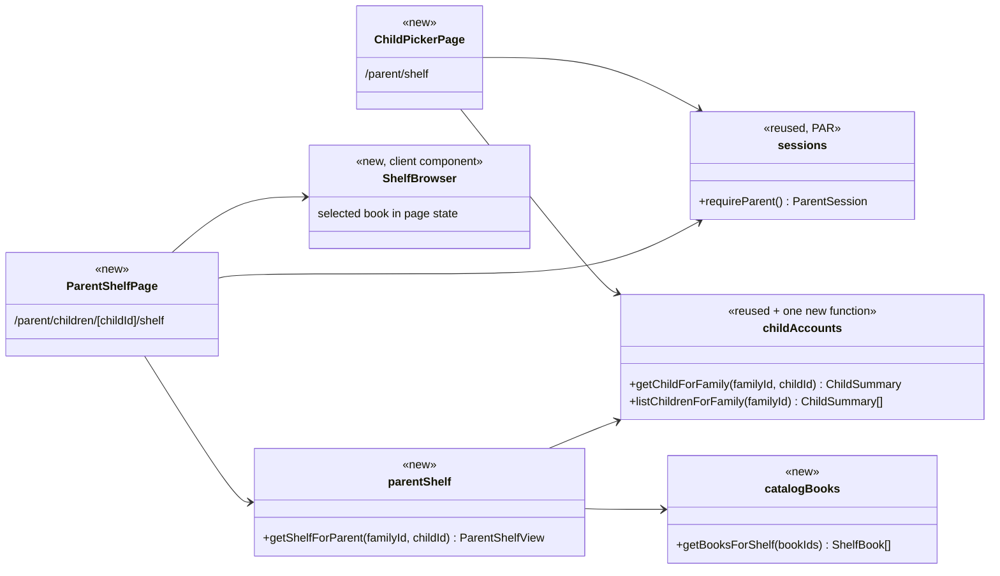
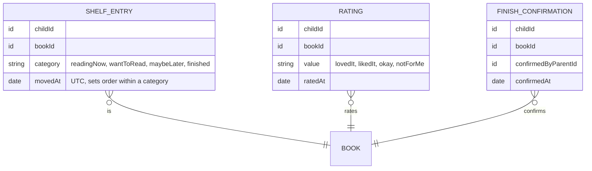

# Shelf (SHLF) Design

**Project:** BookBuddies
**Team:** Team 05
**Area:** `UC-SHLF`

> **Realizes:** `UC-SHLF-parent-view-shelf`, `FR-PAR-review`
> **Depends on:** `UC-ADM-block-content` (extension 5b: a block removes the shelf entries), `BR-parent-account-linked`, `BR-kid-no-metrics`, `FR-SHLF-categories`, `SEC-role-authorization`, `USE-parent-light`
> **Related, designed separately:** `UC-SHLF-parent-remove-book` (`BR-parent-shelf-removal`), `UC-SHLF-par-finish-book`, `UC-PAR-report-book`
> **See:** [use cases, SHLF area](../docs/requirements/use-cases.md#shlf-shelf-feature-area), [specification](../docs/requirements/software-requirements-specification.md), [business rules](../docs/requirements/business-rules.md), [architecture-of-record](architectural-design.md), [PAR design](par.md)
> **Designed against:** use cases v0.14, business rules v0.8, SRS v0.9, the PAR design, and the code on `main` as of 2026-11-16 (`requireParent()` in `sessions.ts` and `getChildForFamily` in `child-accounts.ts`, both used by the add-a-child pages). The Shelf and Catalog components have no code yet, and there is no shared parent layout guard: each parent page calls `requireParent()` itself.

**Status of this draft.** Revised from PR #42 after it was reviewed against the 2026-10-28 client answers. Children no longer enter free text, so reflections, flagging of reflections and the 24-hour deletion window are gone; the use case is "View a Child's Shelf and **Ratings**". Steps 1, 3, 4 and 5 of the design process (own sketch, compare, questions test, teammate review) are still the team's to do. It covers `UC-SHLF-parent-view-shelf` only; the other SHLF use cases are appended as each is designed.

---

## Overview

The Shelf area owns each child's shelf: the entries in four categories, the child's ratings, the parent's confirmation that a child finished a book, manual search and its shelf requests, and parent removal. It is the Shelf component of the Application container ([containers](architectural-design.md#51-containers), [use case areas and components](architectural-design.md#52-use-case-areas-and-components)). `UC-SHLF-parent-view-shelf`, the first use case designed here, is read-only: it reads one child's shelf entries, their ratings and their finish state, checks that the child belongs to the signed-in parent's family, and asks the Catalog for each book's cover and title. It never reads the Child Identity Store, so the parent picks a child by nickname and avatar. It is the entry point to `UC-SHLF-parent-remove-book`, `UC-PAR-report-book` and `UC-SHLF-par-finish-book`, which are designed separately and attach to the controls this page renders. This design changes nothing in the architecture-of-record.

## Components & classes



- `src/app/(parent)/parent/shelf/page.tsx` (new): the child picker (extension 1a), and the temporary entry point until a parent dashboard (`FR-PAR-dashboard`) links to the shelf. It calls `requireParent()`, then `listChildrenForFamily`. With exactly one child it redirects straight to that child's shelf, so a parent with one child takes no extra step (`USE-parent-light`, threshold still TBD). With several it lists them by nickname and avatar. With none (PRE-2 not met), a Main Parent is redirected to `/parent/children/new` and a Sub Parent sees a message to ask the Main Parent to add a child, as the add-a-child page does.
- `src/app/(parent)/parent/children/[childId]/shelf/page.tsx` (new): a server component, marked dynamic so it never serves a cached shelf. It calls `requireParent()` and handles the result the way `onboarding-complete/page.tsx` does: `NOT_SIGNED_IN` redirects to `/sign-in`, and any other failure (`NOT_A_PARENT`, which is what a child or admin session gets) is `notFound()`. It then calls `getShelfForParent` and passes the whole view to `ShelfBrowser`. It has no server action, because viewing changes nothing (POST-2).
- `src/app/(parent)/parent/children/[childId]/shelf/shelf-browser.tsx` (new, client component): renders the four categories in fixed order, each entry with cover and title, and keeps the selected book in its own state, with no request and no URL parameter (steps 4 and 5). For the selected book it shows the rating, and by finish state either "Confirm finished" or the confirmed-finished icon with "Edit note" (extension 5a). Those two controls are links into `UC-SHLF-par-finish-book`; the route is that design's to define, so until it exists the controls' place is reserved and nothing is rendered there.
- `src/app/(parent)/parent/children/[childId]/shelf/error.tsx` (new): the retry screen for extension 2b, with no shelf content.
- `src/server/shelf/parent-shelf.ts` (new, server-only): `getShelfForParent` checks the child's family first, then reads the child's shelf entries, ratings and finish confirmations, and the books' catalog data, and returns one complete view or throws. It never returns part of a shelf.
- `src/server/accounts-family/child-accounts.ts` (reused): `getChildForFamily(familyId, childId)` returns `{ _id, nickname, avatar }` for a child in that family and `null` otherwise (a malformed or unknown ID is also `null`, since the ID is matched as a string); it is the family check for this view. One function is added to the same file, `listChildrenForFamily(familyId)`, for the picker: same fields, ordered by creation date.
- `src/server/catalog/books.ts` (new, server-only): `getBooksForShelf` returns cover and title for the given book IDs. It keeps the Catalog's existing rule that every read leaves out blocked books.
- `src/server/identity-access/sessions.ts` (reused): `requireParent()` returns an `ActionResult`: on success the user ID, family ID and `parentRole` (`main` or `sub`), on failure the code `NOT_SIGNED_IN` or `NOT_A_PARENT`. It does not redirect or throw, so each page decides what to do with the failure.

## Sequence

### UC-SHLF-parent-view-shelf: view a child's shelf and ratings

```mermaid
sequenceDiagram
    actor P as Parent
    participant UI as Web UI
    participant PG as Shelf page
    participant IA as Identity & Access
    participant SH as Shelf
    participant AF as Accounts & Family
    participant CAT as Catalog
    participant DB as Database
    P->>UI: Tap "View Shelf" (step 1)
    alt more than one child (1a)
        UI-->>P: Child picker, nickname and avatar only
        P->>UI: Choose a child (1a)
    end
    UI->>PG: GET /parent/children/{childId}/shelf
    PG->>IA: requireParent()
    IA-->>PG: parent session (family ID), or NOT_SIGNED_IN / NOT_A_PARENT
    alt not signed in
        PG-->>UI: redirect to /sign-in
    else not a parent (child or admin session)
        PG-->>UI: 404, no shelf data
    end
    PG->>SH: getShelfForParent(familyId, childId) (step 2)
    SH->>AF: getChildForFamily(familyId, childId)
    alt child not in the parent's family (2c)
        AF-->>SH: not found
        SH-->>PG: not found
        PG-->>UI: 404, no shelf data
    end
    SH->>DB: Shelf entries, ratings, finish confirmations for the child (step 2)
    SH->>CAT: getBooksForShelf(bookIds) (step 2)
    CAT-->>SH: cover and title; blocked books left out (5b)
    alt any read fails (2b)
        SH-->>PG: error
        PG-->>UI: Retry screen, nothing partial
    end
    SH-->>PG: Complete view
    alt no entries (2a)
        PG-->>UI: Empty-state message
    end
    PG-->>UI: Four categories in fixed order, cover and title (step 3)
    P->>UI: Tap a book (step 4)
    UI-->>P: Rating (step 5); "Confirm finished" if the finish awaits confirmation, or the confirmed-finished icon and "Edit note" if confirmed (5a)
    P->>UI: Leave the view (step 6)
```

Step 4 needs no second request: the page already holds every entry's rating and finish state, and selecting a book only changes state inside `ShelfBrowser`, so the shelf is never read again and cannot hit 2b or 5b halfway through a visit. Extension 5b needs no code in this view: when the admin blocks a book, `UC-ADM-block-content` removes the shelf entries in the same save, so the entry is gone the next time the page loads, and nobody is told.

## API contract

This use case only reads, so its rows are pages and the server function behind them, not server actions (8.2.3).

| Endpoint or job | Caller (who may) | Request | Success | Errors, by extension |
|---|---|---|---|---|
| Page `/parent/shelf` (UC-SHLF-parent-view-shelf 1a) | A signed-in parent, Main or Sub | None | The family's children, nickname and avatar only; with one child, a redirect to that child's shelf | No session: redirect to `/sign-in`. A session that is not a parent: `404`, as the other parent pages do (8.1). |
| Page `/parent/children/{childId}/shelf` (UC-SHLF-parent-view-shelf) | A signed-in parent, Main or Sub, of that child's family | `childId` in the path | The four categories in fixed order, entries most recently moved first, each with cover and title, and for every entry its rating (only if Finished and confirmed) and its finish state (awaiting confirmation or confirmed) | 2a: empty state, not an error. 2b: the `error.tsx` retry screen, no shelf content. 2c: `404`, the same response for another family's child, a child that does not exist, and a malformed ID, so nothing reveals which IDs are real. No session: redirect to `/sign-in`; a child or admin session: the same `404`. |
| `getShelfForParent(familyId, childId)` in Shelf | Only the page above | The family ID from the session and the child ID | One complete shelf view | Throws on any failed read (2b); returns not found when the child is outside the family (2c). |

Fields never in the response: the child's real name (the system holds none), age, grade or reading level; any number at all, including in headings, badges and labels (`BR-kid-no-metrics` applied to this view as the use case proposes; `OI-31` is still open on the parent dashboard); the parent's finish note, which belongs to `UC-SHLF-par-finish-book`.

## Key decisions

**The family check is inside the Shelf data-access function, not the page.** `getShelfForParent` takes the family ID and calls `getChildForFamily` before any read, so there is no function that returns a child's shelf without it. Rejected: checking in the page and passing a bare child ID down, because section 8.1 puts the scope in data access so that "a query cannot be written without it", and the next page to reuse the function would skip the check.

**Another family's child returns 404, not 403.** Rejected: `403 Forbidden`, which confirms that a child ID exists. The child ID would then be a probe for other families' children.

**The parent picks a child by nickname and avatar.** Rejected: showing the child's real name. The system holds none, and the nickname is what the parent chose to identify the child.

**Ratings and finish confirmations are stored apart from the shelf entry, keyed by child and book.** Rejected: fields on the shelf entry. `UC-SHLF-parent-remove-book` and `UC-ADM-block-content` delete the entry but keep the rating and the confirmation, which fields on a deleted entry cannot do. This view joins them to the current entries, so a rating for a removed or blocked book is not shown here.

**A blocked book is simply absent; there is no "no longer available" label.** `UC-ADM-block-content` removes the shelf entries and the use case says neither parent nor child is told. Rejected: an exception to the Catalog's "leave out blocked books" rule that shows blocked books marked, which would contradict that use case and need an architecture change. If an entry survives for a blocked book, the Catalog leaves the book out and the shelf drops the entry.

**The whole shelf loads in one call, and selecting a book is page state.** Every entry's rating and finish state come with step 2, and `ShelfBrowser` shows the selected book from what it already holds. Rejected: a `?book=` parameter or a link per book, because each tap would be a navigation that reads the shelf again, so step 5 could fail with 2b or lose a book to 5b halfway through a visit. A shelf holds only what the child added from a seed catalog of 134 books (`SI-book-dataset`), so one load stays small.

**Every load reads fresh.** The page is dynamic, and `getShelfForParent` and `getBooksForShelf` use no cache. Rejected: caching the shelf, because a cached shelf would show a book that a block or a parent removal has already taken off (5b, 2b).

**A book the Catalog does not return is dropped; only an error is a failure.** `getBooksForShelf` returns the books it found that are not blocked; a shelf entry whose book is missing from the result is left out of the view, and the rest is shown. A thrown error from any read shows the retry screen with no shelf (2b). Rejected: treating a missing book as an error, which would send a parent to the retry screen every time a block removes a book mid-visit.

**"Confirmed" is a `FINISH_CONFIRMATION` record, not a flag on the entry.** A Finished entry with a record is confirmed and may show its rating; a Finished entry without one is awaiting confirmation and shows "Confirm finished" and no rating; an entry in any other category shows neither. Rejected: an `awaitingConfirmation` field on the entry as well, because two stores for one fact can disagree, and then the view could show a rating the rules say cannot exist.

**This view links to finish confirmation and does not implement it.** The "Confirm finished" and "Edit note" controls open `UC-SHLF-par-finish-book`. Rejected: confirming from this page, which would make a read-only view write and break POST-2.

## Data model

This use case writes nothing. It fixes the three collections the SHLF use cases share, so later designs do not redraw them. Children and books belong to Accounts & Family and the Catalog.



Each collection has a unique index on (`childId`, `bookId`), because a child has one entry, one rating and one confirmation per book. Rating values follow the four-option scale in the glossary (`OI-17`, resolved), and a rating exists only for a confirmed finish (`UC-SHLF-par-finish-book` POST-2). "Awaiting confirmation" is derived: a Finished entry with no confirmation record. This view shows a rating only for a Finished entry that has a confirmation record, so a stray rating row is never shown. The parent's finish note is written and read by `UC-SHLF-par-finish-book` and is not part of this view. `childId` is the opaque ID, never a name (`KD-pii-segregation`). The indexes go in `src/server/setup/ensure-indexes.ts` from the [PAR design](par.md). The exact fields of `SHELF_ENTRY` that `UC-SHLF-par-finish-book` and `UC-SHLF-kid-move-book` also need (for example the category a book came from) are theirs to add when they are designed.

## Reuse & cross-cutting

- **Sessions:** `requireParent()` from the [PAR design](par.md), called by each page (8.1 Authentication; middleware is never the check). There is no shared layout guard.
- **Family scope:** `getChildForFamily` in Accounts & Family, already written and reused by every use case that reads a child's records (8.1 Authorization).
- **Error handling:** the route's `error.tsx` with a calm message and no detail (8.2.1).
- **Code conventions:** only Shelf's data-access functions read its collections; the page imports no database client (8.2.4).
- **Logging:** a request ID only, with no rating or child ID, including when a request is refused (8.2.7).
- **Child-facing views:** not used; this is a parent view. The child's own shelf is `UC-SHLF-kid-view-shelf`, which follows 8.2.11.

Not used: Notification, the Child Identity Store, Safety Flagging, and the audit log (a parent viewing a shelf is not in the 8.2.9 list).

## Tests

| Use case, flow | Level | Asserts |
|---|---|---|
| UC-SHLF-parent-view-shelf main | integration | A parent sees their child's entries under the four categories in fixed order, most recently moved first, each with cover and title, and a Finished book's rating on selection |
| UC-SHLF-parent-view-shelf main, Sub Parent | integration | A Sub Parent of the family sees the same shelf as the Main Parent |
| UC-SHLF-parent-view-shelf main, read-only | integration | Viewing the shelf changes no shelf entry, rating or confirmation (POST-2) |
| UC-SHLF-parent-view-shelf main, no metrics | integration | The response holds no count or total |
| UC-SHLF-parent-view-shelf 1a | integration | A parent with two children gets the picker; a parent with one is redirected straight to that child's shelf |
| UC-SHLF-parent-view-shelf 1a, no real name | integration | The picker's response holds nicknames and avatars and no age or grade |
| UC-SHLF-parent-view-shelf 2a | integration | A child with no entries gets the empty state, not an error |
| UC-SHLF-parent-view-shelf 2b | integration | When the catalog read fails, the page shows the retry screen and no shelf entries |
| UC-SHLF-parent-view-shelf 2c | integration | A parent requesting another family's child, or a child ID that does not exist, gets the same `404` and no shelf data |
| UC-SHLF-parent-view-shelf 5a, awaiting | integration | A Finished book awaiting confirmation shows "Confirm finished" and no rating |
| UC-SHLF-parent-view-shelf 5a, confirmed | integration | A confirmed book shows the confirmed-finished icon and "Edit note", and its rating if there is one |
| UC-SHLF-parent-view-shelf 5b | integration | After a block removes the entries, the book does not appear on the shelf, and the parent gets no notice |
| Removed or blocked book | integration | A rating kept after the entry was removed does not appear in this view |
| Authorization | integration | A child session and an admin session both get the `404` and receive no shelf data; with no session, the redirect to `/sign-in` |
| UC-SHLF-parent-view-shelf 2c, malformed ID | integration | A malformed `childId` gets the same `404` as another family's child |
| UC-SHLF-parent-view-shelf 5b, missing book | integration | When the Catalog returns fewer books than the entries, the missing entries are left out and the rest of the shelf is shown; when the Catalog throws, the retry screen shows (2b) |
| UC-SHLF-parent-view-shelf 4, selection | component | Selecting a book makes no request and changes no URL; the rating and controls shown are those already loaded |
| UC-SHLF-parent-view-shelf 5, rating rule | integration | A rating row on a Finished entry with no confirmation, or on an entry in another category, is not shown |
| UC-SHLF-parent-view-shelf fresh read | integration | After a block or a parent removal, the next load omits the book (no cached shelf) |
| UC-SHLF-parent-view-shelf 1a, no children | integration | A Main Parent with no children is redirected to the add-a-child page; a Sub Parent sees the explanation message |

## Changes to the architecture-of-record

None.

## Open questions & risks

- **No dashboard to tap "View Shelf" from yet (team).** The use case triggers from a child's dashboard, which no design or code provides. Until it exists, the entry is the `/parent/shelf` picker. Confirm which design owns the dashboard and its link.
- **Where remove and report attach (team).** `UC-SHLF-parent-remove-book` and `UC-PAR-report-book` start from this view. This design renders the controls' place on the selected book only when those designs say what they need; until then the view shows none.
- **Sub Parent access (client, `OI-25`).** The team decision, awaiting the client, is that a Sub Parent has the same access to linked children as the Main Parent, so this view gives a Sub Parent the same shelf. If the client limits it, the check in the page changes.
- **Seeing move history (client).** The use case leaves open whether a parent sees when a book moved. This design shows only the current category. If history is wanted, it needs its own records, which nothing writes today.
- **Parent dashboards and the no-metrics rule (client, `OI-31`).** This view shows no counts or totals. If the client wants totals, `BR-kid-no-metrics` and the use case assumption change together.
- **Accepted risk: shelf size.** Loading the whole shelf at once assumes a shelf stays small. The seed catalog is 134 books (`SI-book-dataset`) and a shelf holds only what a child added; if the catalog or shelves grow far past that, revisit the single load.
- **Suspended or deleted children.** The data model has no suspended state yet; a deleted child is simply not found (`404`). Revisit when `UC-PAR-delete-kid-account` is designed.
