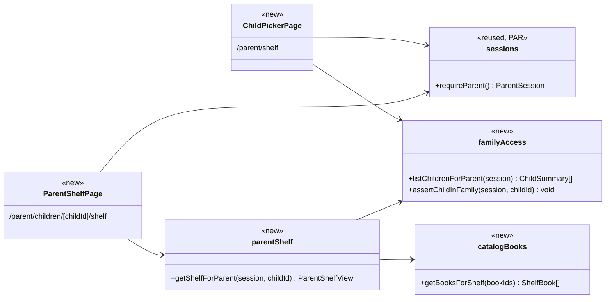
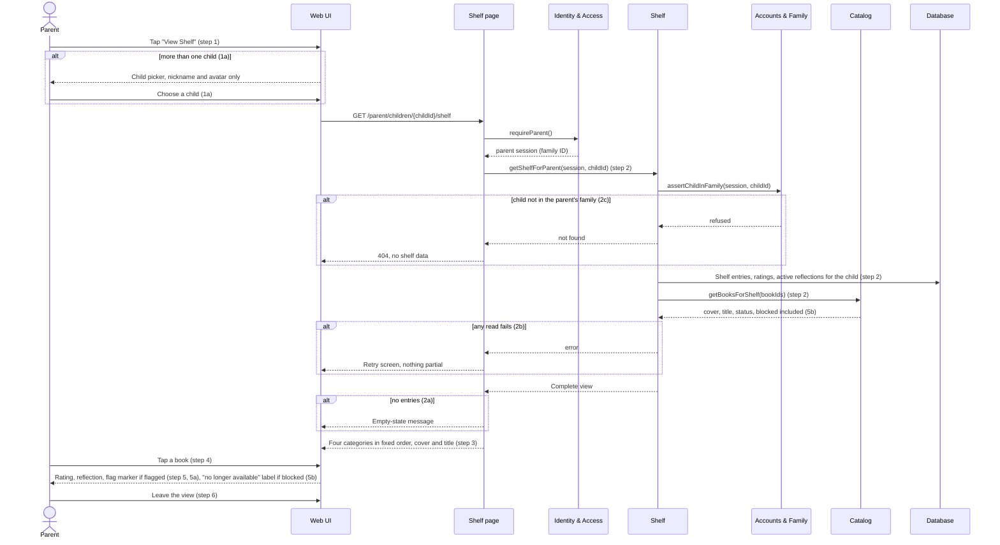
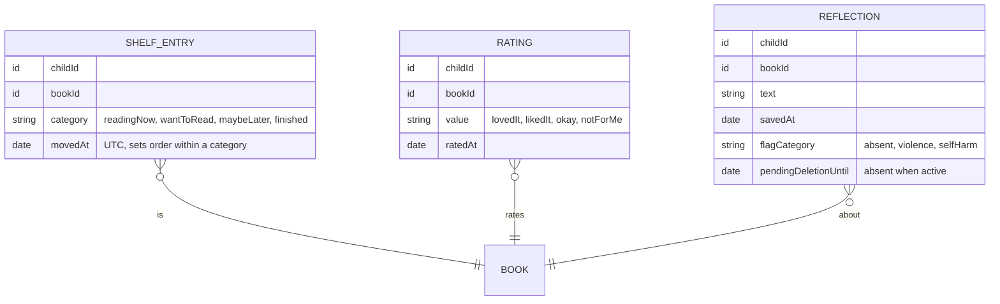

# Shelf (SHLF) Design

**Project:** BookBuddies
**Team:** Team 05
**Area:** `UC-SHLF`

> **Realizes:** `UC-SHLF-parent-view-shelf`, `FR-PAR-review`
> **Depends on:** `BR-parent-account-linked`, `BR-notes-visible-to-parent`, `BR-kid-no-metrics`, `FR-SHLF-categories`, `SEC-role-authorization`, `SEC-no-private-notes`, `USE-parent-light`
> **See:** [use cases, SHLF area](../docs/requirements/use-cases.md#shlf-shelf-feature-area), [specification](../docs/requirements/software-requirements-specification.md), [business rules](../docs/requirements/business-rules.md), [architecture-of-record](architectural-design.md), [PAR design](par.md)
> **Designed against:** `6aca106` (no application code exists yet)

---

_**How to use this template.** Copy it to `docs/design/<area>.md`, named for the lowercase area code (`ord.md` for `UC-ORD-*`). Instructions appear in italic square brackets; leave them in place until the document is stable, because the agent reads them on every later pass. The full worked example is Project Pulse's [`not.md`](https://github.com/Washingtonwei/project-pulse/blob/main/docs/design/not.md); read it for the shape, not for the answers._

_BookBuddies keeps its design documents in the top-level `design/` folder beside the [architecture-of-record](architectural-design.md), so this file is `design/shlf.md`._

_**What this document is.** The **design-of-record** for one use case area: how the code will realize its use cases, written **before** the code and approved before anyone builds from it. It is the last document your agent reads before it writes code, so anything it leaves out, the agent invents. Your [architecture-of-record](architectural-design.md) is the map of the whole system and stops at each component's responsibility; this document goes one level down, inside one area, against real code._

_**What it is not.** A copy of your use cases. It **cites** `UC-*`, `FR-*`, and `BR-*` by identifier and never restates what the system shall do; it says only how. It is also not a transcript of the code. Once code exists, link to the files rather than describing every class, column, or getter._

_**One document per area, not per use case.** Your area gains use cases over the term. The overview, the class diagram, and the data model are **revised in place** when it does. The sequence diagrams, the API contract rows, and the test rows are **appended**, one set per use case. Never add a `## UC-…` section that repeats the whole skeleton._

_**How much to write.** Pin down what a wrong guess would break: a requirement, a business rule, a quality attribute, or the contract between two parts of your team. Leave the rest for the agent to derive while it builds: variable names, field types, exact JSON, column lengths. When you are unsure, ask which side of that line a detail falls on, not whether it is interesting._

_**Write it in this order.** Each step is one person's or one pair's work, and the order is the point:_

1. _**Sketch it yourselves first.** Before you open the agent, draw the main success scenario's sequence diagram and write the API contract rows by hand, from the use case and your architecture-of-record. Twenty minutes, on paper or in this file._
2. _**Have the agent draft it.** Give the agent this template, the use case, the business rules it cites, your architecture-of-record's section 8 (Crosscutting Concepts), and the relevant existing code, and ask for a draft of this document. Use plan mode, so it proposes before it writes._
3. _**Compare the two.** Where the agent's draft differs from your sketch, decide which is right and why. What it found that you missed goes in; what you knew that it could not have known is the context your specification is missing, so fix the specification too._
4. _**Run the questions test** (the last section) and fix what it finds._
5. _**Open a pull request.** A teammate who did not write it reviews and approves it. Nobody starts an implementation branch from this design until it is merged._

_**Status of this draft.** Drafted by Claude on 2026-10-20 from use cases v0.10, business rules v0.3, the specification and architecture-of-record v0.4, and the [PAR design](par.md). Steps 1, 3, 4 and 5 above are still the team's to do. It covers `UC-SHLF-parent-view-shelf` only; the other SHLF use cases are appended as each is designed._

---

## Overview

_[One paragraph: what this area does, which components of your [architecture-of-record](architectural-design.md) it lives in, and what it reads from or calls in other areas. Link the container diagram rather than redrawing it. If this design changes the architecture-of-record, say so here and list the change under "Changes to the architecture-of-record" below.]_

The Shelf area owns each child's shelf: the entries in four categories, the child's ratings and reflections, manual search and its shelf requests, and parent removal. It is the Shelf component of the Application container ([containers](architectural-design.md#51-containers), [use case areas and components](architectural-design.md#52-use-case-areas-and-components)). `UC-SHLF-parent-view-shelf`, the first use case designed here, is read-only: it reads one child's shelf entries, ratings and reflections, asks Accounts & Family whether the child belongs to the signed-in parent's family, and asks the Catalog for each book's cover, title and status. It never reads the Child Identity Store, so the parent picks a child by nickname and avatar. This design adds one exception to the Catalog's "leave out blocked books" rule, listed under "Changes to the architecture-of-record" below.

## Components & classes

_[One class diagram for the whole area, and one line per class or file saying what it does and whether it is **new** or **reused**. Show only what a reader needs to see how the parts relate: classes, their key methods, their dependencies. Fields and getters belong to the code._

_**If your repository has no code for this area yet**, which is the normal case for your proving slice, list the files you expect the agent to create, with the paths your architecture-of-record's conventions give them, and mark them all new. The agent then builds into the structure you chose rather than one it improvised._

_The paths follow the [PAR design](par.md): pages under `src/app/`, and each component's server-only data-access functions under `src/server/<component>/` (8.2.4).]_

- `src/app/(parent)/parent/shelf/page.tsx` (new): the child picker (extension 1a). Lists the family's children by nickname and avatar; with exactly one child it redirects straight to that child's shelf, so the parent stays one tap away (`USE-parent-light`).
- `src/app/(parent)/parent/children/[childId]/shelf/page.tsx` (new): a server component that calls `requireParent()` and `getShelfForParent`, then renders the four categories in fixed order and, for the book selected through `?book=<bookId>`, its rating, reflection and flag marker (steps 3 to 5). No server action: the view changes nothing (POST-2).
- `src/app/(parent)/parent/children/[childId]/shelf/error.tsx` (new): the retry screen for extension 2b, with no shelf content.
- `src/server/shelf/parent-shelf.ts` (new, server-only): `getShelfForParent` checks the child's family first, then reads the child's shelf entries, ratings and active reflections, and the books' catalog data, and returns one complete view or throws. It never returns part of a shelf.
- `src/server/accounts-family/family-access.ts` (new, server-only): `assertChildInFamily` and `listChildrenForParent`, the family scope every component asks for before reading a child's records (8.1 Authorization). Both work for Main and Sub Parents.
- `src/server/catalog/books.ts` (new, server-only): `getBooksForShelf` returns cover, title and status (`active` or `blocked`) for books already on a shelf, including blocked ones (extension 5b).
- `src/server/identity-access/sessions.ts` (reused from the [PAR design](par.md)): `requireParent()`.
- `src/app/(parent)/layout.tsx` (reused from the [PAR design](par.md)): the onboarding guard, which already guarantees PRE-2 (the parent has at least one child).

## Sequence

_[One sequence diagram per use case for its main success scenario, plus one for each extension that does not just return an error. **Label each interaction with the use case step it implements**, so a reviewer can check that every step is realized and nothing extra was invented. Use `alt` blocks for extensions that branch off the main flow. Give each use case its own `###` heading; that heading is the anchor your traceability matrix cites.]_

### UC-SHLF-parent-view-shelf: view a child's shelf and reflections

Step 4 needs no second request: the page already holds every entry's rating and reflection, and selecting a book only changes `?book=` in the URL.

## API contract

_[One row per endpoint, scheduled job, or message this area adds or changes, appended per use case. **This section is never dropped**: before the code exists it is the only thing the person (or agent session) building the front end and the one building the back end both read. Name the caller and who may call it, the request fields, the success response, and the error each extension returns. Leave field types and exact JSON to the agent unless a wrong guess would break something, such as a format another system depends on. Use the error shape your architecture-of-record's section 8.2 fixes; do not invent one here._

_This use case only reads, so its rows are pages and the server function behind them, not server actions (8.2.3).]_

| Endpoint or job | Caller (who may) | Request | Success | Errors, by extension |
|---|---|---|---|---|
| Page `/parent/shelf` (UC-SHLF-parent-view-shelf 1a) | A signed-in parent, Main or Sub | None | The family's children, nickname and avatar only; with one child, a redirect to that child's shelf | No session: redirect to sign-in. Not a parent: refused (8.1). |
| Page `/parent/children/{childId}/shelf` (UC-SHLF-parent-view-shelf) | A signed-in parent, Main or Sub, of that child's family | `childId` in the path; optional `?book=` for the selected book | The four categories in fixed order, each entry with cover, title and a `blocked` marker; for the selected book, its rating, reflection text and saved time, and the flag category if flagged | 2a: empty state, not an error. 2b: the `error.tsx` retry screen, no shelf content. 2c: `404`, the same response as a child that does not exist, so it does not reveal that the child exists. |
| `getShelfForParent(session, childId)` in Shelf | Only the page above | The parent session and the child ID | One complete shelf view | Throws on any failed read (2b); returns not found when the child is outside the family (2c). |

Fields never in the response: the child's real name, age, grade or reading level; any count or total; reflections pending deletion; the reflection's deletion state.

## Key decisions

_[Only the decisions a reader could not recover from the code: an invariant, who may do this and how it is enforced, a trade-off you chose, a reason you reused something rather than writing it. **Each one names what you chose, what you rejected, and why.** If you cannot name an alternative you considered, it probably was not a decision; leave it out._

_A decision that affects the whole system rather than this area is an architecture decision. It belongs in your architecture-of-record as a `KD-*` entry, not here.]_

**The family check is inside the Shelf data-access function, not the page.** `getShelfForParent` takes the session and calls `assertChildInFamily` before any read, so there is no function that returns a child's shelf without it. Rejected: checking in the page and passing a bare child ID down, because section 8.1 puts the scope in data access so that "a query cannot be written without it", and the next page to reuse the function would skip the check.

**Another family's child returns 404, not 403.** Rejected: `403 Forbidden`, which confirms that a child ID exists. The child ID would then be a probe for other families' children.

**The parent picks a child by nickname and avatar.** Rejected: showing the child's real name, which would add a third read path into the Child Identity Store beyond the two `KD-pii-segregation` and section 5.2 allow. The parent chose the nickname, so it identifies the child to them.

**Ratings and reflections are stored apart from the shelf entry, keyed by child and book.** Rejected: fields on the shelf entry. `UC-SHLF-kid-remove-book` keeps a rating and reflection when the book leaves the shelf, which a field on a deleted entry cannot do. This view joins them to the current entries, so a rating for a removed book is not shown here.

**The whole shelf loads in one call.** Every entry's rating and reflection come with step 2. Rejected: fetching a book's details when the parent taps it (step 4). A shelf holds a few dozen books at most (catalog of 30–50, `AS-seed-catalog-size`), and one load means the parent never sees half a shelf (2b) or waits on a second request.

**A reflection pending deletion is left out by the query.** The query keeps only reflections with no pending-deletion deadline, so one inside its 24-hour window is hidden whether or not cleanup has run (`KD-time-rules-on-read`, `UC-SHLF-kid-add-note` 2b). Rejected: returning it with a status for the page to hide, which puts a hidden reflection in the page's data.

## Data model

_[The **change** this area makes to the data: new tables or entities, new columns, the migration that adds them. Draw an ER diagram when there is more than one new table. Do not redraw the domain model; your [specification](../docs/requirements/software-requirements-specification.md) owns it, so link it and show only the change. If the area changes nothing, say "No change" and give the reason in one line; that is a design decision too.]_

This use case writes nothing, but it is the first SHLF design, so it fixes the three collections every SHLF use case shares. The children and books it reads belong to Accounts & Family and the Catalog.

Each collection has a unique index on (`childId`, `bookId`), because a child has one entry, one rating and one reflection per book (`UC-SHLF-kid-rate-book` POST-1, `UC-SHLF-kid-add-note` POST-1). The rating values follow the four-option scale the glossary adopted (`OI-17`, resolved). `flagCategory` is written by Safety Flagging in the same transaction as the reflection (`UC-SHLF-kid-add-note`, 8.2.8); this view only reads it. `childId` is the opaque ID, never a name (`KD-pii-segregation`). The indexes go in the setup script from the [PAR design](par.md).

## Reuse & cross-cutting

_[Which existing services, components, and conventions this area uses rather than rebuilding: authentication, the error handler, email, the clock, another area's service. Cite your architecture-of-record's section 8.2 for each convention by name rather than restating it.]_

- **Sessions and the onboarding guard:** `requireParent()` and the parent layout from the [PAR design](par.md) (8.1 Authentication).
- **Family scope:** `assertChildInFamily` in Accounts & Family, new here and reused by every later use case that reads a child's records (8.1 Authorization).
- **Error handling:** the route's `error.tsx` with a calm message and no detail (8.2.1).
- **Time:** the pending-deletion check uses the clock module (8.2.2).
- **Code conventions:** only Shelf's data-access functions read its collections; the page imports no database client (8.2.4).
- **Logging:** no reflection text, rating, flag category or child ID in logs (8.2.7).
- **Child-facing views:** not used; this is a parent view. The child's own shelf is `UC-SHLF-kid-view-shelf`, which follows 8.2.11.

Not used: Notification (the flag alert belongs to `UC-SHLF-kid-add-note`, extension 5a), the Child Identity Store, and the audit log (a parent viewing a shelf is not in the 8.2.9 list).

## Tests

_[One row per flow: the main success scenario and **every** extension of every use case this document realizes, appended per use case. Name the level (unit or integration) and what the test asserts. No code. This list is the definition of done that the reviewer approves; the agent writes these tests when it builds, and a reviewer can see at a glance whether an extension has no test.]_

| Use case, flow | Level | Asserts |
|---|---|---|
| UC-SHLF-parent-view-shelf main | integration | A parent sees their child's entries under the four categories in fixed order, most recently moved first, each with cover and title, and each Finished book's rating and reflection |
| UC-SHLF-parent-view-shelf main, Sub Parent | integration | A Sub Parent of the family sees the same shelf as the Main Parent |
| UC-SHLF-parent-view-shelf main, read-only | integration | Viewing the shelf changes no shelf entry, rating or reflection (POST-2) |
| UC-SHLF-parent-view-shelf 1a | integration | A parent with two children gets the picker; a parent with one is redirected straight to that child's shelf |
| UC-SHLF-parent-view-shelf 1a, no real name | integration | The picker's response holds nicknames and avatars and no real name, age or grade |
| UC-SHLF-parent-view-shelf 2a | integration | A child with no entries gets the empty state, not an error |
| UC-SHLF-parent-view-shelf 2b | integration | When the catalog read fails, the page shows the retry screen and no shelf entries |
| UC-SHLF-parent-view-shelf 2c | integration | A parent requesting another family's child, or a child ID that does not exist, gets the same `404` and no shelf data |
| UC-SHLF-parent-view-shelf 5a | integration | A flagged reflection shows the flag marker and category |
| UC-SHLF-parent-view-shelf 5b | integration | An entry whose book is blocked still appears, marked no longer available |
| Pending deletion | unit | A reflection whose pending-deletion deadline has not passed by the injected clock is not returned |
| Removed book | integration | A rating kept after the book left the shelf does not appear in this view |
| Authorization | integration | A child session and an admin session are both refused, and neither receives shelf data |

## Changes to the architecture-of-record

_[Designing an area against real code is when the architecture's guesses meet reality. If this design needs a component the map does not have, moves a responsibility, or adds a dependency, **change [the architecture-of-record](architectural-design.md) in the same pull request** and list each change here in one line. If nothing changed, write "None". A design that silently disagrees with the architecture leaves two maps, and the agent will follow whichever it reads last.]_

- Section 5.2, Catalog row: "every catalog read leaves out blocked books" becomes "every catalog read leaves out blocked books, except the shelf lookup, which marks them so a parent can see and remove them (`UC-SHLF-parent-view-shelf` 5b)." Make this edit in `architectural-design.md` in the same pull request.

## Open questions & risks

_[What this design could not settle and who can, and what could go wrong that you are accepting. A question for the client also goes in [`OPEN-ISSUES.md`](../docs/requirements/OPEN-ISSUES.md).]_

- **No nickname field yet (team).** The picker shows the nickname and avatar, but `UC-PAR-create-kid-account` has no nickname field. The architecture's "Changes needed in other documents" already asks for one. Until it is added, this design has nothing to show in the picker but the avatar.
- **Seeing move history (client).** The use case leaves open whether a parent sees when a book moved. This design shows only the current category. If history is wanted, it needs its own records, which nothing writes today.
- **Does viewing count as review? (client, `OI-16`).** If `BR-24hr-review-window` stands, this view may need to record that the parent reviewed. This design records nothing, because a read-only page that writes would break POST-2.
- **Flag marker on a blocked book (team).** When a book is blocked, its unflagged reflections are deleted and its flagged ones are copied to the dangerous content list (`OI-20`). Whether the parent then still sees the flagged reflection on the shelf entry is not decided. This design shows whatever reflection still exists.
- **Accepted risk: shelf size.** Loading the whole shelf at once assumes a small catalog. If the catalog grows far past 30–50 books (`OI-12`), revisit the single load.

---

## Working this document with your agent

_[Delegate: drafting the diagrams from your sketch and the use case; listing the existing files a class should extend; filling the contract rows' request and response fields; proposing the test row for each extension; drafting the rejected alternative for a decision you have already made; checking that every identifier this document cites exists in the document that owns it._

_Keep human: which side of the "would a wrong guess break something" line each detail falls on; every key decision; and the approval, which is a teammate's review of the pull request, not the drafter's own reading._

_**The specific failure to watch for: scope that nobody asked for.** An agent drafting a design adds what designs it has read usually have: an admin override, a retry queue, a status field, a notification "while we are here". Each looks reasonable and none is in your use case, and once it is in the design the agent will build it, test it, and you will maintain it. Read the sequence labels: every interaction should name the use case step it implements. An interaction with no step is either a missing requirement, which goes to your specification and your client, or scope creep, which comes out.]_

---

## The questions test (before you open the pull request)

_[Start a **fresh** agent session in plan mode, so it carries nothing from the session that drafted this document. Give it only the use case, the business rules it cites, your architecture-of-record's section 8, and this document, and ask:_

> _List every point you would still have to guess to implement `<UC-ID>`. For each, say what you would guess and whether a wrong guess could violate a requirement. Do not write code._

_For each item on its list, either fix this document or keep the guess and write one line saying why a wrong guess breaks no requirement. Paste the list, with your answer to each item, into the pull request description under How it was verified, inside a collapsed `

Questions test
 … 
` block so the description stays short. The design is ready when nothing on the list could break a requirement.]_
