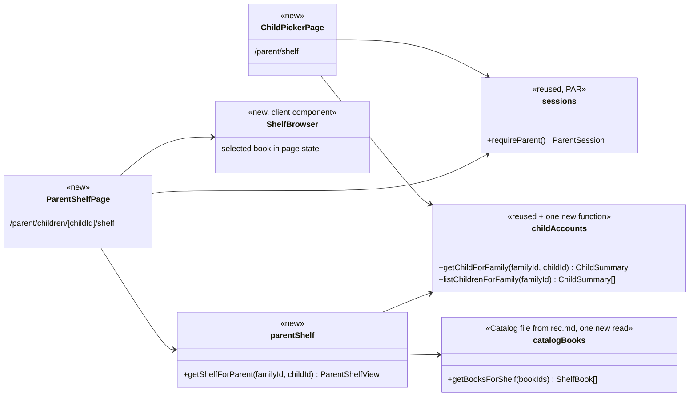
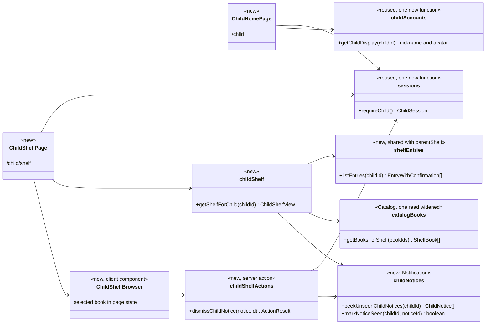
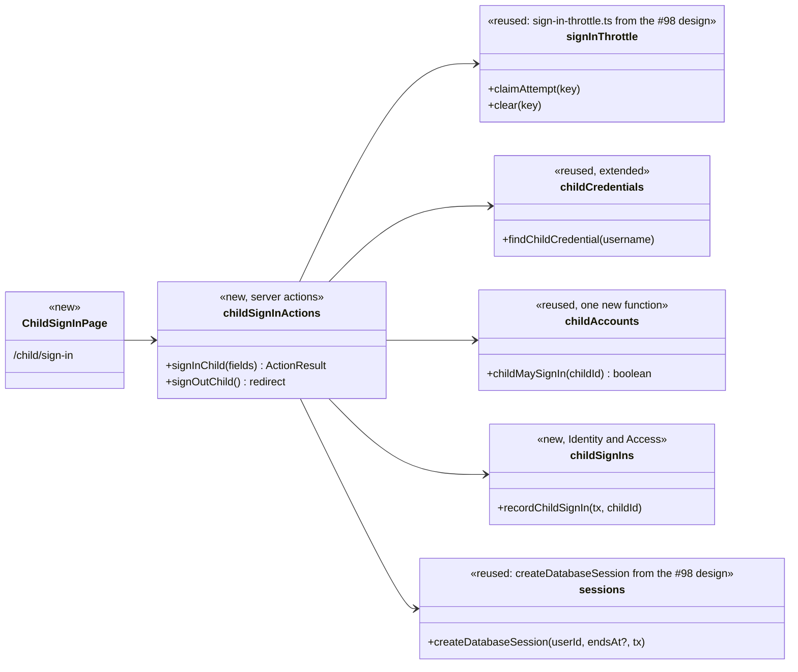
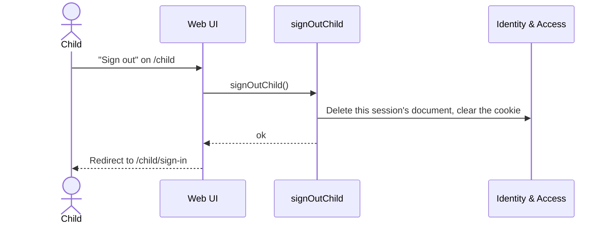
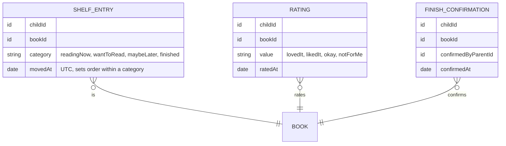

# Shelf (SHLF) Design

**Project:** BookBuddies
**Team:** Team 05
**Area:** `UC-SHLF`

> **Realizes:** `UC-SHLF-parent-view-shelf`, `UC-SHLF-kid-view-shelf`, `FR-PAR-review`, `FR-ACCT-credentials` (the child's sign-in half, a supporting flow with no use case, `OI-46`), `DI-usage-records` (the sign-in record)
> **Depends on:** `UC-ADM-block-content` (extension 5b: a block removes the shelf entries), `BR-parent-account-linked`, `BR-kid-no-metrics`, `BR-kid-anonymous-profile`, `BR-parent-shelf-removal`, `FR-SHLF-categories`, `FR-SHLF-finish-confirm`, `UI-kid-no-metrics`, `USE-child-first-run`, `DI-child-credentials`, `SEC-auth`, `SEC-signin-throttling`, `SEC-role-authorization`, `USE-parent-light`
> **Related, designed separately:** `UC-SHLF-parent-remove-book` (`BR-parent-shelf-removal`), `UC-SHLF-par-finish-book`, `UC-PAR-report-book`
> **See:** [use cases, SHLF area](../docs/requirements/use-cases.md#shlf-shelf-feature-area), [specification](../docs/requirements/software-requirements-specification.md), [business rules](../docs/requirements/business-rules.md), [architecture-of-record](architectural-design.md), [PAR design](par.md)
> **Designed against:** use cases v0.15 (updated in this PR), business rules v0.8, SRS v0.9, the PAR design, and the code on `main` and the merged `design/rec.md` as of 2026-11-18 (`requireParent()` in `sessions.ts` and `getChildForFamily` in `child-accounts.ts`, both used by the add-a-child pages). The Shelf and Catalog components have no code yet, and there is no shared parent layout guard: each parent page calls `requireParent()` itself.

> **Revised for:** `UC-SHLF-kid-view-shelf` and child sign-in, 2026-11-19, against `main` at `9783e44`, which holds the merged designs of #98, #100 and #102 (designs only; no Shelf, Notification or child sign-in code exists).

**Status of this draft.** Revised from PR #42 after it was reviewed against the 2026-10-28 client answers. Children no longer enter free text, so reflections, flagging of reflections and the 24-hour deletion window are gone; the use case is "View a Child's Shelf and **Ratings**". Steps 1, 3, 4 and 5 of the design process (own sketch, compare, questions test, teammate review) are still the team's to do. It covers `UC-SHLF-parent-view-shelf`, `UC-SHLF-kid-view-shelf` and child sign-in; the other SHLF use cases are appended as each is designed.

---

## Overview

The Shelf area owns each child's shelf: the entries in four categories, the child's ratings, the parent's confirmation that a child finished a book, manual search and its shelf requests, and parent removal. It is the Shelf component of the Application container ([containers](architectural-design.md#51-containers), [use case areas and components](architectural-design.md#52-use-case-areas-and-components)). `UC-SHLF-parent-view-shelf`, the first use case designed here, is read-only: it reads one child's shelf entries, their ratings and their finish state, checks that the child belongs to the signed-in parent's family, and asks the Catalog for each book's cover and title. It never reads the Child Identity Store, so the parent picks a child by nickname and avatar. It is the entry point to `UC-SHLF-parent-remove-book`, `UC-PAR-report-book` and `UC-SHLF-par-finish-book`, which are designed separately and implement the pages that this view links to. A child's pending shelf request is not a shelf entry, so it is not shown here; the parent sees it through `UC-PAR-approve-shelf-request`. This design adds one read to the Catalog row of the architecture-of-record.

`UC-SHLF-kid-view-shelf` is the child's side of the same shelf, and it needs a signed-in child, which **no use case covers** (`OI-46`). It is designed here as two parts that share one seam, `requireChild()`. The first is the child's shelf: a read-only view of the child's own entries, book details, own rating and pending notices, with no count of any kind (`BR-kid-no-metrics`, 8.2.11). The second is **child sign-in, sign-out and the child home screen**, written as *supporting flows with no use case*, the way `design/par.md` (open pull request #98) does for parent sign-in (`OI-44`). They live in this document and not in `par.md`: a child starts no `UC-PAR-*` use case, and it keeps this pull request away from the `par.md` edits of pull requests #98, #102, #104 and #100. The pieces this document reuses from those pull requests (`createDatabaseSession`, `sign-in-throttle.ts`, `deleteChildSignIn`, `signOutParent`) are **designs, not code**, and are named as such where used.

## Components & classes



- `src/app/(parent)/parent/shelf/page.tsx` (new): the child picker (extension 1a), and the temporary entry point until a parent dashboard (`FR-PAR-dashboard`) links to the shelf. It calls `requireParent()`, then `listChildrenForFamily`. With exactly one child it redirects straight to that child's shelf, so a parent with one child takes no extra step (`USE-parent-light`, threshold still TBD). With several it lists them by nickname and avatar. With none (extension 1b, PRE-2 not met), a Main Parent is redirected to `/parent/children/new` and a Sub Parent sees a message to ask the Main Parent to add a child, as the add-a-child page does.
- `src/app/(parent)/parent/children/[childId]/shelf/page.tsx` (new): a server component, marked dynamic so it never serves a cached shelf. It calls `requireParent()` and handles the result the way `onboarding-complete/page.tsx` does: `NOT_SIGNED_IN` redirects to `/sign-in`, and any other failure (`NOT_A_PARENT`, which is what a child or admin session gets) is `notFound()`. It then calls `getShelfForParent` and passes the whole view to `ShelfBrowser`. It has no server action, because viewing changes nothing (POST-2).
- `src/app/(parent)/parent/children/[childId]/shelf/shelf-browser.tsx` (new, client component): renders the four categories in fixed order, each entry with cover and title, and keeps the selected book in its own state, with no request and no URL parameter (steps 4 and 5). Every entry whose finish is confirmed carries the confirmed-finished icon in the list, in whichever category it sits. For the selected book it shows the rating if there is one, and by finish state either "Confirm finished" (a Finished entry that no parent has confirmed) or "Edit note" (any confirmed entry), as in extension 5a. For the selected book it also shows "Remove from shelf" and "Report", the controls `UC-SHLF-parent-remove-book` and `UC-PAR-report-book` start from. All four are links to the pages in the table under API contract; this view never writes (POST-2), and it sends no data to them beyond the child and book IDs in the path.
- `src/app/(parent)/parent/children/[childId]/shelf/error.tsx` (new): the retry screen for extension 2b, with no shelf content.
- `src/server/shelf/parent-shelf.ts` (new, server-only): `getShelfForParent` checks the child's family first, then reads the child's shelf entries, ratings and finish confirmations, and the books' catalog data, and returns one complete view or throws. It never returns part of a shelf.
- `src/server/accounts-family/child-accounts.ts` (reused): `getChildForFamily(familyId, childId)` returns `{ _id, nickname, avatar }` for a child in that family and `null` otherwise (a malformed or unknown ID is also `null`, since the ID is matched as a string); it is the family check for this view. One function is added to the same file, `listChildrenForFamily(familyId)`, for the picker: same fields, ordered by creation date.
- `src/server/catalog/books.ts` (the Catalog file planned in `design/rec.md`, not yet in code; this design adds one read, server-only): `getBooksForShelf` returns cover and title for the given book IDs. It keeps the Catalog's existing rule that every read leaves out blocked books.
- `src/server/identity-access/sessions.ts` (reused): `requireParent()` returns an `ActionResult`: on success the user ID, family ID and `parentRole` (`main` or `sub`), on failure the code `NOT_SIGNED_IN` or `NOT_A_PARENT`. It does not redirect or throw, so each page decides what to do with the failure.

### Child's shelf (`UC-SHLF-kid-view-shelf`)



- `src/app/(child)/child/page.tsx` (new): the **child home**, a basic landing screen. It exists because the use case's trigger ("taps My Shelf on their home screen") and child sign-in both need one. It calls `requireChild()` and `getChildDisplay`, shows the child's nickname and avatar (8.2.11), a large "My Shelf" link and a "Sign out" button, and nothing else. The other use cases that start from the home screen (`UC-REC-recommend-quiz-rules`, `UC-SHLF-manual-search`) add their own buttons when they are designed. The reading dashboard is `UC-SHLF-kid-dashboard`, not this page.
- `src/app/(child)/child/shelf/page.tsx` (new): a server component, marked dynamic, with no caching, like the parent page. It calls `requireChild()`: `NOT_SIGNED_IN` redirects to `/child/sign-in`, and `NOT_A_CHILD` (a parent or admin session) is `notFound()`. It then calls `getShelfForChild` with the child ID **from the session**; no child ID is in the URL or the request. It has no server action (POST-2).
- `src/app/(child)/child/shelf/shelf-browser.tsx` (new, client component): renders the four categories in fixed order with large tap targets, each entry with its cover and title, the confirmed-finished icon on every confirmed entry in any category, and a Finished entry that is not confirmed grayed out with no icon (3c). When the child taps a book it shows, from what is already loaded, the book's details, the child's own rating if there is one, and the actions the server listed for that entry (steps 4 and 5). Selection is its own state, with no request and no URL parameter. It shows each pending notice at the top with a large "OK" button (3d, 3f); tapping it calls `dismissChildNotice` and removes that notice from the screen once the call succeeds, and the notice stays until then, the "find a book" message at the top for an empty shelf (2a), a "My Dashboard" link (3e), and nothing at all under an empty category (3a).
- `src/app/(child)/child/shelf/error.tsx` (new): the retry message for extension 2b, with no shelf content and a "Try again" button.
- `src/server/shelf/child-shelf.ts` (new, server-only): `getShelfForChild(childId)` reads the entries, finish confirmations, the child's ratings, the books' catalog data and the child's unseen notices, and builds one complete view or throws. It marks nothing: a notice stays unseen until the child taps OK (`dismissChildNotice`). It never returns part of a shelf.
- `src/server/shelf/shelf-entries.ts` (new, server-only, shared): one read of a child's entries joined to their finish-confirmation state (`confirmed` is a confirmation record, whatever the category, the parent view's decision below). `getShelfForParent` is revised in place to call it, so the parent and the child view cannot disagree about which entries are confirmed.
- `src/server/catalog/books.ts` (the Catalog file, reused): `getBooksForShelf` also returns `author` and `seriesName`, for the child's book details; the parent view ignores them. It keeps the Catalog's rule that every read leaves out blocked books.
- `src/server/notification/child-notices.ts` (new, server-only, Notification): `peekUnseenChildNotices(childId)` and `markNoticeSeen(childId, noticeId)`, a conditional update that sets `seenAt` only on that child's own notice where it is unset. Marking a notice that is already seen, or one that is not the child's, changes nothing. Notices are *written* by `UC-SHLF-par-finish-book` 4b, `UC-SHLF-parent-remove-book` and `UC-PAR-report-book`, none of them designed yet.
- `src/app/(child)/child/shelf/actions.ts` and `schema.ts` (new): `dismissChildNotice(noticeId)`, a verb-first server action (8.2.3). It calls `requireChild()` first, validates the ID with zod (8.2.5), takes the child ID from the session and never from the request, and calls `markNoticeSeen`. It returns `{ ok: true }` also when the notice was already seen, so a second tab's tap or a double tap is harmless; a session that has ended returns `NOT_SIGNED_IN` and the notice stays.
- `src/app/(child)/layout.tsx`, `keep-alive.tsx` (client) and `actions.ts` (new): every child page loads a small client component that calls `keepChildSessionAlive({ active })` every `CHILD_KEEPALIVE_SECONDS`, where `active` is true if the child tapped, pressed a key or scrolled since the last call. The action calls `requireChild()` first, sets `lastSeenAt` (and `lastActiveAt` when `active` is true) on the caller's own `childSessionEnds` record, validates the body with zod (8.2.5) and returns `{ ok: true }`; if the session has ended it returns `NOT_SIGNED_IN` and the client redirects to `/child/sign-in`. It returns nothing else and logs nothing about the child (8.2.7).
- `src/server/accounts-family/child-accounts.ts` (reused): `getChildDisplay(childId)` returns `{ nickname, avatar }` and nothing else, so it is safe for a child session to call (8.2.11).
- `src/server/identity-access/sessions.ts` (reused, one new function): `requireChild()` returns `{ userId, childId }` from the `users` document with role `child`, or `NOT_SIGNED_IN` / `NOT_A_CHILD`. A child session is `NOT_SIGNED_IN` once the child has been inactive for `CHILD_IDLE_MINUTES` (`lastActiveAt`), and once `endsAt` has passed and the visit has ended, meaning `lastSeenAt` is older than the grace (Key decisions). It does not redirect or throw. A parent session gets `NOT_A_CHILD`; a child session already gets `NOT_A_PARENT` from `requireParent()`.

### Child sign-in and sign-out (supporting flows, no use case, `OI-46`)



- `src/app/(child)/child/sign-in/page.tsx`, `actions.ts`, `schema.ts` (new): the form (username and password, large fields, no link to any parent page) and `signInChild`; one zod schema serves form and action (8.2.5). `signOutChild` deletes the caller's own session document, clears the cookie and redirects to `/child/sign-in`, as `signOutParent` does in the #98 design. A signed-in child who opens the sign-in page is redirected to `/child`. The "Sign out" button is on `/child`.
- `src/server/identity-access/child-credentials.ts` (reused, extended): `findChildCredential(username)` returns the user ID, child ID and password hash and nothing else. It trims and lowercases the typed username and matches it exactly, because the parent's entry is stored trimmed and lowercased with a unique index (`design/par.md`, Key decisions), so the child's capitals never matter. `deleteChildSignIn` (pull request #104 named it and was closed, so this design states what it must do) also deletes the child's `childSignIns` records and all the child's throttle state (every key that starts `child:`, the lowercased username and a colon).
- `src/server/identity-access/sign-in-throttle.ts` (reused from the #98 design, server-only): counts failed sign-ins per key and returns how long the caller must wait (`SEC-signin-throttling`). A child's attempt is claimed with one atomic conditional update, `claimAttempt(key)`, before the password is checked, so parallel guesses cannot all pass a check made before any of them is counted (Key decisions). A child's attempt is counted under one of two keys, chosen by whether the caller is a trusted device for that username (below). A trusted device's key is `child:<username>:dev:<hash of its device ID>`. Every other caller shares the account's key, `child:<username>:shared`. The username is lowercased, and neither key can meet a parent's email key. So a guesser's failures only ever count against the shared key, and never make a trusted device wait. It takes the child's numbers and the decay rule from the table under Data model; if #98's module has them fixed, it gains parameters for the free attempts and the decay, and `claimAttempt`, which replaces its separate check and failure record for a child.
- `src/server/identity-access/device-token.ts` (new, server-only): issues and reads the `child_device` cookie that marks a trusted device (httpOnly, Secure, SameSite=Lax). The cookie holds one entry for each child who has signed in on this browser (a random device ID, the child ID and an expiry) and one signature over the whole list, made with a server secret from configuration (8.2.6), so the server trusts it without storing anything. A shared family tablet therefore trusts every child who has signed in on it, and one child's sign-in never removes another's entry. `issueDeviceToken(childId)` is called only after a correct password, never after a failure: it adds or renews that child's entry, keeps the others, drops expired ones and keeps at most `CHILD_DEVICE_MAX_CHILDREN` entries (the oldest go first). `readTrustedDevice(childId)` returns the device ID of that child's entry only when the signature is valid, that entry's expiry has not passed (checked against `now()`) and its child ID is the child the username belongs to. A missing, forged or expired cookie, or one with no entry for this child, returns nothing, and the caller is then counted under the shared key. Only a hash of the device ID is stored, in the throttle key. The cookie identifies a browser for the throttle and nothing else: it is not written to `childSignIns`, it holds no IP address and no name, and it is deleted with the throttle state (`DI-usage-records`).
- `src/server/identity-access/child-sign-ins.ts` (new, server-only): owns `childSignIns`, one record per successful sign-in (`DI-usage-records`), and the read the admin usage lookup will call later (`FR-ADM-child-lookup`).
- `src/server/accounts-family/child-accounts.ts` (reused): `childMaySignIn(childId)` is the one place that decides whether a child account may sign in. Today it checks that the child exists and that the family's consent is confirmed and not revoked (`isConsentConfirmed`). Suspension arrives here later (`UC-ADM-suspend-account`, and the children of a suspended parent, `OI-47`).
- `src/server/identity-access/sessions.ts` (reused): `createDatabaseSession(userId, tx?)` from the #98 design gains an optional `endsAt` argument, because a child's session ends at the next midnight and not after a fixed lifetime (Key decisions). The session document's own `expires` is the #98 lifetime for both roles, never `endsAt`. A parent's call passes none and is unchanged, so the parent session rules of the #98 design, including its sliding expiry, are untouched.


## Sequence

### UC-SHLF-parent-view-shelf: view a child's shelf and ratings

```mermaid
sequenceDiagram
    actor P as Parent
    participant UI as Web UI
    participant PG as Shelf page
    participant IA as Identity & Access
    participant SH as Shelf
    participant AF as Accounts & Family
    participant CAT as Catalog
    participant DB as Database
    P->>UI: Tap "View Shelf" (step 1)
    alt more than one child (1a)
        UI-->>P: Child picker, nickname and avatar only
        P->>UI: Choose a child (1a)
    end
    UI->>PG: GET /parent/children/{childId}/shelf
    PG->>IA: requireParent()
    IA-->>PG: parent session (family ID), or NOT_SIGNED_IN / NOT_A_PARENT
    alt not signed in
        PG-->>UI: redirect to /sign-in
    else not a parent (child or admin session)
        PG-->>UI: 404, no shelf data
    end
    PG->>SH: getShelfForParent(familyId, childId) (step 2)
    SH->>AF: getChildForFamily(familyId, childId)
    alt child not in the parent's family (2c)
        AF-->>SH: not found
        SH-->>PG: not found
        PG-->>UI: 404, no shelf data
    end
    SH->>DB: Shelf entries, ratings, finish confirmations for the child (step 2)
    SH->>CAT: getBooksForShelf(bookIds) (step 2)
    CAT-->>SH: cover and title; blocked books left out (5b)
    alt any read fails (2b)
        SH-->>PG: error
        PG-->>UI: Retry screen, nothing partial
    end
    SH-->>PG: Complete view
    alt no entries (2a)
        PG-->>UI: Empty-state message
    end
    PG-->>UI: Four categories in fixed order, cover and title (step 3)
    P->>UI: Tap a book (step 4)
    UI-->>P: Rating if any (step 5); "Confirm finished" on a Finished entry with no confirmation, or "Edit note" on a confirmed entry in any category (5a)
    P->>UI: Leave the view (step 6)
```

Step 4 needs no second request: the page already holds every entry's rating and finish state, and selecting a book only changes state inside `ShelfBrowser`, so the shelf is never read again and cannot hit 2b or 5b halfway through a visit. Extension 5b needs no code in this view: when the admin blocks a book, `UC-ADM-block-content` removes the shelf entries in the same save, so the entry is gone the next time the page loads, and nobody is told.

### UC-SHLF-kid-view-shelf: view my shelf

```mermaid
sequenceDiagram
    actor C as Child
    participant UI as Web UI
    participant PG as Child shelf page
    participant IA as Identity & Access
    participant SH as Shelf
    participant CAT as Catalog
    participant ACT2 as dismissChildNotice
    participant NOT as Notification
    C->>UI: Tap "My Shelf" on /child (step 1)
    UI->>PG: GET /child/shelf
    PG->>IA: requireChild()
    alt not signed in
        PG-->>UI: redirect to /child/sign-in
    else not a child session (parent or admin)
        PG-->>UI: 404, no shelf data
    end
    PG->>SH: getShelfForChild(childId from the session) (step 2)
    SH->>SH: Entries, finish confirmations and the child's ratings (step 2)
    SH->>CAT: getBooksForShelf(bookIds) (step 2; blocked books left out, 3b)
    CAT-->>SH: cover, title, author, series name
    SH->>NOT: peekUnseenChildNotices(childId) (3d, 3f)
    alt any read throws (2b)
        SH-->>PG: error
        PG-->>UI: error.tsx: retry message, nothing partial
    end
    SH-->>PG: One complete view
    alt no entries (2a)
        PG-->>UI: Message at the top pointing to a recommendation, no count
    end
    PG-->>UI: Four categories in fixed order, cover and title, large tap targets (step 3, 3a, 3c)
    opt a notice was pending
        PG-->>UI: The notice with an OK button, on every load until it is tapped (3d, 3f)
    end
    C->>UI: Tap a book (step 4)
    UI-->>C: Details, own rating if any, move, remove, and rate only if the finish is confirmed (step 5, 5a)
    opt the child taps OK on a notice (3d, 3f)
        UI->>ACT2: dismissChildNotice(noticeId)
        ACT2->>IA: requireChild()
        ACT2->>NOT: markNoticeSeen(childId from the session, noticeId)
        ACT2-->>UI: ok, the notice is removed from the screen
    end
    C->>UI: "My Dashboard" (3e), or leave (step 6)
```

Step 4 needs no second request: the page already holds every entry's details, rating and allowed actions. Extension 3b needs no code here, as in the parent view: the block removed the entry and nobody is told.

### Supporting flows with no use case (`OI-46`): child sign-in and sign-out

These are **not steps of `UC-SHLF-kid-view-shelf`**; its PRE-1 assumes them. The developer chose (2026-11-19) to design them here.

#### Child signs in

```mermaid
sequenceDiagram
    actor C as Child
    participant UI as Web UI
    participant ACT as signInChild
    participant IA as Identity & Access
    participant AF as Accounts & Family
    participant DB as Database
    C->>UI: Username and password on /child/sign-in
    UI->>ACT: signInChild(fields)
    ACT->>ACT: Validate; trim and lowercase both fields
    ACT->>IA: findChildCredential(username), a cheap lookup that checks no password
    ACT->>IA: readTrustedDevice(childId); key = "child:" + username + ":dev:" + device if trusted, else "child:" + username + ":shared" (unknown username: shared)
    ACT->>IA: claimAttempt(key), one atomic conditional update: refused while the key is waiting, otherwise this attempt is counted at once
    alt this key is waiting after repeated failures (SEC-signin-throttling)
        ACT-->>UI: TOO_MANY_ATTEMPTS, password not checked, nothing more counted
    end
    ACT->>IA: verifyPassword (against a dummy hash if the username is unknown, so the work is the same)
    alt unknown username or wrong password
        ACT-->>UI: INVALID_CREDENTIALS (the attempt was already counted by claimAttempt)
    end
    ACT->>IA: clear(key), the password was correct
    ACT->>AF: childMaySignIn(childId)
    alt consent revoked, child gone, or suspended
        ACT-->>UI: ACCOUNT_UNAVAILABLE
    end
    ACT->>DB: Begin transaction
    ACT->>IA: createDatabaseSession(userId, next midnight, tx); recordChildSignIn(tx, childId)
    ACT->>DB: Commit
    ACT->>IA: Delete the session the browser's old cookie named, then set the new session cookie and issueDeviceToken(childId)
    ACT-->>UI: ok
    UI-->>C: Redirect to /child
```

#### Child signs out



## API contract

This use case only reads, so its rows are pages and the server function behind them, not server actions (8.2.3).

| Endpoint or job | Caller (who may) | Request | Success | Errors, by extension |
|---|---|---|---|---|
| Page `/parent/shelf` (UC-SHLF-parent-view-shelf 1a) | A signed-in parent, Main or Sub | None | The family's children, nickname and avatar only; with one child, a redirect to that child's shelf | No session: redirect to `/sign-in`. A session that is not a parent: `404`, as the other parent pages do (8.1). |
| Page `/parent/children/{childId}/shelf` (UC-SHLF-parent-view-shelf) | A signed-in parent, Main or Sub, of that child's family | `childId` in the path | The four categories in fixed order, entries most recently moved first, each with cover and title, and for every entry its finish state (confirmed, in any category, or awaiting, for a Finished entry only) and its rating if the child has rated the book and a parent has confirmed the finish | 2a: empty state, not an error. 2b: the `error.tsx` retry screen, no shelf content. 2c: `404`, the same response for another family's child, a child that does not exist, and a malformed ID, so nothing reveals which IDs are real. No session: redirect to `/sign-in`; a child or admin session: the same `404`. |
| `getShelfForParent(familyId, childId)` in Shelf | Only the page above | The family ID from the session and the child ID | One complete shelf view | Throws on any failed read (2b); returns not found when the child is outside the family (2c). |

Fields never in the response: the child's real name (the system holds none), age, grade or reading level; any number at all, including in headings, badges and labels (`BR-kid-no-metrics` applied to this view as the use case proposes; `OI-31` is still open on the parent dashboard); the parent's finish note, which belongs to `UC-SHLF-par-finish-book`.

**What the page hands to `ShelfBrowser`** (`ParentShelfView`): the child's nickname and avatar, and a list of entries, each with only `bookId`, `title`, `coverUrl`, `category`, `confirmed` (true or false) and `rating` (one of the four values, or none). It has no dates, no `childId`, no confirming parent and no counts. "No number" means nothing displayed as a count or total, and the response does not carry fields the page has no use for.

**Links this view renders**, none of which write anything here:

| Control | Shown on | Target | Implemented by |
|---|---|---|---|
| Confirm finished | A Finished entry with no confirmation record, when selected | `/parent/children/{childId}/shelf/{bookId}/finish` | `UC-SHLF-par-finish-book` |
| Edit note | Any confirmed entry, when selected | `/parent/children/{childId}/shelf/{bookId}/finish` | `UC-SHLF-par-finish-book` |
| Remove from shelf | Any selected entry | `/parent/children/{childId}/shelf/{bookId}/remove` | `UC-SHLF-parent-remove-book` |
| Report | Any selected entry | `/parent/children/{childId}/shelf/{bookId}/report` | `UC-PAR-report-book` |

These paths are this design's proposal. Each of those use cases' designs either builds its page at the path or changes this table in the same pull request, and each page re-checks the family and role itself (`SEC-role-authorization`).

### `UC-SHLF-kid-view-shelf`

This use case only reads, so its rows are pages and the server function behind them (8.2.3).

| Endpoint or job | Caller (who may) | Request | Success | Errors, by extension |
|---|---|---|---|---|
| Page `/child` | A signed-in child | None | The child's nickname and avatar, a "My Shelf" link and "Sign out" | No session: redirect to `/child/sign-in`. A parent or admin session: `404` |
| Page `/child/shelf` (UC-SHLF-kid-view-shelf) | A signed-in child; the child is the session's, never a parameter | None | The four categories in fixed order, entries most recently moved first. Per entry: `bookId`, `title`, `coverUrl`, `author`, `seriesName` (or none), `category`, `confirmed`, `rating` (one of four words, or none) and `actions`: `move` and `remove`, plus `rate` only when `confirmed`; an entry awaiting confirmation (3c) has `move` and `remove`, and either one cancels the parent's pending request. Plus `notices` (kind and, for a removal, the title) and a `showFindBookMessage` flag | 2a: all four categories still show, with the flag set, not an error. 2b: the `error.tsx` retry screen, no shelf content. 3a: an empty category has its heading and nothing else. 3c: a Finished entry that is not confirmed has `confirmed` false and no `rate`. 3d, 3f: a notice shows on every load until the child taps OK, then never. 3b: a blocked book is absent. 5a: `rate` is not in `actions`. No session: redirect to `/child/sign-in`. A parent or admin session: `404` |
| `getShelfForChild(childId)` in Shelf | Only the page above | The child ID from the session | One complete view | Throws on any failed read (2b); marks nothing |
| `dismissChildNotice(noticeId)` in `src/app/(child)/child/shelf/actions.ts` | A signed-in child; the child is the session's | `noticeId` (zod: a notice ID) | `{ ok: true }`, also when the notice was already seen | `NOT_SIGNED_IN`: the session ended, the notice stays. `INVALID_NOTICE`: not a notice ID. A notice that is not the child's changes nothing and returns `{ ok: true }`, so the response does not show whether it exists |

**Never in the payload:** age, grade, reading level, the real name (none is held), any count or total, any date, `childId`, the confirming parent, the parent's note, a book's tags (8.2.11, `BR-kid-no-metrics`). `showFindBookMessage` is a flag, not a count.

**Links this view renders** (paths are this design's proposal; each use case's design adopts them or changes this table in its own pull request, and each page re-checks the child and the book itself): `move` to `/child/shelf/{bookId}/move` (`UC-SHLF-kid-move-book`), `remove` to `/child/shelf/{bookId}/remove` (`UC-SHLF-kid-remove-book`), `rate` to `/child/shelf/{bookId}/rate` (`UC-SHLF-kid-rate-book`), and "My Dashboard" to `/child/dashboard` (`UC-SHLF-kid-dashboard`). Until those pages are built the links lead nowhere, so the implementation may land them with those use cases.

### Supporting flows (`OI-46`): child sign-in and sign-out

Errors use the §8.2.1 shape. Messages are short and written for a child, and say to ask a grown-up when the child cannot fix the problem.

| Endpoint or job | Caller (who may) | Request | Success | Errors |
|---|---|---|---|---|
| Page `/child/sign-in` | Anyone | None | The username and password form | A signed-in child: redirect to `/child` |
| Server action `signInChild` | Anyone | Username, password | `ok`; the session cookie is set; the page redirects to `/child` | `USERNAME_REQUIRED`, `PASSWORD_REQUIRED`; `INVALID_CREDENTIALS` (the same for an unknown username and a wrong password); `TOO_MANY_ATTEMPTS` (a short wait, no number of seconds shown, never a lock); `ACCOUNT_UNAVAILABLE` (ask a grown-up; only after a correct password) |
| Server action `signOutChild` | A signed-in child | None | `ok`; the caller's session document is deleted and the cookie cleared; redirect to `/child/sign-in` | No session: redirect to `/child/sign-in` |


## Key decisions

**The family check is inside the Shelf data-access function, not the page.** `getShelfForParent` takes the family ID and calls `getChildForFamily` before any read, so there is no function that returns a child's shelf without it. Rejected: checking in the page and passing a bare child ID down, because section 8.1 puts the scope in data access so that "a query cannot be written without it", and the next page to reuse the function would skip the check.

**Another family's child returns 404, not 403.** Rejected: `403 Forbidden`, which confirms that a child ID exists. The child ID would then be a probe for other families' children. One `not-found.tsx` serves every cause (another family's child, an unknown or malformed ID, a child or admin session, a parent with no children who types a shelf URL), so the copy is the same. Response timing is not equalized; it is not a stated requirement, and the IDs are opaque.

**The parent picks a child by nickname and avatar.** Rejected: showing the child's real name. The system holds none, and the nickname is what the parent chose to identify the child.

**Ratings and finish confirmations are stored apart from the shelf entry, keyed by child and book.** Rejected: fields on the shelf entry. `UC-SHLF-kid-remove-book`, `UC-SHLF-parent-remove-book` and `UC-ADM-block-content` delete the entry but keep the rating and the confirmation, which fields on a deleted entry cannot do. This view joins them to the current entries, so a rating for a removed or blocked book is not shown here.

**A blocked book is simply absent; there is no "no longer available" label.** `UC-ADM-block-content` removes the shelf entries and the use case says neither parent nor child is told. Rejected: an exception to the Catalog's "leave out blocked books" rule that shows blocked books marked, which would contradict that use case and need an architecture change. If an entry survives for a blocked book, the Catalog leaves the book out and the shelf drops the entry.

**The whole shelf loads in one call, and selecting a book is page state.** Every entry's rating and finish state come with step 2, and `ShelfBrowser` shows the selected book from what it already holds. Rejected: a `?book=` parameter or a link per book, because each tap would be a navigation that reads the shelf again, so step 5 could fail with 2b or lose a book to 5b halfway through a visit. A shelf holds only what the child added from a seed catalog of 134 books (`SI-book-dataset`), so one load stays small.

**Every load reads fresh.** The page sets `export const dynamic = "force-dynamic"`, `next.config.ts` configures no caching or `staleTimes`, and `getShelfForParent` and `getBooksForShelf` use no cache (`unstable_cache` and `"use cache"` stay out). Rejected: caching the shelf, because a cached shelf would show a book that a block or a parent removal has already taken off (5b, 2b). The test below checks a block against the next load.

**A book the Catalog does not return is dropped; only an error is a failure.** `getBooksForShelf` returns the books it found that are not blocked; a shelf entry whose book is missing from the result is left out of the view, and the rest is shown. A thrown error from any read shows the retry screen with no shelf (2b). Rejected: treating a missing book as an error, which would send a parent to the retry screen every time a block removes a book mid-visit. `getBooksForShelf` is one query for all the book IDs, so it returns every book it found or throws; a partial Catalog outage cannot give a partial shelf. An error thrown by `requireParent()` or `getChildForFamily` also goes to the retry screen. Only the two results they return, not-signed-in and not-found, redirect or give the `404`.

**"Confirmed" is a `FINISH_CONFIRMATION` record, and it does not depend on the category.** `UC-SHLF-par-finish-book` POST-1 and `UC-SHLF-kid-move-book` 3d say the confirmation and the icon stay wherever the child moves the book, and trigger (c) lets a parent edit the note on any confirmed book. So an entry with a record is confirmed in any category and shows the icon and "Edit note"; only a Finished entry with no record is awaiting confirmation and shows "Confirm finished"; an entry in another category with no record shows neither. Rejected: tying confirmation to the Finished category, which would drop the icon and "Edit note" from a confirmed book the child moved back to Reading Now to re-read, and rejected: an `awaitingConfirmation` field on the entry as well, because two stores for one fact can disagree.

**A rating shows on any entry still on the shelf, and not once its entry is gone.** A rating belongs to the child and the book, so a confirmed book moved to Reading Now keeps its rating on screen. A rating needs a confirmation record, so a rating row without one is never shown. When the entry is removed by the child or a parent, or by `UC-ADM-block-content`, the rating is kept for the recommender (`UC-SHLF-kid-remove-book` POST-2, `UC-ADM-block-content` POST-3) but this view has no entry to hang it on, so it is not shown. This is a team proposal recorded in the use case and in `OI-41`; the client has not confirmed it.

**This view links out and never writes.** "Confirm finished", "Edit note", "Remove from shelf" and "Report" are links to pages that the other SHLF and PAR use cases implement, at the paths in the table under API contract. Rejected: doing any of them from this page, which would make a read-only view write and break POST-2; and rejected: leaving the targets for later, because the use cases say a parent starts remove and report from this view, so the view has to offer them.

### The child's shelf

**The child ID comes from the session, never from the request.** `getShelfForChild` takes the ID `requireChild()` returned, so there is no parameter a child could change to read another child's shelf. Rejected: `/child/{childId}/shelf`, which would create exactly that parameter.

**A notice is marked seen when the child taps OK on it, and not when the shelf loads** (developer, 2026-11-20, reviewer item 10 of #106). Loading the shelf marks nothing, so a prefetch, an aborted navigation or a failed read (2b) cannot use up a notice the child never saw. The notice shows on every load until the child taps OK, then never again. `dismissChildNotice` is a conditional update scoped to the child's own notice and is idempotent, so two tabs or a double tap are harmless: both tabs show the notice until one is tapped, and the other's tap changes nothing. Rejected: marking on read, which is the reviewer's objection; and showing the notice once per load, which loses it on a crash. Accepted: a child who never taps sees the notice on every visit, and two tabs open at once both show it. A tap after the child's session has ended is refused and the notice stays for the next sign-in.

**The server lists each entry's actions.** `rate` is in `actions` only when the entry is confirmed, because 5a says the action is not offered. The action pages check the state themselves (their own use cases). Rejected: the client deriving it from `confirmed` and `category`, which would put a rule in two places.

**An entry awaiting confirmation can still be moved or removed by the child, and doing so cancels the parent's request** (developer, 2026-11-19). The child's `actions` list `move` and `remove` for every entry. `UC-SHLF-kid-move-book` and `UC-SHLF-kid-remove-book` clear the awaiting state. `UC-SHLF-par-finish-book` must make its save conditional on the entry still being in Finished and awaiting, and when it is not, even after the parent tapped "Confirm finished" or "Not finished yet", show the parent a message that the child moved or removed the book, which cancelled the request (`UC-SHLF-par-finish-book` 1a is edited to say so). This view only lists the actions; the rest belongs to those designs. Rejected: withholding `move` and `remove` on an awaiting entry, which would stop a child retracting a completion (`UC-SHLF-kid-move-book` 3c).

**One shared read of entries and confirmation state for both views.** Rejected: two copies of the confirmed or awaiting rule, which could disagree about the same entry.

**The child's own rating shows on any entry still on the shelf, and only when a confirmation record exists**, the rule the parent view uses (`OI-41`): a stray rating row is never shown. A rating is shown as one of the four words, never a number.

**Book details are cover, title, author and series name only.** The reading level and the other tags stay off the child's screen (`BR-kid-no-metrics`, 8.2.11). Rejected: every catalog field, which would show the reading level.

**A removal notice resolves its book title through the Catalog read; a finish notice has no title.** The removal notice references the book (`UC-SHLF-parent-remove-book`) and the book is no longer on the shelf, so the title comes from the notice's `bookId` through `getBooksForShelf`. If the Catalog does not return it, the notice shows without a title. Wording of the removal notice is still TBD in that use case.

**The empty shelf shows the four categories with a message at the top.** 2a and 3a together, as the developer decided: nothing is shown under an empty category.

### Child sign-in (no use case, `OI-46`)

**A separate `/child/sign-in`, not the parent's `/sign-in`.** Rejected: one form that tells an email from a username, which mixes the two throttle policies and shows a six-year-old a parent screen.

**The password is trimmed and lowercased before it is checked.** Generated passwords are all lowercase words and digits (`generateChildPassword`), so a first letter a tablet capitalizes still works. Rejected: an exact match, which would fail `USE-child-first-run` for no security gain.

**A child's sign-in uses the parent's throttle, with the child's numbers, counted per trusted device and otherwise per account: 3 wrong attempts cost nothing, then each further attempt must wait, 30 seconds first and doubling after every further wrong one, and there is never a lock** (developer, 2026-11-19; `SEC-signin-throttling`; the sign-in decision in `design/par.md`, pull request #98). The wait is capped at 15 minutes, as in #98's table (the developer gave no cap; confirm). A correct password clears the count it was counted under.
- **A device where this child has signed in is trusted and keeps its own count. Every other caller shares one count per account.** A trusted device is a browser holding a valid `child_device` cookie for this child, issued after a correct password (Components, `device-token.ts`). A guesser who discards the cookie, forges one, or sends another child's lands in the shared count, so dropping the cookie never earns a fresh count (`SEC-signin-throttling`: failed attempts are counted per account). A wait in the shared count does not stop the correct password on a trusted device, so a guesser cannot keep a child from signing in on the child's own tablet.
- **Accepted limit: a device with no valid cookie, such as a child's first sign-in or a new device, waits when the shared count is in a wait.** The wait is capped (Data model) and nothing is ever locked, but a guesser who knows a username can slow a child on a new device. The child's signed-in devices are not affected. Recorded in `OI-49`.
- **An attempt made during a wait is refused and does not count.** It is not checked against the password and does not lengthen the wait.
- **The count decays: one wrong attempt is forgiven every 30 minutes, but only while no wait is running.** The 30 minutes start when the last failure's wait ends (or at the last failure, if no wait was running). A count that reaches zero has its record deleted when it is read, and the cleanup purge removes the ones nobody reads again (Data model).
- **An attempt is claimed atomically before the password is checked.** `claimAttempt(key)` is one conditional update on the key's record: if the key is not waiting at `now()`, it adds this attempt to the count (and sets the wait that follows the free attempts) and the caller goes on to check the password; otherwise it refuses with the wait. Parallel guesses therefore cannot all pass a check made before any of them is counted: once the free attempts are used, the next claim is refused whatever the password. A correct password then calls `clear(key)`, and a wrong one needs no second write, because its attempt is already counted. Rejected: checking first and recording the failure after the password check, which lets parallel requests all pass (review of #106).
- Rejected: a lock that a parent dismisses, the first draft of this design, because `SEC-signin-throttling` says a lockout must not let anyone lock a child out on purpose. Rejected: counting per IP address (`DI-usage-records` forbids keeping one). Rejected: a count per device alone, because a guesser who discards the cookie looks like a new device on every attempt and is never slowed (reviewer of #106, `SEC-signin-throttling`). Rejected: one count per account for every device, because a wait would then refuse the child's own correct password on the home tablet. Rejected: a stored record of trusted devices, because the signed cookie needs no collection and no cleanup.

**Failures are counted per lowercased username, under the trusted-device key or the shared key, unknown usernames included, and an unknown username and a wrong password give the same answer** (as #98 does for emails). Rejected: keying by child ID, which would make an existing username answer differently from an unknown one.

**The username is stored trimmed and lowercased, and sign-in trims and lowercases what is typed and matches it exactly** (`design/par.md`, Key decisions: usernames are lowercased in the schema with a unique index, so no two differ only in capitals). The sign-in schema applies the same trim and lowercase as the create schema, so the lookup is an exact match on the indexed field. Accepted, as in #98: a throttle record exists for any string typed at the form, and its clearing and purging belong to #98's throttle.

**`ACCOUNT_UNAVAILABLE` only comes after a correct password**, so it tells a guesser nothing, and tells a child whose consent was revoked or who is suspended something other than "wrong password".

**The session ends at the next midnight, not after a fixed lifetime** (developer's decision, 2026-11-19, `OI-48`). `createDatabaseSession` is given `endsAt` for a child and sets the session document's `expires` as for a parent (the #98 lifetime), never to `endsAt`: Auth.js deletes a session it reads after `expires`, which would end a child's open visit at midnight, and it reads the real clock, so a fixed-clock test would not match. `endsAt` is stored in a small collection Identity & Access owns, `childSessionEnds` (one record per child session: the session ID, `endsAt`, `lastSeenAt` and `lastActiveAt`, all UTC), written in the sign-in transaction. Auth.js never reads or writes that collection, so nothing it does to a session document can change `endsAt`. The session is treated as expired the moment it passes, whether or not cleanup has run (8.2.2, `KD-time-rules-on-read`). `requireChild()` applies the end rule below with `now()` and refuses an ended session itself (developer, 2026-11-19: any extra enforcement is better), which is also what the fixed-clock tests exercise. "Next midnight" is the first 00:00 after the sign-in in one configured time zone. **Auth.js is left alone, so parent sessions are unchanged.** The database strategy may still slide the session document's `expires` forward when it is read after `updateAge`, but `endsAt` is not in that document, so a slid `expires` cannot extend a child's session. `requireChild()` finds the record by the session ID of the caller's own cookie, as `signOutChild` already does. `updateAge` and `maxAge` stay as the #98 design has them, and no setting is global to both roles. Every child-facing page and action calls `requireChild()`, and a parent page refuses a child's session, so no path trusts a child session on `expires` alone. The cleanup route also deletes child sessions whose `endsAt` has passed and whose `lastSeenAt` is older than the grace, or whose `lastActiveAt` is older than the idle time, with their `childSessionEnds` records, because a slid `expires` would otherwise keep them in the collection. `signOutChild` and `deleteChildSignIn` delete the record with the session. **Midnight ends the session for a new visit, but a child who is still in the app keeps full access until they leave** (developer, 2026-11-20, reviewer item 11 of #106). A child's visit lasts from sign-in until every web page is closed or the app is closed. There is no minimum length: a child who signs in at 23:50 and closes the page at 23:55 has to sign in again on the next visit. Midnight changes one thing: after `endsAt`, a session no longer *starts* a visit, it only *continues* one that is still open. While the child has the app open, the page sends a small keep-alive (`keepChildSessionAlive`, every 30 seconds, `CHILD_KEEPALIVE_SECONDS`), which sets `lastSeenAt` on the session's `childSessionEnds` record. `requireChild()` accepts the session when `now()` is before `endsAt`, or, after `endsAt`, when `lastSeenAt` is no older than the grace (10 minutes, `CHILD_LEAVE_GRACE_SECONDS`, which also covers a background tab that the browser slows to one timer a minute and a short trip to another app). A child past midnight therefore has full access to every page and action, and each accepted request also refreshes `lastSeenAt`. When the child closes the last page, the keep-alive stops, and once the grace has passed the session is over: the next visit, and any request, returns `NOT_SIGNED_IN` and goes to `/child/sign-in`. Closing the page loses nothing, because every action is a single tap saved when it is made. **A child is also signed out after 30 minutes of inactivity** (developer, 2026-11-20, `CHILD_IDLE_MINUTES`), before or after midnight. Inactivity means the child did nothing: no tap, key press or scroll, and no page request or action. The keep-alive does not count as activity, because an open page keeps sending it. So the page records whether the child touched it since the last keep-alive and sends `keepChildSessionAlive({ active })`; the server sets `lastActiveAt` when `active` is true and on every accepted page request or action (the shelf's selecting a book makes no request, so the page's own interaction flag is the only sign of it). `requireChild()` refuses the session when `now()` is more than `CHILD_IDLE_MINUTES` after `lastActiveAt`, whatever `endsAt` or `lastSeenAt` say, and the open page's next keep-alive learns it and redirects to `/child/sign-in`. The `active` flag comes from the child's own browser and only ever affects that child's own session, so a script that sets it falsely gains nothing it did not already have. The "app version" is the same pages (`KD-tech-stack` has one Next.js app), so an installed copy behaves the same: closing it stops the keep-alive. Rejected: cutting a visit off at midnight, which the developer ruled out; a minimum session length, which the developer ruled out; and a longer idle timer without a keep-alive, which would sign out a child who is reading a book on the screen. Accepted: a tablet left untouched is signed out after the idle time even though its page is open, and a mobile app moved to the background stops its timers and ends the visit after the grace. `lastSeenAt` and `lastActiveAt` are deleted when the session ends: `requireChild()` deletes the session and its `childSessionEnds` record in the same conditional step in which it refuses an ended or idle one, `signOutChild` and `deleteChildSignIn` delete them, and the daily cleanup deletes any that nobody reached again, so no activity time outlives its session by more than a day and a session nobody touches again is gone within that day (`SEC-auth`, `BR-coppa-minimization`). They are never copied to `childSignIns`, and are not a stored session length (`BR-kid-data-stored`, `DI-usage-records`); see `OI-48`. Rejected: counting keep-alives as activity, which would make a tablet left open never time out. Rejected: setting `updateAge` at least as long as the longest session, because it is one setting for both roles and would stop parent sessions from sliding, which changes the #98 design on `main`. Rejected: a fixed 24-hour lifetime, which is not what was asked and would end a morning session in the middle of the next day.

**The sign-in record is written in the same transaction as the session** (8.2.8), so there is no session without its `DI-usage-records` entry and no record without a session.

**A child's sign-in deletes the session the browser's old cookie named.** Rejected: leaving it, because on a shared family tablet a parent's session would stay valid but unreachable until it expires.

**`requireChild()` makes no second check of the child's account.** Deleting the child (`UC-PAR-delete-kid-account`), revoking consent and a suspension end their sessions (§8.1), so the session is the check, as for parents, plus the expiry check above. `childMaySignIn` runs only at sign-in.


## Data model

This use case writes nothing. It fixes the three collections the SHLF use cases share, so later designs do not redraw them. Children and books belong to Accounts & Family and the Catalog.



Each collection has a unique index on (`childId`, `bookId`), because a child has one entry, one rating and one confirmation per book. Rating values follow the four-option scale in the glossary (`OI-17`, resolved), and a rating exists only for a confirmed finish (`UC-SHLF-par-finish-book` POST-2). "Awaiting confirmation" is derived: a Finished entry with no confirmation record. "Confirmed" is a confirmation record for the child and book, whatever the entry's category. This view shows a rating only for an entry on the shelf whose book has a confirmation record, so a stray rating row is never shown. The parent's finish note is written and read by `UC-SHLF-par-finish-book` and is not part of this view. `childId` is the opaque ID, never a name (`KD-pii-segregation`). The indexes go in `src/server/setup/ensure-indexes.ts` from the [PAR design](par.md). The exact fields of `SHELF_ENTRY` that `UC-SHLF-par-finish-book` and `UC-SHLF-kid-move-book` also need (for example the category a book came from) are theirs to add when they are designed.

### Additions for the child's shelf and child sign-in

```mermaid
erDiagram
    CHILD_NOTICE }o--|| CHILD : "shown to"
    CHILD_SIGN_IN }o--|| CHILD : "records"
    CHILD_NOTICE {
        id _id
        string childId
        string kind "finish-declined or book-removed"
        id bookId "book-removed only"
        date createdAt "UTC"
        date seenAt "absent until shown"
    }
    CHILD_SIGN_IN {
        string childId
        date at "UTC"
    }
```



- `childNotices` (Notification, §5.2 already assigns every in-app notice to it): this design fixes only the shape the shelf reads. Other designs write it: `UC-SHLF-par-finish-book` 4b (a `finish-declined` notice, fixed wording, no book, no parent), and `UC-SHLF-parent-remove-book` and `UC-PAR-report-book` (a `book-removed` notice with the book's ID, no parent's identity). The shelf reads `seenAt` unset; the child's tap on OK sets it (`dismissChildNotice`). Indexed on (`childId`, `seenAt`). It holds the opaque child ID only, never a name (`KD-pii-segregation`).
- `childSignIns` (Identity & Access): one record per successful sign-in, indexed on (`childId`, `at`). Written in the sign-in transaction. It keeps no IP address, device identifier or session length (`DI-usage-records`). Purpose for `BR-coppa-minimization`: the retention measure and the admin's lookup of one child's usage (`FR-ADM-v1-measures`, `FR-ADM-child-lookup`).
- Sign-in throttle state: the `signInAttempts` collection of the #98 design (unique on the account key), with the child's two keys, `child:<username>:shared` and `child:<username>:dev:<hash of the device ID>` (an unknown username has no child to trust a cookie for, so it only ever uses the shared key). No new collection is needed. It is checked against `now()` on read (8.2.2), decays as in Key decisions, is cleared by a correct password under that key and when the child is deleted. **The cleanup route of the #98 design gains one step:** it deletes every child key whose count has decayed to zero at `now()`, so records nobody reads again do not pile up (cron only purges what has already expired, `KD-time-rules-on-read`). It shares the daily run of the #98 design (`design/par.md`, `/api/cron/cleanup`), with no new route or schedule. A decayed record can therefore remain for up to a day, and it is never read as counting, because decay is worked out from `now()` on every read. Without it, usernames sprayed by a guesser would leave records behind.
- `users` (role `child`): no change. `sessions`: no change in shape, for a child or a parent. New `childSessionEnds` (Identity & Access): one record per child session: the session ID, `endsAt` (UTC, the next midnight) `lastSeenAt` (UTC, set at sign-in and by each keep-alive or accepted request) and `lastActiveAt` (UTC, set at sign-in, by each accepted page request or action, and by a keep-alive that reports activity), unique on the session ID. It holds no name or username and is deleted with the session. Auth.js's `expires` is the normal #98 lifetime, not `endsAt`, and is not relied on for a child.
- No change to the shelf collections.

New configuration (8.2.6), read once by the config module:

| Setting | Value |
|---|---|
| `CHILD_KEEPALIVE_SECONDS` | 30, how often an open child page sends its keep-alive and its activity flag (a proposal; confirm) |
| `CHILD_LEAVE_GRACE_SECONDS` | 600, how long after the last keep-alive or request a child's visit counts as still open past midnight (developer, 2026-11-20) |
| `CHILD_IDLE_MINUTES` | 30, how long a child can do nothing before being signed out, before or after midnight (developer, 2026-11-20) |
| `CHILD_SESSION_TIME_ZONE` | required, a time zone name; "midnight" is the first 00:00 after sign-in in this zone (`OI-48`) |
| Free wrong attempts | 3, per trusted-device key and per account's shared key |
| First wait after the free attempts | 30 seconds, doubling after each further wrong attempt, capped at 15 minutes (#98's cap; confirm) |
| Decay | 1 wrong attempt forgiven every 30 minutes, paused while a wait is running |
| `child_device` cookie lifetime | 30 days, renewed on each correct password (a proposal; confirm) |
| `CHILD_DEVICE_MAX_CHILDREN` | 4, how many children one browser's cookie trusts at once; the oldest entry goes first (developer, 2026-11-20) |
| `CHILD_DEVICE_SECRET` | required secret that signs the cookie; in Vercel environment variables and the untracked `.env.local`, never in the repo |


## Reuse & cross-cutting

- **Sessions:** `requireParent()` from the [PAR design](par.md), called by each page (8.1 Authentication; middleware is never the check). There is no shared layout guard.
- **Account states:** a child account exists only after the parent confirmed consent (`UC-PAR-create-kid-account` PRE-3), so this view checks nothing more. The data model has no suspended state, and a deleted child is simply not found.
- **Family scope:** `getChildForFamily` in Accounts & Family, already written and reused by every use case that reads a child's records (8.1 Authorization).
- **Error handling:** the route's `error.tsx` with a calm message and no detail (8.2.1).
- **Code conventions:** only Shelf's data-access functions read its collections; the page imports no database client (8.2.4).
- **Logging:** as 8.2.7 says, a refused request or server error is logged with a request or error ID, and nicknames, ages, grades, note text, usernames and session IDs are never logged. The opaque child ID in the URL path may appear in the hosting platform's request log; it names no one and is not on the 8.2.7 list. No rating or shelf content is logged.
- **Child-facing views:** not used by the parent view. The child's own shelf is `UC-SHLF-kid-view-shelf`, designed below, which follows 8.2.11.

Not used: Notification, the Child Identity Store, Safety Flagging, and the audit log (a parent viewing a shelf is not in the 8.2.9 list).

### Child's shelf and child sign-in

- **Sessions:** `requireChild()` joins `requireParent()` in `sessions.ts`; each page and action calls the one it needs (8.1). The session callback in `auth.ts` already passes on only the user ID, so a child session carries no nickname or username.
- **Child-facing views:** both child pages follow 8.2.11: the child's nickname and avatar and book data, and no count, date, reading level or comparison. `getChildDisplay` is the only account read a child session reaches and returns nothing else.
- **Time:** the session expiry, the throttle wait and the sign-in time use `now()` from the clock module and are checked on read (8.2.2).
- **Persistence:** the session and the sign-in record are one transaction (8.2.8); a notice is marked seen with a conditional update when the child taps OK.
- **Error handling:** every action returns the shared result shape (8.2.1); `error.tsx` is the 2b screen.
- **Logging:** never the username, password, nickname or session ID; a failed or refused sign-in is logged with a request ID only (8.2.7). An unknown username and a wrong password log identically.
- **Audit:** none. A child signing in is a usage record, not an 8.2.9 event.
- **Passwords:** `passwords.ts` `verifyPassword`, reused unchanged, and `child-credentials.ts`.
- **Not used:** the Child Identity Store (nothing here reads age, grade or reading level) and Safety Flagging.


## Tests

| Use case, flow | Level | Asserts |
|---|---|---|
| UC-SHLF-parent-view-shelf main | integration | A parent sees their child's entries under the four categories in fixed order, most recently moved first, each with cover and title, and a Finished book's rating on selection |
| UC-SHLF-parent-view-shelf main, Sub Parent | integration | A Sub Parent of the family sees the same shelf as the Main Parent |
| UC-SHLF-parent-view-shelf main, read-only | integration | Viewing the shelf changes no shelf entry, rating or confirmation (POST-2) |
| UC-SHLF-parent-view-shelf main, no metrics | integration | The response holds no count or total |
| UC-SHLF-parent-view-shelf 1a | integration | A parent with two children gets the picker; a parent with one is redirected straight to that child's shelf |
| UC-SHLF-parent-view-shelf 1a, no real name | integration | The picker's response holds nicknames and avatars and no age or grade |
| UC-SHLF-parent-view-shelf 2a | integration | A child with no entries gets the empty state, not an error |
| UC-SHLF-parent-view-shelf 2b | integration | When the catalog read fails, the page shows the retry screen and no shelf entries |
| UC-SHLF-parent-view-shelf 2c | integration | A parent requesting another family's child, or a child ID that does not exist, gets the same `404` and no shelf data |
| UC-SHLF-parent-view-shelf 5a, awaiting | integration | A Finished entry with no confirmation record shows "Confirm finished" and no rating |
| UC-SHLF-parent-view-shelf 5a, confirmed in Finished | integration | A confirmed Finished entry shows the confirmed-finished icon, "Edit note", and its rating if there is one |
| UC-SHLF-parent-view-shelf 5a, confirmed in another category | integration | A confirmed book the child moved to Reading Now, Want to Read or Maybe Later still shows the icon and "Edit note", and its rating if there is one |
| UC-SHLF-parent-view-shelf 5a, unconfirmed elsewhere | integration | An entry outside Finished with no confirmation record shows neither "Confirm finished" nor "Edit note" |
| UC-SHLF-parent-view-shelf 5b | integration | After a block removes the entries, the book does not appear on the shelf, and the parent gets no notice |
| Removed or blocked book | integration | A rating and confirmation kept after the entry was removed, or the book blocked, do not appear in this view, and appear again if the book is added back |
| Authorization | integration | A child session and an admin session both get the `404` and receive no shelf data; with no session, the redirect to `/sign-in` |
| UC-SHLF-parent-view-shelf 5, links out | component | The selected book offers "Remove from shelf" and "Report", plus "Confirm finished" on a Finished entry with no confirmation or "Edit note" on a confirmed one, each linking to the path in the table with the child and book IDs, and none of them writes |
| UC-SHLF-parent-view-shelf payload | integration | The view handed to the client holds only `bookId`, `title`, `coverUrl`, `category`, `confirmed` and `rating` per entry, and no dates, `childId` or confirming parent |
| UC-SHLF-parent-view-shelf 2c, one response | integration | Another family's child, an unknown ID, a malformed ID, a child or admin session, and a parent with no children all get the same `404` page |
| UC-SHLF-parent-view-shelf 2b, thrown errors | integration | An error thrown by the session, family or Catalog read shows the retry screen with no shelf; a Catalog result with fewer books than entries does not |
| UC-SHLF-parent-view-shelf 2c, malformed ID | integration | A malformed `childId` gets the same `404` as another family's child |
| UC-SHLF-parent-view-shelf 5b, missing book | integration | When the Catalog returns fewer books than the entries, the missing entries are left out and the rest of the shelf is shown; when the Catalog throws, the retry screen shows (2b) |
| UC-SHLF-parent-view-shelf 4, selection | component | Selecting a book makes no request and changes no URL; the rating and controls shown are those already loaded |
| UC-SHLF-parent-view-shelf 5, rating rule | integration | A rating row with no confirmation record is not shown; a rating with a confirmation record shows in any category |
| UC-SHLF-parent-view-shelf fresh read | integration | After a block or a parent removal, the next load omits the book (no cached shelf) |
| UC-SHLF-parent-view-shelf 1a, no children | integration | A Main Parent with no children is redirected to the add-a-child page; a Sub Parent sees the explanation message |

### UC-SHLF-kid-view-shelf

| Use case, flow | Level | Asserts |
|---|---|---|
| UC-SHLF-kid-view-shelf main | integration | A child sees only their own entries under the four categories in fixed order, most recently moved first, each with cover and title; a second child's entries do not appear |
| UC-SHLF-kid-view-shelf main, details | component | Selecting a book shows its cover, title, author and series name, and nothing else of the catalog (no reading level or tags) |
| UC-SHLF-kid-view-shelf main, own rating | integration | A rated book shows the child's own rating as a word on selection; a rating row with no confirmation record is not shown |
| UC-SHLF-kid-view-shelf main, no metrics | integration | The payload holds no count, total, date, `childId`, age, grade or reading level |
| UC-SHLF-kid-view-shelf 2a | integration | A child with no entries gets all four categories and the "find a book" flag, not an error |
| UC-SHLF-kid-view-shelf 3a | component | An empty category shows its heading and nothing else |
| UC-SHLF-kid-view-shelf 2b | integration | A failed read shows the retry screen and no entries, and an unseen notice is still unseen afterwards |
| UC-SHLF-kid-view-shelf load marks nothing | integration | Loading the shelf any number of times, including a load whose response is dropped, leaves every notice unseen |
| UC-SHLF-kid-view-shelf 3b | integration | After a block removes the entries the book is gone on the next load, and the child gets no notice |
| UC-SHLF-kid-view-shelf 3c | integration | A Finished entry with no confirmation record is grayed, has no icon and no `rate` |
| UC-SHLF-kid-view-shelf 3d | integration | A pending finish notice shows with the fixed wording and an OK button on every load until `dismissChildNotice` is called, and not after; it names no parent |
| UC-SHLF-kid-view-shelf dismiss | integration | `dismissChildNotice` sets `seenAt` on the child's own unseen notice; a second call, and a call from another tab, return `{ ok: true }` and change nothing; another child's notice ID changes nothing and returns the same response; with an ended session it returns `NOT_SIGNED_IN` and the notice stays unseen |
| UC-SHLF-kid-view-shelf 3c, actions | integration | An entry awaiting confirmation lists `move` and `remove` and no `rate` |
| UC-SHLF-kid-view-shelf 3e | component | "My Dashboard" links to `/child/dashboard` |
| UC-SHLF-kid-view-shelf 3f | integration | A pending removal notice shows until the child taps OK, with the book's title when the Catalog returns it and without it when not; the book is not on the shelf |
| UC-SHLF-kid-view-shelf 5, selection | component | Selecting a book makes no request and changes no URL |
| UC-SHLF-kid-view-shelf 5a | integration | A confirmed entry in any category has the icon and `rate`; an unconfirmed entry has neither |
| UC-SHLF-kid-view-shelf POST-2 | integration | Viewing changes no entry, rating or confirmation; only notices change, and only to seen, and only by `dismissChildNotice` |
| UC-SHLF-kid-view-shelf fresh read | integration | After a parent removal, the next load omits the book; nothing is cached |
| UC-SHLF-kid-view-shelf authorization | integration | No session redirects to `/child/sign-in`; a parent session and an admin session get `404`; no request can name another child |
| `/child` home | integration | A signed-in child sees only their nickname and avatar, "My Shelf" and "Sign out"; a parent session gets `404` |

### Supporting flows (`OI-46`): child sign-in and sign-out

| Flow | Level | Asserts |
|---|---|---|
| Sign-in main | integration | The right username and password create one session and one `childSignIns` record, set the cookie, and `requireChild()` then returns the child while `requireParent()` refuses it |
| Sign-in, case and spacing | integration | A username typed in other capitals than the stored one, and a password with a capital and a trailing space, both sign in |
| Sign-in, unknown or wrong | integration | An unknown username and a wrong password give the same code and message, and an unknown username is counted under its shared key like a wrong password, so nothing tells a real username from an unknown one |
| Sign-in, throttle | integration | Under a fixed clock, 3 wrong attempts are answered at once, the next attempt is refused with `TOO_MANY_ATTEMPTS` until 30 seconds pass, a wrong attempt after that makes the wait 60 seconds, and the wait doubles with each further wrong one up to the cap; unknown usernames are throttled the same way; a parent's email key is separate |
| Sign-in, trusted device | integration | After a correct password issues the cookie, wrong attempts with it count under that device's own key; while the shared count is in a wait, the correct password with the cookie still signs in; a wait on the trusted key does not change the shared count |
| Sign-in, cookie dropped | integration | A caller that sends no cookie on every attempt is counted under the shared key: after 3 wrong attempts the next is refused with `TOO_MANY_ATTEMPTS`, however many times the cookie is dropped, and the number of records stays at one |
| Sign-in, bad cookie | integration | A forged, expired or tampered cookie, and a valid cookie issued for another child, are all counted under the shared key and never earn a fresh count |
| Sign-in, new device | integration | While the shared count is in a wait, the correct password from a caller with no cookie is refused with the wait, and the wait ends at its cap (the accepted limit, `OI-49`) |
| Sign-in, cookie only after success | integration | A wrong password sets no `child_device` cookie; a correct one sets it with the configured lifetime and renews it on each correct password |
| Sign-in, purge | integration | The cleanup route deletes child throttle records whose count has decayed to zero at the fixed `now()` and keeps those still counting, including the shared key of a username that does not exist |
| Sign-in, refused attempt | integration | An attempt during a wait is refused without checking the password and does not lengthen the wait or raise the count |
| Sign-in, decay | integration | Under a fixed clock, one wrong attempt is forgiven 30 minutes after the wait ends and not before; no attempt is forgiven while a wait is running; a record whose count reaches zero is gone |
| Sign-in, no lock | integration | After any number of wrong attempts and the wait, the right password signs in; no state needs a parent to clear it |
| Sign-in, count cleared | integration | A correct password clears the count it was counted under, so the next wrong attempt under that key starts again from zero |
| Sign-in, device token | unit | The stored throttle key holds a hash of the device ID, never the ID; the device ID is absent from `childSignIns`; the cookie holds no name |
| Sign-in, unavailable | integration | A child whose family's consent is revoked, or whose record is gone, with the right password gets `ACCOUNT_UNAVAILABLE`, no session and no sign-in record |
| Sign-in, atomic | integration | When creating the session fails, no `childSignIns` record exists |
| Sign-in, expiry | integration | Under a fixed clock, a session made at 3 pm has `endsAt` at the next midnight in the configured time zone; one made at 23:59 ends a minute later; after it and the grace with no request or keep-alive, `requireChild()` returns `NOT_SIGNED_IN` even if the session document is still there; reading the session never changes `endsAt`, even when `expires` has been slid forward (the test moves `expires` by hand to prove it) |
| Sign-in, midnight, still open | integration | Under a fixed clock, a child who signed in at 23:50 and whose keep-alive arrives every 30 seconds keeps full access past 00:00, on pages and on actions, for as long as the keep-alives arrive; each accepted request after `endsAt` moves `lastSeenAt` |
| Sign-in, midnight, left | integration | After `endsAt`, with no keep-alive or request for longer than the grace, `requireChild()` returns `NOT_SIGNED_IN` and the page redirects to `/child/sign-in`; before the grace has passed it still accepts; a child who closed the page at 23:55 and returns at 00:15 must sign in, and one who returns at 00:05 (within the 10 minutes) does not |
| Sign-in, keep-alive | integration | `keepChildSessionAlive({ active })` calls `requireChild()` first, sets `lastSeenAt` and, only when `active` is true, `lastActiveAt`, on the caller's own session; returns `NOT_SIGNED_IN` for an ended one; never changes `endsAt`; rejects a body that is not a boolean flag; the timestamps are absent from `childSignIns` and from every log |
| Sign-in, activity times deleted | integration | After each way a session can end (sign-out, an idle refusal, a refusal after midnight and the grace, child deletion, and the daily cleanup), no `childSessionEnds` record, `lastSeenAt` or `lastActiveAt` for that session exists anywhere; a session still running keeps its record |
| Sign-in, inactivity | integration | Under a fixed clock, a child whose keep-alives all report `active: false` is refused at 30 minutes after the last activity, before and after midnight, and the next keep-alive returns `NOT_SIGNED_IN`; a page request, an action, or a keep-alive reporting activity moves the 30 minutes; the keep-alive alone does not |
| Sign-in, keep-alive client | end-to-end | The child layout sends a keep-alive every `CHILD_KEEPALIVE_SECONDS` while a child page is open and stops when the page is closed; it reports `active: true` only if the child tapped, pressed a key or scrolled since the last one, including taps that make no request (selecting a book) |
| Sign-in, parent sessions unchanged | integration | A parent session still slides `expires` on read as the #98 design says, and the auth configuration has no `updateAge` change for children; a parent's `createDatabaseSession` call has no `endsAt` |
| Sign-in, parallel guesses | integration | With 3 free attempts, 10 wrong attempts for one key sent at once: at most 3 are checked against the password and the rest are refused with `TOO_MANY_ATTEMPTS`; the count and wait match a sequential run |
| Sign-in, shared tablet | integration | Two children sign in one after the other in one browser: the cookie holds both entries and each child's wrong attempts count under that child's own device key; a fifth child drops the oldest entry |
| Sign-in, `expires` | integration | A child session's `expires` equals the #98 lifetime and not `endsAt`; a read after `endsAt` while the visit is open (a keep-alive within the grace) does not delete it, under a fixed clock |
| Sign-in, ended session purge | integration | The cleanup route deletes a child session whose `endsAt` has passed at the fixed `now()` even if its `expires` was slid forward, and keeps one still running and every parent session |
| Sign-in, shared device | integration | Signing in as a child deletes the session the old cookie named |
| Sign-in, session contents | integration | The session `auth()` returns holds only the user ID |
| Sign-in, logging | unit | Nothing logged for a failed or refused sign-in contains the username, password or a session ID |
| Sign-out | integration | `signOutChild` deletes the caller's session document and clears the cookie; the old token fails `auth()`; other sessions are untouched |
| Child deletion | integration | Deleting the child (`UC-PAR-delete-kid-account`) removes the child's throttle state, sign-in records and sessions |
| Sign-in, end to end | e2e | A parent creates a child, the child signs in at `/child/sign-in`, opens My Shelf, taps a book and signs out; the cookie is httpOnly, Secure and SameSite=Lax |


## Changes to the architecture-of-record

- §5.2 Catalog: names the shelf read (`getBooksForShelf`) beside the two reads from `design/rec.md`, which share `src/server/catalog/books.ts`. Edited in `architectural-design.md` in this pull request.
- Revision history: a v0.12 row records `design/shlf.md`.

**Added for `UC-SHLF-kid-view-shelf` and child sign-in:**

- §8.1 Authentication: a new paragraph after the Authentication paragraph says a child signs in at their own page, with the parent's throttle and the child's numbers (`SEC-signin-throttling`, no lockout), a session that ends at the next midnight (`OI-48`), and that a suspended parent's children are suspended (`OI-47`). It is a separate paragraph so it does not collide with the sentence edits of pull request #98.
- §5.2 Catalog: `getBooksForShelf` also returns the author and series name, for the child's book details.
- §5.2 Notification: the child's reads, `peekUnseenChildNotices` and `markNoticeSeen`.
- §5.2 Identity & Access: names the child sign-in record and the child's sign-in attempts. Revision history: a v0.15 row.


## Open questions & risks

- **No dashboard to tap "View Shelf" from yet (team).** The use case triggers from a child's dashboard, which no design or code provides. Until it exists, the entry is the `/parent/shelf` picker. Confirm which design owns the dashboard and its link.
- **Link targets in other designs (team).** The paths for "Confirm finished", "Edit note", "Remove from shelf" and "Report" are proposed here. When the designs of `UC-SHLF-par-finish-book`, `UC-SHLF-parent-remove-book` and `UC-PAR-report-book` are written they adopt the paths or change this table in the same pull request. Until their pages are built the controls would lead nowhere, so the implementation of this view may land the controls together with those pages.
- **Rating visibility (client, `OI-41`).** This design shows a rating on any entry still on the shelf and hides it once the entry is removed or the book is blocked. Both are team proposals written into the use case and not yet confirmed by the client; if the client wants otherwise, the rating rule and its tests change.
- **Sub Parent access (client, `OI-25`).** The team decision, awaiting the client, is that a Sub Parent has the same access to linked children as the Main Parent, so this view gives a Sub Parent the same shelf. If the client limits it, the check in the page changes.
- **Seeing move history (client).** The use case leaves open whether a parent sees when a book moved. This design shows only the current category. If history is wanted, it needs its own records, which nothing writes today.
- **Parent dashboards and the no-metrics rule (client, `OI-31`).** This view shows no counts or totals. If the client wants totals, `BR-kid-no-metrics` and the use case assumption change together.
- **Accepted risk: shelf size.** Loading the whole shelf at once assumes a shelf stays small. The seed catalog is 134 books (`SI-book-dataset`) and a shelf holds only what a child added; if the catalog or shelves grow far past that, revisit the single load.
- **Suspended or deleted children.** The data model has no suspended state yet; a deleted child is simply not found (`404`). Revisit when `UC-PAR-delete-kid-account` is designed.


**For `UC-SHLF-kid-view-shelf` and child sign-in** (decisions the developer gave on 2026-11-19 are recorded as such; each open item also has a row in `OPEN-ISSUES.md`):

- **No use case for child sign-in or the home screen (team, `OI-46`).** Designed here as supporting flows. If the team writes a use case, `/implement` should follow it and this section moves under it.
- **A suspended parent's children (team, `OI-47`).** The check lives in `childMaySignIn`. `UC-ADM-suspend-parent-account` and `UC-ADM-reinstate-account` do not yet say it, or which parent counts, or whether children return on reinstatement. Their designs extend `childMaySignIn` and end the children's sessions.
- **The time zone of midnight (team, `OI-48`).** One configured zone for every child. A family in another zone would be signed out at the wrong local hour.
- **Wording of the removal notice (client).** `UC-SHLF-parent-remove-book` leaves it TBD; the child's shelf shows whatever that design fixes.
- **Book details set (team).** Cover, title, author and series name, a team proposal now written into the use case's Associated Information. If the client wants more (a description, for example), the Catalog read and the payload change together.
- **Child-facing paths (team).** `/child`, `/child/shelf`, `/child/sign-in` and the link-out paths are proposals the other child use cases adopt or change.
- **Throttle per trusted device, shared otherwise (team, `OI-49`).** A device where the child has signed in keeps its own count, so no one can lock a child out of their own device remotely (developer, 2026-11-19). Every other caller shares one count per account, so dropping the `child_device` cookie does not escape the throttle (review of #106). Open: a child on a new device waits while a guesser keeps the shared count in a wait, which is capped; whether the cookie is acceptable under `DI-usage-records` and `BR-coppa-minimization`. The cookie is a persistent identifier, and the design relies on the "support for the internal operations of the website or online service" definition (§ 312.2: protect security or integrity, and authenticate users), so it is used only for the sign-in throttle and the privacy notice must say so (`BR-coppa-notice`); it is not the "persistent identifier only" exception that `COPPA-no-persistent-id-exception` rules out. The 30-day lifetime is a proposal. All of this is in `OI-49`.
- **Parent sign-in keeps the #98 throttle as it is (developer, 2026-11-20).** `claimAttempt` is used by child sign-in only. Ideally both roles would share one mechanism, but `design/par.md` is not edited here, so a parent's check-then-record sequence is unchanged and is for a later change to `par.md`.
- **Username uniqueness.** Settled by `design/par.md` on `main`: usernames are stored lowercased with a unique index, and child sign-in matches them exactly after the same trim and lowercase.
- **`UC-SHLF-par-finish-book` design (team).** Its save must be conditional on the entry still awaiting confirmation and must show the parent the cancelled-request message (its extension 1a, edited in this pull request).
- **Pull requests this document relied on.** #98 (`createDatabaseSession`, `signOutParent`), #102 and #100 have merged, so their designs are on `main`. `deleteChildSignIn` was named by #104, which was closed, so this design states what it must do (Components, `child-credentials.ts`) and the design that builds it follows that. Open issue numbers: `main` ends at `OI-45`, so this document uses `OI-46` to `OI-49`; another open pull request that takes the same numbers renumbers.
