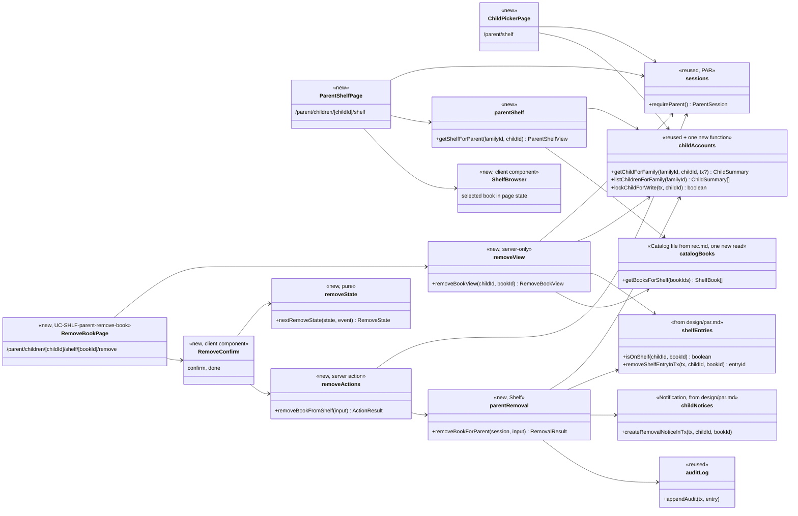
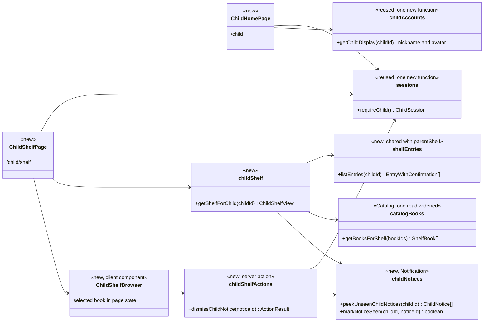
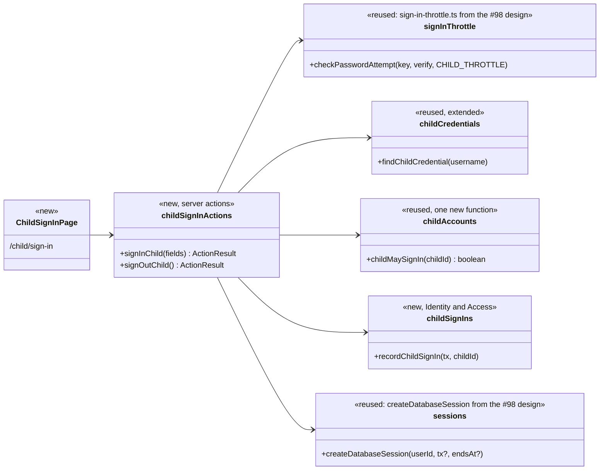
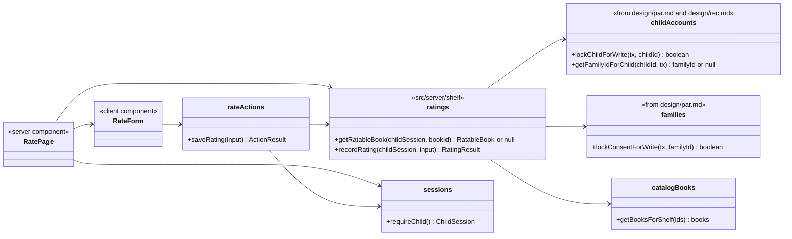
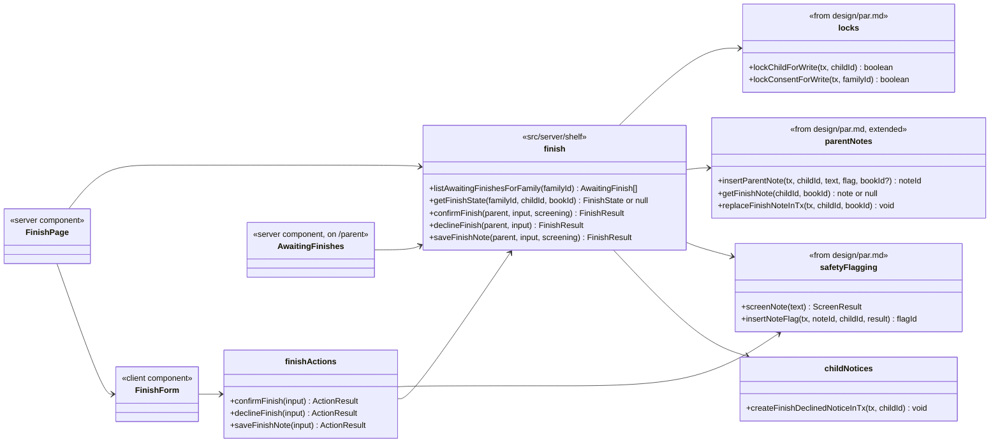
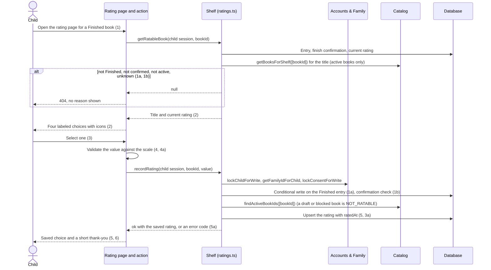
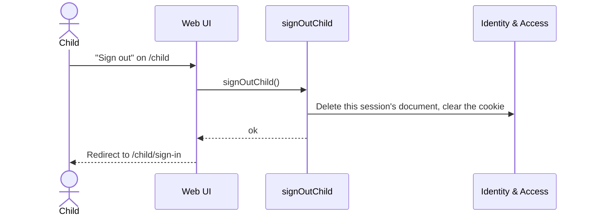
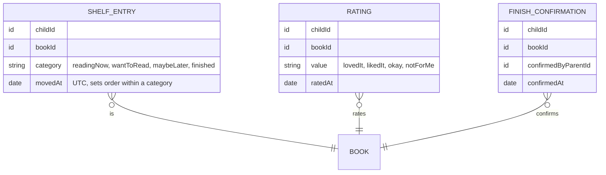
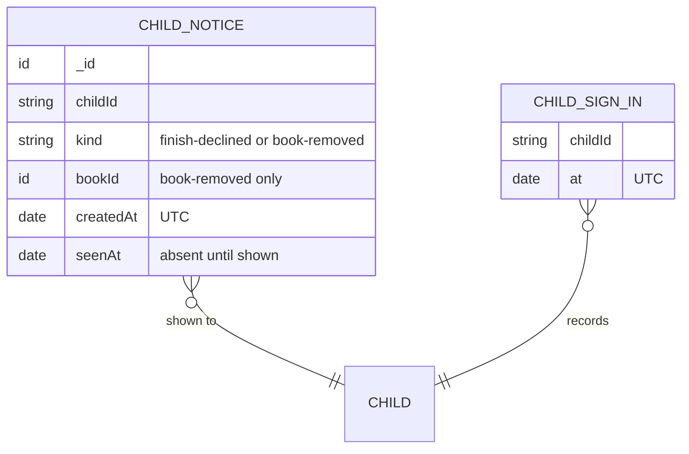
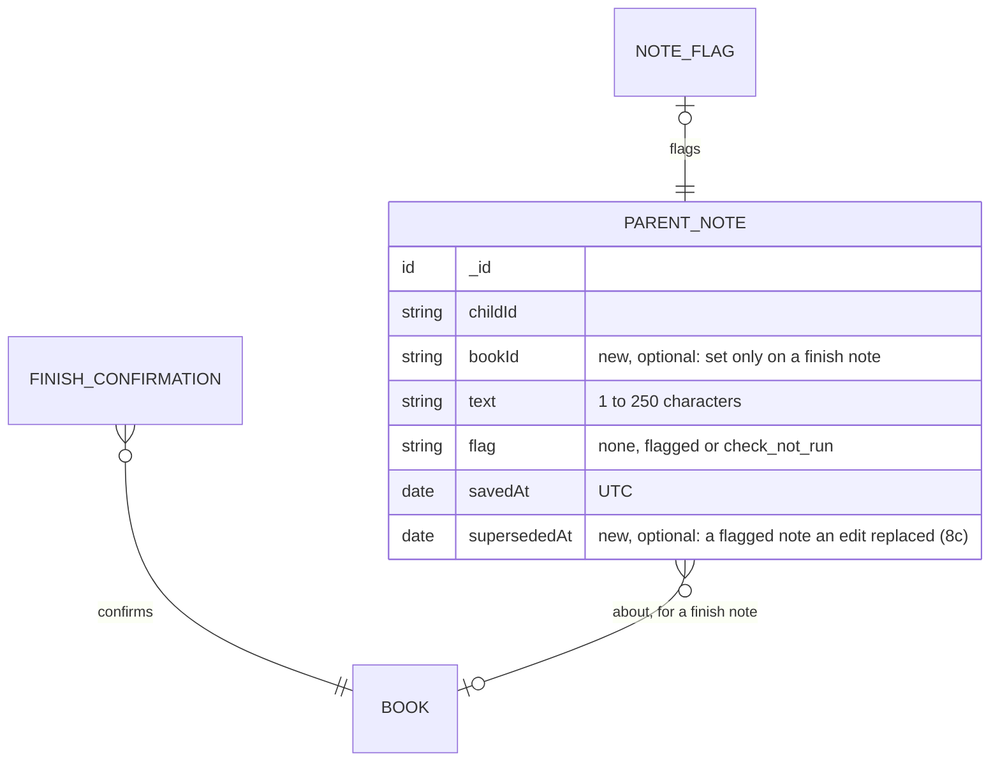

# Shelf (SHLF) Design

**Project:** BookBuddies
**Team:** Team 05
**Area:** `UC-SHLF`

> **Realizes:** `UC-SHLF-parent-view-shelf`, `UC-SHLF-kid-view-shelf`, `UC-SHLF-kid-rate-book`, `FR-RATE-rating`, `FR-REC-post-rating`, `UC-SHLF-parent-remove-book`, `FR-SHLF-parent-remove`, `FR-PAR-review`, `FR-ACCT-credentials` (the child's sign-in half, a supporting flow with no use case, `OI-46`), `DI-usage-records` (the sign-in record), `UC-SHLF-par-finish-book`, `FR-SHLF-finish-confirm` (the parent's half), `FR-NOTE-parent-note` and `FR-NOTE-flagging` (the finish note), `ROB-atomic-finish`
> **Depends on:** `BR-child-structured-responses`, `UC-ADM-block-content` (extension 5b: a block removes the shelf entries), `BR-parent-account-linked`, `BR-kid-no-metrics`, `BR-kid-anonymous-profile`, `BR-parent-shelf-removal`, `FR-SHLF-categories`, `FR-SHLF-finish-confirm`, `UI-kid-no-metrics`, `USE-child-first-run`, `DI-child-credentials`, `SEC-auth`, `SEC-signin-throttling`, `SEC-role-authorization`, `USE-parent-light`; for `UC-SHLF-parent-remove-book`: `BR-parent-ultimate-say`, `ROB-no-data-loss`, `OI-25`, `OI-41`, and from [`design/par.md`](par.md) (`UC-PAR-report-book`): `removeShelfEntryInTx`, `createRemovalNoticeInTx`, `lockConsentForWrite`, `getChildForFamily` with a transaction handle, and the `shelf.parent-removed` audit shape; from [`design/par.md`](par.md) (`UC-PAR-delete-kid-account`): `lockChildForWrite`, its §8.2.8 rule and `children.writeVersion`; for `UC-SHLF-par-finish-book`: `BR-parent-note`, `BR-note-safety-flagging`, `BR-parent-ultimate-say`, `ROB-no-data-loss`, `SAF-flag-delivery`, `CI-in-app-alerts`, `OI-25`, `OI-30`, and from [`design/par.md`](par.md) (`UC-PAR-create-kid-account`): `insertParentNote`, `screenNote`, `insertNoteFlag`, `appendNoteFlagAudit` and its decision that the flag record is the admin's alert; from `UC-SHLF-kid-rate-book` above: the entry's `writeVersion`; from `UC-SHLF-kid-move-book` (#150, open): `shelfEntries.previousCategory`
> **Related, designed separately:** `UC-PAR-report-book`, `UC-SHLF-kid-move-book` (#150)
> **See:** [use cases, SHLF area](../docs/requirements/use-cases.md#shlf-shelf-feature-area), [specification](../docs/requirements/software-requirements-specification.md), [business rules](../docs/requirements/business-rules.md), [architecture-of-record](architectural-design.md), [PAR design](par.md)
> **Designed against:** use cases v0.24 (updated in this PR), business rules v0.8, SRS v0.12 (updated in this PR), the PAR design, and the code on `main` and the merged `design/rec.md` as of 2026-11-18 (`requireParent()` in `sessions.ts` and `getChildForFamily` in `child-accounts.ts`, both used by the add-a-child pages). The Shelf and Catalog components have no code yet, and there is no shared parent layout guard: each parent page calls `requireParent()` itself.

> **Revised for:** `UC-SHLF-kid-view-shelf` and child sign-in, 2026-11-19, against `main` at `9783e44`, which holds the merged designs of #98, #100 and #102 (designs only; no Shelf, Notification or child sign-in code exists).

> **Rating design baseline:** `main` at `9183625` (#79), merged into this branch on 2026-11-26.

> **Revised for:** `UC-SHLF-par-finish-book` (#80), 2026-11-27, against `main` at `961ab9d`, which holds the merged rating design (#133), the parent and child shelf code (#111, #144), the parent note and flag code (#67) and `/parent`'s pending batches (#137). `UC-SHLF-kid-move-book` (#150) is open, not merged.

> **Revised for:** `UC-SHLF-parent-remove-book`, 2026-11-24, against `main` at `8aadd95`. No Shelf, Notification or book-report code exists yet; `appendAudit` is in [`audit-log.ts`](../src/server/audit/audit-log.ts) from #108.

**Status of this draft.** The parent's shelf view was revised from PR #42 after it was reviewed against the 2026-10-28 client answers: children no longer enter free text, so reflections, flagging of reflections and the 24-hour deletion window are gone. The child's shelf and child sign-in were added and revised through two rounds of review on PR #106. The questions test (design process step 3) was run on the first version of the child's half and still needs a re-run on the current design. Parent removal (`UC-SHLF-parent-remove-book`) was added on 2026-11-24. It covers `UC-SHLF-parent-view-shelf`, `UC-SHLF-kid-view-shelf`, child sign-in and `UC-SHLF-parent-remove-book`; the other SHLF use cases are appended as each is designed. The child's rating flow (`UC-SHLF-kid-rate-book`, #79) was added on 2026-11-26 and revised after the reviews on PR #133; its questions test (design process Phase 4) was re-run in a fresh session on the revised design; the results are in the pull request description. The parent's finish confirmation (`UC-SHLF-par-finish-book`, #80) was added on 2026-11-27. Its questions test was run on 2026-11-27 and the design revised for its results, which are in the pull request description; it still needs a re-run in a fresh session on the revised design.

---

## Overview

The Shelf area owns each child's shelf: the entries in four categories, the child's ratings, the parent's confirmation that a child finished a book, manual search and its shelf requests, and parent removal. It is the Shelf component of the Application container ([containers](architectural-design.md#51-containers), [use case areas and components](architectural-design.md#52-use-case-areas-and-components)). `UC-SHLF-parent-view-shelf`, the first use case designed here, is read-only: it reads one child's shelf entries, their ratings and their finish state, checks that the child belongs to the signed-in parent's family, and asks the Catalog for each book's cover and title. It never reads the Child Identity Store, so the parent picks a child by nickname and avatar. It is the entry point to `UC-SHLF-parent-remove-book`, `UC-PAR-report-book` and `UC-SHLF-par-finish-book`, which are designed separately and implement the pages that this view links to. A child's pending shelf request is not a shelf entry, so it is not shown here; the parent sees it through `UC-PAR-approve-shelf-request`. This design adds one read to the Catalog row of the architecture-of-record.

`UC-SHLF-kid-view-shelf` is the child's side of the same shelf, and it needs a signed-in child, which **no use case covers** (`OI-46`). It is designed here as two parts that share one seam, `requireChild()`. The first is the child's shelf: a read-only view of the child's own entries, book details, own rating and pending notices, with no count of any kind (`BR-kid-no-metrics`, 8.2.11). The second is **child sign-in, sign-out and the child home screen**, written as *supporting flows with no use case*, the way `design/par.md` (open pull request #98) does for parent sign-in (`OI-44`). They live in this document and not in `par.md`: a child starts no `UC-PAR-*` use case, and it keeps this pull request away from the `par.md` edits of pull requests #98, #102, #104 and #100. The pieces this document reuses from those pull requests (`createDatabaseSession`, `sign-in-throttle.ts`, `deleteChildSignIn`, `signOutParent`) are **designs, not code**, and are named as such where used.

A parent removes one book from one child's shelf, and the child gets the same `book-removed` notice a report writes. The design adds no new storage. It builds the page the parent shelf view already links to ("Remove from shelf", in the table under API contract below) and one Shelf function that runs the removal, the notice and the audit entry in one transaction (§8.2.8 lists "a shelf removal and its notice"). Everything it writes comes from `UC-PAR-report-book`'s functions, so a plain removal and a report's removal cannot differ: the child sees the same notice, with no reason and no parent, and cannot tell which one happened. The rating and the finish confirmation are untouched (5c), because they live in their own collections (Key decisions below, "Ratings and finish confirmations are stored apart from the shelf entry").

A child rates a book from its Finished shelf entry. The rating screen and its save action use the same eligibility check. A parent can read the result through the shelf view already delivered in #111.

A parent decides whether a child really finished a book the child moved to Finished (`UC-SHLF-par-finish-book`). The design builds the page the parent shelf already links to for "Confirm finished" and "Edit note", a "Books to confirm" section on `/parent` as the in-app prompt, and one Shelf module with three writes: confirm (with an optional note), "not finished yet" (the book goes back with the child's notice) and editing the note. Each is one transaction that also writes the shelf entry, so it conflicts with the child's move or removal and with the other parent's decision, and only the first decision counts. The note is the parent note of `UC-PAR-create-kid-account`, screened by the same word list, now able to belong to a book. It adds two optional fields to `parentNotes` and no collection.

## Components & classes



- `src/app/(parent)/parent/shelf/page.tsx` (new): the child picker (extension 1a), and the temporary entry point until a parent dashboard (`FR-PAR-dashboard`) links to the shelf. It calls `requireParent()`, then `listChildrenForFamily`. With exactly one child it redirects straight to that child's shelf, so a parent with one child takes no extra step (`USE-parent-light`, threshold still TBD). With several it lists them by nickname and avatar. With none (extension 1b, PRE-2 not met), a Main Parent is redirected to `/parent/children/new` and a Sub Parent sees a message to ask the Main Parent to add a child, as the add-a-child page does.
- `src/app/(parent)/parent/children/[childId]/shelf/page.tsx` (new): a server component, marked dynamic so it never serves a cached shelf. It calls `requireParent()` and handles the result the way `onboarding-complete/page.tsx` does: `NOT_SIGNED_IN` redirects to `/sign-in`, and any other failure (`NOT_A_PARENT`, which is what a child or admin session gets) is `notFound()`. It then calls `getShelfForParent` and passes the whole view to `ShelfBrowser`. It has no server action, because viewing changes nothing (POST-2).
- `src/app/(parent)/parent/children/[childId]/shelf/shelf-browser.tsx` (new, client component): renders the four categories in fixed order, each entry with title and author, and keeps the selected book in its own state, with no request and no URL parameter (steps 4 and 5). Every entry whose finish is confirmed carries the confirmed-finished icon in the list, in whichever category it sits. For the selected book it shows the rating if there is one, and by finish state either "Confirm finished" (a Finished entry that no parent has confirmed) or "Edit note" (any confirmed entry), as in extension 5a. For the selected book it also shows "Remove from shelf" and "Report", the controls `UC-SHLF-parent-remove-book` and `UC-PAR-report-book` start from. All four are links to the pages in the table under API contract; this view never writes (POST-2), and it sends no data to them beyond the child and book IDs in the path.
- Retry screen for extension 2b: no new file. The existing `src/app/(parent)/parent/children/error.tsx` covers every page under `/parent/children`, including this one. The picker, which sits outside that folder, has its own `error.tsx`.
- `src/server/shelf/shelf-collections.ts` (new, server-only): the names, types, validators and unique indexes of the three Shelf collections, wired into `ensureIndexes`.
- `src/server/shelf/parent-shelf.ts` (new, server-only): `getShelfForParent` checks the child's family first, then reads the child's shelf entries, ratings and finish confirmations, and the books' catalog data, and returns one complete view or throws. It never returns part of a shelf.
- `src/server/accounts-family/child-accounts.ts` (reused): `getChildForFamily(familyId, childId)` returns `{ _id, nickname, avatar }` for a child in that family and `null` otherwise (a malformed or unknown ID is also `null`, since the ID is matched as a string); it is the family check for this view. One function is added to the same file, `listChildrenForFamily(familyId)`, for the picker: same fields, ordered by creation date.
- `src/server/catalog/books.ts` (the Catalog file, on `main`; this design adds one read, server-only): `getBooksForShelf` returns the title and author of the given books that are active, one query for all the IDs. Like the Catalog's other reads it leaves out blocked books, and it leaves out drafts too. No catalog document defines a book cover, so this view has none (`OI-46`).
- `src/server/identity-access/sessions.ts` (reused): `requireParent()` returns an `ActionResult`: on success the user ID, family ID and `parentRole` (`main` or `sub`), on failure the code `NOT_SIGNED_IN` or `NOT_A_PARENT`. It does not redirect or throw, so each page decides what to do with the failure.

Added for `UC-SHLF-parent-remove-book` (all new unless marked reused):

- `src/app/(parent)/parent/children/[childId]/shelf/[bookId]/remove/page.tsx` (new): a server component, marked dynamic, at the path the parent shelf view links to. It calls `removeBookView` and renders what it returns: the redirect, `notFound()`, the 3b message ("this book is already off the shelf") with a link back to the shelf and no form, or `RemoveConfirm` with the title, the child's nickname and the path back.
- `.../remove/view.ts` (new, server-only): `removeBookView(childId, bookId)` decides on the server what the page shows, so every state is tested without rendering (as `check-email/view.ts` does for `UC-PAR-onboarding`). In order: `requireParent()` (`NOT_SIGNED_IN` is the redirect to `/sign-in`; any other failure is `notFound`), then `getChildForFamily` (another family's child, or an unknown or malformed ID, is `notFound`, the same `404` as the shelf page), then `isOnShelf`, which alone decides 3b: a book not on the shelf is the off-shelf state. Last, `getBooksForShelf([bookId])` for the title. A book on the shelf that the Catalog does not return (a draft, or a blocked book whose entry is still there) is still offered for removal, with the title "this book".
- `.../remove/remove-confirm.tsx` (new, client component): renders the steps of `remove-state.ts` and holds no rule of its own. The **confirmation** (step 3) names the book and says the child will be told it was removed. Its buttons are "Remove" and "Cancel", and "Cancel" is a link back to the shelf with no request (3a). The **result** (step 6) says the book was removed, with a link back to the shelf. Its other messages: on `SAVE_FAILED`, "Nothing was saved. Please try again."; on `OUTCOME_UNKNOWN`, "We could not confirm the removal. It may have been saved, so check the shelf before trying again.", with a link back to the shelf and no "Remove" button; on `CONSENT_NOT_CONFIRMED`, that the book cannot be removed while the family's consent is not active, with a link back to the shelf.
- `.../remove/remove-state.ts` (new, pure: no React, no server code): `nextRemoveState(state, event)`, the form's steps. "Remove" moves the confirmation to pending, and a second "Remove" while pending changes nothing, so the button is disabled. `ok` gives the result. `ALREADY_OFF_SHELF` gives the 3b message. `SAVE_FAILED` returns to the confirmation with the error, so the parent can retry (5a, `ROB-no-data-loss`). `OUTCOME_UNKNOWN` gives the check-the-shelf message (5a), from which the only way on is back to the shelf. `CONSENT_NOT_CONFIRMED` gives the consent message (5d). "Cancel" is a link, not a step.
- `.../remove/actions.ts` and `schema.ts` (new): `removeBookFromShelf`, a verb-first server action (§8.2.3), and its zod schema (§8.2.5): `childId`, `bookId`, and `confirmed`, which must be the literal `true`. Order: `requireParent()`, validate, then `removeBookForParent`. The family comes from the session, never the request.
- `src/server/shelf/parent-removal.ts` (new, server-only): `removeBookForParent(session, { childId, bookId })` runs one `withTransaction` (§8.2.8), in this order:
  1. `getChildForFamily(familyId, childId, tx)`. If it returns nothing, the result is `CHILD_NOT_FOUND`.
  2. `lockChildForWrite(tx, childId)`, because the notice is an inserting child write (§8.2.8; [`design/par.md`](par.md), `UC-PAR-delete-kid-account`). If it matches nothing, the result is `CHILD_NOT_FOUND`.
  3. `lockConsentForWrite(tx, familyId)`, as `reportBook` does ([`design/par.md`](par.md)). This comes before the shelf delete, the notice and the audit entry. If it matches nothing (consent not confirmed, or revoked), the callback throws a `CONSENT_NOT_CONFIRMED` refusal (5d), exactly as step 4 does for 3b, so the transaction aborts: nothing is written and the increment from step 2 is not kept.
  4. `removeShelfEntryInTx(tx, childId, bookId)`. If it deleted nothing, the transaction aborts with `ALREADY_OFF_SHELF` (3b) and nothing is written. On `ALREADY_OFF_SHELF` the callback throws, so the transaction aborts and the increments from steps 2 and 3 are not kept.
  5. `createRemovalNoticeInTx(tx, childId, bookId)` (step 5).
  6. `appendAudit(tx, …)` with a `shelf.parent-removed` entry in the shape `design/par.md` fixes: the parent's user ID as actor, role `parent`, the child ID, the deleted entry's ID and the book ID (§8.2.9).

  Any other error is logged through `logUnexpectedError`, and its error ID is returned. If the error that leaves `withTransaction` carries MongoDB's `UnknownTransactionCommitResult` label, the commit may have applied, and the result is `OUTCOME_UNKNOWN` (5a, save not confirmed). Every other error means the transaction did not commit, and the result is `SAVE_FAILED` (5a). The callback holds no state outside the transaction, so a rerun by `withTransaction` is harmless, as in `reportBook`.
- **Reused, defined elsewhere:** `isOnShelf` and `removeShelfEntryInTx` (`src/server/shelf/shelf-entries.ts`), `createRemovalNoticeInTx` (`src/server/notification/child-notices.ts`), `lockConsentForWrite` (`src/server/accounts-family/families.ts`), `getChildForFamily` with its transaction handle, and the `shelf.parent-removed` validator branch, all from [`design/par.md`](par.md) (`UC-PAR-report-book`); `getBooksForShelf` and `requireParent()` from this document. None of these exist in code yet except `requireParent()`, `getChildForFamily` (without the transaction handle) and `appendAudit`. Whichever of `UC-PAR-report-book` and this use case is implemented first creates them, and the other reuses them unchanged.
- **Reused from `main`, not built here:** `lockChildForWrite` in `src/server/accounts-family/child-accounts.ts` ([`design/par.md`](par.md), `UC-PAR-delete-kid-account`).

### Child's shelf (`UC-SHLF-kid-view-shelf`)



- `src/app/(child)/child/page.tsx` (new): the **child home**, a basic landing screen. It exists because the use case's trigger ("taps My Shelf on their home screen") and child sign-in both need one. It calls `requireChild()` and `getChildDisplay`, shows the child's nickname and avatar (8.2.11), a large "My Shelf" link and a "Sign out" button, and nothing else beyond the layout's privacy notice link. The other use cases that start from the home screen (`UC-REC-recommend-quiz-rules`, `UC-SHLF-manual-search`) add their own buttons when they are designed. The reading dashboard is `UC-SHLF-kid-dashboard`, not this page.
- `src/app/(child)/child/shelf/page.tsx` (new): a server component, marked dynamic, with no caching, like the parent page. It calls `requireChild()`: `NOT_SIGNED_IN` redirects to `/child/sign-in`, and `NOT_A_CHILD` (a parent or admin session) is `notFound()`. It then calls `getShelfForChild` with the child ID **from the session**; no child ID is in the URL or the request. The page itself changes nothing; the one write on the shelf is the `dismissChildNotice` action below (POST-2).
- `src/app/(child)/child/shelf/shelf-browser.tsx` (new, client component): renders the four categories in fixed order with large tap targets, each entry with its title (no cover, see Open items), the confirmed-finished icon on every confirmed entry in any category, and a Finished entry that is not confirmed grayed out with no icon (3c). When the child taps a book it shows, from what is already loaded, the book's details, the child's own rating if there is one, and the actions the server listed for that entry (steps 4 and 5). Selection is its own state, with no request and no URL parameter. It shows each pending notice at the top with a large "OK" button (3d, 3f); tapping it calls `dismissChildNotice` and removes that notice from the screen once the call succeeds, and the notice stays until then, the "find a book" message at the top for an empty shelf (2a), a "My Dashboard" link (3e), and nothing at all under an empty category (3a).
- `src/app/(child)/child/shelf/error.tsx` (new): the retry message for extension 2b, with no shelf content and a "Try again" button.
- `src/server/shelf/child-shelf.ts` (new, server-only): `getShelfForChild(childId)` reads the entries, finish confirmations, the child's ratings, the books' catalog data and the child's unseen notices, and builds one complete view or throws. It marks nothing: a notice stays unseen until the child taps OK (`dismissChildNotice`). It never returns part of a shelf.
- `src/server/shelf/shelf-entries.ts` (new, server-only, shared): one read of a child's entries joined to their finish-confirmation state (`confirmed` is a confirmation record, whatever the category, the parent view's decision below). `getShelfForParent` is revised in place to call it, so the parent and the child view cannot disagree about which entries are confirmed.
- `src/server/catalog/books.ts` (the Catalog file, reused): `getBooksForShelf` also returns `author` and `seriesName`, for the child's book details; the parent view ignores them. `seriesName` is optional: the seed spreadsheet has a "Series name (optional)" column, empty for a book with no series, and a book with none shows no series line. It returns no cover: the Catalog has no cover field, and where covers come from is a separate decision (Open items). It keeps the Catalog's rule that every read leaves out blocked books.
- `src/server/notification/child-notices.ts` (new, server-only, Notification): `peekUnseenChildNotices(childId)` and `markNoticeSeen(childId, noticeId)`, a conditional update that sets `seenAt` only on that child's own notice where it is unset. Marking a notice that is already seen, or one that is not the child's, changes nothing. Notices are *written* by `UC-SHLF-par-finish-book` 4b, `UC-SHLF-parent-remove-book` and `UC-PAR-report-book`, none of them designed yet.
- `src/app/(child)/child/shelf/actions.ts` and `schema.ts` (new): `dismissChildNotice(noticeId)`, a verb-first server action (8.2.3). It calls `requireChild()` first, validates the ID with zod (8.2.5), takes the child ID from the session and never from the request, and calls `markNoticeSeen`. It returns `{ ok: true }` also when the notice was already seen, so a second tab's tap or a double tap is harmless; a session that has ended returns `NOT_SIGNED_IN` and the notice stays.
- `src/app/(child)/layout.tsx`, `keep-alive.tsx` (client) and `actions.ts` (new): every child page loads a small client component that calls `keepChildSessionAlive({ active })` every `CHILD_KEEPALIVE_SECONDS`, where `active` is true if the child tapped, pressed a key or scrolled since the last call. The action calls `requireChild({ countsAsActivity: false })` first, which sets `lastSeenAt` on the caller's own `childSessionEnds` record, validates the body with zod (8.2.5), sets `lastActiveAt` too when `active` is true, and returns `{ ok: true }`; if the session has ended it returns `NOT_SIGNED_IN` and the client redirects to `/child/sign-in`, as it does on `NOT_A_CHILD` (the browser has since signed in as someone else). It returns nothing else and logs nothing about the child (8.2.7). The client sends nothing from the sign-in page. The layout is dynamic and also links the privacy notice on every child page, because the link belongs on the child's home screen and wherever information is collected from a child (`BR-coppa-notice`).
- `src/app/(child)/child/error.tsx` (new): the calm retry screen for every child page (8.2.1).
- `src/server/accounts-family/child-accounts.ts` (reused): `getChildDisplay(childId)` returns `{ nickname, avatar }` and nothing else, so it is safe for a child session to call (8.2.11).
- `src/server/identity-access/sessions.ts` (reused, one new function): `requireChild()` returns `{ userId, childId, sessionId }` from the `users` document with role `child` and the session document the request's own cookie names (`sessionId` stays on the server), or `NOT_SIGNED_IN` / `NOT_A_CHILD`. Every accepted call counts as activity unless the caller passes `countsAsActivity: false`, which the keep-alive uses. A child session is `NOT_SIGNED_IN` once the child has been inactive for `CHILD_IDLE_MINUTES` (`lastActiveAt`), and once `endsAt` has passed and the visit has ended, meaning `lastSeenAt` is older than the grace (Key decisions). A child session with no `childSessionEnds` record is refused and deleted. It does not redirect or throw. A parent session gets `NOT_A_CHILD`; a child session already gets `NOT_A_PARENT` from `requireParent()`. `endCurrentSession()`, which sign-out uses, also deletes the session's record, in one transaction.
- `src/server/identity-access/child-sessions.ts` (new, server-only): owns `childSessionEnds` and states the end rules once: it writes the record, checks and refreshes it on each read, and deletes an ended session with its record in one transaction.

### Child sign-in and sign-out (supporting flows, no use case, `OI-46`)



- `src/app/(child)/child/sign-in/page.tsx`, `sign-in-form.tsx`, `actions.ts`, `schema.ts` (new): the form (username and password, large fields, no link to any parent page) and `signInChild`; one zod schema serves form and action (8.2.5). `signOutChild` deletes the caller's own session document, clears the cookie and redirects to `/child/sign-in`, as `signOutParent` does in the #98 design. A signed-in child who opens the sign-in page is redirected to `/child`. The "Sign out" button is on `/child`.
- `src/server/identity-access/child-credentials.ts` (reused, extended): `findChildCredential(username)` returns the user ID, child ID and password hash and nothing else. It trims and lowercases the typed username and matches it exactly, because the parent's entry is stored trimmed and lowercased with a unique index (`design/par.md`, Key decisions), so the child's capitals never matter. `deleteChildSignIn` (pull request #104 named it and was closed, so this design states what it must do) also deletes the child's `childSignIns` records and all the child's throttle state (every key that starts `child:`, the lowercased username and a colon).
- `src/server/identity-access/sign-in-throttle.ts` (reused from the #98 design, server-only): counts failed sign-ins per key and returns how long the caller must wait (`SEC-signin-throttling`). A child's attempt goes through the same `checkPasswordAttempt(key, verify, policy)` as a parent's, with the child's policy (`CHILD_THROTTLE`): it claims the attempt with one atomic conditional update before the password is checked, so parallel guesses cannot all pass a check made before any of them is counted (Key decisions). A child's attempt is counted under one of two keys, chosen by whether the caller is a trusted device for that username (below). A trusted device's key is `child:<username>:dev:<hash of its device ID>`. Every other caller shares the account's key, `child:<username>:shared`. The username is lowercased, and neither key can meet a parent's email key. So a guesser's failures only ever count against the shared key, and never make a trusted device wait.
- `src/server/identity-access/child-sign-in.ts` (new, server-only): `signInChildAccount(username, password)` runs "Child signs in" up to the commit. The action then ends the old session and sets both cookies.
- `src/server/identity-access/device-token.ts` (new, server-only): issues and reads the `child_device` cookie that marks a trusted device (httpOnly, Secure, SameSite=Lax). The cookie holds one entry for each child who has signed in on this browser (a random device ID, the child ID and an expiry) and one signature over the whole list, made with a server secret from configuration (8.2.6), so the server trusts it without storing anything. A shared family tablet therefore trusts every child who has signed in on it, and one child's sign-in never removes another's entry. `issueDeviceToken(childId)` is called only after a correct password, never after a failure: it adds or renews that child's entry, keeps the others, drops expired ones and keeps at most `CHILD_DEVICE_MAX_CHILDREN` entries (the oldest go first). `readTrustedDevice(childId)` returns the device ID of that child's entry only when the signature is valid, that entry's expiry has not passed (checked against `now()`) and its child ID is the child the username belongs to. A missing, forged or expired cookie, or one with no entry for this child, returns nothing, and the caller is then counted under the shared key. Only a hash of the device ID is stored, in the throttle key. The cookie identifies a browser for the throttle and nothing else: it is not written to `childSignIns`, it holds no IP address and no name, and it is deleted with the throttle state (`DI-usage-records`).
- `src/server/identity-access/child-sign-ins.ts` (new, server-only): owns `childSignIns`, one record per successful sign-in (`DI-usage-records`), and the read the admin usage lookup will call later (`FR-ADM-child-lookup`).
- `src/server/accounts-family/child-accounts.ts` (reused): `childMaySignIn(childId)` is the one place that decides whether a child account may sign in. Today it checks that the child exists and that the family's consent is confirmed and not revoked (`isConsentConfirmed`). Suspension arrives here later (`UC-ADM-suspend-account`, and the children of a suspended parent, `OI-47`).
- `src/server/identity-access/sessions.ts` (reused): `createDatabaseSession(userId, tx?)` from the #98 design gains an optional `endsAt` argument, because a child's session ends at the next midnight and not after a fixed lifetime (Key decisions). The session document's own `expires` is the #98 lifetime for both roles, never `endsAt`. A parent's call passes none and is unchanged, so the parent session rules of the #98 design, including its sliding expiry, are untouched.

### Rate a finished book (`UC-SHLF-kid-rate-book`)



Each file is new unless marked reused.

- `src/app/(child)/child/shelf/[bookId]/rate/page.tsx` (replaces the placeholder `main` has at this path, which only shows "Rate a book"): a server component, marked dynamic. It calls `requireChild()`: `NOT_SIGNED_IN` redirects to `/child/sign-in`, and `NOT_A_CHILD` (a parent or admin session) is `notFound()`. It then calls `getRatableBook`; `null` is `notFound()`, the same `404` for a book that is not on the child's shelf, not in Finished, not confirmed, unknown or malformed, so the page does not show which (1a, 1b). Otherwise it renders `RateForm` with the title, the child's current rating if any, and the nickname from `getChildDisplay`.
- `.../rate/rate-form.tsx` (new, client component): the four choices as large buttons, each with its glossary label as its accessible name and a placeholder icon (see Open questions), and a "Done" link back to the shelf. Nothing is sent until a choice is tapped, so closing writes nothing (2a). All buttons are disabled while a save is pending, and the chosen button stays selected when the save fails (5a). On success it shows the saved choice and the thank-you, with no score, count or text field (`BR-kid-no-metrics`, §8.2.11).
- `.../rate/actions.ts` and `schema.ts` (new): `saveRating({ bookId, rating })`, a verb-first server action (§8.2.3). Order: `requireChild()`, the zod schema (§8.2.5), then `recordRating`. The schema is built from `RATING_VALUES` in `shelf-collections.ts`: `bookId` a non-empty string of at most 100 characters, `rating` one of `lovedIt`, `likedIt`, `okay`, `notForMe`. A missing, empty or oversized `bookId` gets `NOT_RATABLE`, the same as an unknown book, and an unknown key in the request (such as a `childId`) is stripped, since the child always comes from the session. The child comes from the session, never the request.
- `src/server/shelf/ratings.ts` (new, server-only): the only code that writes `ratings`.
  - `getRatableBook(childSession, bookId)`: reads the child's entry for the book, requires category Finished and a finish confirmation record, reads the title through `getBooksForShelf([bookId])` (active books only), and the child's current rating. It returns `{ bookId, title, rating | null }` or `null`. The shelf and confirmation checks are the same ones `recordRating` repeats inside its transaction (4, 5), and so is the active-book check (5b). A Finished, confirmed book that is not active in the Catalog (a draft, or a blocked book whose entry was not deleted) is a `404` on the page and `NOT_RATABLE` from `recordRating`, so the page and the save give the same answer.
  - `recordRating(childSession, input)`: one `withTransaction`, in this order: (1) `lockChildForWrite(tx, childId)` (`CHILD_NOT_FOUND` when it matches nothing); (2) `getFamilyIdForChild(childId, tx)` on the same `tx` (`null` is `CHILD_NOT_FOUND`); (3) `lockConsentForWrite(tx, familyId)` (`CONSENT_NOT_CONFIRMED`); (4) a conditional write on the child's entry for the book: `updateOne({ childId, bookId, category: "finished" }, { $inc: { writeVersion: 1 } })`, and no match is `NOT_RATABLE` (1a); (5) the finish confirmation exists, read on `tx`, else `NOT_RATABLE` (1b); (5b) the book is active in the Catalog, read through `findActiveBookIds([bookId])`, else `NOT_RATABLE`; (6) an upsert on the unique (`childId`, `bookId`) key of `ratings` that sets `value` and `ratedAt` (`now()`, §8.2.2) together, so a new choice replaces the old one (3a). `NOT_RATABLE` is thrown as a sentinel inside the callback and mapped after it, so nothing is written. Returns `ok` with the saved `rating`. Any other error is logged through `logUnexpectedError` and its error ID is returned. If the error that leaves `withTransaction` carries MongoDB's `UnknownTransactionCommitResult` label, the commit may have applied, and the result is `OUTCOME_UNKNOWN`; every other error means nothing committed, and the result is `SAVE_FAILED` (5a). The callback holds no state outside the transaction, so a rerun by `withTransaction` is harmless.
- `src/server/shelf/shelf-collections.ts` (reused, one change): adds the optional `writeVersion` (`bsonType: "int"`: `$inc` of 1 on an absent field creates an int32) to the `shelfEntries` validator and document type (Data model). `ensureCollection` applies a changed validator to an existing collection with `collMod`, so there is no migration. `bookId` is a string, as in all three Shelf collections. Shelf's `deleteChildRecords` already deletes `ratings` (`design/par.md`), so it does not change. `RATING_VALUES` and the `ratings` collection are reused as they are.
- `src/server/shelf/child-shelf.ts` (changed, one line, and its test): `getShelfForChild` currently builds `actions` as `["move", "remove", "rate"]` for every confirmed entry, whatever its category (on `main`, asserted by the `reread` fixture in `child-shelf.int.test.ts`). It now adds `rate` only when the entry is confirmed **and** in Finished, so the Rate link that `shelf-browser.tsx` already renders is never shown for a book the rating page would refuse (Key decisions, `OI-75`). The test's `reread` entry (confirmed, Want to Read) now expects `["move", "remove"]`, and a confirmed Finished entry expects all three.
- `src/server/accounts-family/child-accounts.ts` (reused): `getChildDisplay` (the nickname for the thank-you), `lockChildForWrite` ([`design/par.md`](par.md), `UC-PAR-delete-kid-account`) and `getFamilyIdForChild` ([`design/rec.md`](rec.md), `recordReaction`). `src/server/accounts-family/families.ts` (reused): `lockConsentForWrite`. `src/server/identity-access/sessions.ts` (reused): `requireChild()`. `lockChildForWrite`, `getFamilyIdForChild`, `lockConsentForWrite` and `requireChild()` are on `main` (#124, #129, #134) and are reused unchanged.
- **Not built here:** the follow-up of step 6. This build saves the rating and shows the thank-you; it calls no Recommendation function (Key decisions, "Step 6 is deferred").

### Parent confirms a finish (`UC-SHLF-par-finish-book`)



Each file is new unless marked reused.

- `src/app/(parent)/parent/children/[childId]/shelf/[bookId]/finish/page.tsx`: the page the parent shelf already links to for both "Confirm finished" and "Edit note" (API contract, "Links this view renders"). A server component, marked dynamic. It calls `requireParent()`: `NOT_SIGNED_IN` redirects to `/sign-in`, and any other refusal is `notFound()`. It then calls `getFinishState(familyId, childId, bookId)`; `null` (a child outside the family, an unknown or malformed ID) is `notFound()`, one `404` for all (2b). Otherwise it renders `FinishForm` in one of three states: **awaiting** (steps 3–6), **confirmed** (4c, with the current note), or **not waiting** (1a: "This book isn't waiting for a decision any more", with a link back to the shelf and no controls). Several awaiting books are handled one at a time (step 3), because each has its own page, reached from the step 1 list.
- `.../finish/finish-form.tsx` (client component): in the awaiting state, the book's title, the child's nickname and avatar, and "Confirm finished" and "Not finished yet". "Confirm finished" opens the note box (step 5) with the prompt text from the use case and a live count of the 250-character limit. Over the limit, it shows the inline error and disables Save while keeping the text (6b). Save sends the confirmation and the note together (step 8). In the confirmed state it shows the note box with the current note and Save (4c). Every button is disabled while a save is pending. After a failed save the text stays in the box (8a). After `OUTCOME_UNKNOWN`, the form reloads the state and keeps its controls disabled until the reloaded state arrives, as the batch page does (`design/rec.md`), and never says "try again" or "nothing was saved". `FINISH_NOT_WAITING` and `FINISH_ALREADY_DECIDED` reload the page into the state now stored, with the message from the API contract. The page passes the entry's `_id` and `movedAt` as they were when the page loaded, and the form sends them back with "Confirm finished" and "Not finished yet", so a move the child made while the form was open is caught even if the book is back in Finished, and so is a book removed and added back, which is a new entry (Key decisions). After `FINISH_ALREADY_DECIDED`, the reloaded page keeps the note the parent typed, read-only, under "Your note wasn't saved", so the text is not lost without a word (`ROB-no-data-loss`). The note's live count and the schema count the same way (below).
- `.../finish/actions.ts` and `schema.ts`: `confirmFinish`, `declineFinish` and `saveFinishNote`, verb-first server actions (§8.2.3). Order: `requireParent()`, the zod schema (§8.2.5), `getChildForFamily(familyId, childId)` (`CHILD_NOT_FOUND`, an early answer before screening; the check that counts is the one inside each Shelf transaction, below), then `screenNote` on the trimmed note when there is one, then the Shelf function. The schema: `childId` and `bookId` non-empty strings of at most 100 characters; `expectedEntryId` (the entry's `_id`, a 24-character hexadecimal string) and `expectedMovedAt` (an ISO 8601 UTC time with milliseconds), both required for `confirmFinish` and `declineFinish`; `note` optional, trimmed, at most 250 characters, and an empty note after trimming is no note (6a) or, for `saveFinishNote`, a cleared note (4c). Screening runs before the transaction, as in `UC-PAR-create-kid-account`, and a thrown screen gives `check_not_run` (7a). The parent and family come from the session, never the request. A note's length is counted after trimming, in UTF-16 code units (JavaScript's `length`, which zod's `max` uses), and the form's counter uses the same count, so the browser never enables Save for a note the server refuses. Line breaks are kept.
- `src/app/(parent)/parent/awaiting-finishes.tsx`: the "Books to confirm" section on `/parent` (step 1), beside "Recommendations to review". One line per awaiting book: the child's nickname and avatar, the book's title, and a link to its finish page. No count and no date. Nothing when no book is waiting. `/parent` is already `force-dynamic` (#137).
- `src/server/shelf/finish.ts` (server-only): the only code that writes `finishConfirmations`, and the Shelf side of the note.
  - `listAwaitingFinishesForFamily(familyId)`: the family's children (`listChildrenForFamily`), their Finished entries with no confirmation record (the shared rule in `shelf-entries.ts`), and the titles through `getBooksForShelf` (active books only, so a blocked book is never listed). Oldest `movedAt` first.
  - `getFinishState(familyId, childId, bookId)`: checks the family first (`getChildForFamily`), then reads the entry, the confirmation and, when confirmed, `getFinishNote`. It returns `null` outside the family, and otherwise the state the page shows. It also returns the entry's `_id` and `movedAt` for the form. When the entry is gone but a confirmation exists (the book was removed from the shelf), it returns the confirmed state, so the note stays editable (4c, "at any time"), and the page shows the title from the Catalog. When the book is blocked, `getBooksForShelf` returns nothing for it and the page shows "This book isn't available right now" with no note box (Open questions, "Editing the note of a blocked book").
  - `confirmFinish(parent, input, screening)`: one `withTransaction`, in this order: (1) `getChildForFamily(parent.familyId, childId, tx)`, the family scope on the session's family (§8.1), where `null` is `CHILD_NOT_FOUND` and nothing below runs; (2) `lockChildForWrite(tx, childId)` (`CHILD_NOT_FOUND`); (3) `lockConsentForWrite(tx, familyId)` (`CONSENT_NOT_CONFIRMED`, 8d); (4) the confirmation, read on `tx`: when one exists, `FINISH_ALREADY_DECIDED` (3a); (5) a conditional write on the entry, `updateOne({ _id: expectedEntryId, childId, bookId, category: "finished", movedAt: expectedMovedAt }, { $inc: { writeVersion: 1 }, $unset: { previousCategory: "" } })`, where no match is `FINISH_NOT_WAITING` (1a); the `$inc` makes it a real write even when there is no `previousCategory` to unset, because MongoDB does not count an update that changes nothing as a write, and only a real write conflicts with a concurrent move; (6) insert the confirmation with `confirmedByParentId` (the session's user ID) and `confirmedAt` (`now()`, §8.2.2), where a duplicate key on the unique (`childId`, `bookId`) index is also `FINISH_ALREADY_DECIDED` (3a); (7) with a note, `insertParentNote(tx, childId, text, flag, bookId)`, and when flagged, `insertNoteFlag` and `appendNoteFlagAudit` (step 8). Refusals are thrown as sentinels inside the callback and mapped after it, so nothing is written.
  - `declineFinish(parent, input)`: the same steps (1)–(4); then the entry's conditional write sets `category` to `previousCategory`, or `readingNow` when it is absent (4b, "team proposal"), `movedAt` to `now()`, unsets `previousCategory` and increments `writeVersion`, matching only `category: "finished"` and the `_id` and `movedAt` the page loaded, as in `confirmFinish` (`FINISH_NOT_WAITING`); then `createFinishDeclinedNoticeInTx(tx, childId)`.
  - `saveFinishNote(parent, input, screening)`: steps (1) to (3); the confirmation must exist, read on `tx` (`FINISH_NOT_CONFIRMED`); then `replaceFinishNoteInTx(tx, childId, bookId)` and, unless the note was cleared, `insertParentNote` with its flag and audit as in `confirmFinish` (4c, 8c). It does not write the shelf entry: editing a note does not depend on where the book sits, and a confirmation is never withdrawn by any use case.
  - Errors: as for `recordRating`, any other error is logged through `logUnexpectedError`; when the error carries `UnknownTransactionCommitResult`, the confirmation or decline is read back at majority read concern, and only a stored result that this attempt wrote (for a confirmation, `confirmedByParentId` and `confirmedAt` equal to this attempt's) is `ok`. Anything else is `OUTCOME_UNKNOWN`, never `SAVE_FAILED`, because the commit can still become visible after the read (Key decisions). Every other error is `SAVE_FAILED` (8a). For a decline, the read-back counts as this attempt's only when the entry's `movedAt` equals this attempt's `now()` and its category is the one this attempt wrote; anything else is `OUTCOME_UNKNOWN`. For a note edit, the read-back is the book's current note: with a new note, it counts as this attempt's only when the current note's `_id` is the one this attempt inserted (`insertParentNote` returns it; the action keeps the value from the last run of the callback, because `withTransaction` can rerun it and each run inserts a new ID); with a cleared note, it counts only when no current note remains. A cleared note that the other parent also cleared reads the same, which is `ok`, because the stored state is the one this parent asked for. Anything else is `OUTCOME_UNKNOWN`.
- `src/server/accounts-family/parent-notes.ts` (reused, extended; Accounts & Family owns the parent note, architecture Open questions): `insertParentNote` takes an optional `bookId`; new `getFinishNote(childId, bookId)` (the book's current note: the latest with that `bookId` and no `supersededAt`) and `replaceFinishNoteInTx(tx, childId, bookId)`, which deletes the book's current note, or sets `supersededAt` on it when it is flagged (8c); `listLatestNoteInterestKeys` gains the filter `bookId: { $exists: false }`, so it reads only the profile note from `UC-PAR-create-kid-account` and never a finish note, superseded or not (Key decisions, `OI-76`). The validator gains `bookId` and `supersededAt` (Data model).
- Mapping the screening result: `screenNote` (`src/server/safety-flagging/screen-note.ts`) returns `{ state, passages, version }`, where `state` is `flagged` when `passages` is non-empty and `none` otherwise, and it throws when it cannot screen, including when the word list is not configured. It never returns `check_not_run` itself (`design/par.md`'s Components says it does; the code does not). The action maps it as `createChild` in `child-accounts.ts` does: the note's flag is the result's `state`, and when it is `flagged`, `insertNoteFlag(tx, noteId, childId, result)` and `appendNoteFlagAudit` are called; a throw is `check_not_run` with no flag. No other value is possible, so a match is never saved as `none` (`BR-note-safety-flagging`, POST-5).
- `src/server/notification/child-notices.ts` (reused, extended): `createFinishDeclinedNoticeInTx(tx, childId)` inserts one `finish-declined` notice, with no book and no parent (the shape is already in the validator). The child's shelf already renders its fixed wording (#144).
- `src/server/shelf/shelf-collections.ts` (reused): `writeVersion` is the field `UC-SHLF-kid-rate-book` adds, and `previousCategory` is the field `UC-SHLF-kid-move-book` adds (#150). Whichever is built first adds it to the validator. `ensureShelfIndexes` is unchanged.
- Reused unchanged: `requireParent()`, `getChildForFamily`, `listChildrenForFamily`, `lockChildForWrite`, `lockConsentForWrite`, `screenNote`, `insertNoteFlag`, `appendNoteFlagAudit`, `getBooksForShelf`, `logUnexpectedError`.
- **Not built here:** the weekly check-in (`FR-NOT-weekly-reminder`, `OI-30`); no use case sends it. Nothing writes an awaiting entry until `UC-SHLF-kid-move-book` is built, so until then the page is exercised with fixtures, as the batch page was before the quiz.

## Sequence

### UC-SHLF-kid-rate-book



Step 6's follow-up books are not in this diagram: this build shows the thank-you only (Key decisions).

### UC-SHLF-par-finish-book

```mermaid
sequenceDiagram
    actor Parent as Parent (Main or Sub)
    participant Home as /parent, Books to confirm
    participant Page as Finish page and actions
    participant Shelf as Shelf (finish.ts)
    participant AF as Accounts & Family
    participant SF as Safety Flagging
    participant DB as Database
    Home->>Shelf: listAwaitingFinishesForFamily(familyId) (1)
    Shelf->>DB: Family children's Finished entries with no confirmation
    Home-->>Parent: One line per book: nickname, title, link (1)
    Parent->>Page: Open the book's finish page (2)
    Page->>AF: requireParent(), getChildForFamily (2b: one 404)
    Page->>Shelf: getFinishState(familyId, childId, bookId)
    alt no longer in Finished (1a)
        Page-->>Parent: "This book isn't waiting for a decision any more"
    end
    Page-->>Parent: Title, nickname, Confirm finished, Not finished yet (3)
    Parent->>Page: Confirm finished (4)
    Page-->>Parent: Note box with the prompt and the 250 limit (5)
    Parent->>Page: Write a note or skip it, Save (6, 6a, 6b)
    Page->>Page: requireParent(), zod, getChildForFamily
    Page->>SF: screenNote(note) (7; a throw is check_not_run, 7a)
    Page->>Shelf: confirmFinish(parent, input, screening)
    Shelf->>AF: lockChildForWrite, lockConsentForWrite
    Shelf->>DB: Confirmation exists? (3a)
    Shelf->>DB: Conditional write on the Finished entry (1a)
    Shelf->>DB: Insert the confirmation (unique index, 3a)
    Shelf->>AF: insertParentNote(tx, childId, text, flag, bookId) (8)
    Shelf->>SF: If flagged: insertNoteFlag, appendNoteFlagAudit (8)
    Shelf-->>Page: ok, or an error code (8a)
    Page-->>Parent: Confirmed (9)
```

4b, "Not finished yet": after step 3 the parent taps "Not finished yet", and `declineFinish` runs in one transaction: the same locks and checks, then the entry goes back to `previousCategory` (or Reading Now), and the `finish-declined` notice is written. No note box is shown.

4c, "Edit note": the page opens in the confirmed state with the current note; Save runs `screenNote` and `saveFinishNote` in one transaction: the same locks, a confirmation must exist, the book's current note is replaced (or kept for the admin when flagged, 8c), and the new note with any flag and audit entry is inserted.

### UC-SHLF-parent-view-shelf: view a child's shelf and ratings

```mermaid
sequenceDiagram
    actor P as Parent
    participant UI as Web UI
    participant PG as Shelf page
    participant IA as Identity & Access
    participant SH as Shelf
    participant AF as Accounts & Family
    participant CAT as Catalog
    participant DB as Database
    P->>UI: Tap "View Shelf" (step 1)
    alt more than one child (1a)
        UI-->>P: Child picker, nickname and avatar only
        P->>UI: Choose a child (1a)
    end
    UI->>PG: GET /parent/children/{childId}/shelf
    PG->>IA: requireParent()
    IA-->>PG: parent session (family ID), or NOT_SIGNED_IN / NOT_A_PARENT
    alt not signed in
        PG-->>UI: redirect to /sign-in
    else not a parent (child or admin session)
        PG-->>UI: 404, no shelf data
    end
    PG->>SH: getShelfForParent(familyId, childId) (step 2)
    SH->>AF: getChildForFamily(familyId, childId)
    alt child not in the parent's family (2c)
        AF-->>SH: not found
        SH-->>PG: not found
        PG-->>UI: 404, no shelf data
    end
    SH->>DB: Shelf entries, ratings, finish confirmations for the child (step 2)
    SH->>CAT: getBooksForShelf(bookIds) (step 2)
    CAT-->>SH: title and author; blocked books left out (5b)
    alt any read fails (2b)
        SH-->>PG: error
        PG-->>UI: Retry screen, nothing partial
    end
    SH-->>PG: Complete view
    alt no entries (2a)
        PG-->>UI: Empty-state message
    end
    PG-->>UI: Four categories in fixed order, title and author (step 3)
    P->>UI: Tap a book (step 4)
    UI-->>P: Rating if any (step 5); "Confirm finished" on a Finished entry with no confirmation, or "Edit note" on a confirmed entry in any category (5a)
    P->>UI: Leave the view (step 6)
```

Step 4 needs no second request: the page already holds every entry's rating and finish state, and selecting a book only changes state inside `ShelfBrowser`, so the shelf is never read again and cannot hit 2b or 5b halfway through a visit. Extension 5b needs no code in this view: when the admin blocks a book, `UC-ADM-block-content` removes the shelf entries in the same save, so the entry is gone the next time the page loads, and nobody is told.

### UC-SHLF-kid-view-shelf: view my shelf

```mermaid
sequenceDiagram
    actor C as Child
    participant UI as Web UI
    participant PG as Child shelf page
    participant IA as Identity & Access
    participant SH as Shelf
    participant CAT as Catalog
    participant ACT2 as dismissChildNotice
    participant NOT as Notification
    C->>UI: Tap "My Shelf" on /child (step 1)
    UI->>PG: GET /child/shelf
    PG->>IA: requireChild()
    alt not signed in
        PG-->>UI: redirect to /child/sign-in
    else not a child session (parent or admin)
        PG-->>UI: 404, no shelf data
    else a child session
        Note over PG,SH: only this case goes on to read the shelf
    end
    PG->>SH: getShelfForChild(childId from the session) (step 2)
    SH->>SH: Entries, finish confirmations and the child's ratings (step 2)
    SH->>CAT: getBooksForShelf(bookIds) (step 2; blocked books left out, 3b)
    CAT-->>SH: title, author, series name
    SH->>NOT: peekUnseenChildNotices(childId) (3d, 3f)
    alt any read throws (2b)
        SH-->>PG: error
        PG-->>UI: error.tsx: retry message, nothing partial
    end
    SH-->>PG: One complete view
    alt no entries (2a)
        PG-->>UI: Message at the top pointing to a recommendation, no count
    end
    PG-->>UI: Four categories in fixed order, title, large tap targets (step 3, 3a, 3c)
    opt a notice was pending
        PG-->>UI: The notice with an OK button, on every load until it is tapped (3d, 3f)
    end
    C->>UI: Tap a book (step 4)
    UI-->>C: Details, own rating if any, move, remove, and rate only for a confirmed Finished entry (step 5, 5a)
    opt the child taps OK on a notice (3d, 3f)
        UI->>ACT2: dismissChildNotice(noticeId)
        ACT2->>IA: requireChild()
        ACT2->>NOT: markNoticeSeen(childId from the session, noticeId)
        ACT2-->>UI: ok, the notice is removed from the screen
    end
    C->>UI: "My Dashboard" (3e), or leave (step 6)
```

Step 4 needs no second request: the page already holds every entry's details, rating and allowed actions. Extension 3b needs no code here, as in the parent view: the block removed the entry and nobody is told.

### UC-SHLF-parent-remove-book: remove a book from a child's shelf

```mermaid
sequenceDiagram
    actor P as Parent (Main or Sub)
    participant UI as Remove page
    participant ACT as removeBookFromShelf
    participant IA as Identity & Access
    participant SH as Shelf
    participant AF as Accounts & Family
    participant NOT as Notification
    participant CAT as Catalog
    participant DB as Database
    P->>UI: Open a book on the child's shelf, tap "Remove from shelf" (steps 1 and 2)
    UI->>IA: requireParent()
    UI->>AF: getChildForFamily(familyId, childId)
    alt another family's child, or unknown
        UI-->>P: 404
    end
    UI->>SH: isOnShelf(childId, bookId)
    alt not on the shelf (3b)
        UI-->>P: The book is already off the shelf, no form
    end
    UI->>CAT: getBooksForShelf([bookId]) for the title
    Note over UI,CAT: Not returned (a draft or blocked book still on the shelf): the title is "this book"
    UI-->>P: Confirm, and the child will be told (step 3)
    alt cancel (3a)
        P->>UI: Back to the shelf, no request
    end
    P->>UI: Confirm (step 4)
    UI->>ACT: removeBookFromShelf(childId, bookId, confirmed)
    ACT->>IA: requireParent()
    ACT->>ACT: Validate with the zod schema (confirmation)
    ACT->>SH: removeBookForParent(session, input) (step 5)
    SH->>DB: Begin transaction
    SH->>AF: getChildForFamily(familyId, childId, tx), CHILD_NOT_FOUND if absent
    SH->>AF: lockChildForWrite(tx, childId), CHILD_NOT_FOUND if no match (design/par.md)
    SH->>AF: lockConsentForWrite(tx, familyId), before the delete, notice and audit
    alt no match: consent not confirmed or revoked (5d)
        SH->>DB: Abort (the callback throws the refusal), nothing kept
        SH-->>ACT: CONSENT_NOT_CONFIRMED
    end
    SH->>SH: removeShelfEntryInTx (step 5), returns the deleted entry's ID or nothing
    alt nothing deleted (3b, a race since the page loaded)
        SH->>DB: Abort, nothing kept
        SH-->>ACT: ALREADY_OFF_SHELF
    end
    SH->>NOT: createRemovalNoticeInTx, book only, no reason, no parent (step 5, 5b)
    SH->>DB: Append audit entry shelf.parent-removed, IDs only
    alt the transaction did not commit (5a)
        DB-->>SH: transaction aborted, nothing kept
        SH-->>ACT: SAVE_FAILED, error ID logged
    else commit result unknown after the driver's retries (5a)
        DB-->>SH: error labelled UnknownTransactionCommitResult
        SH-->>ACT: OUTCOME_UNKNOWN, error ID logged; may have been saved
    end
    SH->>DB: Commit
    Note over SH,DB: Rating and finish confirmation untouched (5c)
    ACT-->>UI: ok
    UI-->>P: The book was removed (step 6)
```

The audit append is the only interaction with no use case step; §8.2.9 requires one for every parent shelf removal. Extension 5b needs nothing here: a notice has no expiry, and the child's shelf shows it until the child taps OK (`dismissChildNotice`, above).

### Supporting flows with no use case (`OI-46`): child sign-in and sign-out

These are **not steps of `UC-SHLF-kid-view-shelf`**; its PRE-1 assumes them. The developer chose (2026-11-19) to design them here.

#### Child signs in

```mermaid
sequenceDiagram
    actor C as Child
    participant UI as Web UI
    participant ACT as signInChild
    participant IA as Identity & Access
    participant AF as Accounts & Family
    participant DB as Database
    C->>UI: Username and password on /child/sign-in
    UI->>ACT: signInChild(fields)
    ACT->>ACT: Validate; trim and lowercase both fields
    ACT->>IA: findChildCredential(username), a cheap lookup that checks no password
    ACT->>IA: readTrustedDevice(childId); key = "child:" + username + ":dev:" + device if trusted, else "child:" + username + ":shared" (unknown username: shared)
    ACT->>IA: checkPasswordAttempt(key, verify, CHILD_THROTTLE) claims the attempt in one atomic conditional update: refused while the key is waiting, otherwise this attempt is counted at once
    alt this key is waiting after repeated failures (SEC-signin-throttling)
        ACT-->>UI: TOO_MANY_ATTEMPTS, password not checked, nothing more counted
    end
    ACT->>IA: verifyPassword (against a dummy hash if the username is unknown, so the work is the same)
    alt unknown username or wrong password
        ACT-->>UI: INVALID_CREDENTIALS (the attempt was already counted by the claim)
    end
    IA->>IA: Clear the count, the password was correct
    ACT->>AF: childMaySignIn(childId)
    alt consent revoked, child gone, or suspended
        ACT-->>UI: ACCOUNT_UNAVAILABLE
    end
    ACT->>DB: Begin transaction
    ACT->>IA: createDatabaseSession(userId, tx, next midnight); recordChildSignIn(tx, childId)
    ACT->>DB: Commit
    ACT->>IA: Delete the session the browser's old cookie named, then set the new session cookie and issueDeviceToken(childId)
    ACT-->>UI: ok
    UI-->>C: Redirect to /child
```

#### Child signs out



## API contract

This use case reads: its rows are pages and the server function behind them, not server actions (8.2.3). The only write is a notice's `seenAt`, set by the `dismissChildNotice` server action when the child taps OK (POST-2).

| Endpoint or job | Caller (who may) | Request | Success | Errors, by extension |
|---|---|---|---|---|
| Page `/parent/shelf` (UC-SHLF-parent-view-shelf 1a) | A signed-in parent, Main or Sub | None | The family's children, nickname and avatar only; with one child, a redirect to that child's shelf | No session: redirect to `/sign-in`. A session that is not a parent: `404`, as the other parent pages do (8.1). |
| Page `/parent/children/{childId}/shelf` (UC-SHLF-parent-view-shelf) | A signed-in parent, Main or Sub, of that child's family | `childId` in the path | The four categories in fixed order, entries most recently moved first, each with cover and title, and for every entry its finish state (confirmed, in any category, or awaiting, for a Finished entry only) and its rating if the child has rated the book and a parent has confirmed the finish | 2a: empty state, not an error. 2b: the `error.tsx` retry screen, no shelf content. 2c: `404`, the same response for another family's child, a child that does not exist, and a malformed ID, so nothing reveals which IDs are real. No session: redirect to `/sign-in`; a child or admin session: the same `404`. |
| `getShelfForParent(familyId, childId)` in Shelf | Only the page above | The family ID from the session and the child ID | One complete shelf view | Throws on any failed read (2b); returns not found when the child is outside the family (2c). |

Fields never in the response: the child's real name (the system holds none), age, grade or reading level; any number at all, including in headings, badges and labels (`BR-kid-no-metrics` applied to this view as the use case proposes; `OI-31` is still open on the parent dashboard); the parent's finish note, which belongs to `UC-SHLF-par-finish-book`.

**What the page hands to `ShelfBrowser`** (`ParentShelfView`): the child's nickname, and the four categories in fixed order, each holding its entries; each entry has only `bookId`, `title`, `author`, `confirmed` (true or false) and `rating` (one of the four values, or none). It has no dates, no `childId`, no confirming parent and no counts. "No number" means nothing displayed as a count or total, and the response does not carry fields the page has no use for.

**Links this view renders**, none of which write anything here:

| Control | Shown on | Target | Implemented by |
|---|---|---|---|
| Confirm finished | A Finished entry with no confirmation record, when selected | `/parent/children/{childId}/shelf/{bookId}/finish` | `UC-SHLF-par-finish-book` |
| Edit note | Any confirmed entry, when selected | `/parent/children/{childId}/shelf/{bookId}/finish` | `UC-SHLF-par-finish-book` |
| Remove from shelf | Any selected entry | `/parent/children/{childId}/shelf/{bookId}/remove` | `UC-SHLF-parent-remove-book` |
| Report | Any selected entry | `/parent/children/{childId}/shelf/{bookId}/report` | `UC-PAR-report-book` |

These paths are this design's proposal. Each of those use cases' designs either builds its page at the path or changes this table in the same pull request, and each page re-checks the family and role itself (`SEC-role-authorization`).

### `UC-SHLF-kid-rate-book`

| Endpoint or job | Caller (who may) | Request | Success | Errors, by extension |
|---|---|---|---|---|
| Page `/child/shelf/{bookId}/rate` | A signed-in child; the child is the session's, never a parameter | `bookId` in the path | The book's title, the child's current rating if any, and the four labeled controls. Leaving the page writes nothing (2a) | No session: redirect to `/child/sign-in`. A parent or admin session: `404`. 1a, 1b: a book that is not on the shelf, not in Finished, not confirmed or not active gets the same `404`, as does an unknown or malformed ID |
| Server action `saveRating` (UC-SHLF-kid-rate-book steps 3–5, 3a, 4a, 5a) in `src/app/(child)/child/shelf/[bookId]/rate/actions.ts` | A signed-in child; the child comes from the session, never the request | `bookId`, `rating` (`lovedIt`, `likedIt`, `okay`, `notForMe`) | `ok` with the saved `rating` (steps 5, 3a). The page shows it and the thank-you; no follow-up books in this build | `NOT_SIGNED_IN`, `NOT_A_CHILD`: the session ended or is not a child's; the child is sent to sign-in and nothing is saved. 4a: `INVALID_RATING` for a value off the scale or an absent value; nothing is written and the earlier rating stays. 1a, 1b: `NOT_RATABLE` when the book is not in Finished or not confirmed now, including one moved or removed between opening the page and saving; the child sees "This book can't be rated right now." with a link to the shelf. `CHILD_NOT_FOUND` when the child was deleted while the write ran. `CONSENT_NOT_CONFIRMED` when consent was revoked; the child sees "Something went wrong. Please ask a grown-up." and nothing is saved. 5a: `SAVE_FAILED` with an error ID; no rating is written, the choice stays selected and the child can tap it again. `OUTCOME_UNKNOWN` with an error ID when the commit's result is unknown: the rating may have been saved, and the child is told to look at the book again or try again. Saving again is harmless, since it replaces the same value |
| `getRatableBook(childSession, bookId)` and `recordRating(childSession, input)` in Shelf | Only the page and the action above | The child session; the child ID is never a parameter | The title and current rating, or the saved rating | As the rows above: `null` for an ineligible book, and the codes above for the write. A rating is never returned for another child |

### `UC-SHLF-par-finish-book`

| Endpoint or job | Caller (who may) | Request | Success | Errors, by extension |
|---|---|---|---|---|
| Page `/parent/children/{childId}/shelf/{bookId}/finish` | A signed-in parent, Main or Sub, of the child's family (`OI-25`) | `childId`, `bookId` in the path | One of three states: awaiting (the title, the child's nickname and avatar, "Confirm finished", "Not finished yet"); confirmed (the same, with the current note or an empty box, and Save, 4c); not waiting (1a, a message and a link back to the shelf) | No session: redirect to `/sign-in`. A child or admin session, another family's child, an unknown or malformed ID: the same `404` (2b) |
| Server action `confirmFinish` (steps 4–9, 3a, 6a, 6b, 7a, 8a) | As above; the parent and family come from the session, never the request | `childId`, `bookId`, `expectedEntryId` and `expectedMovedAt` (from the page), `note` (optional; trimmed; at most 250 characters) | `ok` with `{ state: "confirmed" }` | `NOT_SIGNED_IN`, `NOT_A_PARENT`: nothing is saved. `INVALID_INPUT` (6b): a note over 250 characters or a malformed request; nothing is saved and the form keeps the text. `CHILD_NOT_FOUND` (2b, from the action's early check or the transaction's family scope, and a child deleted while the save ran). `CONSENT_NOT_CONFIRMED` (8d): the family's consent is revoked; the form says "We couldn't save that right now." (it names no reason and says nothing about what was saved). `FINISH_NOT_WAITING` (1a, and 3a after the other parent's decline): "This book isn't waiting for a decision any more, so nothing was saved." and the page reloads into the state now stored: the book's current place on the shelf, confirmed, or no longer on the shelf (Key decisions). `FINISH_ALREADY_DECIDED` (3a): "Another parent already decided." and the page reloads into the state now stored. `SAVE_FAILED` with an error ID (8a): "We couldn't save that. Nothing was saved." with the text kept. `OUTCOME_UNKNOWN` with an error ID: "We couldn't confirm whether that was saved." and the page reloads the state |
| Server action `declineFinish` (4b) | As above | `childId`, `bookId`, `expectedEntryId` and `expectedMovedAt` (from the page) | `ok` with `{ state: "declined" }` | As `confirmFinish`, except `INVALID_INPUT` covers only a malformed request |
| Server action `saveFinishNote` (4c, 6b, 7a, 8a, 8c) | As above | `childId`, `bookId`, `note` (trimmed; at most 250; empty clears the note) | `ok` with `{ saved: true }` | As `confirmFinish`, except `FINISH_NOT_CONFIRMED` replaces `FINISH_NOT_WAITING` and `FINISH_ALREADY_DECIDED`: the book has no confirmation, so there is no note to edit |
| Section "Books to confirm" on `/parent` (step 1) | A signed-in parent, Main or Sub | None | The family's awaiting books, oldest first: the child's nickname and avatar, the book's title, and the link to its finish page. Nothing when none is waiting | As the `/parent` page. A failed read shows the page's error screen |
| `listAwaitingFinishesForFamily`, `getFinishState`, `confirmFinish`, `declineFinish`, `saveFinishNote` in Shelf | Only the page, the section and the actions above | The family ID and parent from the session | As the rows above | As the rows above |

Fields never in a response: the child's real name, age, grade or reading level; another child's data; any count. The finish note reaches only the parent's page, never a child's screen (`BR-parent-note`, §8.2.11). The admin sees a flagged note only through `UC-ADM-flag-review`.

### `UC-SHLF-kid-view-shelf`

This use case reads: its rows are pages and the server function behind them (8.2.3). The only write is a notice's `seenAt`, set by `dismissChildNotice` when the child taps OK (POST-2), which is the one server action below.

| Endpoint or job | Caller (who may) | Request | Success | Errors, by extension |
|---|---|---|---|---|
| Page `/child` | A signed-in child | None | The child's nickname and avatar, a "My Shelf" link and "Sign out", with the privacy notice link every child page has | No session: redirect to `/child/sign-in`. A parent or admin session: `404` |
| Page `/child/shelf` (UC-SHLF-kid-view-shelf) | A signed-in child; the child is the session's, never a parameter | None | The four categories in fixed order, entries most recently moved first. Per entry: `bookId`, `title`, `author`, `seriesName` (or none), `category`, `confirmed`, `rating` (one of four words, or none) and `actions`: `move` and `remove`, plus `rate` only when `confirmed`; an entry awaiting confirmation (3c) has `move` and `remove`, and either one cancels the parent's pending request. Plus `notices` (kind and, for a removal, the title) and a `showFindBookMessage` flag | 2a: all four categories still show, with the flag set, not an error. 2b: the `error.tsx` retry screen, no shelf content. 3a: an empty category has its heading and nothing else. 3c: a Finished entry that is not confirmed has `confirmed` false and no `rate`. 3d, 3f: a notice shows on every load until the child taps OK, then never. 3b: a blocked book is absent. 5a: `rate` is not in `actions`. No session: redirect to `/child/sign-in`. A parent or admin session: `404` |
| `getShelfForChild(childId)` in Shelf | Only the page above | The child ID from the session | One complete view | Throws on any failed read (2b); marks nothing |
| `dismissChildNotice(noticeId)` in `src/app/(child)/child/shelf/actions.ts` | A signed-in child; the child is the session's | `noticeId` (zod: a notice ID) | `{ ok: true }`, also when the notice was already seen | `NOT_SIGNED_IN`: the session ended, the notice stays. `NOT_A_CHILD`: a parent or admin session. `INVALID_NOTICE`: not a notice ID. `DISMISS_FAILED`: an unexpected failure, and the notice stays. A notice that is not the child's changes nothing and returns `{ ok: true }`, so the response does not show whether it exists |

**Never in the payload:** age, grade, reading level, the real name (none is held), any count or total, any date, `childId`, the confirming parent, the parent's note, a book's tags (8.2.11, `BR-kid-no-metrics`). `showFindBookMessage` is a flag, not a count.

**Links this view renders** (paths are this design's proposal; each use case's design adopts them or changes this table in its own pull request, and each page re-checks the child and the book itself): `move` to `/child/shelf/{bookId}/move` (`UC-SHLF-kid-move-book`), `remove` to `/child/shelf/{bookId}/remove` (`UC-SHLF-kid-remove-book`), `rate` to `/child/shelf/{bookId}/rate` (`UC-SHLF-kid-rate-book`), and "My Dashboard" to `/child/dashboard` (`UC-SHLF-kid-dashboard`). Until those pages are built, the links open placeholder pages (What the build changed).

### UC-SHLF-parent-remove-book

| Endpoint or job | Caller (who may) | Request | Success | Errors, by extension |
|---|---|---|---|---|
| Page `/parent/children/{childId}/shelf/{bookId}/remove` (UC-SHLF-parent-remove-book steps 1–3, from `UC-SHLF-parent-view-shelf`) | A signed-in Main or Sub Parent of the child's family (`OI-25`) | The child and book IDs in the path | The confirmation: the book's title ("this book" when the Catalog does not return it), the child's nickname, the statement that the child will be told, "Remove" and "Cancel" | No session: redirect to `/sign-in`. A child or admin session, another family's child, or an unknown or malformed child ID: the same `404` as the shelf page. 3b: a book not on this child's shelf shows "already off the shelf" and no form. |
| Server action `removeBookFromShelf` (steps 4–6) | A signed-in Main or Sub Parent; the family comes from the session | `childId`, `bookId`, `confirmed` | `{ ok: true }` and nothing else | `NOT_CONFIRMED` when `confirmed` is not `true`. `INVALID_INPUT` when an ID is missing or not a string. `CHILD_NOT_FOUND` for a child outside the session's family, an unknown child, or one deleted during the save, with the same answer for all three. 5d: `CONSENT_NOT_CONFIRMED` when the family's consent is not confirmed or has been revoked, including by a revocation that commits during the save, nothing written. 3b: `ALREADY_OFF_SHELF`, nothing written. 5a: `SAVE_FAILED` with an error ID when the transaction did not commit, nothing written, or `OUTCOME_UNKNOWN` with an error ID when the commit's result is unknown: the removal may have been saved, and the parent is told to check the shelf before trying again. 5b and 5c are not errors. Not a parent: refused (§8.1). |

No response says which parent removed a book or why. The child's notice holds the book ID only (§8.2.11). It is the same `book-removed` notice the child's shelf already reads, so `UC-SHLF-kid-view-shelf` needs no change.

### Supporting flows (`OI-46`): child sign-in and sign-out

Errors use the §8.2.1 shape. Messages are short and written for a child, and say to ask a grown-up when the child cannot fix the problem.

| Endpoint or job | Caller (who may) | Request | Success | Errors |
|---|---|---|---|---|
| Page `/child/sign-in` | Anyone | None | The username and password form | A signed-in child: redirect to `/child` |
| Server action `signInChild` | Anyone | Username, password | `ok`; the session cookie is set; the page redirects to `/child` | `USERNAME_REQUIRED`, `PASSWORD_REQUIRED`; `INVALID_CREDENTIALS` (the same for an unknown username and a wrong password); `TOO_MANY_ATTEMPTS` (a short wait, no number of seconds shown, never a lock); `ACCOUNT_UNAVAILABLE` (ask a grown-up; only after a correct password); `SIGN_IN_FAILED` (an unexpected failure, including missing configuration, and the child can try again) |
| Server action `signOutChild` | A signed-in child | None | `ok`; the caller's session document is deleted and the cookie cleared; the page then goes to `/child/sign-in` | `NOT_SIGNED_IN`: no session or an ended one, and the page goes to `/child/sign-in` too. `NOT_A_CHILD`: a parent or admin session, which is not ended. `SIGN_OUT_FAILED`: an unexpected failure, and the child can try again |
| Server action `keepChildSessionAlive` | A signed-in child; every open child page but sign-in | `{ active }` (zod: a boolean and nothing else) | `{ ok: true }`; the caller's session is marked as seen, and as used when `active` | `NOT_SIGNED_IN` (no session or an ended one) and `NOT_A_CHILD` (a parent or admin session): the page goes to `/child/sign-in`. `INVALID_INPUT`: no activity is counted. `KEEP_ALIVE_FAILED`: an unexpected failure. After those two, or no answer, the page stays and reports the activity with the next one |

## Key decisions

**The family check is inside the Shelf data-access function, not the page.** `getShelfForParent` takes the family ID and calls `getChildForFamily` before any read, so there is no function that returns a child's shelf without it. Rejected: checking in the page and passing a bare child ID down, because section 8.1 puts the scope in data access so that "a query cannot be written without it", and the next page to reuse the function would skip the check.

**Another family's child returns 404, not 403.** Rejected: `403 Forbidden`, which confirms that a child ID exists. The child ID would then be a probe for other families' children. The framework's single 404 page serves every cause (another family's child, an unknown or malformed ID, a child or admin session, a parent with no children who types a shelf URL), so the copy is the same. Response timing is not equalized; it is not a stated requirement, and the IDs are opaque.

**The parent picks a child by nickname and avatar.** Rejected: showing the child's real name. The system holds none, and the nickname is what the parent chose to identify the child.

**Ratings and finish confirmations are stored apart from the shelf entry, keyed by child and book.** Rejected: fields on the shelf entry. `UC-SHLF-kid-remove-book`, `UC-SHLF-parent-remove-book` and `UC-ADM-block-content` delete the entry but keep the rating and the confirmation, which fields on a deleted entry cannot do. This view joins them to the current entries, so a rating for a removed or blocked book is not shown here.

**A blocked book is simply absent; there is no "no longer available" label.** `UC-ADM-block-content` removes the shelf entries and the use case says neither parent nor child is told. Rejected: an exception to the Catalog's "leave out blocked books" rule that shows blocked books marked, which would contradict that use case and need an architecture change. If an entry survives for a blocked book, the Catalog leaves the book out and the shelf drops the entry.

**The whole shelf loads in one call, and selecting a book is page state.** Every entry's rating and finish state come with step 2, and `ShelfBrowser` shows the selected book from what it already holds. Rejected: a `?book=` parameter or a link per book, because each tap would be a navigation that reads the shelf again, so step 5 could fail with 2b or lose a book to 5b halfway through a visit. A shelf holds only what the child added from a seed catalog of 134 books (`SI-book-dataset`), so one load stays small.

**Every load reads fresh.** The page sets `export const dynamic = "force-dynamic"`, `next.config.ts` configures no caching or `staleTimes`, and `getShelfForParent` and `getBooksForShelf` use no cache (`unstable_cache` and `"use cache"` stay out). Rejected: caching the shelf, because a cached shelf would show a book that a block or a parent removal has already taken off (5b, 2b). The test below checks a block against the next load.

**A book the Catalog does not return is dropped; only an error is a failure.** `getBooksForShelf` returns the books it found that are not blocked; a shelf entry whose book is missing from the result is left out of the view, and the rest is shown. A thrown error from any read shows the retry screen with no shelf (2b). Rejected: treating a missing book as an error, which would send a parent to the retry screen every time a block removes a book mid-visit. `getBooksForShelf` is one query for all the book IDs, so it returns every book it found or throws; a partial Catalog outage cannot give a partial shelf. An error thrown by `requireParent()` or `getChildForFamily` also goes to the retry screen. Only the two results they return, not-signed-in and not-found, redirect or give the `404`.

**"Confirmed" is a `FINISH_CONFIRMATION` record, and it does not depend on the category.** `UC-SHLF-par-finish-book` POST-1 and `UC-SHLF-kid-move-book` 3d say the confirmation and the icon stay wherever the child moves the book, and trigger (c) lets a parent edit the note on any confirmed book. So an entry with a record is confirmed in any category and shows the icon and "Edit note"; only a Finished entry with no record is awaiting confirmation and shows "Confirm finished"; an entry in another category with no record shows neither. Rejected: tying confirmation to the Finished category, which would drop the icon and "Edit note" from a confirmed book the child moved back to Reading Now to re-read, and rejected: an `awaitingConfirmation` field on the entry as well, because two stores for one fact can disagree.

**A rating shows on any entry still on the shelf, and not once its entry is gone.** A rating belongs to the child and the book, so a confirmed book moved to Reading Now keeps its rating on screen. A rating needs a confirmation record, so a rating row without one is never shown. When the entry is removed by the child or a parent, or by `UC-ADM-block-content`, the rating is kept for the recommender (`UC-SHLF-kid-remove-book` POST-2, `UC-ADM-block-content` POST-3) but this view has no entry to hang it on, so it is not shown. This is a team proposal recorded in the use case and in `OI-41`; the client has not confirmed it.

**This view links out and never writes.** "Confirm finished", "Edit note", "Remove from shelf" and "Report" are links to pages that the other SHLF and PAR use cases implement, at the paths in the table under API contract. Rejected: doing any of them from this page, which would make a read-only view write and break POST-2; and rejected: leaving the targets for later, because the use cases say a parent starts remove and report from this view, so the view has to offer them.

### UC-SHLF-kid-rate-book

**A rating is one transaction that starts with the child lock, then the consent lock, then a write to the entry.** The first rating is an inserting upsert for a child, so §8.2.8 requires `lockChildForWrite(tx, childId)` first, stopping with `CHILD_NOT_FOUND`. It serializes with the deletion of the child (`UC-PAR-delete-kid-account`): a deletion that commits first leaves no rating written, and a rating that commits first is deleted with the rest of the child's records. `lockConsentForWrite` follows, as in `recordReaction` and `removeBookForParent`, because a child session may survive a revoked consent until cleanup, and without it a rating could commit after the revocation. Rejected: a read-only check of the child or consent, which a transaction's snapshot would not see change.

**Eligibility is a conditional write on the Finished entry, not a lock.** MongoDB has no row lock. A write conflict arises only from writing the document, and a rating writes only `ratings`. So the transaction does `$inc` on a new optional `writeVersion` of the child's entry, matching only `category: "finished"`. A concurrent move (which writes the entry's category), a removal by the child or parent, or a block (which deletes the entries) conflicts with it, and `withTransaction` reruns the loser, which rechecks eligibility and now matches nothing. Rejected: "accept the race" (recheck in the snapshot and let a late rating through), because the use case's 1a and 1b say a book that is not in Finished gets no rating, and weakening that is a use case change, not a design choice. Rejected: an update that sets the entry's existing values back, because MongoDB does not treat an update that changes nothing as a write, so it would not conflict. The one field added to `shelfEntries` is recorded under Data model. The finish confirmation is read on the same transaction; a later design that lets a parent withdraw a confirmation must write the entry's `writeVersion` too if the two are to conflict (Open questions).

**The rating is stored once per child and book, with the value and `ratedAt` set together.** An upsert on the existing unique (`childId`, `bookId`) key replaces an earlier choice (3a) and the earlier value is not kept; two submissions leave one complete row. Rejected: insert then update, which can leave a row with a value and no timestamp. The rating stays in its own collection when the entry is removed, as the decision "Ratings and finish confirmations are stored apart from the shelf entry" says.

**Step 6 is deferred; this build saves the rating and shows the thank-you.** Step 6 needs a Recommendation function and a place to store the follow-up books, and neither is designed: `OI-2` leaves open how a rating feeds the rules, `design/rec.md` says follow-ups "are not batches here" while step 6 hands them to `UC-REC-kid-review`, which needs them stored, and `OI-32` leaves open whether they skip the parent's review. This is a recorded departure from the use case, the same as the 6b path (a short thank-you with no books). `/implement` builds no Recommendation call, no follow-up list and no 6/6a tests; it builds the 6b thank-you for every rating. When `OI-2` and `OI-32` are answered, a later design adds the Recommendation call after the commit, a read of consent confirmed at that moment (so a revocation between commit and handoff shows the thank-you and uses no child data), and the storage of the follow-up books. Rejected: naming a Recommendation function here, which would be a guess `/implement` could not check.

**The thank-you is the same for all four ratings.** It reads "Thanks, [nickname]!" and nothing about the choice, since step 6's "Since you [loved or saved] [book]" has no wording for "It was okay" or "Not for me" (`OI-74`). It uses the nickname only (§8.2.11).

**Only a confirmed book in Finished can be rated, and the page and the save agree on that.** `UC-SHLF-kid-rate-book` PRE-2 and its trigger say Finished, including a confirmed book moved back into Finished to re-read, and `UC-SHLF-kid-move-book` 6a offers the rating when a confirmed book is moved into Finished. `UC-SHLF-kid-view-shelf` step 5 and `UC-SHLF-par-finish-book` POST-2 are looser, saying "rate" for any confirmed book. The design follows the use case it realizes. `main` does not yet: `getShelfForChild` in `child-shelf.ts` offers `rate` for a confirmed entry in any category, and `child-shelf.int.test.ts` asserts it (the `reread` fixture), so a confirmed book re-read in Reading Now shows a Rate link that ends in a `404`. This build changes that one line and its test (Components), so a confirmed book outside Finished shows no Rate action. The wider reading is `OI-75`, with the proposed edit to those two passages; if the client chooses it, the Finished condition comes out of the shelf's `actions`, `getRatableBook` and `recordRating` together. Rejected: dropping the Finished condition, which would change this use case's precondition without the client's answer.

**The save checks that the book is active, as the page does.** `recordRating` reads `findActiveBookIds([bookId])` in the transaction and returns `NOT_RATABLE` for a draft or blocked book, so a child cannot save a rating for a book whose page is a `404`. It takes no `lockActiveBookForWrite`: that lock serializes writes that put a book in front of a child (`OI-58`, `Team_Decisions.md`), and a rating shows nothing new, so a rating that races a block or a return to draft is harmless, and a block keeps ratings anyway (`UC-ADM-block-content`). A read that sees the book active just before a block can still store one rating; it is never shown for a blocked book. Rejected: the lock, whose write cost on popular books the team accepted for suggestions, quiz batches and shelf adds, not for ratings.

**Every refusal of the page is the same `404`.** A book that is not on the shelf, not Finished, not confirmed, unknown or malformed, and a parent or admin session, all get the shared `not-found.tsx`, so the page does not show whether a book exists or why it is not ratable (1b: "shows no reason or status").

### UC-SHLF-par-finish-book

**The family scope is each transaction's first step** (review of #155). `confirmFinish`, `declineFinish` and `saveFinishNote` each start with `getChildForFamily(parent.familyId, childId, tx)` inside the transaction, before any lock or write, as `removeBookForParent` does ("The family scope is the transaction's first step", below). The action's earlier `getChildForFamily` only answers `CHILD_NOT_FOUND` before screening runs. Rejected: checking the family only in the action and passing a bare child ID down, which §8.1 rules out, because a Shelf function would then write any family's child it was given.

**Every decision writes the shelf entry, matching only while it is in Finished.** `confirmFinish` and `declineFinish` both start with the child lock and the consent lock, as `recordRating` and `removeBookForParent` do, then make a conditional write on the child's entry that matches only `category: "finished"`. A child's move or removal (`UC-SHLF-kid-move-book`, `UC-SHLF-kid-remove-book`) and a block (which deletes the entries) write the same document, so the two conflict and `withTransaction` reruns the loser, which now matches nothing and answers `FINISH_NOT_WAITING` (1a: the system says the book isn't waiting for a decision any more and saves nothing). Two parents deciding at once conflict the same way. Rejected: reading the entry and then inserting the confirmation, which a transaction's snapshot would not see change, the reason `UC-SHLF-kid-rate-book` gives for `writeVersion`.

**Only the first decision counts, and the confirmation record decides it.** The confirmation is read on the transaction before the entry write, and the unique (`childId`, `bookId`) index on `finishConfirmations` is the backstop: a duplicate key is `FINISH_ALREADY_DECIDED` (3a). A decline by the other parent leaves no record: the entry has simply left Finished, which `FINISH_NOT_WAITING` already answers. So 3a shows the state now stored (confirmed, or back on the shelf), not who decided or what, as `UC-SHLF-par-finish-book` 3a now says (developer, 2026-11-27). Rejected: storing declines to name the outcome, which is storage the use case does not ask for.

**A decision counts only against the shelf entry the parent saw** (developer, 2026-11-27; revised for the review of #155). The page loads the entry's `_id` and `movedAt`, and both decisions match them as well as `category: "finished"`. A book removed and added back is a new entry, because `addShelfEntryInTx` inserts a new document (`design/rec.md`), so its `_id` differs; and `UC-SHLF-kid-move-book` sets `movedAt` with `now()` on every move it saves (#150), so a move out of Finished and back changes it. Either way the save answers `FINISH_NOT_WAITING` and the parent sees the book as it now is (1a). Neither depends on `writeVersion`, which a new entry does not have and which #150 does not increment. Rejected: matching `writeVersion` (the earlier draft), because a re-added entry has none and so matches a page loaded before any rating or decision wrote one, and because it relied on #150 changing; rejected: matching on the category alone, which would confirm a finish the child retracted and then made again without the parent seeing it.

**One message for "not waiting any more", whoever caused it** (developer, 2026-11-27). A decline by the other parent leaves no record, and the entry's category and `movedAt` change the same way for a decline and a child's move, so the system cannot tell them apart. The message says only that the book isn't waiting any more and shows the state now stored. This satisfies 3a's rule not to say which parent decided or what, and never tells a parent something untrue. It never says "the child moved or removed the book", and says "another parent already decided" only after a confirmation; `use-cases.md` v0.27 edits 1a and 3a to say so (review of #155). `FINISH_ALREADY_DECIDED` keeps its message, because a confirmation record proves a parent decided. Rejected: storing a decline marker on the entry, which is storage the use case does not ask for and which every child move would have to clear.

**Finish notes do not feed the recommender yet** (developer, 2026-11-27, review of #155). `listLatestNoteInterestKeys` reads only the latest note with no `bookId`, which is the profile note from `UC-PAR-create-kid-account`, so a finish note never replaces its signal, and `design/rec.md`'s rule that a finish-note source contributes zero until a typed read exists still holds. A finish note is stored, screened and editable, and its `bookId` is the type a later read can use; how finish notes should count, for example by adding the keys of every current finish note to the profile note's, is `OI-76` and `UC-REC-recommend-quiz-rules`' design. Rejected: letting the latest note of either kind count, because a finish note with no recognized keyword would erase the profile note's keys (review of #155).

**A note the second parent typed is kept on screen** (developer, 2026-11-27). After `FINISH_ALREADY_DECIDED` nothing is saved (3a), but the form keeps the text read-only with "Your note wasn't saved", as 8a keeps text after a failed save (`ROB-no-data-loss`). The parent can copy it into "Edit note" if the book is now confirmed.

**The in-app prompt is the "Books to confirm" section** (developer, 2026-11-27). Step 1's notification is the section on `/parent`, the page a parent lands on after signing in. `CI-in-app-alerts` asks only that a notification persist in-app for its recipient, including while they are offline, and asks for no indicator on other pages. The section shows for as long as the book waits, as the "batch ready" notice is the pending batch on `/parent` (`design/rec.md`, developer 2026-11-23). It shows no count (`OI-31` is open).

**A finish note is a parent note that belongs to a book.** It is a `parentNotes` record with a `bookId`, written through Accounts & Family's `insertParentNote` and screened by the same word list as the note from `UC-PAR-create-kid-account`, so the child's deletion and `UC-ADM-flag-review` already reach it. Rejected: a separate `finishNotes` collection, which each of those would have to learn about. The recommender's read leaves finish notes out for now (above).

**An edit replaces the note; a flagged note is kept for the admin.** A flag's passages are offsets into the text it screened, so editing the text in place would leave the flag pointing at text that no longer exists, and 8c says the admin keeps the original flagged text. So an edit inserts a new note and `replaceFinishNoteInTx` deletes the book's previous note, unless it is flagged, in which case it is kept with `supersededAt` and its open flag is untouched (8c: an edit does not close the flag). Clearing the note is the same with nothing inserted, which also answers the use case's open issue about deleting a note outright. Rejected: in-place edits, for the reason above; keeping every old version, which keeps parent text with no purpose (`BR-coppa-minimization`).

**The flag record is the admin's alert.** `design/par.md` decided this for `UC-PAR-create-kid-account` (2026-11-05): a flag appears in the `UC-ADM-flag-review` list, so no separate alert is stored, and it is saved in the note's transaction, which is what `SAF-flag-delivery` needs. The developer chose the same here (2026-11-27), so step 8, POST-5 and 8b are edited to match, and 8b has nothing to retry. It is recorded as a team decision in `docs/Team_Decisions.md`, and this pull request removes the alert from every document that still required one (review of #155). Rejected: an in-app alert through Notification, which would make the two note flows differ.

**Step 1's prompt is worked out from the shelf, not stored.** `/parent` lists the family's awaiting books, as it lists the batches to review (`design/rec.md`), so the prompt appears as soon as a book is waiting, stays until a parent acts and never expires (2a), and disappears when the child retracts (1a). Rejected: a stored parent notification, which nothing else reads and which could disagree with the shelf after a child's move. The weekly check-in (`FR-NOT-weekly-reminder`) is its own work (`OI-30`).

**A revoked consent refuses every write.** `lockConsentForWrite` runs in all three transactions, as in parent removal and reports (developer, 2026-11-27). A revoked family's child data should not change; `UC-SHLF-par-finish-book` 8d now says so, as `UC-SHLF-parent-remove-book` 5d does.

**An unknown commit result is `OUTCOME_UNKNOWN` unless the read-back proves this attempt applied.** A majority read that still shows the old state does not prove nothing was saved, because the commit can still become visible after the read (reviews of #135 and #125). Rejected: `SAVE_FAILED` ("Nothing was saved") on an old read-back.

**Screening runs before the transaction.** As in `UC-PAR-create-kid-account`: the word list is pure and does no I/O, so it adds nothing to the transaction's length, and a thrown screen becomes `check_not_run` (7a), which saves the note unflagged and does not block the confirmation.

**Small decisions.**

- After a successful save, the page shows "Saved" and switches to the confirmed state, with a link back to "Books to confirm" (step 9).
- "Not finished yet" asks for no second confirmation; the use case shows none.
- A flagged note shows the parent no marker. A Sub Parent sees and edits a note the Main Parent wrote, and the reverse (`OI-25`).
- 7a's re-run is not built here: storing `check_not_run` is what lets an admin find the note later. No audit entry is written for it.

### The child's shelf

**The child ID comes from the session, never from the request.** `getShelfForChild` takes the ID `requireChild()` returned, so there is no parameter a child could change to read another child's shelf. Rejected: `/child/{childId}/shelf`, which would create exactly that parameter.

**A notice is marked seen when the child taps OK on it, and not when the shelf loads** (developer, 2026-11-20, reviewer item 10 of #106). Loading the shelf marks nothing, so a prefetch, an aborted navigation or a failed read (2b) cannot use up a notice the child never saw. The notice shows on every load until the child taps OK, then never again. `dismissChildNotice` is a conditional update scoped to the child's own notice and is idempotent, so two tabs or a double tap are harmless: both tabs show the notice until one is tapped, and the other's tap changes nothing. Rejected: marking on read, which is the reviewer's objection; and showing the notice once per load, which loses it on a crash. Accepted: a child who never taps sees the notice on every visit, and two tabs open at once both show it. A tap after the child's session has ended is refused and the notice stays for the next sign-in.

**The server lists each entry's actions.** `rate` is in `actions` only when the entry is in Finished and confirmed (#79 PRE-2 and PRE-3), because 5a says the action is not offered. The action pages check the state themselves (their own use cases). Rejected: the client deriving it from `confirmed` and `category`, which would put a rule in two places.

**An entry awaiting confirmation can still be moved or removed by the child, and doing so cancels the parent's request** (developer, 2026-11-19). The child's `actions` list `move` and `remove` for every entry. `UC-SHLF-kid-move-book` and `UC-SHLF-kid-remove-book` clear the awaiting state. `UC-SHLF-par-finish-book` must make its save conditional on the entry still being in Finished and awaiting, and when it is not, even after the parent tapped "Confirm finished" or "Not finished yet", show the parent that the book isn't waiting for a decision any more (`UC-SHLF-par-finish-book` 1a; the message names neither the child nor the other parent, because the system cannot tell a child's move from a decline, as that design's Key decisions explain). This view only lists the actions; the rest belongs to those designs. Rejected: withholding `move` and `remove` on an awaiting entry, which would stop a child retracting a completion (`UC-SHLF-kid-move-book` 3c).

**One shared read of entries and confirmation state for both views.** Rejected: two copies of the confirmed or awaiting rule, which could disagree about the same entry.

**The child's own rating shows on any entry still on the shelf, and only when a confirmation record exists**, the rule the parent view uses (`OI-41`): a stray rating row is never shown. A rating is shown as one of the four words, never a number.

**Book details are title, author and series name only.** The reading level and the other tags stay off the child's screen (`BR-kid-no-metrics`, 8.2.11). Rejected: every catalog field, which would show the reading level.

**A removal notice resolves its book title through the Catalog read; a finish notice has no title.** The removal notice references the book (`UC-SHLF-parent-remove-book`) and the book is no longer on the shelf, so the title comes from the notice's `bookId` through `getBooksForShelf`. If the Catalog does not return it, the notice shows without a title. Wording of the removal notice is still TBD in that use case.

**The empty shelf shows the four categories with a message at the top.** 2a and 3a together, as the developer decided: nothing is shown under an empty category.

### UC-SHLF-parent-remove-book

**One Shelf function runs the transaction, and every write in it is `UC-PAR-report-book`'s.** `removeBookForParent` deletes the shelf entry with `removeShelfEntryInTx` and writes the same `book-removed` notice (`createRemovalNoticeInTx`) and `shelf.parent-removed` audit entry as `reportBook`, without the report's exclusion or its removal of a pending parent suggestion (`removeSuggestionInTx`). Rejected: calling `reportBook` without a reason, which would write a report and an exclusion that the parent did not ask for. Rejected: a second removal or notice function, which could drift from the report's, so a child might be able to tell the two apart (`design/par.md`, "The removal notice is the same kind a parent's plain removal writes").

**The family scope is the transaction's first step.** `removeBookForParent` applies the family scope (§8.1) as its first step, with `getChildForFamily` and the session's family inside the same transaction. `isOnShelf` (on the page) and `removeShelfEntryInTx` are only called after that check passes, as `reportBook` does in [`design/par.md`](par.md). Rejected: checking the family in the page or action and passing a bare child ID down, which §8.1 rules out (the query must not be writable without the scope).

**3b is decided by the delete itself, inside the transaction.** The action does not read the shelf first; it treats "`removeShelfEntryInTx` deleted nothing" as 3b and aborts. Two parents removing at once, a double submit, the child removing the book (`UC-SHLF-kid-remove-book`) or a report removing it at the same moment all delete the same document, so MongoDB aborts and reruns one transaction, and there is exactly one deletion. What else is written depends on who wins. Two parents, or a double submit: one removal notice and one `shelf.parent-removed` audit entry; the loser's rerun deletes nothing, gets `ALREADY_OFF_SHELF` and writes nothing. A parent against the child: if the parent wins, one notice and one `shelf.parent-removed` audit entry; if the child wins, the parent's rerun gets `ALREADY_OFF_SHELF` and writes nothing, so there is no parent-removal notice and no `shelf.parent-removed` audit entry, because the child's own flow writes neither. A parent against a report (`UC-PAR-report-book`): only the winner's own effects are written and the loser writes nothing. If `removeBookForParent` wins, its notice and audit entry, and `reportBook`'s rerun returns `NOT_ON_SHELF_OR_BATCH` and writes nothing; if `reportBook` wins, its own effects as built in #124 (its exclusion, report, removal notice and its `shelf.parent-removed` and `book.reported` audit entries), and the parent's removal gets `ALREADY_OFF_SHELF`. That `reportBook` as the loser writes nothing holds as built in #124: once `UC-REC-parent-review` adds the batch step, a report that loses the shelf delete can still commit with `removedFromShelf: false` if the book is in a pending batch, and that design must restate this race. `ALREADY_OFF_SHELF` is returned only by the parent's `removeBookForParent` action, never by the child's or the report's flow. This is the pattern `reportBook` uses for PRE-3. Rejected: a read before the delete, which two requests can both pass.

**Consent is locked inside the transaction** (review of #121). After `lockChildForWrite`, `removeBookForParent` calls `lockConsentForWrite(tx, familyId)`, as `reportBook` does ([`design/par.md`](par.md), "Consent is locked, not only read, inside the transaction"), before the shelf delete, the notice and the audit entry. When it matches nothing, the callback throws a `CONSENT_NOT_CONFIRMED` refusal (`UC-SHLF-parent-remove-book` 5d), as `ALREADY_OFF_SHELF` does for 3b, so the transaction aborts and the `writeVersion` increment from `lockChildForWrite` is not kept. A revocation writes the same Consent Record, so a removal and a revocation running at once conflict and MongoDB reruns one of them. Either the removal commits first and is kept, and the revocation then proceeds, or the revocation commits first and the rerun removal is refused with nothing written. A family whose consent is already revoked is refused. The notice is a new record keyed by the child, which `UC-PAR-revoke-consent` POST-3 rules out once consent is revoked. Accepted: removals in one family serialize on the Consent Record, as reports do. Rejected: no consent lock (the previous draft), which let a removal write a notice after revocation.

**An unknown commit result is not reported as a failure** (review of #121). `withTransaction` retries a commit whose result is unknown until the driver's time limit ([`design/par.md`](par.md), the `reportBook` key decision on errors). If the error that finally leaves it carries the `UnknownTransactionCommitResult` label, the removal may have committed, so "nothing was saved" could be false. That error is `OUTCOME_UNKNOWN`, logged with an error ID, and the parent is told the removal may have been saved and to check the shelf before trying again (`UC-SHLF-parent-remove-book` 5a). Every other error means the transaction did not commit and stays `SAVE_FAILED` (5a): the driver reports an unknown commit only with that label, so an unlabeled error means the transaction did not commit. A retry after a commit that did apply is safe: it finds no entry and gets `ALREADY_OFF_SHELF` (3b), so no second notice is written. Rejected: one `SAVE_FAILED` for both, which could tell a parent nothing was saved when the child has already been sent the notice.

**`lockChildForWrite` comes right after the family check**, because the notice insert is a write that inserts a record for a child (architecture §8.2.8; [`design/par.md`](par.md), `UC-PAR-delete-kid-account`). The shelf delete alone would be exempt. Without the lock, a removal racing `UC-PAR-delete-kid-account` could commit a notice for a deleted child. This use case uses `lockChildForWrite` from `src/server/accounts-family/child-accounts.ts`, which `UC-PAR-report-book` or `UC-PAR-delete-kid-account` builds, whichever merges first. `/implement` for this use case requires it on `main` and does not build it.

**The action makes no Catalog check.** Removing an entry does not depend on the book being active. Rejected: `findActiveBookIds` as in `reportBook`, which would refuse a draft or blocked book that is still on the shelf and give 3b a second error code (`BOOK_NOT_FOUND`).

**3b on the page is decided by `isOnShelf` alone, not by the Catalog.** `getBooksForShelf` returns active books only, so a book set back to draft, or a blocked book whose entry survived, is still on the child's shelf but not returned. The page offers its removal with the title "this book". Rejected: treating a book the Catalog does not return as 3b, which would tell the parent that a book still on the shelf is gone and leave no way to remove it.

**Page logic in `view.ts`, the form's steps in a pure state module.** The repository has no component-testing library (What the build changed, below), and adding one needs a person's confirmation. So `removeBookView` decides every page state on the server and is tested at integration level, as `check-email/view.ts` is for `UC-PAR-onboarding`; `remove-state.ts` holds the form's steps and is unit-tested; the end-to-end test covers them in the browser. Rejected: component tests, which need that new dependency.

**3b on the page is a message, not a `404`.** The use case tells the parent the book is already off the shelf, and the parent shelf page may be stale (the child removed it first). The family check runs before the shelf check, so the message reveals nothing about another family's children. Rejected: the report page's `404` for a book not on the shelf. That page has no 3b to show; this one does.

**A plain removal writes no exclusion** (developer, 2026-11-24; `OI-72`). The book may come back through a later recommendation or the child's own search. A parent who wants it gone for good uses Report, which excludes it (`KD-book-exclusion`). Rejected: excluding it here, which would make this use case a report without the admin review (`BR-parent-report-book`).

**The removal notice reads "_&lt;title&gt;_ was taken off your shelf."** This is the team's wording, asked of the client in `OI-71`. It gives no reason and names no parent, and it says nothing about "a grown-up", because the use case hides the parent's identity and a report and a removal must read the same. The child's shelf already resolves the title from the notice's book ID (Key decisions above). When the Catalog does not return the title, the notice reads "A book was taken off your shelf." (also proposed in `OI-71`). Because the wording lives in the child's shelf view and not in stored data, the client's answer changes two strings.

**"Removed by" is kept only in the audit entry** (`actorId`). No step of the use case shows it to a parent, and the child must not see it. Rejected: storing it on the notice, which is the child's record and is read by the child's shelf. The use case's "Parent-visible" note for this property is raised under Open questions below.

**Step 6 is a result screen, a step of `remove-state.ts`, not a redirect.** Rejected: a redirect to the shelf with a query flag. That adds a URL parameter to a read-only page, and a reload or shared link would repeat the message.

### Child sign-in (no use case, `OI-46`)

**A separate `/child/sign-in`, not the parent's `/sign-in`.** Rejected: one form that tells an email from a username, which mixes the two throttle policies and shows a six-year-old a parent screen.

**The password is trimmed and lowercased before it is checked.** Generated passwords are all lowercase words and digits (`generateChildPassword`), so a first letter a tablet capitalizes still works. Rejected: an exact match, which would fail `USE-child-first-run` for no security gain.

**A child's sign-in uses the parent's throttle, with the child's numbers, counted per trusted device and otherwise per account: 3 wrong attempts cost nothing, then each further attempt must wait, 30 seconds first and doubling after every further wrong one, and there is never a lock** (developer, 2026-11-19; `SEC-signin-throttling`; the sign-in decision in `design/par.md`, pull request #98). The wait is capped at 2 minutes (developer, 2026-11-22, for now; #98's parent cap is 15 minutes). The cap is short on purpose: a child password has about 2^28.6 possibilities, so at most one guess every 2 minutes still makes guessing impractical, and a child on a new device never waits longer than 2 minutes. A correct password clears the count it was counted under.
- **A device where this child has signed in is trusted and keeps its own count. Every other caller shares one count per account.** A trusted device is a browser holding a valid `child_device` cookie for this child, issued after a correct password (Components, `device-token.ts`). A guesser who discards the cookie, forges one, or sends another child's lands in the shared count, so dropping the cookie never earns a fresh count (`SEC-signin-throttling`: failed attempts are counted per account). A wait in the shared count does not stop the correct password on a trusted device, so a guesser cannot keep a child from signing in on the child's own tablet.
- **Accepted limit: a device with no valid cookie, such as a child's first sign-in or a new device, waits when the shared count is in a wait.** The wait is capped (Data model) and nothing is ever locked, but a guesser who knows a username can slow a child on a new device. The child's signed-in devices are not affected. Recorded in `OI-49`.
- **An attempt made during a wait is refused and does not count.** It is not checked against the password and does not lengthen the wait.
- **The count decays: one wrong attempt is forgiven every 30 minutes, but only while no wait is running.** The 30 minutes start when the last failure's wait ends (or at the last failure, if no wait was running). A count that reaches zero has its record deleted when it is read, and the cleanup purge removes the ones nobody reads again (Data model).
- **An attempt is claimed atomically before the password is checked.** The claim is one conditional update on the key's record: if the key is not waiting at `now()`, it adds this attempt to the count (and sets the wait that follows the free attempts) and the caller goes on to check the password; otherwise it refuses with the wait. Parallel guesses therefore cannot all pass a check made before any of them is counted: once the free attempts are used, the next claim is refused whatever the password. `checkPasswordAttempt` then records the outcome: a correct password clears the failures that have settled, and a wrong one stays counted. Rejected: checking first and recording the failure after the password check, which lets parallel requests all pass (review of #106).
- **The cookie is needed; nothing lighter does the job.** Without it the only count is one per account, so anyone who knows a child's username can keep that account in a wait (up to the 2-minute cap) by guessing again each time the wait ends, and the child waits on their own tablet. That is a lockout in effect, which `SEC-signin-throttling` says must not be possible ("a lockout must not let anyone lock a child out on purpose"). Considered and rejected: a count per IP address (`DI-usage-records` forbids keeping one); a cookie that lasts only for the visit (a child signs in fresh each visit, so it would not exist yet); more free attempts or a shorter cap (a guesser still holds the wait, just shorter); a stored list of trusted devices (the device still needs something to show the server). The cookie carries a device ID and the child ID and is used for the throttle only. Whether it needs a line in the privacy notice is the question in `OI-49`.
- Rejected: a lock that a parent dismisses, the first draft of this design, because `SEC-signin-throttling` says a lockout must not let anyone lock a child out on purpose. Rejected: counting per IP address (`DI-usage-records` forbids keeping one). Rejected: a count per device alone, because a guesser who discards the cookie looks like a new device on every attempt and is never slowed (reviewer of #106, `SEC-signin-throttling`). Rejected: one count per account for every device, because a wait would then refuse the child's own correct password on the home tablet. Rejected: a stored record of trusted devices, because the signed cookie needs no collection and no cleanup.

**Failures are counted per lowercased username, under the trusted-device key or the shared key, unknown usernames included, and an unknown username and a wrong password give the same answer** (as #98 does for emails). Rejected: keying by child ID, which would make an existing username answer differently from an unknown one.

**The username is stored trimmed and lowercased, and sign-in trims and lowercases what is typed and matches it exactly** (`design/par.md`, Key decisions: usernames are lowercased in the schema with a unique index, so no two differ only in capitals). The sign-in schema applies the same trim and lowercase as the create schema, so the lookup is an exact match on the indexed field. Accepted, as in #98: a throttle record exists for any string typed at the form, and its clearing and purging belong to #98's throttle.

**`ACCOUNT_UNAVAILABLE` only comes after a correct password**, so it tells a guesser nothing, and tells a child whose consent was revoked or who is suspended something other than "wrong password".

**The session ends at the next midnight, not after a fixed lifetime** (developer's decision, 2026-11-19, `OI-48`). `createDatabaseSession` is given `endsAt` for a child and sets the session document's `expires` as for a parent (the #98 lifetime), never to `endsAt`: Auth.js deletes a session it reads after `expires`, which would end a child's open visit at midnight, and it reads the real clock, so a fixed-clock test would not match. `endsAt` is stored in a small collection Identity & Access owns, `childSessionEnds` (one record per child session: the session ID, `endsAt`, `lastSeenAt` and `lastActiveAt`, all UTC), written in the sign-in transaction. Auth.js never reads or writes that collection, so nothing it does to a session document can change `endsAt`. The session is treated as expired the moment it passes, whether or not cleanup has run (8.2.2, `KD-time-rules-on-read`). `requireChild()` applies the end rule below with `now()` and refuses an ended session itself (developer, 2026-11-19: any extra enforcement is better), which is also what the fixed-clock tests exercise. "Next midnight" is the first 00:00 after the sign-in in one configured time zone. **Auth.js is left alone, so parent sessions are unchanged.** The database strategy may still slide the session document's `expires` forward when it is read after `updateAge`, but `endsAt` is not in that document, so a slid `expires` cannot extend a child's session. `requireChild()` finds the record by the session ID of the caller's own cookie, as `signOutChild` already does. `updateAge` and `maxAge` stay as the #98 design has them, and no setting is global to both roles. Every child-facing page and action calls `requireChild()`, and a parent page refuses a child's session, so no path trusts a child session on `expires` alone. The cleanup route also deletes child sessions whose `endsAt` has passed and whose `lastSeenAt` is older than the grace, or whose `lastActiveAt` is older than the idle time, with their `childSessionEnds` records, because a slid `expires` would otherwise keep them in the collection. `signOutChild` and `deleteChildSignIn` delete the record with the session, and so does every other path that ends a child's sessions (revoking consent and a suspension, §8.1); the daily cleanup also deletes any `childSessionEnds` record whose session no longer exists.

**Midnight ends the session for a new visit, but a child who is still in the app keeps full access until they leave** (developer, 2026-11-20, reviewer item 11 of #106). A child's visit lasts from sign-in until every web page is closed or the app is closed. There is no minimum length: a child who signs in at 23:50 and closes the page at 23:55 has to sign in again only if they come back after midnight and more than the grace (below) after closing the page; at 00:05 they are still in, and at 00:15 they must sign in. Midnight changes one thing: after `endsAt`, a session no longer *starts* a visit, it only *continues* one that is still open. While the child has the app open, the page sends a small keep-alive (`keepChildSessionAlive`, every 30 seconds, `CHILD_KEEPALIVE_SECONDS`), which sets `lastSeenAt` on the session's `childSessionEnds` record. `requireChild()` accepts the session when `now()` is before `endsAt`, or, after `endsAt`, when `lastSeenAt` is no older than the grace (10 minutes, `CHILD_LEAVE_GRACE_SECONDS`, which also covers a background tab that the browser slows to one timer a minute and a short trip to another app). A child past midnight therefore has full access to every page and action, and each accepted request also refreshes `lastSeenAt`. When the child closes the last page, the keep-alive stops, and once the grace has passed the session is over: the next visit, and any request, returns `NOT_SIGNED_IN` and goes to `/child/sign-in`. Closing the page loses nothing, because every action is a single tap saved when it is made.

**A child is also signed out after 30 minutes of inactivity** (developer, 2026-11-20, `CHILD_IDLE_MINUTES`), before or after midnight. Inactivity means the child did nothing: no tap, key press or scroll, and no page request or action. The keep-alive does not count as activity, because an open page keeps sending it. So the page records whether the child touched it since the last keep-alive and sends `keepChildSessionAlive({ active })`; the server sets `lastActiveAt` when `active` is true and on every accepted page request or action (the shelf's selecting a book makes no request, so the page's own interaction flag is the only sign of it). `requireChild()` refuses the session once `CHILD_IDLE_MINUTES` have passed since `lastActiveAt`, whatever `endsAt` or `lastSeenAt` say, and the open page's next keep-alive learns it and redirects to `/child/sign-in`. The `active` flag comes from the child's own browser and only ever affects that child's own session, so a script that sets it falsely gains nothing it did not already have. The "app version" is the same pages (`KD-tech-stack` has one Next.js app), so an installed copy behaves the same: closing it stops the keep-alive.

Rejected: cutting a visit off at midnight, which the developer ruled out; a minimum session length, which the developer ruled out; and a longer idle timer without a keep-alive, which would sign out a child who is reading a book on the screen. Accepted: a tablet left untouched is signed out after the idle time even though its page is open, and a mobile app moved to the background stops its timers and ends the visit after the grace.

`lastSeenAt` and `lastActiveAt` are deleted when the session ends: `requireChild()` deletes the session and its `childSessionEnds` record in the same conditional step in which it refuses an ended or idle one, `signOutChild` and `deleteChildSignIn` delete them, and the daily cleanup deletes any that nobody reached again, so no activity time outlives its session by more than a day and a session nobody touches again is gone within that day (`SEC-auth`, `BR-coppa-minimization`). They are never copied to `childSignIns`, and are not a stored session length (`BR-kid-data-stored`, `DI-usage-records`); see `OI-48`. Rejected: counting keep-alives as activity, which would make a tablet left open never time out. Rejected: setting `updateAge` at least as long as the longest session, because it is one setting for both roles and would stop parent sessions from sliding, which changes the #98 design on `main`. Rejected: a fixed 24-hour lifetime, which is not what was asked and would end a morning session in the middle of the next day.

**The sign-in record is written in the same transaction as the session** (8.2.8), so there is no session without its `DI-usage-records` entry and no record without a session. Amended by the `UC-PAR-delete-kid-account` design (architecture §8.2.8, [`design/par.md`](par.md)): that transaction first calls Accounts & Family's `lockChildForWrite(tx, childId)` and answers `INVALID_CREDENTIALS` when it matches nothing, so a sign-in that races the child's deletion leaves no session, `childSignIns` or `childSessionEnds` record behind.

**A child's sign-in deletes the session the browser's old cookie named.** Rejected: leaving it, because on a shared family tablet a parent's session would stay valid but unreachable until it expires.

**`requireChild()` makes no second check of the child's account.** Deleting the child (`UC-PAR-delete-kid-account`), revoking consent and a suspension end their sessions (§8.1), so the session is the check, as for parents, plus the expiry check above. `childMaySignIn` runs only at sign-in.

## Data model

This use case writes nothing. It fixes the three collections the SHLF use cases share, so later designs do not redraw them. Children and books belong to Accounts & Family and the Catalog.



The collections are named `shelfEntries`, `ratings` and `finishConfirmations`. Each has a unique index on (`childId`, `bookId`), because a child has one entry, one rating and one confirmation per book. Rating values follow the four-option scale in the glossary (`OI-17`, resolved), and a rating exists only for a confirmed finish (`UC-SHLF-par-finish-book` POST-2). "Awaiting confirmation" is derived: a Finished entry with no confirmation record. "Confirmed" is a confirmation record for the child and book, whatever the entry's category. This view shows a rating only for an entry on the shelf whose book has a confirmation record, so a stray rating row is never shown. The parent's finish note is written and read by `UC-SHLF-par-finish-book` and is not part of this view. `childId` is the opaque ID, never a name (`KD-pii-segregation`). The indexes go in `src/server/setup/ensure-indexes.ts` from the [PAR design](par.md). The category a book came from (`previousCategory`) is `UC-SHLF-kid-move-book`'s to add (#150); `UC-SHLF-par-finish-book` reads and clears it and adds no field to `SHELF_ENTRY` (its additions are under Data model below).

### Additions for the child's rating (`UC-SHLF-kid-rate-book`)

One field is added, and `ratings` is unchanged: it already holds `value` and `ratedAt`. `shelfEntries` gains an optional integer `writeVersion`, added to the collection validator and to `SHELF_ENTRY`'s type. It is absent until a rating first increments it, it carries no meaning to a reader, and no view shows it. It exists so a rating's eligibility check writes the entry and so conflicts with a move or a removal (Key decisions). `writeVersion` holds no personal data. No rating field says whether it followed a weekly check-in (`OI-30`); that field is left out until `OI-30` is settled, and attribution is never inferred from timing.

### Additions for the child's shelf and child sign-in



- `childNotices` (Notification, §5.2 already assigns every in-app notice to it): this design fixes only the shape the shelf reads. Other designs write it: `UC-SHLF-par-finish-book` 4b (a `finish-declined` notice, fixed wording, no book, no parent), and `UC-SHLF-parent-remove-book` and `UC-PAR-report-book` (a `book-removed` notice with the book's ID, no parent's identity). The shelf reads `seenAt` unset; the child's tap on OK sets it (`dismissChildNotice`). Indexed on (`childId`, `seenAt`). It holds the opaque child ID only, never a name (`KD-pii-segregation`).
- `childSignIns` (Identity & Access): one record per successful sign-in, indexed on (`childId`, `at`). Written in the sign-in transaction. It keeps no IP address, device identifier or session length (`DI-usage-records`). Purpose for `BR-coppa-minimization`: the retention measure and the admin's lookup of one child's usage (`FR-ADM-v1-measures`, `FR-ADM-child-lookup`).
- Sign-in throttle state: the `signInAttempts` collection of the #98 design (unique on the account key), with the child's two keys, `child:<username>:shared` and `child:<username>:dev:<hash of the device ID>` (an unknown username has no child to trust a cookie for, so it only ever uses the shared key). No new collection is needed. It is checked against `now()` on read (8.2.2), decays as in Key decisions, is cleared by a correct password under that key and when the child is deleted. A child record's `expiresAt` is the moment its count has decayed to zero, so the existing purge of expired counts removes it and the cleanup route needs no new step (cron only purges what has already expired, `KD-time-rules-on-read`); a claim on such a record before the purge starts again from one. It shares the daily run of the #98 design (`design/par.md`, `/api/cron/cleanup`), with no new route or schedule. A decayed record can therefore remain for up to a day, and it is never read as counting, because decay is worked out from `now()` on every read. Without it, usernames sprayed by a guesser would leave records behind.
- `users` (role `child`): no change. `sessions`: no change in shape, for a child or a parent. New `childSessionEnds` (Identity & Access): one record per child session: the session ID, `endsAt` (UTC, the next midnight) `lastSeenAt` (UTC, set at sign-in and by each keep-alive or accepted request) and `lastActiveAt` (UTC, set at sign-in, by each accepted page request or action, and by a keep-alive that reports activity), unique on the session ID. It holds no name or username and is deleted with the session. Auth.js's `expires` is the normal #98 lifetime, not `endsAt`, and is not relied on for a child.
- No change to the shelf collections.

New configuration (8.2.6), read once by the config module:

| Setting | Value |
|---|---|
| `CHILD_KEEPALIVE_SECONDS` | 30, how often an open child page sends its keep-alive and its activity flag (a proposal; confirm). A whole number from 5 to 300 |
| `CHILD_LEAVE_GRACE_SECONDS` | 600, how long after the last keep-alive or request a child's visit counts as still open past midnight (developer, 2026-11-20). A whole number from 60 to 3600 |
| `CHILD_IDLE_MINUTES` | 30, how long a child can do nothing before being signed out, before or after midnight (developer, 2026-11-20). A whole number from 1 to 240 |
| `CHILD_SESSION_TIME_ZONE` | required for sign-in, with no default, a time zone name; "midnight" is the first 00:00 after sign-in in this zone (`OI-48`) |
| Free wrong attempts | 3, per trusted-device key and per account's shared key |
| First wait after the free attempts | 30 seconds, doubling after each further wrong attempt, capped at 2 minutes (developer, 2026-11-22, for now; #98's parent cap is 15 minutes) |
| Decay | 1 wrong attempt forgiven every 30 minutes, paused while a wait is running |
| `child_device` cookie lifetime | 30 days, renewed on each correct password (a proposal; confirm). Sent to the child pages only (path `/child`) |
| `CHILD_DEVICE_MAX_CHILDREN` | 4, how many children one browser's cookie trusts at once; the oldest entry goes first (developer, 2026-11-20). A whole number from 1 to 10 |
| `CHILD_DEVICE_SECRET` | required for sign-in, with no default, a secret of at least 32 characters that signs the cookie; in Vercel environment variables and the untracked `.env.local`, never in the repo |

The consent notice names the sign-in times, the activity times and the cookie, each with its purpose, in a new version (`BR-coppa-notice`, `COPPA-direct-notice`, `COPPA-notice-versioning`). No family consents again while every consent record is test data (`OI-70`).

`UC-SHLF-parent-remove-book` adds no collection or field: `SHELF_ENTRY` and `CHILD_NOTICE` (`book-removed`) are defined above in this Data model, the `shelf.parent-removed` audit shape and `children.writeVersion` in [`design/par.md`](par.md)'s Data model. Every `childId` in this document is the child's internal UUID, stored as a string.

### Additions for the parent's finish confirmation (`UC-SHLF-par-finish-book`)



- `parentNotes` (Accounts & Family) gains two optional fields, added to its validator: `bookId` (a Catalog UUID string, set only on a finish note) and `supersededAt` (UTC, set only on a flagged note that an edit replaced, which stays for `UC-ADM-flag-review`). A note without `bookId` is the creation-time note of `UC-PAR-create-kid-account`, unchanged. A book's current finish note is its latest with that `bookId` and no `supersededAt`. New index on (`childId`, `bookId`, `savedAt`) for that read. `ensureCollection` applies the changed validator with `collMod`, so there is no migration.
- `finishConfirmations`: no change. It already holds `confirmedByParentId` and `confirmedAt` (POST-1).
- `childNotices`: no change. The `finish-declined` shape (no `bookId`) is already in its validator.
- `shelfEntries`: no field of its own. It reads and clears `previousCategory` (added by `UC-SHLF-kid-move-book`, #150), whose values are `readingNow`, `wantToRead` and `maybeLater`. #150 sets it only when it moves an unconfirmed book into Finished and clears it on every other move; an unconfirmed Finished entry without it still awaits confirmation, and 4b then uses Reading Now. `category` is `finished` for Finished. It increments `writeVersion`, which `UC-SHLF-kid-rate-book` designs but which is not yet in the validator on `main` (`961ab9d`: the `shelfEntries` validator has `additionalProperties: false` and only `_id`, `childId`, `bookId`, `category` and `movedAt`), and neither is `previousCategory`. Whichever build comes first adds each, and until then every save to the entry fails validation. The decisions do not match on `writeVersion`; they match the entry's `_id` and `movedAt` (Key decisions). `movedAt` is required on every entry and #150's save sets it with `now()`, including on a move into Finished (a same-category choice or Cancel leaves it), which orders "Books to confirm".
- `noteFlags`: no change; a flag still points at its note by `noteId`.
- Deletion: `deleteChildRecords` in `parent-notes.ts` already deletes every note of the child, with or without a `bookId`. A block keeps the confirmation and the note (`UC-ADM-block-content`).
- README child data inventory (`COPPA-readme-in-sync`): the `parentNotes` row gains the optional book ID and superseded time, and a new `finishConfirmations` row lists the child UUID, the book ID, the confirming parent's account ID and the confirmation time, written by Shelf only, kept when the entry is removed or the book blocked, and deleted with the child's records. `/implement` edits the README in the same pull request as the code.

## Reuse & cross-cutting

For `UC-ADM-block-content`, Shelf provides a count of entries for a book and `removeEntriesForBook(bookId, tx)`. The latter removes entries across children in the admin's transaction. Ratings and finish records are retained. See [the block design](adm.md#blocking-and-report-decisions).

- **Sessions:** `requireParent()` from the [PAR design](par.md), called by each page (8.1 Authentication; middleware is never the check). There is no shared layout guard.
- **Account states:** a child account exists only after the parent confirmed consent (`UC-PAR-create-kid-account` PRE-3), so this view checks nothing more. The data model has no suspended state, and a deleted child is simply not found.
- **Family scope:** `getChildForFamily` in Accounts & Family, already written and reused by every use case that reads a child's records (8.1 Authorization).
- **Error handling:** the existing `children/error.tsx` for the shelf page and the picker's own `error.tsx`, each with a calm message and no detail (8.2.1).
- **Code conventions:** only Shelf's data-access functions read its collections; the page imports no database client (8.2.4).
- **Logging:** as 8.2.7 says, a refused request or server error is logged with a request or error ID, and nicknames, ages, grades, note text, usernames and session IDs are never logged. The opaque child ID in the URL path may appear in the hosting platform's request log; it names no one and is not on the 8.2.7 list. No rating or shelf content is logged.
- **Child-facing views:** not used by the parent view. The child's own shelf is `UC-SHLF-kid-view-shelf`, designed below, which follows 8.2.11.

Not used: Notification, the Child Identity Store, Safety Flagging, and the audit log (a parent viewing a shelf is not in the 8.2.9 list).

### Child's shelf and child sign-in

- **Sessions:** `requireChild()` joins `requireParent()` in `sessions.ts`; each page and action calls the one it needs (8.1). The session callback in `auth.ts` already passes on only the user ID, so a child session carries no nickname or username.
- **Child-facing views:** both child pages follow 8.2.11: the child's nickname and avatar and book data, and no count, date, reading level or comparison. `getChildDisplay` is the only account read a child session reaches and returns nothing else.
- **Time:** the session expiry, the throttle wait and the sign-in time use `now()` from the clock module and are checked on read (8.2.2).
- **Persistence:** the session and the sign-in record are one transaction (8.2.8); a notice is marked seen with a conditional update when the child taps OK.
- **Error handling:** every action returns the shared result shape (8.2.1); `error.tsx` is the 2b screen.
- **Logging:** never the username, password, nickname or session ID; a failed or refused sign-in is logged with a request ID only (8.2.7). An unknown username and a wrong password log identically.
- **Audit:** none. A child signing in is a usage record, not an 8.2.9 event.
- **Passwords:** `passwords.ts` `verifyPassword`, reused unchanged, and `child-credentials.ts`.
- **Not used:** the Child Identity Store (nothing here reads age, grade or reading level) and Safety Flagging.

### Rating (`UC-SHLF-kid-rate-book`)

- **Sessions:** `requireChild()` in the page and the action (8.1; middleware is never the check). The child ID is the session's.
- **Error handling:** codes as in the API contract (8.2.1); a refusal of the page is the shared `404`, and the retry path keeps the choice on screen.
- **Validation:** the zod schema is built from `RATING_VALUES`, and the server re-checks the value, the book and the eligibility (8.2.5).
- **Time:** `ratedAt` from `now()` (8.2.2).
- **Persistence:** one transaction with the child lock, the consent lock and a conditional write (8.2.8).
- **Logging:** an unexpected error is logged through `logUnexpectedError` with an error ID; no nickname, rating or session ID is logged (8.2.7).
- **Child-facing views:** the child sees their own choice and the thank-you with the nickname, with no score, count, streak or comparison (8.2.11, `BR-kid-no-metrics`).
- **Child data inventory:** the README's table gains a `ratings` row in this pull request (`COPPA-readme-in-sync`): the child's UUID, the book ID, one of four rating values and the rating time; read by Shelf only, shown to the child and the linked parent; kept when a shelf entry is removed and deleted with the child's records.

### Finish confirmation (`UC-SHLF-par-finish-book`)

- **Sessions and family scope:** `requireParent()` and `getChildForFamily` in the page and every action, and `getChildForFamily` with the transaction handle as the first step of each Shelf transaction (8.1, `SEC-role-authorization`); the parent and family are the session's.
- **Error handling:** codes as in the API contract (8.2.1); the page's refusals are one `404`; a failed save keeps the text.
- **Validation:** the zod schema, with the 250-character limit the form also enforces (8.2.5, 6b).
- **Time:** `confirmedAt`, `savedAt`, `supersededAt` and a declined book's `movedAt` from `now()` (8.2.2).
- **Persistence:** one transaction per decision or note edit, with the child lock, the consent lock and the entry's conditional write (8.2.8, `ROB-atomic-finish`).
- **Audit:** a flagged note writes the existing `parent-note-flagged` entry with IDs only (8.2.9). A confirmation or decline is not on the 8.2.9 list and writes none.
- **Logging:** an unexpected error is logged through `logUnexpectedError` with an error ID; never the note text, the nickname or a session ID (8.2.7).
- **Child-facing views:** the child sees only the icon, the rating step and the fixed `finish-declined` wording, which names no parent (8.2.11). The note never reaches a child's screen.
- **Safety Flagging:** `screenNote` and `insertNoteFlag`, unchanged; the word list is still empty, so every note is saved `check_not_run` until it is written (`RISK-flag-detection-unspecified`).

## Tests

| Use case, flow | Level | Asserts |
|---|---|---|
| UC-SHLF-parent-view-shelf main | integration | A parent sees their child's entries under the four categories in fixed order, most recently moved first, each with title and author, and a Finished book's rating on selection |
| UC-SHLF-parent-view-shelf main, Sub Parent | integration | A Sub Parent of the family sees the same shelf as the Main Parent |
| UC-SHLF-parent-view-shelf main, read-only | integration | Viewing the shelf changes no shelf entry, rating or confirmation (POST-2) |
| UC-SHLF-parent-view-shelf main, no metrics | integration | The response holds no count or total |
| UC-SHLF-parent-view-shelf 1a | integration | A parent with two children gets the picker; a parent with one is redirected straight to that child's shelf |
| UC-SHLF-parent-view-shelf 1a, no real name | integration | The picker's response holds nicknames and avatars and no age or grade |
| UC-SHLF-parent-view-shelf 2a | integration | A child with no entries gets the empty state, not an error |
| UC-SHLF-parent-view-shelf 2b | integration | When the catalog read fails, the page shows the retry screen and no shelf entries |
| UC-SHLF-parent-view-shelf 2c | integration | A parent requesting another family's child, or a child ID that does not exist, gets the same `404` and no shelf data |
| UC-SHLF-parent-view-shelf 5a, awaiting | integration | A Finished entry with no confirmation record shows "Confirm finished" and no rating |
| UC-SHLF-parent-view-shelf 5a, confirmed in Finished | integration | A confirmed Finished entry shows the confirmed-finished icon, "Edit note", and its rating if there is one |
| UC-SHLF-parent-view-shelf 5a, confirmed in another category | integration | A confirmed book the child moved to Reading Now, Want to Read or Maybe Later still shows the icon and "Edit note", and its rating if there is one |
| UC-SHLF-parent-view-shelf 5a, unconfirmed elsewhere | integration | An entry outside Finished with no confirmation record shows neither "Confirm finished" nor "Edit note" |
| UC-SHLF-parent-view-shelf 5b | integration | After a block removes the entries, the book does not appear on the shelf, and the parent gets no notice |
| Removed or blocked book | integration | A rating and confirmation kept after the entry was removed, or the book blocked, do not appear in this view, and appear again if the book is added back |
| Authorization | integration | A child session and an admin session both get the `404` and receive no shelf data; with no session, the redirect to `/sign-in` |
| UC-SHLF-parent-view-shelf 5, links out | browser | The selected book offers "Remove from shelf" and "Report", plus "Confirm finished" on a Finished entry with no confirmation or "Edit note" on a confirmed one, each linking to the path in the table with the child and book IDs, and none of them writes |
| UC-SHLF-parent-view-shelf payload | integration | The view handed to the client holds only `bookId`, `title`, `author`, `confirmed` and `rating` per entry, grouped under the four categories, and no dates, `childId` or confirming parent |
| UC-SHLF-parent-view-shelf 2c, one response | integration | Another family's child, an unknown ID, a malformed ID, a child or admin session, and a parent with no children all get the same `404` page |
| UC-SHLF-parent-view-shelf 2b, thrown errors | integration | An error thrown by the session, family or Catalog read shows the retry screen with no shelf; a Catalog result with fewer books than entries does not |
| UC-SHLF-parent-view-shelf 2c, malformed ID | integration | A malformed `childId` gets the same `404` as another family's child |
| UC-SHLF-parent-view-shelf 5b, missing book | integration | When the Catalog returns fewer books than the entries, the missing entries are left out and the rest of the shelf is shown; when the Catalog throws, the retry screen shows (2b) |
| UC-SHLF-parent-view-shelf 4, selection | browser | Selecting a book makes no request and changes no URL; the rating and controls shown are those already loaded |
| UC-SHLF-parent-view-shelf 5, rating rule | integration | A rating row with no confirmation record is not shown; a rating with a confirmation record shows in any category |
| UC-SHLF-parent-view-shelf fresh read | integration | After a block or a parent removal, the next load omits the book (no cached shelf) |
| UC-SHLF-parent-view-shelf 1a, no children | integration | A Main Parent with no children is redirected to the add-a-child page; a Sub Parent sees the explanation message |

### UC-SHLF-kid-rate-book

| Use case, flow | Level | Asserts |
|---|---|---|
| UC-SHLF-kid-rate-book main, POST-1/2 | integration and browser | Each of the four labeled options saves. A reload shows the saved choice, the linked parent sees it on the shelf view, and another child cannot read or change it. A fixed clock gives the stored `ratedAt` |
| UC-SHLF-kid-rate-book main, no metrics | integration | The page and the action's response hold no score, count or total, and the thank-you holds the nickname and nothing else about the child |
| UC-SHLF-kid-rate-book 1a | integration and browser | The page and the action refuse a book that is not in Finished, an unknown book and a malformed ID with the same `404` or `NOT_RATABLE`; no rating is written |
| UC-SHLF-kid-rate-book, draft or blocked book | integration | A Finished, confirmed book set back to draft, or blocked with its entry left in place by a fixture, is a `404` on the page and `NOT_RATABLE` from the action; no rating is written and the entry's `writeVersion` is unchanged. A confirmed book in Reading Now, Want to Read or Maybe Later is refused the same way (`OI-75`) |
| UC-SHLF-kid-view-shelf, Rate action (`OI-75`) | integration | In `child-shelf.int.test.ts`, a confirmed entry in Want to Read has `actions` `["move", "remove"]` and a confirmed entry in Finished has `["move", "remove", "rate"]`; an unconfirmed entry never has `rate`. Replaces the `reread` assertion that offers `rate` outside Finished |
| UC-SHLF-kid-rate-book 1b | integration and browser | A Finished book with no finish confirmation is refused the same way and shows no reason or status |
| UC-SHLF-kid-rate-book 1a, race | integration | A move out of Finished, a removal, or a block between opening the page and saving: `recordRating` conflicts with the entry write, reruns, and returns `NOT_RATABLE` with no rating written |
| UC-SHLF-kid-rate-book 2a | browser | Closing without choosing writes nothing: an unrated book stays unrated and a rated book keeps its choice |
| UC-SHLF-kid-rate-book 3a | integration | A new choice replaces the earlier one, and the earlier value is not kept. Repeated and concurrent submissions leave one row with a complete `value` and `ratedAt` |
| UC-SHLF-kid-rate-book 4a | integration | A value off the scale, an absent value and a non-string value return `INVALID_RATING` and leave the previous state intact |
| UC-SHLF-kid-rate-book 5a | integration and browser | When the rating write fails (the test makes `ratings` throw), the result is `SAVE_FAILED` with an error ID, nothing is written (including the entry's `writeVersion`), the choice stays selected and a retry succeeds |
| UC-SHLF-kid-rate-book 5a, unknown commit | integration | An error labelled `UnknownTransactionCommitResult` returns `OUTCOME_UNKNOWN`; saving again leaves one row |
| UC-SHLF-kid-rate-book 6b | browser | Every rating, including `okay` and `notForMe`, shows the same thank-you with no books, and a reload shows the saved rating |
| UC-SHLF-kid-rate-book, who may call | integration | A signed-out caller gets `NOT_SIGNED_IN`; a parent session and an admin session get `NOT_A_CHILD` and nothing is written; the page returns `404` for both. A child who passes another child's book ID or another child's ID gets `NOT_RATABLE` or the same `404`, and no rating of any other child is returned |
| UC-SHLF-kid-rate-book, child lock | integration | Child deletion first: no rating is written and the result is `CHILD_NOT_FOUND`. A rating first: the child's deletion removes it (`deleteChildRecords`) |
| UC-SHLF-kid-rate-book, consent lock | integration | With consent revoked, a still-valid child session gets `CONSENT_NOT_CONFIRMED`, nothing is written, and the entry's `writeVersion` is unchanged. With consent revoked after a save, the rating is handled by deletion only |
| UC-SHLF-kid-rate-book, payload | integration | The page's payload is the title, the current rating or none, and the nickname; it holds no `childId`, no parent ID and no timestamp |

### UC-SHLF-kid-view-shelf

| Use case, flow | Level | Asserts |
|---|---|---|
| UC-SHLF-kid-view-shelf main | integration | A child sees only their own entries under the four categories in fixed order, most recently moved first, each with its title; a second child's entries do not appear |
| UC-SHLF-kid-view-shelf main, details | component | Selecting a book shows its title, author and series name, and nothing else of the catalog (no reading level or tags) |
| UC-SHLF-kid-view-shelf main, own rating | integration | A rated book shows the child's own rating as a word on selection; a rating row with no confirmation record is not shown |
| UC-SHLF-kid-view-shelf main, no metrics | integration | The payload holds no count, total, date, `childId`, age, grade or reading level |
| UC-SHLF-kid-view-shelf 2a | integration | A child with no entries gets all four categories and the "find a book" flag, not an error |
| UC-SHLF-kid-view-shelf 3a | component | An empty category shows its heading and nothing else |
| UC-SHLF-kid-view-shelf 2b | integration | A failed read shows the retry screen and no entries, and an unseen notice is still unseen afterwards |
| UC-SHLF-kid-view-shelf load marks nothing | integration | Loading the shelf any number of times, including a load whose response is dropped, leaves every notice unseen |
| UC-SHLF-kid-view-shelf 3b | integration | After a block removes the entries the book is gone on the next load, and the child gets no notice |
| UC-SHLF-kid-view-shelf 3c | integration | A Finished entry with no confirmation record is grayed, has no icon and no `rate` |
| UC-SHLF-kid-view-shelf 3d | integration | A pending finish notice shows with the fixed wording and an OK button on every load until `dismissChildNotice` is called, and not after; it names no parent |
| UC-SHLF-kid-view-shelf dismiss | integration | `dismissChildNotice` sets `seenAt` on the child's own unseen notice; a second call, and a call from another tab, return `{ ok: true }` and change nothing; another child's notice ID changes nothing and returns the same response; with an ended session it returns `NOT_SIGNED_IN` and the notice stays unseen |
| UC-SHLF-kid-view-shelf 3c, actions | integration | An entry awaiting confirmation lists `move` and `remove` and no `rate` |
| UC-SHLF-kid-view-shelf 3e | component | "My Dashboard" links to `/child/dashboard` |
| UC-SHLF-kid-view-shelf 3f | integration | A pending removal notice shows until the child taps OK, with the book's title when the Catalog returns it and without it when not; the book is not on the shelf |
| UC-SHLF-kid-view-shelf 5, selection | component | Selecting a book makes no request and changes no URL |
| UC-SHLF-kid-view-shelf 5a | integration | A confirmed entry keeps its icon in every category and offers `rate` only in Finished. An unconfirmed entry has neither |
| UC-SHLF-kid-view-shelf POST-2 | integration | Viewing changes no entry, rating or confirmation; only notices change, and only to seen, and only by `dismissChildNotice` |
| UC-SHLF-kid-view-shelf fresh read | integration | After a parent removal, the next load omits the book; nothing is cached |
| UC-SHLF-kid-view-shelf authorization | integration | No session redirects to `/child/sign-in`; a parent session and an admin session get `404`; no request can name another child |
| `/child` home | integration | A signed-in child sees only their nickname and avatar, "My Shelf" and "Sign out"; a parent session gets `404` |

### UC-SHLF-parent-remove-book

| Use case, flow | Level | Asserts |
|---|---|---|
| UC-SHLF-parent-remove-book main | integration | Under a fixed clock, a Main Parent's removal deletes the shelf entry and writes one `book-removed` notice holding the child ID and book ID and no reason or parent, and one `shelf.parent-removed` audit entry with IDs only (actor, role `parent`, child ID, the deleted entry's ID, book ID, time); the result is `{ ok: true }` |
| main, Sub Parent | integration | A Sub Parent of the family gets the same result |
| 5c | integration | The child's rating and finish confirmation for the book are unchanged after the removal; the parent's shelf view no longer shows them, and shows them again if the book is added back |
| 3, page | integration | For a book on the shelf, `removeBookView` returns the confirmation with the book's title, the child's nickname and the path back; no session returns the redirect to `/sign-in`; a child or admin session returns `notFound` |
| 3, form steps | unit | In `remove-state.ts`, "Remove" moves the confirmation to pending and a second "Remove" while pending changes nothing; `ok` gives the result (step 6); `ALREADY_OFF_SHELF` gives the 3b message; `SAVE_FAILED` returns to the confirmation with "Nothing was saved" (5a); `OUTCOME_UNKNOWN` gives the check-the-shelf message with no "Remove" button; `CONSENT_NOT_CONFIRMED` gives the consent message |
| main, 3a, 3b | end-to-end | From the shelf: "Remove from shelf", the confirmation names the book and says the child will be told, "Remove" is disabled while pending, the step 6 message shows, and the book is gone from the parent's shelf. "Cancel" returns to the shelf and writes nothing (3a). Opening the remove page of a book already removed shows "already off the shelf" and no form (3b) |
| 3b, page | integration | `removeBookView` returns the off-shelf state, with no form, for a book not on this child's shelf; another family's child, or an unknown or malformed child ID, returns `notFound` instead |
| 3b, Catalog miss | integration | A book still on the shelf that the Catalog does not return (a draft, and separately a blocked book whose entry survived) gets the confirmation with the title "this book", not the off-shelf state, and removing it succeeds |
| 3b, action | integration | Removing a book not on the shelf returns `ALREADY_OFF_SHELF`, writes no notice or audit entry, and leaves the child's `writeVersion` unchanged |
| 3b, race, two parents | integration | Two parents' removals of the same entry at once (and a double submit) leave exactly one deletion, one removal notice and one `shelf.parent-removed` audit entry; the loser gets `ALREADY_OFF_SHELF` and writes nothing |
| 3b, race, parent and child | integration | A parent's removal racing the child's own removal leaves exactly one deletion. Parent wins: one removal notice and one `shelf.parent-removed` audit entry. Child wins: the parent gets `ALREADY_OFF_SHELF`, and there are no parent-removal notices and no `shelf.parent-removed` audit entries |
| 3b, race, parent and report | integration | A parent's removal racing `reportBook` for the same entry leaves exactly one deletion, and only the winner's effects. `removeBookForParent` wins: its one notice and one `shelf.parent-removed` audit entry, and `reportBook` returns `NOT_ON_SHELF_OR_BATCH` and writes no report, exclusion or `book.reported` entry. `reportBook` wins: its exclusion, report, removal notice, `shelf.parent-removed` and `book.reported` audit entries as built in #124, and the parent gets `ALREADY_OFF_SHELF` and writes nothing |
| 5a, forced abort | integration | With no `withTransaction` mock, a real failure before commit: the notice insert fails inside the transaction, and separately the audit append fails inside it. The transaction aborts and rolls back fully: the shelf entry is still there, no notice or audit entry exists, `writeVersion` and `consentWriteVersion` are unchanged, and the result is `SAVE_FAILED` with an error ID and no exception text |
| 5a, response lost | integration | Only the commit boundary is mocked: the transaction runs against the real database and commits, and then the commit call throws an error labelled `UnknownTransactionCommitResult`. The result is `OUTCOME_UNKNOWN` with an error ID and no exception text, and one error is logged with that ID; the removal is saved: the entry is gone and exactly one notice and one audit entry exist; a retry then gets `ALREADY_OFF_SHELF` and writes nothing |
| 5b | integration | The notice stays unseen however far a fixed clock moves on, shows on the child's shelf on every load, and goes only when the child calls `dismissChildNotice` |
| Kid view | integration | After a removal, the child's shelf no longer lists the book and shows the notice with the book's title and the `OI-71` wording, and with no parent and no reason; when the Catalog does not return the book, the child sees "A book was taken off your shelf." |
| Confirmation enforced | integration | `confirmed` missing or not `true` returns `NOT_CONFIRMED` and writes nothing |
| Authorization | integration | No session, a child session, an admin session, another family's child and an unknown child ID are all refused, with `CHILD_NOT_FOUND` for the last two alike, and nothing is written |
| Child deleted | integration | A removal racing the child's deletion leaves no notice behind, and a removal after the deletion returns `CHILD_NOT_FOUND` |
| 5d, consent refused | integration | A family whose consent is revoked, and one whose consent was never confirmed, get `CONSENT_NOT_CONFIRMED`, and the shelf entry, the child's notices and the audit log are all unchanged from before the call (compared in full, not only the error code), as are `writeVersion` and `consentWriteVersion`. A successful removal increments `consentWriteVersion` by one |
| 5d, race, revocation first | integration | A revocation (a fixture writing `revokedAt` in its own transaction, until `UC-PAR-revoke-consent` is built, as for `reportBook` in `design/par.md`) that commits before the removal's consent lock: the removal returns `CONSENT_NOT_CONFIRMED`, and the shelf entry, the child's notices and the audit log are all unchanged from before the removal (compared in full), with no `writeVersion` or `consentWriteVersion` increment from the removal kept |
| 5d, race, removal first | integration | The same fixture started after the removal's consent lock and before its commit: the removal commits (entry gone, one notice, one audit entry), and the revocation, rerun after the conflict, then commits, leaving the family revoked |
| No exclusion | integration | After a removal, `listExcludedBookIds` for the child does not include the book, and no report is written |
| Logging | unit | Nothing logged for a failed or refused removal contains the book title, the nickname or the notice text (§8.2.7) |

### Supporting flows (`OI-46`): child sign-in and sign-out

| Flow | Level | Asserts |
|---|---|---|
| Sign-in main | integration | The right username and password create one session and one `childSignIns` record, set the cookie, and `requireChild()` then returns the child while `requireParent()` refuses it |
| Sign-in, case and spacing | integration | A username typed in other capitals than the stored one, and a password with a capital and a trailing space, both sign in |
| Sign-in, unknown or wrong | integration | An unknown username and a wrong password give the same code and message, and an unknown username is counted under its shared key like a wrong password, so nothing tells a real username from an unknown one |
| Sign-in, throttle | integration | Under a fixed clock, 3 wrong attempts are answered at once, the next attempt is refused with `TOO_MANY_ATTEMPTS` until 30 seconds pass, a wrong attempt after that makes the wait 60 seconds, and the wait doubles with each further wrong one up to the 2-minute cap (30, 60, then 120 seconds, and no longer after that); unknown usernames are throttled the same way; a parent's email key is separate |
| Sign-in, trusted device | integration | After a correct password issues the cookie, wrong attempts with it count under that device's own key; while the shared count is in a wait, the correct password with the cookie still signs in; a wait on the trusted key does not change the shared count |
| Sign-in, cookie dropped | integration | A caller that sends no cookie on every attempt is counted under the shared key: after 3 wrong attempts the next is refused with `TOO_MANY_ATTEMPTS`, however many times the cookie is dropped, and the number of records stays at one |
| Sign-in, bad cookie | integration | A forged, expired or tampered cookie, and a valid cookie issued for another child, are all counted under the shared key and never earn a fresh count |
| Sign-in, new device | integration | While the shared count is in a wait, the correct password from a caller with no cookie is refused with the wait, and the wait ends at its cap (the accepted limit, `OI-49`) |
| Sign-in, cookie only after success | integration | A wrong password sets no `child_device` cookie; a correct one sets it with the configured lifetime and renews it on each correct password |
| Sign-in, purge | integration | The cleanup route deletes child throttle records whose count has decayed to zero at the fixed `now()` and keeps those still counting, including the shared key of a username that does not exist |
| Sign-in, refused attempt | integration | An attempt during a wait is refused without checking the password and does not lengthen the wait or raise the count |
| Sign-in, decay | integration | Under a fixed clock, one wrong attempt is forgiven 30 minutes after the wait ends and not before; no attempt is forgiven while a wait is running; a record whose count reaches zero is gone |
| Sign-in, no lock | integration | After any number of wrong attempts and the wait, the right password signs in; no state needs a parent to clear it |
| Sign-in, count cleared | integration | A correct password clears the count it was counted under, so the next wrong attempt under that key starts again from zero |
| Sign-in, device token | unit | The stored throttle key holds a hash of the device ID, never the ID; the device ID is absent from `childSignIns`; the cookie holds no name |
| Sign-in, unavailable | integration | A child whose family's consent is revoked, or whose record is gone, with the right password gets `ACCOUNT_UNAVAILABLE`, no session and no sign-in record |
| Sign-in, atomic | integration | When creating the session fails, no `childSignIns` record exists |
| Sign-in, expiry | integration | Under a fixed clock, a session made at 3 pm has `endsAt` at the next midnight in the configured time zone; one made at 23:59 ends a minute later; after it and the grace with no request or keep-alive, `requireChild()` returns `NOT_SIGNED_IN` even if the session document is still there; reading the session never changes `endsAt`, even when `expires` has been slid forward (the test moves `expires` by hand to prove it) |
| Sign-in, midnight, still open | integration | Under a fixed clock, a child who signed in at 23:50 and whose keep-alive arrives every 30 seconds keeps full access past 00:00, on pages and on actions, for as long as the keep-alives arrive; each accepted request after `endsAt` moves `lastSeenAt` |
| Sign-in, midnight, left | integration | After `endsAt`, with no keep-alive or request for longer than the grace, `requireChild()` returns `NOT_SIGNED_IN` and the page redirects to `/child/sign-in`; before the grace has passed it still accepts; a child who closed the page at 23:55 and returns at 00:15 must sign in, and one who returns at 00:05 (within the 10 minutes) does not |
| Sign-in, keep-alive | integration | `keepChildSessionAlive({ active })` calls `requireChild()` first, sets `lastSeenAt` and, only when `active` is true, `lastActiveAt`, on the caller's own session; returns `NOT_SIGNED_IN` for an ended one; never changes `endsAt`; rejects a body that is not a boolean flag; the timestamps are absent from `childSignIns` and from every log |
| Sign-in, activity times deleted | integration | After each way a session can end (sign-out, an idle refusal, a refusal after midnight and the grace, child deletion, consent revocation, a suspension, and the daily cleanup, which also removes a record whose session is already gone), no `childSessionEnds` record, `lastSeenAt` or `lastActiveAt` for that session exists anywhere; a session still running keeps its record |
| Sign-in, inactivity | integration | Under a fixed clock, a child whose keep-alives all report `active: false` is refused at 30 minutes after the last activity, before and after midnight, and the next keep-alive returns `NOT_SIGNED_IN`; a page request, an action, or a keep-alive reporting activity moves the 30 minutes; the keep-alive alone does not |
| Sign-in, keep-alive client | end-to-end | The child layout sends a keep-alive every `CHILD_KEEPALIVE_SECONDS` while a child page is open and stops when the page is closed; it reports `active: true` only if the child tapped, pressed a key or scrolled since the last one, including taps that make no request (selecting a book) |
| Sign-in, parent sessions unchanged | integration | A parent session still slides `expires` on read as the #98 design says, and the auth configuration has no `updateAge` change for children; a parent's `createDatabaseSession` call has no `endsAt` |
| Sign-in, parallel guesses | integration | With 3 free attempts, 10 wrong attempts for one key sent at once: at most 3 are checked against the password and the rest are refused with `TOO_MANY_ATTEMPTS`; the count and wait match a sequential run |
| Sign-in, shared tablet | integration | Two children sign in one after the other in one browser: the cookie holds both entries and each child's wrong attempts count under that child's own device key; a fifth child drops the oldest entry |
| Sign-in, `expires` | integration | A child session's `expires` equals the #98 lifetime and not `endsAt`; a read after `endsAt` while the visit is open (a keep-alive within the grace) does not delete it, under a fixed clock |
| Sign-in, ended session purge | integration | The cleanup route deletes a child session whose `endsAt` has passed at the fixed `now()` even if its `expires` was slid forward, and keeps one still running and every parent session |
| Sign-in, shared device | integration | Signing in as a child deletes the session the old cookie named |
| Sign-in, session contents | integration | The session `auth()` returns holds only the user ID |
| Sign-in, logging | unit | Nothing logged for a failed or refused sign-in contains the username, password or a session ID |
| Sign-out | integration | `signOutChild` deletes the caller's session document and clears the cookie; the old token fails `auth()`; other sessions are untouched |
| Child deletion | integration | Deleting the child (`UC-PAR-delete-kid-account`) removes the child's throttle state, sign-in records and sessions |
| Sign-in, end to end | e2e | A parent creates a child, the child signs in at `/child/sign-in`, opens My Shelf, taps a book and signs out; the cookie is httpOnly, Secure and SameSite=Lax |

### UC-SHLF-par-finish-book

| Use case, flow | Level | Asserts |
|---|---|---|
| UC-SHLF-par-finish-book main, no note | integration | `confirmFinish` writes one confirmation with the parent's ID and `now()`; the entry stays in Finished with `previousCategory` cleared; no note is written; the child's shelf then shows the entry as confirmed with `rate` (POST-1, POST-2) |
| UC-SHLF-par-finish-book main, with a note | integration | The note is saved with `bookId`, the trimmed text, flag `none` and `savedAt`, in the same transaction as the confirmation; `listLatestNoteInterestKeys` still returns the profile note's keys, not the finish note's (POST-4, `OI-76`) |
| UC-SHLF-par-finish-book main, Sub Parent | integration | A Sub Parent of the family confirms the same way |
| UC-SHLF-par-finish-book main, browser | e2e | From `/parent`, "Books to confirm", the parent opens the book, confirms, writes a note and saves; the child's shelf in the parent view shows it confirmed |
| UC-SHLF-par-finish-book 1, prompt | integration | "Books to confirm" lists only the family's Finished entries with no confirmation, with nickname, avatar and title and no count; it omits another family's books, confirmed books and a blocked book |
| UC-SHLF-par-finish-book 1a, before acting | integration | For an entry the child moved out of Finished or removed, the page shows the not-waiting state, and `confirmFinish` and `declineFinish` return `FINISH_NOT_WAITING` and write nothing |
| UC-SHLF-par-finish-book 1a, during the save | integration | A child's move of the entry racing `confirmFinish` leaves exactly one outcome: the move with no confirmation, or the confirmation with the entry in Finished |
| UC-SHLF-par-finish-book 2a | integration | With no action, the entry stays in Finished and listed in "Books to confirm" after the clock moves on (no expiry) |
| UC-SHLF-par-finish-book 2b | integration | Another family's child, an unknown or malformed ID, and a child or admin session get the same `404` on the page and `CHILD_NOT_FOUND` or a session code from the actions, before validation for the sessions, and nothing is written |
| UC-SHLF-par-finish-book 3a, two confirmations | integration | Two simultaneous `confirmFinish` calls leave one confirmation; the other gets `FINISH_ALREADY_DECIDED` and its note is not saved |
| UC-SHLF-par-finish-book 3a, confirm and decline | integration | A confirmation racing a decline leaves exactly one: confirmed in Finished, or moved back with one notice and no confirmation |
| UC-SHLF-par-finish-book 4b | integration | `declineFinish` moves the entry to its `previousCategory` with `movedAt` at `now()`, clears `previousCategory`, writes one `finish-declined` notice with no `bookId`, and writes no confirmation or note, in one transaction (POST-3) |
| UC-SHLF-par-finish-book 4b, no previous category | integration | An awaiting entry with no `previousCategory` goes to Reading Now |
| UC-SHLF-par-finish-book 4b, browser | e2e | "Not finished yet" shows no note box; the child's next shelf visit shows the notice until OK |
| UC-SHLF-par-finish-book 4c | integration | `saveFinishNote` on a confirmed book replaces the note and leaves the confirmation unchanged, in any category and after the entry was removed; clearing deletes the note; on a book with no confirmation it returns `FINISH_NOT_CONFIRMED` and writes nothing |
| UC-SHLF-par-finish-book 6a | integration | Confirming with an empty or blank note writes the confirmation and no note |
| UC-SHLF-par-finish-book 6b | unit, browser | The schema accepts 250 characters and refuses 251; the form disables Save over the limit and keeps the text |
| UC-SHLF-par-finish-book 7a | integration | When screening throws, the note is saved with `check_not_run` and no flag, and the confirmation is saved |
| UC-SHLF-par-finish-book 8, flagged | integration | A note matching a test word list is saved `flagged` with one open flag and one `parent-note-flagged` audit entry holding IDs only, in the confirmation's transaction (POST-5, POST-6) |
| UC-SHLF-par-finish-book 8a | integration | When any write in the transaction fails (the entry, the confirmation, the note, the flag or the audit entry), nothing is left and the result is `SAVE_FAILED` with an error ID; the child still cannot rate the book |
| UC-SHLF-par-finish-book 8a, unknown commit | integration | With `UnknownTransactionCommitResult` and the commit landing after the read-back, the result is `OUTCOME_UNKNOWN`, never `SAVE_FAILED`; when the read-back shows this attempt's confirmation, it is `ok` |
| UC-SHLF-par-finish-book 8a, browser | e2e | After a failed save, the form shows the error and keeps the note's text |
| UC-SHLF-par-finish-book 8c | integration | Editing a flagged note keeps it with `supersededAt` and its open flag, inserts the new note and screens it; editing an unflagged note deletes the old one; the current-note read returns only the new note |
| UC-SHLF-par-finish-book 8d, consent | integration | With revoked consent, all three actions return `CONSENT_NOT_CONFIRMED`, and the entry, confirmations, notes, flags and notices are unchanged |
| UC-SHLF-par-finish-book child deletion | integration | A deletion racing `confirmFinish` leaves no orphan confirmation or note; `deleteChildRecords` removes finish notes with the rest |
| UC-SHLF-par-finish-book logging | integration | After a confirmation with a note, a decline and a failed save, the logs hold no note text, nickname or session ID |
| UC-SHLF-par-finish-book child-facing | integration | No child-facing response carries the note or names the parent |
| UC-SHLF-par-finish-book 1a, out and back | integration | With the entry moved out of Finished and back after the page loaded (each move setting `movedAt`), `confirmFinish` and `declineFinish` with the `_id` and `movedAt` the page loaded return `FINISH_NOT_WAITING` and write nothing |
| UC-SHLF-par-finish-book 1a, removed and added back | integration | With the entry removed and the book added back and moved to Finished after the page loaded (a new entry with no `writeVersion`), `confirmFinish` and `declineFinish` with the old `_id` and `movedAt` return `FINISH_NOT_WAITING` and write nothing |
| UC-SHLF-par-finish-book 2b, family scope in Shelf | integration | Called directly with another family's `familyId`, `confirmFinish`, `declineFinish` and `saveFinishNote` return `CHILD_NOT_FOUND`, take no lock and write nothing; called with the child's own family, they proceed |
| UC-SHLF-par-finish-book 3a, after a decline | integration | After one parent declines, the other's `confirmFinish` returns `FINISH_NOT_WAITING`; the message names no parent and no outcome, and the page shows the book in its earlier category |
| UC-SHLF-par-finish-book 3a, note kept | e2e | After `FINISH_ALREADY_DECIDED`, the reloaded page shows the typed note read-only with "Your note wasn't saved" |
| UC-SHLF-par-finish-book 4c, removed book | integration | With the entry removed and the confirmation kept, `getFinishState` returns confirmed and `saveFinishNote` saves |
| UC-SHLF-par-finish-book 4c, blocked book | integration | With the book blocked, the page shows "This book isn't available right now" and no note box |
| UC-SHLF-par-finish-book 6b, counting | unit | A trimmed note of 250 code units is accepted and 251 refused, by the schema and by the form's counter alike; an emoji counts as 2 |
| UC-SHLF-par-finish-book 7, mapping | unit | A screen with matches maps to `flagged`, one with none to `none`, and a throw (including an unconfigured word list) to `check_not_run`; no input maps a match to `none` |
| UC-SHLF-par-finish-book 8a, decline unknown commit | integration | With `UnknownTransactionCommitResult` on a decline, the result is `ok` only when the entry's `movedAt` is this attempt's; otherwise `OUTCOME_UNKNOWN` |
| UC-SHLF-par-finish-book 8a, note edit unknown commit | integration | With `UnknownTransactionCommitResult` on `saveFinishNote`, the result is `ok` only when the current note's `_id` is the one the last run inserted, or, for a cleared note, when no current note remains; with the callback rerun once, the first run's ID is not accepted; otherwise `OUTCOME_UNKNOWN` |
| UC-SHLF-par-finish-book recommender, profile note only | integration | With a profile note and a later finish note, `listLatestNoteInterestKeys` returns the profile note's keys; with only finish notes, it returns none (`OI-76`) |

## Changes to the architecture-of-record

- §5.2 Catalog: names the shelf read (`getBooksForShelf`) beside the two reads from `design/rec.md`, which share `src/server/catalog/books.ts`. Edited in `architectural-design.md` in this pull request.
- Revision history: a v0.12 row records `design/shlf.md`.

**Added for `UC-SHLF-kid-view-shelf` and child sign-in:**

- §8.1 Authentication: a new paragraph after the Authentication paragraph says a child signs in at their own page, with the parent's throttle and the child's numbers (`SEC-signin-throttling`, no lockout), a session that ends at the next midnight (`OI-48`), and that a suspended parent's children are suspended (`OI-47`). It is a separate paragraph so it does not collide with the sentence edits of pull request #98.
- §5.2 Catalog: `getBooksForShelf` also returns the author and series name, for the child's book details.
- §5.2 Notification: the child's reads, `peekUnseenChildNotices` and `markNoticeSeen`.
- §5.2 Identity & Access: names the child sign-in record and the child's sign-in attempts. Revision history: a v0.16 row.

**For `UC-SHLF-parent-remove-book`:** None. §8.2.8 already lists "a shelf removal and its notice (`UC-SHLF-parent-remove-book`)" as one transaction, and §8.2.9 already lists parent shelf removals. The `lockChildForWrite` rule is already in §8.2.8, from [`design/par.md`](par.md) (`UC-PAR-delete-kid-account`).

**For `UC-SHLF-par-finish-book`:** the team decision that the flag record is the admin's alert (`docs/Team_Decisions.md`, 2026-11-27) is applied in architecture v0.26: §1.2's quality goal row, §4, the Safety Flagging and Notification rows of §5.2, §8.2.8 and the risk table no longer speak of a separate admin alert. §8.2.8 already lists the finish confirmation's transaction, and the `lockChildForWrite` rule covers its inserts.

**For `UC-SHLF-kid-rate-book`:** None. §8.2.8's `lockChildForWrite` rule already covers the rating's inserting write, and `lockConsentForWrite` is the pattern `design/par.md` and `design/rec.md` fix. The README's child data inventory gains a `ratings` row (see Reuse & cross-cutting).

## What the build changed

Built as `UC-SHLF-parent-view-shelf` and checked against this design. Deliberate departures:

- **Title and author instead of cover and title**, because no document defines a book cover (`OI-65`).
- **Grouped payload:** the page hands the client the four categories, each with its entries, in place of one flat list with a category on each entry.
- **Active books only** from the Catalog read, which also leaves out drafts; the Catalog's other reads do the same.
- **No new `error.tsx` or `not-found.tsx` for the shelf page:** the existing `children/error.tsx` and the framework's single 404 page already behave as designed. The picker has its own `error.tsx`.
- **A new file**, `src/server/shelf/shelf-collections.ts`, names the three collections.
- **Browser tests instead of component tests** for the "no request on selection" and "links out" rows, because the repository has no component-testing library and adding one needs the team's approval.

**Built for `UC-SHLF-kid-view-shelf` and child sign-in:** the first pull request built the child session rules, `requireChild()`, the child home, sign-out, the keep-alive, the cleanup of ended sessions and the series name in the Catalog read. The second built sign-in with its record, next midnight and time zone, its throttle and device cookie, and the consent notice version. The third built the child's shelf and its notices. Differences from the design are written into the sections above or listed below.

The move, remove, rate and dashboard pages are placeholders for their own use cases, and nothing in the application writes a shelf entry or a `finish-declined` notice yet.

### Design changes in part 1

What the first pull request for child sign-in changed in this design, and why.

- **A privacy notice link on every child page**, including the home screen, which had nothing beyond its listed items. `BR-coppa-notice` requires the link on the home screen and wherever information is collected from a child, and every child page but sign-in sends the activity flag. The layout that holds it is dynamic.
- **`requireChild()` counts each accepted call as activity unless passed `countsAsActivity: false`**, which the keep-alive passes. Without it, an open page's keep-alives would count as activity and the idle time would never run out.
- **`requireChild()` also returns `sessionId`**, which stays on the server, so the keep-alive can record activity on that session after it has validated the body (8.2.3).
- **A child session with no `childSessionEnds` record is refused and deleted.** Its end rules cannot be checked, and it must not be trusted on `expires` alone.
- **`endCurrentSession()` deletes the session's record** in the same transaction as the session, so sign-out leaves no activity time behind and a failed sign-out ends nothing.
- **The keep-alive also sends the page to sign-in on `NOT_A_CHILD`.** The browser is now signed in as someone else, and the open page would keep showing the child's nickname. It sends nothing from the sign-in page.
- **The idle time ends once 30 minutes have passed**, not only after more than 30, which is what the Tests table's inactivity row says.
- **`createDatabaseSession(userId, tx?, endsAt?)`** keeps `tx` second, where the existing parent callers pass it, so they are unchanged.
- **Two new files.** `child-sessions.ts` owns `childSessionEnds` and states the end rules once for `requireChild()`, the keep-alive and the cleanup. `child/error.tsx` is the retry screen 8.2.1 asks for on each route segment, including the home screen.
- **Limits on `CHILD_KEEPALIVE_SECONDS`, `CHILD_LEAVE_GRACE_SECONDS` and `CHILD_IDLE_MINUTES`**, so a mistyped value such as 0 stops the application at startup instead of breaking the session rules. The limits themselves are a proposal; confirm.
- **API contract:** a row for `keepChildSessionAlive`, and the error codes of `signOutChild`, which returns the shared result shape and leaves the redirect to the page.

One part of the Tests table is not covered: that the keep-alive stops when the page is closed. A closed page cannot send, so such a test cannot fail. The browser test checks instead that it stops when the app moves to the sign-in page.

### Design changes in part 2

- **Both roles share one throttle operation.** `checkPasswordAttempt` (#130) replaces the separate claim and clear this design named, and takes the child's numbers as a policy. Parents' numbers are unchanged.
- **No new cleanup step.** A child count expires when it has decayed to zero, so the existing purge removes it.
- **Sign-in checks its two settings first**, so a missing time zone or cookie secret fails before an attempt is counted or anything is written.
- **A username over 20 characters or a password over 128 is refused as `INVALID_CREDENTIALS` and not counted.** No account has one, and the limit bounds what an anonymous caller makes the server store and hash.
- **The consent notice has a new version** naming what sign-in collects (`BR-coppa-notice`).
- **The end-to-end test stops short of tapping a book**, which waits for the shelf.
- **Not checked inside the sign-in transaction:** a consent revocation that commits between `childMaySignIn` and the session being saved would leave that session. Revocation is not built; its build must end the child's sessions in a way that closes this.

### Design changes in part 3

- **The shared read also returns the rating**, so the rule that only a confirmed book shows one is stated once. `listEntries` and `groupByCategory` in `shelf-entries.ts` serve both views.
- **Grouped payload,** as in the parent view: four categories, each with its entries, in place of a category on each entry. Each notice also carries its ID, which the OK button sends back.
- **The find-a-book message also shows when every entry's book is hidden**, since the child then sees no book.
- **`dismissChildNotice`** also answers `NOT_A_CHILD`, and `DISMISS_FAILED` for an unexpected failure. On either session code the page goes to `/child/sign-in`.
- **A tap on OK refreshes the shelf.** `dismissChildNotice` revalidates `/child/shelf` after saving, so the browser's Back cannot show a dismissed notice (3d, 3f). A failed refresh is logged and the saved result stands.
- **A Close button on the selected book (added in the build; not in the use case or the earlier design; confirm).** Selecting a book moves focus to its details, and Close hides them and returns focus to that book.
- **No new `shelf/error.tsx`:** the child area's `error.tsx` already is the 2b screen.
- **Placeholder pages** for move, remove, rate and the dashboard, so the links lead somewhere and back. They read nothing about a child and check no session; the use case that builds each page adds both.
- **Browser tests instead of component tests**, as for the parent view.


## Open questions & risks

- **#79 follow-up books (`OI-2`, `OI-32`).** Step 6 is deferred in this build (Key decisions). It needs three answers: how a rating feeds the rules (`OI-2`), whether the follow-ups skip the parent's review (`OI-32`), and where the follow-up books are stored so the child can react to them in `UC-REC-kid-review` (`design/rec.md` says they are not batches). A later design adds the Recommendation call, the consent read after commit and the storage. A thank-you alone does not verify the follow-up flow, so the 6 and 6a tests wait for that design.
- **#79 wording after a low rating (team, `OI-74`).** Step 6 says "Since you [loved or saved] [book]", which does not fit "It was okay" or "Not for me". The team proposes the follow-up only after "Loved it" and "Liked it" once step 6 is built, and the plain thank-you after the other two. Proposed edit to step 6, for the use-case owner.
- **#79 weekly check-in attribution (`OI-30`).** The use case's Assumptions line says each rating records whether it followed a weekly check-in. No field holds it: attribution needs a trusted link from the parent check-in through the finish confirmation, whose source and lifetime stay open with the notification flow. The field is left out until `OI-30` is settled, and attribution is never inferred from timing or a browser flag.
- **#79 way into the page (team).** The child's shelf page is on `main` (#75) and its entries already show Rate for every confirmed book, linking to a placeholder page at `/child/shelf/{bookId}/rate`. This build replaces the placeholder with the rating page and limits Rate to a confirmed entry in Finished (Components, Key decisions), so the link leads to the page for exactly the entries it accepts. The browser tests can reach the page from the shelf.
- **#79 rating a confirmed book outside Finished (`OI-75`).** `UC-SHLF-kid-view-shelf` step 5 and `UC-SHLF-par-finish-book` POST-2 let a child rate any confirmed book, while `UC-SHLF-kid-rate-book` requires Finished. The team proposes Finished only, with a child who re-reads a confirmed book moving it back to Finished (the use case's own trigger), and the edit to step 5 and POST-2 to say so. If the client wants rating in any category, PRE-2, `getRatableBook`, `recordRating` (the entry match no longer names `category`) and the `actions` rule change together.
- **#79 icons (team).** The four choices have glossary labels but no icons are specified; the build uses placeholder emoji, and the real icons wait for the client.
- **#79 withdrawing a confirmation (team).** If a later design lets a parent withdraw a finish confirmation, its write should also increment the entry's `writeVersion`, so a rating racing the withdrawal conflicts. Until then the confirmation is read on the rating's transaction.

- **No dashboard to tap "View Shelf" from yet (team).** The use case triggers from a child's dashboard, which no design or code provides. Until it exists, the entry is the `/parent/shelf` picker. Confirm which design owns the dashboard and its link.
- **Link targets in other designs (team).** The paths for "Confirm finished", "Edit note", "Remove from shelf" and "Report" are proposed here. `UC-PAR-report-book` and `UC-SHLF-parent-remove-book` have adopted theirs. `UC-SHLF-par-finish-book` adopts its path for both "Confirm finished" and "Edit note" (#80). The controls are rendered now, and until those pages are built they lead to a 404.
- **Book covers (client, `OI-65`).** The use case says each entry shows its cover, but no document gives a book a cover: the Catalog's book has only a title, an author and a status, and the admin form collects none. This view shows title and author, as the recommendation picker does. If the client wants covers, the Catalog, the add-content form and this view change together.
- **Rating visibility (client, `OI-41`).** This design shows a rating on any entry still on the shelf and hides it once the entry is removed or the book is blocked. Both are team proposals written into the use case and not yet confirmed by the client; if the client wants otherwise, the rating rule and its tests change.
- **Sub Parent access (client, `OI-25`).** The team decision, awaiting the client, is that a Sub Parent has the same access to linked children as the Main Parent, so this view gives a Sub Parent the same shelf. If the client limits it, the check in the page changes.
- **Seeing move history (client).** The use case leaves open whether a parent sees when a book moved. This design shows only the current category. If history is wanted, it needs its own records, which nothing writes today.
- **Parent dashboards and the no-metrics rule (client, `OI-31`).** This view shows no counts or totals. If the client wants totals, `BR-kid-no-metrics` and the use case assumption change together.
- **Accepted risk: shelf size.** Loading the whole shelf at once assumes a shelf stays small. The seed catalog is 134 books (`SI-book-dataset`) and a shelf holds only what a child added; if the catalog or shelves grow far past that, revisit the single load.
- **Suspended or deleted children.** The data model has no suspended state yet; a deleted child is simply not found (`404`). Suspending a child or a parent is administration (`UC-ADM-suspend-account`, `UC-ADM-suspend-parent-account`, `UC-ADM-reinstate-account`) and is outside the scope of this design: it builds no suspended state, status field or admin action. Revisit when `UC-PAR-delete-kid-account` is designed.

**For `UC-SHLF-kid-view-shelf` and child sign-in** (decisions the developer gave on 2026-11-19 are recorded as such; each open item also has a row in `OPEN-ISSUES.md`):

- **No use case for child sign-in or the home screen (team, `OI-46`).** Designed here as supporting flows. If the team writes a use case, `/implement` should follow it and this section moves under it.
- **A suspended parent's children (team, `OI-47`).** The check lives in `childMaySignIn`. `UC-ADM-suspend-parent-account` and `UC-ADM-reinstate-account` do not yet say it, or which parent counts, or whether children return on reinstatement. **Not built here.** The decision stands (a suspended parent's children are suspended), but the suspend and reinstate use cases belong to the administration designs, which are outside this design's scope. This design leaves the contract they follow: `childMaySignIn` is the one place that refuses a child at sign-in, and anything that ends a child's sessions also deletes that session's `childSessionEnds` record (Key decisions), so an administration design that ends sessions adds no cleanup of its own.
- **The time zone of midnight (team, `OI-48`).** One configured zone for every child. A family in another zone would be signed out at the wrong local hour.
- **Wording of the removal notice (client, `OI-71`).** Fixed provisionally by the `UC-SHLF-parent-remove-book` key decisions: "_&lt;title&gt;_ was taken off your shelf."
- **Book covers (team, deferred).** The child's shelf shows no cover, and its payload has no `coverUrl`. Covers are left to their own use case, once the open question of where they come from (#111, which adds its own `OI-65` for it) is answered by the team and client; that design adds the Catalog field, any upload in `UC-ADM-add-content`, any route handler (§8.2.3) and the seed spreadsheet column, and extends this view. Nothing here depends on it. This pull request adds no cover picture, `bookCovers` collection, `/covers/{bookId}` route or spreadsheet column.
- **Book details set (team).** Title, author and series name, a team proposal now written into the use case's Associated Information. If the client wants more (a description, for example), the Catalog read and the payload change together.
- **Child-facing paths (team).** `/child`, `/child/shelf`, `/child/sign-in` and the link-out paths are proposals the other child use cases adopt or change.
- **Throttle per trusted device, shared otherwise (team, `OI-49`).** A device where the child has signed in keeps its own count, so no one can lock a child out of their own device remotely (developer, 2026-11-19). Every other caller shares one count per account, so dropping the `child_device` cookie does not escape the throttle (review of #106). Open: a child on a new device waits while a guesser keeps the shared count in a wait, which is capped; whether the cookie is acceptable under `DI-usage-records` and `BR-coppa-minimization`. The cookie is a persistent identifier, and the design relies on the "support for the internal operations of the website or online service" definition (§ 312.2: protect security or integrity, and authenticate users), so it is used only for the sign-in throttle and the privacy notice must say so (`BR-coppa-notice`); it is not the "persistent identifier only" exception that `COPPA-no-persistent-id-exception` rules out. The 30-day lifetime is a proposal. All of this is in `OI-49`.
- **One throttle for both roles.** Settled on `main` by #130: parents and children both go through `checkPasswordAttempt`, each with its own numbers.
- **Username uniqueness.** Settled by `design/par.md` on `main`: usernames are stored lowercased with a unique index, and child sign-in matches them exactly after the same trim and lowercase.
- **`UC-SHLF-par-finish-book` design (team).** Its save must be conditional on the entry still awaiting confirmation and must show the parent the cancelled-request message (its extension 1a, edited in this pull request). Done: its design (#80) makes every decision a conditional write on the Finished entry and answers `FINISH_NOT_WAITING` with one "not waiting any more" message that names neither the child nor the other parent (its Key decisions).
- **Pull requests this document relied on.** #98 (`createDatabaseSession`, `signOutParent`), #102 and #100 have merged, so their designs are on `main`. `deleteChildSignIn` was named by #104, which was closed, so this design states what it must do (Components, `child-credentials.ts`) and the design that builds it follows that. Open issue numbers: `main` ends at `OI-45`, so this document uses `OI-46` to `OI-49`; another open pull request that takes the same numbers renumbers.

**For `UC-SHLF-parent-remove-book`:**

- **Notice wording (client, `OI-71`).** Built with the team's wording above, including "A book was taken off your shelf." when the Catalog does not return the title, until answered.
- **Can a removed book be recommended again? (client, `OI-72`)** Designed as yes: no exclusion is written.
- **"Removed by" is "Parent-visible" in the use case's Associated Information, but no step shows it (team).** This design keeps it in the audit entry only. Either the use case drops "Parent-visible", or a later use case (a parent's history view, which none asks for) shows it. Not built here.
- **Audit event naming (team, inherited from `design/par.md`).** `shelf.parent-removed` follows the name `par.md` fixes. Whichever of `UC-PAR-report-book` and this use case is built first settles the style with the existing events.
- **Shared, unbuilt pieces.** `shelf-entries.ts`, `child-notices.ts`, the transaction handle on `getChildForFamily` and the audit branch are designed in `par.md` and built by whichever use case is implemented first.
- **Inherited:** rating visibility once the entry is gone (`OI-41`); Sub Parent access (`OI-25`).

**For `UC-SHLF-par-finish-book`** (decisions the developer gave on 2026-11-27 are recorded as such):

- **Nothing creates an awaiting entry yet (team).** `UC-SHLF-kid-move-book` (#150, open) writes the Finished entry and its `previousCategory`. Until it is built, nothing in the application puts a book in the awaiting state, and the page is exercised with fixtures. #150 also edits this document, so whichever of the two merges second keeps both.
- **The weekly check-in (client, `OI-30`).** Step 1's in-app prompt is built as the "Books to confirm" section on `/parent`. The weekly check-in of `FR-NOT-weekly-reminder` has no use case and no schedule, and its channel and the books it may name are `OI-30`.
- **No admin alert (resolved, team decision 2026-11-27).** Recorded in `docs/Team_Decisions.md`. This pull request edits `FR-SHLF-finish-confirm`, `FR-NOTE-flagging`, `SAF-flag-delivery`, `ROB-atomic-finish`, `UI-notifications` (SRS v0.13), the glossary's Safety Flag and System Admin (v0.12), `UC-ADM-flag-review` and architecture §1.2, §4, §5.2 and §8.2.8 (v0.26) to match.
- **How finish notes count for the recommender (client and team, `OI-76`).** For now they contribute nothing (Key decisions). If the client wants them to count, `listLatestNoteInterestKeys` becomes a typed read in `UC-REC-recommend-quiz-rules`' design, with `design/rec.md` and `design/rec-field-values.md` changed together.
- **Reminding a parent who never acts (client, `OI-79`).** The use case leaves it open. This design shows the prompt for as long as the book waits and sends nothing else.
- **Sub Parent access (client, `OI-25`).** A Sub Parent confirms and edits like the Main Parent, as the use case assumes.
- **Book covers (`OI-65`).** Step 3 shows the cover; the Catalog has none, so the page shows the title, as the shelf views do.
- **#150 and `movedAt` (team).** The stale-page check matches the entry's `_id` and `movedAt` (Key decisions), so it relies on #150 setting `movedAt` with `now()` on every move it saves, including a move into Finished, which its design says ("using `now()`"). Its tests should assert that for a move into Finished. It no longer needs #150 to increment `writeVersion` (review of #155).
- **The wording of 1a and 3a (client to confirm, `OI-78`).** The system cannot tell a child's move from the other parent's decline (Key decisions), so the design shows one message that names neither. `use-cases.md` v0.27 makes the edit: 1a, and 3a after a "not finished yet", say the book isn't waiting for a decision any more; 3a after a confirmation still says another parent already decided.
- **Editing the note of a blocked book (client, `OI-77`).** 4c says "at any time," but a blocked book has no title to show, and the note box is withheld. The note is kept. Proposed: the note becomes editable again if the book is unblocked (`UC-ADM-unblock-content`).
- **Reaching a removed book's note (team).** The note of a book removed from the shelf is editable, but only by its URL, because the parent shelf view lists only books on the shelf. Proposed: accept this for now; a list of confirmed books, if wanted, is the parent shelf view's design.
